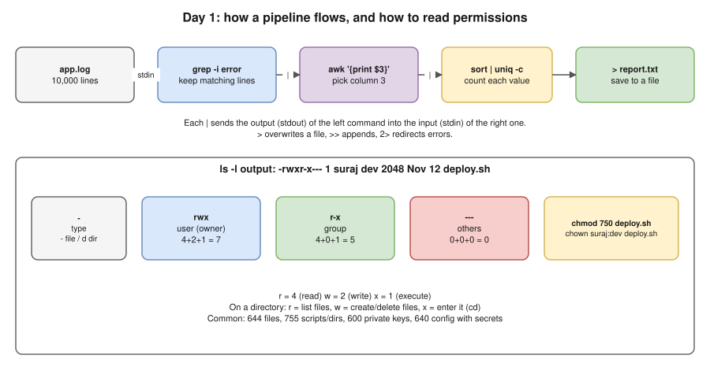

# Day 1 · Thu 12 Nov · Linux text tools I + files/permissions + SQL basics



**Today's goal:** by 6 PM, write all 15 commands and 10 queries in the drill at the end **from memory**. These are exactly the questions you missed on 11 Nov.

| Time | What |
|---|---|
| 9:00–9:30 | Setup (below) and the 5-question warm-up |
| 9:30–12:30 | Part A: grep, find, sed, pipes and redirects. Read a section, then type every command |
| 13:30–16:00 | Part B: files, permissions, users |
| 16:00–17:00 | Part C: SQL basics in sqlite3 |
| 17:00–17:30 | Send "Day 1 quiz" in the thread |
| 17:30–18:00 | Write your own-words summary and add misses to `misses.md` |

---

## Setup (15 min)

You're on a Mac. Some commands (`sed -i`, `find -mtime`, `touch -d`) behave differently on macOS than on Linux, and interviews assume **Linux**. So practise inside an Ubuntu container:

```bash
mkdir -p ~/practice && cd ~/practice
# copy labs/make-logs.sh and labs/day01.sql from this repo folder into ~/practice, then:
docker run -it --rm -v "$PWD":/work -w /work ubuntu:24.04 bash
# inside the container:
apt-get update -qq && apt-get install -y -qq sqlite3 less vim >/dev/null
bash make-logs.sh          # creates ./lab with app.log (600 lines), access.log (1000 lines), configs/, old/
cd lab
```

**Warm-up (no notes, 5 minutes).** Write down what you think each one does, then run it:
`wc -l app.log` · `head -5 app.log` · `tail -3 access.log` · `less app.log` (press `q` to quit, `/ERROR` to search) · `ls -la`

---

## Part A: grep, find, sed, pipes (3 hours)

### A1. grep: find lines that match a pattern

**What it is:** grep reads a file line by line and prints only the lines that match a pattern. That's all. Every flag below changes *what counts as a match* or *what gets printed*.

| Command | Meaning |
|---|---|
| `grep ERROR app.log` | Lines containing `ERROR` (case-sensitive) |
| `grep -i error app.log` | **-i** ignores case: error, Error, ERROR |
| `grep -c ERROR app.log` | **-c** counts matching lines instead of printing them |
| `grep -n ERROR app.log` | **-n** shows line numbers |
| `grep -v DEBUG app.log` | **-v** inverts: lines **not** matching |
| `grep -E 'ERROR\|WARN' app.log` | **-E** extended regex, so `\|` means OR. **This is the 11 Nov question** |
| `grep -w INFO app.log` | **-w** whole word only (won't match `INFORMATION`) |
| `grep -o 'user=[a-z]*' app.log` | **-o** prints only the matched part |
| `grep -r "db.url" configs/` | **-r** searches every file in a folder |
| `grep -l ERROR *.log` | **-l** lists only file names that contain a match |
| `grep -A2 -B1 OutOfMemory app.log` | 2 lines **A**fter and 1 line **B**efore each match (context) |

**Why `grep 'error|info'` failed on 11 Nov:** plain grep uses *basic* regex, where `|` is an ordinary character. It looked for the literal text `error|info`, which never appears. Fix: `grep -E 'error|info'`, or `grep 'error\|info'` in basic regex. Also `cat file | grep` works, but `grep pattern file` is the normal form. Interviewers notice the extra `cat`.

**Regex you need (only these):**

| Pattern | Matches |
|---|---|
| `^ERROR` | line **starts** with ERROR |
| `failed$` | line **ends** with failed |
| `.` | any one character |
| `.*` | anything (zero or more characters) |
| `[0-9]` / `[a-z]` | one digit / one lowercase letter |
| `[0-9]+` | one or more digits (needs `-E`) |
| `\.` | a literal dot |

**Type these (tested on the lab files):**
```bash
grep -c ERROR app.log                         # how many error lines?
grep -Ei 'error|warn' app.log | wc -l         # errors + warnings
grep -v -e INFO -e DEBUG app.log | head       # everything except INFO and DEBUG
grep -n "OutOfMemoryError" app.log            # where did OOM happen?
grep "user=suraj" app.log | grep ERROR        # errors for one user (two greps = AND)
grep -o 'user=[a-z]*' app.log | sort | uniq -c | sort -rn   # lines per user
grep -E '" (500|502|503) ' access.log | wc -l # 5xx responses
grep "^2026-11-12 1[0-1]:" app.log | grep -c ERROR          # errors between 10:00 and 11:59
```

**Explain it out loud:** "What is the difference between `grep -c` and `grep | wc -l`?" (Same number here. `-c` is one command, and on many files it gives a count per file.)

### A2. Pipes and redirects

**What it is:** every command has three streams: **stdin** (0, input), **stdout** (1, normal output), **stderr** (2, errors). A pipe `|` connects one command's stdout to the next command's stdin. Redirects send a stream to a file.

| Syntax | Meaning |
|---|---|
| `cmd1 \| cmd2` | Output of cmd1 becomes input of cmd2 |
| `cmd > file` | stdout to file (**overwrites**) |
| `cmd >> file` | stdout to file (**appends**) |
| `cmd 2> err.txt` | stderr to a file |
| `cmd > out.txt 2>&1` | stdout and stderr both to out.txt |
| `cmd 2>/dev/null` | throw errors away (e.g. "Permission denied" from find) |
| `cmd < file` | file as stdin |
| `cmd1 && cmd2` | run cmd2 only if cmd1 **succeeded** (exit code 0) |
| `cmd1 \|\| cmd2` | run cmd2 only if cmd1 **failed** |

```bash
grep ERROR app.log > errors.txt               # save errors
grep WARN  app.log >> errors.txt              # add warnings to the same file
wc -l errors.txt
ls /nope 2> err.txt ; cat err.txt             # see stderr captured
grep -q ERROR app.log && echo "errors found" || echo "clean"   # -q = quiet, only exit code
echo $?                                       # exit code of the last command: 0 = success
```

### A3. find: locate files by name, age, size, type

**What it is:** `find <where> <tests> <action>`. It walks a directory tree and applies each test to every file.

| Command | Meaning |
|---|---|
| `find . -name "*.log"` | by name (quote the pattern!) |
| `find . -iname "*.LOG"` | name, ignoring case |
| `find . -type f` / `-type d` | only files / only directories |
| `find old -type f -mtime +60` | **modified more than 60 days ago. The 11 Nov question** |
| `find . -mtime -1` | modified in the **last** day |
| `find . -mmin -30` | modified in the last 30 **minutes** |
| `find / -size +500M 2>/dev/null` | bigger than 500 MB |
| `find . -empty` | empty files/dirs |
| `find old -mtime +60 -delete` | **delete** what matched (run without `-delete` first!) |
| `find old -mtime +60 -exec rm {} \;` | run a command on each match; `{}` = the file |
| `find old -name "*.log" -exec gzip {} \;` | compress old logs |
| `find . -name "*.log" \| xargs grep -l ERROR` | which log files contain ERROR |

- **`+60` vs `-60`:** `+60` means **more** than 60 days old, `-60` means **less** than 60 days old. Remember it as "plus = older".
- **Safety habit to say in interviews:** "I always run find **without** `-delete` first, check the list, then add `-delete`."

```bash
find old -type f                     # see all
find old -type f -mtime +60          # report-70, -90, -120 (tested)
find old -type f -mtime +60 -exec ls -l {} \;
find . -size +10M                    # big-dump.bin (20 MB)
find old -type f -mtime +60 -delete && ls old
```

### A4. sed: edit text as a stream

**What it is:** sed reads text line by line, applies an edit, and prints the result. **By default it does not change the file.** Only `-i` writes back to the file.

| Command | Meaning |
|---|---|
| `sed 's/error/success/' f` | replace the **first** "error" on each line |
| `sed 's/error/success/g' f` | **g** = every match on the line |
| `sed -i 's/error/success/g' f` | **-i** = edit the file in place. **The 11 Nov question** |
| `sed -i.bak 's/a/b/g' f` | in place, keep a backup `f.bak` |
| `sed 's#http://#https://#g' f` | any delimiter works; `#` avoids escaping `/` |
| `sed -n '5,10p' f` | print only lines 5–10 (`-n` = don't print everything) |
| `sed -n '/ERROR/p' f` | print matching lines (like grep) |
| `sed '/^#/d' f` | **d**elete comment lines |
| `sed '/^$/d' f` | delete blank lines |
| `sed -i '/^log.level/s/DEBUG/INFO/' f` | change only on lines starting with `log.level` |
| `sed -n '/10:00:/,/10:15:/p' app.log` | print a time range |

- **macOS warning:** on a Mac, `sed -i` needs an empty backup argument: `sed -i '' 's/a/b/g' f`. That's why you practise in the Ubuntu container.

```bash
cd configs
sed 's#http://#https://#g' app.properties          # preview, file unchanged
cat app.properties                                 # still http
sed -i.bak 's#http://#https://#g' app.properties   # now change it, keep backup
diff app.properties.bak app.properties             # see exactly what changed
sed -i 's/log.level=DEBUG/log.level=INFO/' app.properties
sed -i '/^#/d; /^$/d' app.properties               # remove comments and blank lines (two edits with ;)
cat app.properties
cd ..
```

**Explain it out loud:** "How do you change a value in 50 config files on a server, safely?" Answer: `grep -rl 'old' /etc/app/` to see which files contain it → test `sed` without `-i` on one file → `sed -i.bak` on all of them → `diff` to check → restart the service → keep the `.bak` files until it's verified. In production, also do it under a change request.

---

## Part B: files, permissions, users (2.5 hours)

### B1. Reading `ls -l`

```
-rwxr-x---  1  suraj  dev  2048  Nov 12 09:30  deploy.sh
│└┬┘└┬┘└┬┘  │   │      │    │        │            └ name
│ │  │  │   │   │      │    │        └ last modified time
│ │  │  │   │   │      │    └ size in bytes
│ │  │  │   │   │      └ group owner
│ │  │  │   │   └ user owner
│ │  │  │   └ number of hard links
│ │  │  └ others: --- (nothing)
│ │  └ group: r-x (read + execute)
│ └ user/owner: rwx (read + write + execute)
└ type: - file, d directory, l symlink
```

**Numbers:** r = 4, w = 2, x = 1. Add them up for each of user, group and others. So `rwx r-x ---` = 7 5 0 = `chmod 750`.

| Number | Letters | Typical use |
|---|---|---|
| 644 | rw-r--r-- | normal files, configs without secrets |
| 755 | rwxr-xr-x | scripts, directories |
| 600 | rw------- | SSH private keys (ssh refuses keys with looser permissions) |
| 640 | rw-r----- | config with passwords: owner writes, app group reads |
| 700 | rwx------ | private directory (`~/.ssh`) |

- **On a directory:** `r` = list the names, `w` = create or delete files in it, `x` = enter it (`cd`) and reach files inside. A directory with `r` but no `x` lets you see names but not open the files.
- **Symbolic form:** `chmod u+x script.sh` (add execute for the owner), `chmod g-w file`, `chmod o= file` (remove everything for others), `chmod -R 755 dir/`.

### B2. Owners, users, sudo

```bash
whoami ; id                              # who am I, my groups
useradd -m appuser ; passwd appuser      # create a user with a home directory (inside the container as root)
groupadd dev ; usermod -aG dev appuser   # -aG = APPEND to group (without -a it replaces all groups!)
chown appuser:dev deploy.sh              # change owner and group
chown -R appuser:dev /opt/app            # recursively
su - appuser                             # switch user
sudo systemctl restart nginx             # run one command as root (on a real server)
cat /etc/passwd | tail -3                # user accounts
cat /etc/group  | grep dev
```

### B3. Lab: permission problems (type, break, fix)

```bash
cd /work/lab
echo 'echo "deploying..."' > deploy.sh
./deploy.sh                    # Permission denied: no x bit
ls -l deploy.sh                # -rw-r--r--
chmod u+x deploy.sh && ./deploy.sh
chmod 750 deploy.sh ; ls -l deploy.sh
mkdir secret && echo pass123 > secret/db.txt
chmod 600 secret/db.txt ; chmod 700 secret
ls -ld secret secret/db.txt
useradd -m tester
su - tester -c "cat /work/lab/secret/db.txt"   # Permission denied: correct!
```

**Interview scenario to explain out loud:** "The app can't write to its log file after a deployment." Check `ls -l` on the file **and** the directory, then `ps -o user= -p <pid>` to see which user the app runs as. Fix ownership with `chown` (or permissions with `chmod`), not `chmod 777`. **Never say 777 in an interview.** It's an instant red flag.

---

## Part C: SQL basics (1 hour, in sqlite3)

```bash
cd /work
sqlite3 day01.db < day01.sql
sqlite3 day01.db
.headers on
.mode column
.tables
```

### C1. The SQL command families (the 11 Nov question)

| Family | Full form | Commands | Memory hook |
|---|---|---|---|
| **DDL** | Data **Definition** Language | CREATE, ALTER, DROP, TRUNCATE, RENAME | Defines the **structure** |
| **DML** | Data **Manipulation** Language | INSERT, UPDATE, DELETE, MERGE | Changes the **rows** |
| **DQL** | Data **Query** Language | SELECT | **Reads** rows |
| **DCL** | Data **Control** Language | GRANT, REVOKE | **Who** may access |
| **TCL** | Transaction **Control** Language | COMMIT, ROLLBACK, SAVEPOINT | **Save or undo** changes |

### C2. SELECT, step by step (type each one, then predict the output before you press Enter)

```sql
SELECT * FROM employees;                                   -- every column, every row
SELECT name, salary FROM employees;                        -- chosen columns
SELECT name, salary FROM employees WHERE city = 'Pune';    -- filter rows
SELECT name, salary FROM employees WHERE city = 'Pune' ORDER BY salary DESC;   -- Asha, Kiran, Meera, Amit
SELECT name FROM employees WHERE salary > 70000 AND city = 'Pune';
SELECT name FROM employees WHERE city IN ('Pune', 'Mumbai');
SELECT * FROM employees WHERE salary BETWEEN 60000 AND 85000;   -- inclusive on both ends
SELECT name FROM employees WHERE name LIKE 'A%';           -- starts with A: Asha, Amit (% = anything, _ = one char)
SELECT name FROM employees WHERE email IS NULL;            -- Kiran
SELECT name, salary FROM employees ORDER BY salary DESC LIMIT 3;   -- top 3 earners
SELECT DISTINCT city FROM employees;                       -- unique values
SELECT COUNT(*), COUNT(email) FROM employees;              -- 7, 6: COUNT(col) skips NULLs
```

**The NULL trap (interviewers love this one):**
```sql
SELECT * FROM transactions WHERE amount = NULL;    -- returns NOTHING: NULL is never "equal" to anything
SELECT * FROM transactions WHERE amount IS NULL;   -- txn 1007
```

**Order the clauses are written in:** `SELECT … FROM … WHERE … GROUP BY … HAVING … ORDER BY … LIMIT`. (Tomorrow: GROUP BY/HAVING.)

### C3. INSERT, UPDATE, DELETE, safely

```sql
-- INSERT: always name the columns
INSERT INTO employees (id, name, email, dept_id, salary, city, joined_on)
VALUES (8, 'Suraj', 'suraj@corp.com', 10, 90000, 'Pune', '2026-11-12');

-- UPDATE: the WHERE decides which rows. Run the same WHERE as a SELECT first!
SELECT * FROM employees WHERE dept_id = 10;               -- check: which rows will change?
BEGIN;                                                    -- start a transaction
UPDATE employees SET salary = salary * 1.10 WHERE dept_id = 10;
SELECT name, salary FROM employees WHERE dept_id = 10;    -- looks right?
ROLLBACK;                                                 -- undo (or COMMIT; to keep)

-- DELETE: without WHERE it deletes EVERY row
SELECT * FROM employees WHERE id = 8;
DELETE FROM employees WHERE id = 8;
```

**DELETE vs TRUNCATE vs DROP:**

| | DELETE | TRUNCATE | DROP |
|---|---|---|---|
| Family | DML | DDL | DDL |
| Removes | rows you choose (WHERE) | all rows | the whole table (structure too) |
| Rollback | yes, inside a transaction | usually no (DB-dependent) | no |
| Speed | slow on big tables (row by row, logged) | fast | fast |

**Say it in the interview:** "In production, before any UPDATE or DELETE I run a SELECT with the same WHERE to see exactly which rows change, do it inside a transaction, check the row count, and only then COMMIT. And it goes through a change request."

---

## Drill: answer from memory at 5 PM (answers hidden)

Write each answer first, then open it. Add every miss to `misses.md`.

<details><summary>1. Count lines containing ERROR in app.log.</summary>

`grep -c ERROR app.log`
</details>
<details><summary>2. Lines containing error OR info, any case.</summary>

`grep -Ei 'error|info' app.log`
</details>
<details><summary>3. All lines except DEBUG lines.</summary>

`grep -v DEBUG app.log`
</details>
<details><summary>4. Show 2 lines after every OutOfMemoryError.</summary>

`grep -A2 OutOfMemoryError app.log`
</details>
<details><summary>5. Which files under configs/ contain "db.url"?</summary>

`grep -rl "db.url" configs/`
</details>
<details><summary>6. Replace every "error" with "success" in app.log, in place, keeping a backup.</summary>

`sed -i.bak 's/error/success/g' app.log`
</details>
<details><summary>7. Print only lines 20–30 of a file.</summary>

`sed -n '20,30p' app.log` (or `head -30 app.log | tail -11`)
</details>
<details><summary>8. Delete blank lines and comment lines from a config file.</summary>

`sed -i '/^$/d; /^#/d' app.properties`
</details>
<details><summary>9. Find files in /var/log/app older than 60 days.</summary>

`find /var/log/app -type f -mtime +60`
</details>
<details><summary>10. Same, and delete them. What do you do first?</summary>

First run it without `-delete` and check the list. Then: `find /var/log/app -type f -mtime +60 -delete`
</details>
<details><summary>11. Find files bigger than 100 MB under /, hiding permission errors.</summary>

`find / -type f -size +100M 2>/dev/null`
</details>
<details><summary>12. Save all ERROR lines to errors.txt, then append WARN lines.</summary>

`grep ERROR app.log > errors.txt` then `grep WARN app.log >> errors.txt`
</details>
<details><summary>13. Make deploy.sh executable by the owner only, readable by group, nothing for others (number form).</summary>

`chmod 740 deploy.sh` (rwx r-- ---). For rwx r-x --- it's 750.
</details>
<details><summary>14. What do 644, 755 and 600 mean, and where is each used?</summary>

644 = rw-r--r-- (normal files), 755 = rwxr-xr-x (scripts, directories), 600 = rw------- (SSH private keys, secrets)
</details>
<details><summary>15. Add user appuser to group dev without removing their other groups.</summary>

`usermod -aG dev appuser` (`-a` = append; without it the user's other groups are replaced)
</details>

**SQL**

<details><summary>16. Name the 5 SQL command families with 2 commands each.</summary>

DDL (CREATE, ALTER), DML (INSERT, UPDATE), DQL (SELECT), DCL (GRANT, REVOKE), TCL (COMMIT, ROLLBACK)
</details>
<details><summary>17. Employees in Pune, highest salary first.</summary>

`SELECT name, salary FROM employees WHERE city = 'Pune' ORDER BY salary DESC;`
</details>
<details><summary>18. Employees with no email.</summary>

`SELECT name FROM employees WHERE email IS NULL;` (never `= NULL`)
</details>
<details><summary>19. Insert a new employee.</summary>

`INSERT INTO employees (id, name, dept_id, salary) VALUES (9, 'Priya', 20, 72000);`
</details>
<details><summary>20. Give department 10 a 10% raise, safely.</summary>

`SELECT * FROM employees WHERE dept_id = 10;` → `BEGIN;` → `UPDATE employees SET salary = salary * 1.10 WHERE dept_id = 10;` → check → `COMMIT;` (or `ROLLBACK;`)
</details>
<details><summary>21. Delete the employee with id 7.</summary>

`DELETE FROM employees WHERE id = 7;`
</details>
<details><summary>22. DELETE vs TRUNCATE vs DROP in one line each.</summary>

DELETE removes chosen rows (DML, can roll back). TRUNCATE removes all rows fast, keeping the table (DDL). DROP removes the table itself (DDL).
</details>
<details><summary>23. Top 3 earners.</summary>

`SELECT name, salary FROM employees ORDER BY salary DESC LIMIT 3;` (Oracle/SQL Server: `FETCH FIRST 3 ROWS ONLY` / `TOP 3`)
</details>
<details><summary>24. Why does COUNT(*) give 7 but COUNT(email) give 6?</summary>

`COUNT(column)` skips NULLs, and Kiran's email is NULL.
</details>
<details><summary>25. Names starting with "A".</summary>

`SELECT name FROM employees WHERE name LIKE 'A%';`
</details>

---

## Own-words summary (write this at 5:30 PM, not before)

Answer in 5–10 lines, in your notebook:
1. What is the difference between basic and extended regex in grep, and why did my 11 Nov answer fail?
2. What does `-i` do in sed, and what's the safe way to use it?
3. `find -mtime +60` vs `-mtime -60`?
4. How do I turn `rwxr-x---` into a number?
5. Why must I never write `= NULL`?
6. What do I always do before an UPDATE or DELETE in production?

**Tomorrow (Day 2):** awk, sort, uniq, cut, xargs, a log analysis lab, and SQL GROUP BY/HAVING. Day 1's drill comes back at 9 AM.
