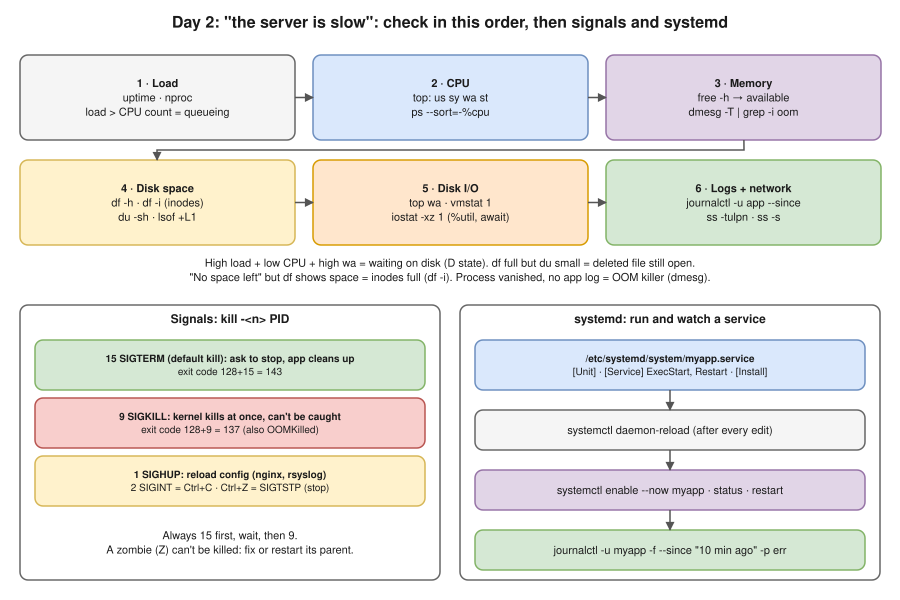

# Day 2 · Wed 18 Nov · Linux II: processes, services, resources, log analysis + SQL GROUP BY



**Today's goal:** by 6 PM you can (1) talk through "the server is slow" in the order above, without notes, in under 3 minutes, and (2) type the top-IPs, status-code and errors-per-hour one-liners from a blank screen. These two come up in almost every SRE and app-support interview.

| Time | What |
|---|---|
| 9:00–9:30 | Recall test: the Day 1 drill + yesterday's misses from `misses.md`, answers hidden |
| 9:30–12:30 | Part A: processes, signals, background jobs, systemd, journalctl, cron, logrotate |
| 13:30–16:00 | Part B: load, CPU, memory, disk, I/O, then log analysis (awk, sort, uniq, cut, xargs) and the break/fix lab |
| 16:00–16:45 | Part C: SQL aggregates, GROUP BY, HAVING |
| 16:45–17:00 | Review: re-test Day 1's 5 hardest drill questions |
| 17:00–17:30 | Send "Day 2 quiz" in the thread |
| 17:30–18:00 | Own-words summary, add misses to `misses.md`, **record one 60-second answer to "the server is slow"** and count the fillers |

---

## Setup (15 min)

You're on **Ubuntu**, and Ubuntu runs **systemd**, so every lab today runs for real on your own machine. No Docker, no VM.

```bash
sudo apt-get update && sudo apt-get install -y sysstat lsof psmisc   # iostat/pidstat, lsof, pstree/killall (ps, top, free, vmstat are already installed)
cd ~/practice
ls lab || bash make-logs.sh      # recreate the Day 1 lab files if they're gone
cd lab
```

**Safety rules for your own machine (read them once):**
- The practice service is called **`lab-myapp`**. Never practise on a real service name (`nginx`, `ssh`, `docker`, `NetworkManager`): stopping one of those can cut your network or your terminal.
- Commands that touch `/etc`, `/usr/local/bin`, systemd, the kernel log or other users need **`sudo`**. Everything in `~/practice` doesn't.
- Each lab that changes the system ends with a **clean-up** block. Run it. The end-of-day checklist is after B8.5.
- Want zero risk? The same labs work in the **Killercoda Ubuntu playground** (killercoda.com → Playgrounds → Ubuntu: free, in the browser, you're root). Sessions last about an hour, then you re-run `make-logs.sh`.

**Warm-up (no notes, 5 minutes).** Predict what each prints, then run it: `uptime` · `nproc` · `free -h` · `df -h /` · `ps -p 1 -o pid,comm`

---

## Part A: processes and services (3 hours)

### A1. Processes: what's running, and who started it

**What it is:** a process is a running program. Each has a **PID** (process ID), a **PPID** (its parent's PID), an owner (user), and a state. PID 1 is the first process the kernel starts (`systemd` on a normal server); every other process descends from it.

| Command | What it shows |
|---|---|
| `ps aux` | Every process, BSD style: USER, PID, %CPU, %MEM, VSZ, RSS, STAT, START, COMMAND |
| `ps -ef` | Every process, System V style: UID, PID, **PPID**, start time, CMD. Use it when you need the parent |
| `ps -eo pid,ppid,user,%cpu,%mem,stat,cmd --sort=-%cpu \| head` | Your own columns, sorted by CPU (`--sort=-%mem` for memory) |
| `pgrep -a nginx` | PIDs and command lines of processes named nginx |
| `pstree -p` | The parent/child tree with PIDs (package `psmisc`) |
| `top` | Live view. Keys: `P` sort by CPU, `M` by memory, `1` show each CPU, `k` kill, `q` quit |
| `htop` | Friendlier `top` (install it separately); same ideas |

**Process states (the STAT column):**

| State | Meaning | Interview point |
|---|---|---|
| `R` | Running or ready to run | Many R processes = CPU is the bottleneck |
| `S` | Sleeping, waiting for an event (most processes) | Normal |
| `D` | Uninterruptible sleep, usually waiting on disk or NFS | Can't be killed, even with `-9`, until the I/O returns. **Counts in the load average** |
| `Z` | Zombie: finished, but the parent hasn't read its exit status | Uses no CPU or memory, only a PID slot. You can't kill it; fix or restart the parent |
| `T` | Stopped (Ctrl+Z or SIGSTOP) | Resume with `fg`, `bg` or SIGCONT |

Extra letters you'll see: `s` session leader, `l` multi-threaded, `+` in the foreground group, `<` high priority, `N` low priority.

**Lab A1 (tested):**

```bash
sleep 300 &                                   # start a background process
ps -eo pid,ppid,user,%cpu,%mem,stat,cmd --sort=-%cpu | head -5
pgrep -a sleep                                # e.g. 1619 sleep 300
ps -ef | grep [s]leep                         # the [s] trick hides the grep line itself
pstree -p | head                              # where does your sleep sit in the tree?
```

**Lab A1b: make a zombie (tested).** The inner `sleep 1` exits, but its parent has turned into `sleep 6` (with `exec`) and never collects the exit status:

```bash
bash -c 'sleep 1 & exec sleep 6' &
sleep 2
ps -eo pid,ppid,stat,cmd | awk '$3 ~ /Z/'
#  1630  1628 Z    [sleep] <defunct>          (tested)
```

After 6 seconds the parent exits, PID 1 adopts the zombie and reaps it, and it disappears. That's why the fix for zombies is always "fix or restart the parent".

### A2. Signals: how you ask (or force) a process to stop

**What it is:** a signal is a small message the kernel delivers to a process. `kill` sends signals; despite the name, it doesn't always kill.

| Signal | Number | What happens | Typical use |
|---|---|---|---|
| **SIGTERM** | 15 | "Please stop." The app can catch it, finish in-flight work, close files, then exit | `kill PID` (the default), `systemctl stop`, Kubernetes pod deletion |
| **SIGKILL** | 9 | The kernel ends it immediately. Can't be caught or ignored; no cleanup | Last resort after SIGTERM didn't work |
| **SIGHUP** | 1 | "Hang up." Many daemons treat it as **reload config** | `kill -HUP $(pgrep -o nginx)`, or `systemctl reload nginx` |
| **SIGINT** | 2 | Interrupt; what Ctrl+C sends | Stopping a foreground command |
| **SIGTSTP** | 20 | Stop from the terminal; what Ctrl+Z sends | Pausing a foreground job |
| SIGSTOP / SIGCONT | 19 / 18 | Pause / resume (SIGSTOP can't be caught) | Debugging |

(Numbers are for Linux on x86 and ARM; `kill -l` lists them on your machine.)

```bash
kill PID            # SIGTERM (15)
kill -15 PID        # same thing, written out
kill -9 PID         # SIGKILL
kill -HUP PID       # reload
pkill -f "python app.py"   # by command line
killall nginx              # by name (package psmisc)
kill -l                    # list all signals
```

**Exit codes after a signal = 128 + the signal number (tested):**

```bash
sleep 300 & SP=$!; kill $SP;    wait $SP; echo $?    # 143 = 128 + 15 (SIGTERM)
sleep 300 & SP=$!; kill -9 $SP; wait $SP; echo $?    # 137 = 128 + 9  (SIGKILL)
```

**Interview links:**
- "Why not always `kill -9`?" → the app gets no chance to flush buffers, finish requests, release locks or remove PID files. You can corrupt data. Send 15, wait 10–30 seconds, then 9.
- Kubernetes uses the same sequence: SIGTERM, wait `terminationGracePeriodSeconds` (30 s default), then SIGKILL. **Exit code 137 in a pod = SIGKILL**, usually `OOMKilled`. Exit code 143 = it stopped on SIGTERM.

### A3. Foreground, background, nohup

| Command | What it does |
|---|---|
| `cmd &` | Run in the background; the shell prints the job number and PID. `$!` holds that PID |
| `jobs` | List background jobs of this shell |
| `fg %1` | Bring job 1 to the foreground |
| Ctrl+Z, then `bg` | Pause the foreground job, then continue it in the background |
| `nohup cmd > out.log 2>&1 &` | Keep running after you log out (ignores SIGHUP). Output goes to `out.log` |
| `disown %1` | Detach a running job from the shell so logout doesn't kill it |

```bash
sleep 100 &
jobs                     # [1]+  Running   sleep 100 &      (tested)
kill %1                  # kill by job number
nohup bash -c 'while true; do date; sleep 5; done' > ticker.log 2>&1 &
tail -f ticker.log       # Ctrl+C stops tail, not the ticker
pkill -f "date; sleep 5" # clean up
```

For anything that must survive reboots and restart on crash, **don't use nohup: use a systemd service** (next section). Say exactly that in an interview.

### A4. systemd: run a program as a service (on your machine, with `sudo`)

**What it is:** systemd is PID 1 on modern Linux. It starts services at boot, restarts them when they crash, and collects their logs in the **journal**. A service is described by a **unit file**.

| Command | What it does |
|---|---|
| `systemctl status nginx` | State (active/failed), main PID, memory, the last 10 log lines |
| `systemctl start / stop / restart nginx` | Now, this boot only |
| `systemctl reload nginx` | Re-read config without dropping connections (if the service supports it) |
| `systemctl enable nginx` | Start at boot (creates a symlink); `enable --now` = enable + start |
| `systemctl disable nginx` | Don't start at boot |
| `systemctl is-active nginx` · `is-enabled nginx` | One-word answers, handy in scripts |
| `systemctl list-units --type=service --state=failed` | Everything that failed |
| `systemctl cat nginx` | Show the unit file in use |
| `systemctl daemon-reload` | Re-read unit files. **Run it after every unit-file edit**, or systemd keeps using the old one |

**A unit file** (`/etc/systemd/system/myapp.service`):

```ini
[Unit]
Description=My demo app
After=network.target            # start after networking is up

[Service]
ExecStart=/usr/local/bin/myapp.sh
Restart=on-failure              # restart if it crashes or is killed by a signal
RestartSec=3                    # wait 3 s between restarts
User=root                       # use a dedicated user on real servers

[Install]
WantedBy=multi-user.target      # what "enable" hooks it into (normal boot)
```

**Lab A4 (your Ubuntu machine; output illustrative). Service name: `lab-myapp`.**

```bash
sudo tee /usr/local/bin/lab-myapp.sh > /dev/null <<'EOF'
#!/usr/bin/env bash
while true; do echo "lab-myapp alive at $(date +%T)"; sleep 5; done
EOF
sudo chmod +x /usr/local/bin/lab-myapp.sh

sudo tee /etc/systemd/system/lab-myapp.service > /dev/null <<'EOF'
[Unit]
Description=Practice service for Day 2 (safe to delete)
After=network.target

[Service]
ExecStart=/usr/local/bin/lab-myapp.sh
Restart=on-failure
RestartSec=3
User=nobody

[Install]
WantedBy=multi-user.target
EOF

sudo systemctl daemon-reload
sudo systemctl enable --now lab-myapp
systemctl status lab-myapp                    # active (running), Main PID: 1234
journalctl -u lab-myapp -f                    # Ctrl+C to stop following (add sudo if it shows nothing)

# crash it and watch systemd bring it back
sudo kill -9 $(systemctl show -p MainPID --value lab-myapp)
sleep 4; systemctl status lab-myapp           # new Main PID; the log shows "Scheduled restart job"

# break it on purpose: point ExecStart at a missing file
sudo sed -i 's#/usr/local/bin/lab-myapp.sh#/usr/local/bin/nope.sh#' /etc/systemd/system/lab-myapp.service
sudo systemctl daemon-reload && sudo systemctl restart lab-myapp
systemctl status lab-myapp                    # failed / activating (auto-restart); status=203/EXEC
journalctl -u lab-myapp -n 20 --no-pager      # read the real reason
# fix it back: the same sed with the two paths swapped, then daemon-reload and restart
```

`sudo tee file > /dev/null <<'EOF'` is how you write a root-owned file: `sudo cat > /etc/...` fails, because the `>` redirect runs as you, not as root. `User=nobody` makes the practice service run without any privileges.

**Clean up `lab-myapp` (when Lab A4 and B8.5 are done):**

```bash
sudo systemctl disable --now lab-myapp
sudo rm /etc/systemd/system/lab-myapp.service /usr/local/bin/lab-myapp.sh
sudo systemctl daemon-reload
sudo systemctl reset-failed lab-myapp 2>/dev/null   # clears it from the "failed" list
systemctl status lab-myapp                          # "Unit lab-myapp.service could not be found." = clean
```

**Interview scenario:** "A service won't start after a deploy." → `systemctl status app` (exit code, the last log lines) → `journalctl -u app -n 100 --no-pager` → check the binary path, permissions (`ls -l`), the user it runs as, the config file, and the port (`ss -tulpn | grep 8080` for "address already in use"). After a unit-file change: `daemon-reload`.

### A5. journalctl: read service and system logs

| Command | What it shows |
|---|---|
| `journalctl -u nginx` | Logs of one unit |
| `journalctl -u nginx -f` | Follow live (like `tail -f`) |
| `journalctl -u nginx --since "10 min ago"` | Time window. Also `--since today`, `--since "2026-11-18 09:00" --until "2026-11-18 10:00"` |
| `journalctl -p err -b` | Priority error and worse, **this boot** only |
| `journalctl -n 50 --no-pager` | Last 50 lines, printed straight (good for scripts and copy-paste) |
| `journalctl -k` | Kernel messages (same source as `dmesg`): OOM kills, disk errors |
| `journalctl --disk-usage` · `journalctl --vacuum-time=7d` | Journal size; delete entries older than 7 days |

Plain log files still exist: on Ubuntu/Debian `/var/log/syslog` and `/var/log/auth.log` (logins, sudo); on RHEL/Amazon Linux `/var/log/messages` and `/var/log/secure`. Apps often write their own under `/var/log/<app>/`.

### A6. cron: run something on a schedule

```
┌──────── minute (0–59)
│ ┌────── hour (0–23)
│ │ ┌──── day of month (1–31)
│ │ │ ┌── month (1–12)
│ │ │ │ ┌ day of week (0–7, 0 and 7 = Sunday)
│ │ │ │ │
* * * * *  command
```

| Schedule | Meaning |
|---|---|
| `*/5 * * * *` | Every 5 minutes |
| `0 2 * * *` | Every day at 02:00 |
| `30 1 * * 0` | Sundays at 01:30 |
| `0 9-18 * * 1-5` | Every hour from 9 to 18, Monday to Friday |
| `0 0 1 * *` | Midnight on the 1st of every month |

```bash
crontab -e          # edit your crontab (the first time it asks for an editor: pick nano)
crontab -l          # list it
# a real entry: full paths, and log both outputs
0 2 * * * /usr/local/bin/backup.sh >> /var/log/backup.log 2>&1
```

**Lab A6 (your machine, 5 minutes).** Add this line with `crontab -e`, save, wait 2 minutes:

```
* * * * * date >> /tmp/lab-cron.log 2>&1
```

```bash
cat /tmp/lab-cron.log                   # one line per minute
grep CRON /var/log/syslog | tail -3     # cron's own log (add sudo if it's empty)
```

**Clean up:** `crontab -e`, delete that line, save; `rm /tmp/lab-cron.log`; check with `crontab -l`.

**The 3 classic "my cron job doesn't run" causes:**
1. **PATH:** cron runs with a tiny PATH (`/usr/bin:/bin`), so `aws`, `kubectl` or `python3` in `/usr/local/bin` aren't found. Use full paths, or set `PATH=` at the top of the crontab.
2. **No output captured:** the error went nowhere. Always add `>> file 2>&1`.
3. **Permissions / environment:** the script isn't executable, or it relies on variables from your login shell.

Where cron logs: `grep CRON /var/log/syslog` (Ubuntu), `/var/log/cron` (RHEL). System-wide jobs live in `/etc/crontab` and `/etc/cron.d/` (these have an extra **user** field). Modern alternative: **systemd timers** (`systemctl list-timers`).

### A7. logrotate: stop logs from filling the disk

`/etc/logrotate.d/myapp`:

```
/var/log/myapp/*.log {
    daily               # rotate every day
    rotate 7            # keep 7 old files
    compress            # gzip old files
    delaycompress       # but keep yesterday's uncompressed
    missingok           # no error if the log is missing
    notifempty          # skip empty logs
    copytruncate        # copy then truncate in place: the app keeps writing to the same file
}
```

- **`copytruncate` vs `create` + `postrotate`:** with `copytruncate` the app needs no signal, but a few lines can be lost between copy and truncate. The alternative is `create` plus a `postrotate` script that sends SIGHUP (or `systemctl reload app`) so the app reopens its log file.
- `logrotate -d /etc/logrotate.d/myapp` = dry run (debug, changes nothing). `logrotate -f` = force a rotation now.
- **Safe practice on your machine:** don't edit files in `/etc/logrotate.d/`. Read a real one (`cat /etc/logrotate.d/rsyslog`) and dry-run it with `sudo logrotate -d /etc/logrotate.d/rsyslog`. To try your own config, save it as `~/practice/lab-rotate.conf` pointing at `~/practice/lab/*.log`, then run `logrotate -d -s ~/practice/lab-rotate.state ~/practice/lab-rotate.conf` (`-s` keeps the state file in your folder, so no sudo is needed).
- It runs daily from cron or a systemd timer (`logrotate.timer`).

**Link to Part B:** if you delete a log file instead of rotating it while the app still has it open, the disk space isn't freed. That's lab B8.4.

---

## Part B: resources and log analysis (2.5 hours)

Follow the diagram's order. Interviewers care less about any single command than about you checking **in a sensible order** and saying **what each number means**.

### B1. Load average

```bash
uptime      # 05:11:29 up 4 min, 0 user, load average: 0.01, 0.02, 0.00   (tested)
nproc       # 4
```

- The 3 numbers are the average count of processes **running or waiting** over the last **1, 5 and 15 minutes**.
- Compare with the CPU count: load 4 on 4 CPUs = fully busy; load 12 on 4 CPUs = things are queueing.
- 1-minute number much higher than the 15-minute = a spike that just started; the reverse = it's calming down.
- **Linux counts `D`-state processes (waiting on disk) in the load.** So "high load but CPU mostly idle" points at **disk or NFS I/O**, not CPU.

### B2. CPU: `top` header and `vmstat`

The `%Cpu(s)` line in `top`:

| Field | Meaning | If high |
|---|---|---|
| `us` | User space: your application code | App is busy or stuck in a loop; find it with `ps --sort=-%cpu` |
| `sy` | Kernel work (system calls, networking) | Lots of small I/O or context switches |
| `ni` | Low-priority (niced) processes | Usually batch jobs, fine |
| `id` | Idle | |
| `wa` | Waiting for disk I/O | Disk is the bottleneck; go to B5 |
| `hi` / `si` | Hardware / software interrupts | Very high network packet rates |
| `st` | **Steal**: time the hypervisor gave to other VMs | On AWS: noisy neighbour, or a T-series instance that ran out of CPU credits |

```bash
vmstat 1 5      # one line per second, 5 times
#  r  b   swpd   free   buff  cache   si   so    bi    bo   in   cs us sy id wa st   (tested)
```
- `r` = processes waiting for CPU (more than the CPU count = CPU saturation).
- `b` = processes blocked on I/O.
- `si`/`so` = swap in/out per second. **Any steady `so` = the box is short of memory.**
- `us sy id wa st` = same as `top`.

### B3. Memory

```bash
free -h
#                total        used        free      shared  buff/cache   available   (tested)
# Mem:            15Gi       497Mi        15Gi        12Mi       365Mi        15Gi
ps -eo pid,user,%mem,rss,cmd --sort=-%mem | head     # who uses it (RSS in KB)
```

- **Read `available`, not `free`.** Linux uses spare RAM as disk cache (`buff/cache`) and gives it back when apps need it. "free is only 200 MB" is normal; "available is 200 MB" is a problem.
- **Swap in use and growing** (`vmstat` `so` > 0) = real memory pressure, and everything slows down.
- **OOM killer:** when RAM and swap run out, the kernel kills the process with the highest "badness" score (usually the biggest). The app simply disappears, with nothing in its own log. Prove it:

```bash
sudo dmesg -T | grep -i -E "out of memory|killed process"   # Ubuntu needs sudo for dmesg
sudo journalctl -k | grep -i oom
# Out of memory: Killed process 2314 (java) total-vm:8123456kB, anon-rss:3900000kB ...   (illustrative)
```

Fixes: find the leak or the heavy process, set sensible limits (JVM `-Xmx`, container memory limits), add RAM, or add swap as a short-term cushion. In Kubernetes the same event shows as `OOMKilled`, exit code 137.

### B4. Disk space and inodes

| Command | What it answers |
|---|---|
| `df -h` | How full is each filesystem (size, used, available, use%) |
| `df -i` | How many **inodes** (file slots) are used. 100% inodes = "No space left on device" even with free GB |
| `du -sh /var/log` | Size of one folder |
| `du -xh --max-depth=1 / 2>/dev/null \| sort -h` | Biggest top-level folders on this filesystem (`-x` stays on one filesystem) |
| `find / -xdev -type f -size +500M 2>/dev/null` | Big files |
| `lsof +L1` | Files that are **deleted but still open** (link count 0): space not freed yet |

- **Inodes full:** usually millions of tiny files (PHP sessions, mail queue, cache). Find the folder with `find /var -xdev -type f | cut -d/ -f2,3 | sort | uniq -c | sort -rn | head`, then clean it.
- **`df` says full but `du` adds up to much less:** a deleted file is still held open by a process. Fix: restart (or reload) that process, or empty the file through `/proc`: `: > /proc/<PID>/fd/<FD>`. Lab B8.4 shows this.

### B5. Disk I/O

```bash
iostat -xz 1        # package sysstat; extended stats every second, skip idle devices
```
- `%util` near 100% = the device is always busy.
- `await` (`r_await` / `w_await`) = average ms per request. A few ms is fine for SSD; tens or hundreds = slow disk or a throttled EBS volume.
- `r/s`, `w/s` = requests per second.
- Who is doing the I/O: `iotop` (separate package) or `pidstat -d 1` (sysstat).
- **AWS link:** gp2 volumes run on burst credits and gp3 has fixed IOPS/throughput. When a volume hits its limit, `await` jumps; check the CloudWatch EBS metrics (`VolumeQueueLength`, burst balance).

### B6. Network (quick; full on Day 3)

```bash
ss -tulpn                                # listening TCP/UDP ports and which process owns them
ss -s                                    # summary: how many connections in each state
ss -tan state established | wc -l        # rough count of open connections
ss -tan state time-wait | wc -l          # many TIME-WAIT = lots of short connections
```

### B7. Log analysis one-liners (the part interviewers make you type)

`access.log` fields (Nginx combined format plus request time at the end):

```
10.0.1.15 - - [12/Nov/2026:09:41:03 +0530] "GET /api/payments HTTP/1.1" 502 3120 "-" "curl/8.5" 1.204
$1            $4                            $6   $7          $8        $9  $10              $NF
```

| Task | Command (all tested on the lab file) |
|---|---|
| Top 5 client IPs | `awk '{print $1}' access.log \| sort \| uniq -c \| sort -rn \| head -5` |
| Count of each status code | `awk '{print $9}' access.log \| sort \| uniq -c \| sort -rn` |
| How many 5xx | `awk '$9 >= 500' access.log \| wc -l` |
| Which paths give 5xx | `awk '$9 >= 500 {print $7}' access.log \| sort \| uniq -c \| sort -rn \| head` |
| Requests per hour | `awk '{print substr($4, 14, 2)}' access.log \| sort \| uniq -c` |
| ERROR lines per hour (app.log) | `grep ERROR app.log \| awk '{print substr($2, 1, 2)}' \| sort \| uniq -c` |
| 5 slowest requests | `awk '{print $NF, $7}' access.log \| sort -rn \| head -5` |
| Average response time | `awk '{sum += $NF} END {printf "%.3f\n", sum/NR}' access.log` |
| First field with cut | `cut -d' ' -f1 access.log` |
| Values from key=value config | `cut -d= -f2 configs/app.properties` (a line without `=`, like the comment, is printed whole) |
| Human users from /etc/passwd | `awk -F: '$3 >= 1000 {print $1}' /etc/passwd` |

**How to read them:**
- `awk '{print $1}'` prints field 1; fields are split on spaces by default. `-F:` changes the separator to `:`.
- `awk '$9 >= 500'` is a **condition** with no action, so awk prints the whole matching line.
- `substr($4, 14, 2)`: `$4` is `[12/Nov/2026:09:41:03`, and characters 14–15 are the hour `09`.
- `END { }` runs once after the last line; `NR` is the number of lines read.
- `sort | uniq -c | sort -rn`: group equal lines together, count them, biggest count first (Day 1).

**xargs: turn lines into arguments.** Many commands (`rm`, `ls`, `kill`) don't read stdin; xargs passes each line as an argument:

```bash
find old/ -name "*.log" -mtime +60 | xargs ls -l            # look first
find old/ -name "*.log" -mtime +60 -print0 | xargs -0 rm -v  # -print0/-0: safe with spaces in names
pgrep -f "sleep 300" | xargs kill                            # kill every match
cat hosts.txt | xargs -I{} ping -c1 {}                        # -I{}: put the line where {} is
```

### B8. Break/fix lab (type every step; predict before you press Enter)

**B8.1 CPU hog (tested)**
```bash
yes > /dev/null & yes > /dev/null &
uptime                                      # load climbs over a minute
top                                         # press P: two "yes" at ~100% each
ps -eo pid,%cpu,cmd --sort=-%cpu | head -3
pkill yes                                   # SIGTERM to both
```

**B8.2 Memory pressure (your machine; illustrative)**
```bash
free -h
python3 -c "a = bytearray(500*1024*1024); import time; time.sleep(60)" &
free -h                                     # available drops by about 500 MB
ps -eo pid,%mem,rss,cmd --sort=-%mem | head -3
kill %1
sudo dmesg -T | grep -i -E "out of memory|killed process"   # usually empty; on a real OOM you'd see the kill
```
Don't try to trigger a real OOM on your laptop; it can freeze the desktop. Know what the `dmesg` line looks like (B3).

**B8.3 Disk full (your machine)**
```bash
df -h /                                     # make sure more than 5 GB is free before the next line
fallocate -l 2G /tmp/bigfile                # instantly reserve 2 GB
df -h /                                     # Use% jumps
find / -xdev -type f -size +1G 2>/dev/null  # finds /tmp/bigfile
du -xh --max-depth=1 / 2>/dev/null | sort -h | tail -5
rm /tmp/bigfile; df -h /
```

**B8.4 Deleted but still open (tested)**
```bash
dd if=/dev/zero of=held.bin bs=1M count=50 status=none
tail -f held.bin > /dev/null &              # a process keeps the file open
rm held.bin                                 # name gone...
df -h .                                     # ...but the 50 MB is still used
lsof +L1 | grep held
# tail  1634  root  3r  REG  254,0  52428800  0  680137 /…/lab/held.bin (deleted)   (tested)
ls -l /proc/$!/fd | grep held               # 3 -> /…/held.bin (deleted)
kill %1                                     # close it: now the space is freed
```

**B8.5 Service keeps crashing (your machine):** you did it in Lab A4 with the missing `ExecStart`. Repeat it once from memory without looking, then run the `lab-myapp` clean-up block from A4.

**End-of-day clean-up checklist (your machine):**

```bash
systemctl status lab-myapp                       # must say "could not be found"; if not, run the A4 clean-up
crontab -l                                       # the lab-cron line must be gone
ls /tmp/bigfile /tmp/lab-cron.log 2>/dev/null    # nothing printed = clean
pgrep -a yes ; pgrep -af "sleep 300"             # nothing printed = no leftover processes
```

---

## Part C: SQL aggregates, GROUP BY, HAVING (45 min, in sqlite3)

Use the Day 1 database (`sqlite3 day01.db < day01.sql`, then `sqlite3 day01.db`, `.headers on`, `.mode column`). Every result below is tested against `labs/day01.sql`.

### C1. Aggregate functions

```sql
SELECT COUNT(*), COUNT(email), COUNT(DISTINCT city) FROM employees;
-- 7 | 6 | 3            COUNT(email) skips Kiran's NULL email
SELECT SUM(salary), AVG(salary), MIN(salary), MAX(salary) FROM employees;
-- 495000 | 70714.28… | 50000 | 95000
SELECT COUNT(*), COUNT(amount), AVG(amount) FROM transactions;
-- 7 | 6 | 4632.58…     AVG ignores the NULL amount: it divides by 6, not 7
```
**Rule:** every aggregate except `COUNT(*)` **ignores NULLs**.

### C2. GROUP BY: one result row per group

```sql
SELECT dept_id, COUNT(*) AS staff, AVG(salary) AS avg_salary
FROM employees
GROUP BY dept_id;
-- NULL | 1 | 60000      Neha has no department: NULLs form their own group
-- 10   | 2 | 82500
-- 20   | 2 | 82500
-- 30   | 2 | 52500

SELECT status, COUNT(*), SUM(amount) FROM transactions GROUP BY status;
-- FAILED  | 3 | 420.5
-- PENDING | 1 | 75.0
-- SUCCESS | 3 | 27300.0
```
**Rule:** every column in SELECT must be either in GROUP BY or inside an aggregate. (SQLite and old MySQL let you break this and return a random row's value; Postgres and modern MySQL refuse it. Don't rely on it.)

### C3. HAVING vs WHERE

```sql
-- cities with more than one employee
SELECT city, COUNT(*) AS n FROM employees GROUP BY city HAVING COUNT(*) > 1 ORDER BY n DESC;
-- Pune | 4
-- Mumbai | 2

-- WHERE filters rows BEFORE grouping; HAVING filters groups AFTER
SELECT dept_id, AVG(salary) FROM employees
WHERE city = 'Pune'
GROUP BY dept_id
HAVING AVG(salary) > 60000;
-- 10 | 82500.0
-- 20 | 85000.0

-- this fails: an aggregate can't go in WHERE
SELECT city, COUNT(*) FROM employees WHERE COUNT(*) > 1 GROUP BY city;
-- Error: misuse of aggregate: COUNT()
```

**Order SQL runs a query in (not the order you write it):** FROM → WHERE → GROUP BY → HAVING → SELECT → ORDER BY → LIMIT. That's why WHERE can't use aggregates (groups don't exist yet), and why ORDER BY can use a SELECT alias like `n`.

### C4. Support-style queries (these get asked)

```sql
-- duplicate emails (data quality check)
SELECT email, COUNT(*) FROM employees GROUP BY email HAVING COUNT(*) > 1;
-- asha@corp.com | 2

-- failed transactions per day
SELECT created_at, COUNT(*) AS failed FROM transactions WHERE status = 'FAILED' GROUP BY created_at;
-- 2026-11-10 | 1
-- 2026-11-12 | 2

-- customers with 2 or more failures
SELECT customer_id, COUNT(*) FROM transactions WHERE status = 'FAILED' GROUP BY customer_id HAVING COUNT(*) >= 2;
-- 502 | 2

-- headcount per department, including empty ones (LEFT JOIN, full JOINs are Day 3)
SELECT d.dept_name, COUNT(e.id) FROM departments d LEFT JOIN employees e ON e.dept_id = d.id GROUP BY d.dept_name;
-- Development 2 · Finance 0 · SRE 2 · Support 2      COUNT(e.id), not COUNT(*), so Finance shows 0

-- department with the highest total salary
SELECT dept_id, SUM(salary) AS total FROM employees GROUP BY dept_id ORDER BY total DESC LIMIT 1;
-- 20 | 165000      careful: dept 10 also totals 165000. LIMIT 1 hides the tie. Say so in an interview.
```

Then do SQLBolt lessons 10–12.

---

## Drill: answer from memory at 5 PM (answers hidden)

Type each answer first, then open it. Add every miss to `misses.md`.

**Processes, signals, services**

<details><summary>1. List all processes sorted by memory, top 5, with PID, user, %MEM and command.</summary>

`ps -eo pid,user,%mem,cmd --sort=-%mem | head -6` (the first line is the header)
</details>
<details><summary>2. What do process states D and Z mean, and how do you deal with each?</summary>

D = uninterruptible sleep, waiting on I/O (disk/NFS); can't be killed until the I/O returns; counts in the load average; fix the storage. Z = zombie, finished but not reaped by its parent; can't be killed; fix or restart the parent.
</details>
<details><summary>3. kill -15 vs kill -9. Which first, and why?</summary>

15 (SIGTERM) asks the process to stop and lets it clean up; 9 (SIGKILL) is immediate and can't be caught, so no cleanup. Send 15, wait, then 9 only if needed.
</details>
<details><summary>4. A container exits with code 137. What does it mean? And 143?</summary>

137 = 128 + 9: killed by SIGKILL, most often the OOM killer (Kubernetes shows `OOMKilled`). 143 = 128 + 15: stopped by SIGTERM.
</details>
<details><summary>5. Reload nginx's config without restarting it (two ways).</summary>

`systemctl reload nginx` or `kill -HUP <nginx master PID>` (also `nginx -s reload`). Run `nginx -t` first to test the config.
</details>
<details><summary>6. Run a script so it keeps running after you log out, with its output in a file.</summary>

`nohup ./script.sh > out.log 2>&1 &`. For anything permanent: a systemd service with `Restart=on-failure`.
</details>
<details><summary>7. You edited a unit file and restarted the service, but nothing changed. Why?</summary>

You didn't run `systemctl daemon-reload`, so systemd still uses the old unit file.
</details>
<details><summary>8. Make a service start at boot and start it now, in one command.</summary>

`systemctl enable --now myapp`
</details>
<details><summary>9. Show the error-level logs of the app service from the last 30 minutes.</summary>

`journalctl -u app --since "30 min ago" -p err`
</details>
<details><summary>10. Write a cron line that runs /opt/backup.sh at 02:30 every day and logs all output.</summary>

`30 2 * * * /opt/backup.sh >> /var/log/backup.log 2>&1`
</details>
<details><summary>11. A cron job works when you run it by hand but not from cron. Top 3 causes?</summary>

PATH is minimal in cron (use full paths); output not captured, so you can't see the error (add `>> log 2>&1`); script not executable or it depends on your login shell's variables.
</details>
<details><summary>12. logrotate: copytruncate vs create + postrotate?</summary>

copytruncate copies the log then empties it in place, so the app needs no signal, but a few lines can be lost. create + postrotate makes a new file and sends SIGHUP (or reload) so the app reopens its log.
</details>

**Resources**

<details><summary>13. Load average is 12 on a 4-CPU box, but top shows CPU 70% idle. What's going on?</summary>

Processes are stuck in D state waiting on disk or network storage; Linux counts them in the load. Check `wa` in top, `vmstat 1` (column b), `iostat -xz 1` (`%util`, `await`).
</details>
<details><summary>14. free -h shows free 150 MB, available 6 GB. Is the box short of memory?</summary>

No. The kernel uses spare RAM as cache and gives it back on demand. Look at `available` and at swap activity (`vmstat` `so`).
</details>
<details><summary>15. A Java process disappeared overnight with nothing in its log. What do you check?</summary>

The OOM killer: `sudo dmesg -T | grep -i -E "out of memory|killed process"` or `sudo journalctl -k | grep -i oom`.
</details>
<details><summary>16. df shows / at 100%, but du adds up to 60%. Cause and fix?</summary>

A deleted file is still held open by a process. Find it with `lsof +L1`. Restart/reload that process, or truncate it with `: > /proc/<PID>/fd/<FD>`.
</details>
<details><summary>17. "No space left on device" but df -h shows 40% used. Cause?</summary>

Inodes are full (`df -i` shows 100%): too many small files. Find the folder with the most files and clean it.
</details>
<details><summary>18. What is steal time (st) and when do you see it on AWS?</summary>

CPU time the hypervisor gave to other VMs. You see it with noisy neighbours, or on T-series (burstable) instances that ran out of CPU credits.
</details>

**Log analysis**

<details><summary>19. Top 5 IPs in access.log.</summary>

`awk '{print $1}' access.log | sort | uniq -c | sort -rn | head -5`
</details>
<details><summary>20. Count of each HTTP status code.</summary>

`awk '{print $9}' access.log | sort | uniq -c | sort -rn`
</details>
<details><summary>21. Number of 5xx responses, then which paths return them.</summary>

`awk '$9 >= 500' access.log | wc -l` and `awk '$9 >= 500 {print $7}' access.log | sort | uniq -c | sort -rn`
</details>
<details><summary>22. ERROR lines per hour in app.log.</summary>

`grep ERROR app.log | awk '{print substr($2, 1, 2)}' | sort | uniq -c`
</details>
<details><summary>23. Average of the last field (response time) in access.log.</summary>

`awk '{sum += $NF} END {printf "%.3f\n", sum/NR}' access.log`
</details>
<details><summary>24. Delete files found by find, safely with spaces in names, using xargs.</summary>

`find old/ -name "*.log" -mtime +60 -print0 | xargs -0 rm -v` (or simply `find … -delete`)
</details>

**SQL**

<details><summary>25. Number of employees per department.</summary>

`SELECT dept_id, COUNT(*) FROM employees GROUP BY dept_id;`
</details>
<details><summary>26. Cities with more than one employee.</summary>

`SELECT city, COUNT(*) FROM employees GROUP BY city HAVING COUNT(*) > 1;`
</details>
<details><summary>27. WHERE vs HAVING in one line, and the order a query runs in.</summary>

WHERE filters rows before grouping; HAVING filters groups after. FROM → WHERE → GROUP BY → HAVING → SELECT → ORDER BY → LIMIT.
</details>
<details><summary>28. Find duplicate emails.</summary>

`SELECT email, COUNT(*) FROM employees GROUP BY email HAVING COUNT(*) > 1;`
</details>
<details><summary>29. Why does AVG(amount) divide by 6 and not 7?</summary>

Aggregates ignore NULLs; one amount is NULL. Only `COUNT(*)` counts every row.
</details>

**Spoken (record it, 60 seconds):** "The server is slow. Walk me through what you do." Use the diagram order: load → CPU → memory → disk space → disk I/O → logs and network, and say one command and one number to look at for each.

---

## Own-words summary (write this at 5:30 PM, not before)

Answer in 5–10 lines, in your notebook:
1. What does the load average count on Linux, and why can it be high when the CPU is idle?
2. Why do I read `available` and not `free`?
3. How do I prove the OOM killer killed my process?
4. Why can disk usage stay high after I delete a big log file, and how do I fix it?
5. Why send SIGTERM before SIGKILL, and what exit codes do they give?
6. What do I always run after editing a systemd unit file?
7. WHERE vs HAVING.

**Tomorrow (Day 3): Networking I.** OSI/TCP-IP, CIDR maths on paper, TCP vs UDP and the 3-way handshake (the 13 Nov miss), DNS and `dig`, HTTP status codes, TLS, and SQL JOINs. Today's drill comes back at 9 AM.
