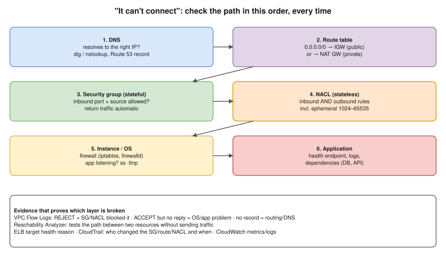
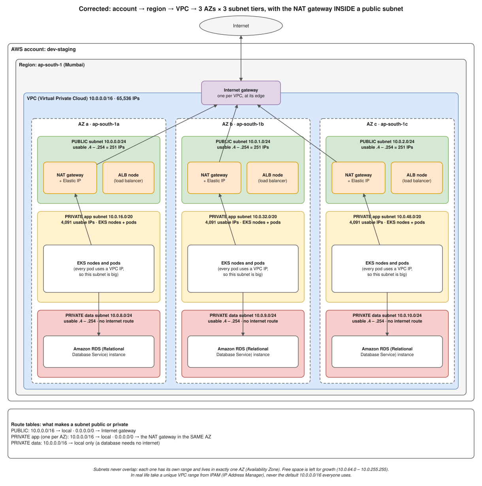
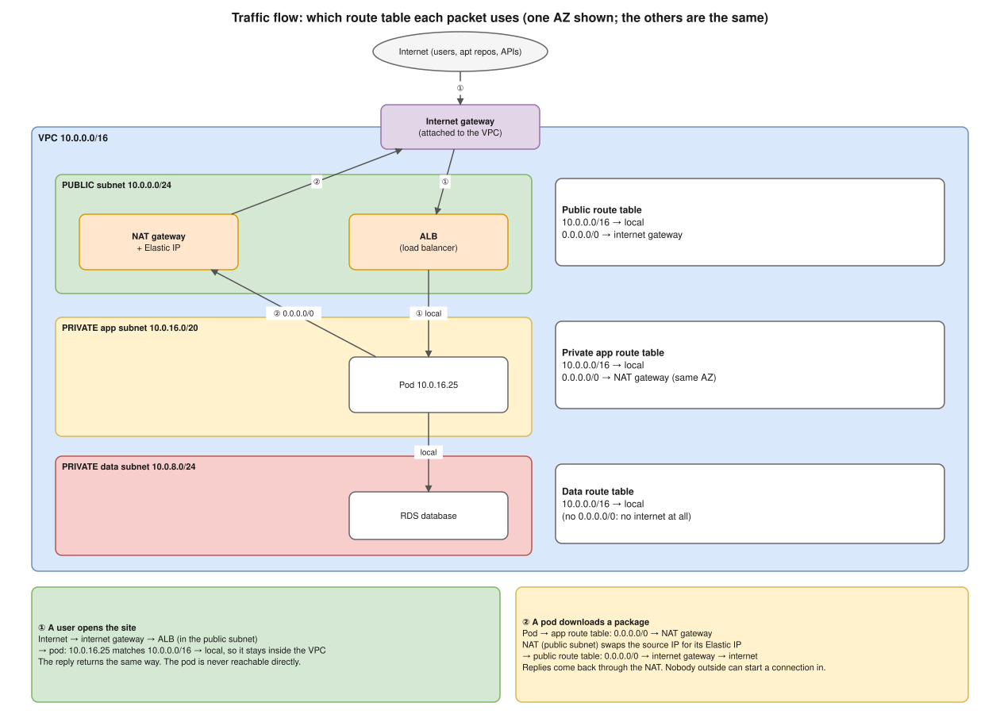

# AWS Admin / troubleshooting interview playbook (13 Nov 2026)

The role: **AWS Admin Engineer, 4–8 years**. Troubleshooting AWS services, load balancers, security, connectivity and outages, with a working knowledge of Terraform. Expect **scenario questions**: "X is broken, what do you check?". Answer every one with the same habit: **scope → path → evidence → fix → prevent**.



---

## 0. How to answer any troubleshooting question (say this structure out loud)

1. **Scope:** one user or all? One instance or all? Since when? **What changed?** (deploy, SG edit, certificate expiry, AWS Health event)
2. **Walk the path** from the client to the app (diagram above): DNS → route table → SG → NACL → OS → app.
3. **Evidence, not guesses:** VPC Flow Logs, ELB target health, CloudWatch metrics/logs, CloudTrail (who changed what), Reachability Analyzer, AWS Health Dashboard.
4. **Fix with the smallest safe change**, and verify it worked.
5. **Prevent it:** RCA, an alarm, Terraform so the change can't drift, a runbook.

**Opening line you can use:** "First I'd scope it and check what changed, then I'd walk the network path layer by layer and use Flow Logs and CloudTrail to prove where it breaks, instead of guessing."

**Background you should be able to draw** (from your 9 Oct review):  

---

## 1. The 13 scenarios

### S1. "I can't SSH into my EC2 instance"
| Check | Command / where | What's wrong if… |
|---|---|---|
| Instance state and status checks | EC2 console → Status checks (system vs instance) | System check failing = AWS host problem: stop/start (moves host). Instance check failing = OS problem (kernel, disk full, bad fstab) |
| Public IP / Elastic IP | Instance details | No public IP in a public subnet = can't reach from the internet |
| Route table of the subnet | VPC → Route tables | No `0.0.0.0/0 → igw-…` = not actually a public subnet |
| Security group | Inbound rule TCP 22 from **your IP** | Missing, or source is the wrong CIDR |
| NACL | Inbound 22 **and** outbound 1024–65535 | Stateless: the return traffic is blocked |
| Key and user | `ssh -i key.pem ec2-user@IP -v` | Wrong user (`ec2-user` Amazon Linux, `ubuntu` Ubuntu), key permissions must be `chmod 400` |
| OS | EC2 serial console / system log | sshd stopped, disk full, OS firewall |

- **Better answer for production:** "In production I'd use **SSM Session Manager** instead of SSH. No port 22 open, no keys, access through IAM, and sessions are logged. It needs the SSM agent, an instance role with `AmazonSSMManagedInstanceCore`, and a route to SSM (NAT or VPC endpoints)."

### S2. "My private EC2 can't reach the internet" (e.g. `yum update` hangs)
1. The private subnet's route table needs `0.0.0.0/0 → nat-…`.
2. The **NAT gateway must sit in a public subnet**, and that subnet's route table needs `0.0.0.0/0 → igw-…`. The NAT gateway needs an Elastic IP and status Available.
3. SG **outbound** allows 443/80 (the default allows everything).
4. NACLs on both subnets allow outbound 80/443 and **inbound ephemeral 1024–65535** for the replies.
5. DNS: `enableDnsSupport` on the VPC, and `/etc/resolv.conf` pointing at the VPC resolver (base + 2, e.g. 10.0.0.2).
- **If it only needs AWS services** (S3, ECR, SSM), use **VPC endpoints** instead. They're cheaper than NAT data processing and keep traffic private. S3/DynamoDB use free gateway endpoints; the others are interface endpoints, with a cost per hour.

### S3. "The website behind the ALB returns 502 / 503 / 504"
| Code | Meaning on an ALB | Check |
|---|---|---|
| **502 Bad Gateway** | Target sent an invalid response or closed the connection | App crashing/restarting, wrong target port, TLS mismatch (ALB → target on HTTPS but app speaks HTTP), target keep-alive timeout shorter than the ALB idle timeout |
| **503 Service Unavailable** | **No healthy targets** registered | Target group → Targets → health status and **reason** (`Target.FailedHealthChecks`, `Target.Timeout`); health check path/port/expected code (e.g. `/health` returns 200?); SG of targets must allow traffic **from the ALB's SG** |
| **504 Gateway Timeout** | Target didn't answer within the idle timeout (default 60 s) | Slow app/DB, target SG/NACL silently dropping, app overloaded |
| **4xx from the ALB itself** | 403 = WAF rule or listener rule; 460 = client closed early; 463 = too many IPs in X-Forwarded-For | WAF logs, listener rules |

- **Evidence:** ALB metrics `HTTPCode_ELB_5XX_Count` (the ALB generated the error) vs `HTTPCode_Target_5XX_Count` (the app returned it), `UnHealthyHostCount`, `TargetResponseTime`. Also **ALB access logs** in S3, which record each request and its target status code.
- **Say it:** "ELB 5xx means the load balancer couldn't get a good answer from the targets. Target 5xx means the app itself returned the error. That split tells me whether to look at the network and health checks, or at the application."

### S4. "Targets keep failing health checks"
- Is the app actually listening on the health check **port** and **path**? From another instance: `curl -v http://<target-ip>:8080/health`.
- The target SG must allow the health check port **from the ALB SG**.
- Does the expected success code match (200 vs 301 redirect to /login)?
- Healthy/unhealthy thresholds, timeout and interval. Is the app slow on startup? Add a grace period (ASG health check grace period, ECS `healthCheckGracePeriodSeconds`).
- NACL between the ALB subnets and the target subnets.

### S5. "S3 Access Denied"
Policy evaluation order: **an explicit Deny anywhere wins → otherwise you need an Allow → otherwise it's an implicit deny.**
1. **The IAM identity policy** of the user or role allows `s3:GetObject` on `arn:aws:s3:::bucket/*`. Note `bucket/*` for objects vs `bucket` for `ListBucket`, which is a common mistake.
2. **The bucket policy** has no Deny (e.g. `aws:SecureTransport`, `aws:SourceVpce`, IP conditions).
3. **Block Public Access** settings, if the access is meant to be public.
4. **KMS:** if the object is SSE-KMS encrypted, the caller also needs `kms:Decrypt` on the key, **and** the key policy must allow it.
5. **Object ownership / ACLs** for cross-account uploads (use "Bucket owner enforced").
6. **An SCP** from AWS Organizations, or a **permission boundary**, can deny it even when IAM allows it.
7. **A VPC endpoint policy**, if the traffic goes through an S3 gateway endpoint.
- **Tools:** `aws sts get-caller-identity` (am I who I think I am?), the **IAM Policy Simulator**, CloudTrail `errorCode: AccessDenied` events, and **IAM Access Analyzer**.

### S6. "The application can't connect to RDS"
1. **Endpoint and port:** use the RDS endpoint DNS name, not an IP. Check the port (3306 MySQL, 5432 Postgres). Test with `nc -zv mydb.xxxx.rds.amazonaws.com 5432`.
2. **RDS SG** inbound on the DB port **from the app's SG** (reference the SG, not IPs).
3. **Same VPC, or peering/TGW routes** in both directions. The DB subnet group sits in private subnets.
4. **Publicly accessible = No** is correct. Access from a laptop goes through a bastion, SSM port forwarding or a VPN.
5. **Credentials:** a wrong password, or a Secrets Manager rotation that changed the password while the app cached the old one.
6. **Max connections reached:** CloudWatch `DatabaseConnections`. Fixes: connection pooling, RDS Proxy.
7. **Status:** in maintenance, storage full (`FreeStorageSpace`), failover happening (Multi-AZ failover takes about 60–120 s; the endpoint stays the same, and the app must reconnect).

### S7. "The site is down after a change" / outage investigation
1. **AWS Health Dashboard:** is it an AWS regional issue?
2. **CloudTrail:** `Event history`, filtered on the time window. Who ran `AuthorizeSecurityGroupIngress` / `RevokeSecurityGroupIngress`, `ReplaceRoute`, `ModifyListener`, `DeleteTargetGroup`, `PutBucketPolicy`?
3. **Mitigate first:** roll back the change (Terraform revert + apply, or restore the previous SG rule).
4. **Then the RCA:** timeline, root cause, why it wasn't caught (no alarm? no review?), action items (Terraform-only changes, an AWS Config rule, an alarm).
- **Say it:** "Restore service first, keep the evidence, and write the RCA after. CloudTrail tells me exactly who changed what, so most 'it suddenly broke' outages are found in minutes."

### S8. "DNS isn't resolving / the domain points to the wrong place"
- `dig app.example.com` and `dig +trace app.example.com`. Check the answer, the TTL and which nameservers responded.
- **The registrar's NS records must match the Route 53 hosted zone's NS records.** A mismatch after recreating a zone is a classic problem.
- An **alias record** to the ALB (free, follows ALB IP changes) vs a CNAME (not allowed at the zone apex).
- **Private hosted zone:** associated with the VPC? The VPC has `enableDnsHostnames` and `enableDnsSupport` on?
- **TTL caching:** clients keep the old answer until the TTL expires. Lower the TTL before a migration.
- **Hybrid DNS:** Route 53 Resolver inbound/outbound endpoints and forwarding rules for on-prem domains.

### S9. "HTTPS certificate error / certificate expired"
- **ACM certificates** renew automatically only if DNS validation (the CNAME record) is still in place. Email validation needs someone to click the link.
- The certificate must be **in the same region as the ALB**. For CloudFront it must be in **us-east-1**.
- The domain names on the certificate must match the host (`*.example.com` doesn't cover `example.com` or `a.b.example.com`).
- Check from the client: `openssl s_client -connect app.example.com:443 -servername app.example.com | openssl x509 -noout -dates -subject`.
- **Prevent it:** CloudWatch alarm on the ACM `DaysToExpiry` metric, or AWS Config `acm-certificate-expiration-check`. Your Koko resume mentions SSL renewals, so tell that story.

### S10. "High CPU / instance slow / instance unreachable"
- CloudWatch `CPUUtilization`. For **T-series instances**, check `CPUCreditBalance`: at 0 the instance gets throttled to its baseline, so either switch to unlimited mode or a non-burstable type.
- **Memory and disk aren't default EC2 metrics.** You need the **CloudWatch agent** for `mem_used_percent` and `disk_used_percent`. Interviewers like this point.
- On the box: `top`, `free -h`, `df -h`, `iostat`, and EBS metrics (`VolumeQueueLength`, burst balance on gp2).
- Status check failing: system → stop/start; instance → check the system log and serial console.
- **Fix:** right-size, Auto Scaling, move to gp3, find the runaway process.

### S11. "Lambda / ECS / EKS can't reach something" (short answers)
- **Lambda in a VPC** has no internet unless its subnets route to a NAT gateway (Lambda never gets a public IP). Check the Lambda's SG and the execution role permissions.
- **ECS task stuck in PENDING / can't pull the image:** needs a route to ECR (NAT or the ECR API + DKR + S3 endpoints), and the **task execution role** must have ECR pull permissions.
- **EKS pod can't reach AWS APIs:** IRSA / Pod Identity role and trust policy; VPC CNI out of IPs (`InsufficientFreeAddressesInSubnet`).

### S12. "Two VPCs can't talk" (peering / Transit Gateway)
- **Overlapping CIDRs can't peer.** Plan non-overlapping ranges.
- The peering connection must be **accepted**.
- **Routes on both sides** pointing to `pcx-…` (or the TGW attachment, plus TGW route tables).
- SGs referencing the other VPC's CIDR (cross-VPC SG references work only for peering in the same region).
- **Peering isn't transitive:** A↔B and B↔C doesn't give A↔C. Use a Transit Gateway for hub-and-spoke.

### S13. "Unexpected cost spike" (bonus, your FinOps strength)
- Cost Explorer grouped by service, then usage type. Common causes: NAT gateway data processing, cross-AZ transfer, forgotten resources (unattached EBS volumes, old snapshots, idle load balancers, unused Elastic IPs), logs never expiring.
- **Prevent it:** AWS Budgets alerts, cost allocation tags, CUR + QuickSight dashboards (your resume), Cost Anomaly Detection.

---

## 2. Security group vs NACL (asked in almost every AWS interview)

| | Security group | NACL |
|---|---|---|
| Level | Instance / ENI | Subnet |
| State | **Stateful**: replies allowed automatically | **Stateless**: you must allow the return traffic (ephemeral 1024–65535) |
| Rules | Allow only | Allow **and** Deny |
| Evaluation | All rules together | In **number order**; the first match wins |
| Default | Deny all inbound, allow all outbound | Default NACL allows all; a custom NACL denies all until you add rules |
| Use | Main access control | Coarse subnet guardrail, e.g. block a bad IP range |

## 3. Logs and monitoring you'll be asked about

| Tool | Answers | Example |
|---|---|---|
| **CloudWatch metrics + alarms** | Is it healthy right now? | ALB `UnHealthyHostCount` > 0 for 2 min → SNS → on-call |
| **CloudWatch Logs + Logs Insights** | What did the app say? | `fields @timestamp, @message \| filter @message like /ERROR/ \| sort @timestamp desc \| limit 50` |
| **CloudTrail** | **Who** did **what**, **when**, from where (API calls) | Who deleted the SG rule at 14:02? |
| **VPC Flow Logs** | Did traffic reach the ENI, and was it ACCEPTed or REJECTed? | `REJECT` on port 5432 means an SG/NACL is blocking the DB |
| **ALB access logs** | Every request: client, target, status codes, latency | Find which target returns the 502s |
| **AWS Config** | What did this resource look like at any point; rule compliance | "SG allowed 0.0.0.0/0 on port 22" → non-compliant |
| **AWS Health Dashboard** | Is AWS itself having a problem? | Regional EC2 issue |
| **Reachability Analyzer** | Can A reach B, and which hop blocks it? | EC2 → RDS: blocked by the SG of RDS |

**Flow log line (default format), know how to read it:**
`2 123456789012 eni-0a1b 10.0.1.15 10.0.2.20 49152 5432 6 10 840 1699999999 1700000059 REJECT OK`
In order: version, account, ENI, **source IP**, **destination IP**, source port, **destination port**, protocol (6 = TCP), packets, bytes, start, end, **action**, log status. This line means 10.0.1.15 tried to reach Postgres on 10.0.2.20 and was blocked.

## 4. Networking protocols (the "good to have" line)

- **TCP 3-way handshake:** SYN → SYN-ACK → ACK. Closing uses FIN/ACK; RST means refused (port closed). "Connection refused" means you reached the host but nothing is listening. "Timeout" means something dropped the packets (SG/NACL/firewall/route).
- **DNS resolution:**
  1. Browser cache → OS cache → the resolver (in a VPC: base + 2).
  2. The root servers point to the TLD (.com), which points to the authoritative nameservers (Route 53), which return the A record.
  3. The answer is cached for its TTL.
  - Record types: A, AAAA, CNAME, MX, TXT, NS, SOA, plus alias (Route 53).
- **DHCP, the 4 steps "DORA":** **D**iscover (client broadcast) → **O**ffer (server offers an IP) → **R**equest (client asks for it) → **A**cknowledge (lease confirmed). **In AWS:** the VPC provides DHCP automatically, and a **DHCP option set** configures the domain name, DNS servers (e.g. on-prem AD DNS) and NTP for the VPC.
- **HTTP vs HTTPS:** HTTPS = HTTP over TLS on port 443. The TLS handshake:
  1. ClientHello
  2. ServerHello + certificate
  3. Key exchange
  4. Encrypted session
  - The certificate proves the server's identity: it's signed by a trusted CA, and the name must match.
- **Status codes:** 2xx success, 3xx redirect, 4xx client error (401 unauthenticated, 403 forbidden, 404 not found, 429 too many requests), 5xx server error (500, 502, 503, 504, as in S3).

## 5. Terraform: the short version

- **Workflow:** `init` → `fmt`/`validate` → `plan` (review!) → `apply`; `destroy` only for test environments.
- **State:** maps your code to real resource IDs. Keep it **remote in S3 with versioning and encryption**, with **DynamoDB locking** (or S3 native locking with `use_lockfile` in newer versions), so two people can't apply at the same time and corrupt it. Never edit it by hand. Use `terraform state list/show/mv/rm`.
- **Drift:** someone changed a resource in the console. `terraform plan` shows the difference. Either revert it with apply, or update the code to match.
- **Import an existing resource:** an `import` block (Terraform 1.5+) or `terraform import aws_instance.web i-0abc…`, then write the matching code until `plan` shows no changes.
- **Modules, variables, outputs, `for_each` vs `count`,** data sources, and one directory or workspace per environment.
- **Troubleshooting:**
  - `Error acquiring the state lock`: someone else is running it, or a crash left the lock behind. Check first, then `terraform force-unlock <ID>`.
  - `AccessDenied` from the provider: check the role or profile with `aws sts get-caller-identity`.
  - Dependency problems: add a `depends_on`.
  - Set `TF_LOG=DEBUG` for detailed logs.
- **Your story:** "I provisioned EKS clusters and the AWS infrastructure (VPC, EC2, RDS, Route 53, ELB, ASG) with Terraform modules at Perfios and Koko."

## 5b. Terraform in depth (HR said to prepare it)

### What to explain in your own words
- **Terraform is declarative.** You describe the *desired* state. `plan` compares it with the **state file** and the real cloud, then shows create/update/destroy. `apply` makes those changes.
- **Providers** talk to the APIs (aws, kubernetes, helm). **Resources** create things. **Data sources** read existing things (e.g. the latest AMI, an existing VPC).
- **State** maps each resource in your code to a real ID (e.g. `aws_instance.web` → `i-0abc…`). Without it, Terraform can't know what it already manages.

### Remote backend with locking (write this from memory)
```hcl
terraform {
  required_version = ">= 1.6"
  required_providers {
    aws = { source = "hashicorp/aws", version = "~> 5.0" }   # pin versions
  }
  backend "s3" {
    bucket         = "mycompany-tfstate"
    key            = "prod/network/terraform.tfstate"
    region         = "ap-south-1"
    encrypt        = true
    dynamodb_table = "terraform-locks"   # lock table (newer Terraform also supports use_lockfile = true)
  }
}
```
- **Why remote:**
  - The team shares one state.
  - The S3 bucket is versioned, so you can recover a broken state.
  - It's encrypted, because **state contains secrets in plain text** (DB passwords, keys).
- **Why locking:** two people running apply at the same time would corrupt the state and race on resources. The lock lets only one run at a time.

### Commands and what they're for

| Command | Use |
|---|---|
| `terraform init` | Download providers and modules, configure the backend (`-upgrade`, `-migrate-state`) |
| `terraform fmt -recursive` / `validate` | Format / syntax check (run in CI) |
| `terraform plan -out=tfplan` | Preview, saved so `apply tfplan` applies **exactly** what was reviewed |
| `terraform apply tfplan` | Apply the reviewed plan |
| `terraform plan -refresh-only` | Show **drift** (console changes) without changing anything |
| `terraform apply -replace=aws_instance.web` | Force-recreate one resource (replaces the old `taint`) |
| `terraform state list` / `state show <addr>` | Inspect the state |
| `terraform state mv` / `moved {}` block | Rename or move a resource in the code **without destroying it** |
| `terraform state rm <addr>` | Stop managing a resource (it stays in AWS) |
| `terraform import` / `import {}` block | Bring an existing resource under Terraform |
| `terraform output` | Show outputs (e.g. VPC ID, ALB DNS name) |
| `terraform force-unlock <LOCK_ID>` | Remove a stuck lock, **after** confirming nobody is running |
| `terraform workspace new/select` | Separate state per workspace (same code) |

### Concepts interviewers ask

| Question | Answer |
|---|---|
| `count` vs `for_each` | `count` uses an index: removing item 0 shifts every other item and **recreates** them. `for_each` uses keys (map or set), so removing one item affects only that one. Prefer `for_each` |
| Module | A reusable folder of `.tf` files with variables (inputs) and outputs. Pin versions: `source = "terraform-aws-modules/vpc/aws"`, `version = "5.8.1"` |
| Variable precedence (lowest → highest) | `default` in the variable block → environment `TF_VAR_name` → `terraform.tfvars` → `*.auto.tfvars` → `-var` / `-var-file` on the command line (later flags win). Short version: "command-line flags win, defaults lose" |
| `locals` vs `variables` | Variables are inputs from outside. Locals are computed values inside the module |
| `lifecycle` | `create_before_destroy` (zero-downtime replace), `prevent_destroy` (protect a prod DB), `ignore_changes = [tags, desired_count]` (ignore values changed by other systems, e.g. ASG scaling) |
| `depends_on` | Explicit ordering when Terraform can't see the dependency from references |
| Environments | Separate directories or state per env (`envs/dev`, `envs/prod`, sharing modules), or workspaces. Separate **accounts** per env is best (your 9 Oct answer) |
| Secrets | Never hard-code them. Use `sensitive = true` on variables and outputs, read them from Secrets Manager/SSM with a data source, keep state encrypted and access-restricted |
| Drift | Someone changed it in the console → `plan -refresh-only` shows it → either `apply` to revert, or update the code. Prevent it: changes only through the pipeline, read-only console access, AWS Config |
| Provisioners | `local-exec` / `remote-exec` are a last resort. Prefer user data, cloud-init, Ansible or a baked AMI |
| Terraform in CI/CD | On a PR: `fmt -check`, `validate`, `tflint`, `tfsec`/`checkov`, `plan`, with the plan posted to the PR. After merge: `apply` the reviewed plan with an IAM role (OIDC), never long-lived keys |
| Read another stack's outputs | `terraform_remote_state` data source, or better, SSM parameters / data sources |
| Terraform vs CloudFormation | Terraform is multi-cloud and multi-provider (Kubernetes, Helm, Datadog), and you manage state yourself. CloudFormation is AWS-only, AWS manages its state, and it rolls back automatically |

### Example: a for_each security group (be able to write something like this)
```hcl
variable "ingress_ports" {
  type    = map(string)
  default = { https = "443", http = "80" }
}

resource "aws_security_group" "web" {
  name   = "web-sg"
  vpc_id = var.vpc_id
}

resource "aws_vpc_security_group_ingress_rule" "web" {
  for_each          = var.ingress_ports
  security_group_id = aws_security_group.web.id
  cidr_ipv4         = "0.0.0.0/0"
  from_port         = tonumber(each.value)
  to_port           = tonumber(each.value)
  ip_protocol       = "tcp"
  description       = each.key
}

output "web_sg_id" { value = aws_security_group.web.id }
```

### Terraform troubleshooting scenarios

| Problem | What you do |
|---|---|
| `Error acquiring the state lock` | Check whether a pipeline or colleague is running. If it's a stale lock from a crash: `terraform force-unlock <ID>` |
| Plan wants to **destroy and recreate** something important | Read why (`# forces replacement`): e.g. a changed name, AZ or subnet. Use `moved {}` for renames, `ignore_changes`, or `prevent_destroy` on critical resources |
| Resource exists in AWS but not in state ("already exists") | `import` it, then match the code until `plan` shows no changes |
| State lost or corrupted | Restore the previous version from the **S3 bucket versioning**. That's why versioning is on |
| `AccessDenied` / `UnauthorizedOperation` | `aws sts get-caller-identity`: wrong profile or role? Missing IAM permission (decode the message with `aws sts decode-authorization-message`) |
| Provider version broke something | Pin versions, commit `.terraform.lock.hcl`, upgrade deliberately with `init -upgrade` |
| Need more detail | `TF_LOG=DEBUG terraform plan` |

**Your story:** "At Perfios I wrote modular Terraform for EC2, RDS, Route 53, ELB, Auto Scaling and VPC across environments. At Koko I provisioned and managed the EKS clusters with Terraform. State was remote in S3 with locking, and changes went through plan review before apply."

---

## 5c. Kubernetes / EKS (HR said to prepare it)

### Must-know 1: architecture
- **Control plane** (on EKS, managed by AWS across 3 AZs):
  - **kube-apiserver:** the front door. It handles authentication, authorisation and admission, and is the only component that talks to etcd.
  - **etcd:** cluster state.
  - **scheduler:** picks a node for each pod (filter, then score).
  - **controller-manager:** control loops (Deployment, ReplicaSet, Node, endpoints).
  - **cloud-controller-manager.**
- **Worker node:** **kubelet** (runs pods, reports status), **kube-proxy** (Service rules via iptables/IPVS), **containerd** (runtime), **VPC CNI** (`aws-node`, gives pods real VPC IPs).

### Must-know 2: what happens after `kubectl apply` (the 11 Nov question)
1. The API server authenticates, authorises and runs admission, then saves the object to **etcd**.
2. The Deployment controller creates a ReplicaSet, which creates the Pods.
3. The **scheduler** binds each pod to a node.
4. The **kubelet** asks **containerd** to pull the image and create the sandbox. The **CNI** assigns the IP, and volumes are mounted.
5. Init containers run, then the app containers.
6. **Probes** pass, so the pod is **Ready** and gets added to the Service **endpoints**. kube-proxy routes traffic to it.

### EKS-specific (this is what an AWS role will ask)

| Topic | What to say |
|---|---|
| **Node options** | Managed node groups (EC2 in an ASG, AWS handles the AMI and draining), **Karpenter** (launches the right-sized instance per pending pod, faster, no ASG), Fargate (serverless pods, no DaemonSets), EKS Auto Mode |
| **VPC CNI** | Every pod gets a **VPC IP** from the subnet, so **pod density is limited by ENIs/IPs per instance**, and subnets can run out of IPs. Fixes: bigger subnets (/20 or more), **prefix delegation**, custom networking with a secondary CIDR (100.64.0.0/10) |
| **Exposing apps** | **AWS Load Balancer Controller**: an `Ingress` creates an **ALB**, a `Service type: LoadBalancer` creates an **NLB**. Subnets must be tagged: `kubernetes.io/role/elb=1` (public) and `kubernetes.io/role/internal-elb=1` (private). Target type `ip` sends traffic straight to pod IPs |
| **Pod access to AWS (no keys)** | **IRSA**: the service account annotation `eks.amazonaws.com/role-arn`, plus an IAM role whose trust policy trusts the cluster's **OIDC provider**. Newer: **EKS Pod Identity** (an agent add-on and an association, no OIDC trust setup) |
| **Cluster access for people** | Old: the `aws-auth` ConfigMap maps IAM roles to Kubernetes groups. New: **EKS access entries** (API-managed, with access policies). `aws eks update-kubeconfig --name <cluster>` writes your kubeconfig |
| **Secrets** | Secrets Manager / SSM via the **Secrets Store CSI driver** or External Secrets Operator (your Koko resume: Secrets Manager integrated with Kubernetes) |
| **Storage** | **EBS CSI driver** (gp3 StorageClass). EBS volumes are **tied to one AZ**, so a pod with an EBS PVC must run in that AZ. EFS for ReadWriteMany |
| **Upgrades** (on your resume) | **One minor version at a time** (1.29 → 1.30). Order: check deprecated APIs (`kubectl convert`, pluto), upgrade the control plane, then add-ons (VPC CNI, CoreDNS, kube-proxy, EBS CSI), then nodes (managed node group rolling update, or Karpenter drift). Use PodDisruptionBudgets to keep apps up. Test in dev and UAT first |
| **Logging/monitoring** | Control-plane logs to CloudWatch (api, audit, authenticator); Container Insights; Prometheus + Grafana (your federated setup) |

### EKS troubleshooting scenarios

| Problem | Checks |
|---|---|
| **Nodes don't join the cluster** | Node IAM role has `AmazonEKSWorkerNodePolicy`, `AmazonEKS_CNI_Policy` and `AmazonEC2ContainerRegistryReadOnly`; role mapped in `aws-auth` or an access entry; node SG can reach the control plane (443); private subnets have a route to the EKS/ECR/S3 endpoints or a NAT; correct AMI for the version; kubelet logs on the node (`journalctl -u kubelet`) |
| **Pods Pending** | `kubectl describe pod`: `Insufficient cpu/memory` (scale nodes, Karpenter, lower requests); taints/affinity; **`failed to assign an IP address`** (subnet out of IPs, max pods per node); PVC in another AZ |
| **ImagePullBackOff from ECR** | Node role has ECR read permission; image tag exists in that region/account; route to ECR (NAT or the ECR API + DKR + S3 endpoints) |
| **Ingress created but no ALB** | AWS LB Controller logs: `kubectl logs -n kube-system deploy/aws-load-balancer-controller`; controller IAM role (IRSA); subnet tags; `ingressClassName: alb`; annotations (`alb.ingress.kubernetes.io/scheme: internet-facing`) |
| **ALB 502/503 to pods** | Target group health (pod readiness, health check path), pod SG / node SG allows traffic from the ALB SG, `targetPort` matches the container port (scenarios S3–S4 above) |
| **Pod gets AccessDenied calling S3** | `kubectl describe sa <sa>` shows the role annotation? Pod restarted after the annotation was added? IAM role trust policy has the right OIDC provider **and** `system:serviceaccount:<ns>:<sa>`? Role policy allows the action? Check with `aws sts get-caller-identity` from inside the pod |
| **CrashLoopBackOff / OOMKilled** | `kubectl logs --previous`; `describe` shows the exit code (137 = OOM); raise memory limits or fix the leak; check that config and secrets exist |
| **Service has no endpoints** | Selector doesn't match pod labels, or pods aren't Ready: `kubectl get endpoints <svc>`, `kubectl get pods --show-labels` |
| **kubectl: "You must be logged in" / Unauthorized** | `aws sts get-caller-identity` (right role?), `aws eks update-kubeconfig`, your IAM principal in `aws-auth` / access entries |
| **DNS fails inside pods** | CoreDNS pods running (`kubectl get pods -n kube-system -l k8s-app=kube-dns`)? Node SG allows UDP/TCP 53 between nodes? Test with `nslookup kubernetes.default` from a busybox pod |

**Commands to know cold:**
```bash
aws eks update-kubeconfig --name prod-eks --region ap-south-1
kubectl get nodes -o wide ; kubectl get pods -A -o wide
kubectl describe pod <pod> -n <ns>          # Events explain Pending / pull / probe / OOM
kubectl logs <pod> -n <ns> --previous
kubectl get events -n <ns> --sort-by=.lastTimestamp
kubectl get svc,endpoints,ingress -n <ns>
kubectl rollout status|history|undo deploy/<name> -n <ns>
kubectl top pods -n <ns> ; kubectl top nodes
kubectl auth can-i list pods --as=system:serviceaccount:<ns>:<sa>
```

**Your stories:**
- **Docker Swarm → EKS migration** at Koko: the environments (Dev, UAT, Prod-Int, Prod), built with Terraform, right-sizing (20–30% cost cut).
- **EKS upgrades.**
- **Federated Prometheus** across clusters.
- **Secrets Manager integration.**

## 6. Your answers for this role

- **Intro (AWS version):** "I'm an SRE with about five and a half years in AWS production operations. Day to day I troubleshoot and run AWS infrastructure: EKS, EC2, VPC networking, load balancers, RDS and IAM. I provision it with Terraform and monitor it with Prometheus, Grafana and CloudWatch. At Koko Networks I handled production incidents and RCAs, EKS upgrades, SSL renewals and a Docker Swarm to EKS migration. Before that, at Perfios, I built AWS infrastructure with Terraform and Ansible. Troubleshooting production issues is the part of the job I'm strongest at, which is why this role fits."
- **Ratings (be honest):** AWS 7, Linux 6–7, Terraform 7, networking 6. Windows: "mainly Linux; Windows only basics." It isn't on your resume, so don't claim it.
- **Certification question:** "I've completed AWS Cloud Practitioner Essentials training and AWS partner accreditations; I'm planning the Solutions Architect Associate." **Don't call the course a certification.**
- **Why this role:** "My strongest work has been troubleshooting AWS production issues: connectivity, load balancers, outages and RCAs. This role is exactly that, full-time, across many environments, so I'd learn faster and contribute from day one."
- **Prepare 2 real stories** (only real ones):
  1. An outage or connectivity issue you debugged at Koko or Perfios: the symptom, how you found the layer, the fix, and what you added afterwards.
  2. An SSL renewal or EKS upgrade that you planned or rescued.

## 7. Questions to ask them

1. What kinds of incidents take most of the team's time: networking, IAM, or application-level?
2. Is the environment managed with Terraform end to end, or is there console drift you're cleaning up?
3. How is on-call organised, and what does a typical escalation look like?

## 8. Morning self-test (say each answer out loud in under 2 minutes)

1. Private EC2 can't reach the internet. Walk me through it.
2. ALB returns 503. What does that mean, and what do you check?
3. ELB 5xx vs Target 5xx?
4. S3 Access Denied, but the IAM policy allows it. What else could deny it?
5. App can't connect to RDS. Your steps?
6. Security group vs NACL?
7. How do you find who changed a security group yesterday?
8. Read a VPC Flow Log line with REJECT on port 5432.
9. Connection refused vs connection timeout?
10. What is DHCP DORA, and what is a DHCP option set in AWS?
11. Why is Terraform state remote and locked? How do you fix a stuck lock?
12. How do you monitor memory on EC2?
13. `count` vs `for_each`: why does it matter?
14. Your plan says "forces replacement" on a production resource. What do you do?
15. What happens after `kubectl apply`, in 6 steps?
16. A pod on EKS gets AccessDenied calling S3. Walk me through it.
17. An Ingress was created but no ALB appeared. What do you check?
18. Pods are Pending with "failed to assign an IP address". Why, and how do you fix it?
19. How do you upgrade an EKS cluster safely?
