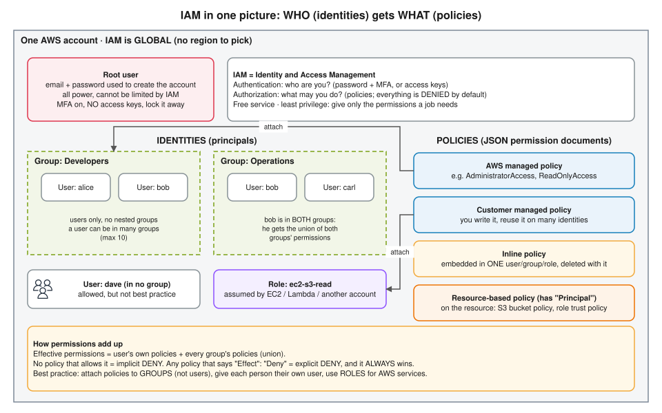
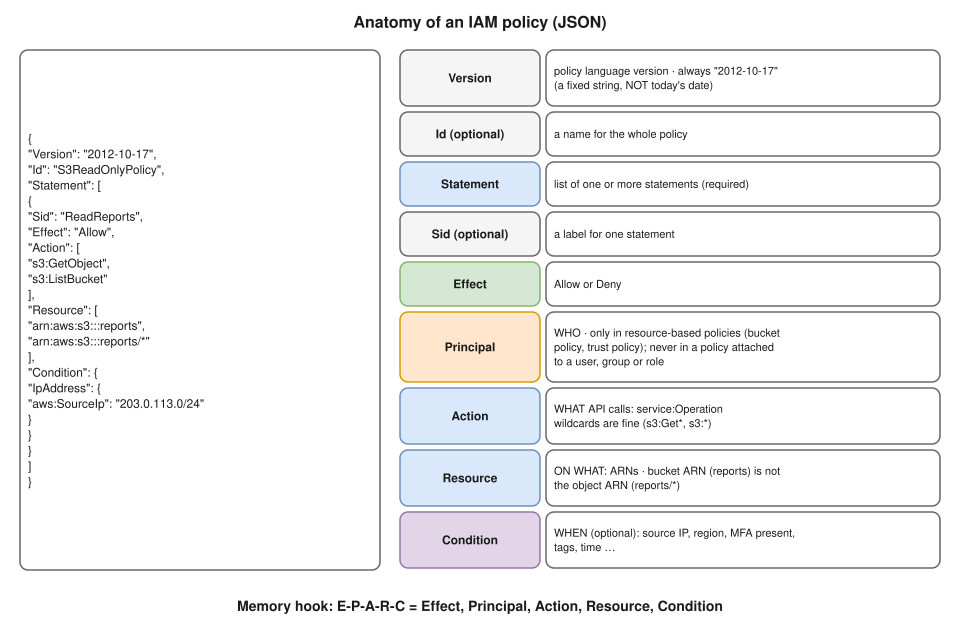
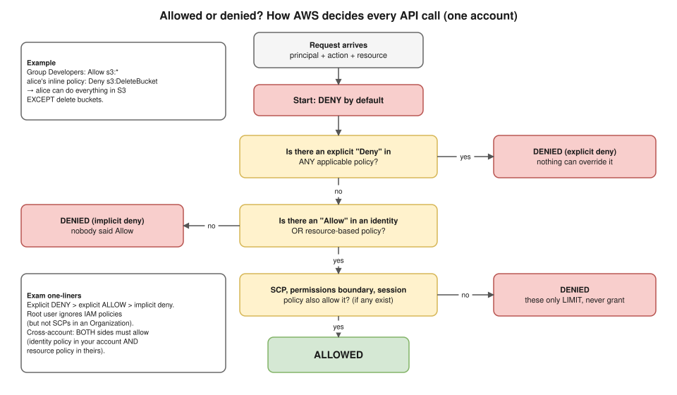
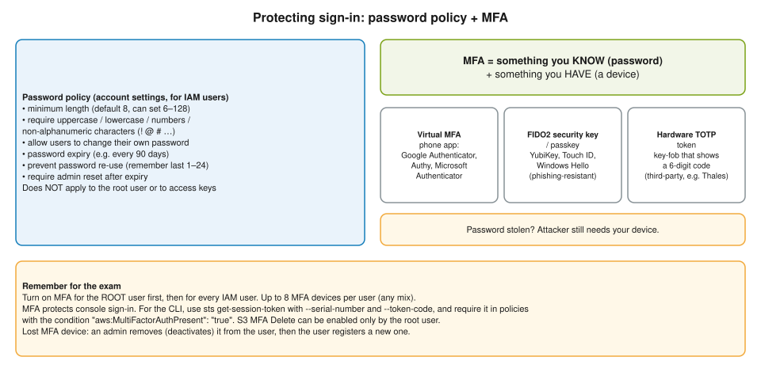
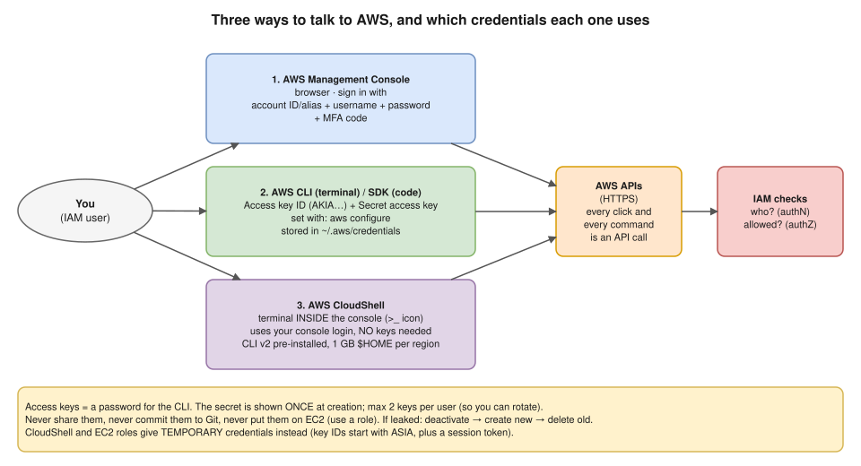
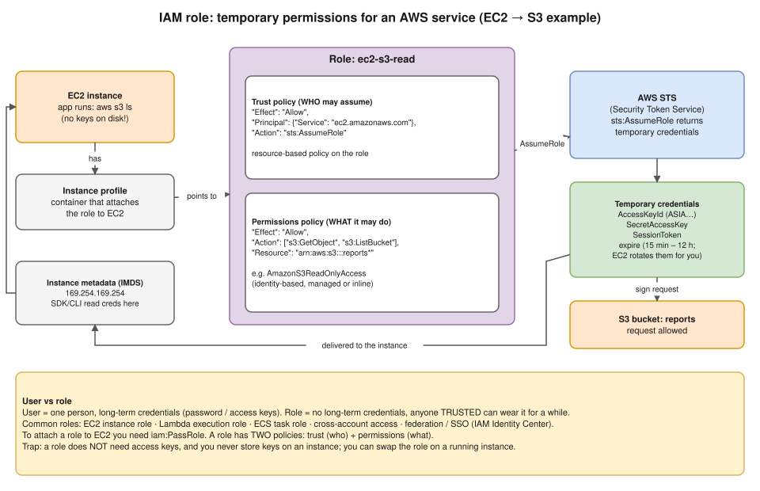
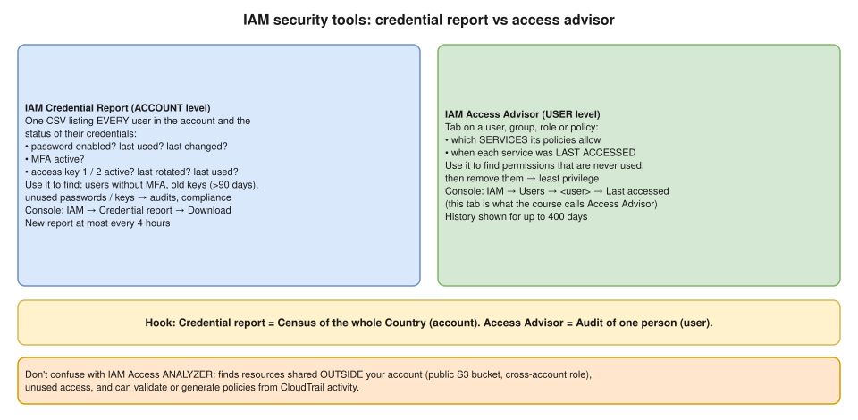
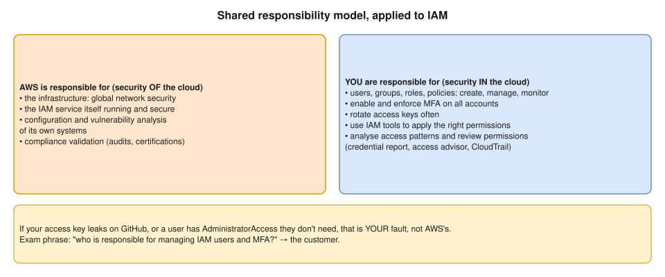

# AWS IAM cheat sheet (SAA-C03 + interviews)



**What you learned today (17 Nov 2026):** users, groups, policies, MFA, access keys, AWS CLI, CloudShell, roles, password policy, and the two IAM security tools (credential report, access advisor). This page puts all of it in one place, with the exam traps and a from-memory drill at the end.

> **How to use this page.** Read one section, close the page, and write down the diagram from memory. Then do the [drill](#from-memory-drill) at the bottom. Reading alone will not make it stick: type it.

**Confidence tags.** `[Certain]` = AWS documentation fact. `[Likely]` = correct when written (Nov 2026), but AWS changes limits and defaults, so check the console before you quote a number in an interview. The CLI commands are **untested** here (installing the AWS CLI was blocked in the environment that wrote this page); run them on your Ubuntu laptop and fix anything that differs.

## Contents

1. [What IAM is](#1-what-iam-is)
2. [Root user](#2-root-user)
3. [Users and groups](#3-users-and-groups)
4. [Policies](#4-policies)
5. [How AWS decides: explicit deny wins](#5-how-aws-decides-explicit-deny-wins)
6. [Password policy and MFA](#6-password-policy-and-mfa)
7. [Three ways to access AWS: console, CLI, CloudShell](#7-three-ways-to-access-aws-console-cli-cloudshell)
8. [Access keys](#8-access-keys)
9. [AWS CLI on Ubuntu](#9-aws-cli-on-ubuntu)
10. [Roles and STS](#10-roles-and-sts)
11. [IAM security tools](#11-iam-security-tools)
12. [Shared responsibility for IAM](#12-shared-responsibility-for-iam)
13. [Best practices](#13-best-practices)
14. [SAA exam traps](#14-saa-exam-traps)
15. [From-memory drill](#from-memory-drill)
16. [30-second spoken answer](#30-second-spoken-answer)

---

## 1. What IAM is

| Fact | Detail |
|---|---|
| Name | **Identity and Access Management** `[Certain]` |
| Scope | **Global** service: you do not pick a region. Users, groups, roles and policies are the same in every region. `[Certain]` |
| Cost | Free. `[Certain]` |
| Two jobs | **Authentication** (who are you? password + MFA, or access keys) and **authorization** (what may you do? policies). |
| Default | Everything is **denied** until a policy allows it (implicit deny). `[Certain]` |
| Principle | **Least privilege**: give each identity only the permissions its job needs, nothing more. |
| Identities | Root user, IAM users, IAM groups (a container for users), IAM roles. |
| Permissions | Policies: JSON documents attached to identities or resources. |

## 2. Root user

- Created automatically when you create the AWS account, and signs in with the account **email address + password**. `[Certain]`
- Has **full access** to everything, and IAM policies **cannot** limit it (only an Organizations SCP can restrict a member account's root user). `[Certain]`
- **Do not use it for daily work** and do not share it. Use it only for the tasks that need root, then lock it away. `[Certain]`
- Turn on **MFA** for root first. Do **not** create access keys for root (delete any that exist). `[Certain]` AWS now enforces MFA on root users for most accounts. `[Likely]`
- Tasks only the root user can do (exam favourites) `[Certain]`:
  - change account settings (account name, email, root password, root access keys)
  - close the AWS account
  - change or cancel the AWS Support plan
  - restore IAM user permissions (when the only IAM admin locked themselves out)
  - register as a seller in the Reserved Instance Marketplace
  - enable **MFA Delete** on an S3 bucket
  - view certain tax invoices; sign up for GovCloud

## 3. Users and groups

| | User | Group |
|---|---|---|
| What it is | One identity = **one person** (or one application) | A **collection of users** |
| Credentials | Console password and/or up to 2 access keys | None: you can't sign in as a group |
| Contains | n/a | **Only users. Groups cannot contain other groups** (no nesting) `[Certain]` |
| Membership | A user can be in **many** groups (up to 10 per user `[Likely]`), or in **none** | |
| Policies | Can have its own policies (managed or inline) | Policies attached to the group apply to every member |
| In a resource policy `Principal`? | Yes | **No**: a group is not a principal `[Certain]` |

- **Effective permissions** of a user = its own policies **+** the policies of every group it belongs to (the union). `[Certain]`
- Example from the course: `alice` and `bob` in **Developers**, `bob` and `carl` in **Operations**, `dave` in no group. `bob` gets both groups' permissions. `dave` only has what is attached to him directly (allowed, but not best practice).
- **Best practice:** one person = one user (never share logins), and attach permissions to **groups**, not to users.

## 4. Policies



A policy is a JSON document that says who can do what, on which resources, under which conditions.

### 4.1 Policy structure

```json
{
  "Version": "2012-10-17",
  "Id": "S3ReadOnlyPolicy",
  "Statement": [
    {
      "Sid": "ReadReports",
      "Effect": "Allow",
      "Action": ["s3:GetObject", "s3:ListBucket"],
      "Resource": [
        "arn:aws:s3:::reports",
        "arn:aws:s3:::reports/*"
      ],
      "Condition": {
        "IpAddress": { "aws:SourceIp": "203.0.113.0/24" }
      }
    }
  ]
}
```

| Element | Required? | Meaning |
|---|---|---|
| `Version` | Yes (in practice) | Policy **language** version. Always `"2012-10-17"`. It is a fixed string, **not** the date you wrote the policy. `[Certain]` |
| `Id` | Optional | A name for the whole policy. |
| `Statement` | **Required** | One statement or a list of statements. |
| `Sid` | Optional | Statement ID, a label for one statement. |
| `Effect` | Required | `Allow` or `Deny`. |
| `Principal` | Only in **resource-based** policies | The account, user, role or service the statement applies to. Never in a policy attached to a user, group or role (there, the principal is whoever it is attached to). `[Certain]` |
| `Action` | Required (or `NotAction`) | API calls, written `service:Operation`, for example `s3:GetObject`, `ec2:StartInstances`, `iam:*`. Wildcards allowed. |
| `Resource` | Required in identity policies (or `NotResource`) | ARNs the actions apply to. `*` = all. |
| `Condition` | Optional | When the statement applies: source IP, region, MFA, tags, time, and so on. |

**Memory hook: E-P-A-R-C** = Effect, Principal, Action, Resource, Condition.

**ARN format:** `arn:partition:service:region:account-id:resource`, for example `arn:aws:iam::123456789012:user/alice`. IAM ARNs have an **empty region** (`iam::`), because IAM is global. S3 bucket ARNs have empty region **and** account (`arn:aws:s3:::reports`). `[Certain]`

**Bucket vs object ARN (classic trap):** `s3:ListBucket` acts on the **bucket** ARN `arn:aws:s3:::reports`; `s3:GetObject` acts on **object** ARNs `arn:aws:s3:::reports/*`. A policy that only lists one of them breaks the other action. `[Certain]`

### 4.2 Useful conditions (exam)

| Condition key | Use |
|---|---|
| `aws:SourceIp` | Allow/deny only from an IP range (the client's public IP). |
| `aws:RequestedRegion` | Allow actions only in chosen regions. |
| `aws:MultiFactorAuthPresent` | Require that the caller signed in with MFA (for example before `ec2:TerminateInstances`). |
| `aws:PrincipalTag` / `aws:ResourceTag` | Attribute-based access control (ABAC) with tags. |
| `aws:PrincipalOrgID` | Allow only principals from your AWS Organization (often in bucket policies). |
| `aws:SecureTransport` | Deny requests that are not HTTPS. |

Policy variables: `${aws:username}` lets one policy give every user their own folder, for example `arn:aws:s3:::home/${aws:username}/*`. `[Certain]`

### 4.3 Kinds of policy

| Kind | Attached to | Key facts |
|---|---|---|
| **AWS managed** | Users, groups, roles | Written and updated by AWS. Examples: `AdministratorAccess` (everything), `PowerUserAccess` (everything except managing IAM users/groups and Organizations), `ReadOnlyAccess`, `AmazonS3ReadOnlyAccess`. You can't edit them. |
| **Customer managed** | Users, groups, roles | You write it once and attach it to many identities. **Versioned** (up to 5 versions, you can roll back `[Likely]`). Recommended over inline. |
| **Inline** | Exactly **one** user, group or role | Embedded in that identity, **deleted with it**, not reusable. Use only for a strict one-to-one permission. |
| **Resource-based** | A resource | Has a `Principal`. Examples: **S3 bucket policy**, **role trust policy**, SQS queue policy, SNS topic policy, KMS key policy, Lambda function policy. Allows **cross-account** access without assuming a role. |

**Identity-based vs resource-based:**

- **Identity-based** = attached to a user/group/role; says what **that identity** may do. No `Principal`.
- **Resource-based** = attached to the resource; says **who** (`Principal`) may do what to **this resource**.

**Also exists (limits, never grants):** permissions boundaries (max permissions for a user or role), Organizations **SCPs** (max permissions for an account), session policies. `[Certain]`

## 5. How AWS decides: explicit deny wins



1. Every request starts as **DENY** (implicit deny). `[Certain]`
2. If **any** applicable policy has `"Effect": "Deny"` for the request → **denied**. An explicit deny **always wins**, no matter how many allows there are. `[Certain]`
3. Otherwise, if an identity-based **or** resource-based policy **allows** it → continue. If nothing allows it → denied (implicit deny).
4. If SCPs, a permissions boundary or a session policy exist, they must **also** allow it.
5. → **Allowed.**

**Order to remember:** explicit DENY > explicit ALLOW > implicit (default) deny.

**Example:** group Developers has `Allow s3:*`; alice also has an inline `Deny s3:DeleteBucket`. Result: alice can do everything in S3 **except** delete buckets.

**Cross-account:** the caller's identity policy (in account A) **and** the resource policy (in account B) must both allow it. `[Certain]`

## 6. Password policy and MFA



### 6.1 Password policy (Account settings in the IAM console)

You can set `[Certain]`:

- **Minimum length** (AWS default 8; you can choose 6–128)
- Require at least one **uppercase** letter, **lowercase** letter, **number**, **non-alphanumeric** character (`! @ # $ % ^ & * ( ) _ + - = [ ] { } | '`)
- **Allow users to change their own password**
- **Password expiration** (for example every 90 days; 1–1095 days)
- **Prevent password reuse** (remember the last 1–24 passwords)
- **Require administrator reset** after the password expires (expired users can't change it themselves)

The password policy applies to **IAM users only**, not to the root user, and not to access keys. `[Certain]`

### 6.2 MFA (multi-factor authentication)

- **MFA = something you know (password) + something you have (a device).** If the password is stolen, the attacker still needs the device. `[Certain]`
- Protect the **root user first**, then every IAM user. `[Certain]`
- Device types `[Certain]`:

| Type | Examples | Notes |
|---|---|---|
| **Virtual MFA** | Google Authenticator, Authy, Microsoft Authenticator (phone apps) | Free, most common. Shows a 6-digit code (TOTP) that changes every 30 seconds. |
| **FIDO2 security key / passkey** | YubiKey, Touch ID, Windows Hello, phone passkey | Phishing-resistant; one key can protect many users and accounts. |
| **Hardware TOTP token** | Key-fob or display card (third party, for example Thales) | Physical device that shows a 6-digit code. |

- Up to **8 MFA devices** per user (any mix). `[Likely]`
- **MFA for the CLI:** call `aws sts get-session-token --serial-number <mfa-arn> --token-code 123456` to get temporary credentials, and require MFA in policies with `"Bool": {"aws:MultiFactorAuthPresent": "true"}`. `[Certain]`
- **Lost device:** an admin deactivates/removes the MFA device on the user; the user signs in and registers a new one. Root user with a lost device: account recovery through the email and phone number on the account. `[Likely]`
- **S3 MFA Delete** can be turned on **only by the root user**. `[Certain]`

## 7. Three ways to access AWS: console, CLI, CloudShell



| Method | Credentials | When |
|---|---|---|
| **AWS Management Console** (browser) | Account ID or alias + IAM username + password + MFA. The IAM user sign-in URL is `https://<account-id-or-alias>.signin.aws.amazon.com/console`. | Clicking around, learning, one-off changes |
| **AWS CLI** (terminal) | **Access key ID + secret access key** (or SSO / role credentials) | Scripts, automation, daily ops |
| **AWS SDK** (code: Python boto3, Java, Go, JS …) | Same as CLI: access keys or a role | Applications calling AWS |
| **AWS CloudShell** (terminal in the browser) | Your **console sign-in**; **no access keys needed** | Quick CLI work without installing anything |

Every console click and every CLI command ends up as an **HTTPS API call**; IAM checks it the same way. The CLI is open source and built on the Python SDK (boto). `[Certain]`

### 7.1 AWS CloudShell

- Browser-based shell opened from the **`>_` icon** in the console top bar. `[Certain]`
- **Pre-authenticated** with the credentials of the user signed in to the console: same permissions, no `aws configure`. `[Certain]`
- **AWS CLI v2 pre-installed**, plus Python, Node.js, git, and more. Runs on Amazon Linux 2023. `[Likely]`
- **1 GB persistent storage per region** in `$HOME`; files outside `$HOME` are lost when the session ends. Home data is deleted after **120 days** of no use in that region. `[Likely]`
- **Upload/download** files through the *Actions* menu. Several tabs, split panes. `[Certain]`
- **Free** (you pay only for AWS resources you create). Not available in every region. `[Likely]`
- **Region**: commands default to the region selected in the console. `[Certain]`
- Trap: "Fastest way to run CLI commands without storing access keys on a laptop?" → **CloudShell**.

## 8. Access keys

- Long-term credentials for the CLI/SDK: an **access key ID** (like a username, starts with **`AKIA`**) + a **secret access key** (like a password). `[Certain]`
- The **secret is shown only once**, at creation. Download the `.csv` or copy it then; if lost, create a new key. `[Certain]`
- **Maximum 2 access keys per user**, so you can rotate without downtime. Each key is *Active* or *Inactive*. `[Certain]`
- **Rotation steps:** create key 2 → update apps to key 2 → **deactivate** key 1 → check nothing broke → **delete** key 1. `[Certain]`
- **Never** share keys, never commit them to Git, never put them on an EC2 instance (use a **role**), never create them for root. `[Certain]`
- **Leaked key?** Deactivate it immediately, create a new one, delete the old, then check CloudTrail for what the key did. `[Certain]`
- **Temporary credentials** (from STS, roles, CloudShell, SSO) start with **`ASIA`** and come with a **session token** and an expiry. `[Certain]`
- AWS now suggests alternatives when you create keys: CloudShell, IAM Identity Center (`aws configure sso`), or roles. `[Likely]`

## 9. AWS CLI on Ubuntu

> **Untested.** These were not run when the page was written. Run them on your Ubuntu laptop, and note anything that differs.

### 9.1 Install AWS CLI v2

```bash
# Official installer (recommended; the apt "awscli" package is old v1 or missing on newer Ubuntu)
sudo apt update && sudo apt install -y unzip curl
curl "https://awscli.amazonaws.com/awscli-exe-linux-x86_64.zip" -o awscliv2.zip
unzip awscliv2.zip
sudo ./aws/install          # add --update to upgrade an existing install
aws --version               # expect: aws-cli/2.x.x Python/3.x Linux/...

# Alternative: snap
sudo snap install aws-cli --classic
```

### 9.2 Configure credentials

```bash
aws configure
# AWS Access Key ID [None]: AKIA................
# AWS Secret Access Key [None]: ****************************************
# Default region name [None]: ap-south-1          # Mumbai
# Default output format [None]: json              # json | text | table | yaml

aws configure list               # what is set, and where it came from
aws configure --profile dev      # a second named profile
aws s3 ls --profile dev          # use it once
export AWS_PROFILE=dev           # or use it for the whole shell
```

`aws configure` writes two files `[Certain]`:

```ini
# ~/.aws/credentials   (secrets: keep chmod 600, never commit)
[default]
aws_access_key_id = AKIA................
aws_secret_access_key = ....

# ~/.aws/config         (settings)
[default]
region = ap-south-1
output = json
```

**Credential precedence** (first one found wins) `[Certain]`: command-line options (`--profile`, `--region`) → environment variables (`AWS_ACCESS_KEY_ID`, `AWS_SECRET_ACCESS_KEY`, `AWS_SESSION_TOKEN`, `AWS_PROFILE`, `AWS_REGION`) → web identity / SSO → `~/.aws/credentials` → `~/.aws/config` → container credentials (ECS task role) → **EC2 instance profile** (instance metadata). This is why an old `AWS_ACCESS_KEY_ID` in your shell can silently override the profile you think you are using.

### 9.3 Commands to know

```bash
# Who am I? (always works with valid credentials; needs no IAM permission)
aws sts get-caller-identity
# {"UserId": "AIDA...", "Account": "123456789012", "Arn": "arn:aws:iam::123456789012:user/suraj"}

# Users and groups
aws iam list-users
aws iam list-users --query 'Users[].UserName' --output table
aws iam create-user --user-name dave
aws iam create-group --group-name developers
aws iam add-user-to-group --user-name dave --group-name developers
aws iam list-groups-for-user --user-name dave

# Policies
aws iam attach-group-policy --group-name developers \
  --policy-arn arn:aws:iam::aws:policy/ReadOnlyAccess
aws iam list-attached-group-policies --group-name developers
aws iam list-attached-user-policies --user-name dave
aws iam create-policy --policy-name s3-read-reports --policy-document file://s3-read.json

# Access keys
aws iam create-access-key --user-name dave            # secret is printed ONCE
aws iam list-access-keys --user-name dave
aws iam update-access-key --user-name dave --access-key-id AKIA... --status Inactive
aws iam delete-access-key --user-name dave --access-key-id AKIA...

# Password policy
aws iam get-account-password-policy
aws iam update-account-password-policy --minimum-password-length 14 \
  --require-uppercase-characters --require-lowercase-characters \
  --require-numbers --require-symbols --max-password-age 90 \
  --password-reuse-prevention 5 --allow-users-to-change-password

# MFA
aws iam list-mfa-devices --user-name dave

# Roles
aws iam list-roles --query 'Roles[].RoleName'
aws sts assume-role --role-arn arn:aws:iam::123456789012:role/ec2-s3-read \
  --role-session-name test

# Security tools
aws iam generate-credential-report
aws iam get-credential-report --query Content --output text | base64 -d > cred-report.csv
aws iam generate-service-last-accessed-details --arn arn:aws:iam::123456789012:user/dave
aws iam get-service-last-accessed-details --job-id <JobId-from-previous-command>
```

**AccessDenied?** First run `aws sts get-caller-identity` to see *who* you really are (wrong profile or a stale env var is the most common cause), then check the policies attached to that identity.

## 10. Roles and STS



- A **role** is an IAM identity with permissions but **no long-term credentials** (no password, no access keys). A trusted entity **assumes** it and gets **temporary credentials**. `[Certain]`
- A role has **two policies** `[Certain]`:
  - **Trust policy** = **who** may assume the role (a resource-based policy with a `Principal`, action `sts:AssumeRole`).
  - **Permissions policy** = **what** the role may do once assumed (identity-based, managed or inline).
- **STS (Security Token Service)** issues the temporary credentials: `AccessKeyId` (ASIA…), `SecretAccessKey`, `SessionToken`, `Expiration`. Default 1 hour; a role's maximum session can be set from **1 to 12 hours**; `AssumeRole` accepts 15 minutes minimum. Role chaining (a role assuming another role) is limited to 1 hour. `[Certain]`

**Trust policy for an EC2 role:**

```json
{
  "Version": "2012-10-17",
  "Statement": [
    {
      "Effect": "Allow",
      "Principal": { "Service": "ec2.amazonaws.com" },
      "Action": "sts:AssumeRole"
    }
  ]
}
```

**Trust policy for cross-account access** (account 111111111111 may assume this role):

```json
{
  "Version": "2012-10-17",
  "Statement": [
    {
      "Effect": "Allow",
      "Principal": { "AWS": "arn:aws:iam::111111111111:root" },
      "Action": "sts:AssumeRole"
    }
  ]
}
```

### 10.1 EC2 instance role (the one the course builds)

1. Create role → trusted entity **AWS service → EC2** (this writes the trust policy above).
2. Attach a permissions policy, for example `AmazonS3ReadOnlyAccess`.
3. Attach the role to the instance (launch wizard → *IAM instance profile*, or *Actions → Security → Modify IAM role* on a running instance). The console creates an **instance profile** (the container EC2 uses to carry the role) with the same name. `[Certain]`
4. On the instance, the CLI/SDK finds credentials automatically from **instance metadata (IMDS)** at `http://169.254.169.254/latest/meta-data/iam/security-credentials/<role-name>` and EC2 **rotates them before they expire**. `[Certain]`
5. `aws sts get-caller-identity` on the instance shows `arn:aws:sts::<acct>:assumed-role/<role-name>/<instance-id>`.

- You can **attach, replace or remove** the role on a **running** instance; one role (instance profile) per instance. `[Certain]`
- The person attaching a role to EC2 (or to Lambda, ECS …) needs **`iam:PassRole`** for that role. `[Certain]`
- **Never** run `aws configure` with access keys on an EC2 instance. Use a role.

### 10.2 Common roles

| Role | Trusted principal | Use |
|---|---|---|
| EC2 instance role | `ec2.amazonaws.com` | App on EC2 reads S3, DynamoDB, etc. |
| Lambda execution role | `lambda.amazonaws.com` | Function writes logs to CloudWatch, reads S3 … |
| ECS task role | `ecs-tasks.amazonaws.com` | Container in a task calls AWS APIs |
| EKS pod roles (IRSA / Pod Identity) | OIDC provider / `pods.eks.amazonaws.com` | Per-pod AWS permissions |
| Cross-account role | Another account's ARN | Admin in account A works in account B |
| Federation / SSO | SAML or OIDC identity provider, IAM Identity Center | Company logins (Okta, Google, AD) without IAM users |
| Service-linked role | A specific AWS service | Created and managed by the service itself; you can't change its permissions |

STS API calls to recognise: `AssumeRole`, `AssumeRoleWithSAML`, `AssumeRoleWithWebIdentity`, `GetSessionToken` (MFA for users), `GetCallerIdentity`. `[Certain]`

**User vs role in one line:** a user is a person with long-term credentials; a role is a hat that anyone trusted can wear for a while.

## 11. IAM security tools



| | **IAM Credential Report** | **IAM Access Advisor** |
|---|---|---|
| Level | **Account** level | **User** level (also group, role, policy) |
| What | A **CSV** listing **all users** and the status of their credentials | The **services** an identity's policies allow and **when each was last accessed** |
| Columns / data | user, ARN, created, password enabled, password last used, password last changed, next rotation, **MFA active**, access key 1/2 active, last rotated, last used (date, region, service), certificates | service name, policies granting it, last accessed time, (for some services: last accessed **action**) |
| Use it to | Audit: users without MFA, unused passwords, keys older than 90 days, keys never used | **Least privilege**: remove permissions for services the user never touches |
| Where | IAM → **Credential report** → Download report | IAM → Users → *user* → **Last accessed** tab (the course calls it Access Advisor) |
| Freshness | Generated at most once every **4 hours** `[Certain]` | Tracking history up to **400 days** `[Likely]` |

**Hook:** Credential report = **Census of the whole Country** (account). Access Advisor = **Audit of one person** (user).

**Don't confuse with IAM Access *Analyzer*** (a different tool): finds resources **shared outside** your account or organization (public S3 bucket, role trusted by another account, shared KMS key), reports **unused access**, and **validates or generates** policies from CloudTrail activity. `[Certain]`

**Other tools that show up with IAM:** **CloudTrail** records every API call (who did what, when, from where); **AWS Config** tracks configuration changes and compliance; **IAM Identity Center** (formerly AWS SSO) manages human logins across many accounts.

## 12. Shared responsibility for IAM



| AWS (security **of** the cloud) | You (security **in** the cloud) |
|---|---|
| Infrastructure (global network security) | Users, groups, roles, policies: **management and monitoring** |
| Configuration and vulnerability analysis of its systems | **Enable MFA** on all accounts |
| Compliance validation | **Rotate** all your keys often |
| | Use IAM tools to apply appropriate permissions |
| | **Analyse access patterns** and review permissions |

Exam phrase: *"Who is responsible for managing IAM users, MFA and access key rotation?"* → **the customer**. `[Certain]`

## 13. Best practices

1. **Don't use the root user** except for account setup and root-only tasks. MFA on root; no root access keys.
2. **One physical user = one AWS user.** Never share credentials.
3. **Put users in groups** and attach permissions to the groups.
4. **Strong password policy.**
5. **Use and enforce MFA.**
6. **Use roles to give permissions to AWS services** (EC2, Lambda …), never access keys on instances.
7. **Access keys only for CLI/SDK**, rotate them, and prefer temporary credentials (CloudShell, SSO, roles).
8. **Audit** with the credential report and access advisor; **least privilege** always.
9. **Never share IAM users or access keys**, never commit keys to Git.
10. For many accounts and humans, prefer **IAM Identity Center** (SSO) over individual IAM users. `[Likely]` current AWS guidance.
11. Prefer **customer managed** policies over inline; use **conditions** (MFA, IP, region) for sensitive actions.
12. Log everything with **CloudTrail**.

## 14. SAA exam traps

| # | If the question says … | Answer / trap |
|---|---|---|
| 1 | "In which region do you create IAM users?" | None: **IAM is global**. |
| 2 | "Give 30 developers the same permissions" | Create a **group**, attach a policy, add users. Not 30 separate policies. |
| 3 | "Put the Developers group inside the Engineering group" | **Impossible**: groups can't contain groups. |
| 4 | "Use an IAM group as Principal in a bucket policy" | **Not allowed**: groups aren't principals. Use users or roles. |
| 5 | Allow in one policy + Deny in another | **Deny wins** (explicit deny). |
| 6 | No policy mentions the action | **Denied** (implicit deny). |
| 7 | "Application on EC2 needs to read S3, most secure way" | **IAM role** (instance profile). Never access keys on the instance or in code/user data. |
| 8 | "Lambda needs to write to DynamoDB" | **Execution role** with DynamoDB permissions. |
| 9 | "Users in account A need access to resources in account B" | **Cross-account role** in B trusting A (`sts:AssumeRole`), or a resource-based policy in B. |
| 10 | "Find all users without MFA / with old access keys" | **Credential report** (account level). |
| 11 | "Which services has this user actually used? Remove unused permissions" | **Access Advisor** (last accessed). |
| 12 | "Find S3 buckets or roles shared with external accounts" | **IAM Access Analyzer**, not Access Advisor. |
| 13 | "Who deleted the EC2 instance yesterday?" | **CloudTrail**, not IAM. |
| 14 | "Run CLI commands from the browser without creating access keys" | **CloudShell**. |
| 15 | "`Version` must be today's date" | No: always `"2012-10-17"`. |
| 16 | "Principal in a policy attached to a user" | Not used: `Principal` appears only in resource-based (and trust) policies. |
| 17 | "A role needs a password / access keys" | No: roles have no long-term credentials; STS gives temporary ones. |
| 18 | "Who can enable S3 MFA Delete / close the account / change the support plan?" | **Root user only**. |
| 19 | "Max access keys per user" | **2**. |
| 20 | "Does the password policy apply to root / to access keys?" | No and no. |
| 21 | "Limit the maximum permissions a developer can grant to roles they create" | **Permissions boundary**. |
| 22 | "Stop every account in the Organization from using a region / service" | **SCP** (Organizations). SCPs never grant permissions, and do not affect the management account. |
| 23 | "Error: user isn't authorized to perform iam:PassRole" when attaching a role to EC2 | Give the user **`iam:PassRole`** on that role. |
| 24 | "`aws sts get-caller-identity` fails with AccessDenied" | It needs **no** permission; the credentials themselves are wrong, expired or missing. |
| 25 | "Require MFA before terminating instances" | Policy condition `aws:MultiFactorAuthPresent: true`. |
| 26 | "Inline vs managed, reuse on many users" | **Managed** (customer managed); inline is one-to-one and deleted with the identity. |
| 27 | "AWS or customer: rotate access keys / enable MFA / review permissions" | **Customer** (shared responsibility). |
| 28 | "Thousands of corporate (AD/Okta) employees need console access" | **Federation / IAM Identity Center**, not one IAM user each. |
| 29 | "Mobile app users need temporary access to S3" | **Amazon Cognito** (identity pools → `AssumeRoleWithWebIdentity`), never embedded keys. |

## From-memory drill

Close everything else. Write or type the answer, **then** open the hidden answer. Mark each ✅/❌ and redo the ❌ ones tomorrow at 9 AM.

**Q1. Draw the IAM big picture from memory:** root user, two groups, a user in both groups, a user in no group, a role, and the four kinds of policy.

<details><summary>Answer</summary>

See the first diagram. Must include: IAM is **global**; root = email login, all power, MFA, no keys; groups contain **only users** (no nesting); a user can be in many groups or none; effective permissions = union of user + group policies; AWS managed, customer managed, inline, resource-based (with `Principal`).
</details>

**Q2. Type an IAM policy that allows `s3:GetObject` and `s3:ListBucket` on bucket `reports`, only from IP range 203.0.113.0/24.**

<details><summary>Answer</summary>

```json
{
  "Version": "2012-10-17",
  "Statement": [
    {
      "Effect": "Allow",
      "Action": ["s3:GetObject", "s3:ListBucket"],
      "Resource": ["arn:aws:s3:::reports", "arn:aws:s3:::reports/*"],
      "Condition": { "IpAddress": { "aws:SourceIp": "203.0.113.0/24" } }
    }
  ]
}
```

Check: Version is `2012-10-17`; **both** bucket ARN and `/*` object ARN; no `Principal` (identity policy).
</details>

**Q3. Name the policy elements in order and say which one is optional and which appears only in resource-based policies.**

<details><summary>Answer</summary>

Version, Id (optional), Statement, Sid (optional), Effect, Principal (**resource-based only**), Action, Resource, Condition (optional). Hook: E-P-A-R-C.
</details>

**Q4. Group gives `Allow ec2:*`. User has inline `Deny ec2:TerminateInstances`. Can the user terminate an instance? Why?**

<details><summary>Answer</summary>

**No.** Explicit deny always wins over any allow. Order: explicit deny > explicit allow > implicit deny.
</details>

**Q5. Identity-based vs resource-based policy: one difference and two examples of resource-based.**

<details><summary>Answer</summary>

Identity-based is attached to a user/group/role and has no `Principal`. Resource-based is attached to the resource and **has a `Principal`** (who may access it). Examples: S3 bucket policy, role trust policy (also SQS/SNS/KMS key/Lambda policies).
</details>

**Q6. Inline vs managed policy: two differences.**

<details><summary>Answer</summary>

Managed (AWS or customer) is a standalone policy reusable on many identities and versioned. Inline is embedded in exactly one identity, not reusable, and deleted when that identity is deleted.
</details>

**Q7. List six password policy settings, and say who the policy does NOT apply to.**

<details><summary>Answer</summary>

Minimum length; require uppercase / lowercase / numbers / non-alphanumeric; allow users to change their own password; password expiration; prevent reuse; require admin reset after expiry. Does **not** apply to the root user (or to access keys).
</details>

**Q8. What is MFA, and name three device types with an example each.**

<details><summary>Answer</summary>

Password (know) + device (have). Virtual MFA (Google Authenticator/Authy), FIDO2 security key/passkey (YubiKey), hardware TOTP token (key-fob, third party such as Thales). Root first, then all users.
</details>

**Q9. Access keys: what are the two parts, how many per user, when is the secret shown, and how do you rotate?**

<details><summary>Answer</summary>

Access key ID (AKIA…) + secret access key. Max **2** per user. Secret shown **once** at creation. Rotate: create new → update apps → deactivate old → verify → delete old.
</details>

**Q10. On Ubuntu, type the commands to: set up credentials, check who you are, and list IAM users as a table. Which two files does the first command write?**

<details><summary>Answer</summary>

```bash
aws configure
aws sts get-caller-identity
aws iam list-users --query 'Users[].UserName' --output table
```

`~/.aws/credentials` (keys) and `~/.aws/config` (region, output).
</details>

**Q11. What is CloudShell, and what credentials does it use? Two more facts.**

<details><summary>Answer</summary>

A browser terminal inside the AWS console (`>_` icon), pre-authenticated with the **console user's** credentials, so no access keys. AWS CLI v2 pre-installed; 1 GB persistent `$HOME` per region; free; upload/download files.
</details>

**Q12. A role has two policies. Name them and say what each controls. Type the trust policy for an EC2 role.**

<details><summary>Answer</summary>

**Trust policy** = who can assume the role. **Permissions policy** = what the role can do.

```json
{
  "Version": "2012-10-17",
  "Statement": [
    {
      "Effect": "Allow",
      "Principal": { "Service": "ec2.amazonaws.com" },
      "Action": "sts:AssumeRole"
    }
  ]
}
```
</details>

**Q13. How does an app on EC2 get credentials from its role, step by step?**

<details><summary>Answer</summary>

Role attached via an **instance profile** → EC2 calls **STS AssumeRole** → temporary credentials (ASIA… + session token, expire) → exposed at instance metadata `169.254.169.254/latest/meta-data/iam/security-credentials/<role>` → CLI/SDK reads them automatically; EC2 rotates them before expiry. Attaching the role needs `iam:PassRole`.
</details>

**Q14. Credential report vs access advisor: level, what each shows, and one use each.**

<details><summary>Answer</summary>

Credential report = **account** level CSV of all users' password/MFA/access key status → find users without MFA or old keys. Access advisor = **user** level, services allowed and when last accessed → remove unused permissions (least privilege). Hook: Census of the Country vs Audit of one person.
</details>

**Q15. Shared responsibility: three things AWS does and four things you do for IAM.**

<details><summary>Answer</summary>

AWS: infrastructure/global network security, configuration and vulnerability analysis, compliance validation. You: manage and monitor users/groups/roles/policies, enable MFA on all accounts, rotate keys, use IAM tools for the right permissions, analyse access patterns and review permissions.
</details>

**Q16. Five things only the root user can do.**

<details><summary>Answer</summary>

Change account settings (name, email, root password); close the account; change the support plan; restore IAM user permissions; register as a Reserved Instance Marketplace seller; enable S3 MFA Delete.
</details>

**Q17. Quick fire (one word or one line each):** IAM region? Groups inside groups? Group as Principal? Max access keys? Default decision? Who found an unused S3 permission, advisor or analyzer? Who deleted an instance?

<details><summary>Answer</summary>

Global · no · no · 2 · deny · Access **Advisor** (Access **Analyzer** = external sharing) · CloudTrail.
</details>

## 30-second spoken answer

Say this out loud, record it on your phone, and check it for filler words ("basically", "actually", "like").

> *"IAM is AWS's global service for identity and access. Users are people with long-term credentials: a password and MFA for the console, or access keys for the CLI. I put users into groups and attach managed policies to the groups. A policy is JSON with Effect, Action, Resource and optional Condition; everything is denied by default and an explicit deny always wins. For AWS services I never use access keys; I use roles, which have a trust policy saying who can assume them and a permissions policy saying what they can do, and STS gives temporary credentials, for example an EC2 instance role reading S3. I lock the root user away with MFA, enforce a password policy, and audit with the credential report at account level and access advisor at user level to keep least privilege."*
