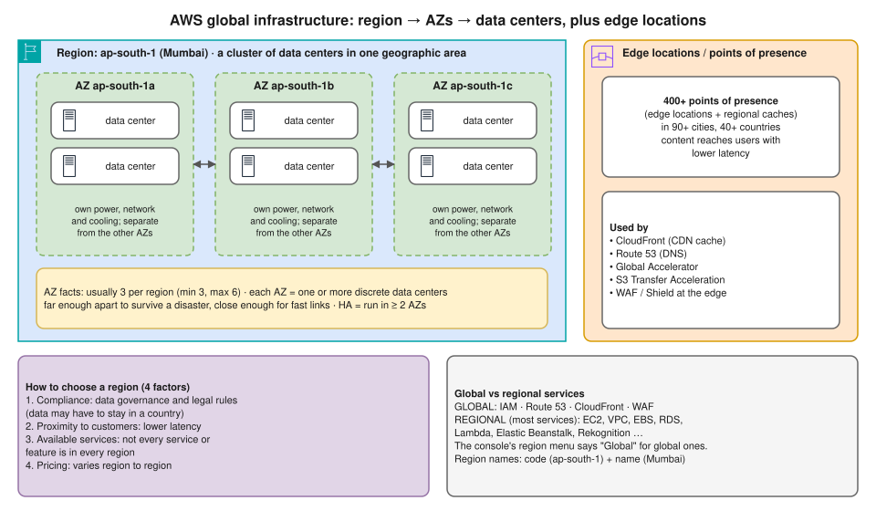

# AWS global infrastructure cheat sheet (course section 3: Getting started)

**What you learned (course section 3, "Getting started with AWS"):** what AWS is, its history, regions, availability zones, data centers, edge locations (points of presence), how to choose a region, and which services are global vs regional. Every later section (EC2, ELB, RDS, VPC) builds on these words, so learn them exactly.

> **How to use this page.** Read one section, close the page, and draw the diagram from memory: one region, three AZs, data centers inside, edge locations on the side. Then do the [drill](#from-memory-drill).

**Confidence tags.** `[Certain]` = in the course slides (v49) and AWS documentation. `[Likely]` = correct when written (Nov 2026), but AWS changes counts (regions, edge locations) often, so check [infrastructure.aws](https://infrastructure.aws/) before you quote a number.

## Contents

1. [What AWS is](#1-what-aws-is)
2. [AWS history and numbers](#2-aws-history-and-numbers)
3. [Regions](#3-regions)
4. [How to choose a region](#4-how-to-choose-a-region)
5. [Availability zones](#5-availability-zones)
6. [Edge locations (points of presence)](#6-edge-locations-points-of-presence)
7. [Global vs regional services](#7-global-vs-regional-services)
8. [SAA exam traps](#8-saa-exam-traps)
9. [From-memory drill](#from-memory-drill)
10. [30-second spoken answer](#30-second-spoken-answer)

---

## 1. What AWS is

| Fact | Detail |
|---|---|
| AWS | **Amazon Web Services**, a cloud provider. `[Certain]` |
| What it gives you | Servers and services you use **on demand** and **scale easily**. `[Certain]` |
| Who runs on it | Some of the biggest websites in the world, e.g. Amazon.com and Netflix. `[Certain]` |
| Use cases | Enterprise IT, backup and storage, big data analytics, website hosting, mobile and social apps, gaming. `[Certain]` |
| Course scope | The SAA-C03 course covers 30+ AWS services. |

## 2. AWS history and numbers

| Year | Event |
|---|---|
| 2002 | Launched internally at Amazon. |
| 2003 | Idea to sell Amazon's infrastructure as a product ("one of their core strengths"). |
| 2004 | Launched publicly with **SQS** (the first public service). |
| 2006 | Re-launched publicly with **SQS, S3 and EC2**. |
| 2007 | Launched in Europe. |

Numbers from the slides `[Likely]` (they change every year): about $90 billion annual revenue in 2023; 31% of the cloud market in Q1 2024 (Microsoft 2nd with 25%); leader in the Gartner Magic Quadrant for 13 years in a row; over 1,000,000 active users. You do not need these numbers for the exam.

## 3. Regions

- A **region** is a **cluster of data centers** in one geographic area. `[Certain]`
- AWS has regions all around the world (map: [infrastructure.aws](https://infrastructure.aws/)). `[Certain]`
- Each region has a **code** and a **name**: `us-east-1` (N. Virginia), `eu-west-3` (Paris), `ap-south-1` (Mumbai), `ap-southeast-2` (Sydney). `[Certain]`
- **Most AWS services are region-scoped**: an EC2 instance, an EBS volume or an RDS database created in Mumbai is not visible in the Sydney console. `[Certain]`
- Data never leaves a region without your explicit permission. `[Certain]`

## 4. How to choose a region

When you launch a new application, four factors decide the region `[Certain]`:

| # | Factor | Meaning | Example |
|---|---|---|---|
| 1 | **Compliance** | Data governance and legal requirements; data never leaves a region without your explicit permission. | Indian banking data must stay in India → `ap-south-1`. |
| 2 | **Proximity** to customers | Closer region = lower latency. | Users in India → Mumbai or Hyderabad, not Virginia. |
| 3 | **Available services** | New services and features are not in every region. | A new AI service may launch in `us-east-1` first. |
| 4 | **Pricing** | Prices vary region to region; listed on each service's pricing page. | `us-east-1` is often cheapest. |

Memory hook: **C-P-A-P** ("Compliance, Proximity, Availability, Price").

## 5. Availability zones

| Fact | Detail |
|---|---|
| Count | Each region has many AZs: **usually 3, minimum 3, maximum 6**. `[Certain]` |
| Names | Region code + letter: `ap-southeast-2a`, `ap-southeast-2b`, `ap-southeast-2c`. `[Certain]` |
| What an AZ is | **One or more discrete data centers** with redundant power, networking and connectivity. `[Certain]` |
| Isolation | AZs are separate from each other, so a disaster (fire, flood, power cut) in one does not hit the others. `[Certain]` |
| Links | AZs in a region are connected with **high-bandwidth, ultra-low-latency** networking. `[Certain]` |
| Why it matters | **High availability = run in at least 2 AZs.** This is why an ALB needs subnets in 2 AZs, RDS Multi-AZ puts a standby in another AZ, and an ASG spreads over AZs. |

Hierarchy to say out loud: **region → availability zones → data centers.**

## 6. Edge locations (points of presence)

- Amazon has **400+ points of presence** (400+ edge locations and 10+ regional caches) in **90+ cities across 40+ countries**. `[Likely]` (count changes)
- Purpose: deliver content to end users with **lower latency**. `[Certain]`
- Edge locations are **not** regions or AZs: you cannot launch an EC2 instance there.
- Services that use the edge (you will meet them later in the course): **CloudFront** (CDN), **Route 53** (DNS), **Global Accelerator**, **S3 Transfer Acceleration**, **WAF** and **Shield**.

## 7. Global vs regional services

| Scope | Services | How you see it in the console |
|---|---|---|
| **Global** `[Certain]` | **IAM**, **Route 53** (DNS), **CloudFront** (CDN), **WAF** (web application firewall) | The region menu shows "Global". |
| **Regional** (most services) `[Certain]` | **EC2** (Infrastructure as a Service), **Elastic Beanstalk** (Platform as a Service), **Lambda** (Function as a Service), **Rekognition** (Software as a Service), and also VPC, EBS, RDS, ELB… | You pick a region; resources exist only there. |

Which service is in which region: the AWS **Region Table** (regional product services page).

Cloud models from the examples above:

| Model | Meaning | Example |
|---|---|---|
| IaaS | You rent virtual servers, network and storage; you manage the OS. | EC2 |
| PaaS | You upload code; AWS runs the platform. | Elastic Beanstalk |
| FaaS | You upload a function; it runs on events. | Lambda |
| SaaS | A finished service you call. | Rekognition |

## 8. SAA exam traps

1. "IAM user created in `us-east-1`" is a trick: IAM is **global**.
2. An AZ is **one or more** data centers, not exactly one.
3. Usually 3 AZs per region, min 3, max 6 (the course's numbers).
4. "Lowest latency for users worldwide for static content" → CloudFront at **edge locations**, not more regions.
5. "Data must stay in country X" → choose the region for **compliance** first; price comes last.
6. "Highly available" in an answer = **multi-AZ**; "disaster recovery across regions" = **multi-region**.
7. Not every service or feature is in every region: check the region table before designing.

---

## From-memory drill

Type each answer before you open it.

**Q1. Draw the hierarchy of AWS global infrastructure and say what each level is.**

Answer

Region (cluster of data centers in one geographic area) → Availability Zones (usually 3, min 3, max 6; each is one or more discrete data centers with redundant power, networking and connectivity, isolated from each other, linked by low-latency networking) → data centers. On the side: edge locations / points of presence (400+), used by CloudFront, Route 53 etc. for low latency.

**Q2. Four factors for choosing a region, with one example each.**

Answer

Compliance (data must stay in India), proximity (users in India → Mumbai for low latency), available services (a new service only in us-east-1), pricing (varies by region). Hook: C-P-A-P.

**Q3. Name the four global services from the course and four regional ones with their cloud model.**

Answer

Global: IAM, Route 53, CloudFront, WAF. Regional: EC2 (IaaS), Elastic Beanstalk (PaaS), Lambda (FaaS), Rekognition (SaaS).

**Q4. What is an edge location and what is it NOT?**

Answer

A point of presence (400+ in 90+ cities, 40+ countries) that caches/serves content close to users for lower latency (CloudFront, Route 53, Global Accelerator). It is not a region or an AZ: you cannot launch EC2 there.

**Q5. Read the name `ap-southeast-2b`.**

Answer

Region `ap-southeast-2` (Sydney), availability zone `b`.

**Q6. Quick fire:** first public AWS service? year EC2 launched? what does HA mean in AWS terms?

Answer

SQS (2004) · 2006 (with S3 and SQS re-launch) · running in at least 2 AZs so you survive a data center loss.

## 30-second spoken answer

> *"AWS infrastructure is organised into regions, like ap-south-1 in Mumbai. A region is a cluster of data centers, and it's split into availability zones, usually three, at least three and at most six. Each AZ is one or more data centers with its own power and networking, isolated from the others but linked with low-latency connections, so for high availability I always run across at least two AZs. On top of that there are 400-plus edge locations that CloudFront and Route 53 use to serve users with low latency. I choose a region by compliance first, then latency to customers, then which services are available, then price. Most services are regional; IAM, Route 53, CloudFront and WAF are global."*
