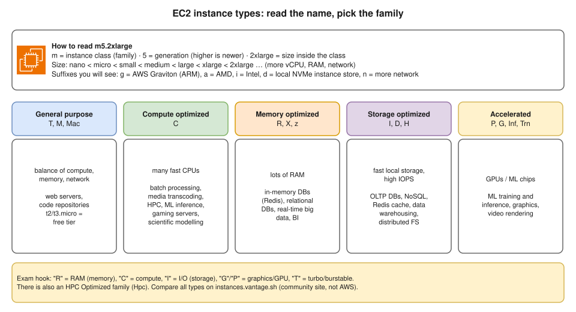
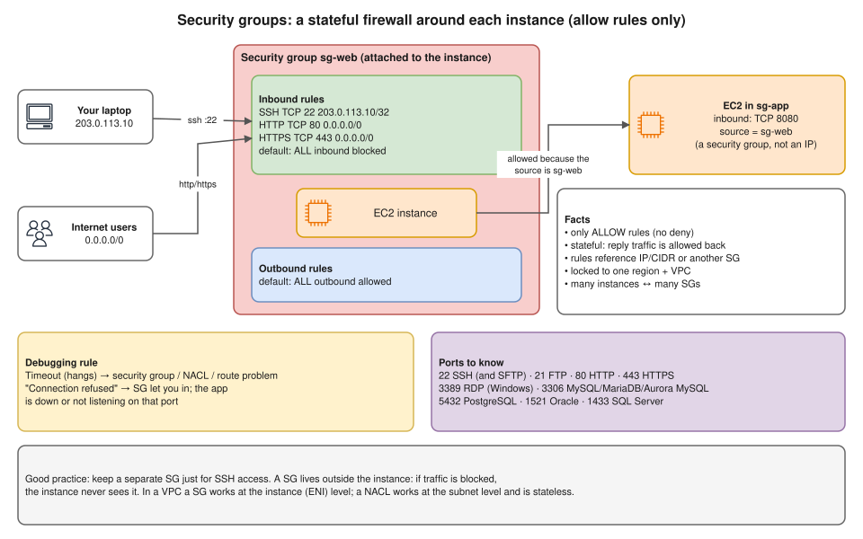
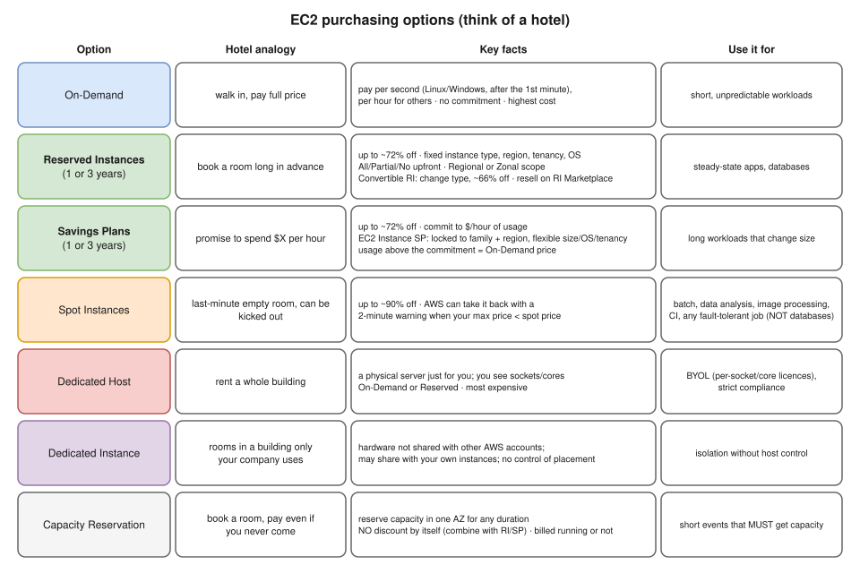
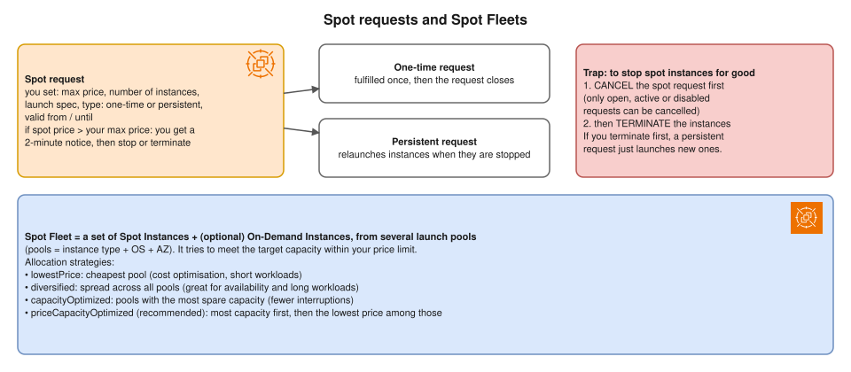

# EC2 fundamentals cheat sheet (course section 5: Amazon EC2 – Basics)



**What you learned (course section 5):** what EC2 is, sizing options, user data, instance types, security groups, the ports to know, SSH and EC2 Instance Connect, and every purchasing option (On-Demand, Reserved, Savings Plans, Spot, Dedicated Hosts/Instances, Capacity Reservations), plus Spot Fleets.

> **How to use this page.** Read one section, close the page, and draw the security group diagram and the purchasing-options table from memory. Then do the [drill](#from-memory-drill). Typing beats reading.

**Confidence tags.** `[Certain]` = in the course slides (v49) and AWS documentation. `[Likely]` = correct in Nov 2026, but discounts and prices change (the slides themselves say exact % are not needed for the exam). Commands are for **Ubuntu**; the AWS ones are **untested** here.

## Contents

1. [What EC2 is](#1-what-ec2-is)
2. [Sizing and configuration options](#2-sizing-and-configuration-options)
3. [User data](#3-user-data)
4. [Instance types](#4-instance-types)
5. [Security groups](#5-security-groups)
6. [Ports to know](#6-ports-to-know)
7. [Connecting: SSH and EC2 Instance Connect](#7-connecting-ssh-and-ec2-instance-connect)
8. [Purchasing options](#8-purchasing-options)
9. [Spot requests and Spot Fleets](#9-spot-requests-and-spot-fleets)
10. [SAA exam traps](#10-saa-exam-traps)
11. [From-memory drill](#from-memory-drill)
12. [30-second spoken answer](#30-second-spoken-answer)

---

## 1. What EC2 is

| Fact | Detail |
|---|---|
| Name | **Elastic Compute Cloud**, AWS's **Infrastructure as a Service**. `[Certain]` |
| Capabilities | Renting virtual machines (**EC2**), storing data on virtual drives (**EBS**), distributing load across machines (**ELB**), scaling services with an auto-scaling group (**ASG**). `[Certain]` |
| Why it matters | Knowing EC2 is fundamental to understanding how the cloud works. |
| Lifecycle | **Start / stop / terminate**. Stop keeps EBS data; terminate deletes the root EBS volume by default. |

## 2. Sizing and configuration options

When you launch an instance you choose `[Certain]`:

- **Operating system**: Linux, Windows or macOS.
- **CPU**: compute power and cores.
- **RAM**: memory.
- **Storage**: network-attached (**EBS** and **EFS**) or hardware (**EC2 Instance Store**).
- **Network card**: speed, public IP address.
- **Firewall rules**: **security group**.
- **Bootstrap script** (first launch): **EC2 user data**.

## 3. User data

- **Bootstrapping** = running commands when a machine starts. `[Certain]`
- The user data script runs **only once, at the instance's first start**. `[Certain]`
- It runs as the **root user** (no `sudo` needed). `[Certain]`
- Used for: installing updates, installing software, downloading common files from the internet, anything you can script. `[Certain]`

The web server from the course hands-on, as user data (Amazon Linux 2023 uses `dnf`; Amazon Linux 2 used `yum`):

```bash
#!/bin/bash
# runs as root, once, at first boot
dnf update -y
dnf install -y httpd
systemctl start httpd
systemctl enable httpd
echo "<h1>Hello World from $(hostname -f)</h1>" > /var/www/html/index.html
```

If you launch an **Ubuntu** AMI instead, the same idea is:

```bash
#!/bin/bash
apt-get update -y
apt-get install -y nginx
systemctl enable --now nginx
echo "<h1>Hello from $(hostname -f)</h1>" > /var/www/html/index.html
```

Debug user data on the instance: `sudo cat /var/log/cloud-init-output.log`.

## 4. Instance types

**Naming:** `m5.2xlarge` → `m` = instance class, `5` = generation (AWS improves them over time), `2xlarge` = size within the class. `[Certain]`

| Family | Classes | Good for `[Certain]` |
|---|---|---|
| **General purpose** | T, M (Mac) | Diversity of workloads: **web servers, code repositories**. Balance of compute, memory, networking. The course uses **t2.micro** (free tier). |
| **Compute optimized** | C | Compute-intensive tasks needing high-performance processors: **batch processing, media transcoding, high-performance web servers, HPC, scientific modelling and ML, dedicated gaming servers**. |
| **Memory optimized** | R, X, z | Fast performance for large data sets **in memory**: high-performance relational/non-relational DBs, distributed web-scale cache stores, in-memory DBs optimised for BI, real-time processing of big unstructured data. |
| **Storage optimized** | I, D, H | High, sequential read/write to large data sets on **local storage**: high-frequency **OLTP**, relational and NoSQL DBs, cache for in-memory DBs (Redis), **data warehousing**, distributed file systems. |
| **Accelerated computing** | P, G, Inf, Trn | GPUs and ML chips: ML training/inference, graphics, video. |
| **HPC optimized** | Hpc | Large, tightly coupled HPC jobs. |

Example sizes from the slides `[Certain]`:

| Instance | vCPU | Memory (GiB) | Storage | Network | EBS bandwidth (Mbps) |
|---|---|---|---|---|---|
| t2.micro | 1 | 1 | EBS only | Low to moderate | – |
| t2.xlarge | 4 | 16 | EBS only | Moderate | – |
| c5d.4xlarge | 16 | 32 | 1 × 400 NVMe SSD | Up to 10 Gbps | 4,750 |
| r5.16xlarge | 64 | 512 | EBS only | 20 Gbps | 13,600 |
| m5.8xlarge | 32 | 128 | EBS only | 10 Gbps | 6,800 |

Compare all types: [instances.vantage.sh](https://instances.vantage.sh) (community site). Hook: **R = RAM, C = compute, I = I/O, G/P = GPU, T = burstable.**

## 5. Security groups



| Fact | Detail `[Certain]` |
|---|---|
| What | The fundamental of network security in AWS: a **firewall** around EC2 instances. |
| Controls | Access to **ports**, authorised **IP ranges** (IPv4 and IPv6), **inbound** (others → instance) and **outbound** (instance → others) traffic. |
| Rules | Only **allow** rules. A rule references an **IP/CIDR** or **another security group**. |
| Defaults | **All inbound blocked**, **all outbound allowed**. |
| Stateful | Return traffic of an allowed connection is allowed automatically. |
| Scope | **Locked to a region / VPC** combination. |
| Attach | One SG can be attached to **many instances**; an instance can have **many SGs**. |
| Where it lives | **Outside** the instance: if traffic is blocked, the instance never sees it. |
| Good practice | Keep **one separate security group for SSH** access. |

**Debugging rule (interview favourite):**

| Symptom | Meaning |
|---|---|
| **Timeout** (hangs) | Security group problem (or NACL/route): traffic is dropped. |
| **"Connection refused"** | The SG let you in; the **application** errored or is not running/listening. |

**Referencing another SG:** instance B's SG allows port 123 from "SG 1". Any instance with SG 1 attached can reach B on 123, whatever its IP. This is how you write "app servers accept traffic only from the load balancer". `[Certain]`

## 6. Ports to know

| Port | Protocol | Use `[Certain]` |
|---|---|---|
| 22 | SSH | Log into a Linux instance |
| 21 | FTP | Upload files into a file share |
| 22 | SFTP | Upload files using SSH |
| 80 | HTTP | Unsecured websites |
| 443 | HTTPS | Secured websites |
| 3389 | RDP | Log into a Windows instance |

Database ports come in [section 9](07-rds-aurora-elasticache.md#13-ports-to-know): 3306 MySQL/MariaDB/Aurora MySQL, 5432 PostgreSQL, 1521 Oracle, 1433 SQL Server.

## 7. Connecting: SSH and EC2 Instance Connect

| Your OS | Method |
|---|---|
| Mac, Linux (your Ubuntu laptop), Windows ≥ 10 | `ssh` |
| Windows < 10 | PuTTY |
| Any (browser) | **EC2 Instance Connect** |

SSH from Ubuntu:

```bash
chmod 0400 ~/Downloads/EC2Tutorial.pem          # ssh refuses a key others can read
ssh -i ~/Downloads/EC2Tutorial.pem ec2-user@<public-ip>   # Amazon Linux user
ssh -i ~/Downloads/EC2Tutorial.pem ubuntu@<public-ip>     # Ubuntu AMI user
```

Optional `~/.ssh/config` so you can type `ssh myec2`:

```text
Host myec2
    HostName <public-ip>
    User ec2-user
    IdentityFile ~/Downloads/EC2Tutorial.pem
```

- You SSH to the **public IP**: the private IP is not reachable from your laptop (different network). `[Certain]`
- **EC2 Instance Connect** `[Certain]`: connect from the browser, no key file needed; AWS uploads a **temporary key**; works out of the box with **Amazon Linux 2** (and AL2023); **port 22 must still be open** in the SG.
- If SSH fails: re-check the lecture, the troubleshooting guide, then try Instance Connect. Common causes: SG port 22 not open to your IP, wrong user name, key permissions, instance in a private subnet.
- Never put access keys on an instance (`aws configure` on EC2 is a bad practice): attach an **IAM role** instead ([IAM sheet](01-iam-cheat-sheet.md#10-roles-and-sts)).

## 8. Purchasing options



| Option | Key facts `[Certain]` | Best for |
|---|---|---|
| **On-Demand** | Pay for what you use: **Linux/Windows billed per second after the first minute**, other OS per hour. Highest cost, no upfront, no commitment. | Short-term, uninterrupted workloads whose behaviour you can't predict. |
| **Reserved Instances** (1 or 3 years) | Up to **72%** off. You reserve instance type, region, tenancy, OS. Period 1 yr (+) or 3 yr (+++). Payment No/Partial/All upfront (+/++/+++). Scope **Regional** or **Zonal** (zonal reserves capacity in an AZ). Buy/sell on the **RI Marketplace**. | Steady-state apps (think **database**). |
| **Convertible RI** | Can change instance type, family, OS, scope and tenancy. Up to **66%** off. | Long workloads with flexible instances. |
| **Savings Plans** (1 or 3 years) | Up to **72%** (same as RIs). Commit to an amount of usage (e.g. **$10/hour**). Usage beyond the plan = On-Demand price. **EC2 Instance Savings Plan** is locked to an instance **family + region** (e.g. M5 in us-east-1), flexible across **size** (m5.xlarge ↔ m5.2xlarge), **OS** (Linux/Windows) and **tenancy** (host, dedicated, default). | Long workloads that change size. |
| **Spot Instances** | Up to **90%** off. You can **lose** them at any time if your **max price < current spot price**. The **most cost-efficient** option. | Workloads resilient to failure: batch jobs, data analysis, image processing, distributed workloads, flexible start/end. **Not** critical jobs or databases. |
| **Dedicated Host** | A **physical server** with EC2 capacity fully dedicated to you. Address compliance; use existing **server-bound licences** (per-socket, per-core, per-VM). On-Demand (pay per second for an active host) or Reserved 1/3 yr. **Most expensive**. | **BYOL** with complicated licensing, strong regulatory/compliance needs. |
| **Dedicated Instance** | Runs on hardware dedicated to you; may share hardware with other instances **in the same account**; **no control over placement** (can move hardware after stop/start). | Isolation from other customers without managing the host. |
| **Capacity Reservation** | Reserve **On-Demand capacity in a specific AZ** for any duration. **No time commitment** (create/cancel any time), **no discount**. Charged at On-Demand rate **whether you run instances or not**. Combine with **Regional RIs / Savings Plans** for a discount. | Short-term, uninterrupted workloads that must be in a specific AZ. |

**Hotel analogy (from the course):** On-Demand = come and stay whenever, pay full price. Reserved = plan ahead, long stay, good discount. Savings Plans = pay a certain amount per hour and stay in any room type. Spot = people bid for empty rooms; highest bidder keeps them; you can be kicked out any time. Dedicated Host = book an entire building. Capacity Reservation = book a room for a period at full price even if you don't stay.

**Price example from the slides (m4.large, us-east-1, per hour)** `[Likely]` (illustrative only):

| Price type | Price |
|---|---|
| On-Demand | $0.10 |
| Spot | $0.038–0.039 (up to 61% off) |
| Reserved 1 yr | $0.062 (No Upfront) – $0.058 (All Upfront) |
| Reserved 3 yr | $0.043 (No Upfront) – $0.037 (All Upfront) |
| EC2 Savings Plan 1 yr | $0.062 – $0.058 |
| Convertible RI 1 yr | $0.071 – $0.066 |
| Dedicated Host | On-Demand price |
| Dedicated Host Reservation | Up to 70% off |
| Capacity Reservation | On-Demand price |

## 9. Spot requests and Spot Fleets



**Spot request** `[Certain]`:

- Define a **max spot price**; you get the instance while **current spot price < max**.
- The hourly spot price varies with offer and capacity.
- If current spot price > your max: choose to **stop or terminate** the instance, with a **2-minute grace period**.
- Request types: **one-time** (fulfilled once, then closes) or **persistent** (keeps relaunching instances when they are stopped/interrupted), with a valid-from / valid-until window.

**How to terminate spot instances (exam trap)** `[Certain]`:

1. You can only cancel spot requests that are **open, active or disabled**.
2. **Cancelling a spot request does not terminate its instances.**
3. So: **first cancel the spot request, then terminate the instances.** If you terminate first, a persistent request launches new ones.

**Spot Fleet** `[Certain]`:

- A set of **Spot Instances + optional On-Demand Instances**.
- Tries to meet the **target capacity** within **price constraints**; stops launching at capacity or max cost.
- You define possible **launch pools**: instance type (m5.large), OS, AZ. Multiple pools so the fleet can choose.
- Allocation strategies:

| Strategy | What it does | Use |
|---|---|---|
| `lowestPrice` | From the pool with the lowest price | Cost optimisation, short workloads |
| `diversified` | Spread across all pools | Great for availability, long workloads |
| `capacityOptimized` | Pool with the optimal capacity for the number of instances | Fewer interruptions |
| `priceCapacityOptimized` (**recommended**) | Pools with the highest capacity available, then the lowest price among them | Best choice for most workloads |

Spot Fleets let you automatically request Spot Instances at the lowest price.

## 10. SAA exam traps

1. "Steady 24/7 database for 3 years, cheapest" → **Reserved Instance** (or Savings Plan), 3 yr, All Upfront.
2. "Batch job that can be interrupted, cheapest" → **Spot**. "Can't be interrupted" → never Spot.
3. "Existing per-core/per-socket licence (BYOL)" or "must see sockets/cores" → **Dedicated Host**, not Dedicated Instance.
4. "Need guaranteed capacity in one AZ for a 3-day event, no long commitment" → **Capacity Reservation** (no discount by itself).
5. "Flexible across instance size and OS, committed spend" → **Savings Plan**.
6. "Change instance family later" → **Convertible RI**.
7. Timeout = security group; connection refused = application.
8. Security groups have **no deny** rules (use a NACL to block one IP).
9. User data runs **once**, at **first** boot, as **root**.
10. Stopping spot instances for good: **cancel the request first**, then terminate.
11. Spot Fleet strategy for most workloads: **priceCapacityOptimized**.
12. A security group is locked to one **region/VPC**; you can't attach an SG from another VPC.

---

## From-memory drill

**Q1. Read `c5d.4xlarge` and say which family it is and one use case.**

<details><summary>Answer</summary>

`c` = compute optimized class, `5` = generation, `d` = local NVMe instance store, `4xlarge` = size (16 vCPU, 32 GiB in the slides' table). Use: batch processing, media transcoding, HPC, gaming servers.
</details>

**Q2. Which family for: an in-memory BI database? a data warehouse on local disks? a web server?**

<details><summary>Answer</summary>

Memory optimized (R/X) · storage optimized (I/D/H) · general purpose (T/M).
</details>

**Q3. Five facts about EC2 user data.**

<details><summary>Answer</summary>

Bootstrapping script; runs once at first start; runs as root; used to install updates/software, download files; log at /var/log/cloud-init-output.log.
</details>

**Q4. Security groups: defaults, rule types, stateful or not, scope, and the timeout vs refused rule.**

<details><summary>Answer</summary>

Inbound all blocked, outbound all allowed; allow rules only, by IP/CIDR or another SG; stateful; locked to region/VPC, attach to many instances. Timeout = SG/network blocks it; connection refused = the app is down or not listening.
</details>

**Q5. Six classic ports.**

<details><summary>Answer</summary>

22 SSH, 21 FTP, 22 SFTP, 80 HTTP, 443 HTTPS, 3389 RDP.
</details>

**Q6. Type the commands to SSH from Ubuntu with a downloaded key to Amazon Linux.**

<details><summary>Answer</summary>

```bash
chmod 0400 EC2Tutorial.pem
ssh -i EC2Tutorial.pem ec2-user@<public-ip>
```
</details>

**Q7. All seven purchasing options with the discount and one use each.**

<details><summary>Answer</summary>

On-Demand (none; short unpredictable) · Reserved (up to 72%; steady DB) · Convertible RI (up to 66%; flexible family) · Savings Plans (up to 72%; committed $/hour, flexible size/OS/tenancy) · Spot (up to 90%; fault-tolerant batch) · Dedicated Host (most expensive; BYOL/compliance) · Dedicated Instance (hardware not shared with other accounts) · Capacity Reservation (no discount; guaranteed capacity in an AZ, billed even if unused).
</details>

**Q8. Dedicated Host vs Dedicated Instance in two lines.**

<details><summary>Answer</summary>

Host: a whole physical server for you, you see sockets/cores and control placement → BYOL, compliance. Instance: hardware not shared with other accounts, but no visibility or control of the host or placement.
</details>

**Q9. How do you stop spot instances permanently, and why does the order matter?**

<details><summary>Answer</summary>

Cancel the spot request (open/active/disabled only) first, then terminate the instances. Cancelling doesn't terminate instances, and terminating first lets a persistent request relaunch them.
</details>

**Q10. Four Spot Fleet strategies and which one is recommended.**

<details><summary>Answer</summary>

lowestPrice, diversified, capacityOptimized, priceCapacityOptimized (recommended: highest capacity pools first, then lowest price).
</details>

**Q11. Quick fire:** On-Demand Linux billing unit? spot warning time? RI scopes? EC2 Instance Connect needs which port?

<details><summary>Answer</summary>

Per second after the first minute · 2 minutes · Regional or Zonal · 22.
</details>

## 30-second spoken answer

> *"EC2 is AWS's infrastructure-as-a-service: I pick an AMI, an instance type like m5.2xlarge, where m is the family, 5 the generation and 2xlarge the size, storage on EBS or instance store, a security group and a user data script that runs once as root at first boot. Security groups are stateful allow-only firewalls; inbound is blocked and outbound allowed by default, and I reference the load balancer's security group instead of IPs. If a connection times out it's the security group; if it's refused it's the app. For cost, I use On-Demand for unpredictable work, Reserved Instances or Savings Plans for steady workloads, up to 72% off, Spot for interruptible batch jobs, up to 90% off, Dedicated Hosts for per-core licences, and Capacity Reservations when I must have capacity in one AZ."*
