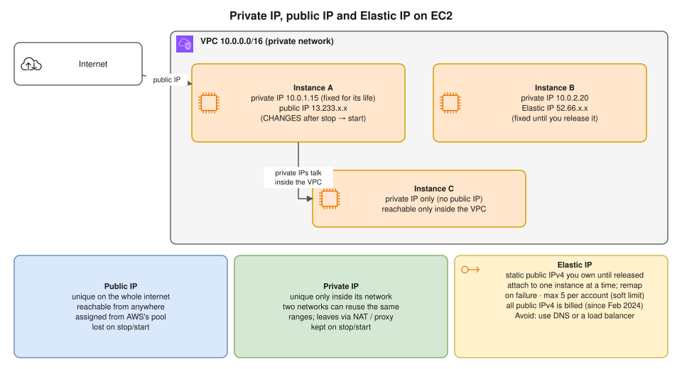
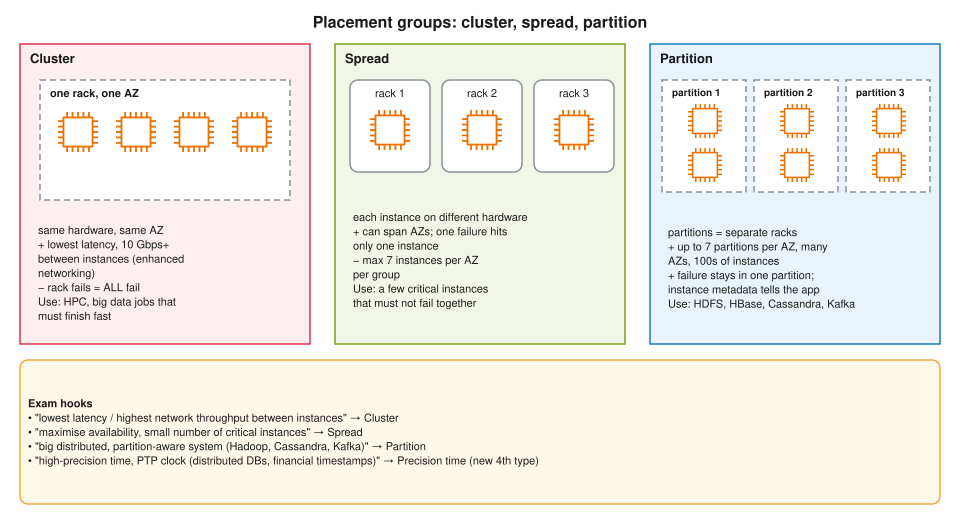
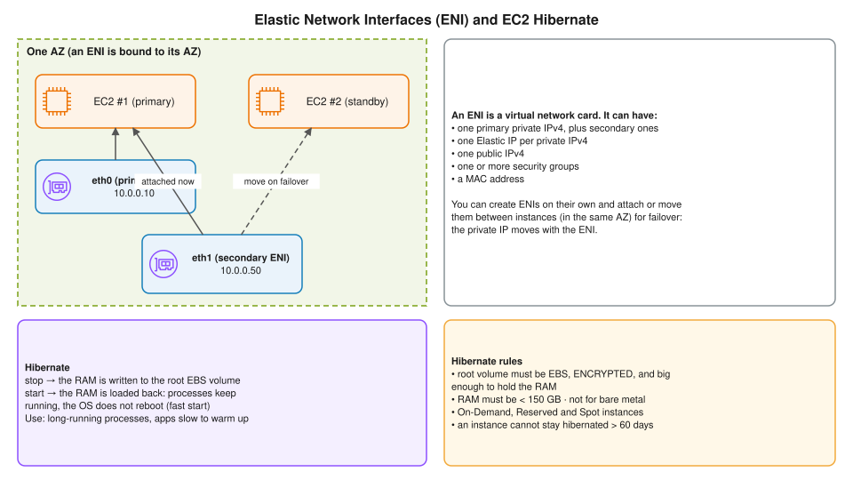

# EC2 associate-level cheat sheet (course section 6: Amazon EC2 – Associate)



**What you learned (course section 6):** public vs private IPv4, Elastic IPs, placement groups (cluster, spread, partition, precision time), Elastic Network Interfaces (ENI) and EC2 Hibernate.

> **How to use this page.** Draw the three placement groups from memory and say one use case for each. Then do the [drill](#from-memory-drill).

**Confidence tags.** `[Certain]` = in the course slides (v49) and AWS documentation. `[Likely]` = correct in Nov 2026 but may change (pricing, limits).

## Contents

1. [IPv4 vs IPv6](#1-ipv4-vs-ipv6)
2. [Public vs private IP](#2-public-vs-private-ip)
3. [Elastic IP](#3-elastic-ip)
4. [IPs on EC2 in practice](#4-ips-on-ec2-in-practice)
5. [Placement groups](#5-placement-groups)
6. [Elastic Network Interfaces (ENI)](#6-elastic-network-interfaces-eni)
7. [EC2 Hibernate](#7-ec2-hibernate)
8. [SAA exam traps](#8-saa-exam-traps)
9. [From-memory drill](#from-memory-drill)
10. [30-second spoken answer](#30-second-spoken-answer)

---

## 1. IPv4 vs IPv6

| | IPv4 | IPv6 |
|---|---|---|
| Example | `1.160.10.240` | `3ffe:1900:4545:3:200:f8ff:fe21:67cf` |
| Format | `[0-255].[0-255].[0-255].[0-255]` | 8 groups of hex |
| Use | Still the most common online; used in the course | Newer; solves problems for IoT (many more addresses) |
| Size | About 3.7 billion public addresses `[Certain]` (slides' figure) | Effectively unlimited |

## 2. Public vs private IP

| | Public IP | Private IP |
|---|---|---|
| Identified on | The **internet (WWW)** | A **private network only** |
| Uniqueness | Unique across the **whole web** | Unique only inside its private network; **two companies can reuse the same private ranges** |
| Geo-location | Can be geo-located easily | No |
| Reaching the internet | Directly | Through a **NAT + internet gateway** (a proxy) |
| Ranges | Assigned by registries / AWS pool | Only specific ranges: `10.0.0.0/8`, `172.16.0.0/12`, `192.168.0.0/16` |

`[Certain]` (the slides' example: Company A and Company B both use `192.168.0.1/22` internally and reach the web through their own internet gateways with different public IPs).

## 3. Elastic IP

- When you **stop and then start** an EC2 instance, its **public IP can change**. `[Certain]`
- An **Elastic IP** is a **static public IPv4 you own as long as you don't delete (release) it**. `[Certain]`
- You can attach it to **one instance at a time**. `[Certain]`
- Use: **mask an instance/software failure** by rapidly remapping the address to another instance in your account. `[Certain]`
- Limit: **5 Elastic IPs per account** by default (ask AWS to raise it). `[Certain]`
- **Try to avoid Elastic IPs** `[Certain]`: they often reflect poor architecture. Instead use a random public IP with a **DNS name** registered to it, or a **load balancer** with no public IP on the instances.
- Cost: since Feb 2024 AWS charges for **every public IPv4 address**, attached or not (about $0.005 per hour). `[Likely]` (check current pricing)

## 4. IPs on EC2 in practice

- By default an EC2 instance gets a **private IP** (internal AWS network) and a **public IP** (WWW). `[Certain]`
- When you SSH from your laptop you **must use the public IP**: you are not in the same network, so the private IP is unreachable. `[Certain]`
- After stop → start the public IP **can change**; the private IP stays for the instance's life.
- See them from inside the instance (Ubuntu or Amazon Linux):

```bash
ip -4 addr show                         # private IP on the ENI (eth0 / ens5)
TOKEN=$(curl -s -X PUT "http://169.254.169.254/latest/api/token" -H "X-aws-ec2-metadata-token-ttl-seconds: 60")
curl -s -H "X-aws-ec2-metadata-token: $TOKEN" http://169.254.169.254/latest/meta-data/public-ipv4
curl -s -H "X-aws-ec2-metadata-token: $TOKEN" http://169.254.169.254/latest/meta-data/local-ipv4
```

(The public IP is **not** on the instance's network card: AWS does 1:1 NAT at the internet gateway, so `ip addr` shows only the private IP.)

## 5. Placement groups



You control EC2 placement strategy with a placement group. Strategies `[Certain]`:

| Strategy | How instances are placed | Pros | Cons | Use cases |
|---|---|---|---|---|
| **Cluster** | Low-latency group in a **single AZ** (same rack / hardware) | Great network: **10 Gbps** between instances with **Enhanced Networking** (recommended) | If the AZ (or rack) fails, **all instances fail at the same time** | Big data job that must complete fast; apps needing extremely low latency and high network throughput (HPC) |
| **Spread** | Each instance on **different physical hardware**; can **span AZs** | Reduced risk of simultaneous failure | **Max 7 instances per AZ per placement group** | Apps that must maximise HA; critical apps where each instance must be isolated from the others' failures |
| **Partition** | Instances spread across **partitions**, each on **different sets of racks**; **up to 7 partitions per AZ**; can span **multiple AZs in the same region**; up to **100s of instances** | A partition failure affects many instances but **not other partitions**; instances see their partition in **instance metadata** | – | **HDFS, HBase, Cassandra, Kafka** (big, partition-aware systems) |
| **Precision time** (new) | Hardware with direct access to **high-precision time sources** | Enhanced Amazon Time Sync Service (more accurate than standard NTP); **PTP hardware clock** + hardware packet timestamping (Linux only) | – | Distributed databases, financial timestamping, event ordering |

Exam hooks: "lowest latency between instances" → **cluster**; "a few critical instances that must not fail together" → **spread**; "Hadoop/Cassandra/Kafka" → **partition**; "high-precision clock" → **precision time**.

## 6. Elastic Network Interfaces (ENI)



- A **logical component in a VPC** that represents a **virtual network card**. `[Certain]`
- An ENI can have `[Certain]`:
  - a **primary private IPv4**, plus one or more **secondary IPv4**
  - **one Elastic IP (IPv4) per private IPv4**
  - **one public IPv4**
  - **one or more security groups**
  - a **MAC address**
- You can **create ENIs independently** and **attach/move them on the fly** between instances **for failover**: the private IP (and its Elastic IP) moves with the ENI. `[Certain]`
- An ENI is **bound to a specific AZ**: you can only attach it to instances in that AZ. `[Certain]`
- Every instance has a primary ENI (`eth0`) that can't be detached; extra ones are `eth1`, `eth2`…

## 7. EC2 Hibernate

**Normal stop/start** `[Certain]`:

- **Stop**: data on EBS is kept for the next start.
- **Terminate**: EBS volumes set to be destroyed (the root by default) are lost.
- On start: **first start** = OS boots and the **user data** script runs; **later starts** = OS boots; then the app starts and caches warm up, which can take time.

**Hibernate** `[Certain]`:

- The **in-memory (RAM) state is preserved**; boot is much faster because the OS is not stopped/restarted.
- Under the hood: the **RAM is written to a file on the root EBS volume**; the root volume **must be encrypted**.
- States: running → stopping (RAM dumped) → stopped → start → running with RAM restored.
- Use cases: **long-running processing**, **saving the RAM state**, **services that take time to initialise**.

**Hibernate rules** `[Certain]`:

| Rule | Value |
|---|---|
| Instance families | C3, C4, C5, I3, M3, M4, R3, R4, T2, T3, … (many; check docs) |
| RAM size | **Less than 150 GB** |
| Instance size | **Not** for bare-metal instances |
| AMIs | Amazon Linux 2, Linux AMI, Ubuntu, RHEL, CentOS, Windows… |
| Root volume | Must be **EBS**, **encrypted**, **not instance store**, and **large enough** to hold the RAM |
| Purchase options | On-Demand, Reserved and Spot |
| Max duration | An instance can **not** be hibernated more than **60 days** |

## 8. SAA exam traps

1. "Public IP changed after I stopped and started the instance" → expected; use an **Elastic IP** only if you truly need a fixed IP, otherwise DNS or a load balancer.
2. Elastic IP default limit = **5 per account** (soft limit).
3. Spread placement group = **max 7 instances per AZ per group**.
4. Partition placement group = **max 7 partitions per AZ**, but **hundreds of instances**.
5. Cluster = **one AZ** only, so it is **not** highly available.
6. An ENI is **AZ-bound**: failover by moving an ENI works only inside one AZ.
7. Hibernate needs an **encrypted EBS root volume**, RAM **< 150 GB**, not bare metal, max **60 days**.
8. You cannot SSH to a private IP from your laptop over the internet.

---

## From-memory drill

**Q1. Public vs private IP: four differences.**

<details><summary>Answer</summary>

Public: identified on the internet, unique worldwide, geo-locatable, reachable directly. Private: only inside a private network, unique only there (companies reuse ranges), reaches the internet via NAT + internet gateway, only 10/8, 172.16/12, 192.168/16.
</details>

**Q2. What is an Elastic IP, its limit, and why avoid it? What to use instead?**

<details><summary>Answer</summary>

A static public IPv4 you own until you release it, attached to one instance at a time, remappable to mask failures. 5 per account (soft). Avoid: poor architecture and billed; use DNS on a random public IP, or a load balancer with instances having no public IP.
</details>

**Q3. Four placement group strategies with one use case and one limit each.**

<details><summary>Answer</summary>

Cluster: one AZ, 10 Gbps low latency; HPC/big data; AZ failure kills all. Spread: separate hardware, spans AZs; critical instances; max 7 per AZ per group. Partition: separate racks per partition, up to 7 partitions per AZ, many AZs, 100s of instances; Hadoop/Cassandra/Kafka. Precision time: PTP hardware clock; distributed DBs/financial timestamps; Linux only for PTP.
</details>

**Q4. List the attributes an ENI can have, and its one big limitation.**

<details><summary>Answer</summary>

Primary private IPv4 + secondary IPv4s, one Elastic IP per private IPv4, one public IPv4, one or more SGs, a MAC address. Bound to one AZ.
</details>

**Q5. How does hibernate work, and its rules?**

<details><summary>Answer</summary>

RAM is saved to a file on the encrypted root EBS volume; on start it's restored so the OS doesn't reboot (fast). Rules: RAM < 150 GB, no bare metal, root EBS encrypted and big enough (not instance store), On-Demand/Reserved/Spot, max 60 days, supported families/AMIs only.
</details>

**Q6. On the instance, type how you get its public IP (IMDSv2).**

<details><summary>Answer</summary>

```bash
TOKEN=$(curl -s -X PUT "http://169.254.169.254/latest/api/token" -H "X-aws-ec2-metadata-token-ttl-seconds: 60")
curl -s -H "X-aws-ec2-metadata-token: $TOKEN" http://169.254.169.254/latest/meta-data/public-ipv4
```
</details>

## 30-second spoken answer

> *"Every EC2 instance has a private IP for the VPC and usually a public IP that changes after a stop and start; if I need a fixed one I can use an Elastic IP, but I prefer DNS or a load balancer, and every public IPv4 is billed now. For placement, a cluster group puts instances on the same hardware in one AZ for the lowest latency, a spread group puts each on different hardware, up to seven per AZ, for critical instances, and a partition group spreads racks into up to seven partitions per AZ for Kafka or Cassandra. An ENI is a virtual network card in one AZ that I can move to a standby instance for failover. Hibernate saves RAM to the encrypted root EBS volume so the instance resumes fast, under 150 GB of RAM and for up to 60 days."*
