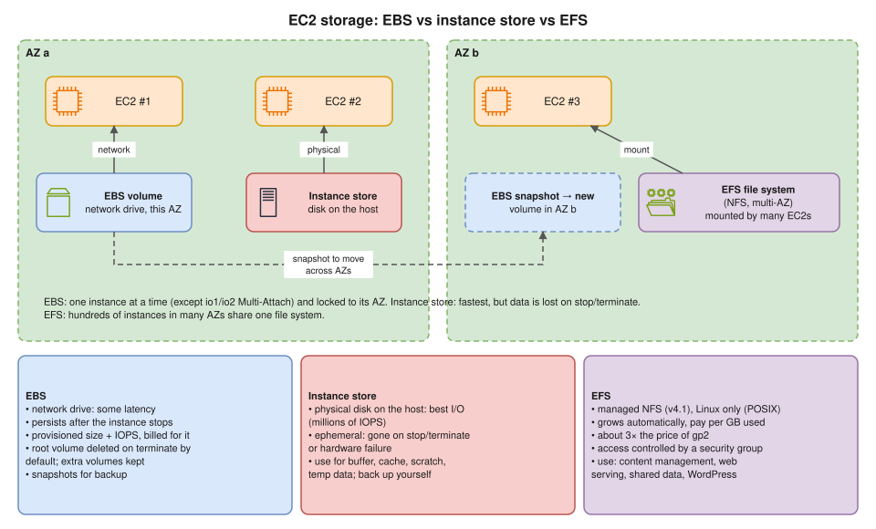
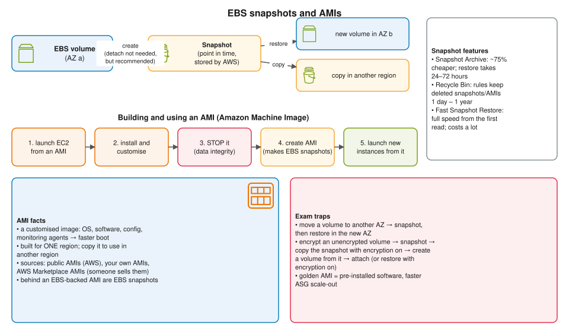
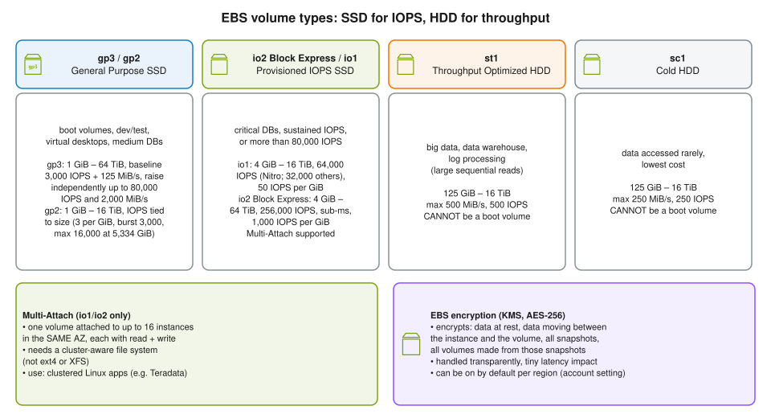
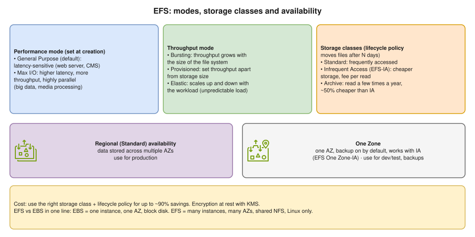

# EC2 instance storage cheat sheet (course section 7: EBS, AMI, instance store, EFS)



**What you learned (course section 7):** EBS volumes, delete on termination, snapshots and their features, AMIs, EC2 instance store, the EBS volume types, Multi-Attach, EBS encryption, EFS (modes, classes, availability), and EBS vs EFS vs instance store.

> **How to use this page.** Draw the diagram above from memory, then fill the volume-types table from memory. Then do the [drill](#from-memory-drill).

**Confidence tags.** `[Certain]` = in the course slides (v49) and AWS documentation. `[Likely]` = correct in Nov 2026 but limits change: **gp3 limits were raised in 2025** (64 TiB, 80,000 IOPS, 2,000 MiB/s); older material still says 16 TiB / 16,000 / 1,000. The slides (v49) use the new numbers. Ubuntu commands are standard Linux; AWS CLI lines are **untested** here.

## Contents

1. [EBS volume](#1-ebs-volume)
2. [Delete on termination](#2-delete-on-termination)
3. [EBS snapshots](#3-ebs-snapshots)
4. [AMI](#4-ami)
5. [EC2 instance store](#5-ec2-instance-store)
6. [EBS volume types](#6-ebs-volume-types)
7. [EBS Multi-Attach](#7-ebs-multi-attach)
8. [EBS encryption](#8-ebs-encryption)
9. [Amazon EFS](#9-amazon-efs)
10. [EBS vs EFS vs instance store](#10-ebs-vs-efs-vs-instance-store)
11. [Hands-on on Ubuntu: format and mount a new EBS volume](#11-hands-on-on-ubuntu-format-and-mount-a-new-ebs-volume)
12. [SAA exam traps](#12-saa-exam-traps)
13. [From-memory drill](#from-memory-drill)
14. [30-second spoken answer](#30-second-spoken-answer)

---

## 1. EBS volume

| Fact | Detail `[Certain]` |
|---|---|
| Name | **Elastic Block Store** volume |
| What | A **network drive** you attach to instances while they run. Analogy: a **"network USB stick"**. |
| Persistence | Lets instances **persist data, even after termination**. |
| Attach | Mounted to **one instance at a time** (at the CCP level; Multi-Attach for io1/io2 is the exception). |
| AZ | **Bound to a specific AZ**: a volume in `us-east-1a` cannot attach to an instance in `us-east-1b`. To move it, **snapshot** first. |
| Network | Not a physical drive: uses the network, so there may be a **bit of latency**. Can be detached and attached to another instance quickly. |
| Capacity | **Provisioned** size (GB) and IOPS; **billed for all provisioned capacity**; you can **increase** capacity over time. |
| Unattached | A volume can exist unattached (still billed). |
| Free tier | 30 GB of gp2/gp3 per month `[Likely]`. |

## 2. Delete on termination

| Volume | Default `[Certain]` |
|---|---|
| **Root** EBS volume | **Deleted** when the instance terminates (attribute **enabled**) |
| **Other** attached EBS volumes | **Not deleted** (attribute **disabled**) |

Change it in the console or CLI. Use case: **preserve the root volume** when the instance is terminated (untick "delete on termination").

## 3. EBS snapshots



- A **backup of your EBS volume at a point in time**. `[Certain]`
- **Not necessary to detach** the volume to snapshot it, **but recommended** (consistency). `[Certain]`
- Can **copy snapshots across AZs or regions**: this is how you move data to another AZ (snapshot → restore in the new AZ). `[Certain]`
- Snapshots are **incremental** (only changed blocks after the first) and stored by AWS (in S3, managed for you). `[Likely]`
- EBS backups use I/O: **don't run them while the app handles heavy traffic**. `[Certain]`

**Snapshot features** `[Certain]`:

| Feature | What it does | Remember |
|---|---|---|
| **EBS Snapshot Archive** | Move a snapshot to an "archive tier" that is **75% cheaper** | Restore takes **24 to 72 hours** |
| **Recycle Bin** for EBS snapshots | Rules to **retain deleted snapshots** so you can recover after accidental deletion | Retention **1 day to 1 year** (also works for AMIs) |
| **Fast Snapshot Restore (FSR)** | Forces full initialisation of the snapshot so there is **no latency on first use** | Expensive ($$$) |

CLI (untested here):

```bash
aws ec2 create-snapshot --volume-id vol-0abc123 --description "before upgrade"
aws ec2 copy-snapshot --source-region ap-south-1 --source-snapshot-id snap-0abc123 --region ap-southeast-1
aws ec2 create-volume --snapshot-id snap-0abc123 --availability-zone ap-south-1b --volume-type gp3
```

## 4. AMI

| Fact | Detail `[Certain]` |
|---|---|
| Name | **Amazon Machine Image** |
| What | A **customisation of an EC2 instance**: your own software, configuration, OS, monitoring… |
| Why | **Faster boot / configuration** because the software is pre-packaged. |
| Region | Built for **a specific region**; can be **copied across regions**. |
| Sources | **Public AMI** (AWS provided, e.g. Amazon Linux, Ubuntu), **your own AMI** (you make and maintain it), **AWS Marketplace AMI** (someone else made it and may sell it). |

**AMI process (from an EC2 instance)** `[Certain]`:

1. Start an EC2 instance and **customise** it.
2. **Stop** the instance (for **data integrity**).
3. **Build an AMI**: this also **creates EBS snapshots**.
4. **Launch instances from the AMI** (in any AZ of the region, or copy the AMI to another region first).

A "golden AMI" with everything pre-installed makes Auto Scaling scale out faster ([section 8](06-elb-asg.md#asg-cooldown)).

## 5. EC2 instance store

- EBS volumes are network drives with good but **"limited"** performance. If you need a **high-performance hardware disk**, use **EC2 instance store**. `[Certain]`
- **Better I/O performance** (very high IOPS, millions on some types). `[Certain]`
- **Ephemeral**: instance store **loses its data if the instance is stopped** (or terminated). `[Certain]`
- Good for **buffer / cache / scratch data / temporary content**. `[Certain]`
- **Risk of data loss if hardware fails.** `[Certain]`
- **Backups and replication are your responsibility.** `[Certain]`
- Only some instance types have it (the `d` in `c5d`, `m5d`, and families like I3/I4i).

## 6. EBS volume types



EBS volumes come in **6 types** and are characterised by **size, throughput and IOPS** (I/O operations per second). **Only gp2/gp3 and io1/io2 Block Express can be boot volumes.** `[Certain]`

| Type | Category | Use cases | Size | Performance `[Certain]` (slides v49) |
|---|---|---|---|---|
| **gp3** | General Purpose SSD | Cost-effective, low latency: **system boot volumes, virtual desktops, dev/test, medium DBs, transactional workloads** | 1 GiB – **64 TiB** | Baseline **3,000 IOPS** and **125 MiB/s**; increase IOPS up to **80,000** and throughput up to **2,000 MiB/s** **independently** |
| **gp2** | General Purpose SSD | Same as gp3 (older) | 1 GiB – 16 TiB | Small volumes **burst to 3,000 IOPS**; size and IOPS **linked**: **3 IOPS per GiB**, max **16,000** (reached at **5,334 GiB**) |
| **io1** | Provisioned IOPS SSD | Critical business apps with **sustained IOPS**, or **more than 80,000 IOPS**; **databases** sensitive to storage performance/consistency | 4 GiB – 16 TiB | Max PIOPS **64,000 on Nitro** instances, **32,000** on others; increase PIOPS independently of size; **50:1** IOPS:GiB |
| **io2 Block Express** | Provisioned IOPS SSD | Same, highest performance | 4 GiB – **64 TiB** | **Sub-millisecond latency**; max **256,000** PIOPS; **1,000:1** IOPS:GiB; supports **Multi-Attach** |
| **st1** | Throughput Optimized **HDD** | **Big data, data warehouses, log processing** (frequent, throughput-heavy) | 125 GiB – 16 TiB | Max **500 MiB/s**, max **500 IOPS**; **cannot boot** |
| **sc1** | **Cold HDD** | **Infrequently accessed** data, where **lowest cost** matters | 125 GiB – 16 TiB | Max **250 MiB/s**, max **250 IOPS**; **cannot boot** |

How to pick in one breath: **boot or general → gp3; DB needing guaranteed high IOPS → io2 Block Express; big sequential throughput cheaply → st1; cold archive on a disk → sc1.** When in doubt, AWS's EBS volume types page is good.

## 7. EBS Multi-Attach

- **io1/io2 family only.** `[Certain]`
- Attach the **same EBS volume to multiple EC2 instances in the same AZ**. `[Certain]`
- Each instance has **full read & write** permission to the volume. `[Certain]`
- Use case: higher availability in **clustered Linux applications** (e.g. **Teradata**); **applications must manage concurrent writes**. `[Certain]`
- **Up to 16 EC2 instances** at a time. `[Certain]`
- Must use a **cluster-aware file system** (**not XFS, ext4**, etc.). `[Certain]`

## 8. EBS encryption

When you create an **encrypted EBS volume** you get `[Certain]`:

- **data at rest** encrypted inside the volume
- **data in flight** between the instance and the volume encrypted
- **all snapshots** encrypted
- **all volumes created from those snapshots** encrypted

More facts `[Certain]`:

- Encryption and decryption are **transparent** (nothing to do); **minimal impact on latency**.
- Uses keys from **KMS (AES-256)**.
- **Copying an unencrypted snapshot allows encryption**; snapshots of encrypted volumes are encrypted.
- You can turn on **encryption by default** per region in the EC2 settings. `[Likely]`

**Encrypt an unencrypted EBS volume (exam favourite)** `[Certain]`:

1. Create an **EBS snapshot** of the volume.
2. **Encrypt the snapshot by copying it** (copy with encryption on).
3. Create a **new EBS volume from the encrypted snapshot** (it is encrypted too).
4. **Attach** the encrypted volume to the original instance.

(Shortcut: you can also create an encrypted volume directly from an unencrypted snapshot by ticking encryption.)

## 9. Amazon EFS



| Fact | Detail `[Certain]` |
|---|---|
| Name | **Elastic File System**: **managed NFS** (network file system) mountable on **many EC2 instances** |
| Multi-AZ | Works with EC2 instances in **multiple AZs** (one **mount target** per AZ) |
| Qualities | **Highly available, scalable, expensive (about 3× gp2), pay per use** |
| Use cases | **Content management, web serving, data sharing, WordPress** |
| Protocol | **NFSv4.1** |
| Access control | **Security group** on the mount targets |
| OS | **Linux-based AMIs only (not Windows)**; **POSIX** file system with a standard file API |
| Encryption | At rest with **KMS** |
| Capacity | Scales automatically, **pay per use, no capacity planning** |
| Scale | **1000s of concurrent NFS clients, 10 GB+/s throughput**, grows to **petabyte scale** automatically |

**Performance mode** (set at creation) `[Certain]`:

| Mode | Use |
|---|---|
| **General Purpose** (default) | Latency-sensitive: web server, CMS… |
| **Max I/O** | Higher latency, more throughput, highly parallel: big data, media processing |

**Throughput mode** `[Certain]`:

| Mode | How it works |
|---|---|
| **Bursting** | 1 TB = 50 MiB/s + burst up to 100 MiB/s (throughput grows with storage) |
| **Provisioned** | Set throughput regardless of storage size, e.g. 1 GiB/s for 1 TB |
| **Elastic** | Scales throughput up/down automatically with the workload; up to **3 GiB/s reads, 1 GiB/s writes**; for **unpredictable** workloads |

**Storage classes** (lifecycle management moves files after N days) `[Certain]`:

| Tier | Use |
|---|---|
| **Standard** | Frequently accessed files |
| **Infrequent Access (EFS-IA)** | Lower price to store, **cost to retrieve** |
| **Archive** | Rarely accessed (a few times a year), **50% cheaper** |

Use **lifecycle policies** (e.g. "no access for 60 days → move to IA") to move files between tiers.

**Availability and durability** `[Certain]`:

| Option | Detail |
|---|---|
| **Standard (Regional)** | **Multi-AZ**, great for **production** |
| **One Zone** | **One AZ**, great for **dev**, **backup enabled by default**, compatible with IA (**EFS One Zone-IA**) |

Using the right classes gives **over 90% cost savings**. `[Certain]`

Mount on Ubuntu (untested here; the EFS mount helper is in `amazon-efs-utils`, which on Ubuntu you build from GitHub, so plain NFS is simpler):

```bash
sudo apt-get install -y nfs-common
sudo mkdir -p /mnt/efs
sudo mount -t nfs4 -o nfsvers=4.1,rsize=1048576,wsize=1048576,hard,timeo=600,retrans=2,noresvport \
  fs-0abc123.efs.ap-south-1.amazonaws.com:/ /mnt/efs
df -h /mnt/efs
```

The instance's SG must be allowed on **TCP 2049 (NFS)** by the EFS mount target's SG.

## 10. EBS vs EFS vs instance store

| | **EBS** | **EFS** | **Instance store** |
|---|---|---|---|
| Type | Block, network drive | File (NFS), network | Block, physical disk on the host |
| Instances | **One** at a time (except io1/io2 Multi-Attach) | **100s**, across AZs | Only its own instance |
| Scope | **Locked to one AZ** | **Multi-AZ** (or One Zone) | The host |
| Persistence | Survives stop; root deleted on terminate by default (can disable) | Independent of instances | **Lost on stop/terminate/hardware failure** |
| Performance | gp2: IO grows with size; gp3/io1: set IO independently | Modes and tiers | Highest I/O |
| OS | Any | **Linux only (POSIX)** | Any |
| Price | Pay for provisioned GB | **Higher price**, pay per GB used; storage tiers save money | Included in instance price |
| Move across AZ | Snapshot → restore in the other AZ | Not needed | Not possible |
| Typical use | Boot disks, databases | Shared website files (**WordPress**), shared data | Cache, buffer, scratch |

`[Certain]` for every row (slides "EBS vs EFS" and "Remember: EFS vs EBS vs Instance Store").

## 11. Hands-on on Ubuntu: format and mount a new EBS volume

On the instance after attaching a new empty volume (standard Linux commands, same as any extra disk on your laptop):

```bash
lsblk                                   # find the new disk, e.g. nvme1n1 (no partitions, no mountpoint)
sudo file -s /dev/nvme1n1               # "data" = empty; do NOT format a disk that shows a filesystem
sudo mkfs -t ext4 /dev/nvme1n1          # create a filesystem (only on an empty disk!)
sudo mkdir -p /data
sudo mount /dev/nvme1n1 /data
df -h /data
UUID=$(sudo blkid -s UUID -o value /dev/nvme1n1)
echo "UUID=$UUID /data ext4 defaults,nofail 0 2" | sudo tee -a /etc/fstab   # survive reboot
sudo umount /data && sudo mount -a && df -h /data                           # test fstab
```

After **growing** a volume in the console: `sudo growpart /dev/nvme0n1 1` (if partitioned) then `sudo resize2fs /dev/nvme0n1p1` (ext4) or `sudo xfs_growfs /` (XFS).

## 12. SAA exam traps

1. "Move an EBS volume to another AZ/region" → **snapshot**, copy, restore.
2. "Keep the root volume after termination" → turn off **delete on termination**.
3. "Highest I/O, data can be lost, cache/scratch" → **instance store**. "Must persist" → never instance store.
4. "Boot volume" → gp2/gp3 or io1/io2 BE only; **st1/sc1 can't boot**.
5. "> 80,000 IOPS or sustained IOPS for a DB" → **io2 Block Express** (io1 max 64,000 on Nitro).
6. gp2 IOPS grows with size (3 per GiB); gp3 sets IOPS and throughput **independently**.
7. "Same volume on several instances" → **Multi-Attach, io1/io2 only, same AZ, up to 16, cluster-aware FS**.
8. "Encrypt an existing unencrypted volume" → snapshot → **copy encrypted** → new volume → attach.
9. "Shared file system for many Linux instances across AZs" (WordPress) → **EFS**. Windows → not EFS (FSx, later in the course).
10. "Cheapest EFS for rarely used files" → lifecycle policy to **IA / Archive**; dev → **One Zone-IA**.
11. "Accidentally deleted snapshot" → **Recycle Bin** (if a rule existed); "cheap long-term snapshot" → **Snapshot Archive** (24–72 h restore); "no first-read latency" → **FSR**.
12. AMIs are **regional**: copy the AMI to launch in another region.

---

## From-memory drill

**Q1. Five facts about an EBS volume.**

<details><summary>Answer</summary>

Network drive ("network USB stick"), one instance at a time (except io1/io2 Multi-Attach), locked to one AZ (snapshot to move), provisioned size + IOPS and billed for it, data persists after termination (for non-root by default), can grow over time.
</details>

**Q2. Delete-on-termination defaults for root and other volumes.**

<details><summary>Answer</summary>

Root: deleted (enabled). Other attached volumes: kept (disabled).
</details>

**Q3. Three snapshot features with one number each.**

<details><summary>Answer</summary>

Snapshot Archive: 75% cheaper, 24–72 h restore. Recycle Bin: retention 1 day–1 year. Fast Snapshot Restore: no first-use latency, expensive.
</details>

**Q4. Four steps to build and use an AMI, and why you stop the instance.**

<details><summary>Answer</summary>

Launch and customise an instance → stop it (data integrity) → create the AMI (creates EBS snapshots) → launch instances from it. AMIs are regional; copy across regions.
</details>

**Q5. Fill the table: type, boot?, max IOPS, size range for gp3, gp2, io1, io2 BE, st1, sc1.**

<details><summary>Answer</summary>

gp3: boot yes, 3,000 baseline → 80,000 (2,000 MiB/s), 1 GiB–64 TiB. gp2: yes, 3/GiB burst 3,000, max 16,000 at 5,334 GiB, 1 GiB–16 TiB. io1: yes, 64,000 Nitro (32,000 other), 4 GiB–16 TiB. io2 BE: yes, 256,000, sub-ms, 4 GiB–64 TiB, Multi-Attach. st1: no, 500 IOPS / 500 MiB/s, 125 GiB–16 TiB. sc1: no, 250 IOPS / 250 MiB/s, 125 GiB–16 TiB.
</details>

**Q6. Multi-Attach: which types, how many instances, which AZ, which file system?**

<details><summary>Answer</summary>

io1/io2 only; up to 16; same AZ; cluster-aware file system (not XFS/ext4); app must manage concurrent writes.
</details>

**Q7. What does an encrypted EBS volume encrypt, and how do you encrypt an unencrypted one?**

<details><summary>Answer</summary>

Data at rest, data in flight between instance and volume, all snapshots, all volumes created from them (KMS AES-256, transparent, minimal latency). Snapshot → copy the snapshot with encryption → create a volume from it → attach.
</details>

**Q8. EFS: protocol, OS, access control, two performance modes, three throughput modes, three storage classes, two availability options.**

<details><summary>Answer</summary>

NFSv4.1; Linux/POSIX only; security group (port 2049); General Purpose / Max I/O; Bursting / Provisioned / Elastic; Standard / IA / Archive; Standard (multi-AZ, prod) / One Zone (dev, backup on, One Zone-IA).
</details>

**Q9. On Ubuntu, type the commands to format and mount a new empty EBS disk at /data and make it survive reboot.**

<details><summary>Answer</summary>

```bash
lsblk
sudo file -s /dev/nvme1n1
sudo mkfs -t ext4 /dev/nvme1n1
sudo mkdir -p /data && sudo mount /dev/nvme1n1 /data
UUID=$(sudo blkid -s UUID -o value /dev/nvme1n1)
echo "UUID=$UUID /data ext4 defaults,nofail 0 2" | sudo tee -a /etc/fstab
sudo umount /data && sudo mount -a
```
</details>

**Q10. Quick fire:** instance store survives stop? EFS on Windows? EFS price vs gp2? st1 as boot?

<details><summary>Answer</summary>

No · no · about 3× · no.
</details>

## 30-second spoken answer

> *"EC2 has three main storage options. EBS is a network block drive locked to one AZ, attached to one instance at a time, billed for what you provision; I back it up with incremental snapshots and copy those to move a volume to another AZ or region. gp3 is the default, 3,000 IOPS baseline that I can raise independently; io2 Block Express is for databases that need guaranteed IOPS and supports Multi-Attach; st1 and sc1 are cheap HDDs that can't boot. Instance store is a physical disk with the best I/O but it's lost when the instance stops, so only for cache or scratch. EFS is managed NFS for Linux that hundreds of instances across AZs can share, like WordPress uploads, with lifecycle policies to cheaper IA and Archive tiers. Encryption uses KMS; to encrypt an existing volume I snapshot, copy encrypted, and restore."*
