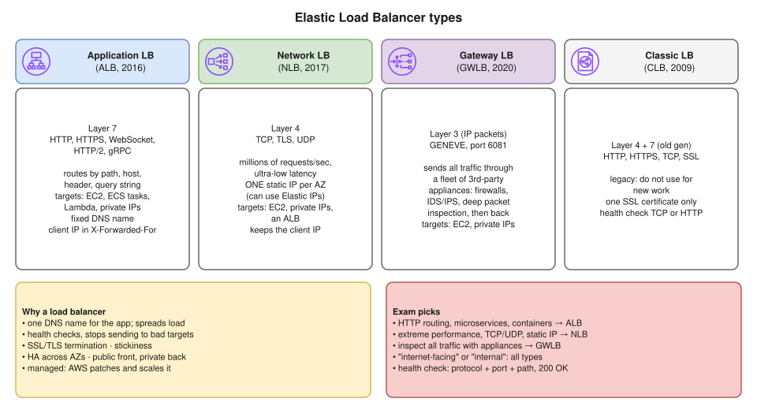
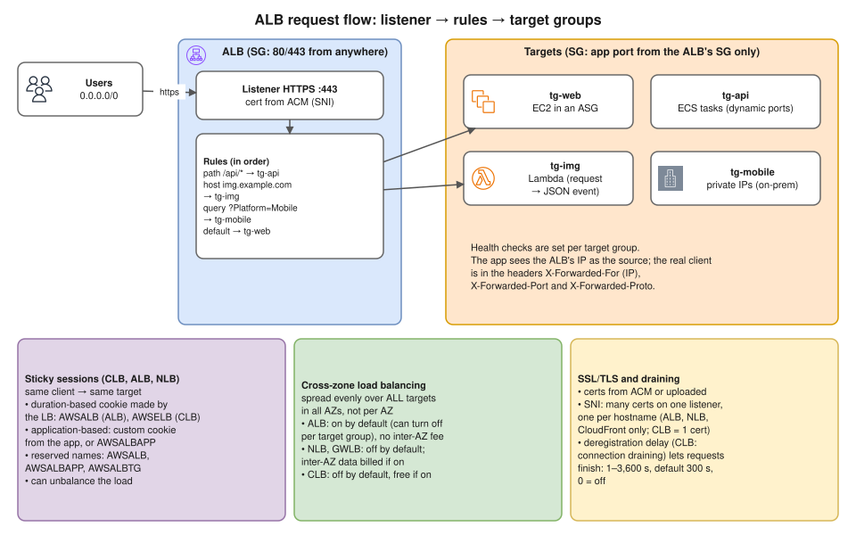
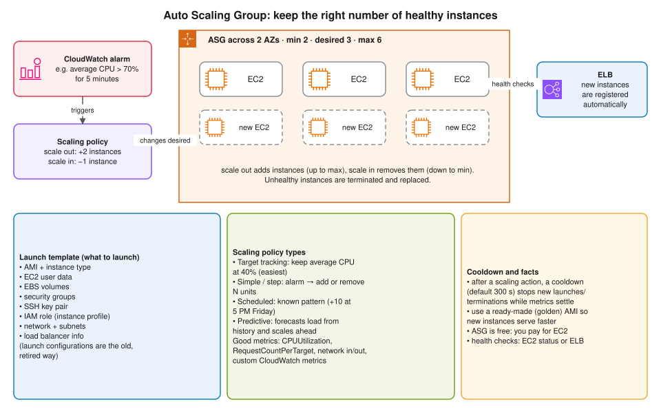

# High availability and scalability cheat sheet (course section 8: ELB + ASG)



**What you learned (course section 8):** vertical vs horizontal scaling, high availability, load balancing, health checks, the four ELB types (CLB, ALB, NLB, GWLB), load balancer security groups, sticky sessions, cross-zone load balancing, SSL/TLS and SNI, connection draining (deregistration delay), Auto Scaling Groups, launch templates, CloudWatch alarms, scaling policies, good scaling metrics and cooldowns.

> **How to use this page.** Draw the ALB flow diagram from memory (listener → rules → target groups, SGs, headers). This topic came up in your AWS Admin interview (13 Nov): an ALB needs subnets in **at least two AZs**, and 503 = no registered targets. Then do the [drill](#from-memory-drill).

**Confidence tags.** `[Certain]` = in the course slides (v49) and AWS documentation. `[Likely]` = correct in Nov 2026, may change. AWS CLI lines are **untested** here.

## Contents

1. [Scalability and high availability](#1-scalability-and-high-availability)
2. [What a load balancer does](#2-what-a-load-balancer-does)
3. [Health checks](#3-health-checks)
4. [The four ELB types](#4-the-four-elb-types)
5. [Load balancer security groups](#5-load-balancer-security-groups)
6. [Application Load Balancer (ALB)](#6-application-load-balancer-alb)
7. [Network Load Balancer (NLB)](#7-network-load-balancer-nlb)
8. [Gateway Load Balancer (GWLB)](#8-gateway-load-balancer-gwlb)
9. [Sticky sessions](#9-sticky-sessions)
10. [Cross-zone load balancing](#10-cross-zone-load-balancing)
11. [SSL/TLS, certificates and SNI](#11-ssltls-certificates-and-sni)
12. [Connection draining / deregistration delay](#12-connection-draining--deregistration-delay)
13. [Auto Scaling Groups](#13-auto-scaling-groups)
14. [ALB error codes (interview)](#14-alb-error-codes-interview)
15. [SAA exam traps](#15-saa-exam-traps)
16. [From-memory drill](#from-memory-drill)
17. [30-second spoken answer](#30-second-spoken-answer)

---

## 1. Scalability and high availability

**Scalability** = a system can handle greater loads by adapting. Two kinds `[Certain]`:

| | Vertical scalability | Horizontal scalability (= elasticity) |
|---|---|---|
| Meaning | **Increase the size** of the instance (scale **up / down**) | **Increase the number** of instances (scale **out / in**) |
| Example | t2.micro → t2.large; from t2.nano (0.5 GB RAM, 1 vCPU) to u-12tb1.metal (12.3 TB RAM, 448 vCPUs) | 3 web servers → 10 web servers |
| Typical for | **Non-distributed** systems, e.g. a **database**; **RDS** and **ElastiCache** scale vertically | **Distributed** systems: web apps, modern apps |
| Limit | Hardware limit | Easy thanks to the cloud (EC2) |
| AWS tools | Change instance type | **Auto Scaling Group + Load Balancer** |
| Call-centre analogy | Junior operator → senior operator | Hire more operators |

**High availability (HA)** `[Certain]`:

- Usually goes hand in hand with horizontal scaling.
- Means running your app in **at least 2 data centers (= 2 AZs)**.
- Goal: **survive a data center loss**.
- Can be **passive** (e.g. **RDS Multi-AZ** standby) or **active** (horizontal scaling: all instances serve).
- For EC2: **ASG multi-AZ** + **load balancer multi-AZ**.
- Analogy: a call centre with a building in New York and a second one in San Francisco.

## 2. What a load balancer does

Load balancers are servers that **forward traffic to multiple servers** (EC2 instances) downstream. Why use one `[Certain]`:

- **Spread load** across multiple downstream instances.
- Expose a **single point of access (DNS)** to your app.
- **Seamlessly handle failures** of downstream instances.
- Do **regular health checks**.
- Provide **SSL termination (HTTPS)**.
- Enforce **stickiness** with cookies.
- **High availability across zones**.
- **Separate public traffic from private traffic**.

Why an **Elastic** Load Balancer (managed) `[Certain]`: AWS guarantees it works and handles upgrades, maintenance and HA; only a few configuration knobs; cheaper to run your own LB but much more effort. Integrated with **EC2, ASG, ECS, ACM, CloudWatch, Route 53, WAF, Global Accelerator**.

## 3. Health checks

- Crucial: they let the LB know which instances can answer requests. `[Certain]`
- Done on a **port** and a **route** (`/health` is common), e.g. protocol HTTP, port 4567, path `/health`. `[Certain]`
- If the response is **not 200 (OK)**, the instance is **unhealthy**. `[Certain]`
- On ALB/NLB, health checks are configured **per target group**. `[Certain]`

## 4. The four ELB types

| Type | Year | Layer | Protocols `[Certain]` |
|---|---|---|---|
| **Classic Load Balancer (CLB)** | 2009 | v1, old generation, L4 + L7 | HTTP, HTTPS, TCP, SSL (secure TCP) |
| **Application Load Balancer (ALB)** | 2016 | v2, **L7** | HTTP, HTTPS, **WebSocket** (and HTTP/2) |
| **Network Load Balancer (NLB)** | 2017 | v2, **L4** | **TCP, TLS (secure TCP), UDP** |
| **Gateway Load Balancer (GWLB)** | 2020 | **L3** (network layer) | **IP** packets (GENEVE) |

- AWS recommends the **newer generation** LBs (more features). `[Certain]`
- Any of them can be **internal (private)** or **external (public)**. `[Certain]`

## 5. Load balancer security groups

| Security group | Inbound rule `[Certain]` |
|---|---|
| **Load balancer SG** | HTTP 80 and HTTPS 443 from **anywhere** (`0.0.0.0/0`) |
| **Application (EC2) SG** | HTTP 80 (or the app port) **only from the load balancer's SG** (source = SG, not an IP) |

So users can't bypass the LB and hit instances directly.

## 6. Application Load Balancer (ALB)



| Fact | Detail `[Certain]` |
|---|---|
| Layer | **Layer 7 (HTTP)** |
| Load balancing | To **multiple HTTP apps across machines** (target groups) and to **multiple apps on the same machine** (containers) |
| Protocols | **HTTP/2** and **WebSocket** |
| Redirects | Yes, e.g. **HTTP → HTTPS** |
| Routing rules | By **path** (`example.com/users`, `/posts`), by **hostname** (`one.example.com`, `other.example.com`), by **query string / headers** (`example.com/users?id=123&order=false`) |
| Fit | **Microservices and container apps** (Docker, **ECS**); **port mapping** feature to route to a **dynamic port in ECS**. With CLB you'd need one LB per application. |
| Hostname | **Fixed** DNS name: `XXX.region.elb.amazonaws.com` (no static IP: use NLB or Global Accelerator for that) |
| Client IP | App servers **don't see the client IP** directly (connection terminates at the LB). The real client IP is in **`X-Forwarded-For`**; port in **`X-Forwarded-Port`**; protocol in **`X-Forwarded-Proto`**. |
| Subnets | Needs subnets in **at least two AZs**. |

**ALB target groups** `[Certain]`:

| Target type | Note |
|---|---|
| **EC2 instances** | Can be managed by an **Auto Scaling Group**; HTTP |
| **ECS tasks** | Managed by ECS itself; HTTP |
| **Lambda functions** | The HTTP request is translated into a **JSON event** |
| **IP addresses** | Must be **private IPs** (e.g. on-premises servers over VPN/Direct Connect) |

An ALB can route to **multiple target groups**; **health checks are at the target group level**.

Example from the slides: query string routing, `?Platform=Mobile` → target group 1 (EC2 on AWS), `?Platform=Desktop` → target group 2 (on-premises, private IP routing).

## 7. Network Load Balancer (NLB)

| Fact | Detail `[Certain]` |
|---|---|
| Layer | **Layer 4**: forward **TCP and UDP** traffic |
| Scale | **Millions of requests per second**, **ultra-low latency** |
| IPs | **One static IP per AZ**, and supports assigning an **Elastic IP** (helpful for **whitelisting** specific IPs) |
| Use | **Extreme performance, TCP or UDP** traffic |
| Target groups | **EC2 instances**, **IP addresses (private IPs)**, an **Application Load Balancer** (NLB in front of ALB = static IPs + HTTP rules) |
| Health checks | **TCP, HTTP and HTTPS** |
| Free tier | Not included `[Likely]` |

## 8. Gateway Load Balancer (GWLB)

| Fact | Detail `[Certain]` |
|---|---|
| Purpose | **Deploy, scale and manage a fleet of third-party network virtual appliances** in AWS |
| Examples | **Firewalls, intrusion detection and prevention (IDS/IPS), deep packet inspection**, payload manipulation |
| Layer | **Layer 3 (network layer): IP packets** |
| Combines | **Transparent network gateway** (single entry/exit for all traffic) + **load balancer** (distributes traffic to the appliances) |
| Protocol | **GENEVE on port 6081** |
| Flow | Route tables send user traffic to the GWLB → appliances (target group) inspect it → back to the GWLB → on to the application |
| Target groups | **EC2 instances**, **IP addresses (private)** |

Exam keyword: **"GENEVE"** or **"6081"** or **"third-party security appliances"** → GWLB.

## 9. Sticky sessions

- **Stickiness (session affinity)**: the same client is always sent to the same instance behind the LB. `[Certain]`
- Works for **CLB, ALB and NLB**. `[Certain]`
- For CLB and ALB, the stickiness **cookie has an expiration date you control**. `[Certain]`
- Use case: the user **doesn't lose session data**. `[Certain]`
- Downside: may bring **imbalance** to the load on backend instances. `[Certain]`

**Cookie names** `[Certain]`:

| Cookie type | Generated by | Name |
|---|---|---|
| **Application-based: custom cookie** | The **target** (your app); can include any custom attributes; name set **per target group** | Anything **except** `AWSALB`, `AWSALBAPP`, `AWSALBTG` (reserved by ELB) |
| **Application-based: application cookie** | The **load balancer** | `AWSALBAPP` |
| **Duration-based cookie** | The **load balancer** | `AWSALB` for ALB, `AWSELB` for CLB |

## 10. Cross-zone load balancing

- **With** cross-zone: each LB node distributes **evenly across all registered instances in all AZs**. `[Certain]`
- **Without**: requests are split per LB node (per AZ), then only among that AZ's instances. `[Certain]`
- Slides' example: 2 AZs, AZ 1 has 2 instances and AZ 2 has 8. With cross-zone each of the 10 gets **10%**. Without it, each AZ gets 50%: AZ 1's two instances get **25%** each and AZ 2's eight get **6.25%** each.

| LB | Default | Inter-AZ data charge `[Certain]` |
|---|---|---|
| **ALB** | **Enabled** (can disable at target group level) | **No charge** |
| **NLB and GWLB** | **Disabled** | **You pay** if enabled |
| **CLB** | **Disabled** | No charge if enabled |

## 11. SSL/TLS, certificates and SNI

**Basics** `[Certain]`:

- An SSL certificate **encrypts traffic between clients and the load balancer in transit** (in-flight encryption).
- SSL = Secure Sockets Layer; **TLS** = Transport Layer Security, the newer version. Today TLS certificates are used, but people still say "SSL".
- Public certificates are issued by **Certificate Authorities (CA)**: Comodo, Symantec, GoDaddy, GlobalSign, DigiCert, Let's Encrypt…
- Certificates have an **expiration date** and must be **renewed**.

**Load balancer certificates** `[Certain]`:

- Users → LB over **HTTPS** (encrypted, over the internet); LB → EC2 over **HTTP** inside the private VPC (SSL termination at the LB).
- The LB uses an **X.509 certificate** (SSL/TLS server certificate).
- Manage certificates with **ACM (AWS Certificate Manager)**, or upload your own.
- **HTTPS listener**: you **must specify a default certificate**; you can add an **optional list of certs** for multiple domains; clients use **SNI** to say which hostname they want; you can set a **security policy** to support older SSL/TLS versions (legacy clients).

**SNI (Server Name Indication)** `[Certain]`:

- Solves loading **multiple SSL certificates onto one web server** (to serve multiple websites).
- A "newer" protocol: the **client says the hostname** in the initial TLS handshake; the server picks the right certificate or returns the default.
- **Works only for ALB and NLB (newer generation) and CloudFront**; **not CLB**.

| LB | Certificates `[Certain]` |
|---|---|
| **CLB** | **Only one** SSL certificate; use **multiple CLBs** for multiple hostnames |
| **ALB** | **Multiple listeners with multiple certificates**, using **SNI** |
| **NLB** | **Multiple listeners with multiple certificates**, using **SNI** |

## 12. Connection draining / deregistration delay

- Naming: **connection draining** on **CLB**, **deregistration delay** on **ALB and NLB**. `[Certain]`
- Time to complete **in-flight requests** while the instance is **de-registering or unhealthy**; the LB **stops sending new requests** to it (new connections go to the other instances). `[Certain]`
- **1 to 3,600 seconds** (default **300 s**); can be **disabled** (set to **0**). `[Certain]`
- Set a **low value if your requests are short**. `[Certain]`

## 13. Auto Scaling Groups



**Goal of an ASG** `[Certain]`:

- **Scale out** (add EC2 instances) to match increased load.
- **Scale in** (remove instances) to match decreased load.
- Ensure a **minimum and a maximum** number of instances.
- **Automatically register new instances to a load balancer**.
- **Re-create an instance** if a previous one is terminated (e.g. unhealthy).
- **ASGs are free**: you pay only for the EC2 instances.

**Capacity settings:** **minimum** capacity ≤ **desired** capacity ≤ **maximum** capacity. The ASG scales out as needed up to the maximum. `[Certain]`

**ASG + load balancer:** the ELB can **check the health** of the instances; if the ASG uses ELB health checks, an instance the ELB marks unhealthy is **terminated and replaced**. `[Certain]`

**ASG attributes** `[Certain]`:

- A **launch template** (older **launch configurations** are **deprecated**) containing:
  - AMI + instance type
  - EC2 user data
  - EBS volumes
  - security groups
  - SSH key pair
  - IAM roles for the instances
  - network + subnet information
  - load balancer information
- **Min size / max size / initial capacity**.
- **Scaling policies**.

**CloudWatch alarms and scaling** `[Certain]`:

- You can scale an ASG based on **CloudWatch alarms**.
- An alarm monitors a **metric** (average CPU or a custom metric); metrics like average CPU are computed **across all the ASG's instances**.
- Based on the alarm, **scale-out** policies add instances and **scale-in** policies remove them.

**Scaling policies** `[Certain]`:

| Policy | How it works | Example |
|---|---|---|
| **Target tracking** (dynamic) | Simplest to set up; keep a metric at a target | Keep average ASG CPU around **40%** |
| **Simple / step scaling** (dynamic) | When a CloudWatch alarm fires, add/remove units | CPU > 70% → **add 2**; CPU < 30% → **remove 1** |
| **Scheduled** | Anticipate scaling from **known usage patterns** | Increase min capacity to **10 at 5 PM on Fridays** |
| **Predictive** | **Continuously forecast** load and schedule scaling ahead | Daily traffic pattern learned from history |

**Good metrics to scale on** `[Certain]`:

- **CPUUtilization**: average CPU across instances.
- **RequestCountPerTarget**: keeps requests per instance stable (e.g. target value 3).
- **Average network in/out**: if the app is network-bound.
- **Any custom metric** you push to CloudWatch.

### ASG cooldown

- After a scaling activity, the ASG is in a **cooldown period** (default **300 seconds**). `[Certain]`
- During cooldown it **will not launch or terminate additional instances**, so metrics can stabilise. `[Certain]`
- Advice: use a **ready-to-use AMI** (golden AMI) to cut configuration time, serve requests faster and **reduce the cooldown period**. `[Certain]`

CLI to see what an ASG did (untested here):

```bash
aws autoscaling describe-auto-scaling-groups --auto-scaling-group-names web-asg \
  --query 'AutoScalingGroups[0].{min:MinSize,desired:DesiredCapacity,max:MaxSize}'
aws autoscaling describe-scaling-activities --auto-scaling-group-name web-asg --max-items 5
aws elbv2 describe-target-health --target-group-arn <tg-arn>
```

## 14. ALB error codes (interview)

Not in this course section, but you were asked in the 13 Nov interview, so keep it next to ALB facts `[Likely]` (AWS ELB troubleshooting docs):

| Code | Usual meaning |
|---|---|
| **502 Bad Gateway** | Target closed the connection or sent a malformed response (app crashed, wrong port, keep-alive mismatch) |
| **503 Service Unavailable** | **No registered targets** in the target group |
| **504 Gateway Timeout** | Target didn't answer in time (SG/NACL blocks the target port, app too slow, idle timeout) |
| All targets unhealthy | ALB **fails open** and sends to all of them anyway, so you usually see 502/504, not 503 |
| 4xx with `ELB` in the response | Generated by the LB (e.g. 400 bad request, 460 client closed) |

## 15. SAA exam traps

1. Vertical scaling for **databases** (RDS, ElastiCache); horizontal for **web/app** tiers.
2. HA = **at least 2 AZs**. An ALB **needs 2 AZs**.
3. "Route by URL path / hostname / query string" → **ALB**. "Static IP / Elastic IP / millions of req/s / UDP" → **NLB**. "Third-party firewall appliances, GENEVE 6081" → **GWLB**.
4. ALB **Lambda target**: request becomes a **JSON event**.
5. App needs the **client IP** behind an ALB → read **`X-Forwarded-For`**.
6. ALB IP targets must be **private IPs**.
7. Cross-zone: **ALB on and free**; **NLB/GWLB off and charged**; **CLB off and free**.
8. **SNI** = many certs on one LB: **ALB, NLB, CloudFront**; **CLB = one cert only**.
9. Deregistration delay **1–3,600 s, default 300 s, 0 = off**; set low for short requests.
10. Sticky sessions can **unbalance** load; reserved names **AWSALB, AWSALBAPP, AWSALBTG**.
11. Launch **configurations** are deprecated; use launch **templates**.
12. "Scale before a known Friday 5 PM peak" → **scheduled**; "keep CPU at 40%" → **target tracking**; "forecast from history" → **predictive**.
13. Default ASG cooldown **300 s**; shorten scale-out time with a **golden AMI**.
14. ASGs are **free**; you pay for instances.
15. App SG should allow traffic **from the LB's security group**, not `0.0.0.0/0`.

---

## From-memory drill

**Q1. Vertical vs horizontal scaling: meaning, example service, and the words "up/out".**

<details><summary>Answer</summary>

Vertical = bigger instance, scale up/down, for non-distributed systems like databases (RDS, ElastiCache). Horizontal = more instances, scale out/in, for distributed web apps (ASG + ELB). HA = run in at least 2 AZs (passive like RDS Multi-AZ, or active like horizontal scaling).
</details>

**Q2. Eight reasons to use a load balancer.**

<details><summary>Answer</summary>

Spread load, single DNS entry point, handle instance failures, health checks, SSL termination, stickiness, HA across zones, separate public from private traffic.
</details>

**Q3. Four ELB types with year, layer and protocols.**

<details><summary>Answer</summary>

CLB 2009 L4/L7 HTTP/HTTPS/TCP/SSL; ALB 2016 L7 HTTP/HTTPS/WebSocket; NLB 2017 L4 TCP/TLS/UDP; GWLB 2020 L3 IP (GENEVE 6081).
</details>

**Q4. ALB: three routing types, four target types, and how the app learns the client IP.**

<details><summary>Answer</summary>

Path, hostname, query string/headers. EC2 (ASG), ECS tasks, Lambda (JSON event), private IPs. X-Forwarded-For (plus X-Forwarded-Port, X-Forwarded-Proto).
</details>

**Q5. NLB: four facts and its target types.**

<details><summary>Answer</summary>

L4 TCP/UDP, millions of req/s, ultra-low latency, one static IP per AZ (Elastic IP possible). Targets: EC2, private IPs, an ALB. Health checks TCP/HTTP/HTTPS.
</details>

**Q6. GWLB: purpose, two functions, protocol and port.**

<details><summary>Answer</summary>

Run a fleet of third-party virtual appliances (firewalls, IDS/IPS, DPI). Transparent network gateway + load balancer. GENEVE on 6081, layer 3.
</details>

**Q7. Write the two security group rules for an ALB in front of EC2.**

<details><summary>Answer</summary>

ALB SG: inbound 80/443 from 0.0.0.0/0. EC2 SG: inbound 80 (app port) with source = the ALB's SG.
</details>

**Q8. Sticky session cookie types and names.**

<details><summary>Answer</summary>

Application-based custom cookie (from the target, any name except AWSALB/AWSALBAPP/AWSALBTG, set per target group); application cookie from the LB = AWSALBAPP; duration-based from the LB = AWSALB (ALB) / AWSELB (CLB). Works on CLB, ALB, NLB; can unbalance load.
</details>

**Q9. Cross-zone defaults and charges for each LB. Then compute: AZ 1 has 2 instances, AZ 2 has 8; share per instance with and without cross-zone.**

<details><summary>Answer</summary>

ALB on (disable per TG), free; NLB/GWLB off, paid if on; CLB off, free if on. With: 10% each. Without: AZ 1 instances 25% each, AZ 2 instances 6.25% each.
</details>

**Q10. SNI: what problem it solves, which LBs support it, and how CLB handles many domains.**

<details><summary>Answer</summary>

Many TLS certificates on one listener; the client sends the hostname in the TLS handshake. ALB, NLB, CloudFront. CLB supports one certificate, so you need one CLB per hostname.
</details>

**Q11. Deregistration delay: names, range, default, how to disable.**

<details><summary>Answer</summary>

Connection draining (CLB) / deregistration delay (ALB, NLB); 1–3,600 s; default 300 s; 0 disables; low value for short requests.
</details>

**Q12. What goes in a launch template? Name all four scaling policy types with an example each, and four good metrics.**

<details><summary>Answer</summary>

AMI + instance type, user data, EBS volumes, SGs, SSH key pair, IAM role, network/subnets, LB info. Target tracking (CPU 40%), simple/step (CPU > 70% add 2), scheduled (min 10 at 5 PM Friday), predictive (forecast). Metrics: CPUUtilization, RequestCountPerTarget, network in/out, custom metric.
</details>

**Q13. ASG cooldown: default, what happens during it, how to make scale-out faster.**

<details><summary>Answer</summary>

300 s; no new launches/terminations so metrics stabilise; golden/ready-to-use AMI.
</details>

**Q14. Interview: 502 vs 503 vs 504 on an ALB, and what you see if all targets are unhealthy.**

<details><summary>Answer</summary>

502: target closed the connection/bad response. 503: no registered targets. 504: target timed out (often SG on the target port or a slow app). All unhealthy: ALB fails open, so 502/504.
</details>

## 30-second spoken answer

> *"For scalability I scale web tiers horizontally with an Auto Scaling Group behind a load balancer, across at least two AZs for high availability, and scale databases vertically. I pick an ALB for HTTP: it routes by path, host or query string to target groups of EC2, ECS, Lambda or private IPs, does health checks per target group, terminates TLS with ACM certificates and SNI, and passes the client IP in X-Forwarded-For. An NLB is for TCP or UDP at millions of requests a second with a static IP per AZ, and a Gateway Load Balancer sends traffic through third-party firewalls over GENEVE. The ALB's security group is open to the internet and the instances only accept the ALB's security group. The ASG uses a launch template, keeps between min and max instances, replaces unhealthy ones, and scales with target tracking, step, scheduled or predictive policies, with a 300-second cooldown."*
