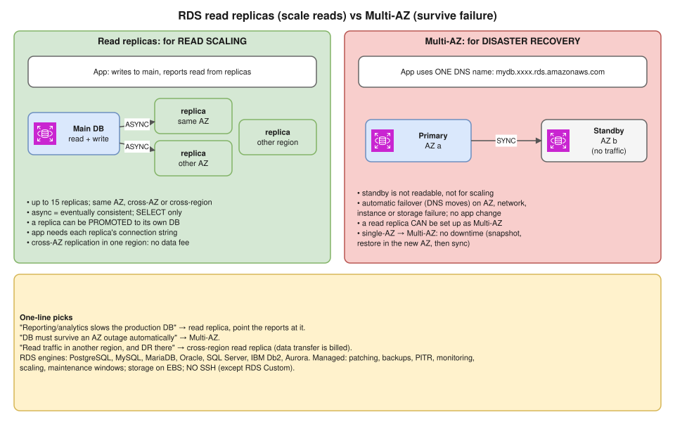
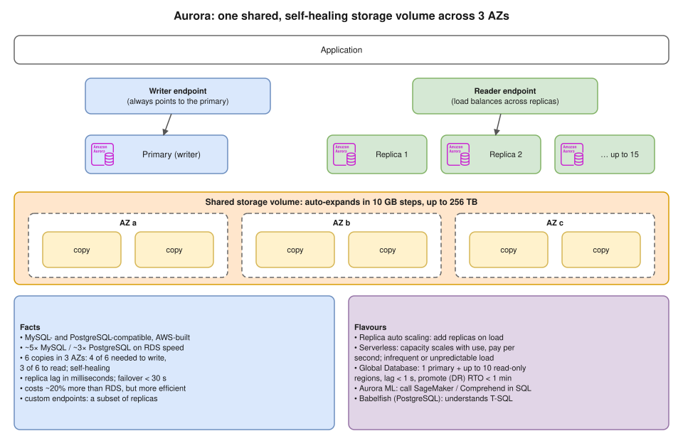
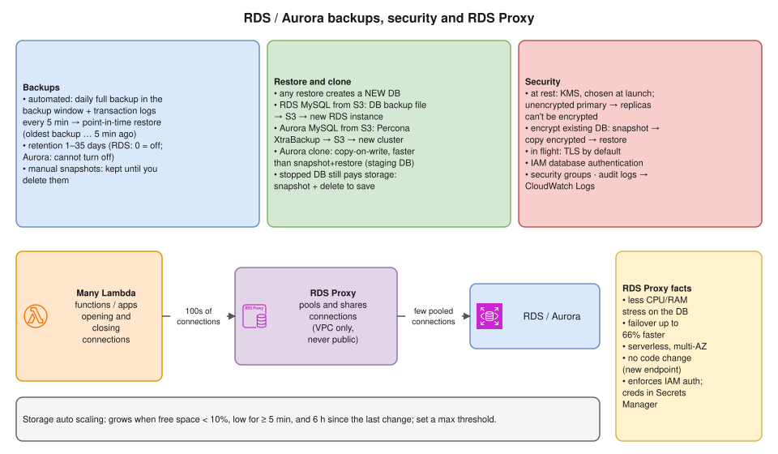
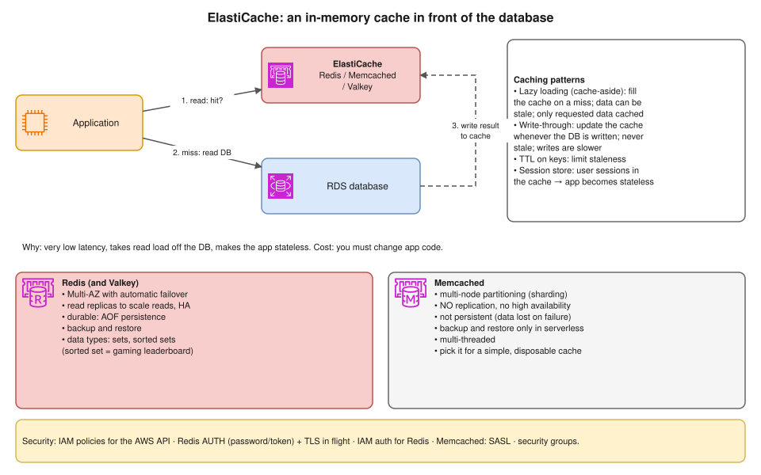

# RDS, Aurora and ElastiCache cheat sheet (course section 9)



**What you learned (course section 9):** Amazon RDS and why it beats a DB on EC2, storage auto scaling, read replicas vs Multi-AZ, RDS Custom, Aurora (storage, HA, endpoints, auto scaling, custom endpoints, Serverless, Global Database, Aurora ML, Babelfish), backups and restore, Aurora cloning, RDS/Aurora security, RDS Proxy, ElastiCache (Redis vs Memcached, security, caching patterns, leaderboard use case).

> **How to use this page.** The question you will get in interviews and the exam is "read replica or Multi-AZ?". Draw the diagram above from memory first. Then do the [drill](#from-memory-drill).

**Confidence tags.** `[Certain]` = in the course slides (v49) and AWS documentation. `[Likely]` = correct in Nov 2026, may change. **Two numbers changed recently and older notes are wrong:** Aurora storage now goes **up to 256 TB** (was 128 TB) and Aurora Global Database allows **up to 10 secondary regions** (was 5); the v49 slides use the new numbers. SQL/CLI lines are **untested** here.

## Contents

1. [Amazon RDS overview](#1-amazon-rds-overview)
2. [RDS storage auto scaling](#2-rds-storage-auto-scaling)
3. [Read replicas](#3-read-replicas)
4. [Multi-AZ](#4-multi-az)
5. [Read replica vs Multi-AZ](#5-read-replica-vs-multi-az)
6. [RDS Custom](#6-rds-custom)
7. [Amazon Aurora](#7-amazon-aurora)
8. [Backups, restore and cloning](#8-backups-restore-and-cloning)
9. [RDS and Aurora security](#9-rds-and-aurora-security)
10. [RDS Proxy](#10-rds-proxy)
11. [ElastiCache](#11-elasticache)
12. [Redis vs Memcached](#12-redis-vs-memcached)
13. [Ports to know](#13-ports-to-know)
14. [SAA exam traps](#14-saa-exam-traps)
15. [From-memory drill](#from-memory-drill)
16. [30-second spoken answer](#30-second-spoken-answer)

---

## 1. Amazon RDS overview

| Fact | Detail `[Certain]` |
|---|---|
| Name | **Relational Database Service**: a managed DB service for databases that use **SQL** |
| Engines | **PostgreSQL, MySQL, MariaDB, Oracle, Microsoft SQL Server, IBM Db2, Aurora** (AWS proprietary) |
| Storage | Backed by **EBS** |
| Access | **You can't SSH** into RDS instances (except **RDS Custom**) |

**Why RDS instead of running the DB on EC2** (it's a managed service) `[Certain]`:

- automated **provisioning** and **OS patching**
- **continuous backups** and **point-in-time restore** to a specific timestamp
- **monitoring dashboards**
- **read replicas** for better read performance
- **Multi-AZ** setup for disaster recovery (DR)
- **maintenance windows** for upgrades
- **scaling** (vertical and horizontal)
- storage backed by **EBS**

## 2. RDS storage auto scaling

- Increases storage on your RDS instance **dynamically** when it detects you are running out of free space, so you avoid manual scaling. `[Certain]`
- You must set a **Maximum Storage Threshold** (upper limit). `[Certain]`
- Storage is modified automatically when **all** of these are true `[Certain]`:
  - free storage is **less than 10%** of allocated storage
  - the low-storage condition **lasts at least 5 minutes**
  - **6 hours** have passed since the last modification
- Useful for **unpredictable workloads**; supports **all RDS engines**. `[Certain]`

## 3. Read replicas

| Fact | Detail `[Certain]` |
|---|---|
| Purpose | **Read scalability** |
| Count | **Up to 15** read replicas |
| Where | **Within AZ, cross-AZ or cross-region** |
| Replication | **ASYNC**, so reads are **eventually consistent** |
| Promotion | A replica can be **promoted to its own DB** (independent, read-write) |
| App change | Apps must **update the connection string** to use replicas (each replica has its own endpoint) |
| Statements | **SELECT only** (not INSERT, UPDATE, DELETE) |
| Can be Multi-AZ | Yes, a read replica can be set up as Multi-AZ for DR |

**Use case** `[Certain]`: production DB under normal load; you want to run a **reporting/analytics** app. Create a read replica and point reporting at it, so the **production app is unaffected**.

**Network cost** `[Certain]`: AWS charges when data goes from one AZ to another, **but for RDS read replicas in the same region (different AZ) replication is free**; **cross-region** replication **costs money**.

## 4. Multi-AZ

| Fact | Detail `[Certain]` |
|---|---|
| Purpose | **Disaster recovery / increase availability** |
| Replication | **SYNC** to a **standby** in another AZ |
| DNS | **One DNS name**: automatic app failover to the standby |
| Failover triggers | Loss of **AZ**, loss of **network**, **instance or storage failure** |
| App change | **None** (no manual intervention) |
| Scaling | **Not used for scaling**: the standby takes no reads or writes |

**Single-AZ → Multi-AZ** `[Certain]`: a **zero-downtime** operation (no need to stop the DB): click **"Modify"**. Internally: a **snapshot** is taken → a new DB is **restored from the snapshot in a new AZ** → **synchronisation** is established between the two.

## 5. Read replica vs Multi-AZ

| | Read replica | Multi-AZ |
|---|---|---|
| Goal | **Scale reads** | **Survive failure** (DR, HA) |
| Replication | **Async** (eventually consistent) | **Sync** |
| Readable? | **Yes** (SELECT) | **No** (standby is passive) |
| Endpoint | **Separate** connection string per replica | **Same** DNS name, fails over automatically |
| Location | Same AZ, cross-AZ, **cross-region** | Another AZ in the **same region** |
| Count | Up to 15 | One standby |
| Failover | **Manual** promotion | **Automatic** |

Exam picks: "reporting slows production" → **read replica**. "Must survive an AZ outage with no app change" → **Multi-AZ**. "Read locally in another region and DR there" → **cross-region read replica**.

## 6. RDS Custom

- **Managed Oracle and Microsoft SQL Server** with **OS and database customisation**. `[Certain]`
- RDS automates setup, operation and scaling; **Custom** gives you **access to the underlying DB and OS** so you can configure settings, install patches, enable native features. `[Certain]`
- Access the underlying EC2 instance with **SSH or SSM Session Manager**. `[Certain]`
- **Deactivate Automation Mode** to customise; **take a DB snapshot before**. `[Certain]`
- RDS = AWS manages the entire DB and OS; RDS Custom = **full admin access** to the OS and DB. `[Certain]`

## 7. Amazon Aurora



**Basics** `[Certain]`:

| Fact | Detail |
|---|---|
| What | **AWS proprietary** technology (not open source) |
| Compatibility | **PostgreSQL and MySQL**: your drivers work as if Aurora were Postgres or MySQL |
| Performance | "Cloud optimised": **5× MySQL on RDS**, **over 3× PostgreSQL on RDS** |
| Storage | **Grows automatically in 10 GB increments, up to 256 TB** |
| Replicas | **Up to 15**; replication is faster than MySQL (**sub-10 ms replica lag**) |
| Failover | **Instantaneous**; HA native |
| Cost | About **20% more than RDS**, but more efficient |

**High availability and read scaling** `[Certain]`:

- **6 copies of your data across 3 AZs**: **4 of 6** needed for **writes**, **3 of 6** for **reads**.
- **Self-healing** with peer-to-peer replication.
- Storage is **striped across 100s of volumes**.
- **One instance takes writes (master)**; **automated failover** for the master in **less than 30 seconds**.
- Master + **up to 15 read replicas** serve reads.
- Supports **cross-region replication**.

**Aurora DB cluster endpoints** `[Certain]`:

| Endpoint | Points to |
|---|---|
| **Writer endpoint** | Always the **master** (follows failover) |
| **Reader endpoint** | **Connection load balancing** across the read replicas (which can **auto scale**) |
| **Custom endpoint** | A **subset** of instances you choose, e.g. bigger instances (db.r5.2xlarge) for **analytical queries**; once defined, the reader endpoint is usually not used |

**Features of Aurora** `[Certain]`: automatic failover, backup and recovery, isolation and security, industry compliance, push-button scaling, **automated patching with zero downtime**, advanced monitoring, routine maintenance, **Backtrack** (restore data to any point in time **without using backups**).

**Aurora flavours** `[Certain]`:

| Feature | What it does | Use |
|---|---|---|
| **Replica auto scaling** | Adds replicas when CPU/requests rise; the reader endpoint extends to them | Spiky read load |
| **Aurora Serverless** | Automated instantiation and **auto scaling based on actual usage**; no capacity planning; **pay per second**; clients go through a proxy fleet managed by Aurora | **Infrequent, intermittent or unpredictable** workloads |
| **Cross-region read replicas** | Simple DR | Basic DR |
| **Aurora Global Database** (recommended) | **1 primary region** (read/write) + **up to 10 secondary read-only regions**; replication lag **< 1 second**; **up to 16 read replicas per secondary region**; promoting another region (DR) has an **RTO < 1 minute** | Global low-latency reads + DR |
| **Aurora Machine Learning** | ML predictions via **SQL**; integrates with **SageMaker** (any ML model) and **Comprehend** (sentiment); no ML experience needed | Fraud detection, ads targeting, sentiment analysis, product recommendations |
| **Babelfish for Aurora PostgreSQL** | Aurora PostgreSQL understands **T-SQL** (SQL Server commands), so SQL Server apps work with **little or no code change** (same SQL Server client driver); migrate with **AWS SCT and DMS** | Moving off SQL Server |

## 8. Backups, restore and cloning



**RDS backups** `[Certain]`:

| Type | Detail |
|---|---|
| **Automated** | **Daily full backup** during the backup window + **transaction logs every 5 minutes** → restore to **any point in time** (from the oldest backup to **5 minutes ago**). Retention **1 to 35 days**; **0 disables** automated backups. |
| **Manual DB snapshots** | Triggered by you; kept **as long as you want**. |

Trick `[Certain]`: a **stopped** RDS DB still pays for **storage**. If you stop it for a long time, **snapshot and restore** later instead (and delete the instance).

**Aurora backups** `[Certain]`: automated **1 to 35 days (cannot be disabled)**, point-in-time recovery in that window; manual snapshots kept as long as you want.

**Restore options** `[Certain]`:

- Restoring an RDS/Aurora **backup or snapshot creates a new database**.
- **RDS MySQL from S3**: back up the on-premises DB → store it on **S3** → restore onto a **new RDS MySQL instance**.
- **Aurora MySQL from S3**: back up on-premises with **Percona XtraBackup** → store on S3 → restore onto a **new Aurora MySQL cluster**.

**Aurora database cloning** `[Certain]`:

- Create a **new Aurora cluster from an existing one**, **faster than snapshot and restore**.
- Uses **copy-on-write**: the clone initially shares the same volume (no copying); only changed data gets new storage.
- Very fast and cost-effective; ideal to make a **staging DB from production** without impacting production.

## 9. RDS and Aurora security

| Layer | Detail `[Certain]` |
|---|---|
| **At rest** | Master and replica encryption with **AWS KMS**, **defined at launch time**. If the **master is not encrypted, read replicas cannot be encrypted**. To encrypt an unencrypted DB: **DB snapshot → restore as encrypted** (copy the snapshot with encryption). |
| **In flight** | **TLS-ready by default**; use the **AWS TLS root certificates** client-side. |
| **IAM authentication** | Use **IAM roles** to connect instead of username/password. |
| **Security groups** | Control **network access** to the DB. |
| **SSH** | **None**, except on **RDS Custom**. |
| **Audit logs** | Can be enabled and sent to **CloudWatch Logs** for longer retention. |

Connect from your Ubuntu laptop or an EC2 instance (untested here):

```bash
sudo apt-get install -y mysql-client postgresql-client
mysql -h mydb.xxxxx.ap-south-1.rds.amazonaws.com -P 3306 -u admin -p
psql "host=mydb.xxxxx.ap-south-1.rds.amazonaws.com port=5432 user=postgres dbname=app sslmode=verify-full sslrootcert=global-bundle.pem"
```

## 10. RDS Proxy

| Fact | Detail `[Certain]` |
|---|---|
| What | **Fully managed database proxy** for RDS |
| Does | Lets apps **pool and share DB connections** established with the DB |
| Why | **Reduces stress on DB resources** (CPU, RAM) and **minimises open connections (and timeouts)** |
| Ops | **Serverless, autoscaling, highly available (multi-AZ)** |
| Failover | **Reduces RDS and Aurora failover time by up to 66%** |
| Engines | RDS (**MySQL, PostgreSQL, MariaDB, SQL Server**) and Aurora (**MySQL, PostgreSQL**) |
| Code | **No code changes** for most apps (point them at the proxy endpoint) |
| Auth | **Enforce IAM authentication** for the DB; store credentials in **AWS Secrets Manager** |
| Network | **Never publicly accessible**: must be accessed **from inside the VPC** |

Classic use: **many Lambda functions** each opening connections → put **RDS Proxy** in between.

## 11. ElastiCache



| Fact | Detail `[Certain]` |
|---|---|
| What | Like RDS gives managed relational DBs, **ElastiCache gives managed Redis or Memcached** (AWS has also added **Valkey**, a Redis fork) |
| Caches | **In-memory databases** with **really high performance, low latency** |
| Benefits | **Reduce load off databases** for **read-intensive** workloads; help make your application **stateless** |
| AWS handles | OS maintenance/patching, optimisations, setup, configuration, monitoring, failure recovery, backups |
| Cost of using it | **Heavy application code changes** |

**Architecture 1: DB cache** `[Certain]`: the app queries ElastiCache; **cache hit** → return; **cache miss** → read from RDS and **write to the cache**. Relieves load on RDS. The cache needs an **invalidation strategy** so only current data is used.

**Architecture 2: user session store** `[Certain]`: the user logs in to any instance; the app **writes the session** to ElastiCache; when the user hits **another instance**, it **retrieves the session** and the user is still logged in.

**Caching patterns** `[Certain]`:

| Pattern | How | Trade-off |
|---|---|---|
| **Lazy loading** (cache-aside) | Cache filled on a **miss** | All read data cached; **data can become stale** |
| **Write-through** | **Add/update the cache when the DB is written** | **No stale data**; extra write work |
| **Session store** | Temporary session data in the cache with **TTL** | Sessions expire automatically |

Quote from the slides: *"There are only two hard things in Computer Science: cache invalidation and naming things."*

**Redis use case: gaming leaderboard** `[Certain]`: leaderboards are computationally complex; **Redis sorted sets** guarantee **uniqueness and element ordering**; each new element is ranked in real time and added in the correct order.

```text
ZADD leaderboard 4200 "suraj"      # add/update a score
ZREVRANGE leaderboard 0 9 WITHSCORES   # top 10, highest first
ZREVRANK leaderboard "suraj"       # my rank (0 = first)
```

**Cache security** `[Certain]`:

- ElastiCache supports **IAM authentication for Redis**.
- **IAM policies** on ElastiCache are only for **AWS API-level** security (create/delete clusters), not data access.
- **Redis AUTH**: set a **password/token** when you create a Redis cluster; an extra layer on top of security groups.
- **SSL/TLS in-flight** encryption supported.
- **Memcached** supports **SASL-based** authentication (advanced).
- Plus **security groups** on the cache.

## 12. Redis vs Memcached

| Redis (and Valkey) | Memcached |
|---|---|
| **Multi-AZ with auto-failover** | **Multi-node partitioning** of data (**sharding**) |
| **Read replicas** to scale reads and for HA | **No high availability** (no replication) |
| **Data durability** with **AOF persistence** | **Non-persistent** |
| **Backup and restore** | Backup and restore (**Serverless only**) |
| Supports **sets and sorted sets** | **Multi-threaded** architecture |

`[Certain]`. Hook: **Redis = "replication + persistence"; Memcached = "sharding, simple, disposable".**

## 13. Ports to know

| Port | Database `[Certain]` |
|---|---|
| **5432** | PostgreSQL (and Aurora PostgreSQL) |
| **3306** | MySQL, MariaDB (and Aurora MySQL) |
| **1521** | Oracle RDS |
| **1433** | Microsoft SQL Server |
| 6379 | Redis / Valkey `[Likely]` (default) |
| 11211 | Memcached `[Likely]` (default) |

Plus from section 5: 22 SSH/SFTP, 21 FTP, 80 HTTP, 443 HTTPS, 3389 RDP.

## 14. SAA exam traps

1. Read replicas = **async**, **readable**, up to **15**, **separate endpoint**, manual promotion. Multi-AZ = **sync**, **not readable**, **one DNS name**, automatic failover.
2. Same-region cross-AZ read replica traffic is **free**; cross-region **costs**.
3. Single-AZ → Multi-AZ is **zero downtime** (snapshot, restore, sync).
4. "Need OS access / install patches on Oracle or SQL Server" → **RDS Custom**.
5. Storage auto scaling needs **< 10% free for 5 min and 6 h since last change**, and a **max threshold**.
6. Aurora: **6 copies / 3 AZs**, **4 of 6 write, 3 of 6 read**, **15 replicas**, failover **< 30 s**, storage **10 GB steps up to 256 TB**, ~**20%** pricier than RDS.
7. "Run analytics on bigger replicas only" → **Aurora custom endpoint**.
8. "Unpredictable, intermittent DB load, pay per second" → **Aurora Serverless**.
9. "Global reads < 1 s lag, DR RTO < 1 min" → **Aurora Global Database** (up to 10 secondary regions, 16 replicas each).
10. "Undo a bad UPDATE without restoring a backup" → **Aurora Backtrack**.
11. "Staging copy of production, fast and cheap" → **Aurora cloning** (copy-on-write).
12. RDS automated backup retention **1–35 days, 0 = off**; Aurora **can't** disable. PITR down to **5 minutes ago**.
13. Restoring always creates a **new** DB. Stopped RDS still pays **storage**.
14. Unencrypted master → replicas **can't** be encrypted; encrypt via **snapshot → restore encrypted**.
15. "Lambda opens too many DB connections" → **RDS Proxy** (VPC only, IAM auth, Secrets Manager, failover up to 66% faster).
16. ElastiCache needs **code changes**; "make the app stateless / store sessions" → ElastiCache.
17. "HA, persistence, sorted sets/leaderboard" → **Redis**; "simple multi-threaded sharded cache, no HA" → **Memcached**.
18. IAM policies on ElastiCache = **API-level** only; data auth = **Redis AUTH / IAM auth for Redis / SASL for Memcached**.

---

## From-memory drill

**Q1. List the RDS engines and eight things RDS manages that a DB on EC2 doesn't.**

<details><summary>Answer</summary>

PostgreSQL, MySQL, MariaDB, Oracle, SQL Server, IBM Db2, Aurora. Provisioning and OS patching, continuous backups + PITR, monitoring dashboards, read replicas, Multi-AZ DR, maintenance windows, vertical/horizontal scaling, EBS-backed storage. No SSH (except RDS Custom).
</details>

**Q2. Three conditions for RDS storage auto scaling and the setting you must give.**

<details><summary>Answer</summary>

Free storage < 10% of allocated, low storage for at least 5 minutes, 6 hours since the last modification. Maximum Storage Threshold.
</details>

**Q3. Read replica vs Multi-AZ: compare goal, replication, readability, endpoint, location, failover.**

<details><summary>Answer</summary>

Replica: read scaling, async, readable (SELECT), own endpoint, same AZ/cross-AZ/cross-region, manual promotion, up to 15. Multi-AZ: DR, sync, standby not readable, one DNS name, another AZ same region, automatic failover, no app change.
</details>

**Q4. What happens internally when you switch a DB from Single-AZ to Multi-AZ?**

<details><summary>Answer</summary>

Zero downtime: snapshot taken → new DB restored from it in another AZ → synchronous replication established.
</details>

**Q5. Aurora: storage growth and max, copies and quorums, replicas, failover time, cost vs RDS.**

<details><summary>Answer</summary>

10 GB increments up to 256 TB; 6 copies across 3 AZs, 4/6 for writes, 3/6 for reads, self-healing, striped across 100s of volumes; up to 15 replicas (sub-10 ms lag); master failover < 30 s; ~20% more than RDS.
</details>

**Q6. Name the three Aurora endpoints and when you use a custom one.**

<details><summary>Answer</summary>

Writer (master), reader (load balances replicas, works with replica auto scaling), custom (subset, e.g. larger instances for analytics).
</details>

**Q7. Aurora Global Database numbers.**

<details><summary>Answer</summary>

1 primary region + up to 10 secondary read-only regions, < 1 s replication lag, up to 16 read replicas per secondary region, promotion RTO < 1 minute.
</details>

**Q8. RDS vs Aurora backups: retention, disable, PITR granularity, and the stopped-DB trick.**

<details><summary>Answer</summary>

RDS automated: daily full + transaction logs every 5 min, PITR to 5 min ago, 1–35 days, 0 disables. Aurora: 1–35 days, cannot disable. Manual snapshots kept forever. Stopped RDS pays storage → snapshot, delete, restore later.
</details>

**Q9. How do you restore an on-prem MySQL to RDS and to Aurora?**

<details><summary>Answer</summary>

RDS: backup → S3 → restore to a new RDS MySQL. Aurora: Percona XtraBackup → S3 → restore to a new Aurora MySQL cluster.
</details>

**Q10. Six RDS/Aurora security facts.**

<details><summary>Answer</summary>

KMS at rest defined at launch; unencrypted master → unencrypted replicas; encrypt via snapshot → restore encrypted; TLS in flight with AWS root certs; IAM DB authentication; security groups; no SSH except RDS Custom; audit logs to CloudWatch Logs.
</details>

**Q11. RDS Proxy: problem it solves and six facts.**

<details><summary>Answer</summary>

Too many connections (e.g. Lambda). Pools/shares connections, less CPU/RAM stress and timeouts, serverless/autoscaling/multi-AZ, failover up to 66% faster, no code change, IAM auth + Secrets Manager, VPC only (never public). Engines: RDS MySQL/PostgreSQL/MariaDB/SQL Server, Aurora MySQL/PostgreSQL.
</details>

**Q12. Explain lazy loading vs write-through, and draw the DB-cache flow.**

<details><summary>Answer</summary>

App → cache: hit = return; miss = read RDS → write to cache. Lazy loading caches on miss, data can be stale. Write-through updates the cache on every DB write, no stale data. Sessions: store with TTL.
</details>

**Q13. Redis vs Memcached: five facts each.**

<details><summary>Answer</summary>

Redis: Multi-AZ auto-failover, read replicas, AOF persistence, backup/restore, sets/sorted sets. Memcached: sharding across nodes, no replication/HA, non-persistent, backup/restore only serverless, multi-threaded.
</details>

**Q14. Ports: PostgreSQL, MySQL, MariaDB, Oracle, SQL Server, Aurora MySQL, Aurora PostgreSQL.**

<details><summary>Answer</summary>

5432, 3306, 3306, 1521, 1433, 3306, 5432.
</details>

## 30-second spoken answer

> *"RDS is managed SQL: Postgres, MySQL, MariaDB, Oracle, SQL Server, Db2 and Aurora, with patching, automated backups and point-in-time restore to five minutes ago, retention up to 35 days. For read scaling I add up to 15 asynchronous read replicas, even cross-region, and point reporting at them; for disaster recovery I enable Multi-AZ, a synchronous standby behind the same DNS name that fails over automatically. Aurora keeps six copies across three AZs, grows to 256 terabytes, has writer and reader endpoints, fails over in under 30 seconds, and Global Database replicates to other regions in under a second. With many Lambda connections I put RDS Proxy in front. ElastiCache with Redis caches hot reads and sessions, using lazy loading or write-through; Redis gives replication and persistence, Memcached is a simple sharded cache."*
