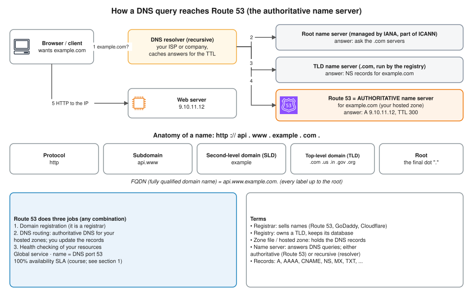
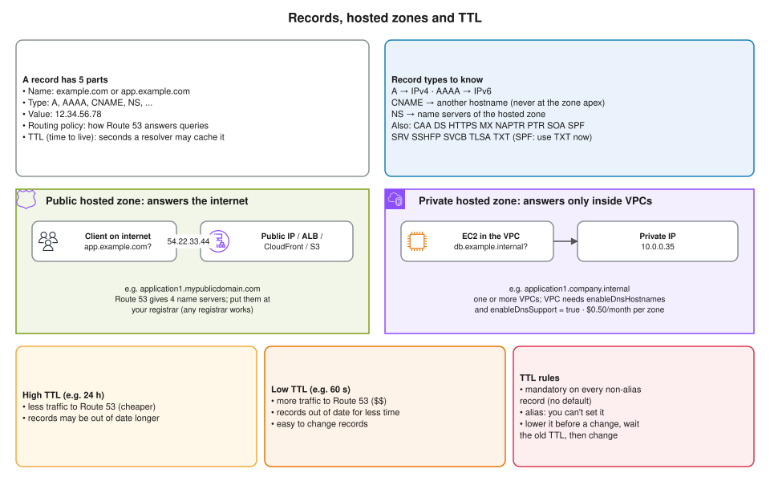
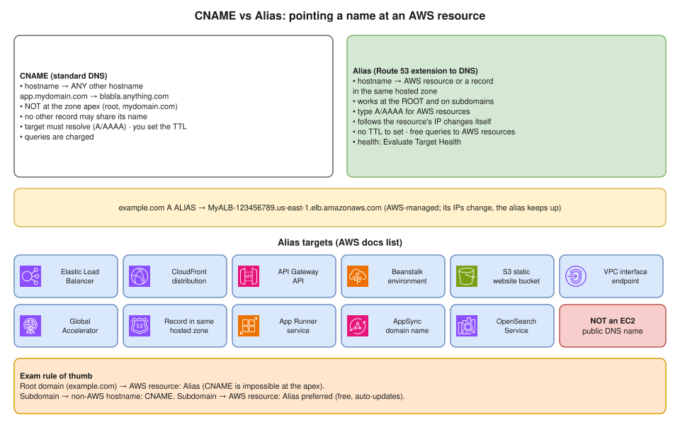
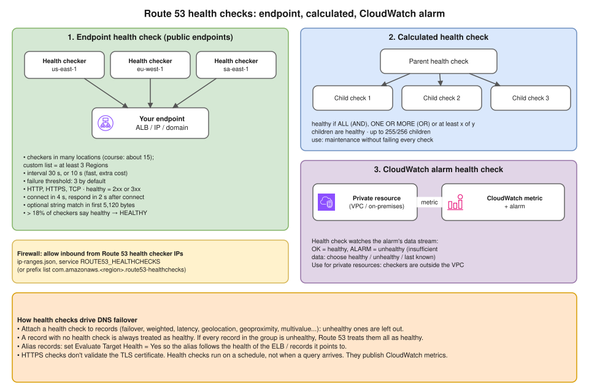
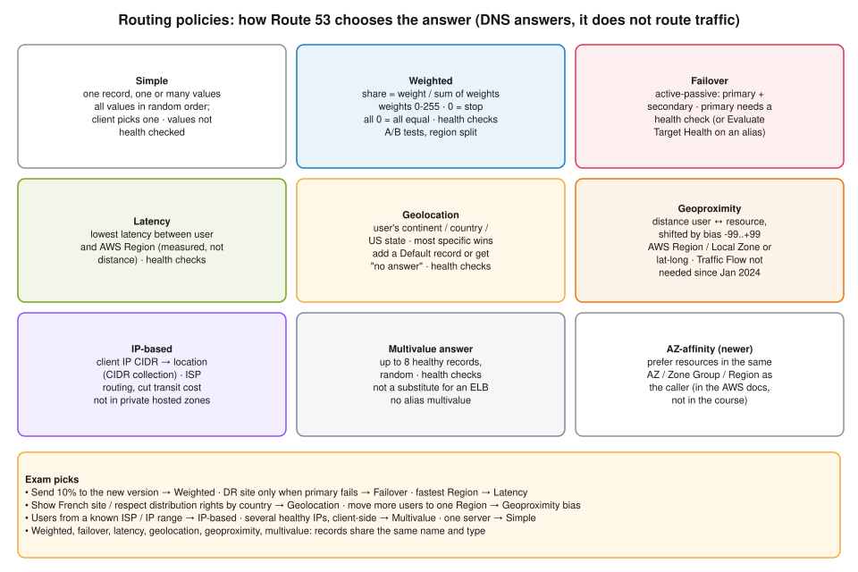
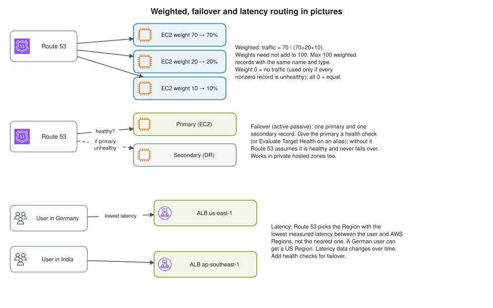
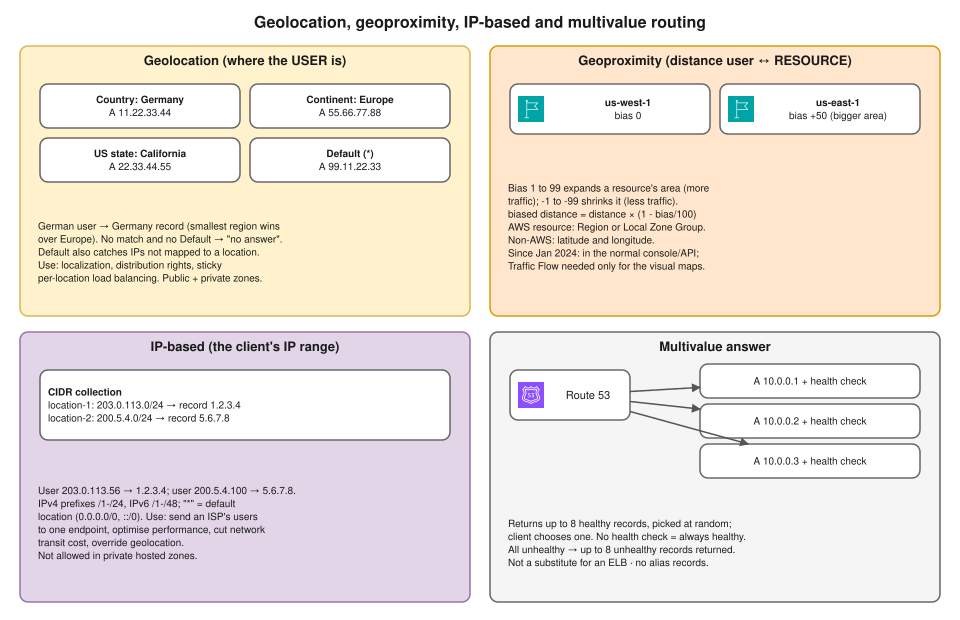

# Route 53 cheat sheet (course section 10)

**What you learned (course section 10):** DNS terms, what Route 53 is, records and record types, public vs private hosted zones, TTL, CNAME vs Alias and alias targets, health checks (endpoint, calculated, CloudWatch alarm, private hosted zones), and the routing policies: simple, weighted, latency, failover, geolocation, geoproximity, IP-based and multivalue answer. Also: registrar vs DNS service.

> **How to use this page.** This page is built from **your own notes**. Every fact you wrote is still here, with typos fixed. Each section was checked against the **AWS Route 53 Developer Guide** (the "Source" line under each heading links the pages). Where your notes were wrong or incomplete, look for the **"Corrections to your notes"** box in that section, and the [full list](#corrections-to-your-notes-all-in-one-place) near the end. First draw the routing-policy grid ([diagram 5](#7-routing-policies-overview)) from memory. Then do the [drill](#from-memory-drill).

**Confidence tags.** `[Certain]` = confirmed on the AWS documentation page linked in that section (checked 23 Nov 2026). `[Likely]` = in the course slides (v49), but the AWS doc pages I read do not state it (so it may be a course simplification or a number AWS does not publish). **Where the course and the AWS docs disagree, the AWS docs win, and the note says so.** AWS CLI lines are **untested** here.

## Contents

1. [DNS terms and what Route 53 is](#1-dns-terms-and-what-route-53-is)
2. [Records and record types](#2-records-and-record-types)
3. [Hosted zones (public and private)](#3-hosted-zones-public-and-private)
4. [TTL (time to live)](#4-ttl-time-to-live)
5. [CNAME vs Alias](#5-cname-vs-alias)
6. [Health checks](#6-health-checks)
7. [Routing policies overview](#7-routing-policies-overview)
8. [Simple, weighted, failover, latency](#8-simple-weighted-failover-latency)
9. [Geolocation, geoproximity, IP-based, multivalue](#9-geolocation-geoproximity-ip-based-multivalue)
10. [Registrar vs DNS service](#10-registrar-vs-dns-service)
11. [SAA exam traps](#11-saa-exam-traps)
12. [Corrections to your notes (all in one place)](#corrections-to-your-notes-all-in-one-place)
13. [From-memory drill](#from-memory-drill)
14. [30-second spoken answer](#30-second-spoken-answer)

---

## 1. DNS terms and what Route 53 is

Source: [What is Amazon Route 53?](https://docs.aws.amazon.com/Route53/latest/DeveloperGuide/Welcome.html) · [Route 53 concepts](https://docs.aws.amazon.com/Route53/latest/DeveloperGuide/route-53-concepts.html) · [Route 53 FAQs](https://aws.amazon.com/route53/faqs/)

**DNS terminologies** (your list, checked):

| Term | Meaning | Examples |
|---|---|---|
| **Domain registrar** | A company accredited by ICANN to process domain registrations for specific TLDs `[Certain]` | Amazon Route 53, GoDaddy, Cloudflare, ... |
| Domain registry (added) | The company that owns the right to sell one TLD and keeps its authoritative database `[Certain]` | e.g. the registry for .com |
| **DNS records** | Entries that say how to route traffic for a domain or subdomain `[Certain]` | A, AAAA, CNAME, NS, ... |
| **Zone file** | Contains the DNS records (in Route 53 the records live in a **hosted zone**) `[Certain]` | |
| **Name server** | **Resolves** DNS queries. Two kinds: **authoritative** (has the definitive answer for a zone, e.g. Route 53) or **recursive** = the DNS resolver, usually run by your ISP or company `[Certain]` | |
| **Top-level domain (TLD)** | The last part of a domain name `[Certain]` | .com, .us, .in, .gov, .org, ... |
| **Second-level domain (SLD)** | The name just left of the TLD | amazon.com, google.com |
| Subdomain (added) | One or more labels in front of the registered name `[Certain]` | www.example.com, api.www.example.com |
| FQDN (added) | Fully qualified domain name: every label up to the root dot | `api.www.example.com.` |

**How a query is answered** (diagram above): browser → **DNS resolver** (recursive, caches for the TTL) → **root** name server (managed by IANA, part of ICANN) → **TLD** name server (.com) → **authoritative** name server for the domain (Route 53 when your hosted zone is there) → the resolver returns the IP and the browser connects to it.

**Amazon Route 53** (your notes plus docs):

- Route 53 is a **domain registrar**. `[Certain]`
- Route 53 is also a highly available, scalable, fully managed **authoritative DNS** service: you (the customer) can update the DNS records. `[Certain]` (FAQ: "Amazon Route 53 is an authoritative DNS service")
- **Ability to check the health of your resources** (health checks). `[Certain]`
- The docs sum it up as **three main functions, in any combination: domain registration, DNS routing, health checking.** `[Certain]`
- It is a **global** service. `[Certain]` (Developer Guide: "Route 53 is a global service")
- The only AWS service with a **100% availability SLA**. `[Likely]` (course; the FAQ confirms Route 53 has an SLA with service credits but the page I read does not give the figure)
- Why "53"? A reference to the traditional **DNS port 53**. `[Likely]` (course; the docs don't explain the name, but 53 is the standard DNS port)

> **Corrections to your notes (section 1)**
> - "Route 53 is Domain Registrar" is **incomplete**: Route 53 is **also an authoritative DNS service** (and a health checker). Being a registrar is only one of its three jobs, and you can use Route 53 DNS for a domain registered elsewhere ([section 10](#10-registrar-vs-dns-service)).
> - "Name Server: resolver DNS queries" → name servers **resolve** DNS queries, and there are two kinds: **authoritative** and **recursive (resolver)**.

## 2. Records and record types

Source: [Supported DNS record types](https://docs.aws.amazon.com/Route53/latest/DeveloperGuide/ResourceRecordTypes.html) · [Route 53 concepts](https://docs.aws.amazon.com/Route53/latest/DeveloperGuide/route-53-concepts.html)

A **record** defines how you route traffic for a domain or subdomain. Each record contains `[Certain]`:

| Part | Example |
|---|---|
| **Domain/subdomain name** | example.com |
| **Record type** | A, AAAA, CNAME |
| **Value** | an IP, e.g. 12.34.56.78 |
| **Routing policy** | how Route 53 **responds** to queries |
| **TTL** (**time to live**) | amount of time (in **seconds**) the record is cached at DNS resolvers |

**Record types Route 53 supports** `[Certain]`:

- **Must know:** A / AAAA / CNAME / NS
- **Advanced:** CAA / DS / MX / NAPTR / PTR / SOA / TXT / SPF / SRV
- **Also supported (in the AWS docs, not in the course list):** HTTPS / SSHFP / SVCB / TLSA
- **SPF:** AWS **no longer recommends** the SPF record type; put the SPF value in a **TXT** record instead.

| Type | What it does `[Certain]` |
|---|---|
| **A** | maps a hostname to **IPv4** |
| **AAAA** | maps a hostname to **IPv6** |
| **CNAME** | maps a hostname to **another hostname**. The target is a domain name which **must have an A or AAAA record**. You **can't create a CNAME at the top node of a DNS namespace (the zone apex)**: e.g. you can't create one for `example.com`, but you can for `www.example.com`. If a name has a CNAME, **no other record can have that same name**. |
| **NS** | the **name servers for the hosted zone**. They control how traffic is routed for the domain: you point your registrar at the **four name servers** in the zone's NS record. NS records also delegate a subdomain to another hosted zone. |

> **Corrections to your notes (section 2)**
> - **TTL = "time to live"**, not "time to leave". Unit: **seconds**.
> - "AAAA – map to hostname to IPv6" → maps **a hostname** to IPv6.
> - The record-type list is incomplete: the docs also list **HTTPS, SSHFP, SVCB, TLSA**, and say to use **TXT instead of SPF**.

## 3. Hosted zones (public and private)

Source: [Route 53 concepts](https://docs.aws.amazon.com/Route53/latest/DeveloperGuide/route-53-concepts.html) · [Considerations when working with a private hosted zone](https://docs.aws.amazon.com/Route53/latest/DeveloperGuide/hosted-zone-private-considerations.html)

A **hosted zone** is a container for records that define how to route traffic for a domain **and all of its subdomains**; it has the same name as the domain. `[Certain]`

| | Public hosted zone | Private hosted zone |
|---|---|---|
| Answers | Specifies how to route traffic **on the internet** (public domain names) `[Certain]` | Specifies how to route traffic **within one or more VPCs** (private domain names) `[Certain]` |
| Example | application.mypublicdomain.com | application.company.internal |
| Typical targets | public IP of EC2, ALB, CloudFront, S3 | private IPs, e.g. db.example.internal → 10.0.0.35 |
| Must-do | point the registrar at the zone's 4 name servers | the VPC must have **enableDnsHostnames** and **enableDnsSupport** set to **true** `[Certain]` |
| Price | **$0.50 per month per hosted zone** `[Likely]` (course; check the Route 53 pricing page) | same |

- **Split-view DNS:** you can create a public and a private hosted zone **with the same name** (inside the VPC you get the private answer, outside the public one). `[Certain]`
- Routing policies in a private hosted zone: all **except IP-based**. `[Certain]`

> **Corrections to your notes (section 3)**
> - "myplublicdomain" → **mypublicdomain**. No fact errors; added the VPC DNS settings and split-view, which the exam likes.

## 4. TTL (time to live)

Source: [Route 53 concepts](https://docs.aws.amazon.com/Route53/latest/DeveloperGuide/route-53-concepts.html) · [Route 53 FAQs](https://aws.amazon.com/route53/faqs/) · [ResourceRecordSet (API)](https://docs.aws.amazon.com/Route53/latest/APIReference/API_ResourceRecordSet.html)

TTL = the time, **in seconds**, that a DNS resolver caches the values for a record before asking Route 53 again. `[Certain]`

| High TTL (e.g. 24 h) | Low TTL (e.g. 60 s) |
|---|---|
| **Less traffic** on Route 53 (lower cost) | **More traffic** on Route 53 ($$) |
| **Possibly outdated** records | Records are **outdated for less time** |
| | **Easy to change** records |

- **Except for alias records, TTL is mandatory for each DNS record.** Route 53 has **no default TTL**; you must always specify one. `[Certain]`
- For records with health checks, AWS recommends a TTL of **60 seconds or less** so clients notice failover quickly. `[Certain]`
- Changes to records propagate to all Route 53 name servers **within 60 seconds** normally. `[Certain]`
- Practical habit: lower the TTL before a planned change, wait for the old TTL to expire, then change the record. (Standard DNS practice.)

> **Corrections to your notes (section 4)**
> - "mandetory" → **mandatory**. Facts correct.

## 5. CNAME vs Alias

Source: [Choosing between alias and non-alias records](https://docs.aws.amazon.com/Route53/latest/DeveloperGuide/resource-record-sets-choosing-alias-non-alias.html) · [ResourceRecordSet (API)](https://docs.aws.amazon.com/Route53/latest/APIReference/API_ResourceRecordSet.html) · [Health checks in complex configurations](https://docs.aws.amazon.com/Route53/latest/DeveloperGuide/dns-failover-complex-configs.html)

AWS resources (load balancer, CloudFront, ...) expose an AWS hostname such as `lb1-1234.us-east-2.elb.amazonaws.com`, and you want `myapp.mydomain.com`.

| | CNAME | Alias |
|---|---|---|
| Points | a hostname to **any** hostname (app.mydomain.com → blabla.anything.com) `[Certain]` | a hostname to an **AWS resource** or another record in the **same hosted zone** `[Certain]` |
| What it is | standard DNS | an **extension to DNS functionality** (Route 53 only) |
| Zone apex (root) | **ONLY works on a non-root domain** (app.example.com) `[Certain]` | **Works for ROOT domain and non-root domain** `[Certain]` |
| IP changes | follows the target name | **Automatically recognizes changes in the resource's IP addresses** `[Certain]` |
| Record type | CNAME | **A / AAAA** for AWS resources (IPv4 / IPv6). An alias to another record in the same zone has the **same type as that record** (any type except NS and SOA). `[Certain]` |
| TTL | you set it | **You can't set the TTL**: Route 53 uses the resource's default TTL, or the target record's TTL for a same-zone alias `[Certain]` |
| Price | queries are charged | **Free**: Route 53 doesn't charge for alias queries to AWS resources `[Certain]` |
| Health | needs its own health check | **Evaluate Target Health** = Yes makes the alias follow the health of the target (e.g. the ELB) `[Certain]` |

**Alias record targets (supported AWS resources)** `[Certain]` (your list + 3 more from the docs):

- Elastic Load Balancer (ALB, NLB, CLB)
- CloudFront distribution
- API Gateway (regional or edge-optimized custom domain)
- Elastic Beanstalk environment
- S3 websites (bucket configured as a static website)
- VPC interface endpoints
- Global Accelerator accelerator
- Route 53 record in the same hosted zone
- *Added from the docs:* **App Runner** service, **AppSync** domain name, **OpenSearch Service**
- **You cannot set an alias record for an EC2 DNS name.** (EC2 is not in the docs' list of alias targets.) `[Certain]`

> **Corrections to your notes (section 5)**
> - "Alias Record is always of A / AAAA" is true **for AWS resources**; an alias to **another record in the same zone** takes that record's type (not NS or SOA).
> - The docs list three more alias targets: **App Runner, AppSync, OpenSearch Service**.
> - Typos: extention → extension, functinality → functionality, reconize → recognize, sat → set, Distribuition → Distribution, Geteway → Gateway.

## 6. Health checks

Source: [How Route 53 checks the health of your resources](https://docs.aws.amazon.com/Route53/latest/DeveloperGuide/welcome-health-checks.html) · [How Route 53 determines whether a health check is healthy](https://docs.aws.amazon.com/Route53/latest/DeveloperGuide/dns-failover-determining-health-of-endpoints.html) · [Values for health checks](https://docs.aws.amazon.com/Route53/latest/DeveloperGuide/health-checks-creating-values.html) · [Router and firewall rules](https://docs.aws.amazon.com/Route53/latest/DeveloperGuide/dns-failover-router-firewall-rules.html) · [IP ranges of Route 53 servers](https://docs.aws.amazon.com/Route53/latest/DeveloperGuide/route-53-ip-addresses.html) · [How Route 53 chooses records when health checking is configured](https://docs.aws.amazon.com/Route53/latest/DeveloperGuide/health-checks-how-route-53-chooses-records.html)

- **HTTP health checks are only for public resources** (the checkers can't reach private, local or non-routable IPs). `[Certain]`
- **Health check ⇒ automated DNS failover.** Three types `[Certain]`:
  1. Health checks that **monitor an endpoint** (application, server, other AWS resource; by IP or domain name).
  2. Health checks that **monitor other health checks** (**calculated** health checks).
  3. Health checks that **monitor CloudWatch alarms** (full control), e.g. throttles of DynamoDB, alarms on RDS, custom metrics. **Helpful for private resources.**
- Health checks are integrated with **CloudWatch metrics**. `[Certain]`
- Route 53 runs health checks **on a schedule**, not when a DNS query arrives. `[Certain]`

### 6a. Health checks that monitor an endpoint

| Setting | Value |
|---|---|
| Health checkers | **About 15 global health checkers** check the endpoint `[Likely]` (course number; the docs say "health checkers in locations around the world" with no count). Default = AWS-recommended Regions; if you pick your own, **at least 3 Regions**. `[Certain]` |
| Healthy / unhealthy threshold | **3** (default) `[Likely]`; the docs define it as the number of consecutive checks an endpoint must pass or fail to change state |
| Interval | **30 s** (standard), can set **10 s** (fast) at a **higher cost** `[Certain]` |
| Protocols | **HTTP, HTTPS, TCP** `[Certain]` |
| Healthy rule | If **more than 18%** of health checkers report the endpoint healthy, Route 53 considers it **Healthy**; otherwise (18% or fewer) it's **Unhealthy** `[Certain]` |
| Locations | You can choose which locations (Regions) Route 53 uses `[Certain]` |
| Status codes | Passes only when the endpoint responds with **2xx or 3xx** `[Certain]` |
| Timing (added) | HTTP/HTTPS: TCP connection within **4 s**, response within **2 s** after connecting; TCP checks: connect within **10 s** `[Certain]` |
| String matching | Pass / fail based on text in the **first 5,120 bytes** of the response body; search string up to **255 characters**, case-sensitive, extra cost `[Certain]` |
| HTTPS (added) | HTTPS checks **don't validate the TLS certificate**, so an expired certificate won't fail the check `[Certain]` |
| Extra cost (added) | HTTPS, string matching, fast interval, latency measurement, endpoints outside AWS `[Certain]` |

- **Configure your router/firewall to allow incoming requests from the Route 53 health checkers.** `[Certain]`
- IP list: <https://ip-ranges.amazonaws.com/ip-ranges.json>, filter `"service": "ROUTE53_HEALTHCHECKS"`. Or use the AWS-managed prefix list `com.amazonaws.<region>.route53-healthchecks` in a security group. `[Certain]`

### 6b. Calculated health checks

- **Combine the results of multiple health checks into a single health check.** `[Certain]`
- Options in the docs: healthy when **all** children are healthy (**AND**), when **one or more** are healthy (**OR**), or when **at least x of y** are healthy. `[Certain]`
- **Specify how many of the health checks need to pass** to make the **parent** pass. `[Certain]` (x greater than the number of children = always unhealthy; x = 0 = always healthy.)
- Can monitor up to **255** child health checks `[Likely]` (course and one docs page say 255; another docs page says you can add up to 256).
- A calculated health check **can't monitor another calculated** health check. `[Certain]`
- **Usage:** perform maintenance on your website without causing all health checks to fail.

### 6c. Private hosted zones and private resources

- Route 53 health checkers are **outside the VPC**, so they **can't access private endpoints** (private VPC or on-premises resource). `[Certain]` (public checks can't target private IPs)
- Workaround: create a **CloudWatch metric**, associate a **CloudWatch alarm**, then create a **health check that checks the alarm itself**. `[Certain]`
- CloudWatch alarm health check states: alarm **OK = healthy**, **ALARM = unhealthy**; for insufficient data you choose healthy, unhealthy or last known status. Same-account alarms only. `[Certain]`

### 6d. How health checks change the DNS answer

- A record **with no health check is always considered healthy**. `[Certain]`
- If **every** record in a group is unhealthy, Route 53 must answer something, so it **treats them all as healthy** and picks one by the routing policy. `[Certain]`
- In a private hosted zone, health checks work only with **AZ-affinity, failover, geolocation, geoproximity, latency, multivalue answer and weighted** records. `[Certain]`

> **Corrections to your notes (section 6)**
> - **NOT is not an option** in the AWS docs for calculated health checks: the choices are AND (all), OR (one or more) and "at least x of y". The course slide says "OR, AND, or NOT"; **the AWS docs win**.
> - "About 15 global health checkers" is a **course number**. AWS does not publish a count; what it does say is "at least 3 Regions" if you customise.
> - "Healthy/Unhealthy Threshold we can set -3 (default)" → the default is **3** (not minus 3).
> - Child limit: course says 255; the AWS docs say 255 on one page and 256 on another. Learn 255 for the exam.
> - Added: 4 s / 2 s timing, HTTPS doesn't check certificates, 255-character search string, managed prefix list.
> - Typos: Helthcheck → Health check, "calculate health checks" → **calculated** health checks, DynomoDB → DynamoDB, "Rout 53 cosider" → Route 53 considers, enpoint → endpoint, ceheckers → checkers, multipal → multiple, parant → parent, ClaudWatch → CloudWatch.

## 7. Routing policies overview

Source: [Choosing a routing policy](https://docs.aws.amazon.com/Route53/latest/DeveloperGuide/routing-policy.html)

- Routing policies **define how Route 53 responds to DNS queries**. `[Certain]`
- Don't confuse "routing" with load balancer routing: **DNS does not route any traffic, it only responds to DNS queries.** `[Certain]`

| Policy | Use it when `[Certain]` | Health checks | Private hosted zone |
|---|---|---|---|
| **Simple** | one resource does the job (one or many values in one record) | values are **not** health checked | yes |
| **Weighted** | split traffic in proportions you choose | yes | yes |
| **Failover** | active-passive failover | yes | yes |
| **Latency-based** | resources in several Regions; send users to the lowest-latency Region | yes | yes |
| **Geolocation** | route by the user's location | yes | yes |
| **Geoproximity** | route by the location of users **and resources**, optionally shifting traffic with a bias | yes | yes |
| **IP-based** | you know the client IP ranges (CIDRs) traffic comes from | yes | **no** |
| **Multi-value answer** | return up to 8 healthy records at random | yes | yes |
| **AZ-affinity** (newer, not in the course) | prefer resources in the same AZ / Zone Group / Region as the caller | yes | yes |

> **Corrections to your notes (section 7)**
> - **IP-based routing is missing** from your list of supported policies (you do describe it further down). The docs list **nine** policies today: your seven + **IP-based** + **AZ-affinity** (new; not in the course or the exam guide yet).
> - "Geoproximity (using Route 53 Traffic Flow)" is **out of date**: since **January 2024** you can create geoproximity records directly in the Route 53 console, API, SDK and CLI. Traffic Flow is only needed for its visual maps ([section 9](#9-geolocation-geoproximity-ip-based-multivalue)).

## 8. Simple, weighted, failover, latency

Source: [Simple routing](https://docs.aws.amazon.com/Route53/latest/DeveloperGuide/routing-policy-simple.html) · [Weighted routing](https://docs.aws.amazon.com/Route53/latest/DeveloperGuide/routing-policy-weighted.html) · [Failover routing](https://docs.aws.amazon.com/Route53/latest/DeveloperGuide/routing-policy-failover.html) · [Active-active and active-passive failover](https://docs.aws.amazon.com/Route53/latest/DeveloperGuide/dns-failover-types.html) · [Latency-based routing](https://docs.aws.amazon.com/Route53/latest/DeveloperGuide/routing-policy-latency.html) · [ResourceRecordSet (API)](https://docs.aws.amazon.com/Route53/latest/APIReference/API_ResourceRecordSet.html)

### Simple

- Routes traffic to a **single** resource, or **multiple values in the same record** (e.g. several IPs). `[Certain]`
- **If multiple values are returned, the client picks one at random**: Route 53 returns **all** values to the resolver in **random order**, and the client chooses one. `[Certain]`
- When **Alias** is enabled, specify **only one** AWS resource (or one record in the hosted zone). `[Certain]`
- **Can't be associated with health checks**: the docs say the multiple values in a simple record **are not health checked**, and simple is not in the list of policies that take health checks in a private zone. `[Certain]`
- In the console you can't create two simple records with the same name and type. `[Certain]`

### Weighted

- Control the **% of requests** that go to each specific resource. `[Certain]`
- Assign each record a **relative weight**: **traffic (%) = weight for a specific record / sum of all weights for all records**. `[Certain]`
- **Weights don't need to sum up to 100.** Weight range **0–255**. `[Certain]`
- DNS records **must have the same name and type**. Max **100** weighted records with the same name and type. `[Certain]`
- **Can be associated with health checks.** `[Certain]`
- **Use cases:** load balancing between Regions, testing new application versions. `[Certain]`
- **Assign a weight of 0 to a record to stop sending traffic to a resource.** (Zero-weight records are used only if every non-zero record is unhealthy.) `[Certain]`
- **If all records have a weight of 0, all records are returned with equal probability.** `[Certain]`

### Failover (active-passive)

- **Redirects queries to the secondary when the primary is unhealthy.** `[Certain]`
- Create **two** records: **Primary** and **Secondary** (disaster recovery). `[Certain]`
- **The primary record must have a health check** (course: "mandatory"). The docs are more exact: give the primary a health check, **or** for an alias primary set **Evaluate Target Health** = Yes. Without either, Route 53 assumes the primary is always healthy and **never fails over**. `[Certain]`
- Failover records work in **private hosted zones** too. `[Certain]`
- (Active-**active** = all records with the same name, type and policy, e.g. weighted or latency, answer unless unhealthy.) `[Certain]`

### Latency-based

- **Redirects to the resource with the least latency** for the user. `[Certain]`
- Super helpful when **latency for users is the priority**. `[Certain]`
- **Latency is based on traffic between users and AWS Regions** (measured over time; it can change). It is **not** distance. `[Certain]`
- So a **user in Germany may be directed to the US** if that's the lowest latency. `[Certain]`
- **Can be associated with health checks** (has a failover capability). `[Certain]`

> **Corrections to your notes (section 8)**
> - Simple: "a random one is chosen by the client" is right, but the docs add that Route 53 returns **all** the values, in random order.
> - Failover: "Primary record must have health check": correct for the exam, but for an alias primary **Evaluate Target Health** also works.
> - Latency: "least latency close to us" → least **latency**, which is **not** the same as closest.
> - Typos: Cat't → Can't, ramdom → random, tp → to, wight → weight, latncy → latency, helful → helpful, reuest → request, secondry → secondary.

## 9. Geolocation, geoproximity, IP-based, multivalue

Source: [Geolocation routing](https://docs.aws.amazon.com/Route53/latest/DeveloperGuide/routing-policy-geo.html) · [Geoproximity routing](https://docs.aws.amazon.com/Route53/latest/DeveloperGuide/routing-policy-geoproximity.html) · [Geoproximity outside Traffic Flow (AWS What's New, Jan 2024)](https://aws.amazon.com/about-aws/whats-new/2024/01/amazon-route-53-expands-geoproximity-routing/) · [IP-based routing](https://docs.aws.amazon.com/Route53/latest/DeveloperGuide/routing-policy-ipbased.html) · [Multivalue answer routing](https://docs.aws.amazon.com/Route53/latest/DeveloperGuide/routing-policy-multivalue.html)

### Geolocation

- Routing is **based on the user's location** (different from latency-based!). `[Certain]`
- Specify location by **continent, country, or US state**. If locations overlap, the **most precise (smallest) location is selected**. `[Certain]`
- **Create a "Default" record** in case there's no match on location. Without one, Route 53 returns **"no answer"** for those users. The default also catches IP addresses that aren't mapped to any location. `[Certain]`
- **Use cases:** website localization, restricting content distribution (distribution rights), load balancing (each location always goes to the same endpoint), ... `[Certain]`
- **Can be associated with health checks.** Works in public and private hosted zones. `[Certain]`

### Geoproximity

- **Routes traffic to your resources based on the geographic location of users and resources.** `[Certain]`
- Ability to **shift more traffic to resources** based on the defined **bias**. `[Certain]`
- To change the size of the geographic region, specify **bias** values `[Certain]`:
  - To **expand** (**1 to 99**): more traffic to the resource
  - To **shrink** (**-1 to -99**): less traffic to the resource
  - Formula: biased distance = actual distance × [1 − (bias / 100)]
- Resources can be `[Certain]`:
  - **AWS resources** (specify the AWS **Region**, or a **Local Zone Group**)
  - **Non-AWS resources** (specify **latitude and longitude**)
- **Traffic Flow:** the course says you must use Route 53 Traffic Flow. **AWS docs win:** since January 2024 geoproximity records can be created in the normal console, API, SDK and CLI; only the **maps** need Traffic Flow. `[Certain]`

### IP-based routing

- Routing is **based on clients' IP addresses**. `[Certain]`
- You provide a **list of CIDRs for your clients** and the corresponding endpoints/locations (**user-IP-to-endpoint mappings**). In Route 53 terms: a **CIDR collection** holds named **CIDR locations**, each a list of **CIDR blocks**; each record points at a location. `[Certain]`
- Example: CIDR `203.0.113.0/24` → location-1 → record `1.2.3.4`; user 203.0.113.56 gets 1.2.3.4.
- **Use cases:** optimize performance, reduce network (transit) costs, e.g. route end users from a particular **ISP** to a specific endpoint; override geolocation routing. `[Certain]`
- Limits (added): IPv4 prefixes **/1 to /24**, IPv6 **/1 to /48**; the default location `"*"` covers 0.0.0.0/0 and ::/0. **Not allowed in private hosted zones.** `[Certain]`

### Multi-value answer

- Use when routing traffic to **multiple resources**. `[Certain]`
- Route 53 **returns multiple values/resources**. `[Certain]`
- **Can be associated with health checks** (returns only values for **healthy** resources). A record with no health check is always treated as healthy. `[Certain]`
- **Up to 8 healthy records** are returned for each multi-value query (picked at random; different resolvers can get different sets). If all are unhealthy, up to 8 **unhealthy** records are returned. `[Certain]`
- **Multi-value is not a substitute for having an ELB.** `[Certain]`
- You **can't create multivalue alias records**. `[Certain]`

> **Corrections to your notes (section 9)**
> - Geoproximity "You must use Route 53 Traffic Flow": **outdated since Jan 2024** (see above). For the exam, the course answer may still appear; know both.
> - Typos: "base on" → based on, Rote → Route, assosiate → associate, Helath → Health, returs → returns, subtitude → substitute, "clients'IP" → clients' IP, multipal → multiple.

## 10. Registrar vs DNS service

Source: [Route 53 concepts](https://docs.aws.amazon.com/Route53/latest/DeveloperGuide/route-53-concepts.html) · [Supported DNS record types (NS)](https://docs.aws.amazon.com/Route53/latest/DeveloperGuide/ResourceRecordTypes.html)

- You **buy/register** a domain from a **registrar**, usually for an annual fee (e.g. GoDaddy, Amazon Registrar). `[Certain]`
- The registrar usually provides a DNS service too, **but you can use another DNS service** to manage the records. Example: buy the domain at GoDaddy, manage DNS in Route 53. `[Certain]`
- To use Route 53 with a third-party registrar: **1.** create a **public hosted zone** in Route 53, **2.** update the **NS records** at the third-party registrar to Route 53's **four name servers**. `[Certain]`
- **Domain registrar ≠ DNS service**, though every registrar usually comes with some DNS features.

## 11. SAA exam traps

1. Root domain (example.com) → AWS resource: **Alias**. CNAME is **impossible at the zone apex**.
2. Alias: free for AWS resources, no TTL to set, follows IP changes, **not** for EC2 DNS names.
3. **Health checkers are on the internet**: private resource → **CloudWatch alarm health check**.
4. Endpoint healthy = **> 18%** of checkers, **2xx/3xx**, string in first **5,120 bytes**, interval **30 s / 10 s (extra)**.
5. Calculated health check = **AND / OR / x of y**, up to **255** children (no NOT in the AWS docs).
6. "Send 5% to the new version" → **Weighted**. Weight 0 = off; all 0 = equal.
7. "DR site only when primary fails" → **Failover** (health check on the primary).
8. "Best performance for global users" → **Latency** (not geolocation, and not "nearest").
9. "Content rights per country / language site" → **Geolocation** + a **Default** record.
10. "Move more users to one Region / shrink another" → **Geoproximity bias**.
11. "Users from ISP X / known CIDRs" → **IP-based**.
12. "Several healthy IPs returned, client picks" → **Multivalue** (max 8; not an ELB replacement). Simple with many values is **not** health checked.
13. Domain bought elsewhere → Route 53 **public hosted zone** + change **NS records** at the registrar.
14. Private hosted zone needs **enableDnsHostnames + enableDnsSupport**.
15. TTL is **mandatory** on non-alias records; high TTL = cheaper but stale; low TTL = fresh but more queries.

## Corrections to your notes (all in one place)

**Facts that were wrong or incomplete** (the AWS docs win):

| # | Your note | Correct (AWS docs) |
|---|---|---|
| 1 | "Route 53 is Domain Registrar" | It is a registrar **and an authoritative DNS service** and a health checker (3 jobs). |
| 2 | "TTL: Time to leave" | **Time to live**, in seconds. |
| 3 | Routing policies list (7) | **IP-based** is missing from the list. The docs now list 9: + IP-based + AZ-affinity (new). |
| 4 | "Name Server: resolver DNS queries" | **Resolves** queries; **authoritative** vs **recursive (resolver)**. |
| 5 | Calculated health checks "OR, AND, or NOT" | AND (all), OR (one or more), or **at least x of y**. No NOT in the docs. |
| 6 | "Threshold we can set -3 (default)" | Default is **3**. |
| 7 | "About 15 global health checkers" | Course number; AWS publishes no count. Custom = **at least 3 Regions**. |
| 8 | Geoproximity "must use Traffic Flow" | Since **Jan 2024**, normal records; Traffic Flow only for the maps. |
| 9 | "Alias Record is always A / AAAA" | For AWS resources, yes. Alias to a same-zone record = that record's type (not NS/SOA). |
| 10 | Alias targets list (8) | + **App Runner, AppSync, OpenSearch Service**. |
| 11 | Record types list | + **HTTPS, SSHFP, SVCB, TLSA**; use **TXT** instead of SPF. |
| 12 | Failover "Primary record must have health check" | Health check **or** Evaluate Target Health on an alias primary. |
| 13 | Simple: "a random one is chosen by the client" | Route 53 returns **all** values in random order; the client picks. |

**Typos fixed:** Domian → Domain, rout53 → Route 53, Claudflare → Cloudflare, "resolver DNS queries" → resolves, conatines → contains, responce → response, leave → live, "map to hostname" → map a hostname, mush → must, myplublicdomain → mypublicdomain, mandetory → mandatory, extention → extension, functinality → functionality, reconize → recognize, sat → set, Distribuition → Distribution, Geteway → Gateway, Helthcheck → Health check, calculate → calculated, Dynomo → DynamoDB, Rout 53 cosider → Route 53 considers, enpoint → endpoint, ceheckers → checkers, multipal → multiple, parant → parent, ClaudWatch → CloudWatch, ramdom → random, Cat't → Can't, tp → to, wight → weight, latncy → latency, helful → helpful, reuest → request, secondry → secondary, Rote → Route, assosiate → associate, Helath → Health, returs → returns, subtitude → substitute.

## From-memory drill

Type each answer in a blank file **before** you open it. Score 1 per question; under 12/16, redo tomorrow morning.

**Q1. Name Route 53's three jobs, and say what "authoritative" means.**

Answer

Domain registration, DNS routing, health checking. Authoritative = Route 53 holds the definitive records for your hosted zone and you (the customer) can update them; a resolver only caches answers.

**Q2. Walk a query for example.com from the browser to the IP.**

Answer

Browser → DNS resolver (ISP/company, caches for the TTL) → root server (IANA/ICANN) → .com TLD server (returns NS) → Route 53 authoritative server (returns A record + TTL) → resolver → browser connects to the IP.

**Q3. List the five parts of a record and expand TTL.**

Answer

Name, type, value, routing policy, TTL = time to live (seconds a resolver caches it).

**Q4. A vs AAAA vs CNAME vs NS, and the CNAME rule.**

Answer

A → IPv4; AAAA → IPv6; CNAME → another hostname (target must resolve to A/AAAA); NS → name servers of the hosted zone. No CNAME at the zone apex (example.com), and no other record with the same name.

**Q5. Public vs private hosted zone, an example of each, and the two VPC settings.**

Answer

Public: internet (application.mypublicdomain.com). Private: inside one or more VPCs (application.company.internal). enableDnsHostnames and enableDnsSupport = true. $0.50/month per zone (course).

**Q6. High TTL vs low TTL, and which records need a TTL.**

Answer

High: less Route 53 traffic, possibly stale. Low: more traffic ($$), less stale, easy to change. TTL is mandatory on every record except alias records (no default).

**Q7. Give 6 differences between CNAME and Alias.**

Answer

CNAME: any hostname, non-root only, you set TTL, charged, standard DNS. Alias: AWS resource or same-zone record, root and non-root, type A/AAAA, auto-follows IP changes, no TTL, free for AWS resources, Evaluate Target Health.

**Q8. List the alias targets, and the one thing you can't alias to.**

Answer

ELB, CloudFront, API Gateway, Elastic Beanstalk, S3 website, VPC interface endpoint, Global Accelerator, record in the same hosted zone (+ App Runner, AppSync, OpenSearch). Not an EC2 DNS name.

**Q9. The three health check types, and which one you use for a private resource.**

Answer

Endpoint, calculated (monitors other checks), CloudWatch alarm. Private: CloudWatch metric + alarm, then a health check on the alarm, because the checkers are outside the VPC.

**Q10. Endpoint health check numbers: checkers, threshold, interval, protocols, healthy rule, status codes, string match, firewall.**

Answer

~15 checkers (course), custom = ≥3 Regions; threshold 3; 30 s or 10 s (extra cost); HTTP/HTTPS/TCP; > 18% healthy = healthy; 2xx/3xx; first 5,120 bytes; allow ROUTE53_HEALTHCHECKS IPs from ip-ranges.json.

**Q11. Calculated health check: logic options, child limit, use case.**

Answer

AND, OR, at least x of y (docs; course also says NOT). Up to 255 children. Maintenance without failing every check.

**Q12. Name all routing policies you know (aim for 8, bonus 9).**

Answer

Simple, weighted, failover, latency, geolocation, geoproximity, IP-based, multivalue answer (+ AZ-affinity, new).

**Q13. Weighted: formula, weight 0, all 0, use cases.**

Answer

Weight / sum of weights (need not total 100, range 0–255, same name and type). 0 = stop traffic. All 0 = all returned equally. Load balancing between Regions, testing a new version.

**Q14. Latency vs geolocation vs geoproximity in one line each.**

Answer

Latency: lowest measured user↔Region latency (a German user may get the US). Geolocation: user's continent/country/US state, most precise wins, needs Default. Geoproximity: distance user↔resource shifted by bias 1..99 / -1..-99; Region or lat/long; Traffic Flow no longer required (Jan 2024).

**Q15. Failover and multivalue: rules.**

Answer

Failover: primary + secondary; primary needs a health check (or Evaluate Target Health on an alias). Multivalue: up to 8 healthy records, health checks, not a substitute for an ELB, no alias.

**Q16. You bought example.com at GoDaddy. How do you make Route 53 answer for it?**

Answer

Create a public hosted zone in Route 53, then change the NS records at GoDaddy to the zone's four Route 53 name servers.

## 30-second spoken answer

> *"Route 53 is AWS's global DNS service. It does three things: it registers domains, it is the authoritative DNS server for my hosted zones, public for the internet or private inside VPCs, and it health-checks resources. Each record has a name, type, value, routing policy and TTL. For the root domain pointing at an ALB or CloudFront I use an alias record, because a CNAME can't sit at the zone apex; aliases are free and follow the resource's IP changes. Health checks come from checkers around the world, more than 18 percent must see 2xx or 3xx, and for private resources I check a CloudWatch alarm instead. Then I pick a routing policy: weighted for canary releases, failover for DR, latency for global users, geolocation for per-country content, geoproximity with a bias, IP-based for known client ranges, and multivalue for up to eight healthy IPs."*
