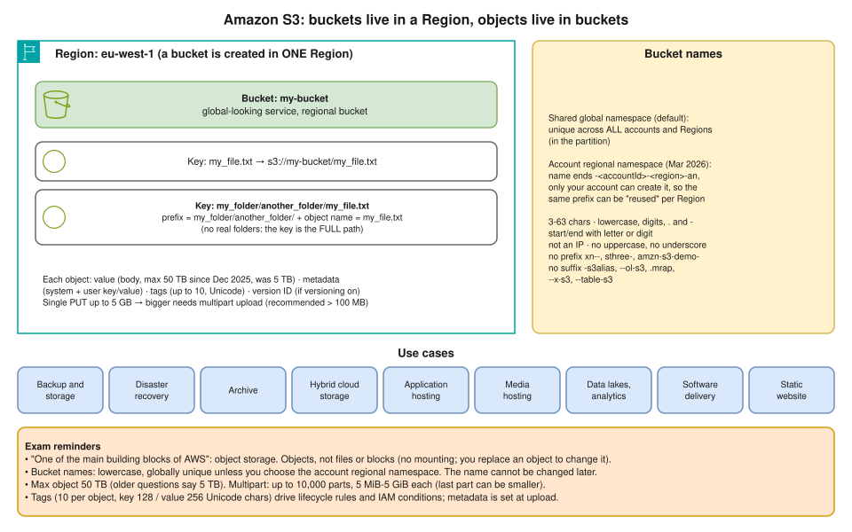
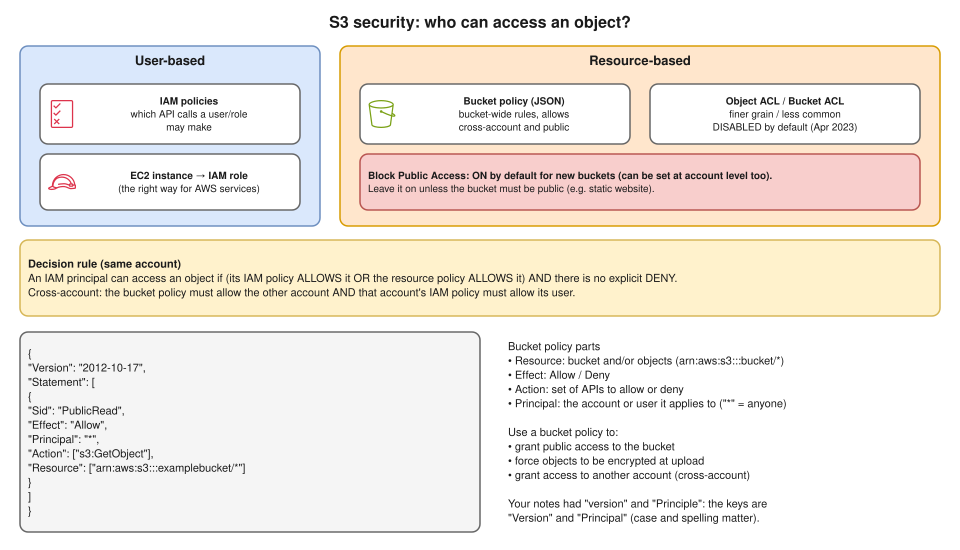
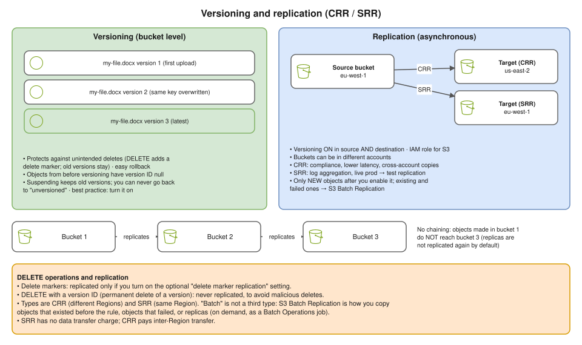
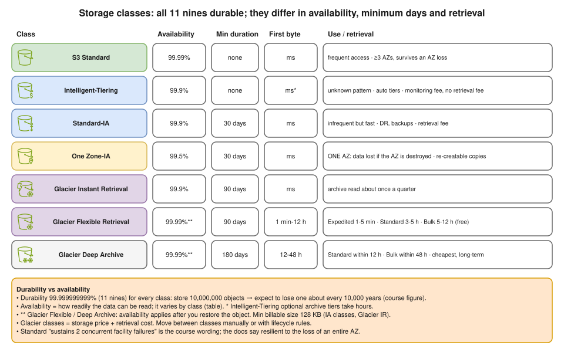
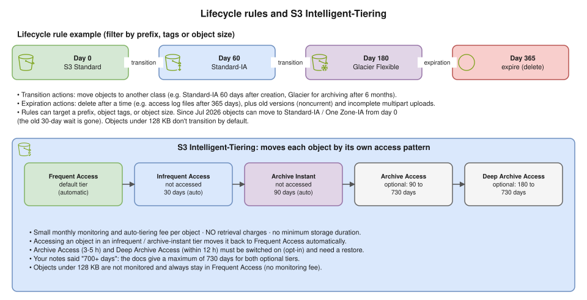
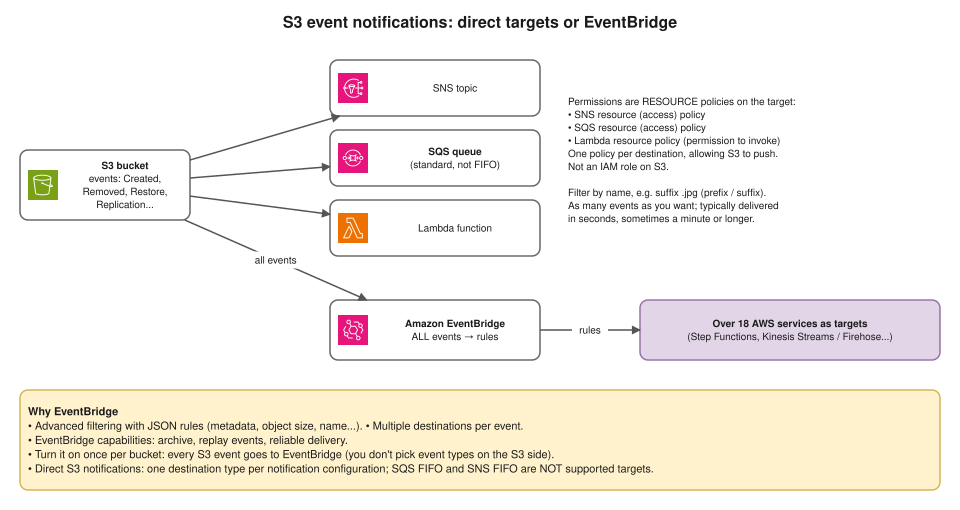
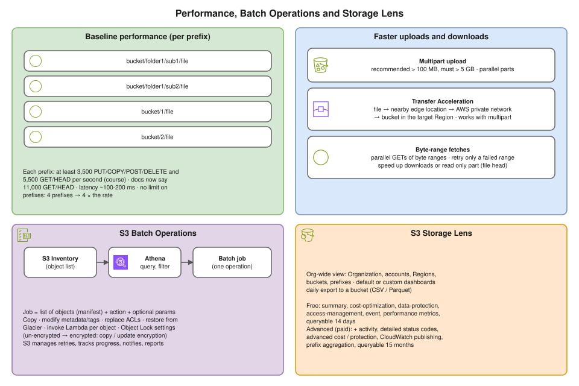
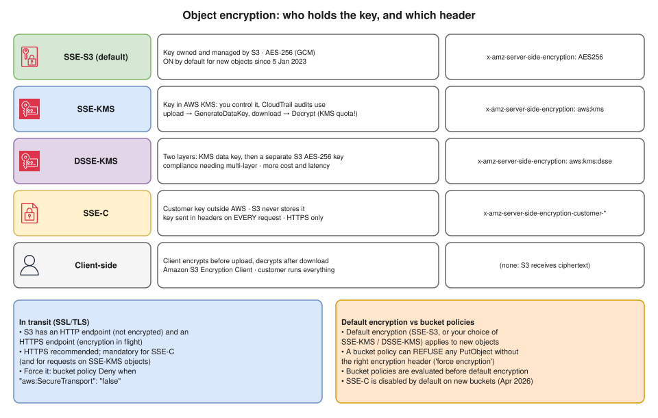
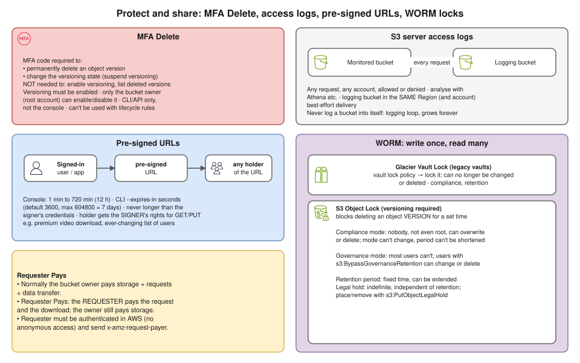
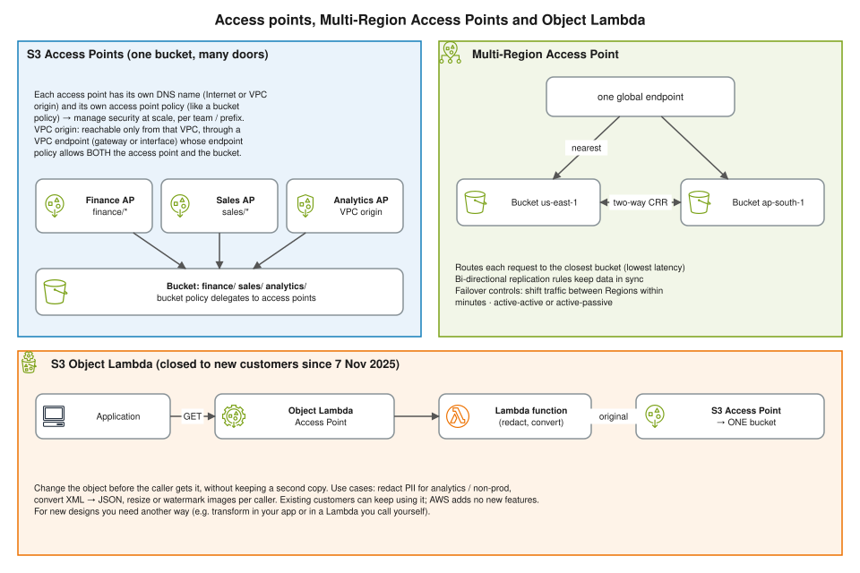

# Amazon S3 cheat sheet (course section 11)



**What you learned (course section 11, S3):** buckets and objects, bucket naming (global vs account regional namespace), security (IAM policies, bucket policies, ACLs, Block Public Access), static websites, versioning, replication (CRR, SRR, Batch Replication), storage classes, durability and availability, Intelligent-Tiering, lifecycle rules, Requester Pays, event notifications (and EventBridge), performance (prefixes, multipart, Transfer Acceleration, byte-range fetches), Batch Operations, Storage Lens, encryption (SSE-S3, SSE-KMS, DSSE-KMS, SSE-C, client-side, in transit), CORS, MFA Delete, access logs, pre-signed URLs, Glacier Vault Lock and Object Lock, Access Points, Multi-Region Access Points and Object Lambda.

> **How to use this page.** This page is built from **your own notes**. Every fact you wrote is still here, with typos fixed. Each section was checked against the **Amazon S3 User Guide** and other AWS pages (the "Source" line under each heading links them). Where your notes were wrong, out of date or incomplete, look for the **"Corrections to your notes"** box in that section, and the [full list](#corrections-to-your-notes-all-in-one-place) near the end. First draw the storage-class table ([diagram 4](#8-storage-classes)) and the encryption table ([diagram 8](#15-encryption)) from memory. Then do the [drill](#from-memory-drill).

**Confidence tags.** `[Certain]` = confirmed on the AWS page linked in that section (checked 24 Nov 2026). `[Likely]` = in the course slides (v49), but the AWS pages I read do not state it (a course simplification, an exam-style rule, or a number AWS does not publish there). **Where the course and the AWS docs disagree, the AWS docs win, and the note says so.** Exam tip: the SAA-C03 question bank is older than some of these changes, so learn both numbers where they differ (the note marks them).

## Contents

1. [S3 and its use cases](#1-s3-and-its-use-cases)
2. [Buckets and bucket names](#2-buckets-and-bucket-names)
3. [Objects](#3-objects)
4. [Security: IAM, bucket policies, ACLs](#4-security-iam-bucket-policies-acls)
5. [Static website hosting](#5-static-website-hosting)
6. [Versioning](#6-versioning)
7. [Replication (CRR and SRR)](#7-replication-crr-and-srr)
8. [Storage classes](#8-storage-classes)
9. [Lifecycle rules](#9-lifecycle-rules)
10. [Requester Pays](#10-requester-pays)
11. [Event notifications](#11-event-notifications)
12. [Performance](#12-performance)
13. [Batch Operations](#13-batch-operations)
14. [Storage Lens](#14-storage-lens)
15. [Encryption](#15-encryption)
16. [CORS](#16-cors)
17. [MFA Delete](#17-mfa-delete)
18. [Server access logs](#18-server-access-logs)
19. [Pre-signed URLs](#19-pre-signed-urls)
20. [Glacier Vault Lock and S3 Object Lock](#20-glacier-vault-lock-and-s3-object-lock)
21. [Access Points and Multi-Region Access Points](#21-access-points-and-multi-region-access-points)
22. [S3 Object Lambda](#22-s3-object-lambda)
23. [SAA exam traps](#23-saa-exam-traps)
24. [Corrections to your notes (all in one place)](#corrections-to-your-notes-all-in-one-place)
25. [From-memory drill](#from-memory-drill)
26. [30-second spoken answer](#30-second-spoken-answer)

---

## 1. S3 and its use cases

Source: [What is Amazon S3?](https://docs.aws.amazon.com/AmazonS3/latest/userguide/Welcome.html) · [Amazon S3 storage classes](https://aws.amazon.com/s3/storage-classes/)

- Amazon S3 is **one of the main building blocks of AWS**: object storage (you store whole objects in buckets; you don't mount it like a disk). `[Likely]` (course wording)
- It is "advertised" as infinitely scaling storage; many websites and AWS services use it as their storage layer. `[Likely]`

**Use cases** (your list) `[Likely]`:

| | | |
|---|---|---|
| Backup and storage | Disaster recovery | Archive |
| Hybrid cloud storage | Application hosting | Media hosting |
| Data lakes and big data analytics | Software delivery | Static website |

## 2. Buckets and bucket names

Source: [Namespaces for general purpose buckets](https://docs.aws.amazon.com/AmazonS3/latest/userguide/gpbucketnamespaces.html) · [General purpose bucket naming rules](https://docs.aws.amazon.com/AmazonS3/latest/userguide/bucketnamingrules.html) · [What's New: account regional namespaces (12 Mar 2026)](https://aws.amazon.com/about-aws/whats-new/2026/03/amazon-s3-account-regional-namespaces)

- Amazon S3 lets people store **objects** (files) in **buckets** (directories). `[Certain]`
- Buckets are defined at the **Regional level**: S3 looks like a global service, but **each bucket is created in one Region**. `[Certain]`

**Naming: two namespaces**

| | Shared global namespace (default) | Account regional namespace (new, Mar 2026) |
|---|---|---|
| Rule | The name must be **globally unique**: "unique across all AWS accounts in all the AWS Regions within a partition" `[Certain]` | A **reserved part of the namespace that only your account can use** `[Certain]` |
| Name format | anything that follows the rules below | `<your-prefix>-<12-digit account ID>-<region code>-an`, e.g. `amzn-s3-demo-bucket-111122223333-us-west-2-an` `[Certain]` |
| Reuse | after you delete a bucket, **another account may take the name** `[Certain]` | **no other account can ever create it**; because the Region is in the name, you can "reuse" the same prefix in every Region (course: "allows for reuse of the same bucket name across regions") `[Certain]` |
| How | normal CreateBucket | header `x-amz-bucket-namespace: account-regional` (the console adds the suffix for you); the suffix counts toward the 63 characters `[Certain]` |

**Naming constraints** (your list plus the full docs list) `[Certain]`:

- 3 to 63 characters.
- **No uppercase, no underscore**: only lowercase letters, numbers, dots (`.`) and hyphens (`-`).
- **Not an IP address** (e.g. `192.168.5.4`).
- **Must start (and end) with a lowercase letter or number.** No two dots next to each other.
- **Must not start with the prefix `xn--`** (also not `sthree-` or `amzn-s3-demo-`).
- **Must not end with the suffix `-s3alias`** (also not `--ol-s3`, `.mrap`, `--x-s3`, `--table-s3`; `-an` only for account regional buckets).
- The name can't be changed after creation. Avoid dots unless you need static website hosting (dots break HTTPS virtual-host URLs and Transfer Acceleration).

> **Corrections to your notes (section 2)**
> - "reginal" → **Regional**; "Contraints" → constraints; "underscrore" → underscore.
> - "Account Regional Namespace: allows reuse of the same bucket name across regions" is right but loose: the name is **not identical** in each Region. It carries your **account ID and Region code plus `-an`** as a suffix, so only the prefix repeats. Feature launched **12 March 2026**.
> - The naming list was incomplete: added length 3-63, must also **end** with a letter/number, and the other reserved prefixes and suffixes.

## 3. Objects

Source: [Amazon S3 multipart upload limits](https://docs.aws.amazon.com/AmazonS3/latest/userguide/qfacts.html) · [What's New: max object size 50 TB (2 Dec 2025)](https://aws.amazon.com/about-aws/whats-new/2025/12/amazon-s3-maximum-object-size-50-tb) · [Categorizing your objects using tags](https://docs.aws.amazon.com/AmazonS3/latest/userguide/object-tagging.html) · [Uploading objects with multipart upload](https://docs.aws.amazon.com/AmazonS3/latest/userguide/mpuoverview.html)

- Objects have a **key**. The key is the **FULL path** `[Certain]`:
  - `s3://my-bucket/my_file.txt`
  - `s3://my-bucket/my_folder/another_folder/my_file.txt`
- The key is composed of **prefix + object name**: in `s3://my-bucket/my_folder/another_folder/my_file.txt` the prefix is `my_folder/another_folder/`. There are **no real directories**; the console only shows prefixes as folders. `[Certain]`

**What an object carries**

| Part | Facts |
|---|---|
| **Value** | the content of the body. **Max object size 50 TB** (since **2 Dec 2025**; it was 5 TB). The multipart page writes it as 48.8 TiB (same limit in binary units). `[Certain]` |
| Upload rule | **More than 5 GB → must use multipart upload** (one PUT is max 5 GB). Multipart: up to **10,000 parts**, each **5 MiB to 5 GiB** (the last part can be smaller). Consider multipart from **100 MB**. `[Certain]` |
| **Metadata** | list of text key/value pairs: **system** metadata (set by S3, e.g. Content-Type, Last-Modified) or **user** metadata (`x-amz-meta-*`) `[Likely]` |
| **Tags** | **Unicode key/value pairs, up to 10 per object**: key up to 128, value up to 256 Unicode characters, case-sensitive. Useful for **security** (IAM conditions) and **lifecycle** rules. `[Certain]` |
| **Version ID** | only if **versioning is enabled** ([section 6](#6-versioning)) `[Certain]` |

> **Corrections to your notes (section 3)**
> - "Max. Object Size is 50TB" is **correct now** (and in the course slides v49): AWS raised it from **5 TB to 50 TB on 2 Dec 2025**. Older practice questions still say **5 TB**, so know both.
> - "perfix" → **prefix**.

## 4. Security: IAM, bucket policies, ACLs

Source: [Controlling ownership of objects and disabling ACLs](https://docs.aws.amazon.com/AmazonS3/latest/userguide/about-object-ownership.html) · [Amazon S3 security](https://aws.amazon.com/s3/security/) · [Bucket policy examples](https://docs.aws.amazon.com/AmazonS3/latest/userguide/example-bucket-policies.html) · [Policy evaluation for cross-account requests](https://docs.aws.amazon.com/IAM/latest/UserGuide/reference_policies_evaluation-logic-cross-account.html)



| Type | What | Notes |
|---|---|---|
| **User-based: IAM policies** | which API calls are allowed for a specific IAM user/role | for an EC2 instance, attach an **IAM role**, not keys `[Likely]` |
| **Resource-based: bucket policies** | bucket-wide rules (set in the S3 console) | **allow cross-account** and public access `[Certain]` |
| **Resource-based: object ACL** | finer grain | **can be disabled** `[Certain]` |
| **Resource-based: bucket ACL** | less common | **can be disabled** `[Certain]` |

- **ACLs are disabled by default** for new buckets: Object Ownership = **Bucket owner enforced** (since April 2023). `[Certain]`
- **Block Public Access is ON by default for all new buckets**; it can also be set at the account level. Leave it on unless the bucket really must be public. `[Certain]`

**When can an IAM principal access an object?** `[Likely]` (course rule; matches IAM evaluation logic)

- Its **IAM permissions ALLOW it, OR the resource (bucket) policy ALLOWS it**
- **AND there is no explicit DENY.**
- Cross-account: the bucket policy must allow the other account **and** that account's IAM policy must allow its user (both sides).

**Encryption:** encrypt objects in S3 using encryption keys (full detail in [section 15](#15-encryption)).

### Bucket policies

- **JSON-based** policies `[Certain]`:
  - **Resource**: buckets and objects (`arn:aws:s3:::examplebucket/*` = all objects)
  - **Effect**: Allow / Deny
  - **Action**: set of APIs to allow or deny
  - **Principal**: the account or user to apply the policy to (`"*"` = everyone)
- Use an S3 bucket policy to:
  - grant **public access** to the bucket
  - **force objects to be encrypted at upload**
  - grant access to **another account (cross-account)**

Your public-read example, **corrected** (it is JSON, not YAML):

```json
{
    "Version": "2012-10-17",
    "Statement": [
        {
            "Sid": "PublicRead",
            "Effect": "Allow",
            "Principal": "*",
            "Action": [
                "s3:GetObject"
            ],
            "Resource": [
                "arn:aws:s3:::examplebucket/*"
            ]
        }
    ]
}
```

For this to work, Block Public Access must be turned off for the bucket.

> **Corrections to your notes (section 4)**
> - JSON typos: **`"version"` → `"Version"`** and **`"Principle"` → `"Principal"`**. Policy element names are case-sensitive and must be spelled exactly; with these typos the policy is rejected. The code block was labelled `yaml`; it is **JSON**.
> - "The use IAM Permission" → the **user's** IAM permissions; "thers's" → there's; "anather" → another.
> - Added: ACLs are **disabled by default** and Block Public Access is **on by default** for new buckets (both exam favourites).

## 5. Static website hosting

Source: [Website endpoints](https://docs.aws.amazon.com/AmazonS3/latest/userguide/WebsiteEndpoints.html) · [Setting permissions for website access](https://docs.aws.amazon.com/AmazonS3/latest/userguide/WebsiteAccessPermissionsReqd.html)

- S3 can host **static websites** and have them accessible on the Internet. `[Certain]`
- The website URL is one of `[Certain]`:
  - `http://bucket-name.s3-website-<region>.amazonaws.com` (dash)
  - `http://bucket-name.s3-website.<region>.amazonaws.com` (dot)
- Website endpoints are **HTTP only** (no HTTPS; put CloudFront in front for HTTPS). `[Certain]`
- You must **disable Block Public Access** and add a **bucket policy that allows public read**; otherwise you get **403 Forbidden (Access Denied)**. `[Certain]`

## 6. Versioning

Source: [Retaining multiple versions of objects with S3 Versioning](https://docs.aws.amazon.com/AmazonS3/latest/userguide/Versioning.html) · [Adding objects to versioning-suspended buckets](https://docs.aws.amazon.com/AmazonS3/latest/userguide/AddingObjectstoVersionSuspendedBuckets.html)



- You can **version your files** in Amazon S3. It is **enabled at the bucket level**. `[Certain]`
- Overwriting the same key changes the "version": 1, 2, 3... `[Certain]`
- It is **best practice** to version your buckets `[Likely]`:
  - protect against **unintended deletes** (a delete only adds a **delete marker**; you can restore the previous version)
  - **easy rollback** to a previous version
- Objects stored **before** versioning was enabled have version ID **`null`**. `[Certain]`
- **Suspending** versioning does **not delete** earlier versions (new uploads get version ID `null`). Once enabled, a bucket can never go back to "unversioned", only "suspended". `[Certain]`

## 7. Replication (CRR and SRR)

Source: [Requirements and considerations for replication](https://docs.aws.amazon.com/AmazonS3/latest/userguide/replication-requirements.html) · [What does Amazon S3 replicate?](https://docs.aws.amazon.com/AmazonS3/latest/userguide/replication-what-is-isnot-replicated.html)

- **Must enable versioning** in **source and destination** buckets. `[Certain]`
- Two kinds `[Certain]`:
  - **Cross-Region Replication (CRR)**: buckets in different Regions. Use: compliance, lower-latency access, replication across accounts. `[Likely]` for the use cases
  - **Same-Region Replication (SRR)**: same Region (no data transfer charge). Use: log aggregation, live replication between production and test accounts. `[Likely]` for the use cases
- Buckets **can be in different AWS accounts** (the destination owner grants the source owner permission in a bucket policy). `[Certain]`
- Copying is **asynchronous**. `[Likely]` (course; the docs describe replicas being created in the background)
- You must give **proper IAM permissions to S3** (an IAM role that S3 assumes to replicate). `[Certain]`
- After you enable replication, **only new objects are replicated**. `[Certain]`
- Optionally, you can replicate **existing objects** using **S3 Batch Replication**: it replicates existing objects **and objects that failed replication** (and replicas). `[Certain]`
- **DELETE operations** `[Certain]`:
  - can replicate **delete markers** from source to target (**optional setting**, off by default)
  - **deletions with a version ID are not replicated** (to avoid malicious deletes)
- **There is no "chaining" of replication**: if bucket 1 replicates into bucket 2, which replicates into bucket 3, then **objects created in bucket 1 are not replicated to bucket 3** (replicas are not replicated again unless you use Batch Replication). `[Certain]`

> **Corrections to your notes (section 7)**
> - **"S3 Batch Region Replication" is not a replication type.** There are two types: **CRR** and **SRR**. **S3 Batch Replication** is the on-demand job that copies **existing** objects, **failed** objects and replicas. (The course slide lists only CRR and SRR.)
> - "diffrant" → different; "Optinally" → optionally; "craeted" → created.

## 8. Storage classes

Source: [Understanding and managing Amazon S3 storage classes](https://docs.aws.amazon.com/AmazonS3/latest/userguide/storage-class-intro.html) · [S3 Glacier storage classes](https://docs.aws.amazon.com/AmazonS3/latest/userguide/glacier-storage-classes.html) · [How S3 Intelligent-Tiering works](https://docs.aws.amazon.com/AmazonS3/latest/userguide/intelligent-tiering-overview.html) · [Amazon S3 storage classes](https://aws.amazon.com/s3/storage-classes/)



The classes (your list) `[Certain]`: **S3 Standard (general purpose)**, **Standard-Infrequent Access (Standard-IA)**, **One Zone-Infrequent Access**, **Glacier Instant Retrieval**, **Glacier Flexible Retrieval**, **Glacier Deep Archive**, **Intelligent-Tiering**. You can move between classes **manually** or with **S3 Lifecycle configurations**.

### Durability and availability

- **Durability**: high durability (**99.999999999%, 11 nines**) of objects across multiple AZs; the **same for all storage classes**. `[Certain]`
- If you store **10,000,000 objects** with S3, you can on average expect to lose **a single object once every 10,000 years**. `[Likely]` (course and older AWS FAQ wording; the pages I read give only the 11 nines)
- **Availability**: measures how readily available a service is; it **varies by storage class** (e.g. S3 Standard 99.99% = not available about 53 minutes a year). `[Certain]` (per-class figures)

### The classes side by side

| Class | Availability (designed) | AZs | Min storage duration | Retrieval | Use `[Certain]` unless tagged |
|---|---|---|---|---|---|
| **S3 Standard** (general purpose) | **99.99%** | ≥ 3 | none | milliseconds | **frequently accessed** data; **low latency and high throughput**; sustains **2 concurrent facility failures** `[Likely]` (docs: survives the loss of an entire AZ). Big data analytics, mobile/gaming apps, content distribution |
| **Standard-IA** | **99.9%** | ≥ 3 | 30 days (min billable 128 KB) | ms, retrieval fee | less frequently accessed, needs **rapid access** when needed; **lower cost than Standard**. Use: **disaster recovery, backups** |
| **One Zone-IA** | **99.5%** | **1** | 30 days (128 KB) | ms, retrieval fee | **high durability in a single AZ; data lost when the AZ is destroyed**. Use: secondary backup copies of on-prem data, data you can re-create |
| **Glacier Instant Retrieval** | 99.9% | ≥ 3 | **90 days** (128 KB) | **milliseconds** | great for data **accessed once a quarter** |
| **Glacier Flexible Retrieval** (formerly Amazon S3 Glacier) | 99.99% after restore | ≥ 3 | **90 days** | **Expedited 1-5 min · Standard 3-5 h · Bulk 5-12 h (free)** | archive read 1-2 times a year |
| **Glacier Deep Archive** (long-term storage) | 99.99% after restore | ≥ 3 | **180 days** | **Standard within 12 h · Bulk within 48 h** | cheapest, long-term archive (7-10 years, compliance) |
| **Intelligent-Tiering** | 99.9% | ≥ 3 | none | ms (archive tiers: hours) | unknown or changing access pattern |

**Infrequent Access classes** (Standard-IA, One Zone-IA): for data that is **less frequently accessed but requires rapid access when needed**, at a **lower cost than S3 Standard** (you pay a per-GB retrieval fee). `[Certain]`

**Glacier storage classes**: **low-cost object storage meant for archiving / backup**. **Pricing: price for storage + object retrieval cost.** `[Certain]`

### S3 Intelligent-Tiering



- Small **monthly monitoring and auto-tiering fee** per object. `[Certain]`
- **Moves objects automatically between access tiers based on usage.** `[Certain]`
- **There are no retrieval charges in S3 Intelligent-Tiering.** `[Certain]`
- No minimum storage duration; objects **under 128 KB** are not monitored and always stay in Frequent Access. `[Certain]`

| Tier | When `[Certain]` |
|---|---|
| **Frequent Access** (automatic) | **default** tier |
| **Infrequent Access** (automatic) | objects **not accessed for 30 days** |
| **Archive Instant Access** (automatic) | objects **not accessed for 90 days** |
| **Archive Access** (optional) | configurable from **90 days to 730 days** (restore takes 3-5 h) |
| **Deep Archive Access** (optional) | configurable from **180 days to 730 days** (restore within 12 h) |

> **Corrections to your notes (section 8)**
> - Intelligent-Tiering: "**700+ days**" → the docs give an exact maximum of **730 days** for both optional archive tiers.
> - "Sustain 2 concurrent facility failures" is **course wording** (old AWS FAQ). The current docs say the multi-AZ classes are designed to be **resilient to the physical loss of an entire Availability Zone**. Fine to say either in an interview.
> - Added the availability of Glacier Instant Retrieval (99.9%), the 30-day minimum for the IA classes and the 128 KB minimum billable size.
> - Typos: Standerd → Standard, Retrival → Retrieval, Glaicer → Glacier, minites → minutes, log turm → **long-term**, tire → tier, monitopring → monitoring, Mesures → measures, multipal → multiple.

## 9. Lifecycle rules

Source: [Examples of S3 Lifecycle configurations](https://docs.aws.amazon.com/AmazonS3/latest/userguide/lifecycle-configuration-examples.html) · [What's New: 30-day minimum removed for IA transitions (16 Jul 2026)](https://aws.amazon.com/about-aws/whats-new/2026/07/s3-removes-30-day-transitions-standard-ia-one-zone-ia/)

- **Transition actions**: configure objects to **transition to another storage class** `[Certain]`, e.g.
  - move objects to **Standard-IA 60 days after creation**
  - move to **Glacier for archiving after 6 months**
- **Expiration actions**: configure objects to **expire (delete) after some time** `[Certain]`, e.g.
  - **access log files** can be set to delete **after 365 days**
  - can also delete **old (noncurrent) versions** and **incomplete multipart uploads**
- Rules can be created for a **certain prefix**. `[Certain]`
- Rules can be created for **certain object tags**. `[Certain]`
- Rules can also filter on **object size** (greater than / less than). Objects **under 128 KB don't transition** by default (since Sep 2024). `[Certain]`
- Since **16 Jul 2026** objects can transition to Standard-IA and One Zone-IA **from day 0** (the old rule "must stay 30 days in Standard first" is gone). Older exam questions still assume the 30-day wait. `[Certain]`

## 10. Requester Pays

Source: [Using Requester Pays buckets](https://docs.aws.amazon.com/AmazonS3/latest/userguide/RequesterPaysBuckets.html)

- In general, **bucket owners pay for all S3 storage and data transfer costs** associated with their bucket. `[Certain]`
- With **Requester Pays** buckets, the **requester** instead of the bucket owner **pays the cost of the request and the data download** from the bucket. The owner still pays for storage. `[Certain]`
- The requester **must be authenticated in AWS (cannot be anonymous)** and must send the `x-amz-request-payer` header. `[Certain]`
- Use: sharing large datasets with other accounts. `[Likely]`

## 11. Event notifications

Source: [Amazon S3 Event Notifications](https://docs.aws.amazon.com/AmazonS3/latest/userguide/EventNotifications.html) · [Event notification types and destinations](https://docs.aws.amazon.com/AmazonS3/latest/userguide/notification-how-to-event-types-and-destinations.html) · [Using EventBridge](https://docs.aws.amazon.com/AmazonS3/latest/userguide/EventBridge.html)



- Events: `s3:ObjectCreated`, `s3:ObjectRemoved`, `s3:ObjectRestore`, `s3:Replication`... `[Certain]`
- You can create **as many "S3 events" as desired**. `[Likely]` (course)
- **Object name filtering** is possible (prefix / suffix, e.g. `*.jpg`). `[Certain]`
- S3 event notifications **typically deliver events in seconds but can sometimes take a minute or longer**. `[Certain]`
- Example use: generate thumbnails of images uploaded to S3. `[Likely]`

### Permissions

- Targets: **SNS** (standard topics only), **SQS** (standard queues only, **not FIFO**), **Lambda function**. `[Certain]`
- To send notifications you attach a **resource (access) policy on each target** that allows S3 to push to it: **SNS resource policy**, **SQS resource policy**, **Lambda resource policy**. One policy per destination service. (Not an IAM role on S3.) `[Certain]`

### With Amazon EventBridge

- All events go to EventBridge once you turn it on for the bucket (you don't pick event types on the S3 side), then **rules** route them. `[Certain]`
- **Advanced filtering** options with **JSON rules** (metadata, object size, name...). `[Likely]`
- **Multiple destinations**: **over 18 AWS services** as targets (e.g. Step Functions, Kinesis Data Streams / Firehose). `[Likely]` (course number)
- **EventBridge capabilities**: **archive, replay events, reliable delivery**. `[Likely]`

> **Corrections to your notes (section 11)**
> - "Send the Notification you need to create policy..." → you create a **resource-based policy on the target** (SNS topic, SQS queue or Lambda function) that allows S3 to send to it, one per target.
> - Added: SQS **FIFO** queues and SNS **FIFO** topics are **not** supported as direct targets.
> - Typos: Adavance → Advanced, Optiuons → options, Multipal → Multiple.

## 12. Performance

Source: [Best practices design patterns: optimizing Amazon S3 performance](https://docs.aws.amazon.com/AmazonS3/latest/userguide/optimizing-performance.html) · [Performance guidelines](https://docs.aws.amazon.com/AmazonS3/latest/userguide/optimizing-performance-guidelines.html) · [Multipart upload limits](https://docs.aws.amazon.com/AmazonS3/latest/userguide/qfacts.html)



### Baseline performance

- S3 **automatically scales to high request rates**; latency **100-200 ms** (small objects, first byte). `[Certain]`
- Your application can achieve **at least 3,500 PUT/COPY/POST/DELETE** and **5,500 GET/HEAD** requests **per second per prefix** in a bucket (course). The current docs say **3,500 PUT/COPY/POST/DELETE or 11,000 GET/HEAD** per partitioned prefix. `[Certain]` for 11,000 · `[Likely]` for 5,500
- There is **no limit on the number of prefixes**: spread objects over 4 prefixes and you get 4 × the rate (e.g. 4 × 5,500 = 22,000 GET/s in course numbers). `[Certain]`

### Faster uploads and downloads

- **Multipart upload** `[Certain]`:
  - **recommended for files > 100 MB, must use for files > 5 GB**
  - can help **parallelize uploads** (speed up transfers)
- **S3 Transfer Acceleration**:
  - increases transfer speed by transferring the file to an **AWS edge location**, which forwards the data to the S3 bucket in the target Region (over the AWS network) `[Likely]`
  - **compatible with multipart upload** `[Likely]`
  - best for transferring GBs to TBs regularly across continents; bucket name can't contain dots `[Certain]`
- **S3 byte-range fetches** `[Certain]`:
  - **parallelize GETs** by requesting specific byte ranges
  - **better resilience** in case of failures (retry only the failed range)
  - **can be used to speed up downloads**
  - **can be used to retrieve only partial data** (for example the head of a file)

> **Corrections to your notes (section 12)**
> - **5,500 GET/HEAD is out of date**: the S3 performance page now says **11,000 GET/HEAD** per second per partitioned prefix (3,500 for writes is unchanged). Older exam questions use 5,500, so recognise both; if an answer says 5,500 and no answer says 11,000, pick 5,500.
> - Typos: achive → achieve, recomended → recommended, forword → forward, traget → target, Compatibale → compatible, Ferches → fetches, retrive → retrieve.

## 13. Batch Operations

Source: [Performing object operations in bulk with Batch Operations](https://docs.aws.amazon.com/AmazonS3/latest/userguide/batch-ops.html) · [Operations supported by S3 Batch Operations](https://docs.aws.amazon.com/AmazonS3/latest/userguide/batch-ops-operations.html)

- Perform **bulk operations on existing S3 objects with a single request**, for example `[Certain]`:
  - modify object **metadata and properties**
  - **copy objects** between S3 buckets
  - **encrypt un-encrypted objects** (by copying in place or with the "update object encryption" operation)
  - modify **ACLs, tags**
  - **restore objects from S3 Glacier**
  - **invoke a Lambda function** to perform a custom action on each object
  - also: Object Lock retention / legal hold, compute checksums, Batch Replication
- A job consists of a **list of objects** (manifest), the **action** to perform, and **optional parameters**. Each job does one operation type. `[Certain]`
- S3 Batch Operations **manages retries, tracks progress, sends completion notifications, generates reports**... `[Certain]`
- **You can use S3 Inventory to get the object list and Athena to query and filter your objects**, then run Batch Operations on the result. `[Certain]` for Inventory as manifest · `[Likely]` for the Athena step

## 14. Storage Lens

Source: [Understanding Amazon S3 Storage Lens](https://docs.aws.amazon.com/AmazonS3/latest/userguide/storage_lens_basics_metrics_recommendations.html) · [Storage Lens metrics glossary](https://docs.aws.amazon.com/AmazonS3/latest/userguide/storage_lens_metrics_glossary.html)

- **Understand, analyze and optimize storage across an entire AWS Organization.** `[Certain]`
- **Discover anomalies, identify cost efficiencies and apply data-protection best practices** across the whole Organization. `[Certain]`
- **Aggregate data** for the Organization, specific accounts, Regions, buckets or prefixes. `[Certain]`
- **Default dashboard** or **create your own** dashboards. `[Certain]`
- Can be configured to **export metrics daily to an S3 bucket** (CSV or Parquet). `[Certain]`

### Metric categories

| Category | Insights | Example metrics | Use case | Tier `[Certain]` |
|---|---|---|---|---|
| **Summary** | general insights about your S3 storage | StorageBytes, ObjectCount | identify the **fastest-growing buckets and prefixes** | free |
| **Cost-optimization** | manage and optimize storage costs | NonCurrentVersionStorageBytes, IncompleteMultipartUploadStorageBytes | find buckets with **incomplete multipart uploads older than 7 days**; find objects that could move to a **lower-cost class** | free (advanced adds more) |
| **Data-protection** | data protection features | VersioningEnabledBucketCount, MFADeleteEnabledBucketCount, CrossRegionReplicationRuleCount | find buckets **not following data-protection best practices** | free (advanced adds more) |
| **Access-management** | S3 **Object Ownership** | ObjectOwnershipBucketOwnerEnforcedBucketCount | see **which Object Ownership settings** your buckets use | free |
| **Event** | S3 Event Notifications | EventNotificationEnabledBucketCount | which buckets send events | free |
| **Performance** | S3 Transfer Acceleration | TransferAccelerationEnabledBucketCount | which buckets use acceleration | free |
| **Activity** | how your storage is requested | AllRequests, GetRequests, PutRequests, ListRequests, BytesDownloaded | request patterns | **advanced** |
| **Detailed status code** | HTTP status codes | 200OKStatusCount, 403ForbiddenErrorCount... | errors per bucket | **advanced** |

### Free vs paid

| | Free metrics | Advanced metrics and recommendations (paid) |
|---|---|---|
| Who | **automatically available for all customers** `[Certain]` | additional paid metrics and features `[Certain]` |
| What | **around 28 usage metrics** `[Likely]` (course count; the glossary has no total) | **Advanced metrics**: activity, advanced cost optimization, advanced data protection, status codes · **CloudWatch publishing**: metrics in CloudWatch **without additional charges** · **Prefix aggregation**: metrics at the prefix level `[Certain]` |
| History | **data available for queries for 14 days** `[Certain]` | **data available for queries for 15 months** `[Certain]` |

> **Corrections to your notes (section 14)**
> - Metric names: `VersioningEnableBucketCount` → **VersioningEnabledBucketCount**; `ObjectOwnershipBucketOwnershipEnforcedBucketCount` → **ObjectOwnershipBucketOwnerEnforcedBucketCount**; `TransferAccelerationEnableBucketCount` → **TransferAccelerationEnabledBucketCount**; `AllRequestes` / `ByteDownloads` → **AllRequests** / **BytesDownloaded**.
> - Activity and detailed status-code metrics are **advanced (paid) only**; your list put them alongside the free categories.
> - "28 free metrics" could not be confirmed in the docs (kept as a course fact).

## 15. Encryption

Source: [Protecting data with server-side encryption](https://docs.aws.amazon.com/AmazonS3/latest/userguide/serv-side-encryption.html) · [SSE-S3](https://docs.aws.amazon.com/AmazonS3/latest/userguide/UsingServerSideEncryption.html) · [SSE-KMS](https://docs.aws.amazon.com/AmazonS3/latest/userguide/UsingKMSEncryption.html) · [DSSE-KMS](https://docs.aws.amazon.com/AmazonS3/latest/userguide/UsingDSSEncryption.html) · [SSE-C](https://docs.aws.amazon.com/AmazonS3/latest/userguide/ServerSideEncryptionCustomerKeys.html) · [Default encryption FAQ](https://docs.aws.amazon.com/AmazonS3/latest/userguide/default-encryption-faq.html) · [KMS request quotas](https://docs.aws.amazon.com/kms/latest/developerguide/requests-per-second.html) · [Amazon S3 Encryption Client](https://docs.aws.amazon.com/amazon-s3-encryption-client/latest/developerguide/client-server-side.html)



Four kinds of **server-side encryption (SSE)** plus client-side `[Certain]`:

| Method | Key held by | Header | Facts |
|---|---|---|---|
| **SSE-S3** (S3-managed keys) | S3 (handled, managed and owned by AWS) | `"x-amz-server-side-encryption": "AES256"` | encrypted server-side · **AES-256** (GCM) · **enabled by default for new buckets and new objects** (since 5 Jan 2023; can't be turned off) |
| **SSE-KMS** (KMS key in AWS KMS) | AWS KMS | `"x-amz-server-side-encryption": "aws:kms"` | **user control + audit key usage with CloudTrail** · encrypted server-side · S3 Bucket Keys cut KMS calls up to 99% |
| **DSSE-KMS** (dual-layer) | AWS KMS + S3 | `"x-amz-server-side-encryption": "aws:kms:dsse"` | encrypted **twice** server-side |
| **SSE-C** (customer-provided keys) | **customer, outside AWS** | `x-amz-server-side-encryption-customer-algorithm` / `-key` / `-key-MD5` | S3 does **not** store the key · **HTTPS must be used** · key in headers on **every** request |
| **Client-side** | customer | none (S3 only sees ciphertext) | client encrypts and decrypts itself |

### SSE-S3

- Encryption using keys **handled, managed and owned by AWS**. `[Certain]`
- Object is **encrypted server-side**. `[Certain]`
- Encryption type is **AES-256**. `[Certain]`
- Must set header **`"x-amz-server-side-encryption": "AES256"`** (only needed if you want to state it; it's the default). `[Certain]`
- **Enabled by default for new buckets and new objects.** `[Certain]`

### SSE-KMS

- Encryption using keys **handled and managed by AWS KMS**. `[Certain]`
- KMS advantages: **user control + audit key usage using CloudTrail**. `[Certain]`
- Object is **encrypted server-side**. `[Certain]`
- Must set header **`"x-amz-server-side-encryption": "aws:kms"`**. `[Certain]`
- GET and PUT on SSE-KMS objects must use **HTTPS (TLS)**. `[Certain]`

**SSE-KMS limitation** (KMS quotas):

- If you use SSE-KMS, you may be impacted by the **KMS limits**. `[Certain]`
- When you **upload**, S3 calls the **GenerateDataKey** KMS API. `[Certain]`
- When you **download**, S3 calls the **Decrypt** KMS API. `[Certain]`
- These **count toward the KMS quota per second**. Course: **5,500, 10,000, 30,000 req/s based on Region**. Current KMS docs: **10,000 req/s shared** by default, **20,000** in some Regions (e.g. us-east-2, ap-southeast-1, eu-central-1), **100,000** in us-east-1, us-west-2, eu-west-1. `[Certain]` for the docs numbers · `[Likely]` for the course numbers
- You can **request a quota increase** using the **Service Quotas console**. `[Certain]`
- Fix without a quota increase: turn on **S3 Bucket Keys** (fewer KMS calls). `[Certain]`

### DSSE-KMS

- **Dual-layer** server-side encryption using keys handled and managed by AWS KMS. `[Certain]`
- Object is **encrypted twice** server-side: the docs say layer 1 = a unique data key generated by **AWS KMS**, layer 2 = a **separate AES-256 key managed by S3**. `[Certain]`
- For **compliance standards requiring multi-layer encryption** (**higher cost and latency than SSE-KMS**: more KMS operations; S3 Bucket Keys not supported). `[Certain]`
- Must set header **`"x-amz-server-side-encryption": "aws:kms:dsse"`**. `[Certain]`

### SSE-C

- Server-side encryption using keys **fully managed by the customer outside of AWS**. `[Certain]`
- **Amazon S3 does NOT store the encryption key you provide.** `[Certain]`
- **HTTPS must be used** (S3 rejects SSE-C requests over HTTP). `[Certain]`
- Encryption key must be provided in **HTTP headers, for every HTTP request** made. `[Certain]`
- New since **April 2026**: SSE-C is **disabled by default** on new general purpose buckets; you must enable it with PutBucketEncryption (`BlockedEncryptionTypes` = NONE). `[Certain]`

### Client-side encryption

- Use a client library such as the **Amazon S3 Encryption Client** (your notes: "Amazon S3 Client-Side Encryption Library"). `[Certain]`
- Clients must **encrypt data themselves before sending** to S3. `[Certain]`
- Clients must **decrypt data themselves when retrieving** from S3. `[Certain]`
- **Customer fully manages the keys and encryption cycle.** `[Certain]`

### Encryption in transit (SSL/TLS)

- Encryption in flight is also called **SSL/TLS**. `[Certain]`
- S3 exposes two endpoints: **HTTP endpoint** (non-encrypted) and **HTTPS endpoint** (encryption in flight). `[Likely]`
- **HTTPS is recommended.** `[Certain]`
- **HTTPS is mandatory for SSE-C** (and for requests on SSE-KMS / DSSE-KMS objects). `[Certain]`
- **Force encryption in transit** with a bucket policy: **Deny** any request where **`"aws:SecureTransport": "false"`**. `[Certain]`

```json
{
  "Version": "2012-10-17",
  "Statement": [{
    "Sid": "DenyHttp",
    "Effect": "Deny",
    "Principal": "*",
    "Action": "s3:*",
    "Resource": ["arn:aws:s3:::examplebucket", "arn:aws:s3:::examplebucket/*"],
    "Condition": { "Bool": { "aws:SecureTransport": "false" } }
  }]
}
```

### Default encryption vs bucket policies

- **SSE-S3 encryption is automatically applied to new objects** stored in an S3 bucket (default encryption; you can change the default to SSE-KMS or DSSE-KMS). `[Certain]`
- Optionally, you can **"force encryption" using a bucket policy** and **refuse any API call to PUT an S3 object without encryption headers** (e.g. require SSE-KMS). `[Certain]`
- **Bucket policies are evaluated before default encryption.** `[Likely]` (course)

> **Corrections to your notes (section 15)**
> - **KMS quota numbers are out of date.** You wrote 5,500 / 10,000 / 30,000 req/s (course). The KMS docs now list **10,000 (shared) by default, 20,000 in 7 Regions, 100,000 in us-east-1, us-west-2 and eu-west-1**. The exam idea is unchanged: lots of SSE-KMS traffic can hit the KMS quota → ask for an increase in **Service Quotas** or use **S3 Bucket Keys**.
> - Header typos: `"x-amz-server-side-encryption"-"aws:kms"` → `"x-amz-server-side-encryption": "aws:kms"`; `"x-amz-server-side-encrytion"` → `"x-amz-server-side-encryption"` (DSSE-KMS).
> - "Amazon S3-Managment Keys" → Amazon S3 **managed** keys. Client library's current name: **Amazon S3 Encryption Client**.
> - Added: SSE-C is **disabled by default on new buckets since April 2026**.
> - Typos: calles → calls, standerds → standards, mandetory → mandatory, Optinally → optionally.

## 16. CORS

Source (the CORS page was rate-limited when I checked, so this section is tagged from the course; the facts are standard browser CORS): [Using cross-origin resource sharing (CORS)](https://docs.aws.amazon.com/AmazonS3/latest/userguide/cors.html) · [Elements of a CORS configuration](https://docs.aws.amazon.com/AmazonS3/latest/userguide/ManageCorsUsing.html)

- **Cross-Origin Resource Sharing (CORS).** `[Likely]`
- **Origin = scheme (protocol) + host (domain) + port.** Example: `https://www.example.com` (implied port 443 for HTTPS, 80 for HTTP). `[Likely]`
- A **web-browser-based mechanism** to allow requests to **other origins** while visiting the **main origin**. `[Likely]`
  - **Same origin**: `http://example.com/app1` and `http://example.com/app2`
  - **Different origins**: `http://www.example.com` and `http://other.example.com`
- The requests **won't be fulfilled unless the other origin allows them, using CORS headers**, e.g. **`Access-Control-Allow-Origin`** (the browser first sends a **preflight OPTIONS** request). `[Likely]`
- If a client makes a cross-origin request on **our S3 bucket**, we need to **enable the correct CORS headers** (a CORS configuration on the bucket that is being called, not on the website bucket). `[Likely]`
- You can allow a **specific origin** or **`*` (all origins)**. `[Likely]`

```json
[
  {
    "AllowedOrigins": ["https://www.example.com"],
    "AllowedMethods": ["GET"],
    "AllowedHeaders": ["*"],
    "MaxAgeSeconds": 3000
  }
]
```

## 17. MFA Delete

Source: [Configuring MFA delete](https://docs.aws.amazon.com/AmazonS3/latest/userguide/MultiFactorAuthenticationDelete.html)



- **MFA (Multi-Factor Authentication)**: forces users to generate a code on a device (usually a mobile phone or hardware device) before doing important operations on S3. `[Certain]`
- MFA **will be required** to `[Certain]`:
  - **permanently delete an object version**
  - **suspend versioning** on the bucket (change the versioning state)
- MFA **won't be required** to `[Likely]`:
  - **enable versioning**
  - **list deleted versions**
- To use MFA Delete, **versioning must be enabled** on the bucket. `[Certain]`
- **Only the bucket owner (root account) can enable/disable MFA Delete.** `[Certain]`
- Only through the **AWS CLI or API** (not the console), and it **can't be used with lifecycle configurations**. `[Certain]`

## 18. Server access logs

Source: [Logging requests with server access logging](https://docs.aws.amazon.com/AmazonS3/latest/userguide/ServerLogs.html) · [Enabling server access logging](https://docs.aws.amazon.com/AmazonS3/latest/userguide/enable-server-access-logging.html)

- For **audit** purposes, you may want to log all access to S3 buckets. `[Certain]`
- **Any request made to S3, from any account, authorized or denied**, will be logged into **another S3 bucket**. `[Certain]`
- That data can be analyzed using data analysis tools (e.g. **Athena**). `[Likely]`
- The target logging bucket **must be in the same AWS Region** (and the **same account**). `[Certain]`
- Delivery is **best-effort** (records can arrive late or, rarely, not at all). `[Certain]`
- **Warning** `[Certain]`:
  - **do not set your logging bucket to be the monitored bucket**
  - it creates a **logging loop**, and your bucket **grows exponentially**

## 19. Pre-signed URLs

Source: [Download and upload objects with presigned URLs](https://docs.aws.amazon.com/AmazonS3/latest/userguide/using-presigned-url.html)

- Generate pre-signed URLs using the **S3 console, AWS CLI or SDK**. `[Certain]`
- **URL expiration** `[Certain]`:
  - **S3 console**: **1 min up to 720 mins (12 hours)**
  - **AWS CLI**: configure expiration with **`--expires-in`** in **seconds** (default **3600 s**, max **604800 s = 168 hours = 7 days**) `[Certain]` for 7 days · `[Likely]` for the default
  - never valid longer than the **credentials that signed it** (e.g. a role session)
- Users given a pre-signed URL **inherit the permissions of the user that generated the URL** for **GET / PUT**. `[Certain]`
- Examples `[Likely]`:
  - allow only **logged-in users to download a premium video** from your S3 bucket
  - allow an **ever-changing list of users to download files** by generating URLs dynamically
  - allow **temporarily** a user to **upload** a file to a precise location in your bucket

```bash
aws s3 presign s3://my-bucket/video.mp4 --expires-in 3600 --region eu-west-1   # untested here
```

## 20. Glacier Vault Lock and S3 Object Lock

Source: [Amazon S3 Glacier Vault Lock](https://docs.aws.amazon.com/amazonglacier/latest/dev/vault-lock.html) · [Locking objects with Object Lock](https://docs.aws.amazon.com/AmazonS3/latest/userguide/object-lock.html)

### S3 Glacier Vault Lock

- Adopt a **WORM (Write Once Read Many)** model. `[Certain]`
- Create a **Vault Lock Policy**. `[Certain]`
- **Lock the policy for future edits** (it can no longer be changed or deleted). You get **24 hours** to test it before the lock is final. `[Certain]`
- Helpful for **compliance and data retention**. `[Certain]`
- Note: this is the **original Glacier vault service**, which is **no longer accepting new customers**; for new designs use the S3 Glacier storage classes + **S3 Object Lock**. `[Certain]`

### S3 Object Lock (versioning must be enabled)

- Adopt a **WORM** model. `[Certain]`
- **Block an object version deletion for a specified amount of time.** `[Certain]`

| | Compliance mode | Governance mode |
|---|---|---|
| Overwrite / delete | object versions **can't be overwritten or deleted by any user, including the root user** `[Certain]` | **most users can't** overwrite or delete an object version or alter its lock settings `[Certain]` |
| Change settings | retention **mode can't be changed** and retention **period can't be shortened** `[Certain]` | **some users have special permissions** to change the retention or delete the object: `s3:BypassGovernanceRetention` + header `x-amz-bypass-governance-retention: true` `[Certain]` |
| Use | regulatory WORM (SEC 17a-4 style) | protect against accidents, test retention settings |

- **Retention period**: protect the object for a **fixed period**; it **can be extended**. `[Certain]`
- **Legal hold** `[Certain]`:
  - protects the object **indefinitely, independent from the retention period**
  - can be **freely placed and removed** using the **`s3:PutObjectLegalHold`** IAM permission

> **Corrections to your notes (section 20)**
> - IAM permission spelling: `S3:putObjectLeagalHold` → **`s3:PutObjectLegalHold`**.
> - Added: Glacier Vault Lock belongs to the **legacy Glacier vault service (closed to new customers)**; S3 Object Lock is the current answer.
> - Typos: Complience → Compliance, owerwritten → overwritten, delet → delete.

## 21. Access Points and Multi-Region Access Points

Source: [Creating access points restricted to a VPC](https://docs.aws.amazon.com/AmazonS3/latest/userguide/access-points-vpc.html) · [Configuring IAM policies for using access points](https://docs.aws.amazon.com/AmazonS3/latest/userguide/access-points-policies.html) · [Multi-Region Access Points](https://docs.aws.amazon.com/AmazonS3/latest/userguide/MultiRegionAccessPoints.html) · [Multi-Region Access Points failover controls](https://docs.aws.amazon.com/AmazonS3/latest/userguide/MrapFailover.html)



### S3 Access Points

- Access Points **simplify security management** for S3 buckets. `[Certain]`
- Each access point has `[Certain]`:
  - its **own DNS name** (network origin **Internet** or **VPC**)
  - an **access point policy** (similar to a bucket policy): **manage security at scale**
- Best practice: the **bucket policy delegates** access control to the access points. `[Certain]`
- **VPC origin** `[Certain]`:
  - we can define the access point to be **accessible only from within the VPC** (set when you create it)
  - you must create a **VPC endpoint** to access the access point (**Gateway or Interface endpoint**) `[Likely]` for the endpoint types
  - the **VPC endpoint policy must allow access to the target bucket and the access point**

### Multi-Region Access Points

- Provide a **global endpoint** that spans S3 buckets in **multiple AWS Regions**. `[Certain]`
- **Dynamically route requests to the nearest S3 bucket (lowest latency).** `[Certain]` (docs: "closest proximity")
- **Bi-directional S3 replication rules** (two-way CRR) are created to keep data in sync across Regions. `[Certain]`
- **Failover controls**: shift requests across S3 buckets in different AWS Regions **within minutes** (**active-active** or **active-passive**). `[Certain]`

## 22. S3 Object Lambda

Source: [Amazon S3 Object Lambda availability change](https://docs.aws.amazon.com/AmazonS3/latest/userguide/amazons3-ol-change.html) · [Transforming objects with S3 Object Lambda](https://docs.aws.amazon.com/AmazonS3/latest/userguide/transforming-objects.html)

- Use an **AWS Lambda function to change the object before it is retrieved** by the caller application. `[Certain]`
- **Only one S3 bucket is needed**, on top of which we create an **S3 Access Point** and an **S3 Object Lambda Access Point**. `[Certain]`
- **Use cases** `[Certain]`:
  - **redacting personally identifiable information** for analytics or non-production environments
  - **converting across data formats**, such as XML to JSON
  - resizing and watermarking images on the fly using caller-specific details `[Likely]`
- **Availability:** since **7 November 2025**, S3 Object Lambda is **available only to existing customers** (and select partners). AWS plans no new features. `[Certain]`

> **Corrections to your notes (section 22)**
> - Added the **availability change**: new AWS accounts can't start using Object Lambda (since 7 Nov 2025). It can still appear in exam questions, so know what it does.

## 23. SAA exam traps

| Question says... | Answer |
|---|---|
| Bucket name must be unique... | globally (shared namespace), unless you pick the **account regional namespace** (`-<account>-<region>-an`) |
| Upload a 10 GB file | **multipart upload** (must above 5 GB; recommended above 100 MB) |
| Largest object? | **50 TB** (since Dec 2025; older questions: 5 TB) |
| Make objects public | turn off **Block Public Access** + **bucket policy** allowing `s3:GetObject` to `"*"` |
| Give another account access | **bucket policy** (cross-account) |
| EC2 instance needs S3 access | **IAM role**, not access keys |
| Website returns 403 | bucket policy missing public read, or Block Public Access still on |
| Protect against accidental delete | **versioning** (+ **MFA Delete**) |
| Copy existing objects to a new replica bucket | **S3 Batch Replication** (replication covers new objects only) |
| Replicate deletes? | delete markers: optional setting · version-ID deletes: **never** |
| Bucket 1 → 2 → 3 replication | objects from 1 **don't reach 3** (no chaining) |
| Infrequent, fast access, re-creatable data, cheapest | **One Zone-IA** |
| Archive, retrieve in milliseconds, once a quarter | **Glacier Instant Retrieval** |
| Archive, retrieve in minutes | Glacier Flexible **Expedited** (1-5 min) |
| Cheapest archive, 12-48 h OK | **Glacier Deep Archive** |
| Unknown access pattern, no retrieval fees | **Intelligent-Tiering** |
| Automatically move / delete by age | **Lifecycle rules** (transition / expiration) |
| Others download our dataset, they pay | **Requester Pays** (requester authenticated) |
| React to uploads (thumbnail) | **Event notification → Lambda** (or SQS/SNS); advanced filters / many targets → **EventBridge** |
| SQS FIFO as S3 event target | **not supported** |
| Upload faster from another continent | **Transfer Acceleration** (+ multipart) |
| Read only the header of a big file | **byte-range fetch** |
| Encrypt millions of existing objects | **S3 Inventory → (Athena) → Batch Operations** |
| Org-wide storage analytics, 15 months history | **Storage Lens advanced metrics** |
| Audit who used the encryption key | **SSE-KMS** (CloudTrail) |
| SSE-KMS throttling | KMS quota → **Service Quotas increase** or **S3 Bucket Keys** |
| Customer keeps keys, S3 encrypts | **SSE-C** (HTTPS only) |
| Customer encrypts before upload | **client-side encryption** |
| Force HTTPS | bucket policy **Deny** when `aws:SecureTransport` = `false` |
| Browser JS on site A calls bucket B, blocked | enable **CORS** on **bucket B** |
| Temporary access to a private object | **pre-signed URL** (console max 12 h, CLI max 7 days) |
| Nobody, not even root, may delete for 7 years | **Object Lock compliance mode** (or Glacier Vault Lock) |
| Lock until a lawsuit ends, no fixed date | **legal hold** |
| Many teams, different permissions on one bucket | **Access Points** (one policy per access point) |
| Access bucket only from a VPC | **VPC-origin access point** + **VPC endpoint** (or bucket policy with `aws:SourceVpce`) |
| One global endpoint, failover between Regions | **Multi-Region Access Point** |
| Redact PII on the way out | **S3 Object Lambda** (existing customers only since Nov 2025) |
| Logs grow forever | logging bucket = monitored bucket (**logging loop**) |

## Corrections to your notes (all in one place)

| # | Your note | Correct (AWS docs) |
|---|---|---|
| 1 | Max object size 50 TB | **Correct now**: raised from 5 TB to 50 TB on **2 Dec 2025** (older questions: 5 TB) |
| 2 | Account Regional Namespace "reuses" the same name across Regions | the prefix repeats; the full name ends **`-<accountId>-<region>-an`** and only your account can create it (since **12 Mar 2026**) |
| 3 | Naming rules | added: 3-63 chars, must **end** with letter/number, other reserved prefixes (`sthree-`, `amzn-s3-demo-`) and suffixes (`--ol-s3`, `.mrap`, `--x-s3`, `--table-s3`) |
| 4 | Bucket policy `"version"`, `"Principle"`, labelled yaml | **`"Version"`**, **`"Principal"`**, it is **JSON** |
| 5 | "S3 Batch Region Replication" as a replication type | only **CRR** and **SRR**; **S3 Batch Replication** is the job for existing/failed objects |
| 6 | Intelligent-Tiering optional tiers "700+ days" | maximum **730 days** |
| 7 | Standard "sustains 2 concurrent facility failures" | course wording; docs: resilient to the **loss of an entire AZ** |
| 8 | 5,500 GET/HEAD per prefix | docs now **11,000 GET/HEAD** (3,500 writes unchanged); old questions use 5,500 |
| 9 | KMS quota 5,500 / 10,000 / 30,000 | KMS docs now **10,000 / 20,000 / 100,000** depending on Region |
| 10 | Event permissions sentence | a **resource policy on each target** (SNS, SQS, Lambda) lets S3 send to it; SQS/SNS **FIFO not supported** |
| 11 | Storage Lens metric names and tiers | correct names (VersioningEnabledBucketCount, ObjectOwnershipBucketOwnerEnforcedBucketCount, TransferAccelerationEnabledBucketCount, AllRequests, BytesDownloaded); activity + status codes are **paid only**; "28 free metrics" not in docs |
| 12 | Encryption header typos | `"x-amz-server-side-encryption": "aws:kms"` and `"x-amz-server-side-encryption": "aws:kms:dsse"` |
| 13 | "Amazon S3 Client-Side Encryption Library" | now called the **Amazon S3 Encryption Client** |
| 14 | (missing) | **SSE-C disabled by default** on new buckets since **April 2026** |
| 15 | `S3:putObjectLeagalHold` | **`s3:PutObjectLegalHold`** |
| 16 | Glacier Vault Lock | legacy vault service, **closed to new customers**; use S3 Object Lock |
| 17 | S3 Object Lambda | **existing customers only since 7 Nov 2025** |
| 18 | Lifecycle (no date rule) | since **16 Jul 2026** transitions to Standard-IA / One Zone-IA can start **day 0** (old rule: 30 days) |
| 19 | (missing) | ACLs **disabled** and Block Public Access **on** by default for new buckets |
| 20 | Pre-signed URL CLI line | `--expires-in` seconds, **default 3600, max 604800 (7 days)**, never beyond the signer's credentials |
| 21 | Spelling | reginal, perfix, Standerd, Retrival, Glaicer, log turm (long-term), tire (tier), Ferches, Oprations, Invetory, calles, mandetory, Complience, owerwritten, diffrant, multipal, Optinally and others fixed |

## From-memory drill

Cover the page. Say or type each answer, then open the box.

**1. A bucket is global or regional? What makes a bucket name unique?**
<details><summary>Answer</summary>

Regional (created in one Region; S3 only looks global). Shared global namespace: unique across all accounts and Regions in the partition. Account regional namespace (Mar 2026): name ends `-<accountId>-<region>-an`, reserved for your account.
</details>

**2. Name five naming rules.**
<details><summary>Answer</summary>

3-63 chars; lowercase, digits, dots, hyphens only (no uppercase, no underscore); start and end with letter or digit; not an IP address; not starting with `xn--` (or `sthree-`, `amzn-s3-demo-`); not ending with `-s3alias` (or `--ol-s3`, `.mrap`, `--x-s3`, `--table-s3`).
</details>

**3. What is an object key? What is the prefix in `s3://b/a/b/c.txt`?**
<details><summary>Answer</summary>

The full path. Prefix = `a/b/`, object name = `c.txt`. No real folders.
</details>

**4. Max object size, max single PUT, when must you use multipart?**
<details><summary>Answer</summary>

50 TB (since Dec 2025, was 5 TB). Single PUT 5 GB. Must use multipart above 5 GB; recommended above 100 MB. Up to 10,000 parts of 5 MiB-5 GiB.
</details>

**5. When can an IAM principal access an object? What changes cross-account?**
<details><summary>Answer</summary>

IAM policy allows OR bucket policy allows, AND no explicit deny. Cross-account: bucket policy must allow the other account AND its IAM policy must allow the user.
</details>

**6. Write the public-read bucket policy.**
<details><summary>Answer</summary>

`{"Version":"2012-10-17","Statement":[{"Sid":"PublicRead","Effect":"Allow","Principal":"*","Action":["s3:GetObject"],"Resource":["arn:aws:s3:::examplebucket/*"]}]}` plus Block Public Access off.
</details>

**7. Three uses of a bucket policy.**
<details><summary>Answer</summary>

Public access, force encryption at upload, cross-account access.
</details>

**8. Replication: two requirements, two types, what is NOT replicated?**
<details><summary>Answer</summary>

Versioning on both buckets, IAM permissions for S3. CRR and SRR. Not replicated: existing objects (use S3 Batch Replication), deletes with a version ID, delete markers unless enabled, replicas (no chaining).
</details>

**9. Fill the storage-class table: availability and minimum duration.**
<details><summary>Answer</summary>

Standard 99.99%/none · Intelligent-Tiering 99.9%/none · Standard-IA 99.9%/30 d · One Zone-IA 99.5%/30 d · Glacier IR 99.9%/90 d · Glacier Flexible 99.99%/90 d · Deep Archive 99.99%/180 d. Durability 11 nines for all.
</details>

**10. Glacier Flexible and Deep Archive retrieval times.**
<details><summary>Answer</summary>

Flexible: Expedited 1-5 min, Standard 3-5 h, Bulk 5-12 h (free). Deep Archive: Standard within 12 h, Bulk within 48 h.
</details>

**11. Intelligent-Tiering tiers and days. What fee does it have and not have?**
<details><summary>Answer</summary>

Frequent (default), Infrequent (30 days), Archive Instant (90 days), Archive Access optional (90-730 days), Deep Archive Access optional (180-730 days). Monitoring + auto-tiering fee; no retrieval charges.
</details>

**12. Two lifecycle action types with an example each; what can a rule filter on?**
<details><summary>Answer</summary>

Transition (Standard-IA after 60 days, Glacier after 6 months); Expiration (delete access logs after 365 days, old versions, incomplete multipart uploads). Filter: prefix, tags, object size.
</details>

**13. Requester Pays: who pays what, and what can't the requester be?**
<details><summary>Answer</summary>

Requester pays requests + data download; owner pays storage. Requester must be authenticated (not anonymous).
</details>

**14. Event notification targets and the permission model. Why EventBridge?**
<details><summary>Answer</summary>

SNS, SQS (not FIFO), Lambda; a resource policy on each target lets S3 send. Usually seconds, sometimes a minute+. EventBridge: advanced JSON filtering, 18+ service targets, archive, replay, reliable delivery.
</details>

**15. Per-prefix request rates (course and docs). Three ways to go faster.**
<details><summary>Answer</summary>

3,500 PUT/COPY/POST/DELETE; 5,500 GET/HEAD (course) / 11,000 GET/HEAD (docs) per prefix. Multipart upload, Transfer Acceleration (edge location), byte-range fetches.
</details>

**16. How do you encrypt all existing unencrypted objects?**
<details><summary>Answer</summary>

S3 Inventory to list them, Athena to filter, S3 Batch Operations to encrypt (copy / update encryption).
</details>

**17. Storage Lens free vs advanced: history and two paid-only features.**
<details><summary>Answer</summary>

Free: ~28 metrics, 14 days. Advanced: 15 months, activity and status-code metrics, CloudWatch publishing, prefix aggregation.
</details>

**18. Four SSE types: key holder and header.**
<details><summary>Answer</summary>

SSE-S3: AWS, `AES256` (default). SSE-KMS: KMS, `aws:kms`. DSSE-KMS: KMS + S3 (two layers), `aws:kms:dsse`. SSE-C: customer, key in headers every request, HTTPS only, S3 doesn't store the key.
</details>

**19. Why can SSE-KMS throttle? Two fixes.**
<details><summary>Answer</summary>

Upload = GenerateDataKey, download = Decrypt, both count toward the KMS per-second quota (docs: 10,000 / 20,000 / 100,000 by Region). Fix: Service Quotas increase, S3 Bucket Keys.
</details>

**20. How do you force HTTPS and force encryption at upload?**
<details><summary>Answer</summary>

Bucket policy Deny when `aws:SecureTransport` is `false`; bucket policy Deny PutObject without the encryption header.
</details>

**21. What is an origin? Where do you put the CORS config?**
<details><summary>Answer</summary>

Scheme + host + port. On the bucket being called cross-origin; allow a specific origin or `*`; header `Access-Control-Allow-Origin`.
</details>

**22. MFA Delete: required for, not required for, who enables it?**
<details><summary>Answer</summary>

Required: permanently delete a version, suspend versioning. Not required: enable versioning, list deleted versions. Versioning must be on; only the bucket owner (root), via CLI/API.
</details>

**23. Access logs: where must the target bucket be, and what must you never do?**
<details><summary>Answer</summary>

Same Region (and account). Never log into the monitored bucket (logging loop).
</details>

**24. Pre-signed URL expiry limits and whose permissions apply?**
<details><summary>Answer</summary>

Console 1 min-12 h; CLI `--expires-in` seconds up to 7 days (604800), never beyond the signer's credentials. The signer's permissions (GET/PUT).
</details>

**25. Object Lock compliance vs governance; retention period vs legal hold.**
<details><summary>Answer</summary>

Compliance: nobody (even root) deletes; can't change mode or shorten. Governance: users with `s3:BypassGovernanceRetention` can. Retention = fixed, extendable. Legal hold = indefinite, independent, `s3:PutObjectLegalHold`.
</details>

**26. Access point with VPC origin: what else do you need?**
<details><summary>Answer</summary>

A VPC endpoint (gateway or interface) whose endpoint policy allows both the access point and the bucket.
</details>

**27. Multi-Region Access Point: three features.**
<details><summary>Answer</summary>

Global endpoint, routes to the nearest bucket, two-way replication rules, failover controls within minutes (active-active / active-passive).
</details>

**28. S3 Object Lambda: what, what do you create, status?**
<details><summary>Answer</summary>

Lambda transforms the object before it reaches the caller (redact PII, XML→JSON). One bucket + S3 Access Point + Object Lambda Access Point. Existing customers only since 7 Nov 2025.
</details>

## 30-second spoken answer

"S3 is AWS object storage: buckets are created in one Region and hold objects addressed by a key, up to 50 terabytes each, with multipart upload above 5 gigabytes. Access is IAM policies plus bucket policies, with ACLs disabled and Block Public Access on by default. Every object is encrypted with SSE-S3 by default, and I'd pick SSE-KMS when I need key control and a CloudTrail audit. I turn on versioning, use CRR or SRR for copies and lifecycle rules to move data to Standard-IA, Glacier or Deep Archive, or Intelligent-Tiering when I don't know the access pattern. For sharing I use pre-signed URLs or access points, and for compliance Object Lock."
