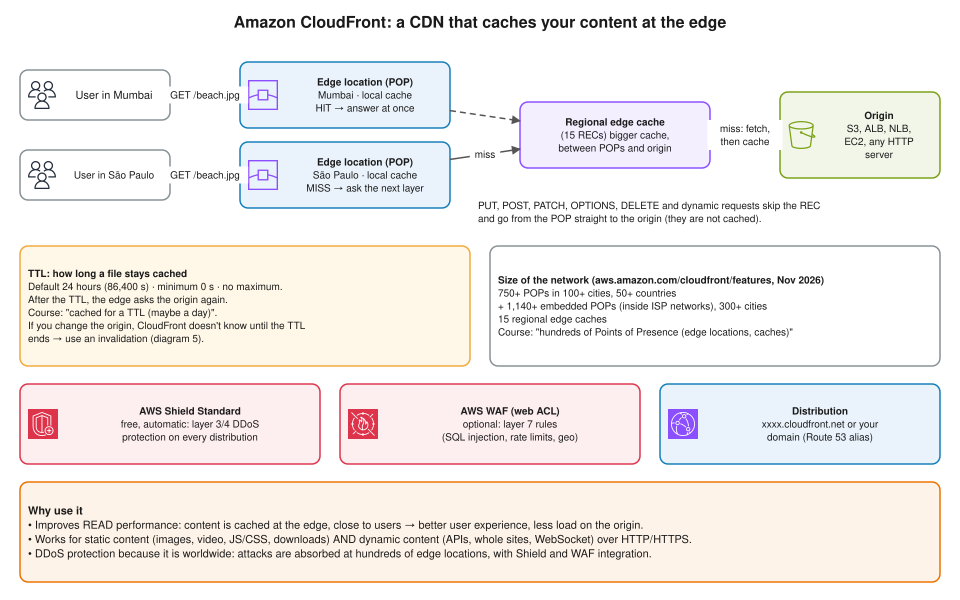
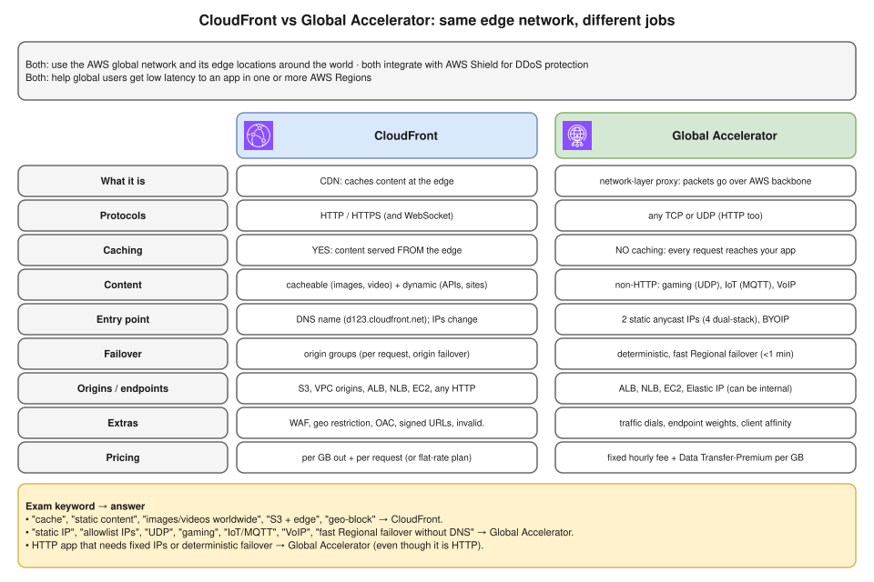
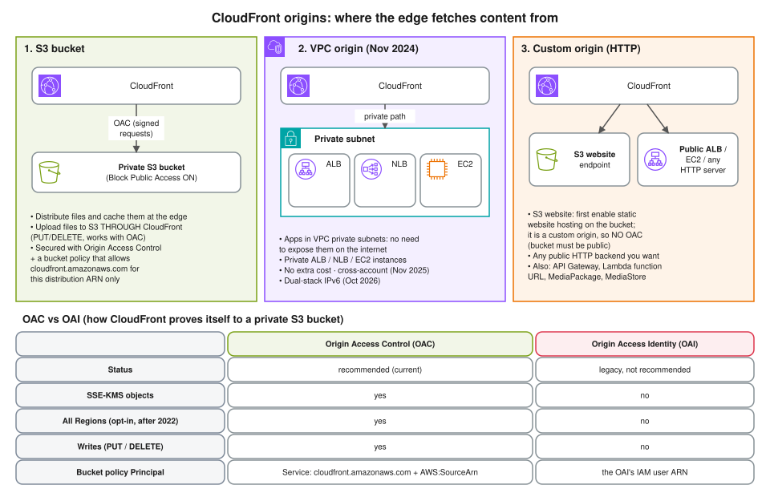
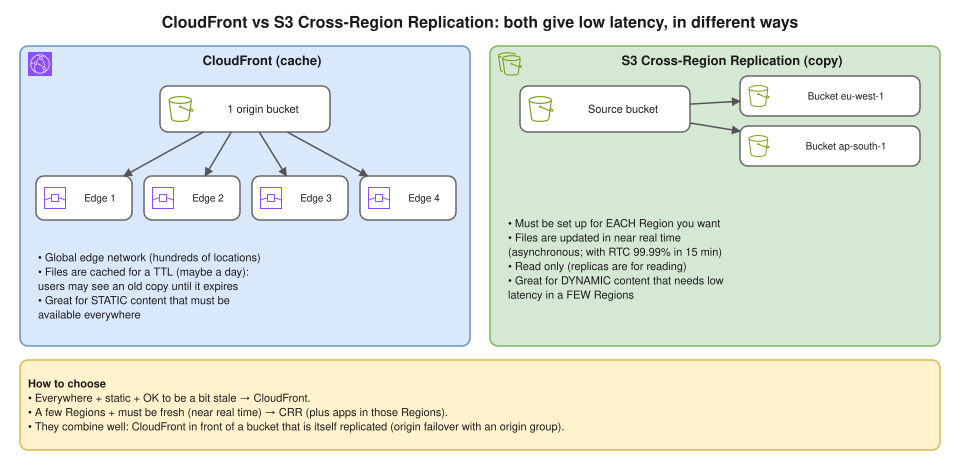
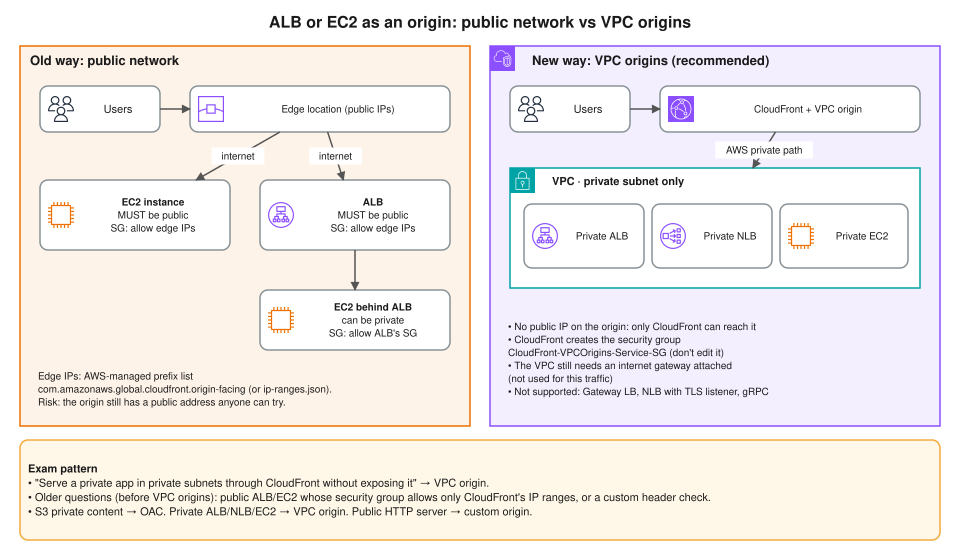
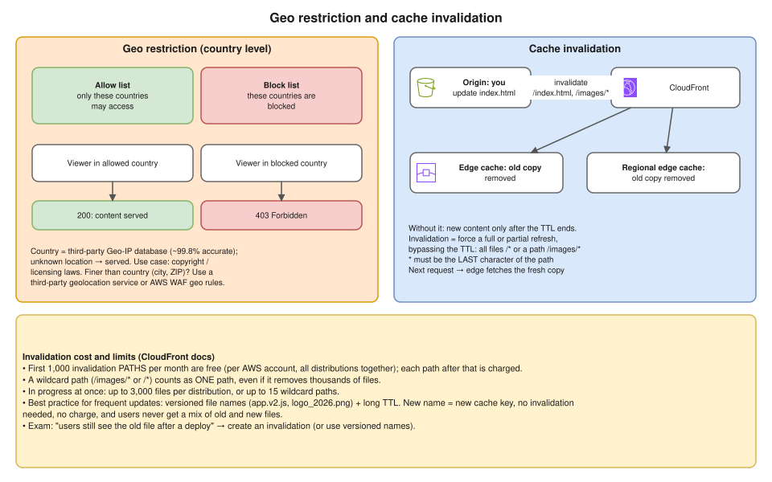
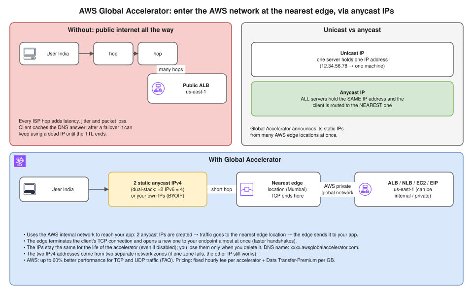
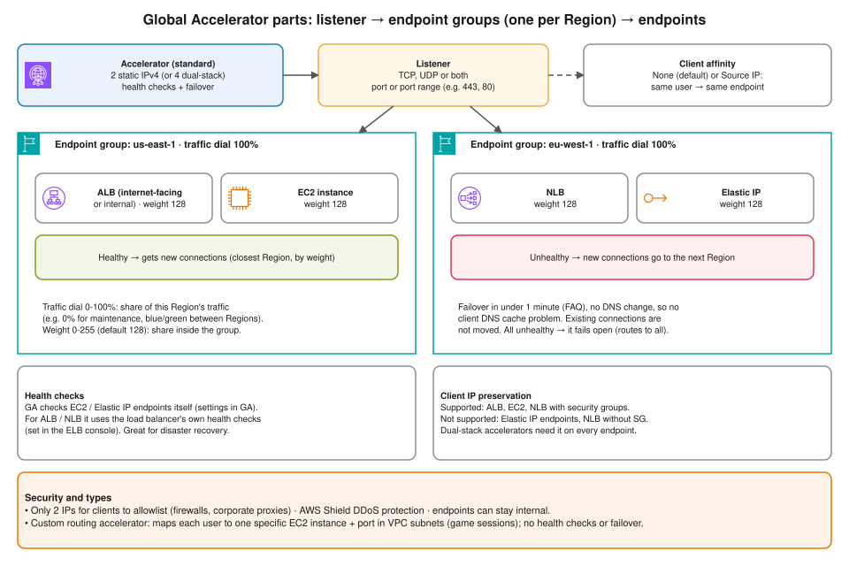

# CloudFront and Global Accelerator cheat sheet (course section 12)





**What you learned (course section 12):** Amazon CloudFront (CDN, edge locations, caching, DDoS protection), CloudFront origins (S3 with Origin Access Control, VPC origins, custom HTTP origins), CloudFront vs S3 Cross-Region Replication, ALB or EC2 as an origin, geo restriction, cache invalidations, then AWS Global Accelerator (unicast vs anycast, how it routes over the AWS network, endpoints, health checks, security) and Global Accelerator vs CloudFront.

> **How to use this page.** This page is built from **your own notes**. Every fact you wrote is still here, with typos fixed. Each section was checked against the **Amazon CloudFront Developer Guide**, the **AWS Global Accelerator Developer Guide** and other AWS pages (the "Source" line under each heading links them). Where your notes were wrong, out of date or incomplete, look for the **"Corrections to your notes"** box in that section, and the [full list](#corrections-to-your-notes-all-in-one-place) near the end. First redraw the [comparison diagram](#9-global-accelerator-vs-cloudfront) from memory. Then do the [drill](#from-memory-drill).

**Confidence tags.** `[Certain]` = confirmed on the AWS page linked in that section (checked 24 Nov 2026). `[Likely]` = in the course slides (v49), but the AWS pages I read do not state it (a course simplification, an exam-style rule, or a number AWS does not publish there). **Where the course and the AWS docs disagree, the AWS docs win, and the note says so.**

## Contents

1. [What CloudFront is](#1-what-cloudfront-is)
2. [CloudFront origins](#2-cloudfront-origins)
3. [CloudFront vs S3 Cross-Region Replication](#3-cloudfront-vs-s3-cross-region-replication)
4. [ALB or EC2 as an origin (VPC origins)](#4-alb-or-ec2-as-an-origin-vpc-origins)
5. [Geo restriction](#5-geo-restriction)
6. [Cache invalidations](#6-cache-invalidations)
7. [Global users: unicast vs anycast](#7-global-users-unicast-vs-anycast)
8. [AWS Global Accelerator](#8-aws-global-accelerator)
9. [Global Accelerator vs CloudFront](#9-global-accelerator-vs-cloudfront)
10. [SAA exam traps](#10-saa-exam-traps)
11. [Corrections to your notes (all in one place)](#corrections-to-your-notes-all-in-one-place)
12. [From-memory drill](#from-memory-drill)
13. [30-second spoken answer](#30-second-spoken-answer)

---

## 1. What CloudFront is

Source: [What is Amazon CloudFront?](https://docs.aws.amazon.com/AmazonCloudFront/latest/DeveloperGuide/Introduction.html) · [How CloudFront delivers content](https://docs.aws.amazon.com/AmazonCloudFront/latest/DeveloperGuide/HowCloudFrontWorks.html) · [CloudFront features](https://aws.amazon.com/cloudfront/features/) · [CloudFront FAQs](https://aws.amazon.com/cloudfront/faqs/)

- **Content Delivery Network (CDN).** AWS: CloudFront "speeds up distribution of your static and dynamic web content" through "a worldwide network of data centers called edge locations". `[Certain]`
- **Improves read performance: content is cached at the edge.** A user is routed to the edge location with the lowest latency; if the file is in that cache it is served at once, if not CloudFront fetches it from the origin and caches it. `[Certain]`
- **Improves user experience** (faster pages, less load on your origin). `[Likely]` (course wording)
- **Hundreds of points of presence globally (edge locations, caches).** `[Certain]` Current AWS figures (features page, Nov 2026): **750+ POPs in 100+ cities across 50+ countries**, plus **1,140+ embedded POPs** (inside ISP networks) in 300+ cities, and **15 regional edge caches (RECs)**.
- **DDoS protection (because it is worldwide), integration with AWS Shield and AWS Web Application Firewall (WAF).** `[Certain]` Every customer gets **AWS Shield Standard** (layer 3/4) at no extra cost; you can attach an **AWS WAF web ACL** for layer 7 rules (SQL injection, rate limits, geo match). `[Certain]` (FAQ)

**How caching works** (added from the docs, needed for the invalidation section):

| | Fact |
|---|---|
| TTL | By default each file stays in an edge location for **24 hours** (86,400 s) before it expires. Minimum 0 seconds; **no maximum**. `[Certain]` |
| Regional edge cache | A bigger cache between the POPs and your origin. A POP miss goes to the REC first, then the origin. `[Certain]` |
| What skips the REC | **Proxy methods (PUT, POST, PATCH, OPTIONS, DELETE)** and **dynamic requests** go straight from the POP to the origin (not cached). `[Certain]` |
| Protocols | HTTP and **WebSocket**, so dynamic pages and APIs work too. Methods: GET, HEAD, POST, PUT, PATCH, DELETE, OPTIONS; only GET/HEAD (and optionally OPTIONS) responses are cached. `[Certain]` (FAQ) |
| Pricing | Pay as you go (per GB out + per request), or a **flat-rate plan** (Free $0, Pro $15, Business $200, Premium $1,000 a month, one distribution each, no overage charges). `[Certain]` (FAQ; flat-rate plans are newer than the course) |

> **Corrections to your notes (section 1)**
> - "Hundereds of points of presence" is right as a course phrase; the real number today is **750+ POPs (+1,140 embedded) and 15 regional edge caches**. Exams just say "hundreds" or "edge locations".
> - Added: Shield **Standard** comes free and automatic; WAF is optional and paid. "Integration with Shield" in an exam answer usually means Shield Advanced for extra protection and cost protection.
> - Spelling: experiance → experience, Hundereds → Hundreds, DDos → DDoS.

## 2. CloudFront origins

Source: [Use various origins with CloudFront distributions](https://docs.aws.amazon.com/AmazonCloudFront/latest/DeveloperGuide/DownloadDistS3AndCustomOrigins.html) · [Restrict access to an Amazon S3 origin](https://docs.aws.amazon.com/AmazonCloudFront/latest/DeveloperGuide/private-content-restricting-access-to-s3.html) · [What's New: VPC origins (20 Nov 2024)](https://aws.amazon.com/about-aws/whats-new/2024/11/amazon-cloudfront-vpc-origins/)



An **origin** is where CloudFront fetches the real content from when the edge doesn't have it.

| Origin | Your notes | Checked against the docs |
|---|---|---|
| **S3 bucket** | For **distributing files and caching them at the edge** · for **uploading files to S3 through CloudFront** · secured using **Origin Access Control (OAC)** | `[Certain]` All three. Uploads: send PUT/POST to CloudFront; with OAC the bucket policy must also allow `s3:PutObject`. Also valid S3 origins: an S3 Access Point, Object Lambda access point, Multi-Region Access Point. |
| **VPC origin** | For **applications hosted in VPC private subnets** · **private Application Load Balancer / Network Load Balancer / EC2 instances** | `[Certain]` Launched **20 Nov 2024**; detail in [section 4](#4-alb-or-ec2-as-an-origin-vpc-origins). |
| **Custom origin (HTTP)** | **S3 website** (must first enable the bucket as a static S3 website) · **any public HTTP backend you want** (example: public ALB) | `[Certain]` An S3 **website endpoint** is used "as a custom origin", so **you can't use OAC (or OAI)** with it: the bucket has to be public. Other custom origins: API Gateway, Lambda function URL, MediaPackage / MediaStore, EC2, on-premises server. |

### OAC vs OAI

| | **Origin Access Control (OAC)** | **Origin Access Identity (OAI)** |
|---|---|---|
| Status | **recommended** `[Certain]` | **"legacy, not recommended"** `[Certain]` |
| S3 buckets in all Regions (incl. opt-in Regions launched after Dec 2022) | yes | no |
| Objects encrypted with **SSE-KMS** | yes | no |
| Dynamic requests (**PUT, DELETE**) to S3 | yes | no |
| Bucket policy `Principal` | `"Service": "cloudfront.amazonaws.com"` with condition `AWS:SourceArn` = your distribution ARN | the OAI's identity ARN |

OAC bucket policy (read only; add `s3:PutObject` for uploads) `[Certain]`:

```json
{
    "Version": "2012-10-17",
    "Statement": [
        {
            "Sid": "AllowCloudFrontServicePrincipalReadOnly",
            "Effect": "Allow",
            "Principal": { "Service": "cloudfront.amazonaws.com" },
            "Action": "s3:GetObject",
            "Resource": "arn:aws:s3:::amzn-s3-demo-bucket/*",
            "Condition": {
                "StringEquals": {
                    "AWS:SourceArn": "arn:aws:cloudfront::111122223333:distribution/EDFDVBD6EXAMPLE"
                }
            }
        }
    ]
}
```

With this, the bucket keeps **Block Public Access on**: only that one distribution can read it.

> **Corrections to your notes (section 2)**
> - Added: **OAI is legacy**. Exam answers written before 2022 say "OAI"; new answers say **OAC**. If both appear, pick OAC.
> - Added: an **S3 website endpoint cannot use OAC**; it is a custom origin, so the bucket must be public. Want private + static site? Use the normal S3 REST endpoint + OAC and set a default root object (`index.html`).

## 3. CloudFront vs S3 Cross-Region Replication

Source: [How CloudFront delivers content](https://docs.aws.amazon.com/AmazonCloudFront/latest/DeveloperGuide/HowCloudFrontWorks.html) · [Replicating objects within and across Regions](https://docs.aws.amazon.com/AmazonS3/latest/userguide/replication.html)



| | **CloudFront** | **S3 Cross-Region Replication** |
|---|---|---|
| Where | **Global edge network** | **Must be set up for each Region** you want replication to happen in |
| Freshness | **Files are cached for a TTL (maybe a day)** (default 24 h) | **Files are updated in near real time** (asynchronous; S3 Replication Time Control: 99.99% within 15 minutes) |
| Writes | cache only; writes go to the origin | **Read only** (the replicas are for reading) |
| Best for | **Static content that must be available everywhere** | **Dynamic content that needs to be available at low latency in a few Regions** |

`[Likely]` for the "great for" rows (course framing); `[Certain]` for TTL and replication behaviour.

## 4. ALB or EC2 as an origin (VPC origins)

Source: [Restrict access with VPC origins](https://docs.aws.amazon.com/AmazonCloudFront/latest/DeveloperGuide/private-content-vpc-origins.html) · [What's New: VPC origins (20 Nov 2024)](https://aws.amazon.com/about-aws/whats-new/2024/11/amazon-cloudfront-vpc-origins/) · [Cross-account VPC origins (6 Nov 2025)](https://aws.amazon.com/blogs/networking-and-content-delivery/introducing-cross-account-support-for-amazon-cloudfront-virtual-private-cloud-vpc-origins/) · [What's New: dual-stack VPC origins (15 Oct 2026)](https://aws.amazon.com/about-aws/whats-new/2026/10/cloudfront-vpc-origin-dualstack/) · [Locations and IP ranges of CloudFront edge servers](https://docs.aws.amazon.com/AmazonCloudFront/latest/DeveloperGuide/LocationsOfEdgeServers.html)



**Using VPC origins (your notes)** `[Certain]`:

- Allows you to **deliver content from your application hosted in your VPC private subnets** (no need to expose them on the internet).
- Delivers traffic to private: **Application Load Balancer**, **Network Load Balancer**, **EC2 instances**.

**Docs details worth knowing** `[Certain]`:

- **No additional cost** for VPC origins (and none for dual-stack VPC origins).
- CloudFront creates a service-managed security group **`CloudFront-VPCOrigins-Service-SG`**; don't edit it. Your origin's security group can allow that group as its source.
- The VPC **must have an internet gateway attached**, even though CloudFront's traffic doesn't use it. The subnet needs at least one free IPv4 address.
- **Not supported:** Gateway Load Balancer, NLB with a **TLS listener**, gRPC, Lambda@Edge origin request/response triggers. An NLB must have a **security group** attached.
- **Cross-account** VPC origins (share through AWS RAM) since **Nov 2025**; **dual-stack (IPv6)** since **15 Oct 2026**. Commercial Regions only.

**Using the public network (course slide, not in your notes)** `[Likely]` for the layout, `[Certain]` for the prefix list:

- **EC2 instance as origin:** must be **public**; its security group allows the **public IPs of edge locations**.
- **ALB as origin:** the ALB must be **public** and its security group allows the edge locations' public IPs; the **EC2 instances behind it can be private** (their security group allows the ALB's security group).
- The edge IPs: AWS-managed prefix list **`com.amazonaws.global.cloudfront.origin-facing`** (use it as the source in a security group rule), or `ip-ranges.json` (service `CLOUDFRONT`).

> **Corrections to your notes (section 4)**
> - Added: VPC origins still need an **internet gateway on the VPC** (a common trap in labs), and they **don't support Gateway Load Balancers or TLS-listener NLBs**.
> - Added the "public network" option from the course, which older exam questions still use.

## 5. Geo restriction

Source: [Restrict the geographic distribution of your content](https://docs.aws.amazon.com/AmazonCloudFront/latest/DeveloperGuide/georestrictions.html)



- You can **restrict who can access your distribution**, at the **country level**. `[Certain]`
  - **Allow list**: allow your users to access your content **only if they're in one of the countries on a list of approved countries**. `[Certain]`
  - **Block list**: **prevent** your users from accessing your content **if they're in one of the countries on a list of banned countries**. `[Certain]`
- Blocked viewers get **HTTP 403 (Forbidden)**. `[Certain]`
- The "country" is determined using a **third-party Geo-IP database**; AWS: "the overall accuracy is 99.8%". If CloudFront can't tell the location, it serves the content. `[Certain]`
- **Use case: copyright laws** to control access to content. `[Likely]` (course)
- Need finer control (city, postal code)? Use a third-party geolocation service with signed URLs, or AWS WAF geo match rules. `[Certain]` (third-party service on the docs page; WAF from the FAQ)

> **Corrections to your notes (section 5)**
> - The console calls them **"Allow list"** and **"Block list"** (the course writes Allowlist / Blocklist; same thing).
> - Added: 403 response, the Geo-IP database, the copyright use case from the course.
> - Spelling: contries → countries.

## 6. Cache invalidations

Source: [Invalidate files](https://docs.aws.amazon.com/AmazonCloudFront/latest/DeveloperGuide/Invalidation_Requests.html) · [What you need to know when invalidating paths](https://docs.aws.amazon.com/AmazonCloudFront/latest/DeveloperGuide/invalidation-specifying-objects.html) · [Pay for file invalidation](https://docs.aws.amazon.com/AmazonCloudFront/latest/DeveloperGuide/PayingForInvalidation.html) · [CloudFront FAQs](https://aws.amazon.com/cloudfront/faqs/)

(Diagram: right half of the geo restriction diagram above.)

- In case you **update the back-end origin, CloudFront doesn't know about it** and will only get the refreshed content **after the TTL has expired**. `[Certain]`
- However, you can **force an entire or partial cache refresh** (thus **bypassing the TTL**) by performing a **CloudFront invalidation**. It removes the object from both the edge (POP) caches and the regional edge caches. `[Certain]`
- You can invalidate **all files (`/*`)** or a **specific path (`/images/*`)**. The `*` must be the **last character** of the path. `[Certain]`

| Cost and limits `[Certain]` | |
|---|---|
| Free | **First 1,000 invalidation paths per month** (per AWS account, all distributions together) |
| After that | charged **per path** |
| Wildcard | `/images/*` or `/*` counts as **one path**, even if it removes thousands of files |
| In progress at once | up to **3,000 files** per distribution, or up to **15 wildcard paths** |
| Better for frequent changes | **versioned file names** (`app.v2.js`) with a long TTL: new name = new cache entry, no invalidation, no charge |

```bash
# Invalidate one file and one folder (Ubuntu, AWS CLI v2)
aws cloudfront create-invalidation \
  --distribution-id EDFDVBD6EXAMPLE \
  --paths "/index.html" "/images/*"
```

> **Corrections to your notes (section 6)**
> - Added: invalidations are **not free beyond 1,000 paths a month**, but a wildcard is one path. That is why `/*` after every deploy is cheap but versioned file names are the better design.
> - Your example `/image/*` is fine; the course uses `/images/*`.

## 7. Global users: unicast vs anycast

Source: [How AWS Global Accelerator works](https://docs.aws.amazon.com/global-accelerator/latest/dg/introduction-how-it-works.html)



**The problem (your notes)** `[Likely]` (course framing):

- You have deployed an application and have **global users who want to access it directly**.
- They go **over the public internet, which can add a lot of latency due to many hops**.
- We wish to go **as fast as possible through the AWS network** to minimize latency.

**Unicast IP vs anycast IP** `[Certain]` (general networking; GA's IPs "are anycast from the AWS edge network"):

| | |
|---|---|
| **Unicast IP** | **one server holds one IP address** |
| **Anycast IP** | **all servers hold the same IP address and the client is routed to the nearest one** |

## 8. AWS Global Accelerator

Source: [What is AWS Global Accelerator?](https://docs.aws.amazon.com/global-accelerator/latest/dg/what-is-global-accelerator.html) · [Components](https://docs.aws.amazon.com/global-accelerator/latest/dg/introduction-components.html) · [How it works](https://docs.aws.amazon.com/global-accelerator/latest/dg/introduction-how-it-works.html) · [Preserve client IP addresses](https://docs.aws.amazon.com/global-accelerator/latest/dg/preserve-client-ip-address.html) · [Endpoint caveats](https://docs.aws.amazon.com/global-accelerator/latest/dg/about-endpoints-caveats.html) · [Failover for unhealthy endpoints](https://docs.aws.amazon.com/global-accelerator/latest/dg/about-endpoints-endpoint-weights.unhealthy-endpoints.html) · [Traffic dials](https://docs.aws.amazon.com/global-accelerator/latest/dg/about-endpoint-groups-traffic-dial.html) · [Endpoint weights](https://docs.aws.amazon.com/global-accelerator/latest/dg/about-endpoints-endpoint-weights.html) · [Global Accelerator FAQs](https://aws.amazon.com/global-accelerator/faqs/) · [Pricing](https://aws.amazon.com/global-accelerator/pricing/)



### How it routes

- **Leverages the AWS internal network** to route to your application. `[Certain]`
- **2 anycast IPs are created for your application.** `[Certain]` for IPv4: "two static IPv4 addresses", from **two separate network zones**. A **dual-stack** accelerator gets **four** (2 IPv4 + 2 IPv6). You can also **bring your own IP range (BYOIP, IPv4)**. The IPs stay for as long as the accelerator exists, **even if you disable it**; you lose them only when you delete it.
- **The anycast IPs send traffic directly to edge locations**: traffic enters the AWS network at the edge location closest to the user. `[Certain]`
- **The edge location sends the traffic to your application** over the AWS global network. The edge **terminates the client's TCP connection** and opens a new one to your endpoint almost at once. `[Certain]`
- DNS name: `a1234567890abcdef.awsglobalaccelerator.com` (dual-stack: `….dualstack.awsglobalaccelerator.com`). `[Certain]`

### Endpoints

- **Works with Elastic IP, EC2 instances, ALB, NLB, public or private.** `[Certain]` The standard accelerator endpoint types are **NLB, ALB, EC2 instances and Elastic IP addresses**; ALBs and NLBs **can be internet-facing or internal**. Endpoints must be in an AWS Region (not a Local Zone).
- **Client IP preservation** (your app sees the user's real IP): supported for **ALB, EC2 and NLB with security groups**; **not** for Elastic IP endpoints or NLBs without security groups. A dual-stack accelerator needs it on every endpoint. `[Certain]`

### Consistent performance

- **Intelligent routing to the lowest latency and fast regional failover.** `[Certain]`
- **No issue with client cache** (because the IP doesn't change; changes take seconds, no DNS TTL to wait for). `[Certain]`
- **Internal AWS network.** `[Certain]`
- AWS figure: improves performance **by up to 60%** for TCP and UDP traffic. `[Certain]` (FAQ, DDoS whitepaper)

### Health checks

- **Global Accelerator performs health checks of your applications.** `[Certain]` (EC2 / Elastic IP checks are set in Global Accelerator; for ALB / NLB it uses the health check settings of the load balancer, set in the ELB console.)
- **Helps make your application global** (failover in **less than 1 minute** for unhealthy endpoints). `[Certain]` (FAQ)
- **Great for disaster recovery** (thanks to the health checks). `[Likely]` (course)
- Only **new** connections move; existing ones stay. If **all** endpoints are unhealthy, it **fails open** (routes to all of them). `[Certain]`

### Security

- **Only 2 external IPs need to be whitelisted** (allowlisted) by clients' firewalls. `[Certain]` (4 for dual-stack)
- **DDoS protection thanks to AWS Shield.** `[Certain]` ("Both services integrate with AWS Shield", FAQ)
- Your endpoints can stay **internal** (not reachable from the internet directly). `[Certain]`

### Parts and settings (added from the docs) `[Certain]`

| Part | What it does |
|---|---|
| **Accelerator** | standard (best healthy endpoint by location, health, weights) or **custom routing** (maps each user to one specific EC2 instance + port in VPC subnets, e.g. game sessions; no health checks, no failover, IPv4 only) |
| **Listener** | **TCP, UDP or both**, on a port or port range |
| **Endpoint group** | one per AWS **Region**; has a **traffic dial** (default 100%; lower it to shift traffic away, e.g. 0% for maintenance or blue/green between Regions) |
| **Endpoint** | ALB, NLB, EC2, Elastic IP, each with a **weight** (default 128, max 255, 0 = no traffic) |
| **Client affinity** | none, or source IP (same user → same endpoint) |
| **Pricing** | **fixed hourly fee per accelerator** ($0.025/h ≈ $18/month) + **Data Transfer-Premium** per GB; no free tier |

> **Corrections to your notes (section 8)**
> - "**2 Anycast IP**" is true only for an **IPv4** accelerator. **Dual-stack = 4 addresses (2 IPv4 + 2 IPv6)**, and you can **bring your own IPs**. Likewise "only 2 external IPs to whitelist" becomes 4 with dual-stack.
> - "Works with Elastic IP, EC2 instances, ALB, NLB, Public or Private": correct (your bold was never closed). "Public or private" = internet-facing or **internal** ALB/NLB. Client IP preservation does **not** work with Elastic IP endpoints.
> - "Intelligent routing to lowest and fast regional failover": the missing word is **latency** (lowest latency). Failover is **under 1 minute**.
> - Added: if every endpoint fails it **fails open**; traffic dials and weights; custom routing accelerators; pricing.
> - Spelling: tarffic → traffic, extarnal → external.

## 9. Global Accelerator vs CloudFront

Source: [Global Accelerator FAQs: how is it different from CloudFront?](https://aws.amazon.com/global-accelerator/faqs/) · [Amazon CloudFront and AWS Global Accelerator comparison](https://aws.amazon.com/compare/cloudfront-and-global-accelerator/)

(Diagram: the comparison picture at the top of this page.)

**Both** `[Certain]`:

- They both use the **AWS global network and its edge locations** around the world.
- Both services **integrate with AWS Shield for DDoS protection**.

| **CloudFront** `[Certain]` | **Global Accelerator** `[Certain]` |
|---|---|
| Improves performance for both **cacheable content** (such as images and videos) | Improves performance for a **wide range of applications over TCP or UDP** |
| and **dynamic content** (such as API acceleration and dynamic site delivery) | **Proxying packets at the edge** to applications running in **one or more AWS Regions** (no caching) |
| **Content is served at the edge** | Good fit for **non-HTTP use cases**, such as **gaming (UDP), IoT (MQTT), or Voice over IP** |
| Entry point: a DNS name; IPs change | Good for **HTTP use cases that require static IP addresses** |
| Failover: origin groups | Good for **HTTP use cases that require deterministic, fast regional failover** |
| Pricing: per GB out + requests; free tier | Pricing: fixed hourly + Data Transfer-Premium; no free tier |

## 10. SAA exam traps

- "Cache static content for global users", "S3 + low latency worldwide", "reduce load on the origin" → **CloudFront**.
- "Private S3 bucket, only CloudFront may read it" → **OAC** + bucket policy (`cloudfront.amazonaws.com` + `AWS:SourceArn`). OAI = old answer.
- "S3 static website behind CloudFront" → custom origin; **OAC not possible** with the website endpoint.
- "App in private subnets, serve through CloudFront without making it public" → **VPC origin** (ALB / NLB / EC2). Older answer: public ALB with a security group allowing only CloudFront IPs (prefix list).
- "Block users from some countries" → **CloudFront geo restriction** (block list); response **403**.
- "Users still see the old version after a deploy" → **invalidation** (or versioned file names). First 1,000 paths/month free; a wildcard = 1 path.
- "Fresh data in a few Regions" → **S3 CRR**; "static, everywhere" → **CloudFront**.
- "Fixed IPs that partners allowlist", "UDP", "gaming", "IoT MQTT", "VoIP" → **Global Accelerator**.
- "Fast Regional failover without waiting for DNS TTL" → **Global Accelerator** (Route 53 failover depends on DNS caching).
- "Each player must reach a specific game server" → **custom routing accelerator**.
- Global Accelerator does **not cache**. CloudFront does **not give static IPs**.
- Both: edge locations + Shield. Only CloudFront: WAF on the distribution, geo restriction, signed URLs, invalidation. Only GA: traffic dial, endpoint weights, client affinity.

## Corrections to your notes (all in one place)

| # | Your note | Correct (AWS docs) |
|---|---|---|
| 1 | "2 Anycast IP" | IPv4: 2 static anycast IPv4 (two network zones). **Dual-stack: 4** (2 IPv4 + 2 IPv6). **BYOIP** possible. Kept until you delete the accelerator |
| 2 | "Only 2 external IP need to be whitelisted" | 2 for IPv4, **4 for dual-stack** |
| 3 | "Works with Elastic IP, EC2, ALB, NLB, Public or Private" | right; "private" = **internal** ALB/NLB. Client IP preservation: ALB, EC2, NLB with SG, **not Elastic IP** |
| 4 | "Intelligent routing to lowest and fast regional failover" | lowest **latency**; failover **< 1 minute**; fails open if all unhealthy |
| 5 | S3 origin "secured using OAC" | right, and **OAI is legacy**; OAC adds SSE-KMS, all Regions, PUT/DELETE |
| 6 | Custom origin "S3 website" | a website endpoint is a custom origin, so **no OAC/OAI**: the bucket must be public |
| 7 | VPC origin (private ALB/NLB/EC2) | launched **20 Nov 2024**, no extra cost, VPC still needs an **internet gateway**, no GWLB / TLS NLB, cross-account Nov 2025, IPv6 Oct 2026 |
| 8 | "Files are cached for a TTL (maybe a day)" | default TTL **24 hours**, min 0, no max |
| 9 | "Hundreds of points of presence" | **750+ POPs**, 1,140+ embedded POPs, **15 regional edge caches** (Nov 2026) |
| 10 | Invalidation (no cost) | **first 1,000 paths/month free**, then per path; a wildcard = 1 path; `*` must be last; max 3,000 files or 15 wildcards in progress |
| 11 | Geo restriction | console terms **Allow list / Block list**; **403**; third-party Geo-IP DB (99.8%); copyright use case |
| 12 | DDoS "integration with Shield" | **Shield Standard is free and automatic**; WAF and Shield Advanced are optional, paid |
| 13 | (missing) | public-network option: public ALB/EC2 security group allows CloudFront prefix list `com.amazonaws.global.cloudfront.origin-facing` |
| 14 | (missing) | GA parts: listener (TCP/UDP), endpoint group per Region + traffic dial, weights (default 128), client affinity, custom routing, pricing |
| 15 | Spelling | experiance, Hundereds, DDos, contries, tarffic, extarnal, intergarte, gamming, "Good fir", failoverinterview fixed |

## From-memory drill

Cover the page. Say or type each answer, then open the box.

**1. What is CloudFront, in one line, and name three benefits.**
<details><summary>Answer</summary>

A CDN that caches content at edge locations close to users. Faster reads / better user experience, less load on the origin, DDoS protection (worldwide edge, Shield Standard free, WAF optional).
</details>

**2. Default TTL, minimum and maximum?**
<details><summary>Answer</summary>

Default 24 hours (86,400 s), minimum 0 s, no maximum.
</details>

**3. What is a regional edge cache, and which requests skip it?**
<details><summary>Answer</summary>

A bigger cache between the POPs and the origin. PUT, POST, PATCH, OPTIONS, DELETE and dynamic requests go straight from the POP to the origin.
</details>

**4. Name the three origin types and one example of each.**
<details><summary>Answer</summary>

S3 bucket (with OAC); VPC origin (private ALB / NLB / EC2); custom HTTP origin (S3 website endpoint, public ALB, any HTTP server).
</details>

**5. OAC vs OAI: which is legacy, and three things only OAC can do?**
<details><summary>Answer</summary>

OAI is legacy. OAC: SSE-KMS objects, all Regions (incl. opt-in after Dec 2022), PUT/DELETE to S3.
</details>

**6. Write the Principal and Condition of an OAC bucket policy.**
<details><summary>Answer</summary>

`"Principal": {"Service": "cloudfront.amazonaws.com"}` and `"Condition": {"StringEquals": {"AWS:SourceArn": "arn:aws:cloudfront::<account>:distribution/<id>"}}`.
</details>

**7. Can you use OAC with an S3 website endpoint? Why?**
<details><summary>Answer</summary>

No. The website endpoint is a custom origin, so OAC/OAI don't apply; the bucket must be public. Use the REST endpoint + OAC for a private bucket.
</details>

**8. CloudFront vs S3 CRR: four differences.**
<details><summary>Answer</summary>

CloudFront: global edge, cached for a TTL, static content everywhere. CRR: set up per Region, near real-time updates, read-only replicas, dynamic content in a few Regions.
</details>

**9. VPC origins: launch date, supported targets, cost, and two gotchas.**
<details><summary>Answer</summary>

Nov 2024. Private ALB, NLB, EC2. No extra cost. VPC needs an internet gateway; no Gateway LB, no NLB with TLS listener (NLB needs a security group).
</details>

**10. Before VPC origins, how did you put a public ALB behind CloudFront securely?**
<details><summary>Answer</summary>

Public ALB whose security group allows only CloudFront's edge IPs (prefix list `com.amazonaws.global.cloudfront.origin-facing`); EC2 behind it private, allowing the ALB's security group. Public EC2 as origin had the same SG rule.
</details>

**11. Geo restriction: two modes, HTTP code, how the country is found.**
<details><summary>Answer</summary>

Allow list, block list (country level). 403 Forbidden. Third-party Geo-IP database (~99.8% accurate). Use case: copyright.
</details>

**12. Why invalidate, what can you invalidate, and what does it cost?**
<details><summary>Answer</summary>

The origin changed but the edge keeps the old copy until the TTL ends. All files `/*` or a path `/images/*` (`*` last). First 1,000 paths a month free, then per path; a wildcard counts as one path. Alternative: versioned file names.
</details>

**13. Unicast vs anycast?**
<details><summary>Answer</summary>

Unicast: one server, one IP. Anycast: many servers share the same IP; the client reaches the nearest one.
</details>

**14. How does Global Accelerator move a packet from a user in India to an ALB in us-east-1?**
<details><summary>Answer</summary>

User hits one of the static anycast IPs → enters AWS at the nearest edge (TCP terminated there) → AWS global network → ALB endpoint (can be internal).
</details>

**15. How many static IPs does an accelerator get? Can you use your own?**
<details><summary>Answer</summary>

IPv4: 2 (two network zones). Dual-stack: 4 (2 IPv4 + 2 IPv6). Yes, BYOIP (IPv4). Kept until you delete the accelerator, even if disabled.
</details>

**16. Four endpoint types; which one can't preserve client IP?**
<details><summary>Answer</summary>

ALB, NLB, EC2 instance, Elastic IP. Elastic IP can't (nor NLB without a security group).
</details>

**17. Global Accelerator failover: how fast, and why no DNS cache problem?**
<details><summary>Answer</summary>

Under 1 minute. The IPs never change, so clients keep using the same IPs; GA moves new connections to a healthy endpoint. All unhealthy → fails open.
</details>

**18. Listener, endpoint group, traffic dial, weight: one line each.**
<details><summary>Answer</summary>

Listener: TCP/UDP/both on ports. Endpoint group: one per Region. Traffic dial: % of traffic to that Region (default 100). Weight: share per endpoint, default 128, max 255, 0 = none.
</details>

**19. Standard vs custom routing accelerator?**
<details><summary>Answer</summary>

Standard: best healthy endpoint by location, health, weights. Custom routing: maps each user to a specific EC2 instance + port in VPC subnets (gaming); no health checks or failover.
</details>

**20. CloudFront vs Global Accelerator: what's shared, and three differences.**
<details><summary>Answer</summary>

Shared: AWS edge network, Shield. CloudFront caches HTTP content at the edge (static + dynamic). GA doesn't cache; proxies any TCP/UDP to one or more Regions; static IPs; deterministic fast regional failover; non-HTTP (gaming UDP, IoT MQTT, VoIP).
</details>

**21. Exam: partners must allowlist two IPs for your HTTPS API in two Regions. Which service?**
<details><summary>Answer</summary>

Global Accelerator (static anycast IPs, Regional failover). CloudFront has no static IPs.
</details>

**22. Global Accelerator pricing vs CloudFront pricing.**
<details><summary>Answer</summary>

GA: fixed hourly fee per accelerator (~$18/month) + Data Transfer-Premium per GB, no free tier. CloudFront: per GB out + per request (free tier), or a flat-rate plan.
</details>

## 30-second spoken answer

"CloudFront is AWS's CDN: users hit the nearest of hundreds of edge locations, and cached files are served from there for a TTL, 24 hours by default, with a miss going to a regional edge cache and then the origin. Origins can be a private S3 bucket locked with Origin Access Control, a private ALB, NLB or EC2 through a VPC origin, or any HTTP server. I use geo restriction to block countries and invalidations or versioned file names after a deploy. Global Accelerator doesn't cache: it gives two static anycast IPs, brings TCP or UDP traffic onto the AWS backbone at the nearest edge, and fails over between Regions in under a minute. So: caching and HTTP, CloudFront; static IPs, UDP or fast failover, Global Accelerator."
