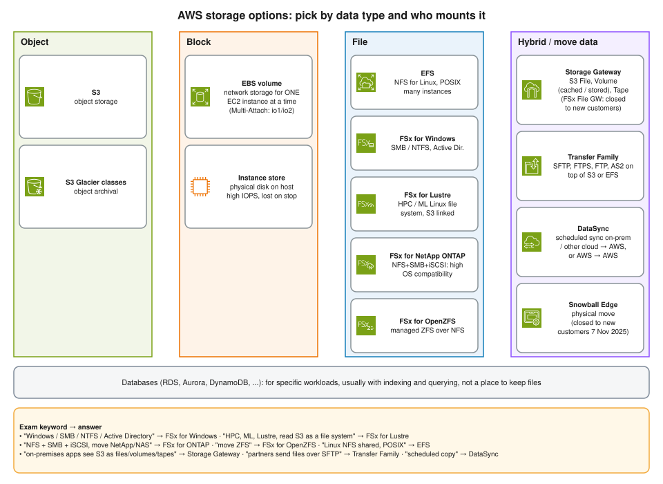
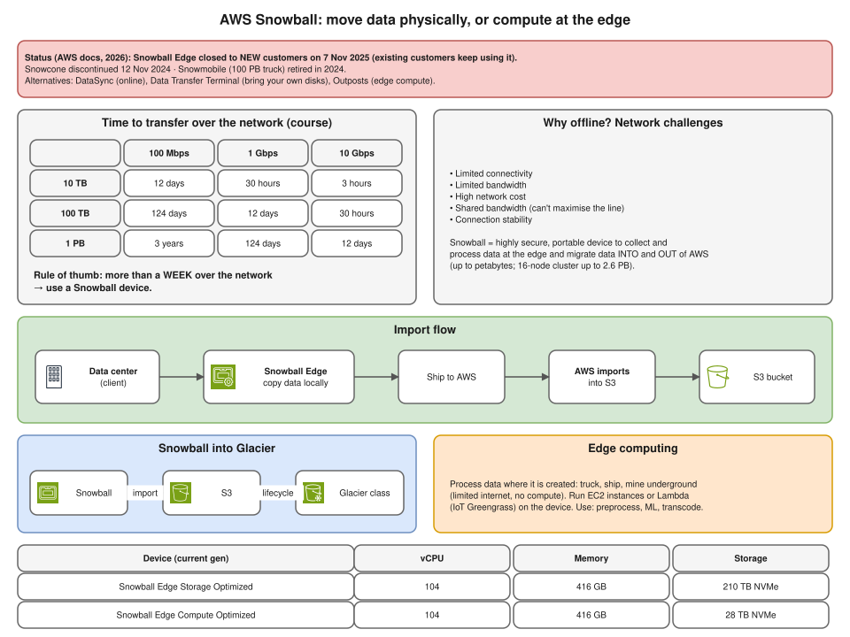
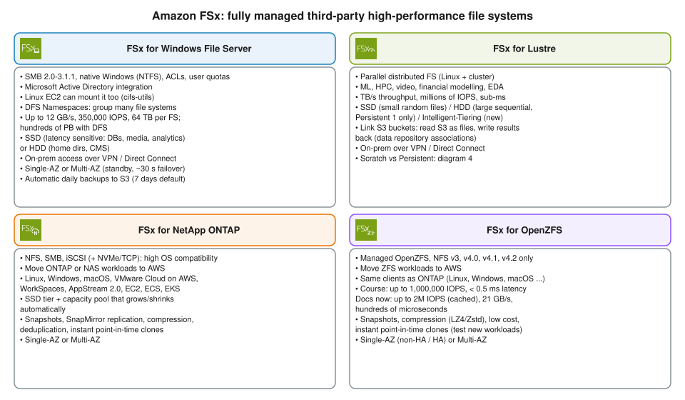
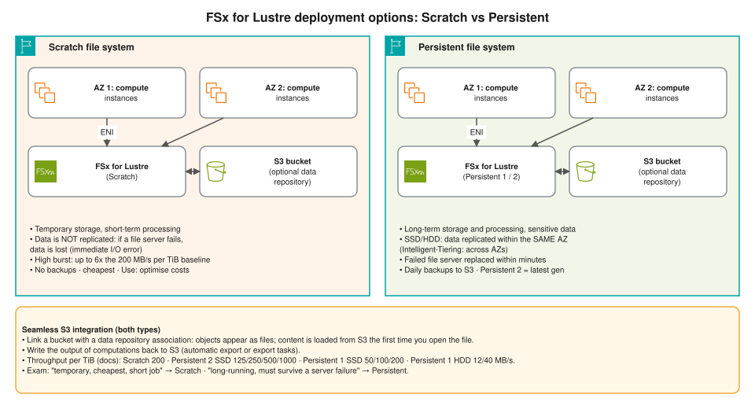
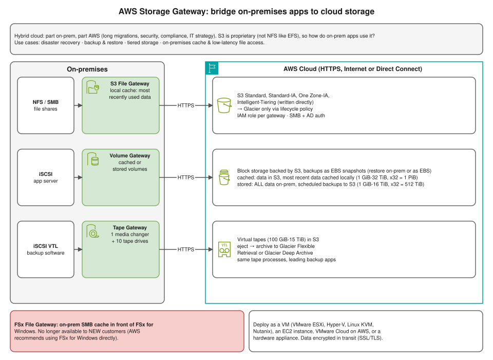
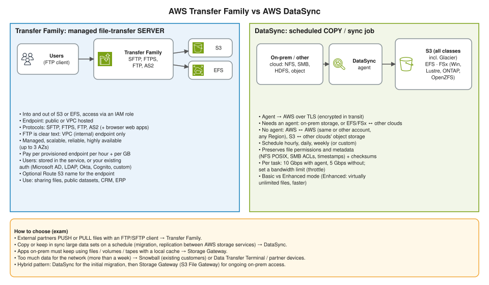

# AWS Storage Extras cheat sheet (course section 13)

**What you learned (course section 13, "AWS Storage Extras"):** AWS Snowball (offline data migration and edge computing), Snowball into Glacier, Amazon FSx (Windows File Server, Lustre, NetApp ONTAP, OpenZFS), FSx for Lustre deployment options, hybrid cloud and AWS Storage Gateway (S3 File Gateway, Volume Gateway, Tape Gateway), AWS Transfer Family, AWS DataSync, and the storage comparison.

> **How to use this page.** This page is built from **your own notes**. Every fact you wrote is still here, with typos fixed. Each section was checked against the **AWS documentation** for that service and the course slides (v49); the "Source" line under each heading links the AWS pages. Where your notes were wrong, out of date or incomplete, look for the **"Corrections to your notes"** box in that section, and the [full list](#corrections-to-your-notes-all-in-one-place) near the end. First redraw the [comparison diagram](#10-storage-comparison) from memory. Then do the [drill](#from-memory-drill).

**Confidence tags.** `[Certain]` = confirmed on the AWS page linked in that section (checked 25 Nov 2026). `[Likely]` = in the course slides (v49), but the AWS pages I read do not state it (a course simplification, an exam-style rule, or a number AWS does not publish there). **Where the course and the AWS docs disagree, the AWS docs win, and the note says so.**

> **The big news first.** Three things in this section changed after the course was recorded:
> 1. **AWS Snowball Edge is closed to new customers since 7 Nov 2025.** Snowcone was discontinued on 12 Nov 2024 and Snowmobile was retired in 2024. The exam may still ask about Snowball; in real life the answer is now DataSync, AWS Data Transfer Terminal or a partner device.
> 2. **Amazon FSx File Gateway is no longer available to new customers.**
> 3. **Transfer Family is not only "FTP"**: it also does **AS2** and browser-based web apps.

## Contents

1. [AWS Snowball](#1-aws-snowball)
2. [Amazon FSx overview](#2-amazon-fsx-overview)
3. [FSx for Windows File Server](#3-fsx-for-windows-file-server)
4. [FSx for Lustre (and its deployment options)](#4-fsx-for-lustre)
5. [FSx for NetApp ONTAP](#5-fsx-for-netapp-ontap)
6. [FSx for OpenZFS](#6-fsx-for-openzfs)
7. [Hybrid cloud and AWS Storage Gateway](#7-hybrid-cloud-and-aws-storage-gateway)
8. [AWS Transfer Family](#8-aws-transfer-family)
9. [AWS DataSync](#9-aws-datasync)
10. [Storage comparison](#10-storage-comparison)
11. [SAA exam traps](#11-saa-exam-traps)
12. [Corrections to your notes (all in one place)](#corrections-to-your-notes-all-in-one-place)
13. [From-memory drill](#from-memory-drill)
14. [30-second spoken answer](#30-second-spoken-answer)

---

## 1. AWS Snowball

Source: [AWS Snowball Edge availability change](https://docs.aws.amazon.com/snowball/latest/developer-guide/snowball-edge-availability-change.html) · [AWS Snow device updates (blog, 12 Nov 2024)](https://aws.amazon.com/blogs/storage/aws-snow-device-updates) · [AWS service availability updates (13 Oct 2025)](https://aws.amazon.com/about-aws/whats-new/2025/10/aws-service-availability) · [AWS Snowball FAQs](https://aws.amazon.com/snowball/faqs/) · [CNBC: AWS stops selling Snowmobile (17 Apr 2024)](https://www.cnbc.com/2024/04/17/aws-stops-selling-snowmobile-truck-for-cloud-migrations.html)

- **Highly secure, portable devices** to **collect and process data at the edge, and migrate data into and out of AWS**. `[Certain]` (FAQ; data on the device is encrypted)
- **Helps migrate up to petabytes of data.** `[Certain]` One Storage Optimized device holds about 210 TB; a 16-node cluster gives up to 2.6 PB. `[Certain]` (FAQ)
- You can't buy a device: **pay per job**; provisioning **may take up to 4 weeks**. `[Certain]` (FAQ)

**Availability today** `[Certain]`

| Device | Status |
|---|---|
| **Snowball Edge** (Storage Optimized, Compute Optimized) | **Closed to new customers since 7 Nov 2025** ("AWS will no longer offer any AWS Snow Family devices for new customers to order"). Existing customers keep using it; AWS moved it to "maintenance". |
| Older Snowball Edge models (Storage Optimized 80 TB, Compute Optimized 52 vCPU, Compute Optimized with GPU) | Discontinued 12 Nov 2024 |
| **Snowcone** (SSD and HDD) | Discontinued 12 Nov 2024; support for existing devices ended 12 Nov 2025 |
| **Snowmobile** (100 PB truck) | Retired: removed from the AWS website by March 2024 (CNBC) |
| Alternatives AWS recommends | **AWS DataSync** (online), **AWS Data Transfer Terminal** (a physical AWS location where you bring your own storage devices), partner devices on AWS Marketplace (Seagate, Tsecond), **AWS Outposts** for edge compute |

**Current devices** `[Certain]` (blog; course table matches)

| Device | Compute | Memory | Storage |
|---|---|---|---|
| Snowball Edge **Storage Optimized** | 104 vCPUs | 416 GB | 210 TB (NVMe SSD), up to ~1.5 GB/s for migration |
| Snowball Edge **Compute Optimized** | 104 vCPUs | 416 GB | 28 TB (NVMe SSD) |

### Data migration with Snowball

**Challenges** of moving data over the network `[Likely]` (course):

- Limited connectivity
- Limited bandwidth
- High network cost
- Shared bandwidth (can't maximise the line)
- Connection stability

**Time to transfer** (course table) `[Likely]`:

| Data | 100 Mbps | 1 Gbps | 10 Gbps |
|---|---|---|---|
| 10 TB | 12 days | 30 hours | 3 hours |
| 100 TB | 124 days | 12 days | 30 hours |
| 1 PB | 3 years | 124 days | 12 days |

- **AWS Snowball: offline device to perform data migrations.** `[Certain]`
- **If it takes more than a week to transfer over the network, use Snowball devices!** `[Likely]` (course rule of thumb, not an AWS rule)
- **Flow:** direct upload to S3 goes over the internet; with Snowball: client copies data to the device → ship it → AWS imports it into your S3 bucket (import/export). `[Certain]` (data goes in through the device's S3-compatible endpoint or NFS file interface)

### Edge computing

- **Process data while it's being created on an edge location**: a truck on the road, a ship on the sea, a mining station underground... `[Likely]` (course wording)
- **These locations may have limited internet and no access to computing power.** `[Likely]`
- **We set up a Snowball Edge device to do edge computing**: **Snowball Edge Compute Optimized** (dedicated for that use case) **& Storage Optimized**. `[Certain]`
- **Run EC2 instances or Lambda functions at the edge.** `[Certain]` The device runs Amazon EC2 (your AMIs), EBS, S3, **AWS IoT Greengrass** and **Lambda** functions, and IAM. Manage it with **AWS OpsHub** (free GUI for Windows/Mac). `[Certain]` (blog, FAQ)
- **Use cases:** preprocess data, machine learning, transcoding media. `[Likely]` (course; you didn't note these)

### Solution architecture: Snowball into Glacier

- **Snowball cannot import to Glacier directly.** `[Likely]` (course; the AWS pages say data is imported "into AWS services such as Amazon S3" and say nothing about Glacier classes)
- **You must use Amazon S3 first, in combination with an S3 lifecycle policy**: Snowball → import → S3 → lifecycle policy → Glacier. `[Likely]`
- Export is the mirror image: an export job **can't read objects in S3 Glacier Flexible Retrieval or Deep Archive**; restore them first. `[Certain]` (FAQ)

> **Corrections to your notes (section 1)**
> - **Snowball Edge is closed to new customers since 7 Nov 2025** (both Compute and Storage Optimized). Snowcone ended 12 Nov 2024, Snowmobile in 2024. For the exam, Snowball is still "the answer" for "more than a week over the network"; in an interview, say you'd use DataSync, Data Transfer Terminal or a partner device today.
> - "Snowball Edge Compute Optimized & **Store** Optimized" → **Storage** Optimized.
> - Added from the course: the device spec table, the transfer-time table and the edge use cases (preprocess, ML, transcoding).
> - Spelling: proccess → process, Snoball → Snowball.

## 2. Amazon FSx overview

Source: [What is FSx for Windows File Server?](https://docs.aws.amazon.com/fsx/latest/WindowsGuide/what-is.html) · [FSx for Lustre deployment options](https://docs.aws.amazon.com/fsx/latest/LustreGuide/using-fsx-lustre.html) · [What is FSx for ONTAP?](https://docs.aws.amazon.com/fsx/latest/ONTAPGuide/what-is-fsx-ontap.html) · [What is FSx for OpenZFS?](https://docs.aws.amazon.com/fsx/latest/OpenZFSGuide/what-is-fsx.html)

- **Launch 3rd-party high-performance file systems on AWS.** `[Certain]`
- **Fully managed service.** `[Certain]`
- **Types:**
  - **FSx for Lustre**
  - **FSx for NetApp ONTAP**
  - **FSx for Windows File Server**
  - **FSx for OpenZFS**

> **Corrections to your notes (section 2)**
> - Spelling: Lunch → **Launch**, sysytem → system, Luster → **Lustre**, NetAPP → **NetApp**.

## 3. FSx for Windows File Server

Source: [What is FSx for Windows File Server?](https://docs.aws.amazon.com/fsx/latest/WindowsGuide/what-is.html) · [FSx for Windows File Server FAQs](https://aws.amazon.com/fsx/windows/faqs/)

- **Fully managed Windows file system share drive.** `[Certain]` ("a fully native Windows file system")
- **Supports SMB protocol & Windows NTFS.** `[Certain]` SMB versions **2.0 to 3.1.1**.
- **Microsoft Active Directory integration, ACLs, user quotas.** `[Certain]` Join AWS Managed Microsoft AD or your self-managed AD; Windows ACLs control access.
- **Can be mounted on Linux EC2 instances.** `[Certain]` (Linux uses `cifs-utils`)
- **Supports Microsoft's Distributed File System (DFS) Namespaces** (group files across multiple file systems). `[Certain]`
- **Scale up to 10s of GB/s, millions of IOPS, 100s PB of data.** `[Certain]` but only **with DFS across many file systems**. One file system: **up to 12 GB/s, 350,000 IOPS, 64 TB**.
- **Storage options:** `[Certain]`
  - **SSD:** latency-sensitive workloads (databases, media processing, data analytics); sub-millisecond latency.
  - **HDD:** broad spectrum of workloads (home directories, CMS); single-digit ms latency.
- **Can be accessed from your on-premises infrastructure (VPN or Direct Connect).** `[Certain]`
- **Can be configured to be Multi-AZ** (high availability). `[Certain]` Multi-AZ = active file server + standby in another AZ, synchronous replication, failover usually **within 30 seconds**. Single-AZ = one file server.
- **Data is backed up daily to S3.** `[Certain]` Automatic daily backups (VSS-consistent), on by default, kept 7 days by default.
- Also (docs): Windows **shadow copies** (users restore previous versions), **data deduplication**. `[Certain]`

> **Corrections to your notes (section 3)**
> - "10s of GB/s, millions of IOPS, 100s PB" is for **many file systems joined with DFS Namespaces**. A single file system tops out at **12 GB/s, 350,000 IOPS and 64 TB**.
> - Spelling: intergration → integration, multipal → multiple.

## 4. FSx for Lustre

Source: [Deployment and storage class options for FSx for Lustre](https://docs.aws.amazon.com/fsx/latest/LustreGuide/using-fsx-lustre.html) · [FSx for Lustre FAQs](https://aws.amazon.com/fsx/lustre/faqs/) · [FSx for Lustre documentation overview](https://aws.amazon.com/documentation-overview/lustre)

- **Lustre is a type of parallel distributed file system, for large-scale computing.** `[Certain]`
- **The name Lustre is derived from "Linux" and "cluster".** `[Likely]` (course; not on the AWS pages I read)
- **Machine learning, High Performance Computing (HPC).** `[Certain]`
- **Video processing, financial modelling, Electronic Design Automation.** `[Certain]`
- **Scales up to 100s GB/s, millions of IOPS, sub-ms latencies.** `[Certain]` but AWS now says **"up to terabytes per second"** (TB/s) and millions of IOPS; SSD gives sub-ms latency, HDD single-digit ms.
- **Storage options:** `[Certain]`
  - **SSD:** low-latency, IOPS-intensive workloads, small & random file operations.
  - **HDD:** throughput-intensive workloads, large & sequential file operations. Only on **Persistent 1**, with an optional SSD read cache (20% of HDD size).
  - **Intelligent-Tiering** (newer than the course): elastic storage, data tiers automatically; Persistent 2 only.
- **Seamless integration with S3:** `[Certain]`
  - **Can "read S3" as a file system** (through FSx): link a bucket with a **data repository association**; a file's content is loaded from S3 the first time you open it.
  - **Can write the output of the computations back to S3** (through FSx): automatic export or export tasks.
- **Can be used from on-premises servers (VPN or Direct Connect).** `[Certain]` (AWS calls it "cloud bursting")

### FSx for Lustre deployment options

| | **Scratch file system** | **Persistent file system** |
|---|---|---|
| Purpose | **Temporary storage**; short-term processing | **Long-term storage**; long-term processing |
| Replication | **Data is not replicated** (doesn't persist if a file server fails; clients get an immediate I/O error) `[Certain]` | **Data is replicated within the same AZ** (SSD/HDD) `[Certain]`; Intelligent-Tiering replicates across AZs |
| Failure | Failed file servers are **not** replaced | **Failed file servers are replaced within minutes** `[Certain]` |
| Speed | **High burst: up to 6x the baseline of 200 MB/s per TiB** `[Certain]` | Persistent 2 SSD: 125/250/500/1,000 MB/s per TiB; Persistent 1 SSD: 50/100/200; HDD: 12/40 `[Certain]` |
| Backups | none | automatic daily backups (stored in S3) `[Certain]` |
| Usage | **short-term processing, optimise costs** `[Likely]` | **long-term processing, sensitive data** `[Likely]` |
| Types (API) | SCRATCH_1, SCRATCH_2 | PERSISTENT_1, **PERSISTENT_2** (latest gen, highest IOPS and throughput, EFA support) |

Both: compute instances in any AZ reach the file system through an **ENI**; an **S3 bucket is an optional data repository**. `[Likely]` (course diagram)

> **Corrections to your notes (section 4)**
> - Persistent: "replace failed **file** within minutes" → failed **file server** is replaced within minutes.
> - Scratch: "6X faster, 200 MBps per TiB" means **burst up to 6x the baseline of 200 MB/s per TiB**.
> - Speed: AWS now says **TB/s** of throughput, not "100s GB/s".
> - HDD is only on **Persistent 1**; Scratch is SSD only; there is now an **Intelligent-Tiering** storage class (Persistent 2).
> - Spelling: Luster → Lustre, atype → a type, discributed → distributed, Lisnux → Linux, Marchine → Machine, Proccessing → Processing, through-intensive → throughput-intensive, bust → burst.

## 5. FSx for NetApp ONTAP

Source: [What is FSx for ONTAP?](https://docs.aws.amazon.com/fsx/latest/ONTAPGuide/what-is-fsx-ontap.html) · [FSx for NetApp ONTAP FAQs](https://aws.amazon.com/fsx/netapp-ontap/faqs/)

- **Managed NetApp ONTAP on AWS.** `[Certain]`
- **File system compatible with NFS, SMB, iSCSI protocol.** `[Certain]` plus **NVMe over TCP** (block); NFS and SMB "all versions", both at once on the same data.
- **Move workloads running on ONTAP or NAS to AWS.** `[Certain]`
- **Works with:** `[Certain]`
  - Linux
  - Windows
  - macOS
  - VMware Cloud on AWS
  - Amazon WorkSpaces & AppStream 2.0
  - Amazon EC2, ECS and EKS
- **Storage shrinks or grows automatically.** `[Certain]` for the **capacity pool** tier ("fully elastic"); the SSD tier is provisioned by you. Data tiers between them by policy (Auto, Snapshot-only, All, None).
- **Snapshots, replication, low-cost, compression and data de-duplication.** `[Certain]` Replication = **SnapMirror** (also cross-Region).
- **Point-in-time instantaneous cloning** (helpful for testing new workloads). `[Certain]`
- Also: **Single-AZ or Multi-AZ** (failover about 60 s), daily automatic backups. `[Certain]`

> **Corrections to your notes (section 5)**
> - "Storage shrinks or grows automatically" is the **capacity pool** tier; the SSD tier you size yourself.
> - Added: **NVMe/TCP** block protocol, Multi-AZ.
> - Spelling: NetAPP → NetApp, Workspace → **WorkSpaces**.

## 6. FSx for OpenZFS

Source: [What is FSx for OpenZFS?](https://docs.aws.amazon.com/fsx/latest/OpenZFSGuide/what-is-fsx.html) · [FSx for OpenZFS FAQs](https://aws.amazon.com/fsx/openzfs/faqs/)

- **Managed OpenZFS file system on AWS.** `[Certain]`
- **File system compatible with NFS (v3, v4, v4.1, v4.2).** `[Certain]` NFS only (no SMB, no iSCSI).
- **Move workloads running on ZFS to AWS.** `[Certain]`
- **Works with:** Linux, Windows, macOS, VMware Cloud on AWS, Amazon WorkSpaces & AppStream 2.0, Amazon EC2, ECS and EKS. `[Likely]` (course list; same as ONTAP)
- **Up to 1,000,000 IOPS with < 0.5 ms latency.** `[Certain]` FAQ: "over 1 million IOPS, latencies as low as a few hundred microseconds". The user guide now says **up to 2 million IOPS** and **21 GB/s** (for cached data; from disk up to 400,000 IOPS and 10 GB/s).
- **Snapshots, compression and low-cost.** `[Certain]` Compression: LZ4 or Zstandard.
- **Point-in-time instantaneous cloning** (helpful for testing new workloads). `[Certain]`
- Also: deployment types **Multi-AZ (HA)**, **Single-AZ (HA)**, **Single-AZ (non-HA)**; **Intelligent-Tiering** storage class (up to 85% cheaper than SSD); up to 512 TiB per file system; S3 access points can attach to volumes. `[Certain]`

> **Corrections to your notes (section 6)**
> - The numbers have grown: up to **2 million IOPS and 21 GB/s** (cached) in the current user guide. The exam still uses "1,000,000 IOPS, < 0.5 ms".
> - Added: Multi-AZ, Intelligent-Tiering.
> - Spelling: AppStrem → AppStream, Workspace → WorkSpaces.

## 7. Hybrid cloud and AWS Storage Gateway

Source: [How Volume Gateway works](https://docs.aws.amazon.com/storagegateway/latest/vgw/StorageGatewayConcepts.html) · [How Tape Gateway works](https://docs.aws.amazon.com/storagegateway/latest/tgw/StorageGatewayConcepts.html) · [Archiving virtual tapes](https://docs.aws.amazon.com/storagegateway/latest/tgw/archiving-tapes-vtl.html) · [Storage Gateway FAQs](https://aws.amazon.com/storagegateway/faqs/) · [What is Amazon FSx File Gateway?](https://docs.aws.amazon.com/filegateway/latest/filefsxw/what-is-file-fsxw.html)

### Hybrid cloud for storage `[Likely]` (course)

- AWS is pushing for **"hybrid cloud"**:
  - Part of your infrastructure is on the cloud
  - Part of your infrastructure is on-premises
- This can be due to:
  - Long cloud migrations
  - Security requirements
  - Compliance requirements
  - IT strategy
- **S3 is a proprietary storage technology** (unlike EFS / NFS), so how do you expose the S3 data on-premises? → **AWS Storage Gateway.**
- Cloud-native storage by type (course slide): **Block** = EBS, EC2 instance store · **File** = EFS, FSx · **Object** = S3, Glacier.

### AWS Storage Gateway

- **Bridge between on-premises data and cloud data.** `[Certain]` ("a hybrid storage service")
- **Use cases:** `[Likely]` (course)
  - Disaster recovery
  - Backup & restore
  - Tiered storage
  - On-premises cache & low-latency file access
- **Types of Storage Gateway:** `[Certain]`
  - S3 File Gateway
  - Volume Gateway
  - Tape Gateway
  - (FSx File Gateway: no longer available to new customers, see below)
- Traffic gateway → AWS is **HTTPS (SSL/TLS encrypted)**, over the **internet or Direct Connect**. `[Certain]`

### S3 File Gateway

- **Configured S3 buckets are accessible using the NFS and SMB protocol.** `[Certain]` NFS **v3 and v4.1**, SMB **v2 and v3**.
- **Most recently used data is cached in the file gateway.** `[Certain]` (local cache up to 64 TiB on a VM gateway)
- **Supports S3 Standard, S3 Standard-IA, S3 One Zone-IA, S3 Intelligent-Tiering** (as the class new files are written to). `[Certain]`
- **Transition to S3 Glacier using a lifecycle policy.** `[Certain]` (opening a file that lifecycle moved to Glacier gives an I/O error until it is restored)
- **Bucket access using IAM roles for each File Gateway.** `[Likely]` (course wording; the FAQ says the gateway uses an IAM role to reach the bucket)
- **SMB protocol has integration with Active Directory (AD) for user authentication.** `[Certain]` (on-prem AD or AWS Managed Microsoft AD; or guest access)

### FSx File Gateway (not in your notes)

- Local SMB cache on-prem in front of **FSx for Windows File Server**. The course comparison slide says "S3 & FSx File Gateway".
- **No longer available to new customers** ("Existing customers of FSx File Gateway can continue to use the service normally"); AWS points you to FSx for Windows File Server directly. `[Certain]`

### Volume Gateway

- **Block storage using iSCSI protocol backed by S3.** `[Certain]`
- **Backed by EBS snapshots which can help restore on-premises volumes!** `[Certain]` A snapshot can be restored to a gateway volume or become a new EBS volume.
- **Cached volumes: low-latency access to most recent data.** `[Certain]` Primary data lives in S3; recently read data stays in the local cache. 1 GiB-32 TiB per volume, 32 volumes = **1 PiB per gateway**.
- **Stored volumes: entire dataset is on premises, scheduled backups to S3.** `[Certain]` 1 GiB-16 TiB per volume, 32 volumes = **512 TiB per gateway**.

### Tape Gateway

- **Some companies have backup processes using physical tapes** (!). `[Likely]`
- **With Tape Gateway, companies use the same processes but in the cloud.** `[Certain]`
- **Virtual Tape Library (VTL) backed by Amazon S3 and Glacier.** `[Certain]` Each gateway: 1 media changer + 10 tape drives, as iSCSI devices; tapes 100 GiB-15 TiB; up to 1,500 tapes or 1 PiB per gateway.
- When the backup software **ejects** a tape, it is archived to **S3 Glacier Flexible Retrieval or S3 Glacier Deep Archive** (pool chosen when the tape is created). Archived tapes can't be read directly: retrieve them first (3-5 h Flexible Retrieval, ~12 h Deep Archive). `[Certain]`
- **Back up data using existing tape-based processes** (and iSCSI interface). `[Certain]`
- **Works with leading backup software vendors.** `[Likely]` (course; the AWS pages I read link to a compatibility list I didn't open)

### Deployment options (course slide + FAQ)

- On-prem as a **VM** (VMware ESXi, Microsoft Hyper-V, Linux KVM, Nutanix), as an **EC2 instance**, in VMware Cloud on AWS, or as a **hardware appliance**. `[Certain]` (FAQ lists all of these; I could not confirm whether the hardware appliance is still sold)

> **Corrections to your notes (section 7)**
> - Added **FSx File Gateway**, and that it is **closed to new customers**.
> - S3 File Gateway: "S3 One-Zone" → **S3 One Zone-IA**.
> - Tape Gateway archives to **Glacier Flexible Retrieval or Deep Archive** when a tape is ejected.
> - Spelling: Geteway/Gatway → Gateway, "Log cloud migration" → **Long** cloud migrations, proprietray technilogy → proprietary technology, resently → recently, Standerd/Stabderd → Standard, Interlligent → Intelligent, primises → premises, "Types od" → Types of.

## 8. AWS Transfer Family

Source: [What is AWS Transfer Family?](https://docs.aws.amazon.com/transfer/latest/userguide/what-is-aws-transfer-family.html) · [Configuring an SFTP, FTPS, or FTP server endpoint](https://docs.aws.amazon.com/transfer/latest/userguide/tf-server-endpoint.html)

- **A fully managed service for file transfers into and out of Amazon S3 or Amazon EFS using the FTP protocol.** `[Certain]` for S3/EFS; "the FTP protocol" is course shorthand for the FTP family **plus AS2**.
- **Supported protocols:** `[Certain]`
  - **AWS Transfer for FTP** (File Transfer Protocol): unencrypted, clear-text credentials. **Only within a VPC** (internal endpoint). `[Likely]` (course slide; the docs I read only warn that FTP sends credentials in clear text)
  - **AWS Transfer for FTPS** (File Transfer Protocol over SSL/TLS)
  - **AWS Transfer for SFTP** (Secure File Transfer Protocol, over SSH)
  - **AS2** (Applicability Statement 2, B2B/EDI exchange): not in the course
  - Plus **Transfer Family web apps**: browser access to S3 for business users.
- **Managed infrastructure, scalable, reliable, highly available (multi-AZ).** `[Certain]` (up to 3 AZs)
- Endpoint: **publicly accessible or VPC hosted**; you can put a Route 53 name in front of it (optional). `[Certain]` / `[Likely]` for Route 53
- **Pay per provisioned endpoint per hour + data transfers in GB.** `[Likely]` (course)
- **Store and manage users' credentials within the service** (service-managed users, SSH keys). `[Certain]`
- **Integrate with existing authentication systems** (Microsoft Active Directory, LDAP, Okta, Amazon Cognito, custom). `[Certain]` for AWS Managed Microsoft AD and **custom identity provider**; LDAP, Okta and Cognito plug in through the custom provider. `[Likely]`
- The service reaches S3 / EFS with an **IAM role**. `[Likely]` (course diagram)
- **Usage:** sharing files, public datasets, CRM, ERP, ... `[Likely]`

> **Corrections to your notes (section 8)**
> - Not only FTP: Transfer Family also supports **AS2** and browser **web apps**.
> - "FTP Protocol" → the FTP **family** (FTP, FTPS, SFTP) + AS2. Note SFTP is SSH-based, not FTP-based.
> - Spelling: Suuported → Supported, tyransfer → transfer, "Manage infrastructure" → Managed infrastructure.

## 9. AWS DataSync

Source: [What is AWS DataSync?](https://docs.aws.amazon.com/datasync/latest/userguide/what-is-datasync.html) · [Do I need a DataSync agent?](https://docs.aws.amazon.com/datasync/latest/userguide/do-i-need-datasync-agent.html) · [Choosing a task mode](https://docs.aws.amazon.com/datasync/latest/userguide/choosing-task-mode.html) · [DataSync quotas](https://docs.aws.amazon.com/datasync/latest/userguide/datasync-limits.html) · [DataSync FAQs](https://aws.amazon.com/datasync/faqs/)

- **Move large amounts of data to and from:** `[Certain]`
  - **On-premises / other cloud to AWS** (NFS, SMB, HDFS, S3 API, ...): **needs an agent**. Other clouds include Google Cloud Storage, Azure Blob, Azure Files, Wasabi, Cloudflare R2, Backblaze B2.
  - **AWS to AWS** (different storage services): **no agent needed** (same or other account, same or other Region).
  - Nuance (docs): **S3 ↔ other clouds' object storage needs no agent** either; EFS/FSx ↔ other clouds needs one.
- **Can synchronize to:** `[Certain]`
  - **Amazon S3** (any storage class, **including Glacier**): Standard, Intelligent-Tiering, Standard-IA, One Zone-IA, Glacier Instant Retrieval, Glacier Flexible Retrieval, Glacier Deep Archive. (Glacier Flexible Retrieval / Deep Archive as a **source** gives an error.)
  - **Amazon EFS**
  - **Amazon FSx** (Windows, Lustre, NetApp ONTAP, OpenZFS)
- **Replication tasks can be scheduled hourly, daily, weekly.** `[Certain]`
- **File permissions and metadata are preserved** (NFS POSIX, SMB, ...). `[Certain]` POSIX UID/GID/permissions and timestamps go into S3 user metadata; NTFS ACLs to FSx for Windows. DataSync also **verifies data with checksums** and encrypts in transit with **TLS**.
- **One agent task can use 10 Gbps, can set up a bandwidth limit.** `[Certain]` Quota: **10 Gbps per task with an agent, 5 Gbps without one**; built-in bandwidth throttle.
- **Task modes** (newer than the course): **Basic** (sequential, 25-50 million files per execution) and **Enhanced** (parallel, "virtually unlimited" files, faster). `[Certain]`

> **Corrections to your notes (section 9)**
> - The 10 Gbps is **per task** (with an agent); agentless AWS-to-AWS tasks are capped at **5 Gbps**.
> - Added: Basic vs Enhanced mode, S3 ↔ other-cloud object storage needs no agent.
> - Spelling: syncronize → synchronize, luster → Lustre, "HDFS. S3 API" → "HDFS, S3 API".

## 10. Storage comparison

Source: course slides (v49) + sections above.

| Service | One line |
|---|---|
| **S3** | Object storage |
| **S3 Glacier** | Object archival |
| **EBS volumes** | Network storage for **one EC2 instance at a time** (Multi-Attach io1/io2 is the exception) |
| **Instance storage** | Physical storage for your EC2 instance (high IOPS) |
| **EFS** | Network file system for **Linux** instances, POSIX file system |
| **FSx for Windows** | Network file system for **Windows** servers |
| **FSx for Lustre** | **High Performance Computing** Linux file system |
| **FSx for NetApp ONTAP** | **High OS compatibility** |
| **FSx for OpenZFS** | Managed **ZFS** file system |
| **Storage Gateway** | S3 & FSx File Gateway, Volume Gateway (cached & stored), Tape Gateway |
| **Transfer Family** | FTP, FTPS, SFTP (and AS2) interface on top of Amazon S3 or Amazon EFS |
| **DataSync** | Schedule data sync from on-premises to AWS, or AWS to AWS |
| **Snowcone / Snowball / Snowmobile** | Move large amounts of data to the cloud, **physically** (today only Snowball Edge, existing customers) |
| **Database** | For specific workloads, usually with indexing and querying |

> **Corrections to your notes (section 10)**
> - You skipped the **DataSync** line from the slide: "Schedule data sync from on-premises to AWS, or AWS to AWS".
> - Volume Gateway is "(cached & stored)"; FSx File Gateway is closed to new customers.
> - Snowcone and Snowmobile no longer exist; Snowball Edge is closed to new customers.
> - Spelling: Luster → Lustre, Tap Gateway → Tape Gateway, ysyally → usually, queryinginterview → querying.

## 11. SAA exam traps

| Question says | Answer | Why not the other |
|---|---|---|
| Windows file share, SMB, NTFS, Active Directory | **FSx for Windows** | EFS is NFS/Linux only |
| HPC, ML training, "read S3 data as a file system", parallel | **FSx for Lustre** | EFS is not built for HPC throughput |
| Temporary, cheapest Lustre for a short job | **Scratch** | Persistent costs more, replicates |
| Long-running Lustre, must survive server failure | **Persistent** | Scratch data is lost on failure |
| NFS + SMB + iSCSI on one system, move NetApp/NAS | **FSx for NetApp ONTAP** | OpenZFS is NFS only |
| Move ZFS workloads, NFS, fast clones | **FSx for OpenZFS** | |
| On-prem apps need S3 through NFS/SMB with local cache | **S3 File Gateway** | DataSync copies; it doesn't serve files |
| On-prem iSCSI block volumes backed up to AWS | **Volume Gateway** (stored = all data local; cached = recent data local) | |
| Replace physical tape backups, keep backup software | **Tape Gateway** | |
| Partners must upload files with SFTP into S3 | **Transfer Family** | |
| Copy/sync NFS or SMB data to S3/EFS/FSx on a schedule, keep permissions | **DataSync** | Storage Gateway is for ongoing on-prem access |
| More than a week over the network / no connectivity | **Snowball Edge** (exam answer) | |
| Snowball data must end up in Glacier | **Import to S3 + lifecycle policy** | Snowball can't import to Glacier directly |
| Compute at a disconnected edge site | **Snowball Edge (Compute Optimized)** (today: Outposts) | |

## Corrections to your notes (all in one place)

1. **Snowball Edge is closed to new customers since 7 Nov 2025**; Snowcone discontinued 12 Nov 2024; Snowmobile retired 2024. Alternatives: DataSync, Data Transfer Terminal, partner devices, Outposts.
2. Snowball Edge "**Store** Optimized" → **Storage** Optimized.
3. FSx for Windows "10s of GB/s, millions of IOPS, 100s PB" needs **DFS across many file systems**; one file system = 12 GB/s, 350,000 IOPS, 64 TB.
4. FSx for Lustre persistent: failed **file server** (not file) replaced within minutes.
5. Lustre scratch: burst **up to 6x the 200 MB/s per TiB baseline**.
6. Lustre throughput: now **TB/s**, not 100s of GB/s; HDD only on Persistent 1; new **Intelligent-Tiering** class.
7. ONTAP "grows/shrinks automatically" = **capacity pool** tier only; added NVMe/TCP and Multi-AZ.
8. OpenZFS: docs now say up to **2M IOPS / 21 GB/s** (cached); added Multi-AZ and Intelligent-Tiering.
9. **FSx File Gateway** exists (course comparison slide) and is **closed to new customers**.
10. S3 File Gateway: "S3 One-Zone" → **S3 One Zone-IA**.
11. Tape Gateway archives ejected tapes to **Glacier Flexible Retrieval or Deep Archive**.
12. Transfer Family is not only FTP: **SFTP, FTPS, FTP, AS2**, plus web apps; FTP only inside a VPC.
13. DataSync 10 Gbps is **per task with an agent** (5 Gbps without); Basic vs Enhanced modes.
14. Storage comparison: you skipped the **DataSync** line.
15. Typos: proccess, Snoball, Lunch, sysytem, Luster, NetAPP, intergration, multipal, atype, discributed, Lisnux, Marchine, Proccessing, through-intensive, bust, Workspace, AppStrem, Geteway, Gatway, "Log cloud migration", proprietray, technilogy, resently, Standerd, Stabderd, Interlligent, primises, "Types od", Suuported, tyransfer, syncronize, Tap, ysyally.

## From-memory drill

Cover the page. Type each answer, then open it.

**1. Draw the storage comparison diagram: four columns and what goes in each.**

Answer

Object: S3, Glacier. Block: EBS (one instance at a time), instance store (physical, high IOPS). File: EFS (Linux NFS), FSx Windows, Lustre, ONTAP, OpenZFS. Hybrid/move: Storage Gateway, Transfer Family, DataSync, Snowball.

**2. When does the course say to use Snowball instead of the network? Name three network challenges.**

Answer

When it would take more than a week over the network. Limited connectivity, limited bandwidth, high network cost, shared bandwidth, connection stability.

**3. Roughly how long does 100 TB take at 1 Gbps?**

Answer

About 12 days (10 TB = 30 hours, 1 PB = 124 days at 1 Gbps).

**4. What is the status of Snowball Edge, Snowcone and Snowmobile today, and what does AWS suggest instead?**

Answer

Snowball Edge: closed to new customers since 7 Nov 2025 (existing customers OK). Snowcone: discontinued 12 Nov 2024. Snowmobile: retired 2024. Instead: DataSync (online), Data Transfer Terminal (bring your own disks), partner devices, Outposts for edge compute.

**5. How do you get Snowball data into Glacier?**

Answer

Import into S3 first, then an S3 lifecycle policy moves it to Glacier. Snowball can't import to Glacier directly.

**6. Edge computing: what is it, which device, what runs on it?**

Answer

Processing data where it is created (truck, ship, mine) with little internet. Snowball Edge Compute Optimized (or Storage Optimized). Runs EC2 instances and Lambda functions (IoT Greengrass). Use: preprocess, ML, transcoding.

**7. Name the four FSx types and one keyword each.**

Answer

Windows File Server (SMB, NTFS, AD). Lustre (HPC, ML, S3 integration). NetApp ONTAP (NFS + SMB + iSCSI, high OS compatibility). OpenZFS (ZFS over NFS, 1M IOPS).

**8. FSx for Windows: protocol, can Linux mount it, how does it scale past one file system, storage options, HA, backups?**

Answer

SMB + NTFS, AD integration, ACLs, quotas. Yes, Linux EC2 can mount it. DFS Namespaces group many file systems (10s of GB/s, millions of IOPS, 100s of PB). SSD (latency sensitive) or HDD (broad). Multi-AZ. Daily backups to S3. On-prem via VPN / Direct Connect.

**9. FSx for Lustre: where does the name come from, use cases, S3 integration?**

Answer

Linux + cluster. ML, HPC, video processing, financial modelling, EDA. Reads S3 as a file system and writes results back to S3 (data repository association).

**10. Lustre SSD vs HDD?**

Answer

SSD: low latency, IOPS-intensive, small and random files. HDD: throughput-intensive, large and sequential files (Persistent 1 only).

**11. Scratch vs Persistent Lustre: replication, failure, speed, use.**

Answer

Scratch: temporary, not replicated, data lost if a server fails, burst up to 6x the 200 MB/s per TiB baseline, short-term processing, cheapest. Persistent: long-term, replicated in the same AZ, failed file servers replaced in minutes, backups, long-term processing and sensitive data.

**12. FSx for NetApp ONTAP: protocols, who can use it, storage features.**

Answer

NFS, SMB, iSCSI (+ NVMe/TCP). Linux, Windows, macOS, VMware Cloud on AWS, WorkSpaces, AppStream 2.0, EC2, ECS, EKS. Capacity pool grows/shrinks automatically; snapshots, SnapMirror replication, compression, dedup; instant point-in-time clones.

**13. FSx for OpenZFS: protocol and performance numbers.**

Answer

NFS v3, v4, v4.1, v4.2 only. Course: up to 1,000,000 IOPS with < 0.5 ms latency (docs now up to 2M IOPS cached). Snapshots, compression, clones.

**14. Why does Storage Gateway exist? Four use cases, three types.**

Answer

Hybrid cloud: S3 is proprietary, so on-prem apps need a bridge. Disaster recovery, backup & restore, tiered storage, on-prem cache and low-latency access. S3 File Gateway, Volume Gateway, Tape Gateway (FSx File Gateway closed to new customers).

**15. S3 File Gateway: protocols, cache, storage classes, Glacier, auth.**

Answer

NFS (v3, v4.1) and SMB. Most recently used data cached locally. Writes to S3 Standard, Standard-IA, One Zone-IA, Intelligent-Tiering; Glacier only via lifecycle policy. IAM role to reach the bucket; SMB integrates with Active Directory.

**16. Volume Gateway cached vs stored?**

Answer

Both iSCSI block storage backed by S3, backed up as EBS snapshots (restore on-prem). Cached: data in S3, most recent data cached locally (up to 32 TiB per volume). Stored: entire dataset on-prem, scheduled backups to S3 (up to 16 TiB per volume).

**17. Tape Gateway: what is it and where do ejected tapes go?**

Answer

Virtual Tape Library (iSCSI: media changer + tape drives) backed by S3; same tape backup process and software. Ejected tapes are archived to S3 Glacier Flexible Retrieval or Deep Archive.

**18. Transfer Family: storage targets, protocols, HA, pricing, auth, use.**

Answer

S3 or EFS. SFTP, FTPS, FTP (VPC only), AS2. Managed, scalable, multi-AZ. Per endpoint-hour + per GB. Users stored in the service or existing auth (AD, LDAP, Okta, Cognito, custom). Sharing files, public datasets, CRM, ERP.

**19. DataSync: when do you need an agent? Targets? Schedule? Speed?**

Answer

Agent for on-prem / other cloud (NFS, SMB, HDFS, S3 API); none for AWS to AWS. S3 (all classes incl. Glacier), EFS, FSx (all four). Hourly, daily, weekly. Keeps permissions and metadata (POSIX, SMB). 10 Gbps per task with an agent (5 without); bandwidth limit.

**20. Exam: on-prem NFS share to S3 every night, keep permissions. Which service? And if the on-prem app must keep reading those files with low latency?**

Answer

DataSync for the scheduled copy. S3 File Gateway for ongoing local access with a cache.

**21. Exam: an external partner must drop files over SFTP into your S3 bucket. Which service?**

Answer

AWS Transfer Family (SFTP endpoint backed by S3).

**22. Storage comparison lines for: EBS, instance store, EFS, FSx ONTAP, Transfer Family, DataSync, database.**

Answer

EBS: network storage for one EC2 instance at a time. Instance store: physical storage, high IOPS. EFS: NFS for Linux, POSIX. ONTAP: high OS compatibility. Transfer Family: FTP/FTPS/SFTP on top of S3 or EFS. DataSync: scheduled sync on-prem → AWS or AWS → AWS. Database: specific workloads with indexing and querying.

## 30-second spoken answer

"For files on AWS, I pick by protocol: EFS for Linux NFS, FSx for Windows for SMB and Active Directory, FSx for Lustre for HPC and ML because it reads S3 as a file system, with scratch for cheap temporary jobs and persistent for long-running ones, ONTAP when I need NFS, SMB and iSCSI together, and OpenZFS to move ZFS workloads. For hybrid, Storage Gateway lets on-prem apps use S3 as file shares, iSCSI volumes or virtual tapes with a local cache. To move data, DataSync copies on a schedule and keeps permissions, Transfer Family gives partners an SFTP endpoint on S3 or EFS, and for huge offline moves the course answer is Snowball, though it closed to new customers in November 2025."
