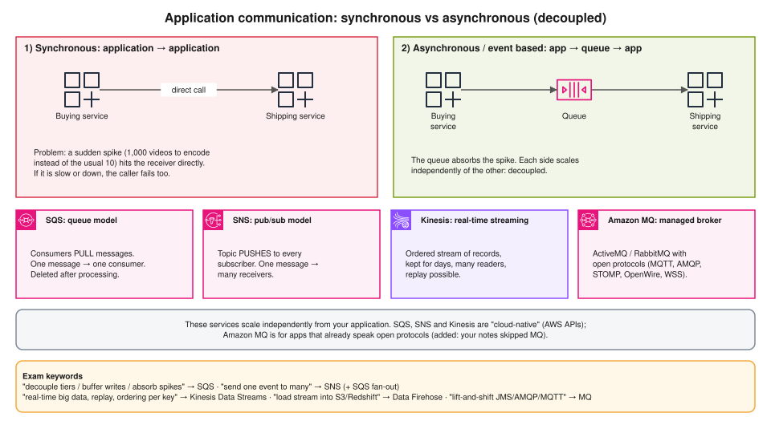
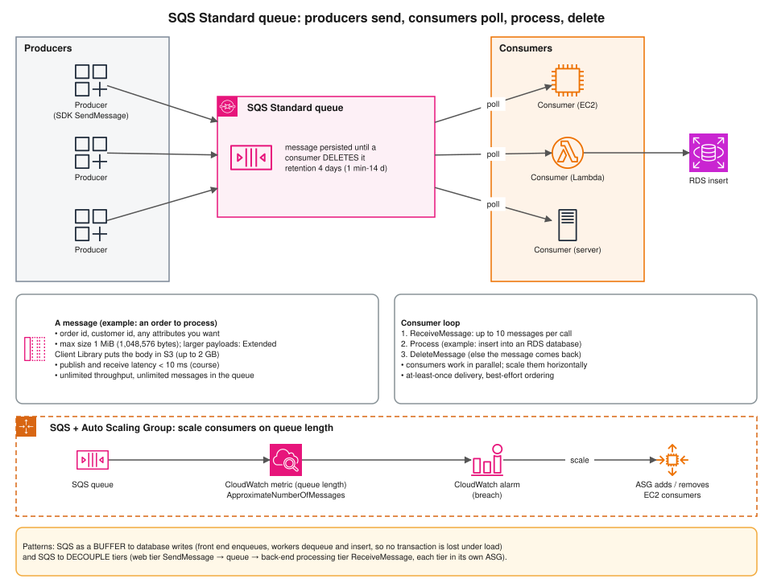
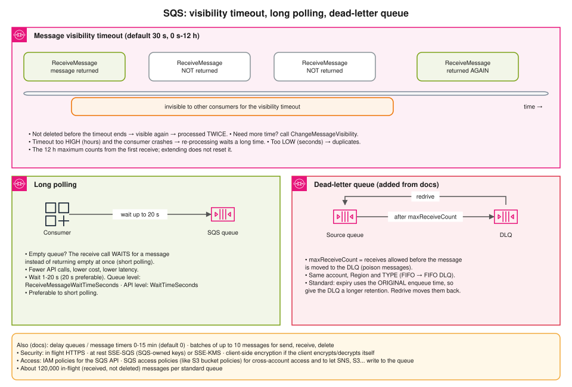
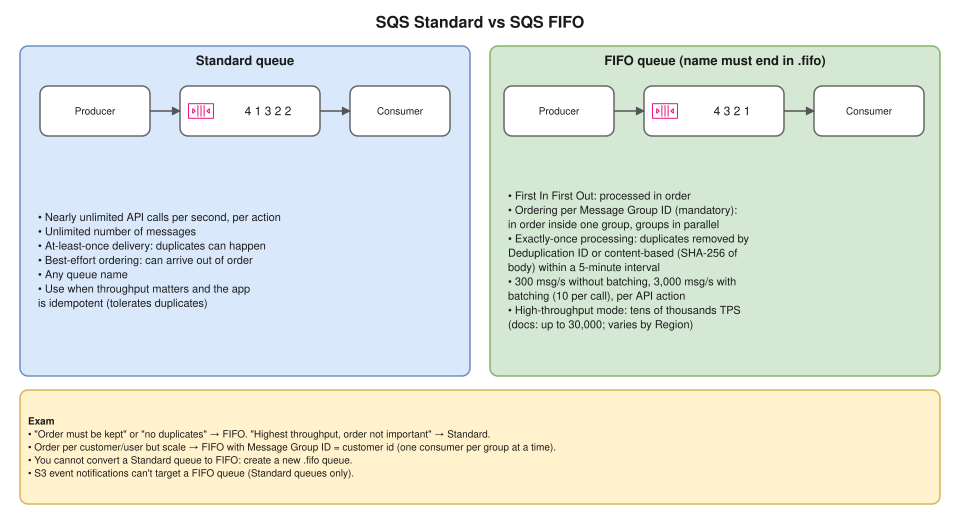
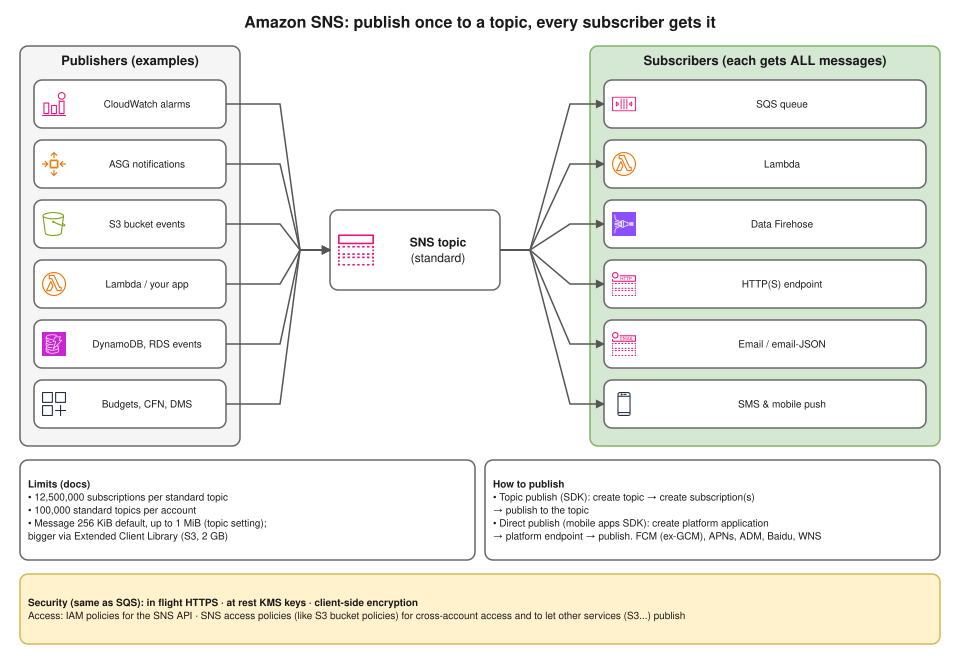
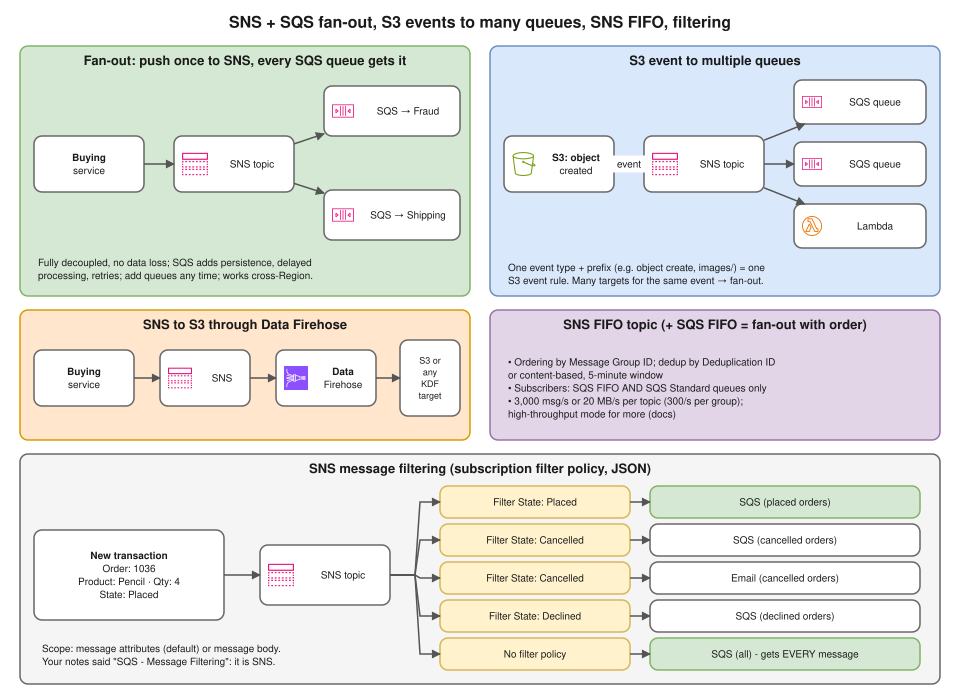
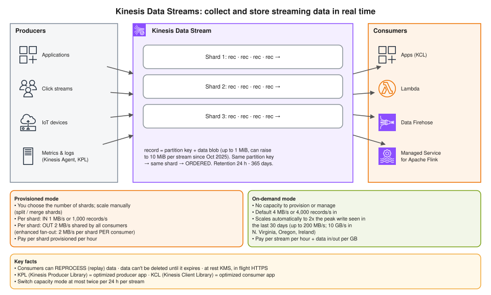
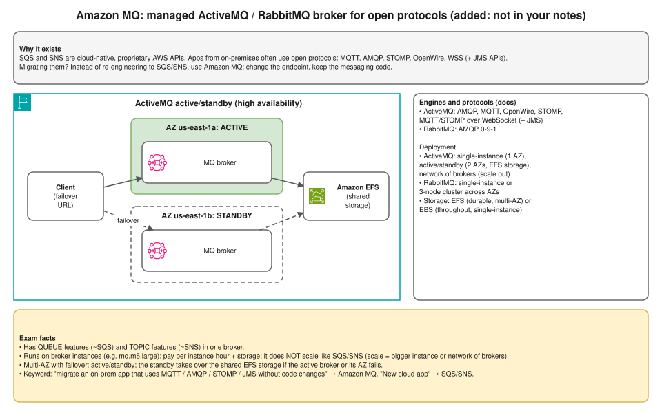
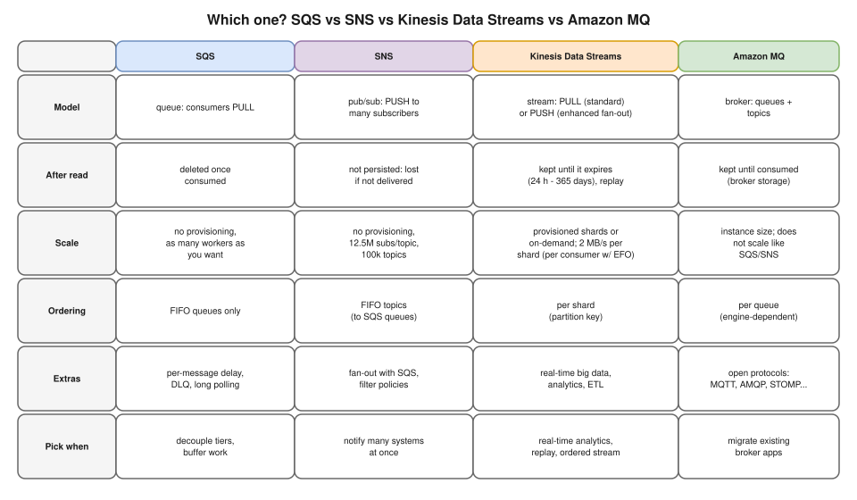

# AWS Integration & Messaging cheat sheet: SQS, SNS, Kinesis, Amazon MQ (course section 14)

**What you learned (course section 14, "AWS Integration & Messaging: SQS, SNS & Kinesis"):** why decouple applications, Amazon SQS (standard queue, producing and consuming, multiple consumers, SQS with an Auto Scaling Group, security, visibility timeout, long polling, FIFO queues), Amazon SNS (pub/sub, how to publish, security), SNS + SQS fan-out (S3 events to many queues, SNS to S3 through Firehose, SNS FIFO, message filtering), Kinesis Data Streams (capacity modes), Amazon Data Firehose, Kinesis Data Streams vs Firehose, SQS vs SNS vs Kinesis, and Amazon MQ.

> **How to use this page.** This page is built from **your own notes**. Every fact you wrote is still here, with typos fixed. Each section was checked against the **AWS documentation** and the course slides (v49); the "Source" line under each heading links the AWS pages. Where your notes were wrong, out of date or incomplete, look for the **"Corrections to your notes"** box in that section, and the [full list](#corrections-to-your-notes-all-in-one-place) near the end. First redraw the [decision table](#11-sqs-vs-sns-vs-kinesis-vs-amazon-mq) from memory. Then do the [drill](#from-memory-drill).

**Confidence tags.** `[Certain]` = confirmed on the AWS page linked in that section (checked 25 Nov 2026). `[Likely]` = in the course slides (v49), but the AWS pages I read do not state it (a course simplification, an exam-style rule, or a number AWS does not publish there). **Where the course and the AWS docs disagree, the AWS docs win, and the note says so.**

> **The big news first.** Five things you should know before the exam:
> 1. **Your notes do not cover Amazon MQ**, although the course does (last two slides of the section). [Section 10](#10-amazon-mq-added-not-in-your-notes) adds it from the AWS docs and the slides.
> 2. **SQS max message size is now 1 MiB** (1,048,576 bytes). Your "1,024 KB" is right. Older material (and some AWS marketing pages) still says 256 KB: that is the old limit.
> 3. **Kinesis records: up to 10 MiB, but only if you raise it.** The default is still **1 MiB** per record; since Oct 2025 you can raise a stream's maximum record size to 10 MiB. Per-shard limits (1 MB/s in, 2 MB/s out) did not change.
> 4. **"SQS - Message Filtering" in your notes is SNS message filtering.** Filter policies belong to SNS subscriptions.
> 5. **Kinesis Data Firehose is now called Amazon Data Firehose.** Same service, new name; the exam may use either.

## Contents

1. [Section introduction: why decouple](#1-section-introduction-why-decouple)
2. [Amazon SQS: standard queue, producing, consuming](#2-amazon-sqs-standard-queue)
3. [SQS: security, visibility timeout, long polling, DLQ](#3-sqs-security-visibility-timeout-long-polling)
4. [SQS FIFO queue](#4-sqs-fifo-queue)
5. [Amazon SNS](#5-amazon-sns)
6. [SNS + SQS fan-out, SNS FIFO, message filtering](#6-sns--sqs-fan-out)
7. [Kinesis Data Streams](#7-kinesis-data-streams)
8. [Amazon Data Firehose](#8-amazon-data-firehose)
9. [Kinesis Data Streams vs Amazon Data Firehose](#9-kinesis-data-streams-vs-amazon-data-firehose)
10. [Amazon MQ (added: not in your notes)](#10-amazon-mq-added-not-in-your-notes)
11. [SQS vs SNS vs Kinesis vs Amazon MQ](#11-sqs-vs-sns-vs-kinesis-vs-amazon-mq)
12. [SAA exam traps](#12-saa-exam-traps)
13. [Corrections to your notes (all in one place)](#corrections-to-your-notes-all-in-one-place)
14. [From-memory drill](#from-memory-drill)
15. [30-second spoken answer](#30-second-spoken-answer)

---

## 1. Section introduction: why decouple

Source: course slides (v49), "Section Introduction". This part is concepts, so it is all `[Likely]`.

- When we start deploying multiple applications, they will **inevitably need to communicate** with one another. `[Likely]`
- There are **two patterns** of application communication: `[Likely]`
  - **Synchronous** communication (application to application), e.g. Buying service calls Shipping service directly.
  - **Asynchronous / event based** (application → **queue** → application).
- **Synchronous between applications can be problematic if there are sudden spikes of traffic.** `[Likely]`
- **What if you need to suddenly encode 1,000 videos but usually it's 10?** `[Likely]`
- In that case it's better to **decouple** your applications: `[Likely]`
  - using **SQS: queue model**
  - using **SNS: pub/sub model**
  - using **Kinesis: real-time streaming model**
  - (the course adds **Amazon MQ** at the end for apps that use open protocols, see [section 10](#10-amazon-mq-added-not-in-your-notes))
- **These services can scale independently from our application.** `[Likely]`

> **Corrections to your notes (section 1)**
> - Spelling: inevitavly → inevitably, Asyncronous → Asynchronous, Syncronous → Synchronous.

## 2. Amazon SQS: standard queue

Source: [SQS message quotas](https://docs.aws.amazon.com/AWSSimpleQueueService/latest/SQSDeveloperGuide/quotas-messages.html) · [SQS queue types](https://docs.aws.amazon.com/AWSSimpleQueueService/latest/SQSDeveloperGuide/sqs-queue-types.md) · [SQS visibility timeout](https://docs.aws.amazon.com/AWSSimpleQueueService/latest/SQSDeveloperGuide/sqs-visibility-timeout.html) · [SQS features](https://aws.amazon.com/sqs/features/)

- **Oldest offering** (over 10 years old). `[Likely]` (course; SQS launched in 2006)
- **Fully managed service, used to decouple applications.** `[Certain]`
- **Attributes:**
  - **Unlimited throughput, unlimited number of messages in queue.** `[Certain]` Docs: standard queues support "a very high, nearly unlimited number of API calls per second, per action".
  - **Default retention of messages: 4 days, maximum of 14 days.** `[Certain]` Minimum 60 seconds (1 minute), maximum 1,209,600 seconds.
  - **Low latency (< 10 ms on publish and receive).** `[Likely]` (course; no number on the AWS pages I read)
  - **Limitation of 1,024 KB per message sent.** `[Certain]` Docs: max **1,048,576 bytes (1 MiB)**, min 1 byte. Bigger payloads: the **SQS Extended Client Library** (Java, Python) stores the body in **S3** and sends a reference; payload up to **2 GB**.
- **Can have duplicate messages** (at-least-once delivery, occasionally). `[Certain]`
- **Can have out-of-order messages** (best-effort ordering). `[Certain]`

### Producing messages

- **Produced to SQS using the SDK** (`SendMessage` API). `[Certain]`
- **The message is persisted in SQS until a consumer deletes it.** `[Certain]`
- **Message retention: default 4 days, up to 14 days.** `[Certain]`
- **Example: send an order to be processed**: order id, customer id, any attributes you want. `[Likely]` (course example)
- **SQS standard: unlimited throughput.** `[Certain]`
- Batch: one batch request holds **up to 10 messages**. `[Certain]`

### Consuming messages

- **Consumers** (running on **EC2 instances, servers, or AWS Lambda**...). `[Certain]`
- **Poll SQS for messages (receive up to 10 messages at a time).** `[Certain]` (`ReceiveMessage` with `MaxNumberOfMessages` = 10)
- **Process the messages** (example: insert the message into an RDS database). `[Likely]` (course example)
- **Delete the messages using the `DeleteMessage` API.** `[Certain]`

### Multiple EC2 instances consumers

- **Consumers receive and process messages in parallel.** `[Certain]`
- **At-least-once delivery.** `[Certain]`
- **Best-effort message ordering.** `[Certain]`
- **Consumers delete messages after processing them.** `[Certain]`
- **We can scale consumers horizontally to improve throughput of processing.** `[Certain]`

### SQS with an Auto Scaling Group, and two patterns (added from the course)

- **SQS + ASG:** EC2 consumers in an ASG poll the queue; the **CloudWatch metric `ApproximateNumberOfMessages`** (queue length) drives a **CloudWatch alarm**, which **scales** the ASG. `[Likely]` (course; the metric is a real SQS CloudWatch metric)
- **SQS as a buffer to database writes:** if the load is too big, direct inserts into RDS/Aurora/DynamoDB may lose transactions. Instead the front end **enqueues** (`SendMessage`), workers **dequeue** (`ReceiveMessage`) and insert. The queue is "infinitely scalable". `[Likely]`
- **SQS to decouple application tiers:** front-end web app → `SendMessage` → SQS → `ReceiveMessage` → back-end processing app, each tier in its own ASG (e.g. video processing). `[Likely]`

> **Corrections to your notes (section 2)**
> - "1,024 KB per message" is **correct and current** (1 MiB). Ignore any source that says 256 KB: that was the old limit (some AWS marketing pages still show it; the developer guide's quota page says 1 MiB).
> - Added from the course: SQS with ASG (`ApproximateNumberOfMessages`), SQS as a write buffer, SQS to decouple tiers. These come up in exam scenarios.
> - Spelling: standerd → standard, Lamda → Lambda, recive → receive, DeleteMssage → DeleteMessage, Multipal → Multiple, proccessing → processing, number if messages → number of messages.

## 3. SQS: security, visibility timeout, long polling

Source: [Encryption at rest in SQS](https://docs.aws.amazon.com/AWSSimpleQueueService/latest/SQSDeveloperGuide/sqs-server-side-encryption.html) · [SQS visibility timeout](https://docs.aws.amazon.com/AWSSimpleQueueService/latest/SQSDeveloperGuide/sqs-visibility-timeout.html) · [Setting up long polling](https://docs.aws.amazon.com/AWSSimpleQueueService/latest/SQSDeveloperGuide/best-practices-setting-up-long-polling.html) · [Dead-letter queues](https://docs.aws.amazon.com/AWSSimpleQueueService/latest/SQSDeveloperGuide/sqs-dead-letter-queues) · [SQS message quotas](https://docs.aws.amazon.com/AWSSimpleQueueService/latest/SQSDeveloperGuide/quotas-messages.html)

### SQS security

- **Encryption:**
  - **In-flight encryption using HTTPS API.** `[Likely]` (course)
  - **At-rest encryption using KMS keys.** `[Certain]` Two kinds of server-side encryption: **SSE-SQS** (SQS-managed keys) or **SSE-KMS** (keys in KMS; if you don't pick one, the AWS managed key `aws/sqs`). SSE encrypts the message **body**.
  - **Client-side encryption** if the client wants to perform encryption/decryption itself. `[Likely]`
- **Access controls: IAM policies** to regulate access to the SQS API. `[Likely]`
- **SQS access policies** (similar to S3 bucket policies): `[Likely]`
  - Useful for **cross-account access** to SQS queues.
  - Useful for allowing **other services (SNS, S3...) to write** to an SQS queue.

### Message visibility timeout

- **After a message is polled by a consumer, it becomes invisible to other consumers.** `[Certain]`
- **By default, the "message visibility timeout" is 30 seconds.** `[Certain]` Range **0 seconds to 12 hours**; the 12 h counts from the first receive, and extending does not reset it. `[Certain]`
- **That means the message has 30 seconds to be processed.** `[Certain]`
- **After the message visibility timeout is over, the message is "visible" in SQS.** `[Certain]`
- **If a message is not processed within the visibility timeout, it will be processed twice.** `[Certain]` (it is received again; delete it in time)
- **A consumer could call the `ChangeMessageVisibility` API to get more time.** `[Certain]` (setting it to 0 makes the message visible at once)
- **If the visibility timeout is high (hours) and the consumer crashes, re-processing will take time.** `[Likely]`
- **If the visibility timeout is too low (seconds), we may get duplicates.** `[Likely]`

### Long polling

- When a consumer requests messages from the queue, it can optionally **"wait" for messages to arrive** if there are none in the queue. **This is called long polling.** `[Certain]`
- **Long polling decreases the number of API calls made to SQS while increasing the efficiency and reducing latency of your application.** `[Certain]`
- **The wait time can be between 1 sec to 20 sec** (20 sec preferable). `[Certain]` ("The maximum long polling wait time is 20 seconds"; long polling is on when the wait time is greater than 0.)
- **Long polling is preferable to short polling.** `[Certain]`
- **Long polling can be enabled at the queue level or at the API level using `WaitTimeSeconds`.** `[Certain]` (queue attribute: `ReceiveMessageWaitTimeSeconds`)

### Dead-letter queue and delay queue (added from the docs)

- **Dead-letter queue (DLQ):** after a message has been received **`maxReceiveCount`** times without being deleted, SQS moves it to the DLQ, so a "poison" message stops blocking work. `[Certain]`
- The DLQ must be in the **same account and Region**, and the **same type** (FIFO queue → FIFO DLQ). `[Certain]`
- **Redrive** moves messages from the DLQ back to the source queue after you fix the bug. `[Certain]`
- Standard queues: a message's expiry is based on its **original enqueue timestamp**, so set the DLQ's retention **longer** than the source queue's. (FIFO: the timestamp resets when moved.) `[Certain]`
- **Delay queue / message timers:** delay delivery **0 to 15 minutes** (default 0). `[Certain]`
- About **120,000 in-flight** messages (received, not yet deleted) per standard queue. `[Certain]`

> **Corrections to your notes (section 3)**
> - Visibility timeout range added: **0 s to 12 h** (default 30 s).
> - Added from the docs: dead-letter queues, delay queues, SSE-SQS vs SSE-KMS. All are common exam answers ("messages keep failing" → DLQ; "delay processing 10 min" → delay queue).
> - Spelling: pooled → **polled**, meance → means, twise → twice, hight → high, craches → crashes, visibilty → visibility, optinally → optionally, ther → there, bettwen → between.

## 4. SQS FIFO queue

Source: [SQS queue types](https://docs.aws.amazon.com/AWSSimpleQueueService/latest/SQSDeveloperGuide/sqs-queue-types.md) · [High throughput for FIFO queues](https://docs.aws.amazon.com/AWSSimpleQueueService/latest/SQSDeveloperGuide/high-throughput-fifo.html) · [Exactly-once processing](https://docs.aws.amazon.com/AWSSimpleQueueService/latest/SQSDeveloperGuide/FIFO-queues-exactly-once-processing.html) · [SQS message quotas](https://docs.aws.amazon.com/AWSSimpleQueueService/latest/SQSDeveloperGuide/quotas-messages.html)

- **FIFO = First In First Out** (ordering of messages in the queue). `[Certain]`
- **Limited throughput: 300 msg/s without batching, 3,000 msg/s with batching.** `[Certain]` Docs: "up to 300 API calls per second per API method (SendMessage, ReceiveMessage, or DeleteMessage)"; with batches of 10, "up to 3,000 messages per second per API method".
- **High-throughput FIFO mode** (docs, not in your notes): much higher, with ordering only inside each message group. The queue-types page says "up to 30,000 transactions per second"; the SQS features page says up to 70,000 messages per second; the exact quota **depends on the Region**. `[Certain]` For the exam: "FIFO but more than 3,000 msg/s" → high-throughput FIFO.
- **Exactly-once send capability** (by removing duplicates using a **Deduplication ID**). `[Certain]` Duplicates sent within the **5-minute deduplication interval** are not added. **Content-based deduplication** = SQS uses a **SHA-256 hash of the message body** (not the attributes) as the deduplication ID. `[Certain]`
- **Messages are processed in order by the consumer.** `[Certain]`
- **Ordering by Message Group ID** (all messages in the same group are ordered) **- mandatory parameter.** `[Certain]` ("If you don't provide a MessageGroupId ... the action fails"; max 128 characters.) Different groups can be processed in parallel.
- The queue name must end in **`.fifo`**. `[Likely]` (well-known rule; not on the pages I fetched)

> **Corrections to your notes (section 4)**
> - Added: the 5-minute deduplication window, content-based deduplication (SHA-256 of the body), and high-throughput FIFO mode.
> - Spelling: Fisrt → First, withount → without, 3000 msg/sec → 3,000 msg/s.

## 5. Amazon SNS

Source: [SNS endpoints and quotas](https://docs.aws.amazon.com/general/latest/gr/sns.html) · [SNS event destinations](https://docs.aws.amazon.com/sns/latest/dg/sns-event-destinations.html) · [Mobile push with SNS](https://docs.aws.amazon.com/sns/latest/dg/sns-mobile-application-as-subscriber.html) · [SNS features](https://aws.amazon.com/sns/features/)

- **What if you want to send one message to many receivers?** `[Likely]`
  - **Direct integration:** the Buying service calls the email service, the Fraud service, the Shipping service's queue... one by one.
  - **Pub/Sub:** the Buying service publishes once to an **SNS topic**; the topic delivers to all of them.
- **The "event producer" only sends a message to one SNS topic.** `[Certain]`
- **As many "event receivers" (subscriptions) as we want listen to the SNS topic notifications.** `[Certain]`
- **Each subscriber to the topic will get all the messages** (note: you can now filter messages, see [section 6](#sns-message-filtering)). `[Certain]`
- **Up to 12,500,000 subscriptions per topic.** `[Certain]` (standard topic; a FIFO topic: 100 subscriptions)
- **100,000 topics limit.** `[Certain]` (standard topics per account; FIFO: 1,000 per account)
- Subscribers (endpoint types): **SQS, Lambda, Amazon Data Firehose, HTTP(S), email (and email-JSON), SMS, mobile push** (platform endpoints). `[Certain]`
- Message size (docs, not in your notes): **256 KiB default**, raise to **1 MiB** with the topic's `MaximumMessageSize` attribute; bigger via the Extended Client Library (S3, up to 2 GB). `[Certain]`
- **Many AWS services can send data directly to SNS for notifications**: CloudWatch alarms, AWS Budgets, Lambda, Auto Scaling Group notifications, S3 bucket events, DynamoDB, CloudFormation state changes, AWS DMS (new replica), RDS events... `[Likely]` (course list)

### How to publish

- **Topic publish** (using the SDK): `[Certain]`
  - Create a topic
  - Create a subscription (or many)
  - Publish to the topic
- **Direct publish** (for mobile apps SDK): `[Certain]`
  - Create a platform application
  - Create a platform endpoint
  - Publish to the platform endpoint
  - **Works with Google GCM, Apple APNS, Amazon ADM...** Docs today: **Firebase Cloud Messaging (FCM**, the successor of GCM), **APNs** (iOS and macOS), **ADM**, **Baidu Cloud Push**, **Windows Push Notification Services (WNS)**. `[Certain]`

### SNS security

- **Encryption:** `[Likely]` (course; the features page confirms KMS at rest)
  - **In-flight encryption using HTTPS API.**
  - **At-rest encryption using KMS keys.**
  - **Client-side encryption** if the client wants to perform encryption/decryption itself.
- **Access controls: IAM policies** to regulate access to the SNS API. `[Likely]`
- **SNS access policies** (similar to S3 bucket policies): `[Likely]`
  - Useful for **cross-account access** to SNS topics.
  - Useful for allowing **other services (S3...) to write** to an SNS topic.

> **Corrections to your notes (section 5)**
> - **Google GCM is now Firebase Cloud Messaging (FCM)**; the docs also list Baidu and WNS.
> - The 12,500,000 and 100,000 limits are for **standard** topics. FIFO topics: 1,000 per account, 100 subscriptions each.
> - Added: SNS message size (256 KiB default, up to 1 MiB) and the subscriber types.
> - Spelling: subcription(s) → subscription(s), recivers → receivers, others services → other services.

## 6. SNS + SQS fan-out

Source: [SNS FIFO message delivery](https://docs.aws.amazon.com/sns/latest/dg/fifo-message-delivery.html) · [SNS FIFO deduplication](https://docs.aws.amazon.com/sns/latest/dg/fifo-message-dedup.html) · [High-throughput FIFO topics](https://docs.aws.amazon.com/sns/latest/dg/fifo-high-throughput.html) · [SNS message filtering](https://docs.aws.amazon.com/sns/latest/dg/message-filtering.html) · [Filter policy scope](https://docs.aws.amazon.com/sns/latest/dg/sns-message-filtering-scope.html) · [S3 event notification destinations](https://docs.aws.amazon.com/AmazonS3/latest/userguide/notification-how-to-event-types-and-destinations.html) · [SNS features](https://aws.amazon.com/sns/features/)

- **Push once in SNS, receive in all SQS queues that are subscribers.** `[Certain]`
- **Fully decoupled, no data loss.** `[Likely]`
- **SQS allows for: data persistence, delayed processing and retries of work.** `[Likely]`
- **Ability to add more SQS subscribers over time.** `[Likely]`
- **Make sure your SQS queue access policy allows for SNS to write.** `[Likely]` (the queue's resource policy must allow `sqs:SendMessage` from the topic)
- **Cross-Region delivery: works with SQS queues in other Regions.** `[Certain]` (features page: "cross-region and cross-account message delivery")

### Application: S3 events to multiple queues

- **For the same combination of: event type (e.g. object create) and prefix (e.g. `images/`) you can only have one S3 event rule.** `[Likely]` (course; the S3 page says "only one destination type can be specified for each event notification")
- **If you want to send the same S3 event to many SQS queues, use fan-out:** S3 → SNS topic → several SQS queues (and/or Lambda). `[Likely]`
- S3 limits (docs): the SNS topic must be a **standard** topic (SNS FIFO not allowed) and an SQS target must be a **standard** queue (FIFO not supported), both in the **same Region** as the bucket. `[Certain]` (Or send S3 events to **EventBridge**, which can route one event to many targets.)

### Application: SNS to Amazon S3 through Data Firehose

- **SNS can send to Kinesis (Data Firehose), and therefore we can have this architecture:** Buying service → SNS topic → Amazon Data Firehose → Amazon S3 (or any supported Firehose destination). `[Certain]` (Firehose is an SNS subscriber type)

### SNS FIFO topic

- **FIFO = First In First Out** (ordering of messages in the topic). `[Certain]`
- **Similar features as SQS FIFO:** `[Certain]`
  - **Ordering by Message Group ID** (all messages in the same group are ordered).
  - **Deduplication using a Deduplication ID or content-based deduplication** (hash of the body, attributes not included), within a **5-minute** interval.
- **Can have SQS Standard and FIFO queues as subscribers.** `[Certain]` FIFO topics **can't** deliver to email, SMS, mobile apps or HTTP(S). For Lambda, put an SQS queue in between.
- **Limited throughput** (same as SQS FIFO in the course). `[Certain]` Docs now: **3,000 messages/s or 20 MB/s per topic** (300 msg/s per message group); **high-throughput mode** (Jan 2025) goes higher, up to 30,000 msg/s per account in N. Virginia.
- **SNS FIFO + SQS FIFO = fan-out + ordering + deduplication.** `[Likely]` (course slide; you didn't note it)

### SNS message filtering

- **JSON policy used to filter messages sent to an SNS topic's subscriptions.** `[Certain]`
- **If a subscription doesn't have a filter policy, it receives every message.** `[Certain]` ("the subscriber receives every message published to its topic")
- Scope (docs): **`MessageAttributes`** (default) or **`MessageBody`**. `[Certain]` Changes take up to 15 minutes to apply.
- Course example: one "new transaction" (Order 1036, Pencil, Qty 4, State: Placed) → topic → SQS "placed orders" (filter State: Placed), SQS "cancelled orders" and email (State: Cancelled), SQS "declined orders" (State: Declined), SQS "all" (no filter). `[Likely]`

> **Corrections to your notes (section 6)**
> - **"SQS - Message Filtering" → SNS message filtering.** The filter policy is set on an **SNS subscription**; SQS itself has no filter policy.
> - The S3 event destination must be a **standard** SNS topic / **standard** SQS queue (no FIFO).
> - SNS FIFO throughput is now **3,000 msg/s per topic** by default, with a high-throughput mode for more.
> - Added: SNS FIFO + SQS FIFO fan-out, filter policy scope.
> - Spelling: rescive → receive, decouple → decoupled, allows fro → allows for, Kenesis → Kinesis, Similer → Similar, SQS FIFIO → SQS FIFO, Standerd → Standard.

## 7. Kinesis Data Streams

Source: [Kinesis Data Streams quotas and limits](https://docs.aws.amazon.com/streams/latest/dev/service-sizes-and-limits.html) · [Terminology and concepts](https://docs.aws.amazon.com/streams/latest/dev/key-concepts.html) · [Handle large records](https://docs.aws.amazon.com/streams/latest/dev/large-records.html) · [10x larger records (blog, 28 Oct 2025)](https://aws.amazon.com/blogs/big-data/amazon-kinesis-data-streams-now-supports-10x-larger-record-sizes-simplifying-real-time-data-processing) · [Kinesis Data Streams FAQs](https://aws.amazon.com/kinesis/faqs/)

- **Collect and store streaming data in real time.** `[Certain]`
- Producers: applications, click streams, IoT devices, metrics & logs (Kinesis Agent). Consumers: applications, Lambda, Amazon Data Firehose, Managed Service for Apache Flink. `[Likely]` (course diagram)
- **Retention between 24 hours and up to 365 days.** `[Certain]` Minimum 24 h, maximum 8,760 h (365 days).
- **Ability to reprocess (replay) data by consumers.** `[Certain]`
- **Data can't be deleted from Kinesis (until it expires).** `[Likely]`
- **Data up to 10 MiB** (typical use case is lots of "small" real-time data). `[Certain]` but: **default max record size is 1 MiB**; you **raise** a stream's maximum record size to **10 MiB** (console, `UpdateMaxRecordSize`, or `MaxRecordSizeInKiB` at create). Available since Oct 2025. Per-shard limits don't change, and AWS advises keeping large records to under ~2% of traffic.
- **Data ordering guarantee for data with the same "Partition ID".** `[Certain]` AWS calls it the **partition key**: same key → same shard → ordered (each record gets a sequence number).
- **At-rest KMS encryption, in-flight HTTPS encryption.** `[Certain]` (server-side encryption with KMS keys)
- **Kinesis Producer Library (KPL)** to write an optimized producer application. `[Certain]`
- **Kinesis Client Library (KCL)** to write an optimized consumer application. `[Certain]`

### Capacity modes

- **Provisioned mode:**
  - **Choose the number of shards.** `[Certain]`
  - **Each shard gets 1 MB/s in (or 1,000 records per second).** `[Certain]`
  - **Each shard gets 2 MB/s out** (shared by all standard consumers; **enhanced fan-out** gives **2 MB/s per shard per consumer**). `[Certain]`
  - **Scale manually to increase or decrease the number of shards** (split / merge shards). `[Certain]`
  - **You pay per shard provisioned per hour.** `[Certain]`
- **On-demand mode:**
  - **No need to provision or manage the capacity.** `[Certain]`
  - **Default capacity provisioned (4 MB/s in or 4,000 records per second).** `[Certain]`
  - **Scales automatically based on observed throughput peak during the last 30 days** (up to double the previous peak). `[Certain]` Max: 200 MB/s write in most Regions; **10 GB/s** in N. Virginia, Oregon and Ireland. `[Certain]`
  - **Pay per stream per hour & data in/out per GB.** `[Likely]`
- Switch between modes **twice per 24 hours** per stream. `[Certain]`
- New in the docs: **On-demand Advantage**, an account-level on-demand setting (minimum charges, up to 50 enhanced fan-out consumers instead of 20). Not in the course; unlikely on SAA-C03. `[Certain]`

> **Corrections to your notes (section 7)**
> - **10 MiB is the maximum you can raise a stream to; the default is still 1 MiB.** Shards are still 1 MB/s in, 2 MB/s out.
> - "Partition ID" → **partition key**.
> - "Retention between up to 365 days" → between **24 hours and 365 days**.
> - Added: enhanced fan-out (2 MB/s per shard per consumer), on-demand max and the twice-a-day mode switch.
> - Spelling: in-filght → in-flight, increaseor → increase or, prvision → provision, privisioned → provisioned.

## 8. Amazon Data Firehose

Source: [Amazon Data Firehose FAQs](https://aws.amazon.com/firehose/faqs/) · [Amazon Data Firehose](https://aws.amazon.com/firehose/) · [BufferingHints API](https://docs.aws.amazon.com/firehose/latest/APIReference/API_BufferingHints.html) · [Buffering hints](https://docs.amazonaws.cn/en_us/firehose/latest/dev/buffering-hints.html) · [Convert input data format](https://docs.aws.amazon.com/firehose/latest/dev/record-format-conversion.html) · [Configure transformation](https://docs.aws.amazon.com/firehose/latest/dev/create-transform.html)

- **Note: used to be called "Kinesis Data Firehose"**, now **Amazon Data Firehose**. `[Certain]` ("previously known as Amazon Kinesis Data Firehose")
- Sources: applications / SDK (**Direct PUT**), **Kinesis Data Streams**, **Amazon MSK**, Kinesis Agent, CloudWatch Logs & Events, AWS IoT, SNS. `[Certain]`
- **Fully managed service**, delivering to: `[Certain]`
  - **AWS destinations: Amazon Redshift / Amazon S3 / Amazon OpenSearch Service** (also Apache Iceberg tables / S3 Tables). Redshift loads go through S3 (`COPY`). `[Likely]` for the COPY detail.
  - **3rd party: Splunk / MongoDB / Datadog / New Relic / ...** (also Snowflake, Dynatrace, Sumo Logic, LogicMonitor)
  - **Custom HTTP endpoint**
- **Automatic scaling, serverless, pay for what you use.** `[Certain]` (pricing by GB ingested)
- **Near real-time with buffering capability based on size / time.** `[Certain]` Buffer size **1-128 MB** (default 5), interval **0-900 s** (default 300); whichever comes first. Interval 0 = deliver "within a few seconds".
- Record size: up to **1,024 KB** (1 MB, before Base64) per record for Direct PUT / Kinesis Data Streams sources (10 MB from MSK). `[Certain]`
- **Supports CSV, JSON, Parquet, Avro, raw text, binary data.** `[Likely]`
- **Conversions to Parquet / ORC, compressions with gzip / snappy.** `[Certain]` Conversion input must be **JSON** (CSV etc. → use Lambda to make JSON first) and uses an **AWS Glue** table for the schema. Compression: **GZIP, ZIP, Snappy** (only GZIP if the data goes on to Redshift).
- **Custom data transformation using AWS Lambda** (e.g. CSV to JSON). `[Certain]`
- **All data or only failed data** can be backed up to an **S3 backup bucket**. `[Certain]`
- **Dynamic partitioning** (docs): write to S3 prefixes by keys in the record, e.g. `customer_id=...`. `[Certain]`

> **Corrections to your notes (section 8)**
> - Title "Kinesis Amazon Data Firehose" → **Amazon Data Firehose** (formerly Kinesis Data Firehose).
> - Format conversion is **JSON → Parquet / ORC** only.
> - Added: buffer ranges, record size, sources, Lambda transform, S3 backup.
> - Spelling: Parquent → Parquet, gzip . snappy → gzip / snappy, NewRelic → New Relic.

## 9. Kinesis Data Streams vs Amazon Data Firehose

Source: course slides (v49), checked against the pages in sections 7 and 8.

| | **Kinesis Data Streams** | **Amazon Data Firehose** |
|---|---|---|
| Job | **Streaming data collection** | **Load streaming data into S3 / Redshift / OpenSearch / 3rd party / custom HTTP** |
| Code | **Producer & consumer code** | **Fully managed** |
| Speed | **Real time** | **Near real time** (buffered) |
| Scaling | **Provisioned / on-demand mode** | **Automatic scaling** |
| Storage | **Data storage up to 365 days** | **No data storage** |
| Replay | **Replay capability** | **Doesn't support replay capability** |

All rows `[Certain]` except "no data storage", which is `[Likely]` (Firehose keeps data only while retrying delivery, up to 24 h for S3).

> **Corrections to your notes (section 9)**
> - Spelling: Near real-rime → near real time, custome → custom, capbility → capability.

## 10. Amazon MQ (added: not in your notes)

Source: [Amazon MQ for ActiveMQ brokers](https://docs.aws.amazon.com/amazon-mq/latest/developer-guide/amazon-mq-basic-elements.html) · [Amazon MQ migration guide](https://docs.aws.amazon.com/amazon-mq/latest/migration-guide/concept-chapter-about.html) · [Amazon MQ FAQs](https://aws.amazon.com/amazon-mq/faqs) · course slides (v49) "Amazon MQ"

You said you studied this, but your notes stop at Firehose. Everything below is added from the slides and the docs.

- **SQS and SNS are "cloud-native" services: proprietary protocols from AWS.** `[Likely]`
- **Traditional applications running from on-premises may use open protocols such as MQTT, AMQP, STOMP, OpenWire, WSS.** `[Certain]`
- **When migrating to the cloud, instead of re-engineering the application to use SQS and SNS, we can use Amazon MQ.** `[Certain]` (docs: migrate "with minimal code changes"; usually you only update the endpoints)
- **Amazon MQ is a managed message broker service for RabbitMQ and ActiveMQ.** `[Certain]` (the slide sentence is cut off; the docs name both engines)
- **Amazon MQ doesn't "scale" as much as SQS / SNS.** `[Likely]` It runs on broker instances (e.g. `mq.t3.micro` to `mq.m5.4xlarge`); you scale up with a bigger instance or out with a **network of brokers**. `[Certain]`
- **Amazon MQ runs on servers, can run in Multi-AZ with failover.** `[Certain]`
- **Amazon MQ has both queue features (~SQS) and topic features (~SNS).** `[Likely]`
- **Protocols (docs):** ActiveMQ: **AMQP, MQTT, MQTT over WebSocket, OpenWire, STOMP, STOMP over WebSocket** (+ JMS API). RabbitMQ: **AMQP 0-9-1**. `[Certain]`
- **Pricing:** broker instance usage + storage + data transfer; no reserved pricing. `[Certain]`

### Amazon MQ high availability

- **Active/standby (ActiveMQ):** two brokers in **two different AZs** in a redundant pair; only one is active. Both use **Amazon EFS** as shared storage. If the active broker or its AZ fails, the **standby takes over** automatically. `[Certain]`
- Course picture: Region us-east-1, ACTIVE broker in us-east-1a, STANDBY in us-east-1b, both on Amazon EFS, client **fails over** to the standby. `[Likely]`
- **Single-instance:** one broker in one AZ (EBS or EFS storage); unavailable until restarted if it fails. `[Certain]`
- **RabbitMQ:** single-instance or a **3-node cluster** across AZs. `[Certain]`
- **Storage:** EFS = durability-optimized, replicated across AZs. EBS = throughput-optimized, single-instance only. `[Certain]`

## 11. SQS vs SNS vs Kinesis vs Amazon MQ

Source: course slide "SQS vs SNS vs Kinesis" + the MQ facts above.

| | **SQS** | **SNS** | **Kinesis Data Streams** | **Amazon MQ** |
|---|---|---|---|---|
| Model | Consumer **pulls** data | **Pushes** data to many subscribers (pub/sub) | Standard: **pull**; enhanced fan-out: **push** | Broker with queues and topics |
| After it's read | **Deleted** after being consumed | **Not persisted** (lost if not delivered) | Kept; **expires after X days**; **replay** possible | Kept by the broker until consumed |
| Scale | As many workers as you want; no throughput to provision | Up to 12,500,000 subscribers, 100,000 topics; no throughput to provision | Provisioned or on-demand; **2 MB/s per shard** (per consumer with enhanced fan-out) | Instance size / network of brokers; doesn't scale like SQS/SNS |
| Ordering | Only on **FIFO** queues | **FIFO** topics (to SQS queues) | At the **shard** level (partition key) | Engine dependent |
| Extras | Individual message **delay**, DLQ, long polling | **Fan-out** with SQS, filter policies | Real-time **big data, analytics, ETL** | Open protocols (MQTT, AMQP, STOMP, OpenWire, WSS) |
| Pick when | Decouple tiers, buffer work | Notify many systems at once | Real-time analytics, replay, ordered stream | Migrate an existing broker app without rewriting |

`[Likely]` for the table as a whole (course slide), with the numbers `[Certain]` from the sections above.

## 12. SAA exam traps

1. **Order + no duplicates → SQS FIFO**; highest throughput and order doesn't matter → **SQS Standard**.
2. **FIFO but more than 3,000 msg/s → high-throughput FIFO** (ordering only per message group).
3. **Order per user but parallel across users → FIFO with Message Group ID = user id.**
4. **Message processed twice → visibility timeout too short** (raise it, or call `ChangeMessageVisibility`).
5. **Too many empty `ReceiveMessage` calls / high cost → long polling** (`WaitTimeSeconds` up to 20 s).
6. **A message keeps failing → dead-letter queue** (`maxReceiveCount`).
7. **Delay processing of new messages → delay queue** (0-15 min).
8. **Message bigger than 1 MiB → SQS Extended Client Library** (body in S3).
9. **Scale EC2 workers on backlog → CloudWatch `ApproximateNumberOfMessages` alarm → ASG.**
10. **Database can't keep up with writes → SQS as a buffer.**
11. **One event to many systems → SNS + SQS fan-out.** Check the **queue access policy** lets SNS write.
12. **Same S3 event (type + prefix) to several queues → S3 → SNS → SQS queues** (one S3 rule per event type + prefix). S3 can't target FIFO queues or FIFO topics.
13. **Each subscriber wants only some messages → SNS filter policy** (no policy = gets everything).
14. **Fan-out with ordering → SNS FIFO + SQS FIFO.** SNS FIFO can't send to email/SMS/HTTP/Lambda directly.
15. **Real-time, replay, multiple consumers reading the same data, ordering per key → Kinesis Data Streams.**
16. **Load streaming data into S3 / Redshift / OpenSearch / Splunk with no code → Amazon Data Firehose** (near real time, no replay).
17. **Convert stream to Parquet/ORC before S3 → Firehose** (JSON in; Lambda for CSV).
18. **Kinesis throttling (`ProvisionedThroughputExceeded`) → add shards** (provisioned) or **on-demand**; hot partition key → better key.
19. **Many consumers each need full read speed → enhanced fan-out** (2 MB/s per shard per consumer).
20. **On-prem app uses MQTT / AMQP / STOMP / OpenWire / JMS and must move without code changes → Amazon MQ.** HA = active/standby in 2 AZs with EFS.
21. **SNS is not persistent**: if you need retries or durability, put SQS behind it.

## Corrections to your notes (all in one place)

1. **Amazon MQ was missing.** Added as [section 10](#10-amazon-mq-added-not-in-your-notes).
2. **"SQS - Message Filtering" is SNS message filtering** (filter policy on an SNS subscription).
3. **Kinesis record: default 1 MiB, raise to 10 MiB** (since Oct 2025); shard limits unchanged.
4. **"Partition ID" → partition key.**
5. **Kinesis retention: 24 hours to 365 days** (not "up to 365").
6. **Firehose's name: Amazon Data Firehose** (formerly Kinesis Data Firehose).
7. **SQS 1,024 KB (1 MiB) is correct**; 256 KB is the old limit.
8. **SQS FIFO has a high-throughput mode** beyond 300/3,000 msg/s.
9. **SNS FIFO throughput is now 3,000 msg/s per topic** by default (+ high-throughput mode).
10. **SNS limits (12.5M subscriptions, 100,000 topics) are for standard topics**; FIFO: 1,000 topics, 100 subscriptions each.
11. **Google GCM → Firebase Cloud Messaging (FCM).**
12. **S3 event notifications only go to standard SNS topics and standard SQS queues.**
13. **Firehose format conversion is JSON → Parquet/ORC.**
14. **Visibility timeout range 0 s-12 h**, long polling 1-20 s; queue attribute `ReceiveMessageWaitTimeSeconds`.
15. Added from the docs or course: SQS + ASG, buffer and decouple patterns, DLQ, delay queues, SSE-SQS/SSE-KMS, FIFO dedup window, SNS message size, SNS FIFO + SQS FIFO fan-out, enhanced fan-out, Firehose sources/buffers/backup, the SQS vs SNS vs Kinesis comparison.
16. Spelling (all sections): inevitavly, Asyncronous, standerd, Lamda, Multipal, proccessing, pooled → polled, meance, twise, hight, craches, visibilty, optinally, bettwen, Fisrt, withount, subcription, recivers, rescive, fro, Kenesis, Similer, FIFIO, in-filght, increaseor, prvision, privisioned, Parquent, real-rime, custome, capbility.

## From-memory drill

Cover the page. Answer out loud or type the answer, then open it.

**1. Name the two communication patterns and the three decoupling models (plus the fourth service).**

Answer

Synchronous (app to app) and asynchronous / event based (app → queue → app). SQS = queue, SNS = pub/sub, Kinesis = real-time streaming. Amazon MQ = managed broker for open protocols.

**2. SQS standard: throughput, retention (default/max), latency, message size, delivery and ordering.**

Answer

Unlimited throughput and messages. Retention 4 days default, 1 min-14 days. < 10 ms (course). 1 MiB (1,024 KB); bigger via Extended Client Library + S3. At-least-once (duplicates possible), best-effort ordering.

**3. Walk through the consumer loop. How many messages per receive?**

Answer

Poll (ReceiveMessage, up to 10), process (e.g. insert into RDS), DeleteMessage. If not deleted, it comes back after the visibility timeout.

**4. How do you auto scale EC2 consumers on queue length?**

Answer

CloudWatch metric ApproximateNumberOfMessages → CloudWatch alarm → ASG scaling.

**5. SQS security: three kinds of encryption, two kinds of access control, two uses of an access policy.**

Answer

HTTPS in flight, KMS at rest (SSE-SQS or SSE-KMS), client-side. IAM policies and SQS access policies. Cross-account access; let SNS/S3 write to the queue.

**6. Visibility timeout: default, range, what happens if processing is slower, how to get more time, too high vs too low.**

Answer

30 s default, 0 s-12 h. Message becomes visible again and is processed twice. ChangeMessageVisibility. Too high: slow re-processing after a crash. Too low: duplicates.

**7. Long polling: what, why, range, where to set it.**

Answer

Receive call waits for messages if the queue is empty. Fewer API calls, more efficient, lower latency. 1-20 s (20 preferable). Queue level (ReceiveMessageWaitTimeSeconds) or API level (WaitTimeSeconds).

**8. What is a DLQ and what decides when a message goes there? What else must match?**

Answer

Queue for messages that keep failing. maxReceiveCount. Same account, Region and type (FIFO → FIFO). Redrive moves them back.

**9. SQS FIFO: throughput, dedup (two ways + window), ordering parameter, name.**

Answer

300 msg/s without batching, 3,000 with (per API action); high-throughput mode for more. Deduplication ID or content-based (SHA-256 of body), 5 minutes. Message Group ID (mandatory). Name ends in .fifo.

**10. SNS: limits, subscriber types, message size.**

Answer

12,500,000 subscriptions per standard topic, 100,000 standard topics (FIFO: 1,000 topics, 100 subs). SQS, Lambda, Firehose, HTTP(S), email, SMS, mobile push. 256 KiB default, up to 1 MiB.

**11. Topic publish vs direct publish steps.**

Answer

Topic: create topic → create subscription(s) → publish. Direct (mobile): create platform application → platform endpoint → publish. FCM (ex-GCM), APNs, ADM, Baidu, WNS.

**12. Fan-out: what, benefits, what to check, cross-Region?**

Answer

Publish once to SNS, every subscribed SQS queue gets it. Decoupled, no data loss, SQS adds persistence, delay, retries; add queues later. Queue access policy must let SNS write. Yes, cross-Region works.

**13. Why do you need fan-out for S3 events to many queues?**

Answer

Only one S3 event rule per event type + prefix. So S3 → SNS → many SQS queues. (Standard topic and standard queues only.)

**14. SNS FIFO: features, subscribers, throughput.**

Answer

Message group ordering, dedup ID or content-based, 5 min. SQS FIFO and standard queues only. 3,000 msg/s or 20 MB/s per topic; high-throughput mode for more.

**15. SNS message filtering: what, no policy, scope.**

Answer

JSON filter policy on a subscription. No policy = every message. Message attributes (default) or message body.

**16. Kinesis Data Streams: retention, record size, ordering, encryption, libraries.**

Answer

24 h-365 days, replay, can't delete. 1 MiB default, raise to 10 MiB. Same partition key → same shard → ordered. KMS at rest, HTTPS in flight. KPL producer, KCL consumer.

**17. Provisioned vs on-demand: per-shard limits, default on-demand capacity, scaling, pricing.**

Answer

Provisioned: choose shards, 1 MB/s or 1,000 rec/s in, 2 MB/s out per shard, scale manually, pay per shard-hour. On-demand: 4 MB/s or 4,000 rec/s default, scales on the 30-day peak, pay per stream-hour + GB.

**18. Data Firehose: destinations, speed, formats, transform.**

Answer

S3, Redshift, OpenSearch; 3rd party (Splunk, MongoDB, Datadog, New Relic, Snowflake); custom HTTP. Near real time (buffer 1-128 MB / 0-900 s). CSV, JSON, Parquet, Avro, raw text, binary; JSON → Parquet/ORC; gzip/snappy. Lambda transform. Failed or all data to S3 backup.

**19. Six differences between Data Streams and Firehose.**

Answer

Collection vs loading; your code vs fully managed; real time vs near real time; provisioned/on-demand vs automatic; stores up to 365 days vs no storage; replay vs no replay.

**20. Amazon MQ: why, engines, protocols, scale, HA.**

Answer

Migrate apps using open protocols without rewriting for SQS/SNS. ActiveMQ and RabbitMQ. MQTT, AMQP, STOMP, OpenWire, WSS. Doesn't scale like SQS/SNS (runs on broker instances). Active/standby in 2 AZs with shared EFS, automatic failover. Queues + topics.

**21. SQS vs SNS vs Kinesis: pull/push, persistence, ordering.**

Answer

SQS pull, deleted after consumption, order only FIFO. SNS push, not persisted, FIFO topics. Kinesis pull (push with enhanced fan-out), kept X days with replay, order per shard.

## 30-second spoken answer

"To decouple services I use SQS when one consumer should process each message: consumers poll, process and delete, the visibility timeout hides a message while it's worked on, long polling cuts empty calls, a DLQ catches poison messages, and FIFO gives ordering per message group with deduplication. When one event must reach many systems I use SNS, usually fanned out into SQS queues so each consumer gets durable retries, with filter policies so each one gets only what it needs. For real-time streams with replay and ordering per key I use Kinesis Data Streams, and to land a stream in S3, Redshift or OpenSearch without writing consumers I use Data Firehose. If an existing app speaks AMQP, MQTT or JMS, I move it to Amazon MQ instead of rewriting it."
