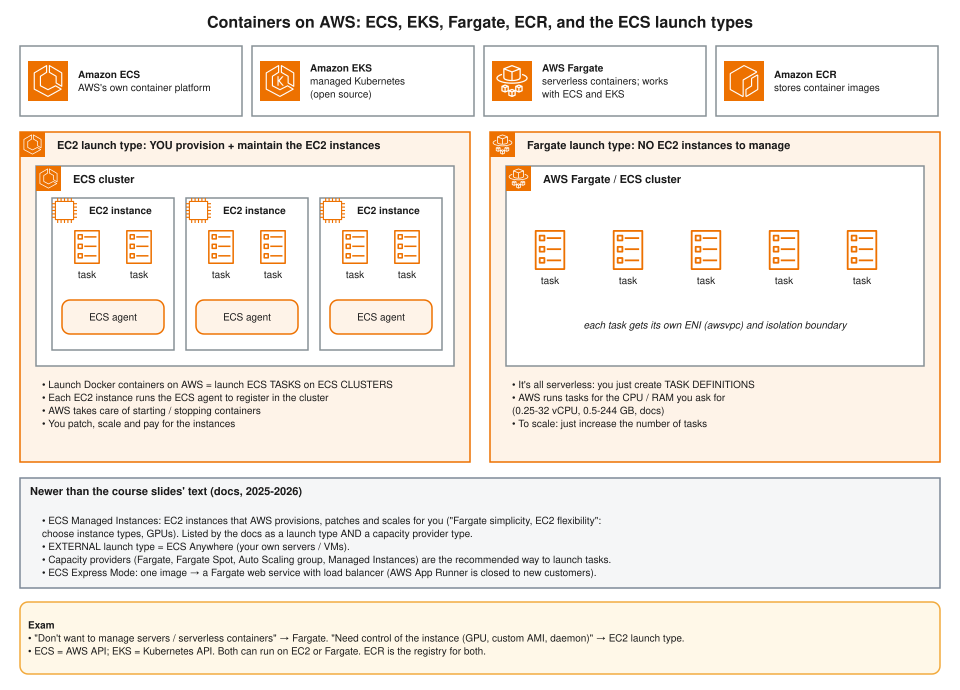
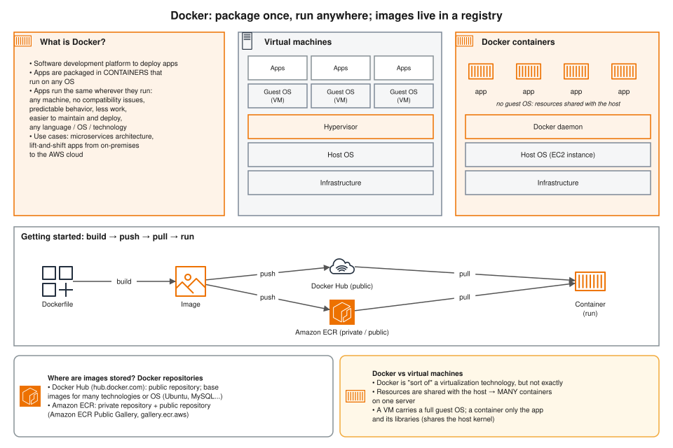
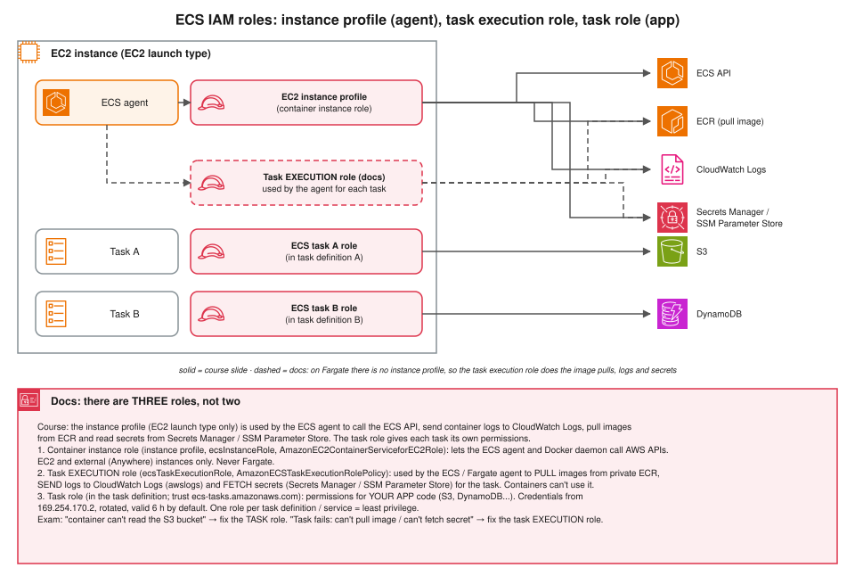
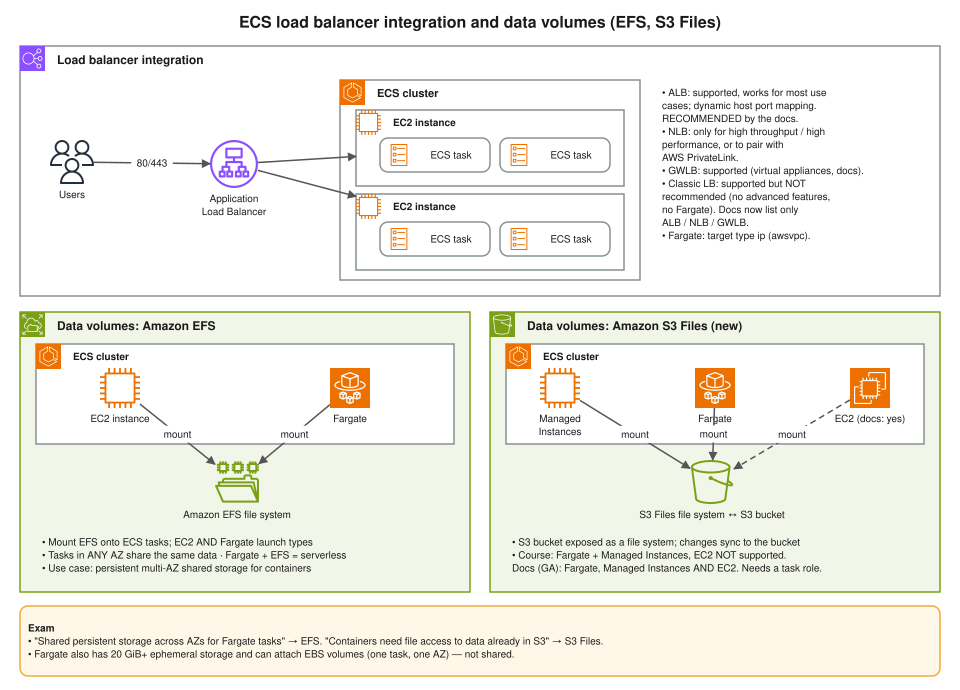
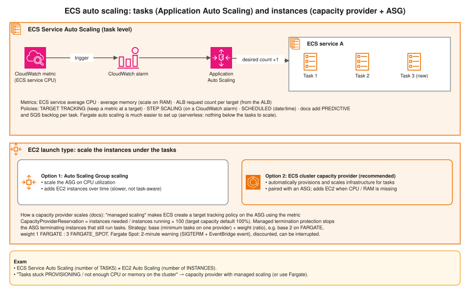
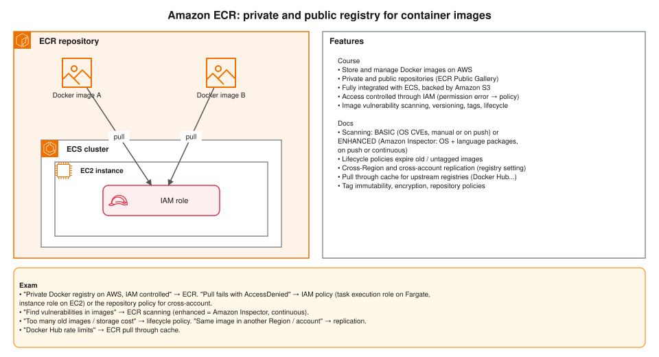
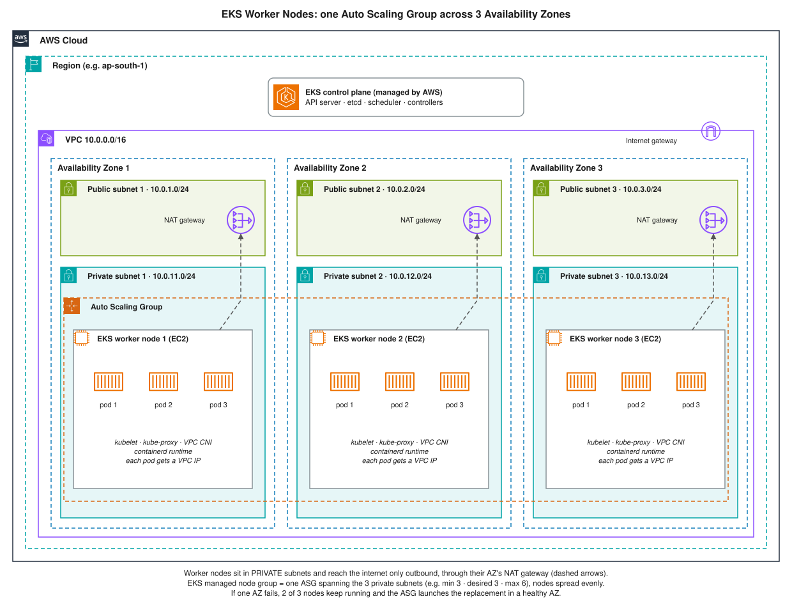
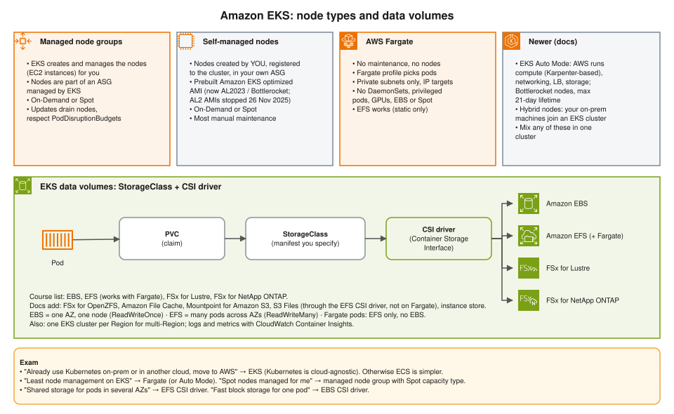
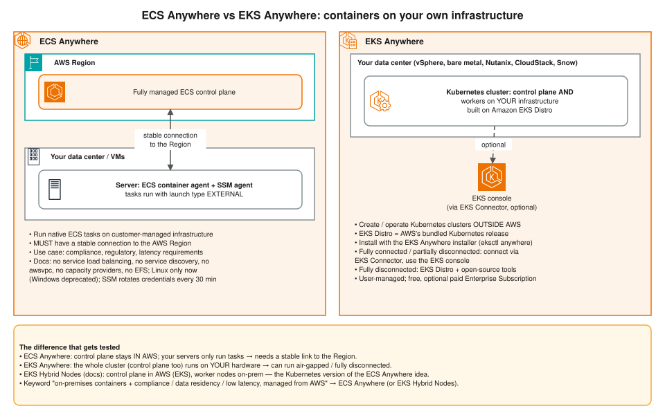

# Containers on AWS cheat sheet: Docker, ECS, Fargate, ECR, EKS, ECS/EKS Anywhere (course section 15)

**What you learned (course section 15, "Containers on AWS"):** what Docker is, where images are stored, Docker vs virtual machines, container management on AWS (ECS, EKS, Fargate, ECR), the ECS EC2 and Fargate launch types, IAM roles for ECS, load balancer integrations, data volumes (EFS and S3 Files), ECS Service Auto Scaling, scaling the EC2 instances (ASG and capacity providers), four application patterns with EventBridge and SQS, Amazon ECR, Amazon EKS (overview, node types, data volumes), ECS Anywhere and EKS Anywhere.

> **How to use this page.** This page is built from **your own notes**. Every fact you wrote is still here, with typos fixed. Each section was checked against the **AWS documentation** and the course slides (v49); the "Source" line under each heading links the AWS pages. Where your notes were wrong, out of date or incomplete, look for the **"Corrections to your notes"** box in that section, and the [full list](#corrections-to-your-notes-all-in-one-place) near the end. Your four empty "Application:" headings are filled from the slides in [section 11](#11-application-patterns-eventbridge-and-sqs). First redraw the [IAM roles diagram](#5-amazon-ecs-iam-roles) and the [decision table](#18-ecs-vs-eks-vs-fargate-which-one) from memory. Then do the [drill](#from-memory-drill).

**Confidence tags.** `[Certain]` = confirmed on the AWS page linked in that section (checked 26 Nov 2026). `[Likely]` = in the course (slides v49 or, for ECS/EKS Anywhere, the course lecture, because those two topics are not in the v49 slide PDF), but the AWS pages I read do not state it. **Where the course and the AWS docs disagree, the AWS docs win, and the note says so.**

> **The big news first.** Five things you should know before the exam:
> 1. **ECS has THREE IAM roles, not two.** The slide shows the EC2 instance profile and the task role. The **task execution role** is missing: on Fargate (no instance profile) it is what pulls the image from ECR, sends logs to CloudWatch and fetches secrets. "Can't pull image / can't read secret" → execution role. "App can't read S3" → task role. See [section 5](#5-amazon-ecs-iam-roles).
> 2. **S3 Files works with the EC2 launch type too.** The slide (and your note) says "EC2 launch type is NOT supported". The ECS docs list Fargate, ECS Managed Instances **and Amazon EC2** as "Fully supported" at GA. Docs win; the exam may still follow the slide.
> 3. **"Step Tracking" is Step Scaling.** And the docs add **predictive scaling** and **SQS backlog-per-task** scaling to the three policies on the slide.
> 4. **New compute options the slides only hint at:** **ECS Managed Instances** (AWS-managed EC2 for ECS, a launch type and a capacity provider), **EKS Auto Mode** and **EKS Hybrid Nodes**. **AWS App Runner is closed to new customers**; AWS points new users to **ECS Express Mode**.
> 5. **EKS-optimized Amazon Linux 2 AMIs stopped on 26 Nov 2025.** "Amazon EKS optimized AMI" now means **AL2023 or Bottlerocket**.

## Contents

1. [What is Docker?](#1-what-is-docker)
2. [Docker container management on AWS](#2-docker-container-management-on-aws)
3. [Amazon ECS: EC2 launch type](#3-amazon-ecs-ec2-launch-type)
4. [Amazon ECS: Fargate launch type (and Managed Instances)](#4-amazon-ecs-fargate-launch-type)
5. [Amazon ECS: IAM roles](#5-amazon-ecs-iam-roles)
6. [Amazon ECS: load balancer integrations](#6-amazon-ecs-load-balancer-integrations)
7. [Amazon ECS: data volumes (EFS)](#7-amazon-ecs-data-volumes-efs)
8. [Amazon ECS: data volumes (S3 Files)](#8-amazon-ecs-data-volumes-s3-files)
9. [ECS Service Auto Scaling](#9-ecs-service-auto-scaling)
10. [EC2 launch type: auto scaling EC2 instances (capacity providers)](#10-ec2-launch-type-auto-scaling-ec2-instances)
11. [Application patterns: EventBridge and SQS](#11-application-patterns-eventbridge-and-sqs)
12. [Amazon ECR](#12-amazon-ecr)
13. [Amazon EKS overview](#13-amazon-eks-overview)
14. [Amazon EKS: node types](#14-amazon-eks-node-types)
15. [Amazon EKS: data volumes](#15-amazon-eks-data-volumes)
16. [ECS Anywhere](#16-ecs-anywhere)
17. [EKS Anywhere](#17-eks-anywhere)
18. [ECS vs EKS vs Fargate: which one?](#18-ecs-vs-eks-vs-fargate-which-one)
19. [SAA exam traps](#19-saa-exam-traps)
20. [Corrections to your notes (all in one place)](#corrections-to-your-notes-all-in-one-place)
21. [From-memory drill](#from-memory-drill)
22. [30-second spoken answer](#30-second-spoken-answer)

---

## 1. What is Docker?

Source: course slides (v49), "What is Docker?", "Where are Docker images stored?", "Docker vs. Virtual Machines", "Getting Started with Docker". This part is concepts, so it is `[Likely]` unless marked.

- **Docker is a software development platform to deploy apps.** `[Likely]`
- **Apps are packaged in containers** that can be run on any OS. `[Likely]`
- **Apps run the same, regardless of where they're run:** `[Likely]`
  - any machine
  - no compatibility issues
  - predictable behavior
  - less work
  - easier to maintain and deploy
  - works with any language, any OS, any technology
- **Use cases:** microservices architecture, lift-and-shift apps from on-premises to the AWS cloud, ... `[Likely]`
- **Getting started (slide):** write a **Dockerfile** → **build** an **image** → **push** it to a Docker repository (Docker Hub or Amazon ECR) → **pull** it on a server → **run** a container. `[Likely]`

### Where are Docker images stored?

- **Docker images are stored in Docker repositories.** `[Likely]`
- **Docker Hub** (hub.docker.com): `[Likely]`
  - public repository
  - find base images for many technologies or OS (e.g. Ubuntu, MySQL, ...)
- **Amazon ECR (Amazon Elastic Container Registry):** `[Certain]` ([ECR](https://docs.aws.amazon.com/AmazonECR/latest/userguide/what-is-ecr.html))
  - private repository
  - public repository (**Amazon ECR Public Gallery**, https://gallery.ecr.aws)

### Docker vs. virtual machines

- **Docker is "sort of" a virtualization technology, but not exactly.** `[Likely]`
- **Resources are shared with the host → many containers on one server.** `[Likely]`
- Slide picture: a VM stack is apps → **guest OS (one per VM)** → hypervisor → host OS → infrastructure; a Docker stack is apps → **Docker daemon** → host OS (EC2 instance) → infrastructure. No guest OS, so containers are lighter and start faster. `[Likely]`

> **Corrections to your notes (section 1)**
> - Spelling: thechnology → technology, techinologies → technologies, one-premises → on-premises.
> - Added from the slides: the build → push → pull → run flow and the VM vs Docker stacks.

## 2. Docker container management on AWS

Source: [Choosing an AWS container service](https://docs.aws.amazon.com/decision-guides/latest/decision-guides/choosing-aws-container-service.html) (decision guide, updated 11 Nov 2026)

- **Amazon Elastic Container Service (Amazon ECS):** Amazon's own container platform. `[Certain]` Docs: "a managed container orchestration service".
- **Amazon Elastic Kubernetes Service (Amazon EKS):** Amazon's managed Kubernetes (open source). `[Certain]`
- **AWS Fargate:** `[Certain]`
  - Amazon's own **serverless** container platform (docs: "a serverless compute engine with which you can run containers without managing the underlying infrastructure")
  - works with **ECS and with EKS**
- **Amazon ECR:** stores container images (docs: "a fully managed container registry that you use with Amazon ECS, Amazon EKS, and other container services"). `[Certain]`
- **Newer (docs, not in your notes):** `[Certain]`
  - **ECS Express Mode**: deploy a web app or API from a container image straight to a Fargate-based service.
  - **AWS App Runner is closed to new customers.** Existing customers can keep using it; new and migrating customers should use ECS Express Mode. Old exam questions may still show App Runner as "simplest way to run a web container".

## 3. Amazon ECS: EC2 launch type

Source: [ECS launch types and capacity providers](https://docs.aws.amazon.com/AmazonECS/latest/developerguide/capacity-launch-type-comparison.html) · [Container instance IAM role](https://docs.aws.amazon.com/AmazonECS/latest/developerguide/instance_IAM_role.html)

Diagram: the [top of this page](#containers-on-aws-cheat-sheet-docker-ecs-fargate-ecr-eks-ecseks-anywhere-course-section-15) (left half).

- **ECS = Elastic Container Service.** `[Certain]`
- **Launch Docker containers on AWS = launch ECS tasks on ECS clusters.** `[Certain]`
- **EC2 launch type: you must provision and maintain the infrastructure (the EC2 instances).** `[Certain]`
- **Each EC2 instance must run the ECS agent to register in the ECS cluster.** `[Certain]` Docs: container instances "run the Amazon ECS container agent and require an IAM role".
- **AWS takes care of starting / stopping containers.** `[Likely]` (course wording; ECS places and starts the tasks, you own the instances)

## 4. Amazon ECS: Fargate launch type

Source: [Architect for AWS Fargate](https://docs.aws.amazon.com/AmazonECS/latest/developerguide/AWS_Fargate.html) · [Fargate task definition differences](https://docs.aws.amazon.com/AmazonECS/latest/developerguide/fargate-tasks-services.html) · [ECS launch types and capacity providers](https://docs.aws.amazon.com/AmazonECS/latest/developerguide/capacity-launch-type-comparison.html) · [ECS clusters](https://docs.aws.amazon.com/AmazonECS/latest/developerguide/clusters.html)

- **Launch Docker containers on AWS.** `[Certain]`
- **You do not provision the infrastructure (no EC2 instances to manage).** `[Certain]`
- **It's all serverless.** `[Certain]`
- **You just create task definitions.** `[Certain]`
- **AWS just runs ECS tasks for you based on the CPU / RAM you need.** `[Certain]` Docs: task sizes from **0.25 vCPU / 512 MiB up to 32 vCPU / 244 GB** (8, 16 and 32 vCPU need Linux, platform 1.4.0+).
- **To scale, just increase the number of tasks. Simple: no more EC2 instances.** `[Certain]`
- **Added from the docs:** `[Certain]`
  - Fargate tasks **always use the `awsvpc` network mode**: each task gets its own ENI, private IP and security group.
  - Each Fargate task has **its own isolation boundary** (no shared kernel, CPU, memory or ENI with another task).
  - Storage: **EFS volumes** (persistent), **EBS volumes**, bind mounts (ephemeral). Ephemeral storage is 20 GiB by default, up to 200 GiB `[Likely]` (well known, not re-checked on the pages above).
  - Not supported on Fargate: `privileged`, `placementConstraints`, `links`, `gpu` and a few others.
  - **Fargate Spot**: interruption-tolerant tasks at a discount, interrupted with a **two-minute warning**.

### ECS Managed Instances and the other launch types (added: newer than the course)

- The docs list **four launch types: EC2, Fargate, External (ECS Anywhere) and ECS Managed Instances.** `[Certain]`
- **ECS Managed Instances** = "fully-managed compute" that "combine[s] the simplicity of Fargate with the flexibility of EC2": AWS "fully manages the underlying Amazon EC2 instances, including provisioning, patching, and scaling", and picks instance types for your workload. Use it when you need EC2 features (instance families, GPUs) without running the fleet yourself. `[Certain]`
- **Capacity providers** (Fargate, Fargate Spot, Auto Scaling group, Managed Instances) are what the docs **recommend** for launching tasks and services, instead of a plain launch type. A strategy can't mix capacity provider types (e.g. Fargate and ASG providers in one strategy). `[Certain]`

> **Corrections to your notes (sections 3-4)**
> - Your notes mention ECS Managed Instances only under S3 Files. It is a full **launch type and capacity provider** (above).
> - Spelling: farget → Fargate, Tyep → Type, definations → definitions.

## 5. Amazon ECS: IAM roles

Source: [Container instance IAM role](https://docs.aws.amazon.com/AmazonECS/latest/developerguide/instance_IAM_role.html) · [Task execution IAM role](https://docs.aws.amazon.com/AmazonECS/latest/developerguide/task_execution_IAM_role.html) · [Task IAM role](https://docs.aws.amazon.com/AmazonECS/latest/developerguide/task-iam-roles.html) · [Best practices for IAM roles in ECS](https://docs.aws.amazon.com/AmazonECS/latest/developerguide/security-iam-roles.html)

- **EC2 instance profile (EC2 launch type only):** `[Certain]` for the role and its purpose
  - **used by the ECS agent** `[Certain]`
  - **makes API calls to the ECS service** `[Certain]`
  - **sends container logs to CloudWatch Logs** `[Likely]` (course; docs give this job to the task execution role, see below)
  - **pulls Docker images from ECR** `[Likely]` (same: on EC2 the agent falls back to the instance role if the task has no execution role)
  - **references sensitive data in Secrets Manager or SSM Parameter Store** `[Likely]` (docs: secrets in a task definition need the **task execution role**)
  - Docs name: **container instance IAM role** (`ecsInstanceRole`, managed policy `AmazonEC2ContainerServiceforEC2Role`). Used by EC2 **and external (ECS Anywhere)** instances. Never on Fargate. `[Certain]`
- **ECS task role:** `[Certain]`
  - **allows each task to have a specific role**
  - **use different roles for the different ECS services you run** (docs: one role per task definition or service, least privilege)
  - **the task role is defined in the task definition**
  - Added from the docs: trusted principal `ecs-tasks.amazonaws.com`; credentials reach the containers from `169.254.170.2` and are valid **6 hours** by default, rotated automatically. On EC2, Managed Instances and Anywhere there is **no task isolation** (block container access to the instance metadata, IMDS); on Fargate each task is isolated.

### The third role: task execution role (added: missing from the slide)

- **Task execution role** (`ecsTaskExecutionRole`, managed policy `AmazonECSTaskExecutionRolePolicy`): "grants the Amazon ECS container and Fargate agents permission to make AWS API calls on your behalf". `[Certain]`
  - **pull images from a private ECR repository**
  - **send logs to CloudWatch Logs** (`awslogs` log driver)
  - **fetch secrets** from Secrets Manager (`secretsmanager:GetSecretValue`) or SSM Parameter Store (`ssm:GetParameters`) that the task definition references (+ `kms:Decrypt` for a customer managed key)
  - The containers **can't use** these permissions; the app uses the task role.

| Role | Who uses it | Launch types | Typical error when it's wrong |
|---|---|---|---|
| Container instance role (instance profile) | ECS agent + Docker daemon on the instance | EC2, External | Instance never registers in the cluster |
| Task execution role | ECS / Fargate agent, while starting the task | All (needed on Fargate for ECR pulls, logs, secrets) | `CannotPullContainerError`, secret not found, no logs |
| Task role | Your application code in the containers | All | `AccessDenied` calling S3, DynamoDB, ... from the app |

> **Corrections to your notes (section 5)**
> - **Missing: the task execution role.** On Fargate there is no instance profile, so ECR pulls, CloudWatch logs and secrets all go through the task execution role. Even on EC2, secrets referenced in a task definition are fetched with the task execution role.
> - Spelling: Referance → Reference, deiffrent / diffrent → different, Defination → definition.

## 6. Amazon ECS: load balancer integrations

Source: [Use load balancing to distribute ECS service traffic](https://docs.aws.amazon.com/AmazonECS/latest/developerguide/service-load-balancing.html) · [Fargate task networking](https://docs.aws.amazon.com/AmazonECS/latest/developerguide/fargate-task-networking.html)

- **Application Load Balancer: supported and works for most use cases.** `[Certain]` Docs: "We recommend that you use Application Load Balancers"; supported on Fargate and EC2; allows **dynamic host port mapping** (many tasks of one service on one instance).
- **Network Load Balancer: recommended only for high throughput / high performance use cases, or to pair it with AWS PrivateLink.** `[Likely]` (course wording; docs: NLB is layer 4, TCP/UDP, and supported on Fargate and EC2 `[Certain]`)
- **Classic Load Balancer: supported but not recommended** (course adds: no advanced features, **no Fargate**). `[Likely]` The current ECS load-balancing page lists only **ALB, NLB and Gateway Load Balancer**.
- **Added from the docs:** `[Certain]`
  - **Gateway Load Balancer** is supported too (for virtual appliances such as firewalls).
  - With Fargate (`awsvpc`), target groups use the **`ip` target type** (each task has its own IP).

> **Corrections to your notes (section 6)**
> - Add **Gateway Load Balancer** to the list. Add the reason CLB is "not recommended": no advanced features and **no Fargate** support.

## 7. Amazon ECS: data volumes (EFS)

Source: [Fargate task definition differences: task storage](https://docs.aws.amazon.com/AmazonECS/latest/developerguide/fargate-tasks-services.html) · course slide "Amazon ECS – Data Volumes (EFS)"

Diagram: [section 6](#6-amazon-ecs-load-balancer-integrations) (bottom left).

- **Mount EFS file systems onto ECS tasks.** `[Certain]`
- **Works for both EC2 and Fargate launch types.** `[Certain]` (docs: "Amazon EFS volumes for persistent storage" on Fargate)
- **Tasks running in any AZ will share the same data in the EFS file system.** `[Likely]` (course; follows from EFS being a Regional, multi-AZ file system)
- **Fargate + EFS = serverless.** `[Likely]`
- **Use cases: persistent multi-AZ shared storage for your containers.** `[Likely]`
- Exam note from the course: **Amazon S3 can't be mounted as a file system** by tasks the classic way (that is what S3 Files now changes, next section). `[Likely]`

> **Corrections to your notes (section 7)**
> - Spelling: lunch → launch, Farget → Fargate.

## 8. Amazon ECS: data volumes (S3 Files)

Source: [Configuring S3 Files for Amazon ECS](https://docs.aws.amazon.com/AmazonECS/latest/developerguide/s3files-volumes.html) · [Specify an S3 Files volume in your task definition](https://docs.aws.amazon.com/AmazonECS/latest/developerguide/specify-s3files-config.html) · [Mounting S3 file systems on ECS](https://docs.aws.amazon.com/AmazonS3/latest/userguide/s3-files-mounting-ecs.html)

- **Mount S3 Files file systems onto ECS tasks (S3 bucket exposed as a file system).** `[Certain]` Docs: "a shared file system that connects any AWS compute resource directly with your data in Amazon S3".
- **Works for Fargate and ECS Managed Instances (EC2 launch type is NOT supported).** Course: `[Likely]`. **Docs disagree:** at GA the ECS page lists **Fargate, ECS Managed Instances and Amazon EC2, all "Fully supported"**. `[Certain]` Docs win.
- **Changes sync automatically to the S3 bucket.** `[Certain]` (docs: keeps "your file system and S3 bucket synchronized automatically")
- **Use cases: containers needing shared file access to data that already lives in S3.** `[Likely]`
- **Added from the docs:** `[Certain]`
  - A **task IAM role is mandatory**, and **encryption in transit is mandatory**.
  - You need an S3 file system and a **mount target** reachable from the VPC and subnets of the tasks; an optional **access point** is supported.
  - Task definition block: `s3filesVolumeConfiguration` with `fileSystemArn` (required), optional `rootDirectory` (default `/`), `transitEncryptionPort`, `accessPointArn`.

> **Corrections to your notes (section 8)**
> - **"EC2 launch type is NOT supported" is out of date.** The ECS docs list EC2 as fully supported for S3 Files. If an exam question repeats the slide, recognise it, but the current answer is "all three".
> - Spelling: alredy → already, Farget → Fargate.

## 9. ECS Service Auto Scaling

Source: [Automatically scale your ECS service](https://docs.aws.amazon.com/AmazonECS/latest/developerguide/service-auto-scaling.html) · [Step scaling for ECS](https://docs.aws.amazon.com/AmazonECS/latest/developerguide/service-autoscaling-stepscaling.html) · [Scale ECS services on an SQS queue](https://docs.aws.amazon.com/AmazonECS/latest/developerguide/service-autoscaling-queue.html) · [ECS service utilization metrics](https://docs.aws.amazon.com/AmazonECS/latest/developerguide/service_utilization.html)

- **Automatically increase/decrease the desired number of ECS tasks.** `[Certain]`
- **Amazon ECS auto scaling uses AWS Application Auto Scaling.** `[Certain]` Metrics:
  - **ECS service average CPU utilization** `[Certain]` (ECS publishes service `CPUUtilization` and `MemoryUtilization` every 60 s)
  - **ECS service average memory utilization: scale on RAM** `[Certain]`
  - **ALB request count per target: metric coming from the ALB** `[Certain]` (`ALBRequestCountPerTarget`; not supported with the blue/green deployment type)
  - (API names of the predefined metrics: `ECSServiceAverageCPUUtilization`, `ECSServiceAverageMemoryUtilization`, `ALBRequestCountPerTarget` `[Likely]`, the first two not shown on the pages I read)
- **Target tracking: scale based on a target value for a specific CloudWatch metric.** `[Certain]`
- **Step scaling: scale based on a specified CloudWatch alarm.** `[Certain]` (your note said "Step Tracking")
- **Scheduled scaling: scale based on a specified date/time** (predictable changes). `[Certain]`
- **ECS Service Auto Scaling (task level) ≠ EC2 Auto Scaling (EC2 instance level).** `[Certain]`
- **Fargate auto scaling is much easier to set up (because serverless).** `[Likely]`
- **Added from the docs:** `[Certain]`
  - Two more policy types: **predictive scaling** and **SQS queue backlog per task** (queue depth ÷ running tasks, with CloudWatch metric math: `ApproximateNumberOfMessagesVisible` / `RunningTaskCount`, which needs Container Insights; target = acceptable latency ÷ time per message).
  - Scale-in is paused while an ECS deployment is in progress. Min capacity 0 is allowed (scale to zero).

> **Corrections to your notes (section 9)**
> - **"Step Tracking" → Step Scaling.**
> - "=!" → ≠ (not equal).
> - Docs add **predictive** and **SQS backlog-per-task** scaling.
> - Spelling: Farget → Fargate.

## 10. EC2 launch type: auto scaling EC2 instances

Source: [ECS cluster auto scaling](https://docs.aws.amazon.com/AmazonECS/latest/developerguide/cluster-auto-scaling.html) · [Fargate capacity providers](https://docs.aws.amazon.com/AmazonECS/latest/developerguide/fargate-capacity-providers.html) · [ECS launch types and capacity providers](https://docs.aws.amazon.com/AmazonECS/latest/developerguide/capacity-launch-type-comparison.html)

Diagram: [section 9](#9-ecs-service-auto-scaling) (bottom half).

- **Accommodate ECS Service Scaling by adding underlying EC2 instances.** `[Certain]`
- **Auto Scaling Group scaling:** `[Likely]`
  - scale your ASG based on CPU utilization
  - add EC2 instances over time
- **ECS cluster capacity provider:** `[Certain]`
  - used to **automatically provision and scale the infrastructure** for your ECS tasks
  - capacity provider **paired with an Auto Scaling Group**
  - adds EC2 instances when you're **missing capacity (CPU, RAM, ...)**
- **Added from the docs:** `[Certain]`
  - **Managed scaling**: ECS creates a **target tracking policy on the ASG** using its own metric `CapacityProviderReservation` = instances needed ÷ instances running × 100. **Target capacity** default 100%. ECS doesn't change the ASG's min or max; max must be > 0.
  - **Managed termination protection** keeps the ASG from terminating instances that still run tasks.
  - **Capacity provider strategy**: **base** = minimum tasks on one provider (only one provider can have a base, default 0); **weight** = ratio for the rest (weight 0 = not used). Example: base 2 on FARGATE, weight 1 FARGATE : 3 FARGATE_SPOT. Max 20 providers per strategy.
  - **Fargate Spot**: tasks get a **two-minute warning** (task state change event to EventBridge + SIGTERM; `stopTimeout` up to 120 s, then SIGKILL). Fargate does not replace Spot capacity with on-demand.

> **Corrections to your notes (section 10)**
> - "SCPU Utilization" → CPU utilization. Lunch → Launch.

## 11. Application patterns: EventBridge and SQS

Source: course slides (v49) "ECS tasks invoked by Event Bridge", "... Event Bridge Schedule", "ECS – SQS Queue Example", "ECS – Intercept Stopped Tasks using EventBridge" · [Scale ECS services on an SQS queue](https://docs.aws.amazon.com/AmazonECS/latest/developerguide/service-autoscaling-queue.html) · [Fargate capacity providers (task state change events)](https://docs.aws.amazon.com/AmazonECS/latest/developerguide/fargate-capacity-providers.html)

Your four "Application:" headings were empty. These are the slides, as text and as one diagram.

### Application: ECS task invoked by EventBridge

- A client **uploads an object** to an **S3 bucket**. `[Likely]`
- S3 sends an **event** to **Amazon EventBridge**; a **rule** has the action **"Run ECS task"**. `[Likely]`
- A **new task** starts on **AWS Fargate** in the ECS cluster (in your VPC). Its **ECS task role** gives access to **S3 and DynamoDB**. `[Likely]`
- The task **gets the object** from S3, processes it, and **saves the result** in **Amazon DynamoDB**. `[Likely]`
- Why: serverless, event-driven processing; nothing runs until a file arrives.

### Application: ECS task invoked by an EventBridge schedule

- **EventBridge** rule on a schedule, **every 1 hour**: "Run ECS task". `[Likely]`
- A **new Fargate task** starts; its **task role** has **access to S3**; it does **batch processing** on S3. `[Likely]`
- Today you'd usually build this with **EventBridge Scheduler** (cron or rate expressions, ECS RunTask target). `[Likely]`

### Application: SQS queue example

- Producers put **messages** in an **SQS queue**. `[Likely]`
- **Service A** (tasks 1, 2, 3...) **polls for messages**. `[Likely]`
- **ECS Service Auto Scaling** adds tasks as the queue grows and removes them when it drains. `[Likely]` Docs: scale on **backlog per task**, and protect busy tasks from scale-in (task scale-in protection). `[Certain]`

### Application: ECS – intercept stopped tasks using EventBridge

- An **ECS task**'s containers **exit**. `[Likely]`
- ECS sends a **task state change event** to **EventBridge**; an **event pattern** matches it. `[Likely]`
- The rule **triggers SNS**, which **emails the administrator**. `[Likely]`
- Typical pattern: match `"lastStatus": "STOPPED"` (add `stoppedReason` or exit code to filter). Fargate Spot interruptions arrive the same way, with `stopCode` `SpotInterruption`. `[Certain]` for the Spot event

## 12. Amazon ECR

Source: [What is Amazon ECR?](https://docs.aws.amazon.com/AmazonECR/latest/userguide/what-is-ecr.html) · [ECR image scanning](https://docs.aws.amazon.com/AmazonECR/latest/userguide/image-scanning.html) · [ECR pull through cache](https://docs.aws.amazon.com/AmazonECR/latest/userguide/pull-through-cache.html) · [Using ECR images with ECS](https://docs.aws.amazon.com/AmazonECR/latest/userguide/ECR_on_ECS.html)

- **ECR = Elastic Container Registry.** `[Certain]`
- **Store and manage Docker images on AWS.** `[Certain]` Docs: "an AWS managed container image registry service that is secure, scalable, and reliable".
- **Private and public repository** (**Amazon ECR Public Gallery**, https://gallery.ecr.aws). `[Certain]`
- **Fully integrated with ECS, backed by Amazon S3.** `[Likely]` for "backed by S3" (course; the ECR pages I read don't say it) and `[Certain]` for the ECS integration.
- **Access is controlled through IAM** (permission error → policy). `[Certain]` Docs: private repositories use resource-based permissions with IAM (repository policies), plus identity policies.
- **Supports image vulnerability scanning, versioning, image tags, image lifecycle, ...** `[Certain]`
- **Added from the docs:** `[Certain]`
  - **Scanning**: **basic** (AWS native, OS CVEs; manual or scan on push) or **enhanced** (**Amazon Inspector**: OS **and** programming-language packages; scan on push or **continuous**).
  - **Lifecycle policies** clean up unused images (you can test a policy before applying it).
  - **Cross-Region and cross-account replication** is a registry setting, per Region.
  - **Pull through cache** rules cache an upstream registry (e.g. Docker Hub) in your private registry.
  - **Tag immutability**, encryption, repository policies (also set by repository creation templates).

> **Corrections to your notes (section 12)**
> - "Fully integration" → fully integrated.

## 13. Amazon EKS overview

Source: [Amazon EKS architecture](https://docs.aws.amazon.com/eks/latest/userguide/eks-architecture.html) · [Choosing an AWS container service](https://docs.aws.amazon.com/decision-guides/latest/decision-guides/choosing-aws-container-service.html)

- **Amazon EKS = Amazon Elastic Kubernetes Service.** `[Certain]`
- **It is a way to launch managed Kubernetes clusters on AWS.** `[Certain]`
- **Kubernetes is an open-source system for automatic deployment, scaling and management of containerized (usually Docker) applications.** `[Certain]`
- **It's an alternative to ECS: similar goal but different API.** `[Certain]`
- **EKS supports EC2 if you want to deploy worker nodes, or Fargate to deploy serverless containers.** `[Certain]`
- **Use case: if your company is already using Kubernetes on-premises or in another cloud, and wants to migrate to AWS using Kubernetes.** `[Likely]`
- **Kubernetes is cloud-agnostic** (can be used in any cloud: Azure, GCP, ...). `[Likely]`
- **For multiple Regions, deploy one EKS cluster per Region.** `[Likely]` (an EKS cluster is a Regional resource)
- **Collect logs and metrics using CloudWatch Container Insights.** `[Likely]`
- Slide diagram (redrawn above): worker nodes in **private subnets** in 3 AZs, one **Auto Scaling Group**; public subnets hold NAT gateways and the **public service load balancer** (ELB); a **private service LB** can sit in the private subnets. `[Likely]`

> **Corrections to your notes (section 13)**
> - Spelling: Kubernets → Kubernetes, similer → similar, diffrent → different, alredy → already, on-primises → on-premises, anather → another.

## 14. Amazon EKS: node types

Source: [Manage compute resources by using nodes](https://docs.aws.amazon.com/eks/latest/userguide/eks-compute.html) · [Managed node groups](https://docs.aws.amazon.com/eks/latest/userguide/managed-node-groups.html) · [Fargate on EKS](https://docs.aws.amazon.com/eks/latest/userguide/fargate.html) · [EKS Auto Mode](https://docs.aws.amazon.com/eks/latest/userguide/automode.html) · [AL2 AMI deprecation FAQ](https://docs.aws.amazon.com/eks/latest/userguide/eks-ami-deprecation-faqs.html)

### Managed node groups

- **Creates and manages nodes (EC2 instances) for you.** `[Certain]`
- **Nodes are part of an ASG managed by EKS.** `[Certain]` Docs: "Every managed node is provisioned as part of an Amazon EC2 Auto Scaling group that's managed for you by Amazon EKS."
- **Supports On-Demand or Spot instances.** `[Certain]` (one capacity type per node group; Spot uses Capacity Rebalancing)
- Added (docs): node updates and terminations **drain nodes automatically** and respect **PodDisruptionBudgets**; no extra charge for managed node groups. `[Certain]`

### Self-managed nodes

- **Nodes created by you and registered to the EKS cluster, and managed by an ASG.** `[Certain]`
- **You can use a prebuilt AMI: Amazon EKS optimized AMI.** `[Certain]` **Note:** EKS **stopped publishing Amazon Linux 2 EKS-optimized AMIs on 26 Nov 2025** (Kubernetes 1.32 was the last); use **AL2023 or Bottlerocket**.
- **Supports On-Demand or Spot instances.** `[Certain]`
- Docs: self-managed nodes support everything but "require a lot more manual maintenance". `[Certain]`

### AWS Fargate

- **No maintenance required; no nodes managed.** `[Certain]`
- Added (docs): `[Certain]`
  - Pods must match a **Fargate profile** to run on Fargate.
  - **Private subnets only**; load balancers use **IP targets** only.
  - **Not supported:** DaemonSets (use sidecars), privileged containers, HostPort/HostNetwork, **GPUs**, **EBS volumes**, **Fargate Spot** on EKS.
  - **EFS works** (mounted automatically, **static provisioning only**).

### Newer node options (added: not in your notes)

- **EKS Auto Mode**: AWS manages compute autoscaling (**Karpenter**-based), pod and service networking, load balancing, DNS, block storage and GPU support. Nodes are Bottlerocket, no SSH/SSM, **max lifetime 21 days**. The decision guide recommends it over Fargate as the low-overhead EKS option. `[Certain]`
- **EKS Hybrid Nodes**: your own on-premises machines join an EKS cluster whose control plane runs in AWS. `[Certain]`
- One cluster can use **any combination** of Auto Mode, managed node groups, self-managed nodes, Fargate and hybrid nodes. `[Certain]`

> **Corrections to your notes (section 14)**
> - Add **EKS Auto Mode** and **Hybrid Nodes**.
> - "EKS optimized AMI" today = **AL2023 or Bottlerocket** (AL2 AMIs ended 26 Nov 2025).
> - Spelling: create → created, prebuild → prebuilt, Node are → nodes are.

## 15. Amazon EKS: data volumes

Source: [Use application data storage for your cluster](https://docs.aws.amazon.com/eks/latest/userguide/storage.html) · [S3 Files with the EFS CSI driver](https://docs.aws.amazon.com/eks/latest/userguide/s3files-csi.html) · [Fargate on EKS](https://docs.aws.amazon.com/eks/latest/userguide/fargate.html)

Diagram: [section 14](#14-amazon-eks-node-types) (bottom half).

- **Need to specify a StorageClass manifest on your EKS cluster.** `[Likely]` (Kubernetes concept; for dynamic provisioning)
- **Leverage a Container Storage Interface (CSI) compliant driver.** `[Certain]`
- **Support for:** `[Certain]`
  - **Amazon EBS**
  - **Amazon EFS (works with Fargate)**
  - **Amazon FSx for Lustre**
  - **Amazon FSx for NetApp ONTAP**
- **Added from the docs:** `[Certain]`
  - Also **FSx for OpenZFS**, **Amazon File Cache**, **Mountpoint for Amazon S3** CSI driver, EC2 instance store and the CSI snapshot controller.
  - **S3 Files** on EKS through the **EFS CSI driver (v3.0.0+)**: not on Fargate, not on Windows, not on Hybrid Nodes.
  - Fargate pods: **EFS only** (static provisioning), **no EBS**, no FSx for Lustre.
  - EBS = one AZ, attached to one node (ReadWriteOnce). EFS = shared across AZs and pods (ReadWriteMany).

> **Corrections to your notes (section 15)**
> - "FSx For Luster" → FSx for Lustre.

## 16. ECS Anywhere

Source: [ECS clusters for external instances (ECS Anywhere)](https://docs.aws.amazon.com/AmazonECS/latest/developerguide/ecs-anywhere.html) · [Container instance IAM role](https://docs.aws.amazon.com/AmazonECS/latest/developerguide/instance_IAM_role.html). Not in the v49 slide PDF; facts from your notes (course lecture), checked against the docs.

- **Easily run containers on customer-managed infrastructure (on-premises, VMs, ...).** `[Certain]` Docs: register "an external instance such as an on-premises server or virtual machine (VM)" to your ECS cluster.
- **Allows customers to deploy native Amazon ECS tasks in any environment.** `[Certain]`
- **Fully managed Amazon ECS control plane** (it stays in AWS). `[Certain]`
- **ECS container agent and SSM Agent need to be installed.** `[Certain]` (the SSM Agent rotates the instance's IAM credentials every 30 minutes)
- **"EXTERNAL" launch type.** `[Certain]`
- **Must have a stable connection to the AWS Region.** `[Likely]` for the word "stable"; the docs list the Regional endpoints (ECS, SSM, ec2messages, ssmmessages) the instance must reach. `[Certain]`
- **Use case: meet compliance, regulatory, and latency requirements.** `[Likely]` (docs: best for apps that "generate outbound traffic or process data")
- **Added from the docs (limits):** `[Certain]`
  - No **service load balancing**, no **service discovery**, no **`awsvpc`** (use bridge, host or none), no **capacity providers**, no **EFS** volumes, no App Mesh, no SELinux.
  - An external instance belongs to **one cluster at a time**.
  - Linux only now (AL2023, Ubuntu 20/22/24, RHEL 9); **Windows support is deprecated**, and older OSes (incl. Amazon Linux 2) were dropped from 7 Aug 2026.

## 17. EKS Anywhere

Source: [EKS Anywhere overview](https://anywhere.eks.amazonaws.com/docs/overview/) · [EKS Anywhere FAQs](https://aws.amazon.com/eks/eks-anywhere/faqs/). Not in the v49 slide PDF; facts from your notes, checked against these pages.

Diagram: [section 16](#16-ecs-anywhere) (right half).

- **Create and operate Kubernetes clusters outside AWS** (on your own infrastructure: the control plane runs there too). `[Certain]`
- **Leverage the Amazon EKS Distro** (AWS's bundled release of Kubernetes). `[Certain]` ("built on EKS Distro" and Cluster API)
- **Reduce support costs and avoid maintaining redundant 3rd-party tools.** `[Likely]` (course / AWS marketing)
- **Install using the EKS Anywhere installer** (the `eksctl anywhere` CLI). `[Certain]`
- **Optionally use the EKS Connector to connect the EKS Anywhere cluster to AWS:** `[Certain]`
  - **Fully connected and partially disconnected:** you can connect the EKS Anywhere cluster to AWS and leverage the EKS console.
  - **Fully disconnected:** must install the EKS Distro and leverage open-source tools to manage your clusters. Docs: EKS Anywhere can run without a connection to AWS and in **air-gapped** environments.
- **Added from the docs:** `[Certain]`
  - Runs on **VMware vSphere, bare metal, Nutanix, Apache CloudStack, AWS Snow**; not on AWS Cloud or Outposts. Default node OS **Bottlerocket** (Ubuntu, RHEL also).
  - It is **user-managed** (you run the cluster lifecycle), **open source and free**; optional paid **Enterprise Subscription** adds AWS support, curated packages and extended Kubernetes support.

> **Corrections to your notes (sections 16-17)**
> - "Kubernets cluster created Outside AWS" → clusters that run on your own infrastructure (control plane included). That is the key difference from ECS Anywhere, whose control plane stays in AWS.
> - Add the ECS Anywhere limits (no load balancing, no awsvpc, no EFS, no capacity providers) and **EKS Hybrid Nodes** (EKS control plane in AWS, workers on-prem).
> - Spelling: Disctro → Distro, avoide → avoid, maintaing → maintaining, redundent → redundant, Optinally → Optionally, Anyware → Anywhere, clustersinterview → clusters.

## 18. ECS vs EKS vs Fargate: which one?

Source: course slides + [Choosing an AWS container service](https://docs.aws.amazon.com/decision-guides/latest/decision-guides/choosing-aws-container-service.html). `[Likely]` for the table as a whole, with the facts `[Certain]` from the sections above.

| | **ECS on EC2** | **ECS on Fargate** | **EKS** | **ECS / EKS Anywhere** |
|---|---|---|---|---|
| API | AWS (ECS) | AWS (ECS) | Kubernetes | ECS / Kubernetes |
| Who runs servers | You (or AWS with Managed Instances) | Nobody: serverless | You (node groups), AWS (Fargate, Auto Mode) | You, on-premises |
| Scale | Service Auto Scaling + capacity provider (ASG) | Service Auto Scaling only | HPA + node groups / Karpenter / Auto Mode | Your hardware |
| Storage | EFS, EBS, S3 Files, bind mounts | EFS, EBS, S3 Files, ephemeral | CSI: EBS, EFS, FSx, S3 | ECS Anywhere: no EFS |
| Load balancer | ALB (dynamic ports), NLB, GWLB | ALB / NLB / GWLB, `ip` targets | AWS Load Balancer Controller | ECS Anywhere: none |
| Pick when | Need instance control (GPU, custom AMI, daemons), steady big load | No servers, spiky or small workloads | Already on Kubernetes, multi-cloud | Data must stay on-prem (compliance, latency) |

## 19. SAA exam traps

1. **"Run containers without managing servers" → Fargate** (with ECS or EKS).
2. **"Already use Kubernetes / want cloud-agnostic" → EKS.** Otherwise ECS is the simpler AWS-native answer.
3. **App in the container can't reach S3 / DynamoDB → task role** (one per task definition). **Task can't pull the image or read a secret → task execution role.**
4. **EC2 instances don't register in the cluster → ECS agent / container instance role** (instance profile).
5. **Many tasks of the same service on one EC2 instance → ALB with dynamic host port mapping.**
6. **High throughput, TCP/UDP, or PrivateLink in front of ECS → NLB.** Classic LB: no Fargate.
7. **Shared persistent storage for Fargate tasks across AZs → EFS** (Fargate + EFS = serverless).
8. **Containers need file access to data already in S3 → S3 Files** (needs a task role; docs: Fargate, Managed Instances, EC2).
9. **Scale tasks on CPU / memory / ALB requests → ECS Service Auto Scaling (Application Auto Scaling)**: target tracking, step, scheduled (+ predictive).
10. **Tasks can't be placed (not enough CPU/RAM on the cluster) → capacity provider with managed scaling** on the ASG.
11. **Cheapest for interruption-tolerant tasks → Fargate Spot** (2-minute warning) via capacity provider strategy (base + weight).
12. **Run a container when a file lands in S3 → S3 event → EventBridge rule → ECS RunTask.**
13. **Run a container every hour / nightly → EventBridge schedule → ECS task.**
14. **Workers drain an SQS queue → ECS service polling SQS + service auto scaling** (backlog per task).
15. **Alert when a task stops → EventBridge event pattern on task state change → SNS.**
16. **Private image registry with IAM, scanning, lifecycle → ECR.** Vulnerabilities in OS + language packages, continuous → **enhanced scanning (Inspector)**. Old images piling up → **lifecycle policy**. Image in another Region/account → **replication**. Docker Hub limits → **pull through cache**.
17. **EKS nodes with least effort → Fargate or EKS Auto Mode.** Managed EC2 nodes with Spot → **managed node group, Spot capacity type**.
18. **EKS on Fargate: no DaemonSets, no EBS, no GPUs, private subnets only.**
19. **Kubernetes persistent volumes → StorageClass + CSI driver**: EBS (one AZ), EFS (multi-AZ, works with Fargate), FSx.
20. **Multi-Region EKS → one cluster per Region.**
21. **Containers on-premises, control plane managed by AWS → ECS Anywhere** (EXTERNAL launch type, SSM + ECS agents, needs a connection to the Region).
22. **Kubernetes on-premises, possibly air-gapped → EKS Anywhere** (EKS Distro; EKS Connector optional).

## Corrections to your notes (all in one place)

1. **"Step Tracking" → Step Scaling.**
2. **S3 Files supports the EC2 launch type** per the ECS docs (slide and your note say it doesn't).
3. **ECS IAM: the task execution role was missing.** It pulls ECR images, sends logs and fetches secrets for tasks (always on Fargate).
4. **Load balancers: add Gateway Load Balancer**; CLB has no Fargate support and no advanced features.
5. **Auto scaling: docs add predictive and SQS backlog-per-task scaling.** "=!" → ≠.
6. **"SCPU Utilization" → CPU utilization.**
7. **ECS Managed Instances is a launch type and capacity provider** (not only an S3 Files detail); EXTERNAL = ECS Anywhere.
8. **EKS: add Auto Mode and Hybrid Nodes**; EKS-optimized AL2 AMIs ended 26 Nov 2025 (use AL2023 / Bottlerocket).
9. **EKS storage: docs add FSx for OpenZFS, File Cache, Mountpoint for S3, S3 Files**; Fargate pods get EFS only (static), no EBS.
10. **EKS Anywhere runs the whole cluster on your infrastructure**; ECS Anywhere keeps the control plane in AWS.
11. **ECS Anywhere limits:** no load balancing, service discovery, awsvpc, capacity providers or EFS; Windows deprecated.
12. **App Runner is closed to new customers** (ECS Express Mode replaces it). Not in your notes.
13. **The four "Application:" headings were empty**; filled from the slides in [section 11](#11-application-patterns-eventbridge-and-sqs).
14. **"Fully integration with ECS" → fully integrated.**
15. Added from the docs or course: Docker build/push/pull flow, VM vs Docker stacks, Fargate task sizes and awsvpc, Fargate Spot, capacity provider managed scaling / base / weight, ECR scanning types, replication, pull through cache, EKS Fargate limits, EKS slide diagram.
16. Spelling (all sections): thechnology, techinologies, one-premises, contaier, Tyep, farget/Farget, definations, Referance, deiffrent, diffrent, Defination, lunch/Lunch, alredy, SCPU, Invocked, Shedule, Kubernets, similer, on-primises, anather, prebuild, Luster, Disctro, avoide, maintaing, redundent, Optinally, Anyware.

## From-memory drill

Cover the page. Answer out loud or type the answer, then open it.

**1. What is Docker, and why use it? Two use cases.**

Answer

A software development platform to deploy apps packaged in containers that run the same on any OS / machine: no compatibility issues, predictable behavior, less work, easier to maintain and deploy, any language/OS/technology. Use cases: microservices, lift-and-shift from on-premises to AWS.

**2. Where are Docker images stored? Docker vs VM in one sentence.**

Answer

Docker repositories: Docker Hub (public, base images) and Amazon ECR (private + public, ECR Public Gallery). Containers share the host's OS and resources (Docker daemon, no guest OS), so many containers run on one server; a VM carries its own guest OS on a hypervisor.

**3. Name the four AWS container services and one line each.**

Answer

ECS (AWS's own container platform), EKS (managed Kubernetes, open source), Fargate (serverless containers, works with ECS and EKS), ECR (stores container images).

**4. EC2 launch type vs Fargate launch type: who manages what? What must every EC2 instance run?**

Answer

EC2: you provision and maintain the instances; each runs the ECS agent to register in the cluster; AWS starts/stops containers. Fargate: no instances, serverless; you create task definitions, AWS runs tasks for the CPU/RAM you ask; scale by adding tasks. Fargate tasks use awsvpc (own ENI).

**5. What are the four ECS launch types in the docs today, and what is ECS Managed Instances?**

Answer

EC2, Fargate, External (ECS Anywhere), ECS Managed Instances. Managed Instances = EC2 that AWS provisions, patches and scales for you ("Fargate simplicity, EC2 flexibility").

**6. Name the three ECS IAM roles, who uses each, and the error that points to each.**

Answer

Container instance role (instance profile): ECS agent on EC2/external instances → instance doesn't register. Task execution role: agent pulls ECR image, sends CloudWatch logs, fetches Secrets Manager / SSM secrets → CannotPullContainerError / secret errors. Task role (in the task definition): app code → AccessDenied on S3/DynamoDB.

**7. Which load balancers work with ECS and when do you pick each?**

Answer

ALB: most use cases, dynamic host port mapping, recommended. NLB: high throughput / performance or with PrivateLink. GWLB: appliances (docs). CLB: supported but not recommended (no advanced features, no Fargate). Fargate uses ip targets.

**8. EFS with ECS: launch types, AZs, use case. S3 Files: what, which launch types (course vs docs), requirement.**

Answer

EFS: EC2 and Fargate, tasks in any AZ share data, Fargate + EFS = serverless, persistent multi-AZ shared storage. S3 Files: S3 bucket as a file system, changes sync to the bucket; course: Fargate + Managed Instances only; docs: also EC2. Needs a task role and encryption in transit.

**9. ECS Service Auto Scaling: what service does it use, which metrics, which policies?**

Answer

Application Auto Scaling. Service average CPU, service average memory, ALB request count per target. Target tracking, step scaling (CloudWatch alarm), scheduled; docs add predictive and SQS backlog per task. Task level ≠ EC2 instance level.

**10. Two ways to scale the EC2 instances under ECS, and how managed scaling works.**

Answer

ASG scaling on CPU (adds instances over time), or an ECS cluster capacity provider paired with an ASG (adds EC2 when CPU/RAM is missing). Managed scaling: ECS puts a target tracking policy on the ASG using CapacityProviderReservation (needed ÷ running × 100, target 100% default); managed termination protection keeps busy instances.

**11. Capacity provider strategy: base and weight. Fargate Spot warning?**

Answer

Base = minimum tasks on one provider (only one provider has a base); weight = ratio for the rest (0 = unused). E.g. base 2 FARGATE, 1:3 FARGATE:FARGATE_SPOT. Fargate Spot: 2-minute warning (EventBridge event + SIGTERM).

**12. Draw the four application patterns.**

Answer

(1) Client uploads to S3 → EventBridge rule "run ECS task" → Fargate task (task role S3 + DynamoDB) gets the object → saves result in DynamoDB. (2) EventBridge schedule every hour → Fargate task → batch processing on S3. (3) Messages → SQS queue ← ECS service tasks poll; ECS Service Auto Scaling adds tasks. (4) Task containers exit → EventBridge event pattern → SNS → admin email.

**13. ECR: what, access, features (course + docs).**

Answer

Elastic Container Registry: private and public (ECR Public Gallery), integrated with ECS, backed by S3 (course), IAM-controlled (permission error → policy). Scanning (basic OS CVEs; enhanced = Inspector, continuous), versioning, tags, lifecycle policies, cross-Region/account replication, pull through cache, tag immutability.

**14. EKS: what, how it differs from ECS, use case, multi-Region, monitoring.**

Answer

Managed Kubernetes clusters on AWS; same goal as ECS, different API (Kubernetes, open source, cloud-agnostic). EC2 worker nodes or Fargate. Use case: already on Kubernetes on-prem or another cloud. One cluster per Region. CloudWatch Container Insights for logs and metrics.

**15. EKS node types: three from the course, two newer ones.**

Answer

Managed node groups (EKS creates nodes in an ASG it manages, On-Demand or Spot), self-managed nodes (you create them, your ASG, EKS optimized AMI = AL2023/Bottlerocket now, On-Demand or Spot), Fargate (no nodes). Newer: EKS Auto Mode (Karpenter-based, AWS manages compute/networking/storage), Hybrid Nodes (on-prem workers).

**16. What doesn't work on EKS Fargate?**

Answer

DaemonSets, privileged containers, HostPort/HostNetwork, GPUs, EBS volumes, Fargate Spot; public subnets (private only). EFS works (static provisioning).

**17. EKS data volumes: what you need, which services.**

Answer

A StorageClass manifest and a CSI-compliant driver. EBS, EFS (works with Fargate), FSx for Lustre, FSx for NetApp ONTAP; docs add FSx for OpenZFS, File Cache, Mountpoint for S3, S3 Files (EFS CSI driver, not Fargate).

**18. ECS Anywhere: what, agents, launch type, requirement, use case, two limits.**

Answer

Native ECS tasks on customer-managed infrastructure, ECS control plane in AWS. ECS container agent + SSM agent. EXTERNAL launch type. Stable connection to the Region. Compliance, regulatory, latency. Limits: no service load balancing, no awsvpc, no EFS, no capacity providers, no service discovery.

**19. EKS Anywhere: what, built on, installer, connection modes.**

Answer

Kubernetes clusters on your own infrastructure (control plane too), built on EKS Distro, installed with the EKS Anywhere installer (eksctl anywhere). Fully connected / partially disconnected: EKS Connector + EKS console. Fully disconnected: EKS Distro + open-source tools (air-gapped OK). Free; paid Enterprise Subscription for support.

**20. ECS Anywhere vs EKS Anywhere vs EKS Hybrid Nodes in one line each.**

Answer

ECS Anywhere: ECS control plane in AWS, your servers run tasks. EKS Anywhere: whole Kubernetes cluster on your hardware. EKS Hybrid Nodes: EKS control plane in AWS, worker nodes on-prem.

## 30-second spoken answer

"For containers on AWS I use ECS when I want the simplest AWS-native option and EKS when the team already runs Kubernetes. Either can run on EC2, where I manage the instances and the ECS agent registers them, or on Fargate, which is serverless: I define CPU and memory per task and scale by task count. Each task gets its own task role for app permissions, and a task execution role lets the agent pull images from ECR, ship logs and read secrets. Traffic comes through an ALB, shared storage comes from EFS, and Service Auto Scaling with target tracking scales tasks, while a capacity provider scales the EC2 instances underneath. Images live in ECR with scanning and lifecycle policies, and for on-premises I'd look at ECS Anywhere or EKS Anywhere."
