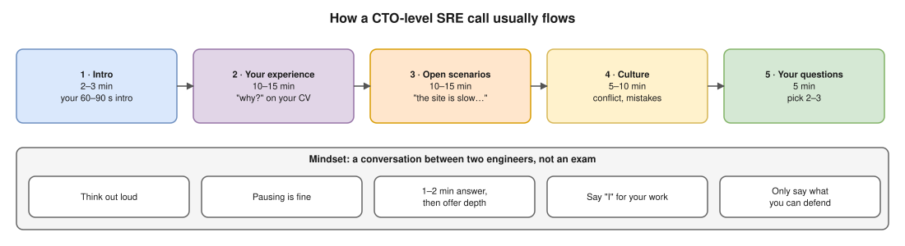
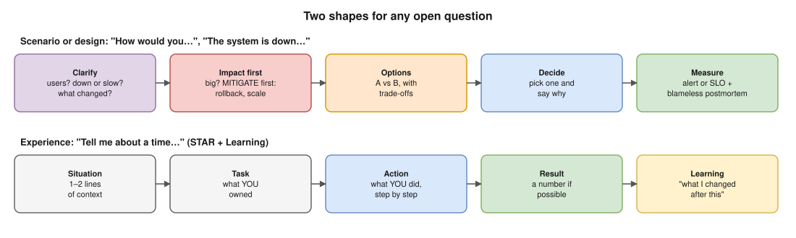
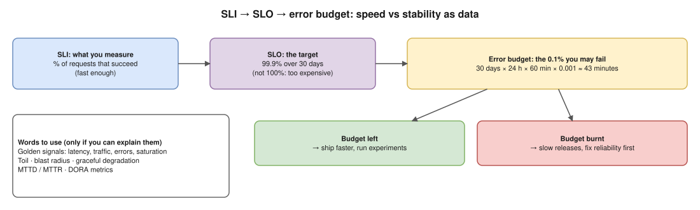

# How to Handle the "General Discussion" with a CTO-Level SRE

A CTO-level SRE is not checking whether you remember commands. Hemant already did that kind of round. This person wants to know **how you think**, **whether they can trust you with production**, and **whether you can talk to clients and teams**.

---

## 1. What they are really checking

| They ask themselves… | You show it by… |
|---|---|
| Does this person understand *why*, not just *how*? | Explaining the reason behind every tool or step |
| Can I trust them with production? | Incident stories: you stayed calm, fixed it first, then found the root cause |
| Do they connect tech to business? | Talking about impact: downtime, users, cost, speed of delivery |
| Do they see trade-offs? | Saying "option A gives X but costs Y" instead of "always use Kubernetes" |
| Are they honest? | Saying "I haven't done that in production, but here's how I'd approach it" |
| Can they learn fast? | Showing what you're learning now, and how you learn |
| Can they talk to clients? | Answering clearly and briefly, asking questions, and not using jargon to show off |

> **Key idea:** A senior person can spot bluffing in 10 seconds. Honesty plus clear thinking beats a fake "expert" answer every time.

---

## 2. Your mindset going in

- **It's a conversation, not an exam.** Talk to them as a colleague would, like two engineers discussing a problem.
- **Think out loud.** They want to hear how you reason. Silence followed by a perfect answer is worth less than visible thinking.
- **Pausing is fine.** Say "Let me think for a second." Five seconds of silence looks thoughtful, not weak.
- **Short answers, then offer depth.** Answer in 1–2 minutes, then ask: *"Should I go deeper into any part?"*
- **Say "I" for your work.** "We moved to EKS" hides your part. Say "I wrote the Terraform for the node groups, and the team…"

---

## 3. How the call usually flows

1. **Small talk and intro (2–3 min).** Have your 60–90 second intro ready (see section 4).
2. **Deep dive into your experience (10–15 min).** They pick one thing from your intro or CV and dig in with "why?" questions.
3. **Open-ended or scenario questions (10–15 min).** For example: "What does reliability mean to you?" or "The site is slow. What do you do?"
4. **Culture and behaviour (5–10 min).** Conflict, mistakes, learning.
5. **Your questions (5 min).** Very important, see section 9.

---

## 4. Your intro (60–90 seconds)

Practise this out loud 5 times. Don't read it.

1. **Who you are now:** "I'm a DevOps engineer with __ years of experience, currently at __, working on __."
2. **What you do day to day:** "I mainly work on AWS, Kubernetes/EKS, Docker, CI/CD with __, and Terraform."
3. **One or two achievements with a number:**
   - "I reduced deploy time from __ to __ minutes by __."
   - "I set up __ which cut alert noise / cost / incidents by __."
4. **Why this role:** "I want to go deeper into reliability and platform engineering, and One2N works on exactly these problems for many clients. I also like your problem-first approach, like the SRE bootcamp."

⚠️ **Say only what you can defend.** Every word in your intro becomes a follow-up question.

---

## 5. How to answer any open question

### A) Scenario or design questions ("How would you…", "The system is down…")

Use **Clarify → Impact → Options → Decide → Measure**:

1. **Clarify:** "Before I answer, can I ask a few questions? How many users? Is it fully down or just slow? Did anything change recently?"
2. **Impact first:** "First I'd check how many users are affected. If it's big, I'd **mitigate first**: roll back the last deploy, or scale up. Root cause comes later."
3. **Options with trade-offs:** "We could do A or B. A is faster but costs more. B is cheaper but needs more effort from the team."
4. **Decide and say why:** "For this case I'd pick A, because downtime costs more than the extra instance."
5. **Measure and improve:** "After that, I'd add an alert or SLO so we catch it earlier, and write a blameless postmortem."

### B) Experience questions ("Tell me about a time…")

Use **STAR + Learning**:

- **Situation:** one or two lines of context.
- **Task:** what *you* were responsible for.
- **Action:** what *you* did, step by step, and why.
- **Result:** a number if possible (minutes saved, % cost cut, incidents reduced).
- **Learning:** "What I changed after this was…". SREs love this part.

---

## 6. Prepare your story bank (do this tonight)

Write 3–4 real stories from your own work. Use bullet points only, then practise saying each in 2 minutes.

| Story type | Your example (fill in) | The number / result |
|---|---|---|
| 🔥 A production incident you handled | | |
| ⚙️ Something you automated (toil you removed) | | |
| 💰 A cost or performance improvement | | |
| 😬 A mistake you made and what you learned | | |
| 🤝 A disagreement with a dev / lead and how you solved it | | |

**Tips:**
- For the **mistake** story: own it fully, show the fix, and show the guardrail you added so it can't happen again. Never blame others.
- For the **incident** story: describe the timeline (detect → mitigate → root cause → prevent).

---

## 7. Questions a CTO-level SRE often asks

You don't need memorised answers. Know the **direction** of a good answer.

| Question | The direction of a good answer |
|---|---|
| What does reliability mean to you? | Users can do what they need, when they need it. We measure it with **SLIs/SLOs**, not just uptime. |
| Should a system be 100% reliable? | No. 100% is too expensive and slows feature work. Pick an **SLO** (e.g. 99.9%). The gap is the **error budget**, which you can spend on releases and experiments. |
| SRE vs DevOps? | DevOps is a culture: dev and ops work together. SRE is one concrete way to do it, using software engineering, SLOs, error budgets, and reducing toil. |
| How do you balance speed vs stability? | Error budget: if budget is left, ship faster. If it's burnt, slow down and fix reliability first. It turns the fight into data. |
| How do you handle alert fatigue? | Alert on **symptoms users feel** (errors, latency), not every CPU spike. Every alert must be actionable. Remove or tune noisy ones. |
| What do you do in an outage? | Communicate, **mitigate first** (rollback, failover, scale), then find the root cause, then a **blameless postmortem** with action items. |
| What is toil? How do you reduce it? | Manual, repetitive work with no lasting value. Automate it, self-service it, or remove it. Give a real example. |
| How do you measure a DevOps team's performance? | **DORA metrics:** deployment frequency, lead time for changes, change failure rate, time to restore. |
| First 30 days at a new client? | Listen and map the current system, secure obvious risks (secrets, backups that actually restore, basic alerts), and deliver one quick visible win. |
| What are you learning right now? | Be specific and honest: "Kubernetes internals and security. This week I practised __ on a kind cluster." |
| Why are you leaving / why One2N? | Positive only: growth, harder problems, many clients, learning from strong engineers. Never criticise your current company. |

### SRE words to use naturally (only if you can explain them)

- **SLI:** what you measure (e.g. % of requests that succeed).
- **SLO:** the target (e.g. 99.9% succeed over 30 days).
- **Error budget:** the 0.1% you're allowed to fail.
- **Golden signals:** latency, traffic, errors, saturation.
- **Toil:** boring, repeated manual work.
- **Blast radius:** how much breaks if something fails. Keep it small (canary, per-team accounts, limits).
- **Graceful degradation:** turn off non-essential features to keep the core working.
- **MTTD / MTTR:** time to detect / time to recover.

---

## 8. Useful phrases (simple English)

**Starting an answer**
- "Can I ask a clarifying question first?"
- "Let me think about this for a second."
- "I'll answer at a high level first, then go deeper if you want."

**Showing trade-offs**
- "It depends on __. If __, I'd choose __. If __, then __."
- "The trade-off here is cost vs speed."

**When you don't know**
- "I haven't worked with that in production. My understanding is __. To confirm, I'd __ (read the docs / test it in a lab)."
- "I'm not sure, and I don't want to guess. Here's how I'd find out…"

**Ending an answer**
- "Does that answer your question, or should I go deeper into __?"

**Avoid**
- Bluffing or making up numbers.
- Blaming people ("the dev team broke it").
- Long monologues (more than 2–3 minutes without a pause).
- Absolute words: "always", "never", "best tool". Seniors don't like them.
- Buzzwords you can't explain.

---

## 9. Questions to ask them (pick 2–3)

Good questions show senior thinking. Ask about **problems and growth**, not salary or leave (save those for HR).

- "What are the most common reliability problems you see when you first join a client?"
- "Do your clients usually work with SLOs, or is that something One2N helps them adopt?"
- "In your view, what separates a good SRE from a great one?"
- "What would success look like for someone in this role after the first 3–6 months?"
- "How do engineers here keep learning across so many different client setups?"
- "How is on-call and incident response handled on client projects?"

When they answer, **listen and react** ("That makes sense, I've seen something similar when…"). It turns into a real conversation, and that is the goal.

---

## 10. Online call checklist

**The night before**
- [ ] Practise the intro out loud 5 times.
- [ ] Fill the story bank (section 6) and say each story once out loud.
- [ ] Read section 7 once. Don't memorise it, just know the direction.
- [ ] Look at the One2N website and blog for 10 minutes. Have one thing you can mention.

**30 minutes before**
- [ ] Laptop charged, internet tested, camera at eye level, quiet room, good light on your face.
- [ ] Water, a notepad and a pen (writing notes while they speak is good).
- [ ] Close Slack and notifications. Keep a terminal and draw.io ready in case they ask you to share your screen.
- [ ] Take 3 slow breaths. You've prepared; now just have a good conversation.

**During**
- [ ] Smile at the start, use their name once.
- [ ] Look at the camera when you speak.
- [ ] If you get a question wrong, it's fine: "Actually, let me correct that…" Correcting yourself shows maturity.

**At the end**
- [ ] "Thank you for your time. I really enjoyed this discussion, especially the part about __."
