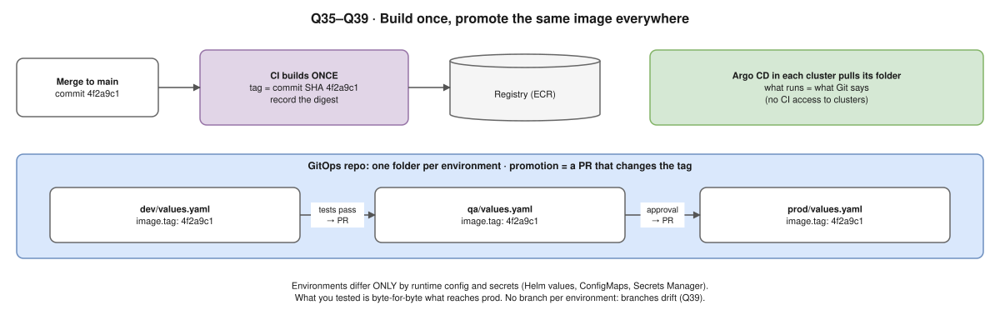

# 3-Day DevOps Interview Prep Plan

> **Replaced by the new plan:** [study-plan-oct-5-9.md](study-plan-oct-5-9.md) (5–9 Oct, built around your working hours, with videos). This file is kept as reading material; the new plan links to sections of it.

**Topics:** Docker · Kubernetes · AWS · CI/CD · Security
**Interviewer:** Hemant Kumar, Platform Engineering & DevOps lead at One2N (Pune), ~11 years of experience

---

## About the interviewer

- One2N publishes a free [SRE bootcamp](https://one2n.io/sre-bootcamp) that shows how they think. Its milestones:
  REST API → Docker → one-command local setup (Makefile) → CI pipeline (GitHub Actions) → deploy on a server → Kubernetes → Helm → ArgoCD → Prometheus/Loki/Grafana → dashboards and alerts.
- They teach **"problem-first, not technology-first"**. Expect **"why"** questions, **"how would you debug this"** scenarios and **end-to-end flows**, more than definitions.
- His public projects include a **VPC Flow Logs network analyzer** (AWS networking) and an **MLOps project on Kubernetes**.

## Priority

| # | Topic | Share | Why |
|---|---|---|---|
| 1 | **Kubernetes** | 35% | Central to One2N's work; troubleshooting questions are very likely |
| 2 | **CI/CD** (GitHub Actions, Helm, ArgoCD) | 20% | Half of their bootcamp is about this |
| 3 | **AWS** (VPC networking + IAM first) | 20% | His VPC Flow Logs project suggests he goes deep on networking |
| 4 | **Docker** | 15% | Quick to cover, and everything else builds on it |
| 5 | **Security** | 10% | Learn the security side of each topic above, not on its own |

## How to use this plan

- **Daily rhythm:** read for about 1 hour, practise for 2–3 hours, then answer the self-test questions **out loud** without notes.
- ⭐ = must read. Everything else is optional or for skimming.
- **Tools to install first:** Docker Desktop, `kind`, `kubectl`, `helm`.
- If a link has moved, search for the page title.

---

# Day 1: Docker + Kubernetes basics

## Morning (3h): Docker

### Points to learn

| Topic | Remember |
|---|---|
| Container | A Linux process: **namespaces** (what it sees) + **cgroups** (what it uses), host kernel shared |
| Layers | Cache breaks at the first changed line: copy the dependency file, install, **then** code |
| Multi-stage | Build in a big image, copy only the result into a small one |
| CMD vs ENTRYPOINT | ENTRYPOINT = fixed program, CMD = default args; **exec form** so the app is PID 1 |
| COPY vs ADD | Prefer COPY (ADD also unpacks tars and fetches URLs) |
| Volumes vs bind mounts | Volumes for data; bind mounts for development |
| Networks | bridge (default, `-p`) · host (no isolation) · user-defined bridge = DNS by name |
| Security | Non-root `USER`, slim/distroless, no secrets in `ENV` or layers, `.dockerignore`, Trivy |

### Reading (~1h)

- [ ] ⭐ [What even is a container (Julia Evans)](https://jvns.ca/blog/2016/10/10/what-even-is-a-container/): 10 min, explains namespaces and cgroups clearly
- [ ] ⭐ [Dockerfile best practices](https://docs.docker.com/build/building/best-practices/)
- [ ] ⭐ [Multi-stage builds](https://docs.docker.com/build/building/multi-stage/)
- [ ] [Dockerfile reference](https://docs.docker.com/reference/dockerfile/): read only the CMD and ENTRYPOINT sections
- [ ] [Volumes](https://docs.docker.com/engine/storage/volumes/) · [Networking](https://docs.docker.com/engine/network/): skim
- [ ] [OWASP Docker Security Cheat Sheet](https://cheatsheetseries.owasp.org/cheatsheets/Docker_Security_Cheat_Sheet.html): read the rule headings

### Practice (~2h)

- [ ] Write a tiny API in Python or Go (whichever you know).
- [ ] Build a single-stage image with a full base image and note its size with `docker images`.
- [ ] Rebuild it as multi-stage with a slim or distroless base and a non-root user, and compare sizes.
- [ ] Change one line of code, rebuild, and watch which layers come from the cache.
- [ ] Look inside with `docker history <image>`, `docker inspect`, and `docker exec -it <id> sh`.

### Self-test

- [ ] "I changed one line of code and the whole build is slow. Why?"
- [ ] "What is a container, and how is it different from a VM?"
- [ ] "What happens to data when a container is deleted?"
- [ ] "Why doesn't my container stop gracefully?" (shell form, PID 1)

## Afternoon/evening (5h): Kubernetes basics

### Points to learn

| Topic | Remember |
|---|---|
| Workloads | Deployment (stateless) · StatefulSet (stable name + own disk) · DaemonSet (one per node) · Job/CronJob · ReplicaSet (never directly) |
| DNS / Ingress | `my-svc.my-ns.svc.cluster.local` via CoreDNS · Ingress routes host/path, needs a controller |
| ConfigMap vs Secret | Secrets are only base64: RBAC + encryption at rest, or AWS Secrets Manager |
| Probes | liveness → restart · readiness → out of the Service · startup → time before the others |
| Requests vs limits | Requests = scheduler reserves · over CPU limit = throttled · over memory limit = OOMKilled |

### Reading (~1.5h)

- [ ] ⭐ [Kubernetes components](https://kubernetes.io/docs/concepts/overview/components/)
- [ ] ⭐ [What happens when… (k8s)](https://github.com/jamiehannaford/what-happens-when-k8s): read the overview, not every line
- [ ] ⭐ [Deployments](https://kubernetes.io/docs/concepts/workloads/controllers/deployment/): include the rolling update and rollback sections
- [ ] ⭐ [Service](https://kubernetes.io/docs/concepts/services-networking/service/) · [Probes](https://kubernetes.io/docs/tasks/configure-pod-container/configure-liveness-readiness-startup-probes/) · [Requests and limits](https://kubernetes.io/docs/concepts/configuration/manage-resources-containers/)
- [ ] [Workloads](https://kubernetes.io/docs/concepts/workloads/) · [DNS](https://kubernetes.io/docs/concepts/services-networking/dns-pod-service/) · [Ingress](https://kubernetes.io/docs/concepts/services-networking/ingress/) · [Secrets](https://kubernetes.io/docs/concepts/configuration/secret/): skim
- [ ] [kind quick start](https://kind.sigs.k8s.io/docs/user/quick-start/)

### Practice (~3h)

- [ ] Create a cluster with `kind create cluster`, then load your image with `kind load docker-image myapi:v1`.
- [ ] Write a Deployment with 3 replicas, probes, requests and limits, and environment values from a ConfigMap and a Secret. Add a Service.
- [ ] Run `kubectl apply -f .`, then reach the app with `kubectl port-forward svc/myapi 8080:80`.
- [ ] Scale with `kubectl scale deploy myapi --replicas=5`.
- [ ] Build v2, then `kubectl set image …`, watch `kubectl rollout status`, and roll back with `kubectl rollout undo`.
- [ ] Delete a pod and watch it come back. That's the controller loop at work.
- [ ] Decode your Secret with `base64 -d` to see why base64 isn't security.

### Self-test

- [ ] Explain everything that happens from `kubectl apply` to a running pod.
- [ ] "Deployment vs StatefulSet?"
- [ ] "What goes wrong if the liveness probe checks the database?" (When the database slows down, every pod restarts at once.)
- [ ] "How does one pod reach another Service by name?"

---

# Day 2: Troubleshooting + CI/CD

## Morning (4h): Break things on purpose and fix them

### Debugging order (say this in the interview)

`get pods` → `describe pod` (Events) → `logs --previous` → `get events --sort-by=.lastTimestamp` → `get endpoints` → `exec` + `curl`/`nslookup` → `describe node` / `top`.

### Practice: break it, then fix it

| Done | Break it like this | What you'll see | Find it with |
|---|---|---|---|
| [ ] | Wrong image tag | `ImagePullBackOff` | `describe pod` |
| [ ] | Bad start command | `CrashLoopBackOff` | `logs --previous` |
| [ ] | Memory limit too low | `OOMKilled` | `describe pod` |
| [ ] | CPU request too high | `Pending` | events, `describe node` |
| [ ] | Wrong Service selector | Service gets no traffic | `get endpoints` (empty) |
| [ ] | Wrong readiness path | Pod shows `0/1` ready, gets no traffic | probe failures in `describe` |
| [ ] | Missing ConfigMap used as env vars | `CreateContainerConfigError` (used as a volume instead: stuck in `ContainerCreating`) | `describe pod` |

### Then learn

| Topic | Remember |
|---|---|
| HPA vs node autoscaling | HPA adds pods (metrics-server, requests set) · Cluster Autoscaler / Karpenter adds nodes |
| RBAC | Role / ClusterRole grants · RoleBinding / ClusterRoleBinding gives to user, group, ServiceAccount · `kubectl auth can-i` |
| NetworkPolicy | Default-deny, allow what's needed; needs an enforcing CNI (Calico, Cilium) |
| Pod Security Standards | privileged · baseline · restricted, via a namespace label |

### Reading

- [ ] ⭐ [learnk8s troubleshooting flowchart](https://learnk8s.io/troubleshooting-deployments): the best single page for this, so study it
- [ ] ⭐ [Debug Pods](https://kubernetes.io/docs/tasks/debug/debug-application/debug-pods/) · [Debug Services](https://kubernetes.io/docs/tasks/debug/debug-application/debug-service/)
- [ ] [HPA](https://kubernetes.io/docs/tasks/run-application/horizontal-pod-autoscale/) · [RBAC](https://kubernetes.io/docs/reference/access-authn-authz/rbac/) · [Network Policies](https://kubernetes.io/docs/concepts/services-networking/network-policies/) · [Pod Security Standards](https://kubernetes.io/docs/concepts/security/pod-security-standards/)

### Self-test

- [ ] "A pod is Pending. Give 4 reasons." (not enough resources, taints/affinity, PVC not bound, quota)
- [ ] "Why does a pod go into CrashLoopBackOff?"
- [ ] "The Service isn't working. What do you check?" (selector and labels, targetPort, readiness, NetworkPolicy, DNS)

## Afternoon/evening (4h): CI/CD

### Points to learn

| Topic | Remember |
|---|---|
| CI vs CD | CI builds and tests every commit · Delivery = always releasable, manual prod approval · Deployment = automatic to prod |
| Stages | Test → build (tag = commit SHA) → Trivy (fail HIGH/CRITICAL) → push → update Helm values in Git → Argo CD sync → smoke test |
| Push vs pull | Push: CI holds cluster creds · Pull (GitOps): Argo CD in cluster, no CI creds, drift fixed, `git revert` = rollback |
| Strategies | Rolling (`maxSurge`, `maxUnavailable`) · blue/green (instant rollback, double cost) · canary (Argo Rollouts) |
| Security | GitHub OIDC (no stored keys), minimal `permissions:`, actions pinned to a SHA, branch protection |

### Reading

- [ ] ⭐ [GitHub Actions docs](https://docs.github.com/en/actions): the Quickstart and the workflow syntax page
- [ ] ⭐ READMEs of [docker/build-push-action](https://github.com/docker/build-push-action), [trivy-action](https://github.com/aquasecurity/trivy-action), and [configure-aws-credentials](https://github.com/aws-actions/configure-aws-credentials) (its OIDC section)
- [ ] ⭐ [Helm: getting started with charts](https://helm.sh/docs/chart_template_guide/getting_started/)
- [ ] ⭐ [ArgoCD getting started](https://argo-cd.readthedocs.io/en/stable/getting_started/) · [ArgoCD core concepts](https://argo-cd.readthedocs.io/en/stable/core_concepts/)
- [ ] [Argo Rollouts concepts](https://argoproj.github.io/argo-rollouts/concepts/): clearest explanation of blue/green vs canary

### Practice

- [ ] Push your app to GitHub. Write a workflow that tests, builds, runs a Trivy scan, and pushes to GHCR (GitHub's free registry, so no AWS needed).
- [ ] Run `helm create myapi` and move your Kubernetes files into the chart. Then `helm install`, `helm upgrade` and `helm rollback`.
- [ ] Install ArgoCD in kind and point an Application at your chart. Change the replica count in Git and watch it sync.

### Self-test

- [ ] "Design CI/CD from commit to production, including rollback."
- [ ] "Someone ran `kubectl edit` in production. What happens with GitOps?" (With automated sync and self-heal turned on, ArgoCD reverts it; otherwise ArgoCD only marks the app OutOfSync.)
- [ ] "How do you avoid storing AWS keys in GitHub?"
- [ ] "Blue/green vs canary: when do you use each?"

---

# Day 3: AWS + security + practice interview

## Morning (4h): AWS

### Points to learn

| Topic | Remember |
|---|---|
| Subnets | Public: `0.0.0.0/0 → IGW` · private: `→ NAT` (in a public subnet, outbound only, one per AZ) · S3 via a VPC endpoint |
| SG vs NACL | SG: instance, allow only, **stateful** · NACL: subnet, allow + deny, **stateless** (ephemeral ports), numbered order |
| Flow Logs | src, dst, port, protocol, ACCEPT/REJECT: "why can't A reach B?" ⚠️ he built a Flow Logs analyzer |
| Peering vs TGW | Peering: 1-to-1, not transitive, no overlap · TGW: hub for many VPCs + VPN |
| IAM | Roles (STS, temporary) over users · trust policy = who, permission policy = what · explicit deny wins |
| Pods | IRSA / Pod Identity, never the node role |
| Other | ALB (L7, paths, WAF) vs NLB (L4, static IP) · ASG = template + min/max/desired · S3 block public + KMS · VPC CNI IPs can run out |

### Reading

- [ ] ⭐ [How Amazon VPC works](https://docs.aws.amazon.com/vpc/latest/userguide/how-it-works.html) · [NAT gateways](https://docs.aws.amazon.com/vpc/latest/userguide/vpc-nat-gateway.html)
- [ ] ⭐ [Security groups](https://docs.aws.amazon.com/vpc/latest/userguide/vpc-security-groups.html) · [Network ACLs](https://docs.aws.amazon.com/vpc/latest/userguide/vpc-network-acls.html)
- [ ] ⭐ [VPC Flow Logs](https://docs.aws.amazon.com/vpc/latest/userguide/flow-logs.html): read the flow log records section carefully
- [ ] ⭐ [IAM best practices](https://docs.aws.amazon.com/IAM/latest/UserGuide/best-practices.html) · [IAM roles](https://docs.aws.amazon.com/IAM/latest/UserGuide/id_roles.html)
- [ ] [IRSA](https://docs.aws.amazon.com/eks/latest/userguide/iam-roles-for-service-accounts.html) · [EKS Pod Identity](https://docs.aws.amazon.com/eks/latest/userguide/pod-identities.html)
- [ ] [Transit Gateway](https://docs.aws.amazon.com/vpc/latest/tgw/what-is-transit-gateway.html) · [Load balancer comparison](https://aws.amazon.com/elasticloadbalancing/features/): skim

### Practice

- [ ] In draw.io, draw a VPC across 2 availability zones:
  - **Public subnets:** the ALB and the NAT Gateway.
  - **Private app subnets:** EKS nodes or EC2 instances.
  - **Private DB subnets:** RDS.
  - **Security groups in a chain:** ALB SG → app SG → DB SG.
- [ ] Explain the drawing out loud in 3 minutes.

### Self-test

- [ ] "A private EC2 instance can't reach the internet. What do you check?" (route to NAT, NAT's route to the IGW, SG outbound rules, NACL ephemeral ports)
- [ ] "Security Group vs NACL?"
- [ ] "How does a pod on EKS get access to S3 securely?"

## Afternoon (2h): Security review by layer

| Layer | Controls |
|---|---|
| CI | Dependency and secret scanning, OIDC, minimal token permissions |
| Image | Small base, non-root, Trivy, no secrets |
| Kubernetes | Least-privilege RBAC, default-deny NetworkPolicy, restricted PSS, Secrets outside the cluster |
| AWS | Least-privilege IAM, no long-lived keys, private subnets, KMS, TLS, CloudTrail, GuardDuty |

### Reading

- [ ] [Kubernetes security checklist](https://kubernetes.io/docs/concepts/security/security-checklist/)
- [ ] [OWASP Kubernetes Cheat Sheet](https://cheatsheetseries.owasp.org/cheatsheets/Kubernetes_Security_Cheat_Sheet.html)
- [ ] [AWS Security Pillar](https://docs.aws.amazon.com/wellarchitected/latest/security-pillar/welcome.html): design principles only

## Evening (2h): Practice interview

- [ ] Go through the [One2N SRE bootcamp milestones](https://one2n.io/sre-bootcamp/sre-bootcamp-exercises). For each one, can you explain **how** you'd do it and **why**? This is the closest thing to the interviewer's own question list.
- [ ] Prepare 2–3 resume projects using STAR (Situation, Task, Action, Result).
- [ ] Be ready for "why did you choose X over Y?" about every tool on your resume.
- [ ] Do a mock interview, out loud.

---

# Scenarios to practise out loud

- [ ] A user opens your URL. Trace it: DNS (Route 53) → load balancer → Pod. Know both common paths:
  - **AWS Load Balancer Controller:** the Ingress *configures* an ALB, which sends traffic straight to pod IPs (IP mode).
  - **ingress-nginx:** a load balancer sends traffic to the nginx pods, which forward it to your Service's pods.
- [ ] A pod is in `CrashLoopBackOff`. How do you debug it?
- [ ] A private EC2 instance can't reach the internet. Why?
- [ ] Design CI/CD for a microservice, from commit to production, including rollback.
- [ ] How do you handle secrets from end to end?
- [ ] The site is slow at 2 AM. What do you check first? (metrics → logs → recent deploys)

# Tips for this interviewer

- Explain from basic principles (for example, containers = namespaces + cgroups).
- Think out loud and debug step by step.
- Mention trade-offs: every choice has a cost.
- If you don't know something, say so and reason your way to an answer.
- **The night before:** only reread the self-test questions, then sleep.
