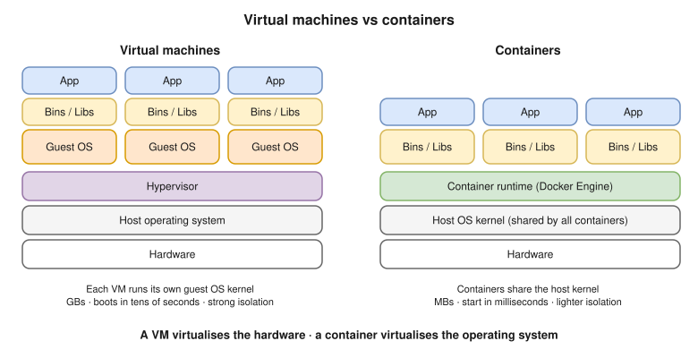

# 01 · Docker Fundamentals



- Docker **builds, ships and runs** apps as **containers**: the app plus everything it needs, the same on a laptop, in CI and in prod.
- ⭐ A container is just a **Linux process** with **namespaces** (isolation) and **cgroups** (limits) ([02](02-architecture-internals.md)).
- **One line:** a VM virtualises the **hardware**; a container virtualises the **OS**.
- **Mac:** Docker Desktop runs a small **Linux VM**; your containers run inside it.

| | Container | VM |
|---|---|---|
| Kernel | **Shares** the host's | Its **own** guest kernel |
| Isolated by | Namespaces + cgroups | Hypervisor |
| Starts in | ms to seconds | Tens of seconds |
| Size / density | MBs, hundreds per host | GBs, tens per host |
| Isolation | Weaker (one kernel) | Stronger |

## Why Docker

- Same image everywhere (no "works on my machine") · fast start · density · per-app dependency versions.
- **Immutable artifact:** CI builds one image and promotes it through every environment.
- Foundation for Kubernetes and ECS.

## Key terms

| Term | Meaning |
|---|---|
| **Image** | Read-only layers + metadata (command, env, user) |
| **Container** | A running instance of an image + its own writable layer |
| **Dockerfile** | Steps to build an image |
| **Layer** | One filesystem change; cached and shared |
| **Registry / repository** | Image server (Docker Hub, ECR) / a named set of images (`nginx`) |
| **Tag / digest** | Movable label (`1.27`) / fixed content hash (`sha256:…`) |
| **Volume / network** | Persistent storage / virtual network |
| **dockerd** | The Docker daemon |
| **OCI** | Open standards for images and runtimes: the same image runs on Docker, containerd, Podman, Kubernetes |

**Analogy:** image = program file on disk; container = a running process of it.

## Interview angle

| Question | Answer |
|---|---|
| What is a container, really? | A process with namespaces (what it sees), cgroups (what it uses) and a root FS from image layers. |
| Windows container on a Linux host? | No. Containers share the host kernel. |
| Docker vs Kubernetes? | Build and run on **one host** vs orchestrate across many (scheduling, self-healing, scaling). |
| As secure as a VM? | Less: one shared kernel, so a kernel exploit can escape ([10](10-security.md)). |

## Practice

```bash
docker version
docker info
docker run hello-world
docker run -it --rm alpine sh   # inside: ps (your shell is PID 1), hostname, cat /etc/os-release
```
