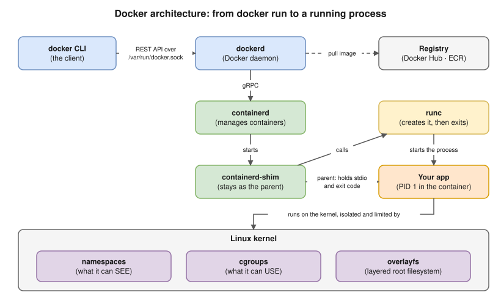
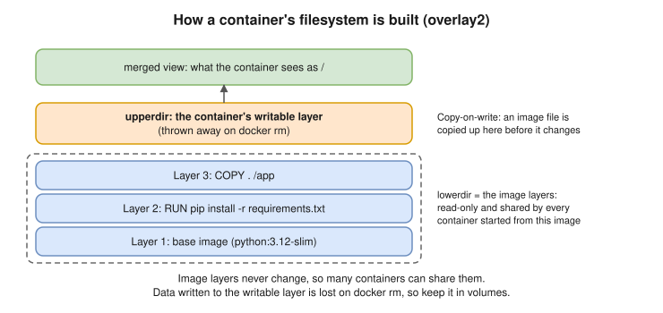

# 02 · Docker Architecture & Internals ⭐

## The components



| Component | Job |
|---|---|
| **docker CLI** | The client. Turns your commands into REST API calls. |
| **dockerd** | The Docker daemon: images, builds, networks, volumes, the API. |
| **containerd** | Manages the container lifecycle: starting and stopping containers. With the **containerd image store** (the default in Docker Desktop and in recent Docker Engine installs) it also pulls and stores images; with the older classic store, dockerd does that itself. |
| **containerd-shim** | Stays as the **parent** of each container process. It holds the container's input/output and exit code, so dockerd or containerd can restart **without killing your containers**. |
| **runc** | The low-level OCI runtime. It **asks the kernel** to create the namespaces and cgroups, starts your process, then **exits**. |
| **Linux kernel** | Does the real isolation (namespaces), limits (cgroups) and layered filesystem (overlayfs). |

> **Kubernetes link ⭐:** Kubernetes doesn't need Docker. The kubelet talks to **containerd directly** through the **CRI** (container runtime interface). The Docker adapter (dockershim) was removed in **Kubernetes 1.24**. Images built with Docker still run, because they're OCI images.

## What happens on `docker run -d -p 8080:80 nginx` ⭐

1. The CLI sends a "create and start a container" request to dockerd through `/var/run/docker.sock`.
2. dockerd checks for the image locally. If it's missing, it **pulls** it: it reads the manifest and downloads each layer by its digest.
3. It **creates the container**: a new **writable layer** on top of the image layers (overlay2), plus config (env, command, mounts).
4. It **prepares networking:** picks an IP from the bridge's subnet and adds **iptables NAT rules** so host port 8080 forwards to the container's port 80.
5. containerd starts a **shim**, which runs **runc**. runc creates the namespaces and cgroups. While the network namespace is set up, Docker plugs in a **veth pair** (a virtual cable): one end becomes `eth0` inside the container, the other joins the `docker0` bridge. Then runc starts nginx as **PID 1**.
6. runc exits; the shim stays as the parent. The process's stdout and stderr go to the **logging driver** (`docker logs`).

## Namespaces: what a container can SEE ⭐

| Namespace | Isolates |
|---|---|
| `pid` | Process IDs: the container sees its own process tree, starting at PID 1 |
| `net` | Network interfaces, IPs, ports, routing tables, iptables |
| `mnt` | Mount points: its own root filesystem |
| `uts` | Hostname and domain name |
| `ipc` | Shared memory and message queues |
| `user` | User and group ID mapping. ⚠️ **Not enabled by default in Docker** |
| `cgroup` | Its own view of the cgroup tree |

⚠️ Because the user namespace is off by default, **root inside the container is UID 0 on the host**. Docker reduces the danger with capabilities, seccomp and AppArmor, but you should still run as **non-root** (see [10-security](10-security.md)).

## cgroups: what a container can USE ⭐

- **Control groups** limit and measure resources: **CPU, memory, process count (pids), disk I/O**.
- `--memory=512m`: a hard limit. Going over gets the process **OOM-killed** (exit code **137**).
- `--cpus=1.5`: CPU time is capped. Going over gets it **throttled** (slowed down), not killed.
- `--pids-limit=200`: stops fork bombs.
- Modern Linux uses **cgroup v2**.

> **Kubernetes link:** `resources.limits.memory` and `limits.cpu` become exactly these cgroup settings on the node.

## The layered filesystem (overlay2)



- **Copy-on-write:** when a container changes a file from the image, the file is first copied up into the writable layer. The image never changes.
- That's why many containers can share one image, and why data written inside a container **is lost when you remove it** unless you use a volume ([07](07-storage.md)).

## Other kernel security features

- **Capabilities:** root's power is split into about 40 pieces. Docker keeps only a small default set (about 14) and drops the rest.
- **seccomp:** the default profile blocks dozens of dangerous system calls.
- **AppArmor / SELinux:** mandatory access control profiles.

## Important files and directories

| Path | What it is |
|---|---|
| `/var/run/docker.sock` | The daemon's API socket. ⚠️ **Whoever can use it controls the host as root.** |
| `/etc/docker/daemon.json` | Daemon config: log driver, registry mirrors, `userns-remap`, `live-restore` |
| `/var/lib/docker/` | Containers, volumes (`volumes/`), and with the classic image store, image layers (`overlay2/`). With the containerd image store, images live in containerd's storage instead; the overlay idea is the same. |
| `~/.docker/config.json` | Client config and **registry logins**. Without a credential helper, logins are stored only base64-encoded. |

⚠️ Membership in the **`docker` group = root on the host**, because those users can use the socket.

## Interview angle

- ⭐ "Explain Docker's architecture." → client, daemon, containerd, shim, runc, kernel (the diagram above).
- ⭐ "containerd vs runc?" → containerd **manages** containers (high level); runc **creates** one container through the kernel (low level), then exits.
- "Why does the shim exist?" → so containers keep running when dockerd or containerd restarts, and so something holds the container's output and exit code.
- ⭐ "Why is mounting `docker.sock` into a container dangerous?" → that container can start a privileged container that mounts the host's `/`. That's full root on the host.
- "Docker doesn't run on Kubernetes anymore?" → Kubernetes uses containerd through the CRI. Docker-built images still work because they're OCI images.

## Practice 🖥️

```bash
docker run -d --name web nginx
docker exec web sh -c 'ls -l /proc/1/ns'
docker inspect -f '{{.State.Pid}}' web
docker stats --no-stream web
```

On a Mac, enter the Docker Desktop VM to see the container as a normal host process:

```bash
docker run -it --rm --privileged --pid=host alpine nsenter -t 1 -m -u -n -i sh
```

Inside it, `ps aux | grep nginx` shows nginx with a **different PID** from the one it has inside its container. That's the PID namespace.
