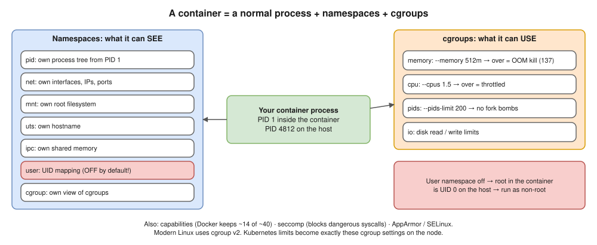

# 02 · Docker Architecture & Internals ⭐


| Component | Job |
|---|---|
| **docker CLI** | Turns commands into REST calls |
| **dockerd** | Daemon: builds, networks, volumes, the API |
| **containerd** | Container lifecycle; with the **containerd image store** (Docker Desktop default) it also pulls and stores images |
| **containerd-shim** | Parent of each container; holds stdio and exit code so dockerd / containerd can restart **without killing containers** |
| **runc** | OCI runtime: asks the kernel for namespaces + cgroups, starts the process, **exits** |

> **Kubernetes link ⭐:** the kubelet talks to **containerd directly** through the **CRI**. dockershim was removed in **1.24**; Docker-built images still run (OCI).

## `docker run -d -p 8080:80 nginx` ⭐

1. CLI → dockerd over `/var/run/docker.sock`.
2. Pull if missing (manifest, then each layer by digest).
3. Create the **writable layer** (overlay2) and config.
4. Network: IP from the bridge subnet + **iptables NAT** for 8080 → 80.
5. containerd → shim → **runc**: namespaces, cgroups, a **veth pair** to `docker0`; nginx starts as **PID 1**.
6. runc exits; the shim stays; stdout/stderr go to the **logging driver**.

## Namespaces and cgroups ⭐



## overlay2: the layered filesystem


- **Copy-on-write:** a changed file is copied up into the writable layer; the image never changes.
- So many containers share one image, and data inside a container **dies with it** unless it's in a volume ([07](07-storage.md)).

## Files to know

| Path | What it is |
|---|---|
| `/var/run/docker.sock` | The API socket. ⚠️ **Access = root on the host** |
| `/etc/docker/daemon.json` | Log driver, mirrors, `userns-remap`, `live-restore` |
| `/var/lib/docker/` | Containers, volumes, (classic store) image layers |
| `~/.docker/config.json` | Registry logins; base64 only without a credential helper |

- ⚠️ The **`docker` group = root on the host**.

## Interview angle

| Question | Answer |
|---|---|
| ⭐ Docker's architecture? | CLI → dockerd → containerd → shim → runc → kernel. |
| ⭐ containerd vs runc? | Manages containers (high level) vs creates one through the kernel, then exits. |
| Why the shim? | Containers survive daemon restarts; it holds output and exit code. |
| ⭐ Why is mounting `docker.sock` dangerous? | The container can start a privileged container mounting host `/`: full root. |
| Docker gone from Kubernetes? | Kubernetes uses containerd via CRI; Docker images still work (OCI). |

## Practice 🖥️

```bash
docker run -d --name web nginx
docker exec web sh -c 'ls -l /proc/1/ns'    # the namespaces
docker inspect -f '{{.State.Pid}}' web       # its PID on the host
docker stats --no-stream web
# On a Mac, enter the Docker Desktop VM and see nginx with a different PID:
docker run -it --rm --privileged --pid=host alpine nsenter -t 1 -m -u -n -i sh
```
