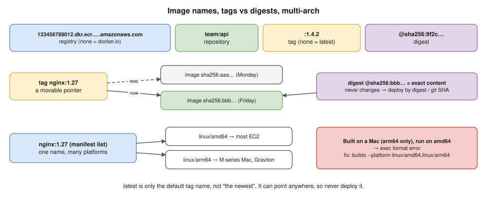

# 03 · Docker Images



## What an image is

- A **read-only template**: a stack of **filesystem layers** plus a **config** (default command, env vars, user, exposed ports).
- **Immutable:** you never change an image; you build a new one.
- Each layer is stored by its **content hash** (sha256), so identical layers are stored once and shared.

## Image naming

```text
123456789012.dkr.ecr.ap-south-1.amazonaws.com / team/api : 1.4.2 @sha256:9f2c…
└──────────────── registry ──────────────────┘ └ repo ─┘ └ tag ┘ └── digest ──┘
```

- No registry given → **Docker Hub** (`docker.io`). Official images live under `library/` (`nginx` = `docker.io/library/nginx`).
- No tag given → **`latest`**.

⭐ **The `latest` trap:** `latest` is **just a default tag name**, not "the newest version". It can point to anything and changes over time, so never deploy `latest` to production.

## Tag vs digest ⭐

| | Tag (`nginx:1.27`) | Digest (`nginx@sha256:…`) |
|---|---|---|
| Can it change? | **Yes**: it can be moved to a new image | **No**: it's a hash of the content |
| Use for | Humans, CI tagging (use the git SHA) | **Production deploys and pinning** |

> **Kubernetes link:** deploy by digest (or an immutable tag such as the git SHA). That way every node runs exactly the same image, and you can turn on ECR's "immutable tags" setting.

## Multi-architecture images ⭐ (matters on your Mac)

- An image can contain variants for `linux/amd64` (most EC2 instances) and `linux/arm64` (Apple Silicon Macs, Graviton).
- Building on an M-series Mac gives an **arm64** image. Running it on an amd64 server fails with **`exec format error`**.
- The fix: `docker buildx build --platform linux/amd64,linux/arm64 -t repo/app:1.0 --push .`

## Image commands

| Command | What it does |
|---|---|
| `docker pull nginx:1.27` | Download an image |
| `docker images` / `docker image ls` | List local images |
| `docker build -t app:1.0 .` | Build an image from a Dockerfile |
| `docker tag app:1.0 repo/app:1.0` | Add another name to an image |
| `docker push repo/app:1.0` | Upload to a registry |
| `docker history app:1.0` | Show the layers and the instruction that created each one |
| `docker image inspect app:1.0` | Full metadata (config, layers, architecture) |
| `docker rmi app:1.0` | Remove an image |
| `docker image prune` / `-a` | Remove dangling images / all unused images |
| `docker save -o app.tar app:1.0` / `docker load -i app.tar` | Export or import an image as a tar file (no registry needed) |

## Choosing a base image

| Base | Size | Notes |
|---|---|---|
| `scratch` | 0 | Empty. Only for static binaries (Go, Rust). |
| **distroless** (`gcr.io/distroless/…`) | Tiny | Only the runtime: **no shell, no package manager**, so far fewer vulnerabilities. Harder to debug (use the `:debug` variants). |
| **alpine** | ~5 MB | Uses **musl** instead of glibc, so some packages need compiling or behave differently. |
| **debian/ubuntu `-slim`** | Small | glibc, good compatibility. A safe default. |
| Full images (`python:3.12`) | ~1 GB | Include compilers and tools. Use only as a **build stage**. |

## Registries

- **Docker Hub:** public default. It **rate-limits anonymous pulls**, so log in or use a mirror in CI.
- **Amazon ECR:** private and IAM-controlled, with image scanning, **lifecycle policies** (delete old images), **immutable tags** and a **pull-through cache** for Docker Hub.
- **GHCR** (GitHub), **Harbor** (self-hosted), **Artifact Registry** (GCP), **ACR** (Azure).

ECR login (it uses your AWS identity, with no stored password):

```bash
aws ecr get-login-password --region ap-south-1 | docker login --username AWS --password-stdin 123456789012.dkr.ecr.ap-south-1.amazonaws.com
```

## Interview angle

- ⭐ "What is an image layer and why does it matter?" → each Dockerfile step that changes files is a layer. Layers are cached and shared, which makes builds faster and storage smaller.
- ⭐ "Why not use `latest` in production?" → it can change, so you can't tell what's running and can't roll back reliably. Use the git SHA or a digest.
- "My image works on my Mac but fails on EC2 with `exec format error`." → architecture mismatch (arm64 vs amd64). Build for multiple platforms with buildx.
- "How do you keep a registry clean?" → ECR lifecycle policies (for example, keep the last 30 tagged images and delete untagged ones after 7 days).

## Practice

```bash
docker pull python:3.12
docker pull python:3.12-slim
docker images python
docker history python:3.12-slim
docker image inspect -f '{{.Architecture}}' python:3.12-slim
```
