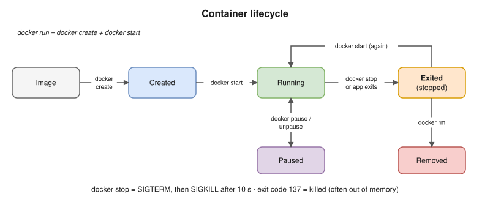
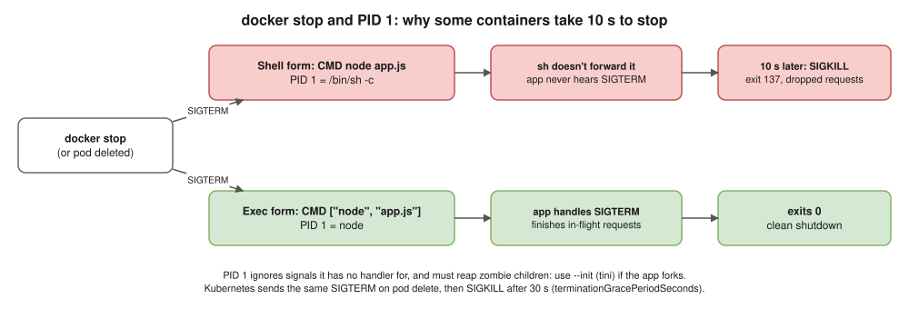

# 04 · Docker Containers ⭐

## What a container is

- A running (or stopped) **instance of an image**: the image layers plus its own **writable layer**, running as an isolated process.
- The writable layer is **thrown away** when the container is removed. Keep data in volumes ([07](07-storage.md)).

## Lifecycle



States you'll see in `docker ps -a`: **created, running, paused, restarting, exited, dead**.

## Essential commands

| Command | What it does |
|---|---|
| `docker run [options] image [cmd]` | Create and start a container |
| `docker ps` / `docker ps -a` | Running containers / all containers |
| `docker logs -f --tail 100 c` | Follow the logs (stdout and stderr) |
| `docker exec -it c sh` | Open a shell **inside** a running container |
| `docker stop c` | **SIGTERM**, then **SIGKILL** after 10 seconds |
| `docker kill c` | **SIGKILL** immediately |
| `docker start` / `docker restart c` | Start or restart a container |
| `docker pause` / `docker unpause c` | Freeze or unfreeze all its processes (cgroup freezer) |
| `docker rm c` / `docker rm -f c` | Remove (`-f` kills a running container first, with no graceful stop) |
| `docker inspect c` | Full JSON: state, IP, mounts, exit code, OOMKilled |
| `docker stats` | Live CPU, memory, network and disk use |
| `docker top c` | Processes inside the container |
| `docker cp c:/path ./local` | Copy files in or out |
| `docker port c` | Show the port mappings |
| `docker container prune` | Remove all stopped containers |

## Important `docker run` flags

| Flag | Meaning | Example |
|---|---|---|
| `-d` | Run in the background (detached) | `-d` |
| `-it` | Interactive with a terminal | `-it ubuntu bash` |
| `--name` | Give it a name | `--name api` |
| `-p host:container` | Publish a port | `-p 8080:80` |
| `-e` / `--env-file` | Environment variables | `-e ENV=dev` |
| `-v` / `--mount` | Volume or bind mount | `-v data:/var/lib/data` |
| `--network` | Attach to a network | `--network appnet` |
| `--rm` | Delete it automatically when it exits | `--rm` |
| `--restart` | Restart policy | `--restart unless-stopped` |
| `--memory` / `--cpus` | Resource limits | `--memory 512m --cpus 1` |
| `--user` | Run as a given user | `--user 10001` |
| `--read-only` | Make the root filesystem read-only | `--read-only` |
| `--init` | Run a tiny init (tini) as PID 1 | `--init` |
| `--entrypoint` | Override the ENTRYPOINT | `--entrypoint sh` |

## Restart policies

| Policy | Behaviour |
|---|---|
| `no` (default) | Never restart |
| `on-failure[:N]` | Restart only on a non-zero exit, up to N times |
| `always` | Always restart, including after the daemon restarts |
| `unless-stopped` | Like `always`, but not if you stopped it by hand |

## Signals and PID 1 ⭐ (Hemant asks this)



- Your app runs as **PID 1** inside the container. The kernel treats PID 1 specially: **signals it has no handler for are ignored**.
- So if your app doesn't handle SIGTERM, `docker stop` waits **10 seconds** and then SIGKILLs it. That means no graceful shutdown and dropped requests.
- **Shell form** `CMD node app.js` runs as `/bin/sh -c "node app.js"`. Usually **sh becomes PID 1** and doesn't pass SIGTERM on to node. (Some shells replace themselves with the command, but don't rely on it.) Use **exec form** `CMD ["node", "app.js"]`.
- PID 1 must also **clean up zombie processes** (children that exited). Use `--init` (tini) if your app starts child processes.

> **Kubernetes link:** the same thing happens when a pod is deleted. It gets SIGTERM, waits `terminationGracePeriodSeconds` (30 seconds by default), then SIGKILL.

## Exit codes ⭐

| Code | Meaning |
|---|---|
| `0` | Finished successfully |
| `1` | The app reported an error |
| `125` | `docker run` itself failed (bad flag, daemon error) |
| `126` | The command was found but can't be run (permissions) |
| `127` | Command not found (typo, or a missing binary in the image) |
| `137` | 128 + 9 = **SIGKILL**: usually **out of memory (OOM)**, or `docker kill` |
| `139` | 128 + 11 = SIGSEGV (the app crashed) |
| `143` | 128 + 15 = **killed by SIGTERM** (the app had no handler). An app that handles SIGTERM and shuts down cleanly usually exits with `0`. |

Check it: `docker inspect -f '{{.State.ExitCode}} OOM={{.State.OOMKilled}}' c`

## Interview angle

- ⭐ "My container exits immediately. Why?" → the main process finished or crashed. A container lives only as long as its PID 1. Check `docker logs` and the exit code. A common cause: running a service in the background (daemon mode) instead of the foreground.
- ⭐ "Exit code 137?" → SIGKILL, usually out of memory. In Kubernetes you'd see `OOMKilled`.
- ⭐ "Why does my container take 10 seconds to stop?" → PID 1 isn't handling SIGTERM (shell form, or no signal handler).
- "`docker stop` vs `docker kill`?" → graceful SIGTERM with a timeout vs an immediate SIGKILL.
- "How does `docker exec` get inside?" → it starts a new process **inside the existing container's namespaces**.

## Practice 🖥️

```bash
docker run -d --name web -p 8080:80 nginx
curl -I http://localhost:8080
docker exec -it web sh
docker stop web
docker inspect -f '{{.State.ExitCode}}' web
docker run --rm --memory 20m python:3.12-slim python -c "x = ' ' * 100_000_000"
echo $?
```

The last command should exit with **137** (OOM-killed).
