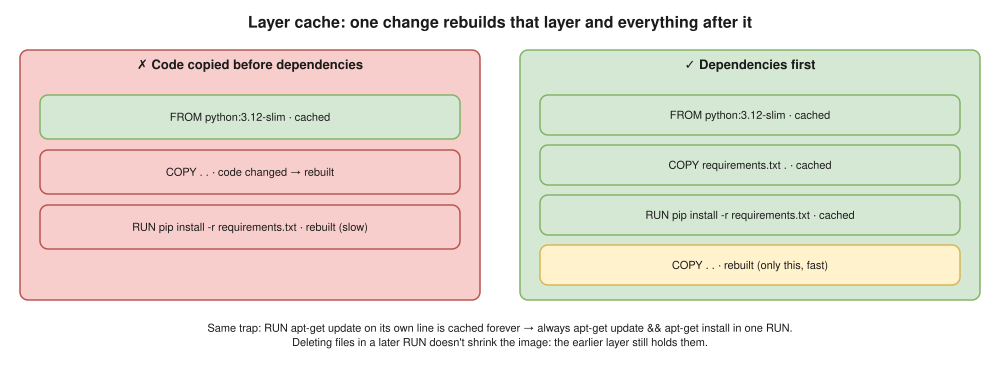
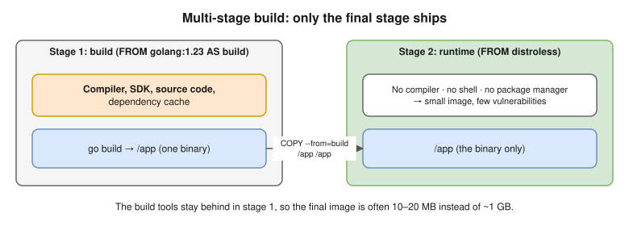

# 06 · Build & Build Optimization

```bash
docker build -t app:1.0 -f Dockerfile .
```

- The `.` is the **build context**, sent to the builder; `COPY` sees only it. Big context (`.git`, `node_modules`) = slow builds → `.dockerignore`.
- **BuildKit** (default since Engine 23.0): parallel stages, skips unused stages, secrets, cache mounts. `docker buildx` is its full CLI.

## Layer cache ⭐



- A layer is reused only if the **instruction** is unchanged and, for `COPY`/`ADD`, the **file checksums** are unchanged.

```dockerfile
# ❌ Bad: any code change reinstalls all dependencies
COPY . .
RUN pip install -r requirements.txt

# ✅ Good: dependencies stay cached until requirements.txt changes
COPY requirements.txt .
RUN pip install -r requirements.txt
COPY . .
```

## Multi-stage builds ⭐



```dockerfile
FROM golang:1.23 AS build
WORKDIR /src
COPY go.mod go.sum ./
RUN go mod download
COPY . .
RUN CGO_ENABLED=0 go build -o /app ./cmd/api

FROM gcr.io/distroless/static-debian12
COPY --from=build /app /app
USER nonroot
ENTRYPOINT ["/app"]
```

- Result: ~10–20 MB, **no compiler, shell or package manager**: faster pulls, far fewer CVEs.

## Smaller and faster

- Small base · multi-stage · clean up **in the same `RUN`** (`--no-install-recommends … && rm -rf /var/lib/apt/lists/*`).
- `pip install --no-cache-dir`, `npm ci --omit=dev` · `.dockerignore` · measure with `docker history` or `dive`.
- **Cache mounts** keep downloads between builds, outside the image:

```dockerfile
RUN --mount=type=cache,target=/root/.cache/pip pip install -r requirements.txt
```

## CI cache ⭐

A fresh runner has no cache; store it in GitHub Actions or the registry (`type=registry,ref=repo/app:buildcache`):

```bash
docker buildx build --cache-from type=gha --cache-to type=gha,mode=max -t app:${GIT_SHA} --push .
docker buildx build --platform linux/amd64,linux/arm64 -t repo/app:1.0 --push .   # multi-platform
```

| Command | Purpose |
|---|---|
| `docker build --no-cache .` | Ignore cache (pick up security patches) |
| `docker build --target build .` | Stop at one stage |
| `docker build --progress=plain .` | Full output |
| `docker build --build-arg VERSION=1.2 .` | Build arg |
| `docker builder prune` | Clear build cache |

## Interview angle

| Question | Answer |
|---|---|
| ⭐ Slow builds? | Layer order, `.dockerignore`, cache mounts, registry/GHA cache in CI, multi-stage. |
| ⭐ Smaller image? | Small base, multi-stage, clean in the same layer, `.dockerignore`, measure with `dive`. |
| Deleted files, still big? | The earlier layer still holds them; layers only add. |
| When `--no-cache`? | Scheduled rebuilds for base-image and OS patches. |

## Practice

1. Build single-stage on `python:3.12`; note the size.
2. Rebuild multi-stage on `python:3.12-slim`; compare.
3. Change one code line and rebuild: which steps are `CACHED`?
4. Move `COPY . .` above the install and rebuild: watch the cache break.
