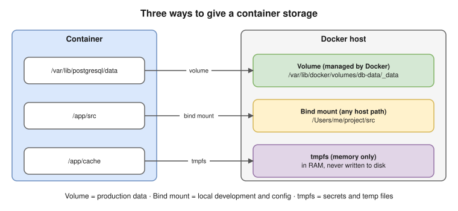

# 07 · Storage & Volumes

## Why volumes are needed

- A container's writable layer is **temporary**: it's deleted with the container.
- Its storage driver (overlay2) is also **slow for heavy writes**.
- Databases, uploads and anything else that must survive need storage **outside** the container's lifecycle.

## Three kinds of mounts ⭐

| | **Volume** | **Bind mount** | **tmpfs** |
|---|---|---|---|
| Stored in | `/var/lib/docker/volumes/` (managed by Docker) | **Any host path** you choose | **Memory** only |
| Survives container removal | ✅ | ✅ (it's a host folder) | ❌ |
| Portable between hosts | ✅ (and volume drivers support NFS, cloud disks) | ❌ (depends on the host's layout) | n/a |
| Best for | **Databases and app data in production** | **Local development** (live code reload), config files | **Secrets and temporary files** that must never touch disk |



## Syntax: `-v` vs `--mount`

```bash
docker run -v db-data:/var/lib/postgresql/data postgres:16
docker run -v "$(pwd)/src":/app/src:ro myapp
docker run --mount type=volume,src=db-data,dst=/var/lib/postgresql/data postgres:16
docker run --mount type=bind,src="$(pwd)/src",dst=/app/src,readonly myapp
docker run --mount type=tmpfs,dst=/app/cache myapp
```

- `--mount` is longer but clearer. Use it in scripts.
- Gotcha: with `-v`, a missing host path is **created silently** as an empty folder. With `--mount type=bind`, a missing path is an **error**.
- Add `:ro` / `readonly` when the container only needs to read.

## Volume commands

| Command | Purpose |
|---|---|
| `docker volume create data` | Create a named volume |
| `docker volume ls` | List volumes |
| `docker volume inspect data` | Show its mountpoint and driver |
| `docker volume rm data` | Remove a volume |
| `docker volume prune` | Remove all unused volumes ⚠️ data loss |
| `docker rm -v c` | Remove a container **and** its anonymous volumes |

**Named vs anonymous:** `-v data:/path` is **named** (easy to find and reuse). `-v /path` or a `VOLUME` line in the Dockerfile creates an **anonymous** volume with a random name, which is easy to lose track of.

## Backup and restore a volume

Use a throwaway container that mounts both the volume and a host folder:

```bash
docker run --rm -v db-data:/data -v "$(pwd)":/backup alpine tar czf /backup/db-data.tgz -C /data .
docker run --rm -v db-data:/data -v "$(pwd)":/backup alpine tar xzf /backup/db-data.tgz -C /data
```

⚠️ For databases, use the database's own tool (`pg_dump`), or stop the database first. Copying files from a running database can produce a broken backup.

## Common problems

- **Permission denied on a bind mount:** the container's user ID (for example 10001) doesn't own the host folder. Fix the folder's owner, or run with a matching `--user`.
- **"My data disappeared":** it was written to the container's writable layer, not to a volume, and then the container was removed.
- **Disk full:** old anonymous volumes and logs. Check with `docker system df` (see [12](12-troubleshooting.md)).

> **Kubernetes link:**
> - volume → **PersistentVolume / PVC** (EBS through a StorageClass)
> - bind mount → **hostPath** (avoid it; it ties the pod to one node)
> - tmpfs → **`emptyDir` with `medium: Memory`**
> - In production, prefer a **managed database (RDS)** over a database in a container.

## Interview angle

- ⭐ "Volume vs bind mount?" → Docker-managed and portable (production data) vs a host path (development and config).
- "Where do you keep secrets on disk in a container?" → tmpfs (memory only), or a secret mounted as a file.
- "How do you back up a volume?" → a temporary container with tar, or the database's own dump tool.
- "Should you run databases in containers in production?" → it's possible with volumes and care, but a managed service (RDS) handles backups, failover and patching for you.

## Practice

```bash
docker volume create pgdata
docker run -d --name pg -e POSTGRES_PASSWORD=dev -v pgdata:/var/lib/postgresql/data postgres:16
sleep 5
docker exec -it pg psql -U postgres -c "create table t(x int); insert into t values (1);"
docker rm -f pg
docker run -d --name pg2 -e POSTGRES_PASSWORD=dev -v pgdata:/var/lib/postgresql/data postgres:16
sleep 5
docker exec -it pg2 psql -U postgres -c "select * from t;"
```

The data survived because it lives in the volume, not in the container. (The `sleep` gives Postgres a few seconds to start before you connect.)
