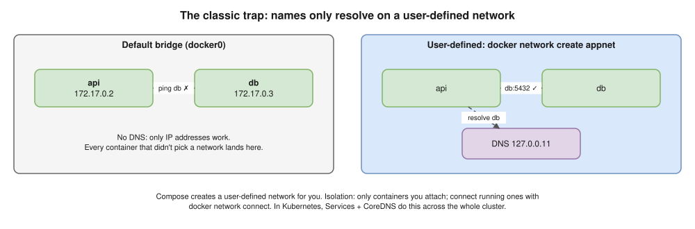

# 08 · Docker Networking ⭐

| Driver | What | Use |
|---|---|---|
| **bridge** (default) | Private network on one host, NAT out | Most single-host setups |
| **user-defined bridge** ✅ | A bridge you create | **Recommended**: DNS by name, isolation |
| **host** | Host's network stack, no isolation, no `-p` | Max performance (Linux) |
| **none** | Loopback only | Isolated batch jobs |
| **overlay** | Spans several hosts | Swarm |
| **macvlan / ipvlan** | Own MAC / IP on the LAN | Apps that must look like a device |

## ⚠️ Default vs user-defined bridge



- The Instagram handbook says the default bridge resolves names. **Wrong.**

## How the bridge really works ⭐


- `docker0` = virtual switch · each container gets a **veth pair** (`eth0` inside its netns, other end on the bridge).
- **Out:** iptables **MASQUERADE** rewrites the source to the host IP. **In (`-p 8080:80`):** **DNAT** to `172.17.0.2:80` (`docker-proxy` covers some cases, like localhost).


- DNAT happens in **PREROUTING**, before routing, so the packet goes to docker0, not a host process.
- **conntrack** remembers each rewrite and reverses it for replies: only the **first packet** hits the NAT rule.

> **Go deeper:** [NAT](../networking/02-nat.md) · [the bridge inside out](../networking/03-docker-bridge.md) · [hands-on lab](../networking/05-hands-on-lab.md) · [debugging](../networking/06-debugging.md).

## Ports

| Flag | Meaning |
|---|---|
| `-p 8080:80` | All host interfaces |
| `-p 127.0.0.1:8080:80` | Host only (safer) |
| `-P` | Every `EXPOSE`d port on random host ports |

- ⚠️ Docker's iptables rules **bypass UFW**: a published port is open even if UFW blocks it.

## Between containers, and to the host

```bash
docker network create appnet
docker run -d --name db --network appnet -e POSTGRES_PASSWORD=dev postgres:16
docker run -d --name api --network appnet -e DB_HOST=db myapi   # reaches db:5432, no -p needed
```

- Different networks can't talk until `docker network connect appnet c`.
- Container → host: `host.docker.internal` (Docker Desktop); Linux: `--add-host=host.docker.internal:host-gateway`.

## Debugging 🖥️

```bash
docker exec api cat /etc/resolv.conf     # nameserver 127.0.0.11 on user-defined networks
docker exec api getent hosts db
docker run -it --rm --network container:api nicolaka/netshoot   # curl, dig, tcpdump, ss in api's netns
```

> **Kubernetes link ⭐:** every pod gets its own IP (no port mapping) · a CNI replaces `docker0` · Services + CoreDNS replace names · NetworkPolicy replaces separate networks.

## Interview angle

| Question | Answer |
|---|---|
| ⭐ Containers can't resolve each other? | Default bridge. Use a user-defined network (or Compose). |
| ⭐ How does `-p 8080:80` work? | iptables DNAT host:8080 → container IP:80, over the bridge and veth into the netns. |
| Bridge vs host? | Isolated + NAT vs host stack (faster, no isolation, port clashes). |
| Works inside, not outside? | App on `127.0.0.1`, or no `-p`. |
| Overlay? | Multi-host (Swarm); in Kubernetes the CNI does it. |
