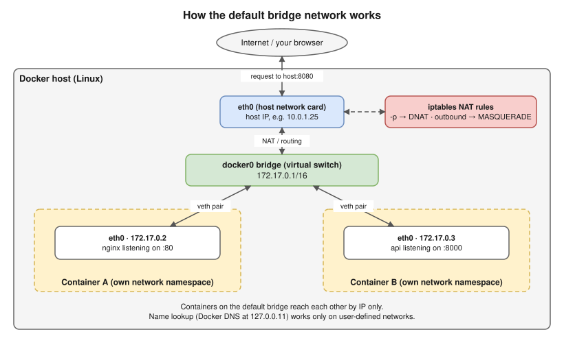
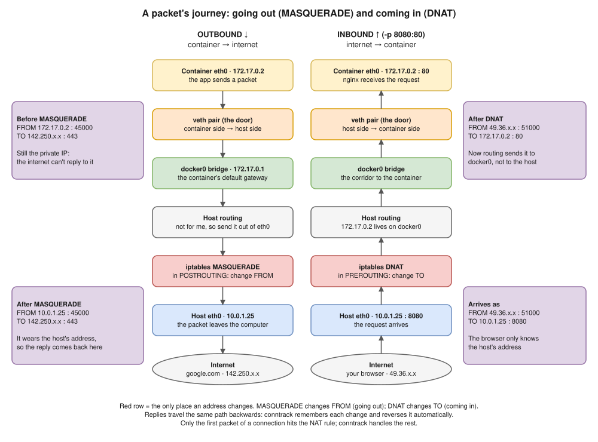

# 08 · Docker Networking ⭐

## Network types (drivers)

| Driver | What it is | Use it for |
|---|---|---|
| **bridge** (default) | A private network on one host, with NAT to the outside | Most single-host setups |
| **user-defined bridge** | A bridge you create yourself | ✅ **Recommended**: built-in DNS and isolation |
| **host** | The container uses the **host's network stack** directly (no isolation, no port mapping) | Maximum network performance. Designed for Linux hosts; Docker Desktop behaves differently. |
| **none** | Only a loopback interface | Fully isolated batch jobs |
| **overlay** | One network spanning **several hosts** | Docker Swarm |
| **macvlan / ipvlan** | The container gets its own MAC or IP **on the physical LAN** | Old apps that must look like a physical device |

## ⚠️ Default bridge vs user-defined bridge (the classic trap)

| | Default `bridge` | User-defined (`docker network create appnet`) |
|---|---|---|
| Containers find each other **by name (DNS)** | ❌ **No, only by IP** | ✅ **Yes** (built-in DNS server at `127.0.0.11`) |
| Isolation | Every container that didn't choose a network ends up here together | Only containers you attach |
| Connect or disconnect a running container | ❌ | ✅ |

> Some study material (including the Instagram handbook) says containers on the default bridge can talk by name. **That's wrong.** Name resolution works only on user-defined networks (and in Compose, which creates one for you).

## How the bridge network really works ⭐ (Hemant-level detail)



1. Docker creates a Linux **bridge** (`docker0`), which works like a virtual switch.
2. Each container gets a **veth pair** (a virtual cable). One end is `eth0` inside the container's **network namespace**; the other end plugs into the bridge.
3. **Outbound:** an iptables **MASQUERADE** (NAT) rule rewrites the container's private IP to the host's IP.
4. **Inbound with `-p 8080:80`:** an iptables **DNAT** rule forwards host port 8080 to `172.17.0.2:80`. (The `docker-proxy` helper process handles some cases, such as localhost traffic.)

### A packet's journey, step by step



**How to read it:** both columns pass through the **same pieces**, in **opposite directions**. The **red row** is the only place where an address changes.

```text
OUTBOUND: container eth0 → veth → docker0 → host routing → MASQUERADE (src = host IP) → host eth0 → internet
INBOUND:  internet → host eth0:8080 → DNAT in PREROUTING (dst = 172.17.0.2:80) → host routing → docker0 → veth → container eth0:80
```

- **Outbound (MASQUERADE)** changes the **FROM** address (the source) to the host's IP, so the reply can find its way back.
- **Inbound (DNAT)** changes the **TO** address (the destination) from host port 8080 to the container's `172.17.0.2:80`. It happens in **PREROUTING**, before the routing decision, so the kernel sends the packet to docker0 instead of looking for a host process on port 8080.
- **Replies** take the same path backwards. **conntrack** (the kernel's connection table) remembers each change and reverses it automatically, so only the **first packet** of a connection hits the NAT rule.

## Port publishing

| Flag | Meaning |
|---|---|
| `-p 8080:80` | Host port 8080 → container port 80, on **all** host interfaces |
| `-p 127.0.0.1:8080:80` | Only reachable from the host itself (safer) |
| `-P` | Publish every `EXPOSE`d port on random host ports |

- `EXPOSE` doesn't publish anything; `-p` does.
- ⚠️ **Security gotcha:** Docker's own iptables rules **bypass UFW** (the common Linux firewall tool), so a published port is reachable **even if UFW blocks it**. Bind to `127.0.0.1`, or put a firewall in front.

## Container-to-container and container-to-host

```bash
docker network create appnet
docker run -d --name db --network appnet -e POSTGRES_PASSWORD=dev postgres:16
docker run -d --name api --network appnet -e DB_HOST=db myapi
```

- `api` reaches the database at **`db:5432`**, resolved by name. No `-p` is needed for traffic between containers.
- Containers on **different** networks can't talk to each other unless you connect them: `docker network connect appnet c`.
- **Reaching the host from a container:** `host.docker.internal` works on Docker Desktop. On Linux, add `--add-host=host.docker.internal:host-gateway`.

## Network commands

| Command | Purpose |
|---|---|
| `docker network ls` | List networks |
| `docker network create appnet` | Create a user-defined bridge |
| `docker network inspect appnet` | Subnet, gateway, connected containers |
| `docker network connect` / `disconnect appnet c` | Attach or detach a running container |
| `docker network rm` / `prune` | Remove a network / all unused networks |

## Debugging networking 🖥️

```bash
docker exec api cat /etc/resolv.conf
docker exec api getent hosts db
docker run -it --rm --network container:api nicolaka/netshoot
```

- The first command shows `nameserver 127.0.0.11` on user-defined networks.
- The last one runs a container full of network tools (`curl`, `dig`, `tcpdump`, `ss`) **inside `api`'s network namespace**.

> **Kubernetes link ⭐:**
> - every **pod gets its own IP**, with no port mapping, and every pod can reach every other pod;
> - a **CNI plugin** replaces `docker0`;
> - **Services and CoreDNS** replace container names;
> - **NetworkPolicy** replaces "separate networks" for isolation.

## Interview angle

- ⭐ "Why can't my containers resolve each other by name?" → they're on the **default** bridge. Use a user-defined network (or Compose).
- ⭐ "How does `-p 8080:80` work?" → an iptables DNAT rule from host port 8080 to the container's IP and port 80 over the bridge, with the veth pair inside the network namespace.
- "Bridge vs host network?" → isolated with NAT, vs sharing the host's network stack (faster, no isolation, port clashes possible).
- "The app works inside the container but not from outside." → it listens on `127.0.0.1` instead of `0.0.0.0`, or the port isn't published.
- "Overlay?" → a multi-host network (Swarm). In Kubernetes, the CNI does this job.
