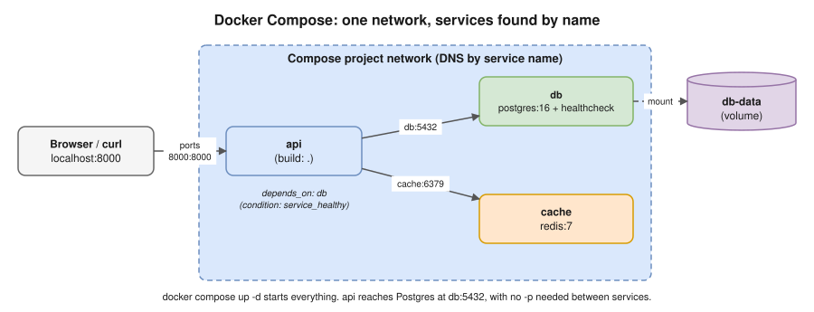

# 09 · Docker Compose

## What it is

- A tool that defines and runs a **multi-container app from one YAML file** (`compose.yaml`).
- `docker compose` (v2, built into the Docker CLI) replaced the old Python `docker-compose` (v1).
- Compose automatically creates a **project network**, so services reach each other **by service name**.
- Best for **local development and testing**. In production you'd use Kubernetes or ECS.



## Example: API + Postgres + Redis

```yaml
services:
  api:
    build: .
    ports:
      - "8000:8000"
    env_file: .env
    environment:
      DATABASE_URL: postgresql://app:app@db:5432/app
      REDIS_URL: redis://cache:6379/0
    depends_on:
      db:
        condition: service_healthy
      cache:
        condition: service_started

  db:
    image: postgres:16
    environment:
      POSTGRES_USER: app
      POSTGRES_PASSWORD: app
      POSTGRES_DB: app
    volumes:
      - db-data:/var/lib/postgresql/data
    healthcheck:
      test: ["CMD-SHELL", "pg_isready -U app"]
      interval: 5s
      timeout: 3s
      retries: 5

  cache:
    image: redis:7

volumes:
  db-data:
```

Notes:
- The old top-level `version: "3.8"` key is **obsolete**. Compose v2 ignores it and warns about it, so leave it out.
- `depends_on` alone only waits for the container to **start**. Adding `condition: service_healthy` waits until the **health check passes**.
- `app` / `app` are local-development credentials only. Real secrets go in an `.env` file that is **never committed**.

## Commands

| Command | Purpose |
|---|---|
| `docker compose up -d` | Build if needed, create and start everything in the background |
| `docker compose up -d --build` | Force a rebuild |
| `docker compose ps` | Status of the services |
| `docker compose logs -f api` | Follow one service's logs |
| `docker compose exec api sh` | Open a shell in a running service |
| `docker compose restart api` | Restart one service |
| `docker compose down` | Stop and remove the containers and network |
| `docker compose down -v` | Also remove the volumes ⚠️ deletes the data |
| `docker compose config` | Show the final merged config (good for debugging) |
| `docker compose pull` | Pull newer images |

## Environment variables

- `${VAR}` placeholders in `compose.yaml` are filled from your shell or from a `.env` file **next to the compose file**.
- `env_file:` passes variables **into the container**.
- Commit a `.env.example`, never the real `.env`.

## Multiple compose files (dev vs prod)

- `compose.yaml` holds the shared base. `compose.override.yaml` is **loaded automatically** and holds dev extras: bind-mounting the code, debug ports.
- Choose files explicitly with: `docker compose -f compose.yaml -f compose.prod.yaml up -d`. Later files override earlier ones.
- **Profiles** turn optional services on or off: `profiles: ["debug"]`, then `docker compose --profile debug up`.

## Project layout

```text
myapp/
├── compose.yaml
├── compose.override.yaml   # dev-only: bind mounts, debug ports
├── .env.example            # committed
├── .env                    # NOT committed (.gitignore)
├── Dockerfile
├── .dockerignore
└── src/
```

> **Kubernetes link:** a Compose service is roughly a **Deployment + Service**, a Compose volume a **PVC**, `env_file` a **ConfigMap or Secret**, and the `healthcheck` a **readiness/liveness probe**. Compose runs on **one host** with no self-healing across machines.

## Interview angle

- ⭐ "How do you keep local development in sync with the dev environment?" (Hemant's Q36) → the same Dockerfile and image, Compose with the **same versions** of the database and cache, a one-command setup (`make up`), config through environment variables, `.env.example`.
- "Does `depends_on` wait for the database to be ready?" → only if you add `condition: service_healthy` with a health check. Apps should also retry their connections.
- "Compose in production?" → fine for a single small server, but it has no multi-host scheduling or self-healing. Use Kubernetes or ECS.

## Practice

Put your API, Postgres and Redis in a `compose.yaml` like the one above. Run `docker compose up -d`, then `docker compose ps`, then `docker compose logs -f api`. Finally run `docker compose down`, and `docker compose down -v` to see the difference.
