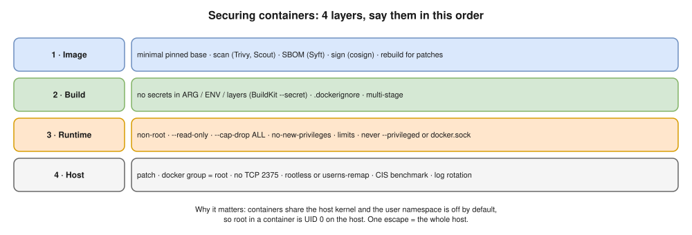

# 10 · Docker Security ⭐ (part of Hemant's 🔥 security homework)



## The basic risk

- Containers **share the host kernel**, so a kernel bug or a misconfiguration can lead to a **container escape**.
- The **user namespace is off by default**, so **root in a container = UID 0 on the host**.
- Security therefore comes in **layers**: the image, the build, the runtime, and the host.

## 1. Image security

- [ ] Use **trusted, minimal** base images (official, distroless, slim) and **pin** the version or digest.
- [ ] **Scan** images in CI and fail on HIGH/CRITICAL: `trivy image app:1.0`, `docker scout cves app:1.0`, Grype. ECR can scan on push.
- [ ] Generate an **SBOM** (a list of every package in the image) with Syft or `docker scout sbom` (the older `docker sbom` command is deprecated).
- [ ] **Sign** images (cosign / Sigstore) and verify the signature before deploying.
- [ ] **Rebuild regularly** to pick up base-image security patches, even when your code hasn't changed.

## 2. Build security

- [ ] **No secrets** in `ARG`, `ENV`, `COPY`d files or layers. Use **BuildKit secrets** (`RUN --mount=type=secret`).
- [ ] Keep `.env`, `.git` and `*.pem` out with `.dockerignore`.
- [ ] Use multi-stage builds so compilers and tools aren't in the final image.

## 3. Runtime security

| Control | How | Why |
|---|---|---|
| Non-root user | `USER 10001` in the Dockerfile, or `--user` | Root in a container is root on the host |
| Read-only filesystem | `--read-only` plus `--tmpfs /tmp` | An attacker can't change binaries |
| Drop capabilities | `--cap-drop ALL --cap-add NET_BIND_SERVICE` | Least privilege |
| No privilege escalation | `--security-opt no-new-privileges` | Blocks setuid tricks |
| Never `--privileged` | n/a | It disables almost every protection |
| **Never mount `docker.sock`** | n/a | Gives control of the whole host |
| Resource limits | `--memory`, `--cpus`, `--pids-limit` | Stops one container from starving or crashing the host |
| Keep the default seccomp and AppArmor profiles | Don't use `unconfined` | They block dangerous system calls |
| Network isolation | User-defined networks; publish only the ports you need; bind to `127.0.0.1` | Smaller attack surface |

## 4. Secrets at runtime

- Environment variables are **visible** to anyone who can run `docker inspect`, and through `/proc/<pid>/environ`. That's acceptable only for low-risk config.
- Better: **mount secrets as files** (tmpfs), using Compose or Swarm secrets, Kubernetes Secrets, or values fetched from **AWS Secrets Manager** at startup.
- Registry logins in `~/.docker/config.json` are stored **base64-encoded** unless you use a **credential helper** (osxkeychain, `ecr-login`).

## 5. Host and daemon security

- [ ] Patch the host OS and Docker itself.
- [ ] **The `docker` group = root**, so add only trusted admins.
- [ ] Never expose the daemon API over TCP without TLS. Port **2375** (no TLS) is the classic hack; **2376** uses TLS.
- [ ] Consider **rootless Docker**, or `userns-remap` in `daemon.json`, so container root isn't host root.
- [ ] Audit the host against the **CIS Docker Benchmark** (`docker-bench-security`).
- [ ] Log rotation, so a noisy container can't fill the disk ([11](11-production.md)).

> **Kubernetes link ⭐:** the same controls go in the pod's `securityContext`: `runAsNonRoot: true`, `readOnlyRootFilesystem: true`, `allowPrivilegeEscalation: false`, `capabilities: drop: ["ALL"]`. Pod Security Standards `restricted` enforces them at the namespace level.

## Hardened `docker run` example

```bash
docker run -d --name api \
  --user 10001 \
  --read-only --tmpfs /tmp \
  --cap-drop ALL \
  --security-opt no-new-privileges \
  --memory 512m --cpus 1 --pids-limit 200 \
  -p 127.0.0.1:8000:8000 \
  myapi:1.0
```

## Interview angle

- ⭐ "How do you secure a container?" → walk through the 4 layers: image, build, runtime, host.
- ⭐ "Why not run as root?" → no user namespace by default, so container root is host root. If someone escapes the container, they own the host.
- ⭐ "How do secrets leak in Docker?" → ARG/ENV in the image, files `COPY`d into layers, `docker inspect`, logs, a committed `.env`, base64 registry logins. (Ties to Hemant's Q57.)
- "Why is `--privileged` dangerous?" → it gives every capability and access to the host's devices, and switches off seccomp and AppArmor. It's almost the same as root on the host.
- "What's shift-left for containers?" → scan, lint (hadolint) and sign in the pipeline, and enforce policy at admission. (Hemant's Q55.)

## Practice

```bash
docker run --rm aquasec/trivy image python:3.12
docker run --rm aquasec/trivy image python:3.12-slim
docker run --rm --read-only alpine touch /x
docker run --rm --cap-drop ALL alpine chown nobody /tmp
```

- Compare the vulnerability counts of the two Python images.
- The third command fails: the filesystem is read-only.
- The fourth fails too: with every capability dropped, even root can't change file ownership.
