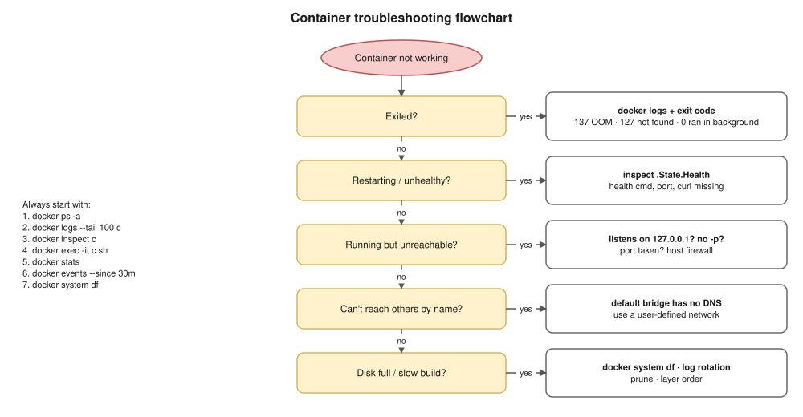

# 12 · Docker Troubleshooting ⭐



## Common problems

| Symptom | Likely cause | Confirm / fix |
|---|---|---|
| **Exits immediately** | Main process ended; service ran in background | `logs`, exit code; run in foreground |
| **Exit 137** | **OOM** (or `kill`) | `OOMKilled=true`; raise `--memory` or fix the leak |
| **Exit 127** | Command not in the image | Wrong CMD, missing binary, distroless has no shell |
| **`exec format error`** | arm64 vs amd64, or no `#!` shebang | Check `.Architecture`; buildx `--platform`; add shebang |
| **`no such file`** for an existing script | Windows CRLF line endings (`\r`) | `dos2unix`, `eol=lf` in `.gitattributes` |
| **Port is already allocated** | Another process has the port | `docker ps`, `lsof -i :8080` |
| **Unreachable from the host** | App on `127.0.0.1`, or no `-p` | `ss -tlnp` (or netshoot); bind `0.0.0.0` |
| **Can't reach by name** | Default bridge | User-defined network ([08](08-networking.md)) |
| **Permission denied** on a mount | UID doesn't own the host folder | Fix owner or `--user` |
| **No space left** | Logs, images, volumes, build cache | `docker system df`, prune, log rotation |
| **Pull fails** | Not logged in, rate limit, wrong name, proxy | `docker login`, mirror, ECR pull-through |
| **Slow build** | Cache order, big context | [06](06-build-optimization.md) |
| **Stays unhealthy** | Wrong port/path, no `curl` | `inspect -f '{{json .State.Health}}'` |
| **10 s to stop** | PID 1 ignores SIGTERM | Exec form, handle SIGTERM, `--init` |

```bash
docker inspect -f '{{.State.Status}} exit={{.State.ExitCode}} oom={{.State.OOMKilled}}' c
docker inspect -f '{{json .State.Health}}' c
docker logs --since 10m c
docker events --since 30m
docker stats --no-stream
docker system df
docker run -it --rm --network container:c nicolaka/netshoot
```

- ⚠️ `docker system prune -a --volumes` deletes **all unused images and volumes**. Check `docker system df -v` first.
- **No shell (distroless):** a `:debug` image, or `docker run -it --rm --network container:c --pid container:c busybox sh`.

> **Kubernetes link:** same method: `get pods` → `describe` → `logs --previous` → `exec` → `get events`, plus `kubectl debug` ([Kubernetes 17](../kubernetes/17-troubleshooting.md)).

## Interview angle

| Question | Answer |
|---|---|
| ⭐ Keeps restarting? | The 7 steps; say exit code and OOMKilled early. |
| ⭐ 137 vs 143? | SIGKILL (often OOM) vs SIGTERM unhandled; a clean shutdown is usually 0. |
| ⭐ Works inside, not from the browser? | Bind address (`0.0.0.0`) → `-p` mapping → host firewall. |
| No shell to debug? | `:debug` image or a tool container sharing namespaces; `kubectl debug`. |

## Practice: break it and fix it 🖥️

1. Memory hog from [04](04-containers.md) with `--memory 20m`: why does it die? (Limits below 6 MB fail at start.)
2. A typo in the command: read the exit code.
3. Two containers on the default bridge: `ping` by name. Move both to a user-defined network; again.
4. A Python server bound to `127.0.0.1` with `-p`: why does `curl` from the Mac fail?
