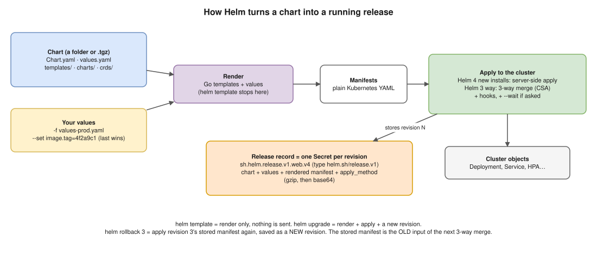
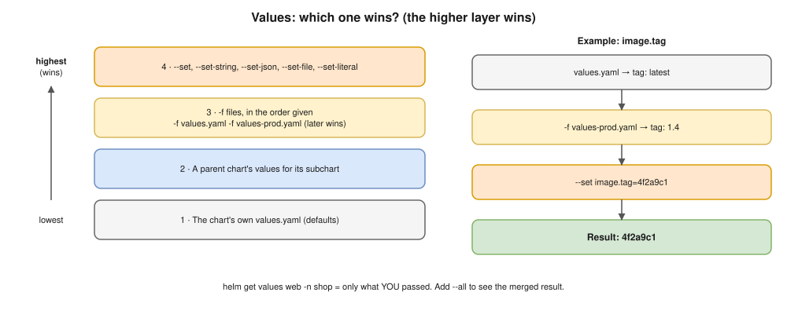
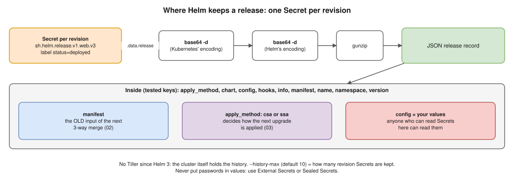

# 01 · Helm Basics



| Word | Meaning | Example |
|---|---|---|
| **Chart** | Templated Kubernetes YAML + default values | `./demo`, or `oci://…/demo --version 0.1.0` |
| **Release** | One installed copy of a chart, named, in a namespace | `web` in `shop` |
| **Revision** | One version of a release; every install, upgrade or rollback adds one | `helm history web -n shop` → 1, 2, 3… |

- ⚠️ **A rollback doesn't go back in time:** `helm rollback web 3` re-applies revision 3 and saves it as a **new** revision (e.g. 6).

## The chart folder (`helm create demo`, Helm 4.2.3 🧪)

```text
demo/
├── Chart.yaml          # apiVersion: v2, name, version (the chart's), appVersion (the app's)
├── values.yaml         # default settings
├── charts/             # dependency charts (helm dependency update)
└── templates/
    ├── _helpers.tpl    # named templates (names, labels), reused with include
    ├── deployment.yaml # replicas only if autoscaling is off (see 03)
    ├── hpa.yaml · httproute.yaml · ingress.yaml · service.yaml · serviceaccount.yaml
    ├── NOTES.txt       # printed after install
    └── tests/          # helm test pods
```

- **`version`** = the chart's version (bump on chart change) · **`appVersion`** = the app's (often the image tag). Independent.
- **`crds/`** (optional): installed **only on first install**, never upgraded or deleted, not templated.

## Values: which one wins?



## Rendering: templates become YAML

| You write | It becomes |
|---|---|
| `{{ .Values.image.tag }}` | A value |
| `{{ .Release.Name }}`, `{{ .Release.Namespace }}` | Release name / namespace |
| `{{ include "demo.labels" . \| nindent 4 }}` | A named template from `_helpers.tpl`, indented |
| `{{ toYaml .Values.resources \| nindent 12 }}` | A whole YAML block from values |
| `{{ required "image.tag is required" .Values.image.tag }}` | Fails the render if missing |
| `{{ lookup "v1" "Secret" "shop" "db" }}` | A **live** object; empty with `helm template` / `--dry-run=client` |

| Check | Cluster? | Use |
|---|---|---|
| `helm template web ./demo -f values-prod.yaml` | No | See final YAML; CI |
| `helm lint ./demo` | No | Chart mistakes |
| `helm upgrade web ./demo --dry-run=server` | Yes, saves nothing | Real API validation + admission policies |

## Where a release is stored 🧪



```bash
kubectl get secrets -n shop --field-selector type=helm.sh/release.v1 -o custom-columns=NAME:.metadata.name,STATUS:.metadata.labels.status --no-headers
# sh.helm.release.v1.web.v1    superseded
# sh.helm.release.v1.web.v2    failed
# sh.helm.release.v1.web.v3    deployed

kubectl get secret sh.helm.release.v1.web.v3 -n shop -o jsonpath='{.data.release}' | base64 -d | base64 -d | gunzip
```

## Repositories, OCI and dependencies

| Task | Command |
|---|---|
| Classic repo | `helm repo add prometheus-community https://prometheus-community.github.io/helm-charts`, `helm repo update` |
| Package | `helm package ./demo` → `demo-0.1.0.tgz` |
| Push to **OCI** (ECR) | `helm push demo-0.1.0.tgz oci://123456789012.dkr.ecr.us-west-1.amazonaws.com/charts` |
| Install from OCI | `helm install web oci://123456789012.dkr.ecr.us-west-1.amazonaws.com/charts/demo --version 0.1.0` |
| Dependencies from `Chart.yaml` | `helm dependency update ./demo` (writes `charts/`, `Chart.lock`) |

## Interview angle

| Question | Answer |
|---|---|
| Chart vs release vs revision? | The package, one installed copy, one version of that copy. |
| ⭐ Where does Helm 3/4 keep state? | Secrets in the release's namespace, one per revision: chart, values, manifest, apply method. No Tiller. |
| ↳ Security? | Anyone who can read Secrets there reads your values: no passwords in values. |
| See exactly what Helm will apply? | `helm template` locally, or `--dry-run=server` for real validation. |
| `version` vs `appVersion`? | Chart's version vs the app's version. |
| CRD changes not applied on upgrade? | `crds/` is install-once. Upgrade CRDs separately, or ship them as templates on purpose. |
