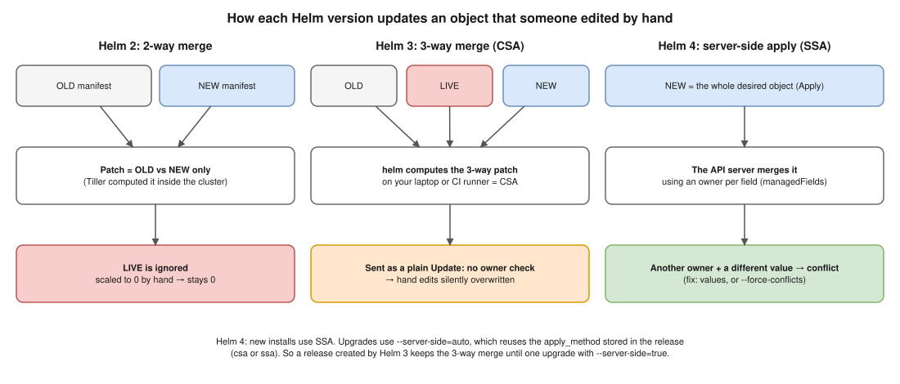
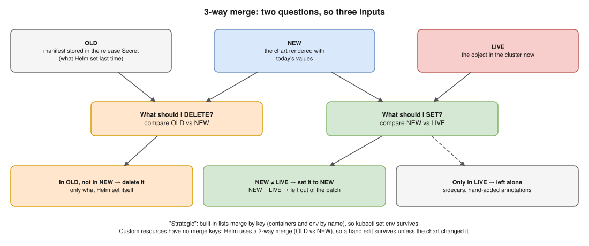
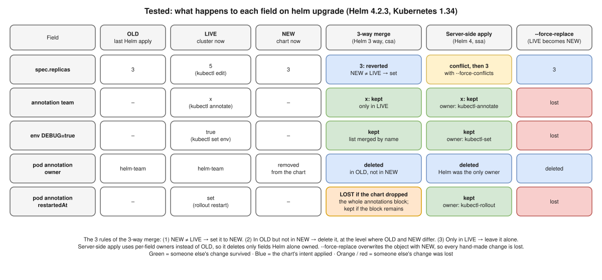
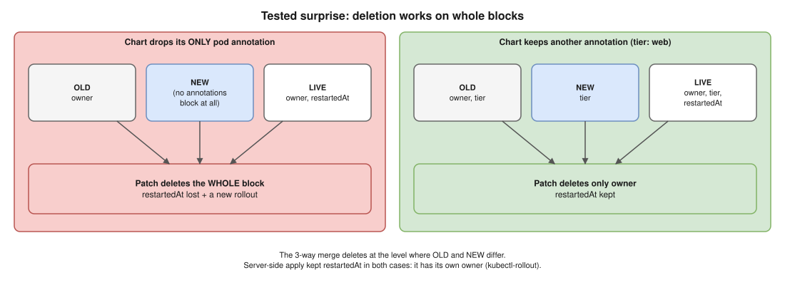

# 02 · How `helm upgrade` Changes Objects ⭐

| Version | How | Inputs | A hand edit on a chart field… |
|---|---|---|---|
| **Helm 2** | 2-way merge (Tiller, in the cluster) | OLD vs NEW | …is **never fixed** (LIVE ignored) |
| **Helm 3** | 3-way strategic merge by Helm = **CSA** | OLD + LIVE + NEW | …is **silently overwritten** |
| **Helm 4** | **Server-side apply (SSA)** for new installs | NEW, merged by the API server | …causes a **conflict** |

## CSA vs SSA

- **CSA (client-side apply):** `helm` on your laptop/CI reads OLD (release Secret), LIVE, NEW → computes the patch → sends a plain **Update**. The server **doesn't check field owners**.
- **SSA (server-side apply):** Helm sends the whole desired object as an **Apply**; the **API server** merges and checks every field's owner (`managedFields`). See [03](03-server-side-apply.md).
- **Tell them apart 🧪:** release Secret `apply_method: csa|ssa`; `managedFields` shows `helm / Update` (CSA) or `helm / Apply` (SSA).
- **Not `kubectl apply`:** kubectl keeps OLD in the `last-applied-configuration` annotation; Helm keeps OLD in its release Secret.
- **Helm 4 still uses CSA** with `--server-side=false`, or on `auto` (default) for a release created with CSA (e.g. by Helm 3) until one upgrade with `--server-side=true`.

## What "3-way merge" really means

- NEW = LIVE for the whole object → no change sent, no pods restart, but Helm still records a new revision.
- Source: `pkg/kube/client.go` `createPatch` → `CreateThreeWayMergePatch(old, new, live)` for built-in types; 2-way JSON merge for custom resources.

| Why not 2 inputs? | What goes wrong |
|---|---|
| **OLD vs NEW** (Helm 2) | Drift never fixed: scaled to 0 by hand stays 0 |
| **NEW vs LIVE** (cluster = chart exactly) | Everything others added is destroyed. 🧪 `--force-replace` wiped a hand annotation, an env var and `rollout restart`'s annotation at once |

## Tested: one upgrade, five kinds of field 🧪

Chart: `replicas: 3` + pod annotation `owner: helm-team`. By hand: `kubectl edit` (replicas → 5), `annotate team=x`, `rollout restart`, `set env DEBUG=true`. Then `helm upgrade` with `owner` **removed** from the chart.

## Interview angle

| Question | Answer |
|---|---|
| ⭐ What does a 3-way merge mean? | "Two questions, three inputs. NEW vs LIVE decides what to set (fixes drift). OLD vs NEW decides what to delete (only what Helm set). Anything only in the cluster, like a sidecar or hand annotation, is left alone." |
| ↳ Edge cases? | "Deletion happens where OLD and NEW differ: dropping a whole annotations block deleted `rollout restart`'s `restartedAt` too. Custom resources only get a 2-way merge." |
| ⭐ Helm 2 vs 3 vs 4? | "2: old vs new only. 3: adds live, computes the patch itself (CSA, no ownership check). 4: server-side apply, API server enforces per-field owners. Old releases keep their method." |
| NEW = LIVE? | Nothing for that field. With SSA, same value = no conflict; the field gets two owners. |
