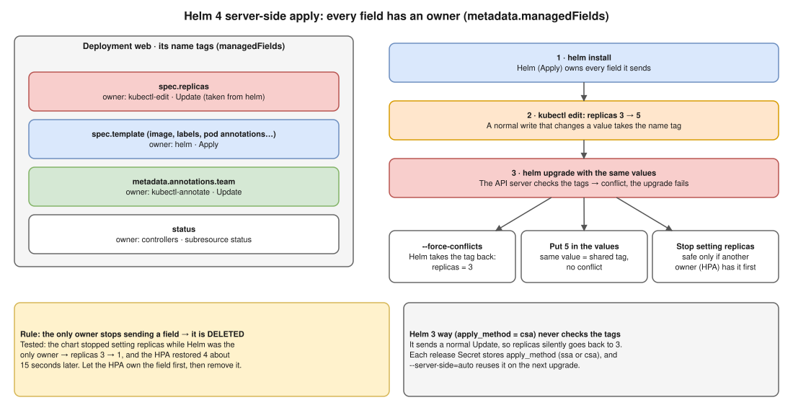
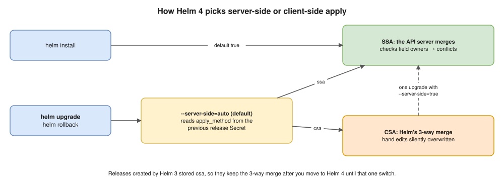
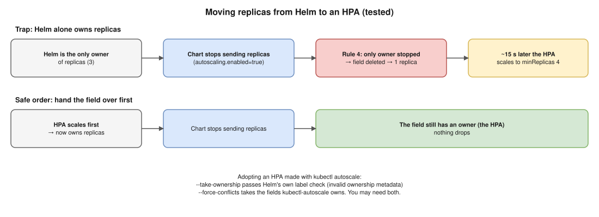

# 03 · Server-Side Apply (Helm 4) ⭐



## The idea: every field carries a name tag

The API server records **who owns each field** of an object in `metadata.managedFields`.

- **Helm 3 (CSA)** builds the patch itself and sends a normal **Update**. The server doesn't check the tags.
- **Helm 4 (SSA)** sends an **Apply**, and the server **checks the tags**. If another owner holds a field Helm wants to change, the server refuses.

## See the tags 🧪

`kubectl` hides them unless you ask:

```bash
kubectl get deploy web -n shop -o yaml --show-managed-fields
```

A one-line summary of who owns what:

```bash
kubectl get deploy web -n shop --show-managed-fields -o jsonpath='{range .metadata.managedFields[*]}{.manager}/{.operation}{"  "}{end}'
```

**Real result** after `helm install`, then `kubectl edit` (replicas 3 → 5) and `kubectl annotate team=x`:

| manager | operation | subresource | owns `replicas` | owns `team` |
|---|---|---|---|---|
| `helm` | **Apply** | – | **no** (lost it) | no |
| `kubectl-edit` | Update | – | **yes** | no |
| `kubectl-annotate` | Update | – | no | yes |
| `k3s` (the controllers) | Update | status | no | no |

Each tool has its own manager name: `kubectl-edit`, `kubectl` (for `kubectl scale`, with subresource `scale`), `kubectl-annotate`, `kubectl-rollout`, `kubectl-set`, `kubectl-autoscale`, and the controller manager for the HPA (`k3s` on this test cluster).

## The 5 rules 🧪

| # | Rule | Seen in the lab |
|---|---|---|
| 1 | You own **only the fields you send**. Fields you never send are never touched. | `team=x` survived every upgrade, even `--force-conflicts` |
| 2 | A normal write that **changes** a value **takes the tag** silently | After `kubectl edit`, Helm no longer owned `replicas` |
| 3 | Applying a **different value** to someone else's field = **conflict** | `conflict with "kubectl-edit"`; `conflict with "kubectl" with subresource "scale"`; from an HPA: `conflict with "k3s" with subresource "scale"` |
| 4 | If the **only owner stops sending** a field, it is **deleted** | `replicas` 3 → 1 (the HPA case below) |
| 5 | The **same value** = no conflict: the field gets two owners | (Kubernetes docs; not run in the lab) |

## The conflict, exactly as Helm 4.2.3 prints it 🧪

```
Error: UPGRADE FAILED: conflict occurred while applying object shop/web apps/v1, Kind=Deployment: Apply failed with 1 conflict: conflict with "kubectl-edit" using apps/v1: .spec.replicas
```

- Nothing in the cluster changes: replicas **stays 5**.
- `helm history` shows the new revision as **`failed`**, with this message as its description.

The same story with `--server-side=false` (the Helm 3 way): `deployed`, and replicas **silently** went 5 → 3.

## When it conflicts: choose, don't just force

| Choice | Do | When |
|---|---|---|
| **Take it back** | `--force-conflicts` | The edit was a mistake, or an emergency that's over. 🧪 Replicas went back to 3, and the `kubectl-edit` entry disappeared. |
| **Keep it** | Put the value in the values file | The edit was right (e.g. the incident showed you need 5). Same value = no conflict. |
| **Give it away** | Stop setting the field in the chart | Something else should own it (an HPA). ⚠️ Hand it over first (rule 4). |

🎯 If CI **always** passes `--force-conflicts`, the protection is switched off and you're back to Helm 3's silent overwrite. Better: let CI fail, and have a person decide.

**Preview the conflict before upgrading** 🧪 (a server-side dry run as Helm):

```bash
helm get manifest web -n shop | kubectl diff -n shop --server-side --field-manager=helm -f -
```

```
Error from server (Conflict): Apply failed with 1 conflict: conflict with "kubectl-edit" using apps/v1: .spec.replicas
```

## How Helm picks CSA or SSA 🧪



| Command | Default | Meaning |
|---|---|---|
| `helm install` | `--server-side=true` | New releases use SSA |
| `helm upgrade`, `helm rollback` | `--server-side=auto` | Reuse the previous revision's `apply_method` |

Each release Secret stores the method. I decoded two: `apply_method = ssa` for the server-side release, `apply_method = csa` for the `--server-side=false` one. That's why releases created by Helm 3 keep the 3-way merge after you move to Helm 4.

## The HPA case, end to end 🧪



**1 · The fight.** An HPA (`minReplicas: 4`) scaled the Deployment from 3 to 4 and took the tag. The next `helm upgrade` failed:

```
conflict with "k3s" with subresource "scale" using apps/v1: .spec.replicas
```

**2 · The fix:** set `autoscaling.enabled=true`. In `helm create` charts this **stops templating `replicas`** (`{{- if not .Values.autoscaling.enabled }}`) and makes the chart create the HPA. But an HPA made with `kubectl autoscale` already existed:

1. No flags:
   ```
   HorizontalPodAutoscaler "web" in namespace "shop" exists and cannot be imported into the current release: invalid ownership metadata
   ```
2. With `--take-ownership`: that check passed, but then:
   ```
   conflict with "kubectl-autoscale" using autoscaling/v2: .spec.maxReplicas
   ```
3. With **`--take-ownership --force-conflicts`**: ✅ adopted. The HPA now has `managed-by=Helm`, later upgrades worked with no flags, and replicas stayed at 4.

👉 **`--take-ownership` skips only Helm's own label check. The server's field tags still apply.**

**3 · ⚠️ The trap (rule 4).** On a fresh release where **Helm alone** owned `replicas`, switching the chart to autoscaling **deleted** the field, so it fell back to the default of 1:

```
Scaled down replica set web4-… from 3 to 1
New size: 4; reason: Current number of replicas below Spec.MinReplicas     ← about 15 seconds later
```

In step 2 the HPA **already** owned `replicas`, so nothing dropped. **Safe order: let the HPA own the field first, then remove it from the chart.** The Kubernetes docs call this "transferring ownership".

## Interview angle

- ⭐ **"What changes in Helm 4?"** → "New releases use server-side apply. The API server tracks an owner for every field, so a hand edit makes `kubectl-edit` the owner, and the next upgrade fails with a conflict instead of silently overwriting. Old releases keep client-side apply via `--server-side=auto`."
  - **He'll push: "So what do you do with the conflict?"** → The choose-don't-force table.
- **"`--take-ownership` vs `--force-conflicts`?"** → The first adopts objects without Helm's labels. The second overrides other owners' fields. Adopting a hand-edited object can need both.
- **"We're moving a Deployment to an HPA. Any risk?"** → Yes. If Helm is the only owner of `replicas` and stops sending it, the field is deleted and the Deployment drops to 1 replica until the HPA reacts. Let the HPA take ownership first.
