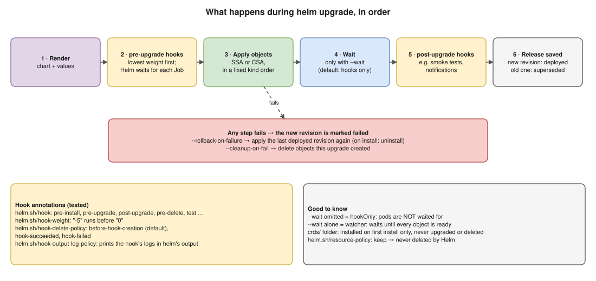
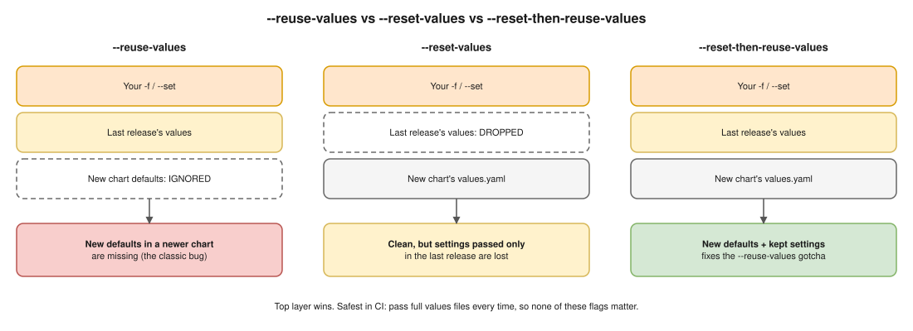

# 05 · Flags, Annotations and Hooks

Checked against **`helm upgrade --help` in Helm 4.2.3**. 🧪 = tested on the practice cluster.

## What happens during `helm upgrade`, in order



## 🔴 Must know ⭐

| Flag | What it does | Detail |
|---|---|---|
| `--server-side true\|false\|auto` 🧪 | **How** Helm writes | `install` default `true`; `upgrade`/`rollback` default `auto` (reuse stored `apply_method`); `false` = CSA |
| `--force-conflicts` 🧪 | Override other owners' fields | Without it: `UPGRADE FAILED: … conflict with "kubectl-edit" … .spec.replicas` |
| `--take-ownership` 🧪 | Adopt objects made outside Helm | Skips `invalid ownership metadata`. ⚠️ Not field owners: may need `--force-conflicts` too |
| `--force-replace` 🧪 (was `--force`) | **Replace** with NEW | Wipes **every** hand change. `--force` prints a deprecation warning |
| `--rollback-on-failure` (was `--atomic`) | Auto-undo | Upgrade → last good revision; install → uninstall. Turns on `--wait=watcher` |

## 🟠 Waiting and safety

| Flag | Detail |
|---|---|
| `--wait [watcher\|hookOnly\|legacy]` | ⚠️ **Omitted = `hookOnly`: hooks only, not pods.** `--wait` alone = `watcher` (every object ready). `legacy` = Helm 3 wait |
| `--timeout 5m0s` | Per-operation limit (default 5m) |
| `--wait-for-jobs` | With `--wait`, also wait for Jobs |
| `--cleanup-on-fail` | Delete **new** objects from a failed upgrade |
| `--dry-run=client\|server\|none` + `--hide-secret` | `client` = render only; `server` = API validates, saves nothing |

- 🎯 **CI:** `--wait --rollback-on-failure --timeout 10m`. Without `--wait`, `deployed` even while pods crash-loop.

## 🟡 Values



- `-f`, `--set`, `--set-string`, `--set-json`, `--set-file`, `--set-literal` (text exactly, no splitting on `,` or `.`): later wins ([01](01-basics.md)).
- `--history-max 10`: revision Secrets kept (`0` = no limit).

## 🔵 Everything else

| Group | Flags |
|---|---|
| Install from upgrade | `-i/--install`, `--create-namespace` |
| Hooks, CRDs | `--no-hooks`, `--skip-crds` |
| Rendering | `--post-renderer` + `--post-renderer-args` (Helm 4: a post-renderer **plugin** name), `--enable-dns`, `--hide-notes`, `--render-subchart-notes` |
| Chart version | `--version` (tag or range `^2.0`), `--devel`, `--dependency-update`, `--verify` |
| Validation | `--skip-schema-validation`, `--disable-openapi-validation` |
| Release record | `-l/--labels`, `--description`, `-o json\|yaml` |

- **`install` only:** `--generate-name`, `--replace` (reuse a deleted name; unsafe in prod).
- **`rollback`:** `--server-side`, `--force-conflicts`, `--force-replace`, `--wait`, `--cleanup-on-fail`, `--no-hooks`.
- **`uninstall`:** `--keep-history` (can roll back), `--cascade background|orphan|foreground`, `--ignore-not-found` (repeatable CI), `--wait`.

## Helm annotations 🧪

| Annotation | Values | Detail |
|---|---|---|
| `helm.sh/hook` | `pre/post-install`, `pre/post-upgrade`, `pre/post-rollback`, `pre/post-delete`, `test` | Runs the object (usually a Job) then, e.g. DB migration `pre-upgrade` |
| `helm.sh/hook-weight` | `"-5"`, `"0"` (quoted) | Lowest first |
| `helm.sh/hook-delete-policy` | `before-hook-creation` (default), `hook-succeeded`, `hook-failed` | 🧪 `hook-succeeded` deleted the Job right after |
| `helm.sh/hook-output-log-policy` | `hook-succeeded`, `hook-failed` | Prints hook logs 🧪 `level=INFO msg="running migration v42\ndone"` |
| `helm.sh/resource-policy` | `keep` | Never deleted by Helm 🧪 `These resources were kept due to the resource policy: [ConfigMap] keep-me` |

- **Helm adds these itself (don't set):** label `app.kubernetes.io/managed-by: Helm`, annotations `meta.helm.sh/release-name`, `meta.helm.sh/release-namespace`. Missing on an existing object → `invalid ownership metadata` 🧪 → `--take-ownership`.

```yaml
# The tested pre-install,pre-upgrade migration hook
apiVersion: batch/v1
kind: Job
metadata:
  name: db-migrate
  annotations:
    helm.sh/hook: pre-install,pre-upgrade
    helm.sh/hook-weight: "0"
    helm.sh/hook-delete-policy: before-hook-creation,hook-succeeded
    helm.sh/hook-output-log-policy: hook-succeeded,hook-failed
spec:
  backoffLimit: 0
  template:
    spec:
      restartPolicy: Never
      containers:
        - name: migrate
          image: busybox:1.36
          command: ["sh", "-c", "echo running migration v42; echo done"]
```

## Roll pods when config changes

Pods don't restart when only a ConfigMap changes. Put its checksum in the **pod template** ([B5](../hemant-scenario-deep-dives.md)):

```yaml
spec:
  template:
    metadata:
      annotations:
        checksum/config: {{ include (print $.Template.BasePath "/configmap.yaml") . | sha256sum }}
```

## Interview angle

| Question | Answer |
|---|---|
| ⭐ Deploy with Helm in CI safely? | `helm upgrade --install … --wait --rollback-on-failure --timeout 10m`, git-SHA image tag, after `lint`, `template`, `helm diff --three-way-merge`. |
| DB migrations with Helm? | `pre-upgrade` hook Job, `before-hook-creation,hook-succeeded`. Helm waits for it; a failed hook fails the release. |
| Stop Helm deleting a PVC on uninstall? | `helm.sh/resource-policy: keep`; then it's orphaned, clean up by hand. |
| `--reuse-values` bug after chart upgrade? | It ignores new defaults. `--reset-then-reuse-values`, or always pass full values files. |
