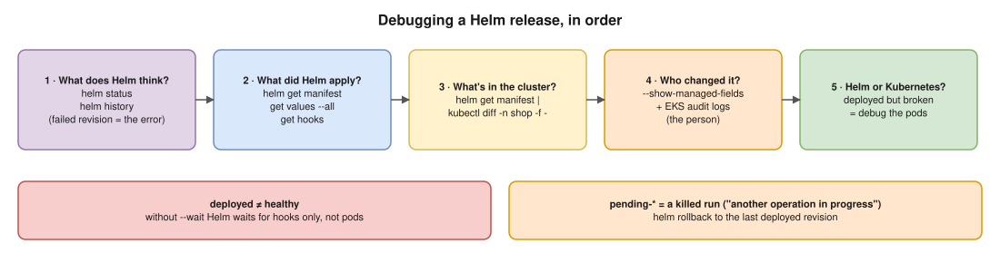
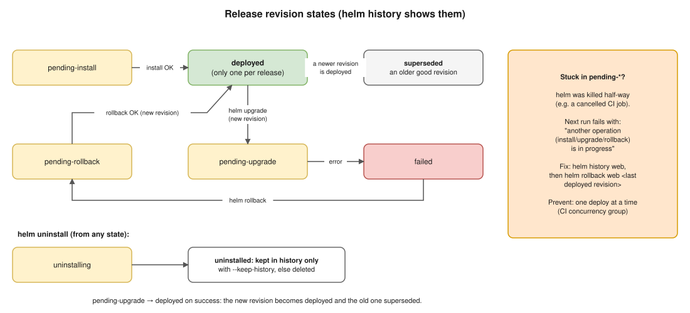

# 06 · Troubleshooting Helm

## Release states

See them with `helm history web -n shop`, or list releases by state with `helm list -n shop --failed` and `helm list -n shop --pending`.

## The debugging order

1. **What does Helm think?** `helm status web -n shop`, then `helm history web -n shop`. The failed revision's description holds the error.
2. **What did Helm apply?** `helm get manifest web -n shop`, `helm get values web -n shop --all`, `helm get hooks web -n shop`.
3. **What is really in the cluster?** `helm get manifest web -n shop | kubectl diff -n shop -f -`.
4. **Who changed it?** `kubectl get deploy web -n shop -o yaml --show-managed-fields`.
5. **Is it Helm or Kubernetes?** If Helm says `deployed` but the app is broken, debug the pods like any Kubernetes problem ([Kubernetes 17](../kubernetes/17-troubleshooting.md)).

## Error messages and what they mean

| Error | Cause | Fix |
|---|---|---|
| `UPGRADE FAILED: … Apply failed with 1 conflict: conflict with "kubectl-edit" … .spec.replicas` 🧪 | SSA: someone changed a field Helm wants to change | Choose: `--force-conflicts`, put the value in Git, or stop setting the field ([03](03-server-side-apply.md)) |
| `… exists and cannot be imported into the current release: invalid ownership metadata` 🧪 | The object was created outside Helm (no Helm labels) | `--take-ownership` (plus `--force-conflicts` if it was edited by hand) |
| `another operation (install/upgrade/rollback) is in progress` | A previous run was killed half-way and left the release in `pending-*` | `helm history`, then `helm rollback web <last deployed revision>`. Prevent with a CI concurrency group |
| `has no deployed releases` | The very first install failed, so there's nothing to upgrade from | `helm uninstall`, then install again, or use `--rollback-on-failure` on install |
| `cannot re-use a name that is still in use` | `helm install` with a name that already exists | Use `helm upgrade --install` |
| `no matches for kind "PodDisruptionBudget" in version "policy/v1beta1"` | The **stored** manifest uses an API the upgraded cluster removed | The `helm mapkubeapis` plugin rewrites the stored manifest ([scenario deep dives](../hemant-scenario-deep-dives.md), B8) |
| A timeout with `--wait` | Pods never became ready (image pull, probes, resources) | Debug the pods; `--rollback-on-failure` restores the last good revision |
| `Flag --atomic has been deprecated, use --rollback-on-failure instead` 🧪 | An old Helm 3 flag | Rename it in CI (it still works for now) |

## Scenarios, short

**"Helm says `deployed`, but the pods crash-loop."**
Without `--wait`, Helm 4 waits for **hooks only** (`hookOnly`), so `deployed` means "applied", not "healthy". Use `--wait --rollback-on-failure` in CI.

**"We pushed a fix with the same image tag; half the pods still run the old code."**
Tags are mutable, and nodes reuse cached images (`IfNotPresent`). Use a unique tag per build (the git SHA) or a digest, plus ECR tag immutability ([scenario deep dives](../hemant-scenario-deep-dives.md), B3).

**"We changed a ConfigMap through Helm, but the app still has the old config."**
The pod template didn't change, so no rollout happened. Add a `checksum/config` annotation ([05](05-flags-annotations-hooks.md)), or `kubectl rollout restart`.

**"A teammate ran `kubectl rollout undo` in prod."**
It works, but now Git, Helm and the cluster all disagree, and the next deploy brings the bad version back. Roll back with the tool that deployed: `helm rollback`, or `git revert` with GitOps.

**"We use Argo CD with Helm charts. Does `helm list` show them?"**
No. Argo CD **renders** the chart (like `helm template`) and applies it itself. Drift is fixed by self-heal, and for HPA-managed replicas you add `ignoreDifferences` on `/spec/replicas`.

## Interview angle

- ⭐ **"CI fails: another operation is in progress."** → A killed upgrade left `pending-upgrade`. Check `helm history`, roll back to the last deployed revision, and stop concurrent deploys.
- **"How do you know what Helm actually applied?"** → `helm get manifest` (and `values --all`, `hooks`), then diff it against the cluster with `-n`.
- **"Helm says deployed but the app is down."** → Helm doesn't wait for pods unless you ask: `--wait`.
