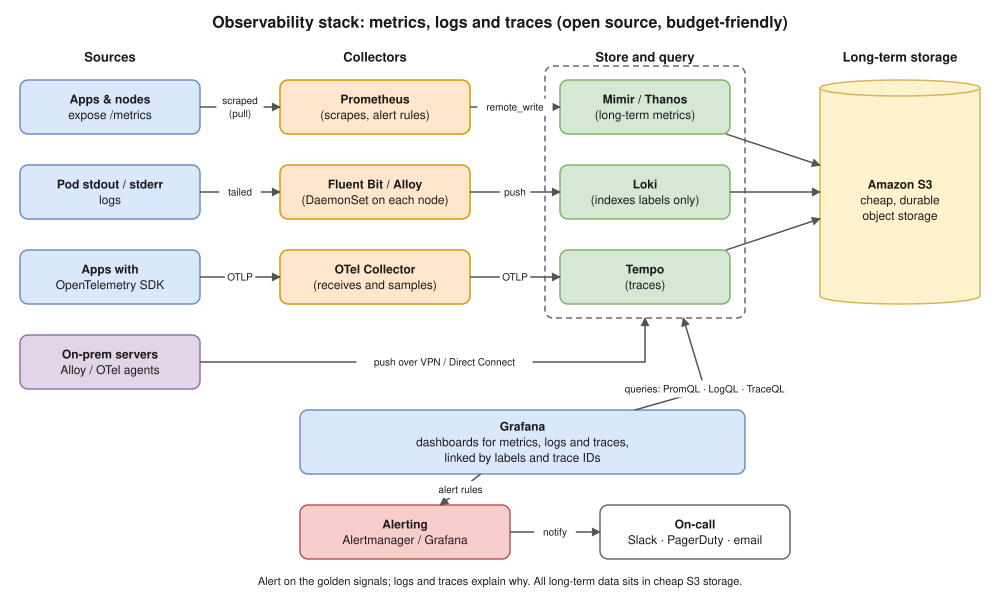

# Model Answers: Hemant's Past Interview Questions

Companion to [hemant-past-interview-questions.md](hemant-past-interview-questions.md). Same numbering.

**How to use:** don't memorise these word for word. Learn the key points, then say them **in your own words, out loud**. For each question:
- **Say:** the points your answer should cover.
- **Follow-up:** the next question he's likely to ask, with a short answer.

---

## Priority for the next round

Hemant said the next round focuses on **Docker, Kubernetes, AWS, CI/CD and security**. That's the most direct evidence you have, so it decides the priority. The past questions still show *how* he asks: he starts from a topic, then drills down into Linux and networking basics.

| Section | Questions | Priority | Why |
|---|---|---|---|
| 🔥 Closing feedback | 55–58 | **Top** | His known gaps, and all four fall inside CI/CD and security |
| CI/CD and delivery | 35–40 | **High** | One of the focus topics |
| Debugging methodology | 26–30 | **High** | Covers AWS load balancers and 5xx errors through Kubernetes |
| DNS, IP, TCP/HTTP, Linux | 1–25 | **Medium–high** | He drills into these from Docker, Kubernetes and AWS (for example, PID 1, resolv.conf in pods, NAT) |
| Hybrid connectivity | 50–51 | Medium | AWS networking |
| Database and migration | 41–44 | Medium–low | Only the RDS parts are AWS |
| Observability | 45–49 | Medium–low | Not in the focus list, but it's the last step of One2N's bootcamp |
| Ansible | 31–34 | Low | Not in the focus list; skim only |
| Consulting and framing | 52–54 | **Always** | You will be asked to introduce yourself |

---

# 1. DNS and name resolution

### Q1. Walk me through everything that happens when you type mixy.com in the browser.

**Say:**
1. **Parse the input.** The browser decides whether it's a URL or a search term. There's no scheme, so it picks `https` (and checks its HSTS list).
2. **DNS lookup.** Browser cache → OS cache and `/etc/hosts` → the recursive resolver from `resolv.conf` or DHCP. If nothing is cached, the resolver asks root → `.com` TLD → mixy.com's authoritative server, gets the A/AAAA record, and caches it for its TTL.
3. **Routing.** Is the IP on my subnet? No, so the packet goes to the default gateway (router). ARP finds the gateway's MAC. The router does NAT and forwards to the ISP.
4. **TCP handshake** to IP:443 (SYN, SYN-ACK, ACK), from a random ephemeral source port.
5. **TLS handshake.** The browser sends the domain name (SNI); the server sends its certificate; the browser checks it against trusted CAs; they agree on session keys.
6. **HTTP request:** `GET /` with Host, cookies and other headers.
7. **Server side:** CDN → load balancer → web or app server → database. The response comes back with a status, headers and body.
8. **Render.** The browser parses the HTML, finds the CSS, JS and images, makes more requests (reusing the connection), and draws the page.

**Follow-up:** "Where can the DNS answer be cached?" → browser, OS, recursive resolver, each for up to the TTL. "What if DNS fails?" → NXDOMAIN (name doesn't exist), SERVFAIL (resolver problem) or a timeout.

### Q2. What is the very first step? What does the browser do before anything else?

**Say:**
- Before any network call, it **parses the input** (URL or search?) and **checks its own caches**:
  - its HSTS list, to force HTTPS;
  - its own DNS cache.
- If there's no answer there, it asks the **OS resolver**, which checks `/etc/hosts` first (the order comes from `/etc/nsswitch.conf` on Linux) and then DNS.
- Key idea: **cache first, network last**.

**Follow-up:** "How do you see Chrome's DNS cache?" → `chrome://net-internals/#dns`. "On macOS, who does the resolving?" → the `mDNSResponder` system service.

### Q3. 🖥️ What is resolv.conf? How does the system know which resolver to use?

**Say:**
- `/etc/resolv.conf` configures the system's DNS stub resolver (the client-side DNS lookup library):
  - `nameserver` lines: up to 3, tried in order.
  - `search`: domains appended to short names.
  - `options`: `ndots`, `timeout`, `attempts`.
- It's usually written automatically by DHCP, NetworkManager or systemd-resolved. With systemd-resolved it often shows `127.0.0.53`, a local stub that forwards to the real servers.
- **macOS:** `/etc/resolv.conf` is only informational; the real config comes from `scutil --dns`.
- **Kubernetes (tie it to the focus topic):**
  - A pod's `resolv.conf` points to the **CoreDNS Service IP**.
  - It has `search <ns>.svc.cluster.local svc.cluster.local cluster.local` and `options ndots:5`.
  - That's why `my-svc` resolves inside a pod. See it with `kubectl exec <pod> -- cat /etc/resolv.conf`.

**Follow-up:** "What is `ndots:5`?" → a name with fewer than 5 dots tries every search domain first. So `api.stripe.com` makes several failed lookups before the real one. Fix it with a trailing dot (Q6) or a lower `ndots` in the pod's `dnsConfig`.

### Q4. 🖥️ How would you find the name servers for google.com? Which command?

**Say:**
- `dig NS google.com` (or `dig +short NS google.com`)
- `nslookup -type=ns google.com`
- `host -t ns google.com`
- To see the whole delegation chain: `dig +trace google.com`
- Answer: `ns1.google.com` through `ns4.google.com`

**Follow-up:** "How do you query a specific server?" → `dig @8.8.8.8 google.com`, or ask the authoritative server directly with `dig @ns1.google.com google.com`.

### Q5. 🖥️ Which DNS utility comes pre-installed on macOS?

**Say:**
- `dig`, `nslookup` and `host` all ship with macOS. (Verified on this Mac: they're in `/usr/bin`.)
- `dscacheutil -q host -a name google.com` uses the system's resolver path, including its cache.
- Important: `dig` and `nslookup` **query DNS directly**. They skip `/etc/hosts` and the OS cache.

**Follow-up:** "`ping` resolves a name but `dig` gives a different IP. Why?" → `ping` uses the OS resolver, which reads `/etc/hosts` and the cache. `dig` asks the DNS server directly.

### Q6. What is the difference between google.com and google.com. with a trailing dot?

**Say:**
- The trailing dot makes it a **fully qualified domain name (FQDN)**: an absolute name ending at the DNS root (the empty label after the last dot).
- **Without the dot** the name is relative, so the resolver may first append the `search` domains from `resolv.conf`, depending on `ndots`.
- **With the dot** no search domain is added; the name is looked up exactly as written.
- **Kubernetes:** with `ndots:5`, looking up `google.com` first tries `google.com.default.svc.cluster.local` and so on. `google.com.` goes straight out, with fewer lookups and less latency.
- **Zone files:** a name without a trailing dot gets the zone name appended. A classic bug: a CNAME to `example.com` becomes `example.com.example.com.`

**Follow-up:** "Why are DNS lookups slow in my pods?" → `ndots:5` plus the search domains multiply the queries. Use FQDNs, tune `ndots`, or run NodeLocal DNSCache.

### Q7. What does "non-authoritative answer" mean?

**Say:**
- The answer came from a **recursive resolver** (usually from its cache), **not** from the authoritative name server for that zone.
- It isn't wrong; it can just be **up to TTL seconds old**, which matters right after a DNS change.
- To get an authoritative answer, ask the zone's name server directly with `dig @ns1.google.com google.com`. dig shows the `aa` (authoritative answer) flag.

**Follow-up:** "You changed a DNS record but users still see the old IP. Why?" → resolvers and browsers cache the old answer until the TTL expires. Lower the TTL **before** a planned change.

### Q8. What is the Address field in that output?

**Say:** `nslookup` prints **two** Address fields. Know which is which:
- **Top block:** `Server:` / `Address: 192.168.1.1#53`. This is the **DNS resolver that answered you**, with its IP and port 53.
- **Under "Non-authoritative answer":** `Name: google.com` / `Address: 142.250.x.x`. This is the **resolved A record**, the IPv4 address of google.com (AAAA for IPv6).

**Follow-up:** "The resolver address is 192.168.1.1. What is it?" → usually your home router acting as a DNS forwarder, which leads into Q10.

### Q9. Explain the hierarchy of root, TLD and authoritative name server. Who answers what?

**Say:**
- **Stub resolver** (on your machine): only asks a recursive resolver and waits.
- **Recursive resolver** (ISP, 8.8.8.8, 1.1.1.1, or the AWS VPC resolver at the VPC's base address +2): does the walking and caches the results.
- **Root servers:** 13 named identities (a–m), served from well over a thousand anycast instances worldwide. They don't know mixy.com; they answer with a **referral** to the `.com` TLD servers.
- **TLD servers** (`.com` is run by Verisign): they answer with a referral to **mixy.com's authoritative name servers**, which the registrar set up (NS records, plus glue records when those name servers are inside the same domain).
- **Authoritative name server** (for example Route 53, `ns1.google.com`): holds the zone and gives the **final answer** (A, AAAA, CNAME, MX, TXT…).

**Follow-up:** "Where does Route 53 fit?" → it's the authoritative DNS for your hosted zone; at the registrar you point the domain's NS records at Route 53's name servers. "What is TTL?" → how long resolvers may cache an answer.

---

# 2. IP addressing

### Q10. Is that a private or a public IP address? Why do you say so?

**Say:**
- For example, `192.168.1.1` is **private**. It's inside an RFC 1918 range (`192.168.0.0/16`), which is not routable on the internet and can be reused in every network.
- A public IP is globally unique and routable.
- Other special ranges worth knowing:
  - `127.0.0.0/8`: loopback.
  - `169.254.0.0/16`: link-local. AWS instance metadata is at `169.254.169.254`.
  - `100.64.0.0/10`: carrier-grade NAT.

**Follow-up:** "In AWS, what's the DNS resolver's IP?" → the VPC base address +2 (for example `10.0.0.2`). It's private.

### Q11. If it is private, how is your laptop communicating with it?

**Say:**
- **Same subnet:** the laptop compares the destination IP against its own IP and subnet mask. If they're on the same network, it uses **ARP** to find the MAC address and sends frames directly over Wi-Fi or the switch. No routing is needed.
- **Internet:** the packet goes to the **default gateway** (router), which does **NAT/PAT**. It rewrites the private source IP and port to its public IP and a port, remembers the mapping in its NAT table, and reverses it for the replies.
- **In AWS it's the same idea:** private subnets go out through a **NAT Gateway**, and a public IP on an instance is actually 1:1 NAT done by the Internet Gateway.

**Follow-up:** "Show me the route." → `ip route` (Linux: look for `default via <gateway>`) or `netstat -rn` (macOS: look for the `default` line).

### Q12. Which ranges are private? Class A, B and C, with the actual boundaries.

**Say (RFC 1918):**

| Class range | CIDR | From – To |
|---|---|---|
| A | `10.0.0.0/8` | 10.0.0.0 – 10.255.255.255 |
| B | `172.16.0.0/12` | 172.16.0.0 – **172.31**.255.255 |
| C | `192.168.0.0/16` | 192.168.0.0 – 192.168.255.255 |

- Classful addressing is obsolete (CIDR replaced it in 1993), but the ranges still map to the old classes.
- **Trap:** `172.32.x.x` is **public**.

**Follow-up:** "How many addresses in a /16?" → 65,536. AWS reserves 5 IPs in every subnet. "Why does VPC CIDR planning matter?" → overlapping ranges break VPC peering, Transit Gateway routing and on-prem connectivity.

---

# 3. TCP, UDP and HTTP

### Q13. You have the IP address. What happens next?

**Say:**
1. **Routing decision:** is the IP local? If not, send it to the default gateway (ARP finds the gateway's MAC).
2. The OS picks an **ephemeral source port** and opens a TCP connection: a **3-way handshake** to IP:443.
3. **TLS handshake** (SNI, certificate check, key exchange).
4. Send the **HTTP request**, get the response, and keep the connection alive to reuse it.
5. (HTTP/3 is different: **QUIC over UDP** does the transport and TLS handshakes together.)

**Follow-up:** "How many round trips before the first byte of data?" → 1 for TCP + 1 for TLS 1.3 (2 for TLS 1.2), then the request itself.

### Q14. Why does it need to create a TCP connection?

**Say:**
- **IP is best effort:** packets can be dropped, duplicated or arrive out of order.
- HTTP needs a **reliable, ordered, complete byte stream**; a web page can't be missing bytes.
- TCP provides:
  - **Connection setup:** both sides agree on starting sequence numbers and prove they can reach each other.
  - **Sequence numbers** to put data in order.
  - **ACKs and retransmission** to recover lost packets.
  - **Flow control** (the receive window) so a fast sender doesn't overwhelm a slow receiver.
  - **Congestion control** so the network isn't overloaded.

**Follow-up:** "Explain the handshake exactly." → `SYN (seq=x)` → `SYN-ACK (seq=y, ack=x+1)` → `ACK (ack=y+1)`. Closing uses FIN/ACK, and the side that closes first waits in `TIME_WAIT`.

### Q15. What is TCP? If not TCP, what else could you use, and what is the difference?

**Say:**

| | TCP | UDP |
|---|---|---|
| Connection | Handshake first | None |
| Delivery | Guaranteed, in order | Best effort; may drop or reorder |
| Overhead | Higher (20+ byte header, ACKs) | Low (8-byte header) |
| Used for | HTTP/1.1 and HTTP/2, SSH, databases | DNS, video and voice, gaming, **QUIC (HTTP/3)** |

- QUIC builds reliability on top of UDP in user space. It avoids TCP's head-of-line blocking and has a faster handshake.

**Follow-up:** "Does DNS use only UDP?" → UDP port 53 normally. It falls back to **TCP 53** when a response is too big (the TC "truncated" flag), and zone transfers use TCP. DNS over TLS or HTTPS also uses TCP.

### Q16. 🖥️ Prove the notion that HTTP is built on top of TCP.

**Say (prove it live):**
- **Raw TCP socket:** `nc example.com 80`, then type the request below. The HTML comes back, which shows HTTP/1.1 is just **text sent over a TCP connection**.

```text
GET / HTTP/1.1
Host: example.com
(press Enter twice)
```

Type it by hand. If you pipe it in instead, macOS `nc` quits as soon as the input ends, before the reply arrives, so keep the input open: `(printf 'GET / HTTP/1.1\r\nHost: example.com\r\nConnection: close\r\n\r\n'; sleep 2) | nc example.com 80` (tested on your Mac).

- `curl -v http://example.com` prints `Connected to example.com (IP) port 80` **before** it sends the request headers.
- `sudo tcpdump -i any -nn port 80` while running curl shows SYN, SYN-ACK, ACK, **then** the HTTP data, then FIN.
- The browser's DevTools **Timing** tab shows an "Initial connection" step before the request is sent.
- `ss -tnp` (Linux) or `lsof -i -n -P` (macOS) shows the browser's `ESTABLISHED` TCP connections.

**Follow-up:** "And HTTPS?" → `openssl s_client -crlf -connect example.com:443`, then type the same request (`-crlf` sends proper HTTP line endings). "Is HTTP always on TCP?" → no: HTTP/3 runs on QUIC over UDP.

### Q17. 🖥️ Open the browser network tab and explain what the request is actually doing.

**Say (DevTools → Network → reload → click the main document):**
- **Headers tab:**
  - Request URL, Method (`GET`), Status (200, 301, 304…), Remote Address (`IP:443`).
  - Request headers: `Host`, `User-Agent`, `Accept`, `Accept-Encoding`, `Cookie`.
  - Response headers: `Content-Type`, `Cache-Control`, `Set-Cookie`, `Server`.
- **Timing tab:**
  - Queueing / Stalled
  - **DNS lookup**
  - **Initial connection** (TCP)
  - **SSL** (TLS)
  - Request sent
  - **Waiting (TTFB)**: time until the server's first byte
  - Content download
- **Columns:** Protocol (`h2` or `h3`), Initiator (which file triggered the request), Size (or "from cache"), Waterfall.
- **The flow:** the HTML loads first; the parser then finds the CSS, JS and images, which become more requests over the same connection.

**Follow-up:** "TTFB is high. What does it mean?" → mostly **server or backend time** (app or database). TTFB also includes one network round trip, so compare it with the connection time before blaming the server. "Why a 304?" → a conditional request (`If-None-Match` with an ETag) found the cached copy still valid.

---

# 4. Linux: processes, memory, ports

> Practise these in a Linux container (`docker run -it --rm ubuntu bash`). macOS `top` looks different, and `free` and `ss` don't exist on macOS.

### Q18. 🖥️ Run top and explain everything on the screen.

**Say:**
- **Line 1:** current time, uptime, number of users, **load average** (1, 5 and 15 minutes).
- **Tasks:** total, running, sleeping, stopped, zombie.
- **%Cpu(s):**
  - `us` user code, `sy` kernel, `ni` low-priority (niced) user code, `id` idle
  - **`wa`**: waiting for disk I/O
  - `hi` / `si`: hardware / software interrupts
  - **`st`**: steal, time the hypervisor gave to other VMs (matters in the cloud)
- **Mem / Swap:** total, free, used, `buff/cache`, and **avail Mem** (how much new apps can get without swapping).
- **Process columns:**
  - `PID`, `USER`, `PR` (priority), `NI` (nice value)
  - `VIRT`: virtual memory reserved
  - **`RES`**: actually in RAM
  - `SHR`: shared memory
  - **`S` (state):** `R` running, `S` sleeping, `D` waiting on I/O and can't be interrupted, `Z` zombie, `T` stopped, `I` idle
  - `%CPU`, `%MEM`, `TIME+` (total CPU time used), `COMMAND`
- **Useful keys:** `1` (per-CPU view), `P` / `M` (sort by CPU / memory), `H` (show threads), `c` (full command).

**Follow-up:** "A process shows 350% CPU. How?" → 100% per core, so it's using 3.5 cores. "`wa` is high?" → disk bottleneck. "`st` is high?" → a noisy neighbour, or a burstable (T-class) instance that has run out of CPU credits.

### Q19. What is load average? What is it actually measuring?

**Say:**
- It's the average number of tasks that are **running or waiting for a CPU** (state `R`). On Linux it **also counts tasks in uninterruptible sleep** (`D`, usually waiting on disk or NFS).
- It's a smoothed moving average over **1, 5 and 15 minutes**.
- **Compare it with the number of cores** (`nproc`): a load of 4 on 4 cores means fully busy; 8 on 4 cores means tasks are queuing.
- Read the trend: if the 1-minute value is above the 15-minute value, load is rising.

**Follow-up:** "Load is 20 but CPU usage is 10%. Why?" → many tasks in `D` state waiting on I/O. Check `wa` in top, `iostat -x`, and `ps -eo state,pid,cmd | grep '^D'`.

### Q20. Why do sleeping processes appear there? Why should they be there at all?

**Say:**
- Most processes are **waiting for something**: network data, a timer, user input, a lock, a child process. That's state `S`.
- They're still alive, holding memory and open sockets, but using **no CPU**.
- `top` lists **all** processes, not only the ones running right now. Only one task per core can run at any instant.
- A sleeping server is **healthy**. For example, nginx waits for connections and the kernel wakes it when one arrives.
- `D` = uninterruptible sleep (in the middle of I/O, can't be killed). `Z` = zombie (finished, but its parent hasn't collected the exit status).

**Follow-up:** "How do you get rid of a zombie?" → you can't kill it; fix or kill its **parent**, and then PID 1 adopts it and cleans it up. **Docker link:** your app is PID 1 in the container, so it must clean up its finished child processes. Use `tini` or `docker run --init`.

### Q21. What is PPID?

**Say:**
- **Parent Process ID:** the process that created this one (using fork/exec).
- Every process sits in a tree under PID 1 (`systemd` or `init`). If a parent dies, its children are **re-parented** to PID 1.
- See it with `ps -ef` (PPID column), `ps -o pid,ppid,cmd`, or `pstree -p`.
- Use it to find **who keeps starting** a process, then fix or kill that parent.

**Follow-up:** "What is PID 1 in a container and why does it matter?" → your app, thanks to PID namespaces. PID 1 ignores signals it has no handler for, so a badly written app ignores the SIGTERM from `docker stop` and gets SIGKILLed after the grace period. It also has to clean up zombies.

### Q22. What are threads in that output, and how do they relate to cores?

**Say:**
- A thread is a schedulable unit of work inside a process. Threads share the process's memory; each has its own thread ID. Press `H` in `top`, or use `ps -eLf`, to list them.
- **Cores:** at any instant one logical CPU runs one thread. Hyper-threading gives 2 logical CPUs per physical core (check with `lscpu`).
- **More threads than cores is normal**; the scheduler time-slices between them.
  - CPU-heavy work: more threads than cores doesn't help, just adds context switching.
  - I/O-heavy work: many threads is fine, since most of them are waiting.

**Follow-up:** "A Java app is using 300% CPU. Which thread?" → `top -H -p <pid>`, convert the busiest thread ID to hex, and find it in `jstack` output. **Kubernetes link:** `cpu: 2` as a limit means 2 cores' worth of time per scheduling period, so many busy threads hit **throttling** early.

### Q23. 🖥️ Find which process is occupying port 8080 on a given machine.

**Say:**
- `sudo ss -ltnp | grep :8080` (modern Linux)
- `sudo lsof -i :8080` (also works on macOS)
- `sudo netstat -tlnp | grep :8080`
- `sudo fuser 8080/tcp`
- Then `ps -fp <pid>` shows the full command. `sudo` is needed to see other users' processes.

**Follow-up:** "Nothing shows up, but something answers on 8080." → it may be a container, so check `docker ps` port mappings or look inside its network namespace. Also check the **local address**: `127.0.0.1:8080` (only reachable locally) vs `0.0.0.0:8080` (all interfaces).

### Q24. 🖥️ In netstat output, what are Recv-Q and Send-Q? How are they useful when debugging?

**Say:**
- **On established connections:**
  - **Recv-Q** = bytes the kernel received that the **app hasn't read yet**.
  - **Send-Q** = bytes sent that the **remote side hasn't acknowledged yet**.
- **On listening sockets (`ss`):** Recv-Q = connections waiting to be accepted; Send-Q = the maximum queue size (backlog).
- **What growing numbers mean:**
  - Recv-Q growing → the **app is slow or stuck** reading (busy CPU, blocked, deadlock).
  - Send-Q growing → the **remote side or the network is slow** (congestion, packet loss, or the peer's receive window is full).
  - Listen Recv-Q close to its Send-Q → the **accept queue is full** and new connections get dropped. Raise the backlog or `somaxconn`, or fix the slow app.
- Normally both are around 0.

**Follow-up:** "Send-Q stuck high to one IP?" → check retransmissions with `ss -ti` or `netstat -s | grep -i retrans`; it's probably a network or peer problem.

### Q25. The laptop has 8 GB but free shows 6 GB. Where did the other 2 GB go?

**Say:**
- **First clarify** (his style): does 6 GB mean the *total*, or the *available* memory?
- **If total = 6 GB,** memory was reserved before Linux could use it:
  - **integrated GPU** shared memory;
  - firmware/BIOS reserved areas and memory-mapped I/O holes;
  - kernel reservations such as `crashkernel=` for kdump (check `/proc/cmdline`);
  - in a VM, less memory was allocated, or a balloon driver took some.
  - Check with `dmesg | grep -i memory` and `sudo dmidecode -t memory` (installed RAM).
- **If available = 6 GB,** the rest is in use: by processes and the kernel, and by **buff/cache**, which Linux fills with page cache. That's reclaimable ("free memory is wasted memory"). Look at the `available` column, not `free`.

**Follow-up:** "Can apps use buff/cache?" → yes, most of it is reclaimed on demand. No need to drop caches in production.

---

# 5. Debugging methodology

### Q26. example.com/ABC works but example.com/DEF does not. What is your debugging approach?

**Say:**
1. **Clarify first** (Q27): what exactly fails, for whom, and since when?
2. **Narrow it down:** `/ABC` works, so DNS, TLS and reaching the load balancer are fine. The problem is **path-specific**, which points at routing.
3. **Follow the request path:**
   1. CDN (behaviour or caching per path)
   2. **ALB listener rules** (path-based routing to a target group)
   3. **Ingress rules** (`pathType` Prefix vs Exact, rewrite annotations)
   4. Service → pods for that backend
   5. Does the app actually have that route?
   6. Its dependencies (database, downstream API)
4. **Tools:**
   - `curl -v https://example.com/DEF` vs `/ABC`: compare the status and headers (`server`, `x-cache`) to see **which layer answered**.
   - ALB access logs, the health of the DEF target group, ingress controller logs, app logs.
   - Recent deploys or config changes.
5. **The status code tells you the layer:** a 404 from nginx (routing) vs a 404 from the app; 502/503/504 come from the load balancer (backend problem).

**Follow-up:** "It returns 502." → Q28.

### Q27. What do you need to ask me first? Ask me what "not getting accessed" means.

**Say:** "Before I touch anything, I want to know what 'not accessible' means, because it changes where I look." Then ask:
- What exactly happens: an error code (which one), a timeout, a blank page, wrong content?
- Who is affected: everyone, one region, internal or external users? Can you reproduce it with `curl`?
- When did it start? Did it ever work? Any recent deploy, config, DNS or certificate change?
- Constant or intermittent?
- Which environment, and what's the architecture (CDN, load balancer, ingress, services)?

**Follow-up:** he answers ("it returns 502"), and you continue from Q28. **This question is a test: actually ask.**

### Q28. It returns 502. What do 501, 502 and 503 each mean?

**Say:**
- **500 Internal Server Error:** a generic error in the app (worth mentioning as a bonus).
- **501 Not Implemented:** the server doesn't support that method or feature.
- **502 Bad Gateway:** the proxy or load balancer got a **bad or no response from the upstream**. Typical causes: the app crashed or closed the connection, wrong port or protocol (HTTP sent to an HTTPS port), the app is restarting, or a keep-alive timeout mismatch.
- **503 Service Unavailable:** **can't serve right now**. No healthy targets, overloaded, maintenance or rate limiting. In Kubernetes, a Service with **no ready endpoints** usually means the ingress returns 503.
- **504 Gateway Timeout:** the upstream **didn't answer in time** (slow app or database, or the timeout is too low).
- Key point: **502, 503 and 504 are generated by the proxy or load balancer**, not by the app.

**Follow-up:** "ALB 502 specifically?" → the target closed the connection, sent a malformed response, or (a classic) the **app's keep-alive timeout is shorter than the ALB's idle timeout**. The app's timeout should be longer.

### Q29. Given a 5xx, what do you check, and in what order?

**Say (from the outside in):**
1. **Who generated it?** Look at the response headers and body: `Server: awselb/2.0` = the ALB itself; nginx = the ingress; a JSON error = the app. In CloudWatch, compare `HTTPCode_ELB_5XX_Count` with `HTTPCode_Target_5XX_Count`.
2. **Scope and timing:** all paths or one? When did it start? Does it line up with a deploy? If customers are affected, **mitigate first**: roll back or scale.
3. **Load balancer target health** (Q30).
4. **Ingress or proxy logs:** connection refused, upstream timeout, connection reset.
5. **Pods or instances:** restarts, `OOMKilled`, readiness failures, `kubectl get endpoints`, CPU and memory saturation.
6. **App logs and traces:** exceptions and stack traces.
7. **Dependencies:** database connections used up, slow queries, downstream APIs, DNS.
8. **Recent infra changes:** Security Groups or NACLs, certificates, rotated secrets.

**Follow-up:** "Customers are down right now. First move?" → **restore service first** (roll back, scale out, fail over), then find the root cause and write a blameless postmortem.

### Q30. 🖥️ How do you check whether load balancer targets are healthy?

**Say:**
- **Console:** EC2 → Target Groups → **Targets** tab. Each target shows `healthy`, `unhealthy`, `initial`, `draining` or `unused`, with a reason code such as `Target.Timeout`, `Target.ResponseCodeMismatch` or `Target.FailedHealthChecks`.
- **CLI:** `aws elbv2 describe-target-health --target-group-arn <arn>`
- **CloudWatch:** `HealthyHostCount` and `UnHealthyHostCount`.
- **Check the health check settings:** path, port, protocol, success codes (matcher), interval, timeout and thresholds.
- **From inside the VPC:** `curl` the target's health path directly.
- **Kubernetes + AWS Load Balancer Controller:** check `TargetGroupBinding`, the target type (`ip` vs `instance`) and pod readiness gates.

**Follow-up:** "Targets are unhealthy, but the app works when I curl it." → the Security Group doesn't allow the **ALB's SG** on the target port, the health path returns **301 or 401** (a redirect to HTTPS or an auth check), the port is wrong, or the timeout is too short.

---

# 6. Ansible and configuration management *(low priority, skim)*

### Q31. How would you scale Ansible automation across cloud and on-prem, for stateful databases and stateless servers?

**Say:**
- **Inventory:**
  - Dynamic inventory for the cloud (the `aws_ec2` plugin, grouping by tags).
  - On-prem inventory from a static file or a CMDB.
  - `group_vars` per environment and role.
- **Code:** roles and collections in Git, versioned and reviewed.
- **Execution:** a central controller (AWX or Ansible Automation Platform) or CI runners. Reach on-prem through a bastion (`ProxyJump`) or a runner located on-prem.
- **Stateless servers:** prefer **immutable** infrastructure. Bake images with Packer + Ansible and replace instances through the Auto Scaling group, instead of changing them in place.
- **Stateful databases:**
  - `serial: 1` with health checks between hosts; run `--check --diff` first.
  - Back up before changing anything.
  - Replicas first, then fail over, then the old primary.
  - Use maintenance windows.
- **Speed:** raise `forks`, enable `pipelining` and fact caching, use `async` for long tasks.
- **Secrets:** Ansible Vault, or look them up from AWS Secrets Manager or HashiCorp Vault.

**Follow-up:** "Push or pull?" → `ansible-pull` (each host pulls its own config) for very large fleets or at boot time.

### Q32. How does Ansible work? What protocol does it use underneath?

**Say:**
- **Agentless:** nothing is installed on the managed hosts.
- The control node reads the inventory and playbook, turns each task into a small **Python module**, sends it over **SSH** (`sftp`/`scp`, or stdin with pipelining), runs it with the target's Python, gets **JSON** results back, and removes the temporary files.
- Modules are **idempotent**: they describe the desired state, so running them twice changes nothing the second time.
- Windows uses **WinRM** (or SSH) with PowerShell; network devices use `network_cli` or `httpapi`.

**Follow-up:** "What does pipelining do?" → fewer SSH operations per task, so it's faster. It needs `requiretty` turned off in sudoers.

### Q33. Your playbook takes five minutes but the server's SSH daemon timeout is three minutes, so it fails. How do you handle that?

**Say:**
- **Run the long task asynchronously:** `async: 600` with `poll: 0`, then wait with an `async_status` loop (`until` / `retries` / `delay`). The SSH session isn't held open while the task runs.
- Or `async: 600` with `poll: 15`: Ansible checks back every 15 seconds using short, new connections.
- **If it's an idle timeout,** SSH keep-alives also help: set `ServerAliveInterval` in `ssh_args` in `ansible.cfg`.
- **Fix the root cause:** split the playbook, or pre-bake the slow step into the image.
- Changing `sshd` timeouts on production is the **last** option, because it's usually a security policy.

**Follow-up:** "How do you know the async job failed?" → `async_status` returns `finished`, `rc` and output; fail the play on a non-zero `rc`.

### Q34. How do you safely change automation you are hesitant to touch?

**Say:**
1. **Understand it first**, then dry-run it: `ansible-playbook --check --diff` against the real inventory shows what *would* change.
2. Make **small changes through PRs** with review; run `ansible-lint`.
3. **Test it:** Molecule (create a test host, apply, check that a second run changes nothing, verify, destroy) and a staging environment that mirrors production.
4. **Limit the blast radius:** `--limit` to one canary host, `serial: 1` (or a percentage), `max_fail_percentage`.
5. **Back up or snapshot** first, and have a rollback plan.
6. **Add tests before refactoring** that capture what the code does today.

**Follow-up:** "What is Molecule?" → a test framework for Ansible roles that runs the role against a container or VM and checks it.

---

# 7. CI/CD and delivery

### Q35. What is your suggestion around CI/CD overall?

**Say:**
- **Trunk-based development** with short-lived branches. PR checks (lint, unit tests, SAST, secret scan, dependency scan) give **feedback in under 10 minutes**.
- **Build once, promote everywhere:** one immutable image tagged with the commit SHA moves dev → QA → staging → prod. Config is injected per environment, never baked into the image.
- **GitOps (ArgoCD):** each environment's state lives in Git, so a promotion is a PR that changes the image tag.
- **Progressive delivery:** canary or blue/green with **automatic rollback** on metrics. Feature flags separate *deploying* code from *releasing* a feature.
- **Security built in** (shift-left, Q55): OIDC instead of keys, signed images, an SBOM (a list of every package in the image).
- **Measure the DORA metrics:** deployment frequency, lead time, change failure rate, time to restore.

**Follow-up:** this leads into the Q37 → Q38 → Q39 chain. Practise them as one story.

### Q36. How do you maintain sanity between local development and the development environment?

**Say:**
- Use the **same Dockerfile and image** locally and in dev.
- Run the local stack with `docker compose` (or kind plus Tilt or Skaffold), using the **same versions** of Postgres, Redis and so on.
- **One-command setup:** `make run`, `make test`. This is a One2N bootcamp milestone.
- **Config through environment variables** (12-factor), with a committed `.env.example` and no machine-specific settings.
- **Pin versions:** runtime, lockfiles, base image digest. Devcontainers help.
- Run the same database migration tool locally and in CI, with seed data.
- **Ephemeral preview environments** per PR.

**Follow-up:** "Secrets locally?" → a `.env` file that is never committed, values pulled from a vault or SSM with dev-only credentials, or dummy values.

### Q37. Every branch merge means a rebuild. How do you reduce lead time to production?

**Say:**
- **Build once per commit and promote it; don't rebuild per environment** (Q38).
- **Faster builds:**
  - BuildKit layer cache (`cache-from` the registry, or the GitHub Actions cache).
  - Dependency caching, multi-stage builds, smaller images.
  - Parallel jobs and split test suites.
  - Build only the services that changed (path filters in a monorepo).
- **Tests:** quick tests on the PR; heavy suites run asynchronously or nightly.
- **Automated quality gates** instead of manual approvals; deploy to dev and QA automatically on merge.
- **Small batches.**
- **Measure where the time actually goes.** Waiting for runners and for approvals is usually longer than the build itself.

**Follow-up:** "So you're saying I don't rebuild?" → Q38.

### Q38. So you are saying I do not rebuild. What happens instead?

**Say:**
- Build the image **once** when code merges to main, tag it with the **commit SHA**, push it, and record its **digest** (the unique content hash).
- Every environment runs **that same digest**. Promotion = updating the image tag in that environment's config (for example `values-qa.yaml` in the GitOps repo) once the tests pass.
- Environments differ **only by runtime config and secrets** (ConfigMaps, Secrets Manager, Helm values).
- **Benefits:**
  - what you tested is byte-for-byte what reaches production;
  - promotion is faster;
  - it's reproducible;
  - every running image traces back to a commit.

**Follow-up:** "How is config different per environment?" → Helm values per environment, ConfigMaps, and Secrets Manager. Never environment-specific builds.

### Q39. If the dev image is deployed to QA, GitHub shows a divergence between the branch and what is running. How do you solve that?

**Say:**
- **The problem:** QA runs an image built from commit X, while the `qa` branch is at commit Y, so nobody can tell from GitHub what's actually running.
- **The fix is to separate *code version* from *deployment state*:**
  - **Tag images with the git SHA** and expose the version (pod label, a `/version` endpoint).
  - **Stop using a branch per environment** (dev, qa and prod branches always drift). Use trunk plus artifact promotion.
  - **A GitOps repo with a folder per environment:** QA's values point at SHA X, so Git is the single source of truth for what runs. ArgoCD shows the synced revision.
  - Record deployments with **GitHub Environments / the Deployments API**, and tag released commits (semver).

**Follow-up:** "A hotfix for production?" → fix it on main, build once and promote through. Or use a release branch with a cherry-pick, then merge back to main.

### Q40. What security would you put around CI/CD and the network footprint?

**Say:**
- **Identity:**
  - **OIDC to AWS** instead of static keys.
  - A least-privilege IAM role per pipeline and per environment (the trust policy limited to the repo, branch or environment).
  - A minimal `permissions:` block for `GITHUB_TOKEN`.
- **Secrets:**
  - Kept in a secret manager, masked in logs.
  - **Never exposed to pull requests from forks**; be careful with `pull_request_target`.
- **Supply chain:**
  - **Pin actions to a commit SHA.** Tags can be moved; for example, the `tj-actions/changed-files` compromise in March 2025 leaked secrets from many repos.
  - Dependency scanning and an SBOM.
  - **Sign images** with cosign and verify them at admission.
- **Repo controls:** branch protection, required reviews, CODEOWNERS, protected environments for production.
- **Runners:** ephemeral self-hosted runners in **private subnets**, with no inbound access and **egress allow-lists**. Don't run untrusted PR code on privileged runners.
- **Network:**
  - **Pull-based deploys** (ArgoCD inside the cluster), so CI never needs cluster access.
  - A **private EKS API endpoint**.
  - ECR and S3 reached through **VPC endpoints**.
- **Audit:** the GitHub audit log and CloudTrail.

**Follow-up:** "Why pin actions to a SHA?" → a tag can be repointed to malicious code at any time; a SHA can't change.

---

# 8. Database and migration *(medium–low; RDS parts are AWS)*

### Q41. The database will not scale. What would you propose?

**Say:**
- **Measure first.** What's the bottleneck: CPU, IOPS, connections, locks or specific queries? Use Performance Insights and `pg_stat_statements`.
- Then, from cheapest to most complex:
  1. Optimise queries and indexes (Q44).
  2. **Connection pooling** with PgBouncer or RDS Proxy.
  3. **Cache** hot reads in Redis (ElastiCache).
  4. **Scale up:** a bigger instance, more IOPS (gp3 or io2).
  5. **Read replicas** for read-heavy traffic, with the app sending reads to them.
  6. **Partition** big tables (for example by time) and archive old data.
  7. Move analytics to a replica or data warehouse; use queues to smooth write spikes.
  8. **Aurora** (storage that grows automatically, up to 15 replicas, fast failover).
  9. **Sharding** (for example Citus) is the last resort because of its complexity.

**Follow-up:** "Reads or writes?" → that decides it: reads → replicas and caching; writes → partitioning, queues or sharding.

### Q42. How would you migrate Postgres from EC2 to RDS with live customer data and no downtime?

**Say:**
1. **Assess:** Postgres version, extensions RDS supports, superuser features RDS doesn't allow, data size, write rate.
2. **Prepare RDS:** parameter group, same VPC, Security Groups, right size.
3. **Initial copy plus continuous replication:**
   - **Native logical replication** (Postgres 10+): copy the schema first (`pg_dump --schema-only`), create a **publication** on EC2 and a **subscription** on RDS. It copies the data, then streams every change.
     - Needs `wal_level = logical` on the source (this needs a restart).
     - Limits: sequences and schema changes aren't replicated, and UPDATE/DELETE only replicate on tables with a primary key (or a replica identity).
   - Or **AWS DMS** (full load plus ongoing change capture).
4. **Validate:** row counts and checksums; watch the replication lag drop to about 0.
5. **Cut over:**
   - lower the DNS TTL days before;
   - **pause writes for a few seconds** (or make the source read-only);
   - wait until the lag is 0 and sync the sequences;
   - switch the app's endpoint (DNS, config or RDS Proxy); resume.
6. **Rollback plan:** keep EC2 running, with reverse replication from RDS to EC2 for a while.
7. **Rehearse it in staging first.**

Be honest: it's **near**-zero downtime, with a write pause of a few seconds.

**Follow-up:** "Why not dual writes?" → Q43.

### Q43. Why can't Postgres on EC2 just sync to RDS asynchronously? Why complicate it with dual writes?

**Say:**
- **It can, and it should.** Asynchronous **logical replication** (or DMS change capture) is the standard approach and is **simpler and safer than dual writes**.
- **Dual writes** (the app writing to both databases) have no single transaction across two databases. A partial failure, or writes arriving in a different order, makes the two **silently diverge**, and it also means changing the app.
- **The only cost of async** is lag: at cutover you **pause writes until the lag is 0** (compare the source's current position in its write log (the LSN) with what the subscriber has applied). Otherwise you lose the last transactions.
- Physical streaming replication isn't possible, because RDS can't be a physical replica of an external primary. That's why it's logical replication.
- Dual writes are only worth it if even seconds of write pause are unacceptable. Even then, prefer change capture or an outbox pattern over app-level dual writes.

**Follow-up:** "Data-loss risk with async?" → only at cutover, and freezing writes until the lag is 0 removes it.

### Q44. Ten queries are slow. How do you go about optimising them?

**Say:**
1. **Rank them** by total impact (`total_exec_time`, `calls` in `pg_stat_statements`), not just by the slowest single run. Use the slow query log and Performance Insights.
2. Run **`EXPLAIN (ANALYZE, BUFFERS)`** and look for:
   - sequential scans on big tables;
   - bad row estimates;
   - nested loops over large sets;
   - sorts spilling to disk.
3. **Fixes:**
   - **Indexes** (composite, partial, covering), created with `CREATE INDEX CONCURRENTLY` in production.
   - Rewrite the query: no `SELECT *`, fix the ORM's N+1 queries, no functions on indexed columns, keyset pagination.
   - Refresh statistics with `ANALYZE`; clean up bloat with `VACUUM`; tune `work_mem`.
   - Caching or materialised views.
4. **Check for waiting, not just bad plans:** `pg_stat_activity`, `wait_event` and locks. A query may be slow because it's **blocked**.
5. Measure before and after, on production-like data.

**Follow-up:** "Don't indexes slow down writes?" → yes, it's a trade-off. Drop unused indexes (`idx_scan = 0` in `pg_stat_user_indexes`).

---

# 9. Observability *(medium–low; final step of One2N's bootcamp)*

### Q45. We have zero observability. How would you build the stack, at our future scale, on a tight budget?

**Say:**
- **Start from goals:** SLIs and SLOs for the key user journeys. Watch **RED** (Rate, Errors, Duration) for services and **USE** (Utilisation, Saturation, Errors) for infrastructure.
- **Open-source stack, which keeps costs low:**
  - **Metrics:** Prometheus (the `kube-prometheus-stack` chart) with exporters: `node_exporter`, `kube-state-metrics`, `postgres_exporter`, and `blackbox_exporter` for probing endpoints. For long-term storage and scale, use Mimir, Thanos or VictoriaMetrics on **S3**.
  - **Logs:** Fluent Bit or Grafana Alloy → **Loki** (on S3).
  - **Traces:** OpenTelemetry SDK and Collector → **Tempo** (on S3).
  - **Grafana** for dashboards and alerts → Slack or PagerDuty.
- **Cost controls:** retention tiers, dropping noisy logs and high-cardinality labels (labels with too many unique values), trace sampling, S3 lifecycle rules.
- **Roll it out in phases:**
  1. Metrics and alerts on the golden signals.
  2. Logs.
  3. Traces.
  - Keep dashboards as code and write a runbook for every alert.
- **Managed alternatives:** CloudWatch (simple, but per-GB log ingestion gets expensive at scale), Amazon Managed Prometheus and Grafana.

**Follow-up:** "Draw it." → Q46.

### Q46. 🖥️ Draw the flow architecture. How would it look?

**Say (draw this):**



**Follow-up:** "Single points of failure?" → run Prometheus as an HA pair (or agent mode with remote write), replicate Loki and Mimir, and keep everything durable in S3.

### Q47. How would you monitor the on-premise services too?

**Say:**
- Use the same agents: `node_exporter`, service exporters, and `blackbox_exporter` for endpoints.
- Run **Grafana Alloy or an OTel Collector on-prem**. It scrapes locally and **pushes** (remote write) over VPN or Direct Connect. The connection is **outbound only**, so no inbound firewall holes.
- Ship logs with Alloy or Fluent Bit → Loki over TLS.
- Use **consistent labels** (`env`, `site`, `dc`) so one Grafana shows the whole hybrid setup.
- **Monitor the link itself:** VPN tunnel state, Direct Connect metrics, latency.
- Agents buffer data during link outages using a local write-ahead log.

**Follow-up:** "Pull or push across the network boundary?" → push from on-prem, which avoids opening inbound access into the data centre.

### Q48. Exporters will not surface slow-query detail. How do you get deep database metrics?

**Say:**
- **`pg_stat_statements`:** per-query calls, total and mean time, rows and I/O. Query it directly, or with custom `postgres_exporter` queries.
- **Slow query log:** `log_min_duration_statement` (for example 500 ms) plus **`auto_explain`**, which logs the execution plans of slow queries. Ship the logs to Loki, or analyse them with pgBadger.
- `pg_stat_activity` (wait events), `pg_locks`, `pg_stat_user_tables` (sequential scans, dead rows).
- **RDS:** **Performance Insights** (database load by wait event and top SQL) and Enhanced Monitoring (OS level).
- **Traces:** OpenTelemetry database spans show the slow query inside the request that ran it.

**Follow-up:** "Overhead?" → `pg_stat_statements` costs little. `auto_explain` with `analyze` costs more, so sample it.

### Q49. How does Loki actually work, and when would you choose it over CloudWatch?

**Say:**
- **Like Prometheus, but for logs.** It indexes **only labels** (`app`, `namespace`, `pod`, `level`), never the full text. Log lines are compressed into **chunks stored in object storage** (S3).
- **Components:**
  - **distributor:** receives and validates incoming logs;
  - **ingester:** builds chunks in memory and flushes them to storage;
  - **querier / query-frontend:** selects chunks by label, then filters the text, like grep;
  - **compactor:** enforces retention.
- **Agents:** Grafana Alloy (Grafana now recommends it over Promtail), Fluent Bit, or the OTel Collector.
- **LogQL examples:** `{app="api"} |= "error" | json | status >= 500`, and as a metric: `rate({app="api"} |= "error" [5m])`.
- **Keep labels low-cardinality:** never use user IDs or request IDs as labels.

**Choose Loki when:** you have high log volume (cheap S3 storage instead of per-GB ingestion fees), you span multiple clouds or on-prem, or you want one Grafana for metrics, logs and traces.
**Choose CloudWatch when:** you're small, want zero operations, or need logs from AWS-managed services (Lambda, VPC Flow Logs) with IAM built in.
**Trade-off:** you have to run Loki yourself, and full-text search over long time ranges is slower than in an indexed store like Elasticsearch.

**Follow-up:** "What if you add `request_id` as a label?" → a cardinality explosion: millions of tiny streams, and both ingestion and queries slow down.

---

# 10. Hybrid connectivity *(medium; AWS networking)*

### Q50. How do you establish connectivity between AWS and on-prem? What are the best practices?

**Say:**
- **Site-to-Site VPN:** IPsec over the internet, with **2 tunnels** per connection. Classic tunnels carry up to about 1.25 Gbps each (AWS has been adding higher-bandwidth options, so check the current limit). Quick and cheap.
- **Direct Connect:** a dedicated private line (1, 10 or 100 Gbps) with consistent latency. Takes weeks to set up and costs more. **Not encrypted by default**, so add MACsec or run a VPN over it.
- **Where it ends on the AWS side:** a Virtual Private Gateway (one VPC) or a **Transit Gateway** (many VPCs). Prefer Transit Gateway.
- **Best practices:**
  - Redundancy: both tunnels up, two customer devices, a VPN as backup for Direct Connect, two Direct Connect locations for critical links.
  - **BGP** for dynamic routing.
  - **No overlapping IP ranges.**
  - Least-privilege SGs and NACLs, plus the on-prem firewall.
  - Monitor `TunnelState` in CloudWatch.
  - **Route 53 Resolver inbound and outbound endpoints**, so each side can resolve the other's DNS names.

**Follow-up:** "Need more than 1.25 Gbps?" → spread traffic across several VPN tunnels on a Transit Gateway (ECMP), or move to Direct Connect.

### Q51. How would you scale that connectivity model as services grow?

**Say:**
- **Hub and spoke:** a Transit Gateway as the hub; VPCs and on-prem (VPN, or Direct Connect through a Direct Connect Gateway) as spokes.
- **TGW route tables for separation** (prod, non-prod, shared services). Use multiple AWS accounts, sharing the TGW with AWS RAM.
- **Multiple regions:** peer the Transit Gateways.
- **Central egress and inspection VPC** (NAT Gateway, AWS Network Firewall).
- **AWS VPC IPAM** to plan IP ranges without overlap, and to summarise routes.
- **Service-level connectivity:** **PrivateLink** or VPC Lattice expose single services and work even with overlapping IP ranges. The full overlapping-CIDR answer, with a packet walk-through, is in [Scenario A2](hemant-scenario-deep-dives.md#a2--two-clusters-two-vpcs-overlapping-cidrs-how-do-you-connect-them-).
- More bandwidth: add Direct Connect links (bundled as a LAG) or more VPN tunnels.
- Manage it all with Terraform; watch it with VPC and TGW flow logs.

**Follow-up:** "Peering vs Transit Gateway?" → peering doesn't scale: it's a full mesh (n×(n−1)/2 connections) and not transitive.

---

# 11. Consulting and framing *(always prepare)*

### Q52. Introduce yourself.

**Say (60–90 seconds, practise it):**
1. **Now:** your current role, years of experience, domain.
2. **Strengths that match their focus:** Docker, Kubernetes, AWS, CI/CD, security, with concrete tools.
3. **1–2 achievements with numbers** ("cut deploy time from 40 to 8 minutes", "moved 30 services to EKS").
4. **Why One2N and this role.**

**Follow-up:** he will dig into **anything you mention**, so mention only what you can defend in depth.

### Q53. Do you have exposure to a customer like ours, social media, in the past?

**Say:**
- Be honest. If not: "Not social media specifically, but I've worked with systems that have similar traits…"
- Then show you know what a social media platform needs:
  - **read-heavy feeds** → caching and a CDN;
  - **traffic spikes when something goes viral** → autoscaling (HPA plus Karpenter), queues to absorb load, rate limiting;
  - **media storage** → S3 + CloudFront;
  - **fan-out and notifications** → asynchronous queues;
  - **user data** → privacy and security.

**Follow-up:** "Something goes viral. How do you survive the spike?" → CDN caching, autoscaling, queue-based load levelling, rate limiting, and graceful degradation (switch off non-essential features).

### Q54. 🖥️ Share your screen and walk us through how you are thinking about requirements and the roadmap.

**Say (use draw.io or a simple doc table):**
1. **Understand:** business goals, constraints (budget, team, compliance, timeline), current state and pain points. Ask questions and write down your assumptions.
2. **Prioritise by risk and impact:** what's on fire (no observability, a leaked secret, a database that won't scale) vs nice-to-have.
3. **Phased roadmap:**
   - **Weeks 1–2:** discovery, access, quick wins: rotate secrets, basic alerts, verify backups actually restore.
   - **Month 1:** observability baseline, a standard CI/CD pipeline with security scanning, infrastructure as code for the core.
   - **Months 2–3:** database scaling or the RDS migration, Kubernetes platform hardening, hybrid connectivity.
   - **After that:** SLOs, disaster recovery, cost optimisation, developer self-service.
4. For each item: the outcome, a metric, an owner, the risks and the trade-offs.

**Follow-up:** "What do you do in your first 30 days?" → listen and map the current state, secure the obvious risks, and ship one visible quick win.

---

# 12. 🔥 Assigned in their closing feedback *(top priority)*

### Q55. 🔥 What do shift-left principles actually mean in a pipeline?

**Say:**
- **Definition:** move quality and security checks **earlier** in the delivery process ("left" on the timeline), where problems are **cheapest to fix**: at the developer's machine or the PR, not in production.
- **Concretely, stage by stage:**
  - **Developer machine:** pre-commit hooks (gitleaks for secrets, linters), IDE security plugins.
  - **PR:**
    - unit tests;
    - **SAST** (Semgrep, SonarQube, CodeQL);
    - **SCA**, the dependency scan (Dependabot, Snyk, `trivy fs`);
    - **IaC scan** (Checkov, tfsec, `trivy config`);
    - `hadolint` for Dockerfiles;
    - secret scanning;
    - **policy as code** on manifests (OPA/Conftest).
  - **Build:** image scan (Trivy or Grype), **SBOM** (Syft), **image signing** (cosign).
  - **Deploy:** an admission controller (Kyverno or Gatekeeper) **enforces** the rules: signed images only, no root, no `latest` tag. **DAST** (OWASP ZAP) runs against staging.
  - **Runtime ("shield right"):** Falco, GuardDuty, monitoring. Shift-left **doesn't replace** runtime security.
- **Make it work for people:**
  - fail the build on HIGH/CRITICAL findings, with a documented exception process;
  - keep scans fast;
  - start with a baseline so developers own only **new** issues.

**Follow-up:** "Developers say the pipeline is slow and noisy." → tune severity thresholds, accept the existing issues as a baseline, run heavy scans nightly, and block only on new criticals.

### Q56. 🔥 CI/CD security and OWASP: the top risks and where each control sits.

**Say (OWASP Top 10 CI/CD Security Risks):**

| # | Risk | Control | Where it sits |
|---|---|---|---|
| 1 | Insufficient Flow Control Mechanisms (code reaches prod without review) | Branch protection, required reviews, no self-approval, protected environments | Source control |
| 2 | Inadequate Identity and Access Management | SSO and MFA, least privilege, remove stale accounts, no shared accounts | Source control and CI |
| 3 | Dependency Chain Abuse (dependency confusion, typosquatting) | Private registry or proxy, pin versions and hashes, scoped packages, dependency scanning | Build |
| 4 | Poisoned Pipeline Execution (a PR changes the pipeline to run malicious commands) | No secrets for untrusted PRs, pipeline config only from protected branches, isolated runners | Pipeline |
| 5 | Insufficient Pipeline-Based Access Controls (pipelines have too much access) | Least-privilege credentials per pipeline, OIDC limited to repo, branch or environment | Pipeline and cloud IAM |
| 6 | Insufficient Credential Hygiene | Secret manager, rotation, masking, secret scanning, short-lived credentials | Everywhere |
| 7 | Insecure System Configuration | Hardened and patched CI servers and runners, network isolation | CI infrastructure |
| 8 | Ungoverned Usage of Third-Party Services | Approve and review integrations and apps, least-privilege scopes | Source control and CI |
| 9 | Improper Artifact Integrity Validation | Sign artifacts (cosign), provenance (SLSA), deploy by digest, verify at admission | Registry and deploy |
| 10 | Insufficient Logging and Visibility | Central audit logs (GitHub audit log, CloudTrail) and alerts | Monitoring |

**Follow-up:** "Give a real example of Poisoned Pipeline Execution." → a PR edits the `Makefile` or a test script that CI runs **with secrets**, and sends the secrets to an attacker. Fix: run untrusted code without secrets on isolated runners.

### Q57. 🔥 OS security: how secrets leak, and how to prevent a repeat of the key incident.

> Recall the details of "the key incident" from your last interview, and fit this answer to it.

**Say. How secrets leak:**
- **Committed to Git.** Deleting the commit doesn't help: it stays in history, forks and clones, and bots scan GitHub within minutes.
- **Docker image layers** (`ENV`, a copied `.env` file); `docker inspect` shows environment variables.
- **CI logs** (`echo`, `set -x`, debug output).
- **Environment variables** readable in `/proc/<pid>/environ` by the same user or root; **command-line arguments** visible to every user in `ps`.
- **Shell history** (`~/.bash_history`); **world-readable files** (a private key with mode 644).
- Backups, snapshots and AMIs; core dumps; error pages and stack traces; Slack, tickets and wikis.
- **SSRF to the metadata service** (IMDSv1) stealing an instance's role credentials.

**How to prevent it:**
- **Remove long-lived secrets:**
  - IAM roles, OIDC, IRSA or Pod Identity;
  - **enforce IMDSv2**;
  - **SSM Session Manager** or short-lived SSH certificates instead of SSH keys.
- **Store and rotate:** Secrets Manager, SSM Parameter Store or Vault; fetch at runtime and rotate automatically.
- **Detect:** pre-commit `gitleaks` or `trufflehog`, **GitHub push protection** and secret scanning, image scanning.
- **Harden the OS:**
  - `chmod 600` and correct ownership;
  - mount secrets as files (tmpfs) rather than environment variables or arguments;
  - turn off core dumps for sensitive processes;
  - least-privilege users and no shared accounts;
  - `auditd`, CIS benchmarks, patching.

**When a key leaks:**
1. **Revoke or rotate it immediately.** Assume it's compromised; rotating matters more than deleting.
2. Check **CloudTrail** and access logs for any use of it.
3. Clean the Git history (`git filter-repo`), but rotation is what actually protects you.
4. Write a **blameless postmortem** and add guardrails (push protection, pre-commit hooks, organisation-wide SCPs).

**Follow-up:** "The key was in Git for 2 days and you deleted the commit. Are you safe?" → **No.** Rotate it and check CloudTrail for use.

### Q58. 🔥 Linux and networking fundamentals end to end.

**Say:** this is Q1–Q25 told as **one story**. Practise telling it in 5 minutes:
1. **Client:** browser → DNS (`resolv.conf`, recursive resolver, root → TLD → authoritative, TTL).
2. **Network:** IP (private or public, subnet mask, default gateway, ARP, NAT).
3. **Transport:** TCP (handshake, ports, sockets, Recv-Q/Send-Q) → TLS → HTTP (request, status codes, headers).
4. **Server:** load balancer → Linux host: a process listening on a port (`ss`), its threads, CPU, load and memory (`top`, `free`), its logs.
5. **Containers:**
   - network namespaces, `veth` pairs and the `docker0` bridge;
   - **iptables NAT** for `-p` port mapping;
   - PID 1, cgroups for limits.
6. **Kubernetes:**
   - CNI plugins give pods IPs;
   - **kube-proxy** (iptables or IPVS rules) makes Services work;
   - **CoreDNS** and the pod's `resolv.conf` with `ndots:5`.
7. **AWS:** VPC route tables, IGW and NAT Gateway, SG (stateful) vs NACL (stateless), the VPC resolver at base +2.

**Follow-up:** he'll stop at any step and ask "why?" or "show me", so practise the 🖥️ commands from the questions file.

---

## Further reading for these questions

- [What happens when… (the classic deep dive for Q1)](https://github.com/alex/what-happens-when)
- [Linux load averages: solving the mystery (Brendan Gregg, Q19)](https://www.brendangregg.com/blog/2017-08-08/linux-load-averages.html)
- [Linux ate my RAM (Q25)](https://www.linuxatemyram.com/)
- [OWASP Top 10 CI/CD Security Risks (Q56)](https://owasp.org/www-project-top-10-ci-cd-security-risks/)
- [PostgreSQL logical replication (Q42–43)](https://www.postgresql.org/docs/current/logical-replication.html)
- [Loki architecture (Q49)](https://grafana.com/docs/loki/latest/get-started/architecture/)
- [AWS Site-to-Site VPN (Q50)](https://docs.aws.amazon.com/vpn/latest/s2svpn/VPC_VPN.html)
