# Model Answers: Hemant's Past Interview Questions

Companion to [hemant-past-interview-questions.md](hemant-past-interview-questions.md), same numbering. **Diagram first**: learn the picture, then say the bullets in your own words, out loud. **↳** = his likely follow-up, with a short answer.

## Priority for the next round

Hemant said the next round is **Docker, Kubernetes, AWS, CI/CD and security**. The past questions show *how* he asks: start from a topic, drill into Linux and networking basics.

| Section | Questions | Priority | Why |
|---|---|---|---|
| 🔥 Closing feedback | 55–58 | **Top** | His known gaps, all inside CI/CD and security |
| CI/CD and delivery | 35–40 | **High** | A focus topic |
| Debugging | 26–30 | **High** | Load balancers and 5xx through Kubernetes |
| DNS, IP, TCP/HTTP, Linux | 1–25 | **Medium–high** | He drills into these from Docker, K8s and AWS |
| Hybrid connectivity | 50–51 | Medium | AWS networking |
| Database | 41–44 | Medium–low | Only the RDS parts are AWS |
| Observability | 45–49 | Medium–low | Last step of One2N's bootcamp |
| Ansible | 31–34 | Low | Skim only |
| Consulting | 52–54 | **Always** | You will introduce yourself |

---

# 1. DNS and name resolution

### Q1. Walk me through everything that happens when you type mixy.com in the browser.

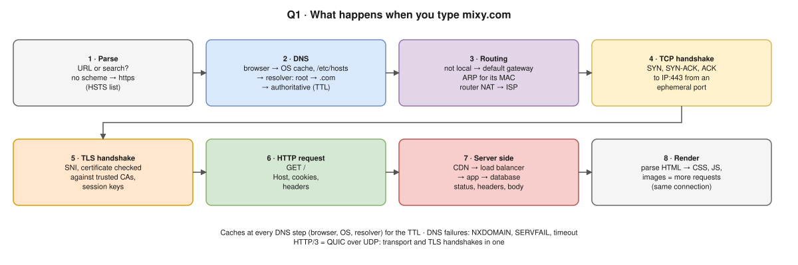

- Tell it as the 8 boxes, one sentence each. Name the protocol at each step (DNS, ARP, TCP, TLS, HTTP).
- **↳** "Where can the DNS answer be cached?" → browser, OS, recursive resolver, each up to the TTL. "DNS fails?" → NXDOMAIN (no such name), SERVFAIL (resolver problem) or timeout.

### Q2. What is the very first step? What does the browser do before anything else?

- Before any network call: **parse the input** (URL or search?) and **check its own caches**: HSTS list (force HTTPS), its DNS cache.
- Then the **OS resolver**: `/etc/hosts` first (order from `/etc/nsswitch.conf`), then DNS.
- Key idea: **cache first, network last**.
- **↳** Chrome's DNS cache → `chrome://net-internals/#dns`. Resolver on macOS → `mDNSResponder`.

### Q3. 🖥️ What is resolv.conf? How does the system know which resolver to use?


| Line | Meaning |
|---|---|
| `nameserver` | Up to 3, tried in order |
| `search` | Domains appended to short names |
| `options` | `ndots`, `timeout`, `attempts` |

- Written by DHCP, NetworkManager or systemd-resolved (`127.0.0.53` = local stub that forwards).
- **macOS:** the file is informational only; real config is `scutil --dns`.
- **Pod:** `nameserver` = CoreDNS Service IP, `search <ns>.svc.cluster.local svc.cluster.local cluster.local`, `ndots:5`. That's why `my-svc` resolves. `kubectl exec <pod> -- cat /etc/resolv.conf`.
- **↳** "`ndots:5`?" → a name with fewer than 5 dots tries every search domain first, so `api.stripe.com` fails several lookups first. Fix: trailing dot (Q6) or lower `ndots` in `dnsConfig`.

### Q4. 🖥️ How would you find the name servers for google.com? Which command?

- `dig NS google.com` (`+short`) · `nslookup -type=ns google.com` · `host -t ns google.com` · whole chain: `dig +trace google.com`. Answer: `ns1`–`ns4.google.com`.
- **↳** Query a specific server → `dig @8.8.8.8 google.com`, or the authoritative one: `dig @ns1.google.com google.com`.

### Q5. 🖥️ Which DNS utility comes pre-installed on macOS?

- `dig`, `nslookup`, `host` (all in `/usr/bin`). `dscacheutil -q host -a name google.com` goes through the system resolver and its cache.
- `dig`/`nslookup` **query DNS directly**: they skip `/etc/hosts` and the OS cache.
- **↳** "`ping` and `dig` give different IPs?" → `ping` uses the OS resolver (`/etc/hosts`, cache); `dig` asks DNS.

### Q6. What is the difference between google.com and google.com. with a trailing dot?

- Trailing dot = **FQDN**, absolute, ends at the root. No dot = relative: `search` domains may be appended (per `ndots`).
- **Kubernetes:** with `ndots:5`, `google.com` first tries `google.com.default.svc.cluster.local`…; `google.com.` goes straight out.
- **Zone files:** no dot → zone appended. Classic bug: CNAME `example.com` becomes `example.com.example.com.`
- **↳** "DNS slow in pods?" → `ndots:5` × search domains. Use FQDNs, tune `ndots`, or NodeLocal DNSCache.

### Q7. What does "non-authoritative answer" mean?

- It came from a **recursive resolver's cache**, not the zone's authoritative server. Not wrong, but can be **up to TTL seconds old**.
- Authoritative: `dig @ns1.google.com google.com` shows the `aa` flag.
- **↳** "Changed a record, users still see the old IP?" → cached until the TTL expires. Lower the TTL **before** a planned change.

### Q8. What is the Address field in that output?

| Block | Meaning |
|---|---|
| `Server:` / `Address: 192.168.1.1#53` (top) | The **resolver that answered you** (port 53) |
| `Name:` / `Address: 142.250.x.x` (under "Non-authoritative answer") | The **A record**: google.com's IPv4 (AAAA for IPv6) |

- **↳** "What is 192.168.1.1?" → usually your home router as a DNS forwarder (→ Q10).

### Q9. Explain the hierarchy of root, TLD and authoritative name server. Who answers what?

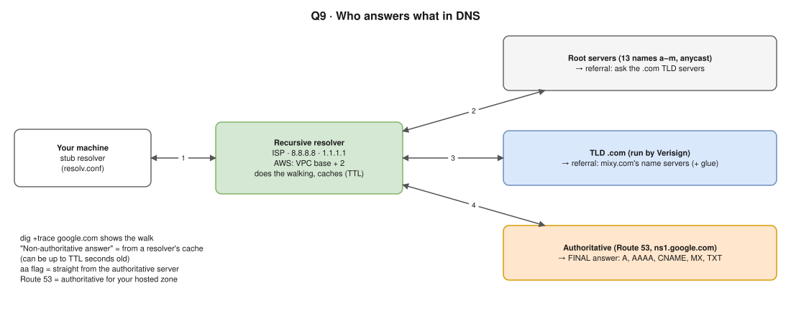

- Root: 13 names (a–m), well over a thousand anycast instances; it only refers you to the TLD.
- TLD refers you to the domain's name servers that the registrar set (NS records, plus glue when they're inside the domain).
- **↳** "Where does Route 53 fit?" → authoritative DNS for your hosted zone; point the domain's NS at it at the registrar. TTL = how long resolvers may cache.

---

# 2. IP addressing

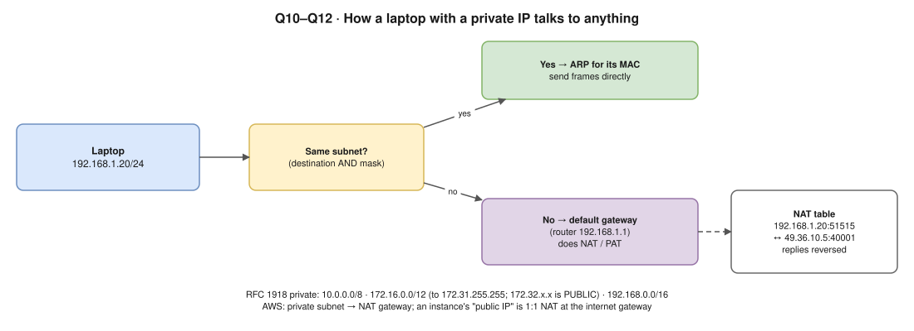

### Q10. Is that a private or a public IP address? Why do you say so?

- `192.168.1.1` is **private**: inside RFC 1918 `192.168.0.0/16`, not routable on the internet, reusable everywhere. Public = globally unique and routable.
- Other special ranges: `127.0.0.0/8` loopback · `169.254.0.0/16` link-local (AWS metadata `169.254.169.254`) · `100.64.0.0/10` carrier-grade NAT.
- **↳** AWS DNS resolver IP → VPC base +2 (`10.0.0.2`), private.

### Q11. If it is private, how is your laptop communicating with it?

- Follow the diagram: destination AND mask → same subnet = **ARP** and send directly; otherwise **default gateway**, which does **NAT/PAT** and keeps a NAT table.
- **AWS:** private subnet → NAT Gateway; an instance's public IP = 1:1 NAT at the internet gateway.
- **↳** "Show me the route." → `ip route` (`default via …`) or `netstat -rn` on macOS.

### Q12. Which ranges are private? Class A, B and C, with the actual boundaries.

| Class | CIDR | From – To |
|---|---|---|
| A | `10.0.0.0/8` | 10.0.0.0 – 10.255.255.255 |
| B | `172.16.0.0/12` | 172.16.0.0 – **172.31**.255.255 |
| C | `192.168.0.0/16` | 192.168.0.0 – 192.168.255.255 |

- Classes are obsolete (CIDR, 1993), but the names stuck. **Trap:** `172.32.x.x` is **public**.
- **↳** `/16` = 65,536 addresses; AWS reserves 5 per subnet. Overlapping ranges break peering, TGW and on-prem routing.

---

# 3. TCP, UDP and HTTP

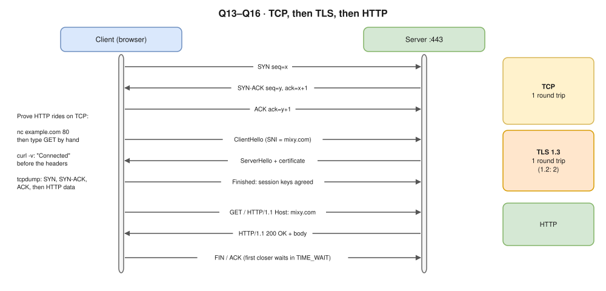

### Q13. You have the IP address. What happens next?

- Routing decision (local or gateway, ARP) → ephemeral source port → **TCP 3-way handshake** to `:443` → **TLS** (SNI, certificate, keys) → **HTTP** request, keep-alive.
- HTTP/3: **QUIC over UDP** does transport and TLS in one handshake.
- **↳** Round trips before the first data byte → 1 (TCP) + 1 (TLS 1.3; 2 for 1.2), then the request.

### Q14. Why does it need to create a TCP connection?

- IP is **best effort** (drops, duplicates, reorders). HTTP needs a **reliable, ordered, complete byte stream**.
- TCP gives: setup (agree sequence numbers) · **sequence numbers** (order) · **ACKs + retransmit** (loss) · **flow control** (receive window) · **congestion control**.
- **↳** Exact handshake → `SYN seq=x` → `SYN-ACK seq=y, ack=x+1` → `ACK ack=y+1`. Close: FIN/ACK; first closer waits in `TIME_WAIT`.

### Q15. What is TCP? If not TCP, what else could you use, and what is the difference?

| | TCP | UDP |
|---|---|---|
| Connection | Handshake first | None |
| Delivery | Guaranteed, in order | Best effort |
| Header | 20+ bytes, ACKs | 8 bytes |
| Used for | HTTP/1.1, HTTP/2, SSH, databases | DNS, video, voice, gaming, **QUIC (HTTP/3)** |

- QUIC = reliability on UDP in user space: no TCP head-of-line blocking, faster handshake.
- **↳** "DNS only UDP?" → UDP 53 normally; **TCP 53** when the reply is truncated (TC flag) and for zone transfers; DoT/DoH use TCP.

### Q16. 🖥️ Prove the notion that HTTP is built on top of TCP.

```text
nc example.com 80
GET / HTTP/1.1
Host: example.com
(press Enter twice)
```

- HTML comes back: HTTP/1.1 is **text over a TCP socket**. Piping on macOS: `(printf 'GET / HTTP/1.1\r\nHost: example.com\r\nConnection: close\r\n\r\n'; sleep 2) | nc example.com 80` (nc quits when input ends).
- `curl -v` prints `Connected to … port 80` **before** the headers · `sudo tcpdump -i any -nn port 80` shows SYN, SYN-ACK, ACK, **then** data, then FIN · DevTools Timing shows "Initial connection" · `ss -tnp` / `lsof -i -n -P` shows `ESTABLISHED`.
- **↳** HTTPS → `openssl s_client -crlf -connect example.com:443`. Always TCP? → no, HTTP/3 is QUIC over UDP.

### Q17. 🖥️ Open the browser network tab and explain what the request is actually doing.

| Tab / column | What to point at |
|---|---|
| **Headers** | URL, method, status (200/301/304), Remote Address `IP:443`; request: `Host`, `User-Agent`, `Accept-Encoding`, `Cookie`; response: `Content-Type`, `Cache-Control`, `Set-Cookie`, `Server` |
| **Timing** | Queueing → **DNS** → **Initial connection** (TCP) → **SSL** → Request sent → **Waiting (TTFB)** → Content download |
| **Columns** | Protocol (`h2`/`h3`), Initiator, Size ("from cache"), Waterfall |

- HTML first; the parser finds CSS, JS, images → more requests on the same connection.
- **↳** High TTFB → mostly server/backend time (it includes one round trip, so compare with connection time). 304 → `If-None-Match` + ETag says the cache is still valid.

---

# 4. Linux: processes, memory, ports

> Practise in a Linux container (`docker run -it --rm ubuntu bash`): macOS has a different `top` and no `free` or `ss`.

### Q18. 🖥️ Run top and explain everything on the screen.

| Area | Fields |
|---|---|
| Line 1 | time, uptime, users, **load average** 1/5/15 min |
| Tasks | total, running, sleeping, stopped, zombie |
| %Cpu | `us` user · `sy` kernel · `ni` niced · `id` idle · **`wa`** disk wait · `hi`/`si` interrupts · **`st`** steal (other VMs) |
| Mem / Swap | total, free, used, buff/cache, **avail Mem** |
| Columns | `PID` `USER` `PR` `NI` · `VIRT` reserved · **`RES`** in RAM · `SHR` · **`S`**: `R` run, `S` sleep, `D` uninterruptible I/O, `Z` zombie, `T` stopped, `I` idle · `%CPU` `%MEM` `TIME+` |

- Keys: `1` per CPU · `P`/`M` sort · `H` threads · `c` full command.
- **↳** 350% CPU → 3.5 cores. High `wa` → disk. High `st` → noisy neighbour or a T-class out of credits.

### Q19. What is load average? What is it actually measuring?

- Average tasks **running or waiting for CPU** (`R`), and on Linux **also `D`** (uninterruptible, usually disk/NFS). Smoothed over 1, 5, 15 min.
- **Compare with `nproc`:** 4 on 4 cores = full; 8 on 4 = queuing. 1-min > 15-min = rising.
- **↳** "Load 20, CPU 10%?" → many `D` tasks on I/O: `wa` in top, `iostat -x`, `ps -eo state,pid,cmd | grep '^D'`.

### Q20. Why do sleeping processes appear there? Why should they be there at all?


- Most processes **wait** (network, timer, lock, child): state `S`, holding memory and sockets but **no CPU**. One task per core runs at any instant; `top` lists all.
- A sleeping server (nginx waiting for connections) is **healthy**. `D` = mid-I/O, unkillable; `Z` = finished, parent hasn't collected the exit status.
- **↳** Kill a zombie → you can't; fix or kill the **parent**, PID 1 adopts and reaps it. Docker: your app is PID 1, so use `tini` / `docker run --init`.

### Q21. What is PPID?

- **Parent Process ID**: who forked this process. Everything is a tree under PID 1; orphans are re-parented to PID 1.
- `ps -ef`, `ps -o pid,ppid,cmd`, `pstree -p`. Use it to find **who keeps starting** a process.
- **↳** PID 1 in a container → your app; it ignores signals it has no handler for, so SIGTERM from `docker stop` is ignored and SIGKILL follows after the grace period. It must also reap zombies.

### Q22. What are threads in that output, and how do they relate to cores?

- Thread = schedulable unit inside a process; shares memory, own TID. `H` in top, `ps -eLf`.
- One logical CPU runs one thread at a time; hyper-threading = 2 logical per core (`lscpu`). More threads than cores is normal: CPU-bound gains nothing, I/O-bound is fine.
- **↳** Busy Java thread → `top -H -p <pid>`, TID to hex, find it in `jstack`. K8s: `cpu: 2` limit = 2 cores of time per period, so many busy threads **throttle** early.

### Q23. 🖥️ Find which process is occupying port 8080 on a given machine.

```bash
sudo ss -ltnp | grep :8080      # modern Linux
sudo lsof -i :8080              # also macOS
sudo fuser 8080/tcp
ps -fp <pid>                    # full command
```

- **↳** "Nothing shows, but 8080 answers." → a container: `docker ps` port mappings, or its network namespace. Check `127.0.0.1:8080` (local only) vs `0.0.0.0:8080` (all interfaces).

### Q24. 🖥️ In netstat output, what are Recv-Q and Send-Q? How are they useful when debugging?

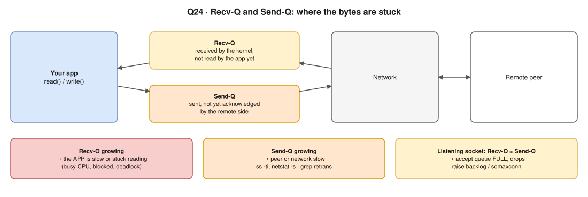

- Normally both ≈ 0. On a listening socket, Recv-Q = connections waiting for `accept()`, Send-Q = backlog size.
- **↳** Send-Q stuck high to one IP → `ss -ti` or `netstat -s | grep -i retrans`: network or peer.

### Q25. The laptop has 8 GB but free shows 6 GB. Where did the other 2 GB go?

- **Clarify first** (his style): 6 GB *total* or 6 GB *available*?
- **Total = 6 GB:** reserved before Linux sees it: integrated GPU, firmware and MMIO holes, `crashkernel=` (`/proc/cmdline`), or a VM given less / balloon driver. Check `dmesg | grep -i memory`, `sudo dmidecode -t memory`.
- **Available = 6 GB:** the rest is processes, kernel and **buff/cache** (page cache, reclaimable). Read the `available` column, not `free`.
- **↳** Apps can use buff/cache → yes, reclaimed on demand; never drop caches in production.

---

# 5. Debugging methodology

### Q26. example.com/ABC works but example.com/DEF does not. What is your debugging approach?

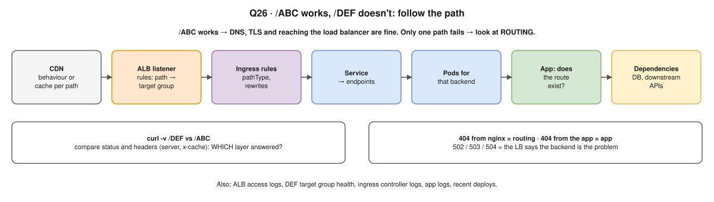

- **Clarify first** (Q27). Then walk the path left to right, and let the status code and `server` header say which layer answered.
- **↳** "It returns 502." → Q28.

### Q27. What do you need to ask me first? Ask me what "not getting accessed" means.

- Say: "Before I touch anything, what does 'not accessible' mean? It changes where I look." Then ask:
  - What happens: which error code, timeout, blank page, wrong content?
  - Who: everyone, one region, internal or external? Reproducible with `curl`?
  - Since when; did it ever work; any deploy, config, DNS or certificate change?
  - Constant or intermittent? Which environment and architecture?
- **This question is a test: actually ask.**

### Q28. It returns 502. What do 501, 502 and 503 each mean?

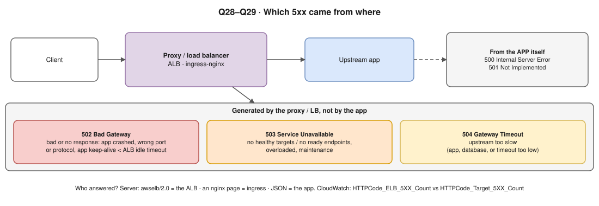

- **502, 503, 504 come from the proxy or load balancer**, not the app. 500 and 501 come from the app.
- K8s: a Service with **no ready endpoints** → the ingress returns 503.
- **↳** "ALB 502?" → target closed the connection or sent garbage, or classically the **app's keep-alive timeout is shorter than the ALB idle timeout** (make the app's longer).

### Q29. Given a 5xx, what do you check, and in what order?

1. **Who generated it?** `Server: awselb/2.0` = ALB · nginx page = ingress · JSON = app. CloudWatch: `HTTPCode_ELB_5XX_Count` vs `HTTPCode_Target_5XX_Count`.
2. **Scope and timing:** one path or all, since a deploy? Customers hit → **mitigate first** (roll back, scale).
3. **Target health** (Q30) → ingress logs (refused, timeout, reset) → pods (restarts, `OOMKilled`, readiness, `kubectl get endpoints`).
4. **App logs and traces** → dependencies (DB connections, slow queries, downstream, DNS).
5. **Recent infra changes:** SGs, NACLs, certificates, rotated secrets.

- **↳** "Customers down now?" → restore first (roll back, scale out, fail over), then root cause and a blameless postmortem.

### Q30. 🖥️ How do you check whether load balancer targets are healthy?

- **Console:** EC2 → Target Groups → **Targets**: `healthy`, `unhealthy`, `initial`, `draining`, `unused`, with a reason (`Target.Timeout`, `Target.ResponseCodeMismatch`, `Target.FailedHealthChecks`).
- **CLI:** `aws elbv2 describe-target-health --target-group-arn <arn>` · **CloudWatch:** `HealthyHostCount`, `UnHealthyHostCount`.
- Check the health check: path, port, protocol, matcher, interval, timeout, thresholds. `curl` the health path from inside the VPC.
- **K8s + AWS LB Controller:** `TargetGroupBinding`, target type `ip` vs `instance`, pod readiness gates.
- **↳** "Unhealthy, but curl works." → SG doesn't allow the **ALB's SG** on the port, health path returns **301/401**, wrong port, or timeout too short.

---

# 6. Ansible and configuration management *(low priority, skim)*

### Q31. How would you scale Ansible automation across cloud and on-prem, for stateful databases and stateless servers?

| Area | Answer |
|---|---|
| Inventory | Dynamic `aws_ec2` plugin (by tags) + static file or CMDB on-prem; `group_vars` per env/role |
| Code and execution | Roles in Git, reviewed; AWX / AAP or CI runners; on-prem via bastion (`ProxyJump`) or an on-prem runner |
| **Stateless** | **Immutable**: bake images (Packer + Ansible), replace via the ASG |
| **Stateful DB** | `serial: 1` + health checks, `--check --diff` first, back up, replicas → fail over → old primary, maintenance window |
| Speed / secrets | `forks`, `pipelining`, fact cache, `async` · Vault, or Secrets Manager lookups |

- **↳** Push or pull → `ansible-pull` for huge fleets or at boot.

### Q32. How does Ansible work? What protocol does it use underneath?

- **Agentless.** Control node turns each task into a small **Python module**, sends it over **SSH**, runs it with the target's Python, gets **JSON** back, cleans up.
- Modules are **idempotent** (desired state). Windows: **WinRM** or SSH; network gear: `network_cli`, `httpapi`.
- **↳** Pipelining → fewer SSH operations per task; needs `requiretty` off.

### Q33. Your playbook takes five minutes but the server's SSH daemon timeout is three minutes, so it fails. How do you handle that?

- **`async: 600` + `poll: 0`**, then an `async_status` loop (`until`/`retries`/`delay`); or `poll: 15` (short new connections). The session isn't held open.
- Idle timeout → `ServerAliveInterval` in `ssh_args`. Root cause → split the play or bake the slow step into the image. Changing `sshd` timeouts is the **last** option.
- **↳** Failure detection → `async_status` returns `finished`, `rc`; fail on non-zero.

### Q34. How do you safely change automation you are hesitant to touch?

- Understand it, then `ansible-playbook --check --diff` against the real inventory.
- Small PRs + review + `ansible-lint`; **Molecule** (create, converge, idempotence, verify, destroy) and staging.
- Blast radius: `--limit` one canary, `serial`, `max_fail_percentage`. Back up first; rollback plan; tests before refactoring.

---

# 7. CI/CD and delivery


### Q35. What is your suggestion around CI/CD overall?

- **Trunk-based**, short branches; PR checks (lint, unit, SAST, secrets, deps) in **under 10 minutes**.
- **Build once, promote everywhere** (diagram); **GitOps** with Argo CD.
- **Progressive delivery:** canary or blue/green with auto-rollback on metrics; feature flags separate deploy from release.
- **Security built in** (Q55): OIDC, signed images, SBOM. **Measure DORA**: deploy frequency, lead time, change failure rate, time to restore.
- **↳** Leads into Q37 → Q38 → Q39: practise them as one story.

### Q36. How do you maintain sanity between local development and the development environment?

- **Same Dockerfile and image** locally and in dev; `docker compose` (or kind + Tilt/Skaffold) with the **same** Postgres, Redis versions.
- **One command:** `make run`, `make test` (a bootcamp milestone). Config via env vars (12-factor), committed `.env.example`.
- Pin versions (runtime, lockfiles, base image digest), devcontainers, same migration tool, seed data, **preview environments per PR**.
- **↳** Local secrets → uncommitted `.env`, dev-only values from a vault or SSM, or dummies.

### Q37. Every branch merge means a rebuild. How do you reduce lead time to production?

- **Build once per commit, promote** (Q38).
- Faster builds: BuildKit cache (`cache-from` registry or GHA cache), dependency cache, multi-stage, parallel jobs, build only changed services.
- Fast tests on PR, heavy ones nightly; **automated gates** instead of manual approvals; small batches.
- **Measure where time goes**: waiting for runners and approvals usually beats the build itself.

### Q38. So you are saying I do not rebuild. What happens instead?

- Build **once** on merge, tag with the **commit SHA**, record the **digest**. Every environment runs that digest; promotion = a PR changing the tag.
- Environments differ **only by runtime config and secrets**. Benefits: what you tested is what ships, faster, reproducible, traceable to a commit.
- **↳** Per-env config → Helm values, ConfigMaps, Secrets Manager. Never per-env builds.

### Q39. If the dev image is deployed to QA, GitHub shows a divergence between the branch and what is running. How do you solve that?

- **Problem:** QA runs commit X, the `qa` branch is at Y; GitHub can't tell you what runs.
- **Fix: separate code version from deployment state.** SHA-tagged images, expose the version (label, `/version`); **no branch per environment**; GitOps folder per env is the source of truth (Argo CD shows the synced revision); GitHub Environments / Deployments API, semver tags.
- **↳** Prod hotfix → fix on main, build once, promote; or a release branch + cherry-pick, merged back.

### Q40. What security would you put around CI/CD and the network footprint?

| Area | Controls |
|---|---|
| Identity | **OIDC to AWS**, least-privilege role per pipeline/env (trust limited to repo, branch, env), minimal `permissions:` |
| Secrets | Secret manager, masked; **never to fork PRs**; careful with `pull_request_target` |
| Supply chain | **Pin actions to a SHA** (`tj-actions/changed-files`, March 2025), dependency scan, SBOM, **cosign** + verify at admission |
| Repo | Branch protection, reviews, CODEOWNERS, protected prod environment |
| Runners | Ephemeral, **private subnets**, no inbound, **egress allow-list**; no untrusted code on privileged runners |
| Network | **Pull-based deploys** (Argo CD in cluster), private EKS endpoint, VPC endpoints for ECR/S3 |
| Audit | GitHub audit log, CloudTrail |

- **↳** Why a SHA → a tag can be repointed to malicious code; a SHA can't.

---

# 8. Database and migration *(medium–low; RDS parts are AWS)*

### Q41. The database will not scale. What would you propose?

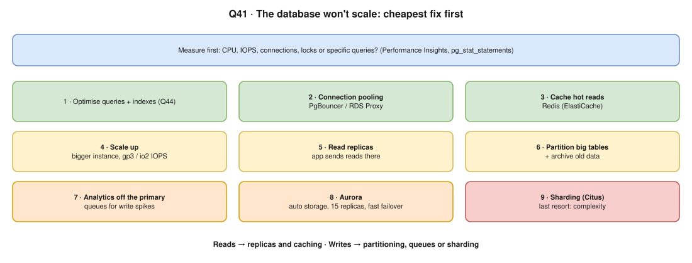

- **Measure first**, then climb the ladder from cheapest. Say why you stop where you stop.
- **↳** "Reads or writes?" → it decides: reads → replicas and cache; writes → partitioning, queues, sharding.

### Q42. How would you migrate Postgres from EC2 to RDS with live customer data and no downtime?

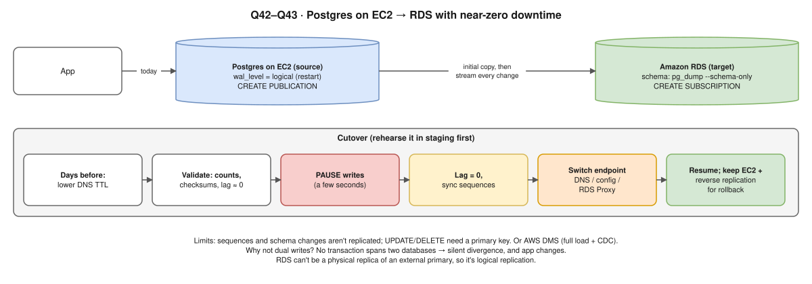

- **Assess:** version, extensions RDS supports, superuser features, size, write rate. **Prepare:** parameter group, same VPC, SGs, sizing.
- Copy + stream with **logical replication** (or **DMS**), validate, then the cutover row in the diagram.
- **Be honest: near-zero** downtime, a write pause of seconds. Rehearse in staging.

### Q43. Why can't Postgres on EC2 just sync to RDS asynchronously? Why complicate it with dual writes?

- **It can, and it should.** Async logical replication or CDC is **simpler and safer** than dual writes.
- **Dual writes:** no transaction spans two databases, so partial failures or reordering **silently diverge**, and the app must change.
- Async's only cost is lag: **pause writes until lag = 0** (source LSN = subscriber's applied LSN). RDS can't be a physical replica of an external primary, hence logical.
- **↳** Data-loss risk → only at cutover; freezing writes until lag 0 removes it. If even seconds are unacceptable, CDC or outbox, not app dual writes.

### Q44. Ten queries are slow. How do you go about optimising them?

1. **Rank by total impact** (`total_exec_time`, `calls` in `pg_stat_statements`), slow log, Performance Insights.
2. **`EXPLAIN (ANALYZE, BUFFERS)`**: seq scans on big tables, bad estimates, nested loops over large sets, sorts spilling to disk.
3. **Fix:** indexes (composite, partial, covering) with `CREATE INDEX CONCURRENTLY`; no `SELECT *`, no N+1, no functions on indexed columns, keyset pagination; `ANALYZE`, `VACUUM`, `work_mem`; cache or materialised views.
4. **Blocked, not slow?** `pg_stat_activity`, `wait_event`, locks. Measure before and after.

- **↳** Indexes slow writes → yes; drop unused ones (`idx_scan = 0` in `pg_stat_user_indexes`).

---

# 9. Observability *(medium–low; final step of One2N's bootcamp)*

### Q45. We have zero observability. How would you build the stack, at our future scale, on a tight budget?


- **Start from SLOs** for key journeys; **RED** for services, **USE** for infrastructure.
- Open source on **S3**: Prometheus (`kube-prometheus-stack`, node/kube-state/postgres/blackbox exporters; Mimir, Thanos or VictoriaMetrics long-term) · Alloy or Fluent Bit → **Loki** · OTel → **Tempo** · **Grafana** alerts → Slack/PagerDuty.
- **Cost:** retention tiers, drop noisy logs and high-cardinality labels, trace sampling, S3 lifecycle.
- **Phases:** metrics + golden-signal alerts → logs → traces; dashboards as code, a runbook per alert. Managed: CloudWatch (per-GB logs get expensive), AMP + Managed Grafana.

### Q46. 🖥️ Draw the flow architecture. How would it look?

- Draw the diagram above.
- **↳** Single points of failure → HA Prometheus pair (or agent mode + remote write), replicated Loki/Mimir, everything durable in S3.

### Q47. How would you monitor the on-premise services too?

- Same agents (`node_exporter`, exporters, blackbox). **Alloy or OTel Collector on-prem** scrapes locally and **pushes** (remote write) over VPN/DX: **outbound only**, no inbound holes.
- Logs via Alloy/Fluent Bit → Loki over TLS; consistent labels (`env`, `site`, `dc`); **monitor the link** (tunnel state, DX metrics, latency); agents buffer in a local WAL.

### Q48. Exporters will not surface slow-query detail. How do you get deep database metrics?

- **`pg_stat_statements`** (calls, time, rows, I/O), directly or via custom `postgres_exporter` queries.
- **Slow log** `log_min_duration_statement` (500 ms) + **`auto_explain`** → Loki or pgBadger. `pg_stat_activity`, `pg_locks`, `pg_stat_user_tables`.
- **RDS:** Performance Insights (load by wait event, top SQL) + Enhanced Monitoring. **Traces:** OTel DB spans show the query inside the request.
- **↳** Overhead → `pg_stat_statements` small; `auto_explain` with `analyze` larger, so sample it.

### Q49. How does Loki actually work, and when would you choose it over CloudWatch?

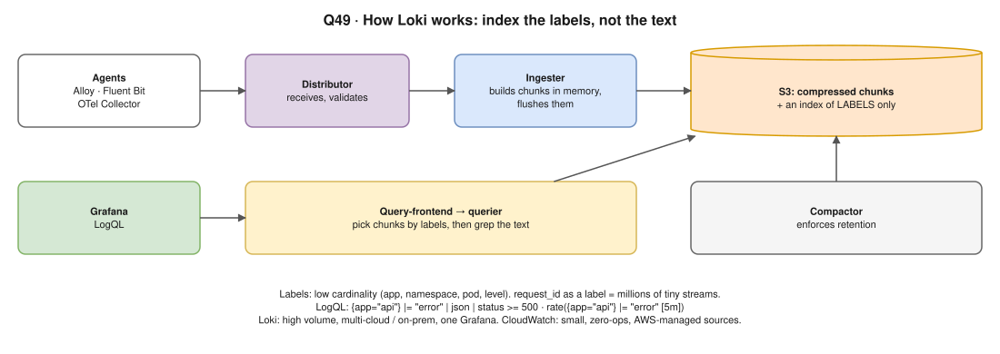

| Choose | When |
|---|---|
| **Loki** | High volume (cheap S3, not per-GB ingestion), multi-cloud or on-prem, one Grafana for everything |
| **CloudWatch** | Small, zero-ops, AWS-managed sources (Lambda, VPC Flow Logs), IAM built in |

- Trade-off: you run Loki, and full-text search over long ranges is slower than Elasticsearch. Agents: Alloy (preferred over Promtail), Fluent Bit, OTel.
- **↳** `request_id` as a label → cardinality explosion, millions of tiny streams, slow ingest and queries.

---

# 10. Hybrid connectivity *(medium; AWS networking)*


### Q50. How do you establish connectivity between AWS and on-prem? What are the best practices?

| | Site-to-Site VPN | Direct Connect |
|---|---|---|
| Path | IPsec over the internet, **2 tunnels** | Dedicated line, 1/10/100 Gbps |
| Speed | ~1.25 Gbps per classic tunnel (check current limits) | Consistent latency |
| Setup | Quick, cheap | Weeks, costs more |
| Encryption | Yes | **No by default**: MACsec or VPN over it |

- Terminate on a **Transit Gateway** (many VPCs) rather than a VGW (one VPC).
- **Best practices:** both tunnels, two customer devices, VPN as DX backup, two DX locations · **BGP** · **no overlapping CIDRs** · SGs, NACLs, on-prem firewall · `TunnelState` alarms · **Route 53 Resolver inbound/outbound endpoints**.
- **↳** More than 1.25 Gbps → several tunnels with ECMP on the TGW, or Direct Connect.

### Q51. How would you scale that connectivity model as services grow?

- **Hub and spoke** on TGW; **TGW route tables** to separate prod, non-prod, shared; multi-account via AWS RAM; peer TGWs across regions.
- **Central egress and inspection VPC** (NAT, Network Firewall); **VPC IPAM** for non-overlapping ranges and route summaries.
- **PrivateLink** or VPC Lattice for single services, even with overlapping CIDRs: see [Scenario A2](hemant-scenario-deep-dives.md#a2--two-clusters-two-vpcs-overlapping-cidrs-how-do-you-connect-them-).
- More bandwidth: DX LAG or more tunnels. Terraform it; VPC and TGW flow logs.
- **↳** Peering vs TGW → peering is a full mesh (n×(n−1)/2) and not transitive.

---

# 11. Consulting and framing *(always prepare)*

### Q52. Introduce yourself.

- 60–90 s: **now** (role, years, domain) → **strengths matching their focus** with concrete tools → **1–2 numbers** ("deploys 40 → 8 min", "30 services to EKS") → **why One2N**.
- **↳** He digs into **anything you mention**: say only what you can defend.

### Q53. Do you have exposure to a customer like ours, social media, in the past?

- Honest: "Not social media specifically, but systems with similar traits…", then show what it needs: read-heavy feeds → cache + CDN · viral spikes → HPA + Karpenter, queues, rate limits · media → S3 + CloudFront · fan-out → async queues · user data → privacy.
- **↳** Surviving a viral spike → CDN, autoscaling, queue-based load levelling, rate limiting, graceful degradation.

### Q54. 🖥️ Share your screen and walk us through how you are thinking about requirements and the roadmap.

| When | What |
|---|---|
| Understand | Goals, constraints (budget, team, compliance, timeline), current pain; write down assumptions |
| Weeks 1–2 | Discovery, access, quick wins: rotate secrets, basic alerts, **backups that restore** |
| Month 1 | Observability baseline, standard CI/CD with scanning, IaC for the core |
| Months 2–3 | DB scaling or RDS migration, K8s hardening, hybrid connectivity |
| After | SLOs, DR, cost, developer self-service |

- Prioritise by **risk and impact**; each item gets an outcome, metric, owner, risks.
- **↳** First 30 days → listen and map, secure obvious risks, one visible quick win.

---

# 12. 🔥 Assigned in their closing feedback *(top priority)*

### Q55. 🔥 What do shift-left principles actually mean in a pipeline?

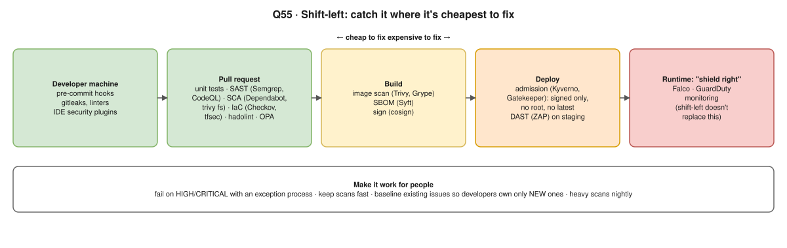

- **Definition:** move quality and security checks **earlier**, where problems are **cheapest to fix** (laptop or PR, not prod).
- Also at the PR: `trivy fs` / `trivy config` and secret scanning. Admission **enforces** what earlier stages only warned about.
- **↳** "Pipeline slow and noisy." → tune thresholds, baseline existing issues, heavy scans nightly, block only new criticals.

### Q56. 🔥 CI/CD security and OWASP: the top risks and where each control sits.

| # | OWASP CI/CD risk | Control | Where |
|---|---|---|---|
| 1 | Insufficient Flow Control (unreviewed code reaches prod) | Branch protection, required reviews, no self-approval, protected envs | Source control |
| 2 | Inadequate Identity and Access Management | SSO + MFA, least privilege, remove stale and shared accounts | Source control, CI |
| 3 | Dependency Chain Abuse (confusion, typosquatting) | Private registry/proxy, pin versions and hashes, scoped packages, scanning | Build |
| 4 | Poisoned Pipeline Execution | No secrets for untrusted PRs, pipeline config from protected branches, isolated runners | Pipeline |
| 5 | Insufficient Pipeline-Based Access Controls | Least-privilege creds per pipeline, OIDC scoped to repo/branch/env | Pipeline, IAM |
| 6 | Insufficient Credential Hygiene | Secret manager, rotation, masking, scanning, short-lived creds | Everywhere |
| 7 | Insecure System Configuration | Hardened, patched runners; network isolation | CI infra |
| 8 | Ungoverned Third-Party Services | Approve integrations, least-privilege scopes | Source control, CI |
| 9 | Improper Artifact Integrity Validation | cosign, SLSA provenance, deploy by digest, verify at admission | Registry, deploy |
| 10 | Insufficient Logging and Visibility | Central audit logs (GitHub, CloudTrail) + alerts | Monitoring |

- **↳** Real PPE example → a PR edits the `Makefile` or a test script that CI runs **with secrets** and sends them out. Fix: untrusted code runs without secrets on isolated runners.

### Q57. 🔥 OS security: how secrets leak, and how to prevent a repeat of the key incident.

> Recall the details of "the key incident" from your last interview and fit this answer to it.

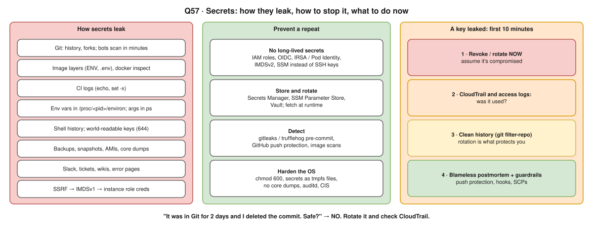

- Extra leak paths to name: `ps` shows command-line arguments to every user; private key files with mode 644; error pages and stack traces.
- Extra prevention: **enforce IMDSv2**; **SSM Session Manager** or short-lived SSH certificates; mount secrets as tmpfs **files**, not env vars or args; least-privilege users.
- **↳** "In Git for 2 days, commit deleted. Safe?" → **No.** Rotate and check CloudTrail.

### Q58. 🔥 Linux and networking fundamentals end to end.

Q1–Q25 told as **one 5-minute story**, then into containers and Kubernetes:

| Layer | Say |
|---|---|
| Client | Browser → DNS (`resolv.conf`, recursive, root → TLD → authoritative, TTL) |
| Network | Private/public IP, mask, gateway, ARP, NAT |
| Transport | TCP handshake, ports, sockets, Recv-Q/Send-Q → TLS → HTTP |
| Server | LB → process listening (`ss`), threads, CPU, load, memory (`top`, `free`), logs |
| Containers | Namespaces, `veth` + `docker0` bridge, **iptables NAT** for `-p`, PID 1, cgroups |
| Kubernetes | CNI gives pod IPs, **kube-proxy** (iptables/IPVS) makes Services, **CoreDNS** + `ndots:5` |
| AWS | Route tables, IGW and NAT GW, SG (stateful) vs NACL (stateless), resolver at base +2 |


- **↳** He'll stop at any step and ask "why?" or "show me": practise the 🖥️ commands.

---

## Further reading

- [What happens when… (Q1)](https://github.com/alex/what-happens-when)
- [Linux load averages (Brendan Gregg, Q19)](https://www.brendangregg.com/blog/2017-08-08/linux-load-averages.html)
- [Linux ate my RAM (Q25)](https://www.linuxatemyram.com/)
- [OWASP Top 10 CI/CD Security Risks (Q56)](https://owasp.org/www-project-top-10-ci-cd-security-risks/)
- [PostgreSQL logical replication (Q42–43)](https://www.postgresql.org/docs/current/logical-replication.html)
- [Loki architecture (Q49)](https://grafana.com/docs/loki/latest/get-started/architecture/)
- [AWS Site-to-Site VPN (Q50)](https://docs.aws.amazon.com/vpn/latest/s2svpn/VPC_VPN.html)
