# Hemant's Scenario Deep Dives ⭐🔥

On 7 Oct Hemant said the interview will be **scenario-based** and named three:
1. **Helm drift:** someone edited a Helm release's objects by hand. What does the next `helm upgrade` do?
2. **Overlapping VPC CIDRs:** two clusters, two VPCs, same IP range. How do you connect them?
3. **Node CIDR ≠ pod CIDR:** which technique is that? He pointed to One2N's post [Why Your EKS Auto Mode NodeClass Keeps Reverting to Default](https://one2n.io/blog/eks-auto-mode-nodeclass-reverting-to-default) (21 Sep 2026).

Part A goes deep on these three, **diagram first**. Part B has 20 more in the same style.

---

## How he asks, and how to answer ⭐

He pushes: **"What happens?" → "Why?" → "What else?" → "Which would you pick?" → "How would you check?"** Answer in 5 steps:

| Step | Say | Example (overlapping CIDRs) |
|---|---|---|
| 1. **Clarify** | 1–2 short questions | "Which direction, a few HTTP services or everything?" |
| 2. **Mechanism** | What really happens | "The local route always wins, so 10.0.x.x never leaves the VPC." |
| 3. **Options** | 2–4, each with its trade-off | Lattice · PrivateLink · private NAT + TGW · re-IP |
| 4. **Pick one** | Choice and **why** | "A few HTTP APIs → Lattice: no network changes." |
| 5. **Verify / prevent** | Prove it, stop a repeat | "Test from a pod; IPAM so VPCs never overlap." |

### The one idea behind all three of his scenarios: *who owns this?*

- **Helm drift:** Helm and a human both claim one field.
- **One2N's NodeClass bug:** Argo CD and EKS Auto Mode both claim one object.
- **Overlapping CIDRs:** two VPCs claim the same addresses.
- **Node vs pod CIDR:** you deliberately give pods **separate** address space.

"Keeps changing back" or "can't be reached" → ask **who else owns this?** Full table: [the two owners pattern](#the-two-owners-pattern-).

---

# Part A: the three scenarios he named

## A1 · Helm drift: someone edited the cluster, then we run `helm upgrade` again ⭐🔥

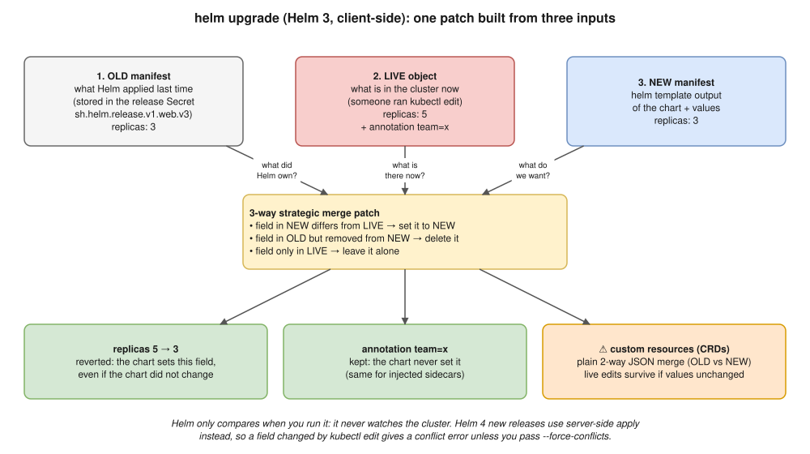

**Scenario:** release `web` (chart `replicas: 3`). During an incident someone ran `kubectl edit`: replicas → 5, annotation `team=x`. Next day CI runs `helm upgrade` with the **same** chart. What happens?

### Say this first (30 seconds)

> "It depends on the Helm version. **Helm 3** builds a 3-way merge patch from the **old manifest** in the release, the **live object** and the **new manifest**. Fields the chart sets go back to the chart's value, so replicas 5 → 3 even though the chart didn't change. Fields the chart never set, like that annotation or an Istio sidecar, are left alone. Helm doesn't watch the cluster, so drift stays until the next run.
>
> **Helm 4** uses **server-side apply** for new releases. `kubectl edit` made kubectl the owner of `replicas`, so the upgrade **fails with a conflict** unless you pass `--force-conflicts`.
>
> The real fix: Git is the only way to change prod. GitOps with self-heal, no edit rights for people."

### What each kind of edit leads to (Helm 3, client-side)

| Changed by hand | Next `helm upgrade` | Why |
|---|---|---|
| A field the **chart sets** | **Reverted** | NEW ≠ LIVE |
| Something the chart **never set** (annotation, sidecar, extra env) | **Kept** | Only in LIVE |
| **Deleted** a chart field | **Added back** | In NEW, missing from LIVE |
| The **chart dropped** a field | **Deleted** ⚠️ whole block if the block vanished from NEW, others' entries included | In OLD, not NEW |
| **Deleted the object** | **Recreated** | Missing, so Helm creates it |
| Edited a **custom resource** | ⚠️ **Edit survives** (unless the chart changed that field) | CRs get a 2-way JSON merge, OLD vs NEW only (`createPatch` in `pkg/kube/client.go`) |
| **HPA** changed replicas, chart sets `replicas:` | **Reset every deploy**, then HPA scales back | Two owners; don't template `replicas` with autoscaling on |


### Go deeper (all tested, in the Helm notes)

| Topic | Note |
|---|---|
| Why 3 inputs, the 3 rules, CSA vs SSA, `apply_method`, the `restartedAt` surprise | [Helm 02 · how upgrades work](helm-chart/02-how-upgrades-work.md) |
| SSA rules, the real conflict message, take back / keep / give away, the HPA handover trap | [Helm 03 · server-side apply](helm-chart/03-server-side-apply.md) |
| This scenario as a practise-out-loud script, see the drift, try it on kind | [Helm 04 · drift scenario](helm-chart/04-drift-scenario.md) |
| Stuck `pending-upgrade`, ownership metadata, `mapkubeapis`, `rollout undo` | [Helm 06 · troubleshooting](helm-chart/06-troubleshooting.md) |

### Follow-ups he's likely to ask

| He asks | Answer |
|---|---|
| How do you stop it happening? | **GitOps** (Argo CD `selfHeal: true`), **view-only RBAC** in prod, a time-limited audited **break-glass** role |
| Where is OLD kept? | Secret `sh.helm.release.v1.<release>.v<rev>` (chart, values, manifest, gzip + base64); `--history-max` 10 |
| How do you see the drift? | `helm get manifest web -n shop \| kubectl diff -n shop -f -` · who: `--show-managed-fields`, EKS audit logs |
| `another operation … in progress` | Release stuck `pending-upgrade`: `helm rollback` to the last good revision; CI concurrency group |
| `invalid ownership metadata` | Created outside Helm: add `managed-by=Helm` + `meta.helm.sh/release-*`, or `--take-ownership` |
| `no matches for kind … policy/v1beta1` after an EKS upgrade | Stored OLD uses a removed API: `helm mapkubeapis`; check with pluto / kubent first |
| Argo CD + Helm, same? | No: Argo renders and applies itself, self-heals continuously; `ignoreDifferences` for HPA replicas |
| `kubectl rollout undo` in prod? | Git, Helm and cluster now disagree; roll back with `git revert` or `helm rollback` |

---

## A2 · Two clusters, two VPCs, overlapping CIDRs: how do you connect them? ⭐🔥

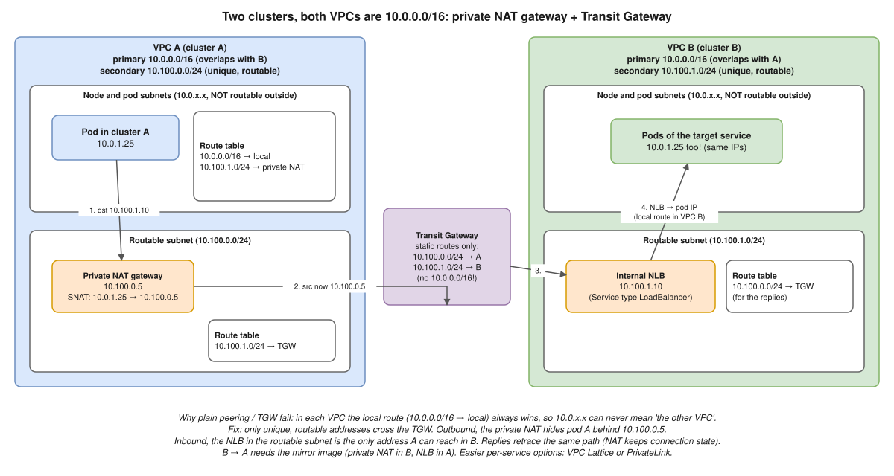

**Scenario:** VPC A and VPC B are **both `10.0.0.0/16`** (same template). A service in A must call an API in B.

### Clarify first (this alone impresses)

1. **What overlaps?** With the VPC CNI, node **and pod** IPs. Overlapping **Service CIDRs don't matter**: ClusterIPs never leave the cluster.
2. **Direction and size?** A few HTTP APIs A → B, or two-way on many ports?
3. **Same account and region? Temporary** (merger, migration) **or permanent?**

### Why the normal tools fail (the mechanism)

- **VPC peering:** AWS **refuses** overlapping CIDRs.
- **Transit Gateway:** attaches both but **can't route**: one route per prefix, and inside A **`10.0.0.0/16 → local` always wins**, so the packet never leaves.
- **Rule:** only unique addresses cross networks. Every working option **translates** addresses or **avoids IP routing**.

### What a Transit Gateway is (and why it can't route an overlap) ⭐

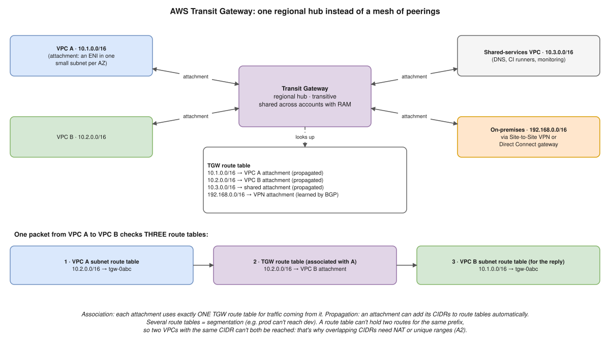

| | VPC peering | Transit Gateway |
|---|---|---|
| Shape | 1-to-1; 10 VPCs = 45 peerings | **Hub**; 10 VPCs = 10 attachments |
| Transitive | **No** | **Yes**, as its route tables allow |
| VPN, DX, on-prem | No | Yes |
| Cost | No hourly; data only across AZs/regions | Per attachment-hour + **per GB** |
| Overlap | **Refused** | Attaches, **can't route** |
| Cross-account | Accept a request | Share with **AWS RAM** |

- Words: **attachment** (an ENI in one subnet per AZ) · **association** (one route table per attachment) · **propagation** (auto-add CIDRs; BGP from VPN/DX; static and blackhole routes too) · **segmentation** (several tables).
- Classic mistake: forgetting the **reply route** in VPC B's subnet table.
- That's why option 3 sends **only unique ranges** (`10.100.x.x`) through the TGW, with static routes.

> **Say it:** "A Transit Gateway is a regional hub: VPCs, VPNs and Direct Connect attach once, and TGW route tables decide who reaches whom. Unlike peering it's transitive and scales, but it charges per GB. It still routes by IP, so two VPCs with the same CIDR can't both be reached through it."

### Your options

| Option | How | Best when | Trade-offs |
|---|---|---|---|
| **1. VPC Lattice** (EKS: AWS Gateway API Controller) | Service network; clients use link-local **169.254.171.0/24**, VPC IPs never matter | Several **HTTP/gRPC** services, many teams, **IAM auth** | Per service-hour, GB, request; mostly L7; SGs must allow 169.254.171.0/24 |
| **2. PrivateLink** | B: NLB → **endpoint service**. A: **interface endpoint** with an IP from **A's own subnet** | **1–2 TCP services**, one direction, cross-account | One endpoint per service per direction; provider sees the NLB IP (proxy protocol v2) |
| **3. Unique CIDR + private NAT + TGW** | Small unique CIDR per VPC; private NAT hides A; TGW carries **only** unique ranges; internal NLB in B | **Network-level** access, many ports, on-prem too | Most moving parts; NAT and TGW per GB; one direction per NAT |
| **4. Re-IP** | New VPC from **IPAM**, move apps blue/green, retire old | Permanent fix | Takes time, but it's the **real** fix |
| 5. **IPv6** | Pods get globally unique IPv6 | New clusters | IP family fixed at cluster creation |

**Not options:** peering (refused), plain TGW (can't route), "change the Service CIDR" (irrelevant), Cilium Cluster Mesh (needs unique pod CIDRs). Submariner Globalnet only outside AWS.

### Each option as a picture

All five: VPC A (blue) and VPC B (green), **both `10.0.0.0/16`**, a pod in A calls `orders` in B.

#### Option 1 · Amazon VPC Lattice

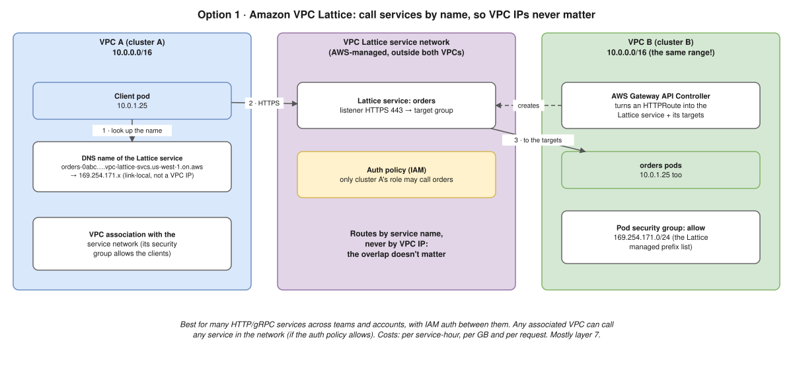

- Client calls a **name** → `169.254.171.x`; the service network routes by service, never VPC IP. On EKS an `HTTPRoute` becomes the Lattice service; an **IAM auth policy** says who may call.

#### Option 2 · AWS PrivateLink

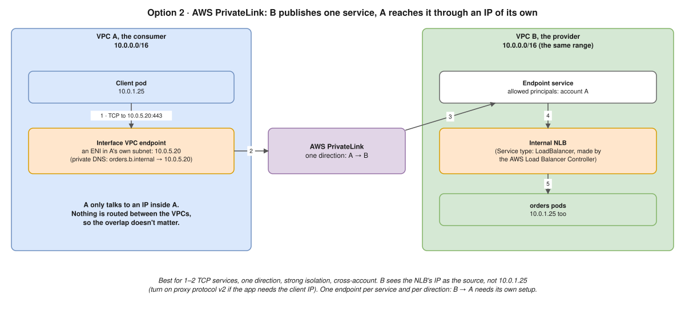

- B publishes pods → NLB → endpoint service; A talks only to its **own** address (`10.0.5.20`). One service, one direction.

#### Option 3 · Unique CIDR + private NAT + Transit Gateway


- Only `10.100.x.x` crosses the TGW. Packet walk [below](#walk-the-packet-option-3-as-in-the-diagram).

#### Option 4 · Remove the overlap (re-IP)

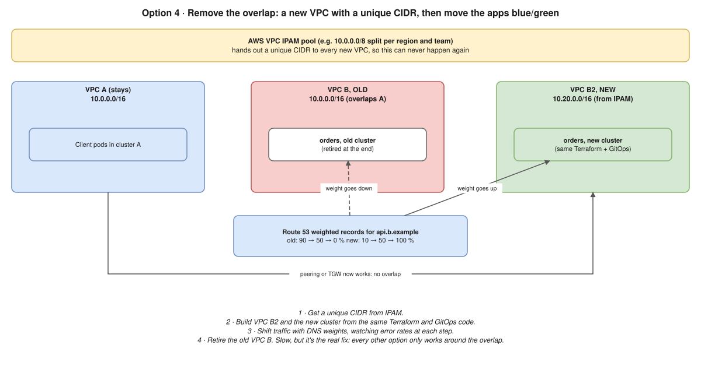

- VPC B2 from **IPAM**, shift with **Route 53 weights**, retire B; then plain peering or TGW works. The only option that **removes** the problem.

#### Option 5 · IPv6 clusters

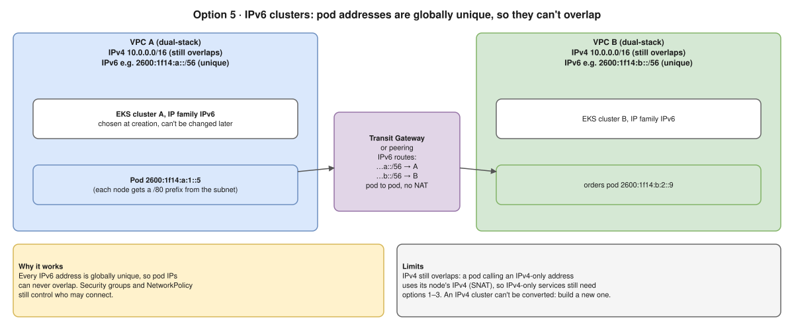

- Pods use each VPC's unique `/56`, so pod-to-pod routes with **no NAT**. IPv4-only traffic still needs options 1–3. New clusters only.

### What I'd pick (say a choice, then the reason)

- **A few HTTP APIs, A → B:** Lattice, or **PrivateLink** for one or two TCP services. No redesign, IAM or SG controlled.
- **Broad two-way connectivity:** unique CIDR + **private NAT** + **TGW**, internal NLBs inbound.
- **In parallel, fix the cause:** every new VPC CIDR from **IPAM** pools; never `10.0.0.0/16` again.

### Walk the packet (option 3, as in the diagram)

1. Pod A (`10.0.1.25`) calls `api.b.internal` → Route 53 private zone → **B's internal NLB `10.100.1.10`**.
2. A's pod subnet route: `10.100.1.0/24 → private NAT`.
3. NAT does **SNAT** `10.0.1.25 → 10.100.0.5`, then `10.100.1.0/24 → TGW`.
4. TGW static route `10.100.1.0/24 → VPC B`.
5. NLB → target pods; their `10.0.x.x` is local inside B, so fine.
6. Reply to `10.100.0.5` (`10.100.0.0/24 → TGW`); the NAT **remembers the connection** and translates back to `10.0.1.25`.

### Option 3: which load balancer receives the traffic? ⭐

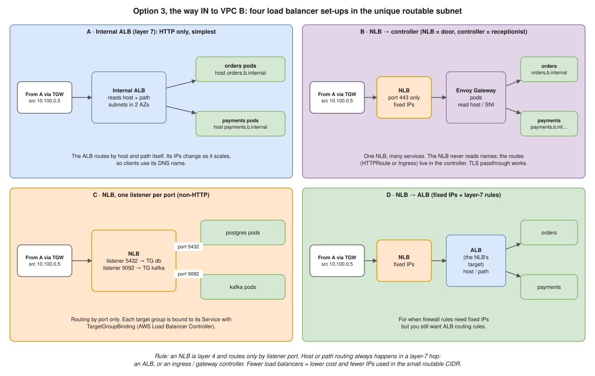

- The way in needs an IP in B's **unique** subnet. **Not one NLB per service**: each LB costs hourly and takes an IP per AZ from a deliberately small CIDR.
- **NLB = layer 4**: routes only by **listener port**, can pick a certificate but not route by name. Host/path routing needs a **layer-7 hop** (ALB, or an ingress/gateway controller).

| | Set-up | Who routes by host/path | Use it for |
|---|---|---|---|
| **A** | Internal **ALB** | The ALB | HTTP/gRPC only; share via `alb.ingress.kubernetes.io/group.name` |
| **B** | **NLB → controller pods** (Envoy Gateway) | The controller (NLB passes TCP 443) | HTTP + fixed IPs or TLS passthrough |
| **C** | **NLB, listener per port** | Nobody: by port (`5432`, `9092`) | Non-HTTP; `TargetGroupBinding` per Service |
| **D** | **NLB → ALB** | The ALB | Fixed IPs for firewalls + ALB routing |

- **Why NLB here:** fixed private IPs, any protocol, **one subnet is enough** (an ALB needs two AZs, so split the `/24` into two `/25`s), TLS passthrough.
- **With an ALB:** clients use its DNS name; SG allows the **NAT range**, not pod IPs; targets are `ip` type; B sees the **NAT IP** in `X-Forwarded-For`.

> **Say it:** "Not one NLB per service. An NLB routes only by port, so host or path routing needs a layer-7 hop: an internal ALB for plain HTTP, or an NLB in front of a gateway controller when I need fixed IPs or TLS passthrough. Non-HTTP services share an NLB with a listener per port."

### Two-way traffic ⭐

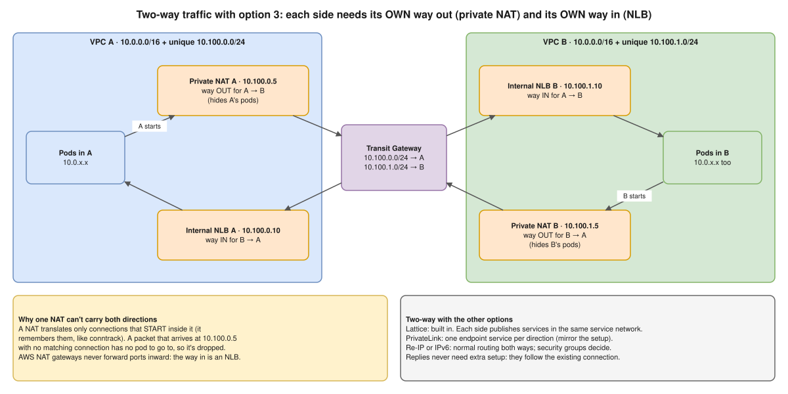

- **Two-way = both sides can START a connection.** Replies always come back.
- A NAT only translates connections **started inside it** (like your home Wi-Fi). An unknown packet to `10.100.0.5` is dropped. AWS NAT never forwards ports in: **the way in is always a load balancer**.

| | Way OUT | Way IN |
|---|---|---|
| VPC A | Private NAT A · `10.100.0.5` | Internal NLB A · `10.100.0.10` |
| VPC B | Private NAT B · `10.100.1.5` | Internal NLB B · `10.100.1.10` |

#### Can the other options do two-way? Yes, all of them

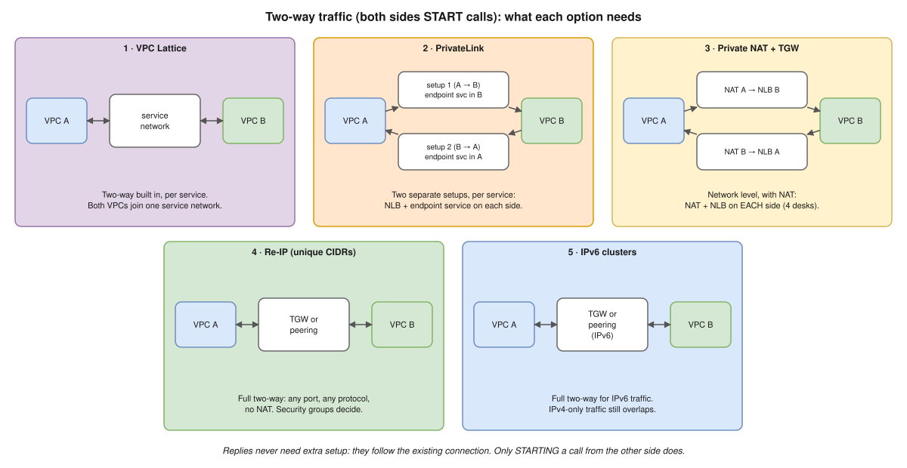

| Option | Two-way | What B → A needs |
|---|---|---|
| **1 · Lattice** | **Built in**, per service | A publishes into the same service network; an auth policy per service |
| **2 · PrivateLink** | Two one-way set-ups, per service | Mirror image; 5 services both ways = 10 endpoint services + 10 endpoints |
| **3 · NAT + TGW** | Network level, with NAT | NAT + NLB on **each** side |
| **4 · Re-IP** | **Full**, no NAT | Normal routes; SGs decide |
| **5 · IPv6** | For IPv6 traffic | Same as re-IP |

> **Say it:** "Lattice gives two-way per service with almost no extra setup. PrivateLink needs a mirrored setup per direction and service. Only re-IP or IPv6 give full network-level two-way without NAT."

### Why not a bastion host or a VPN? ⭐

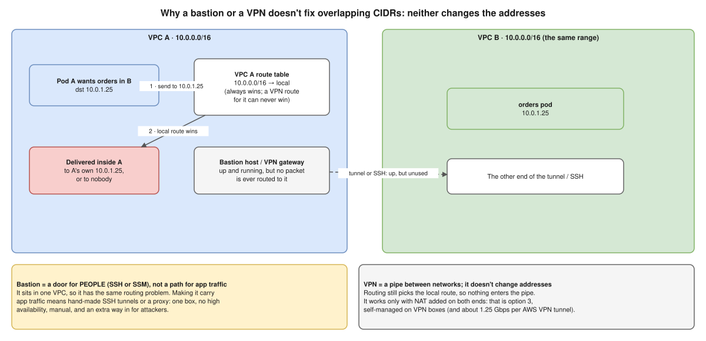

- **Bastion** = a door for **people**, in one VPC, with the same `10.0.0.0/16 → local` problem. Carrying app traffic means hand-made tunnels: no HA, a throughput cap, extra attack surface.
- **VPN** = a pipe; it changes no address. VPC A's local route wins, so **nothing enters the tunnel**. It only works with **NAT on both ends** on self-run appliances, which is option 3 self-managed (~1.25 Gbps per AWS tunnel). VPNs are for on-prem or another cloud.

> **Say it:** "A bastion is a door for people and a VPN is a pipe. Neither changes addresses, and with an overlap the problem *is* the addresses. Only three things work: translate (private NAT), avoid IP routing (Lattice, PrivateLink), or change the addresses (re-IP, IPv6)."

### Follow-ups he's likely to ask

| He asks | Answer |
|---|---|
| Can B start a connection to A? | Not with one NAT: add a private NAT in B and an NLB in A |
| Does B see pod A's IP? | No, the NAT or NLB IP. Use **mTLS / service identity**; proxy protocol v2 or `X-Forwarded-For` |
| DNS? | Route 53 **private hosted zone** on VPC A, or Lattice/PrivateLink names; ExternalDNS can create records |
| Cost? | NAT per hour + GB; TGW per attachment-hour + GB; PrivateLink per endpoint per AZ + GB; Lattice per service-hour, GB, request. "I'd model it", never guess |
| Prevent next time? | **VPC IPAM** pools per env and region, Terraform takes CIDRs from IPAM, a register including on-prem |

---

## A3 · Nodes in one CIDR, pods in another: how is that done? ⭐🔥

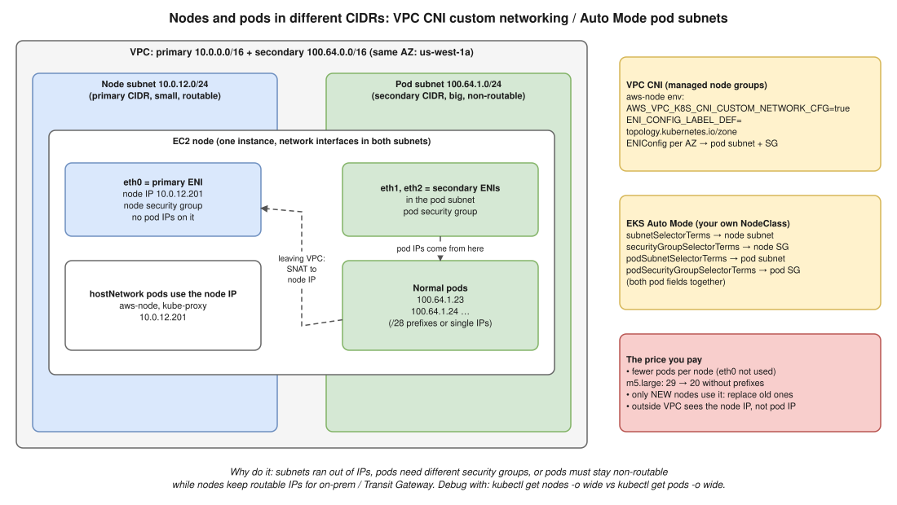

**Scenario:** `kubectl get nodes -o wide` shows `10.0.12.201`; `kubectl get pods -o wide` shows `100.64.1.23`. "Which technique, and how does it work?"

### Say this first (30 seconds)

> "With the VPC CNI, pods normally get IPs from **their node's subnet**. Different ranges means one of three things:
> 1. **VPC CNI custom networking:** a **secondary CIDR** (usually `100.64.0.0/10`) with pod subnets per AZ; an **ENIConfig** per AZ puts the node's **secondary ENIs** there; the **primary ENI keeps the node IP**.
> 2. **EKS Auto Mode:** the same idea via `podSubnetSelectorTerms` + `podSecurityGroupSelectorTerms` in a **custom NodeClass**.
> 3. An **overlay CNI** (Calico, Cilium overlay): the pod CIDR isn't in the VPC at all.
>
> I'd check the ENIConfigs, aws-node settings, the NodeClass and the instance's ENIs."

### Why teams do this

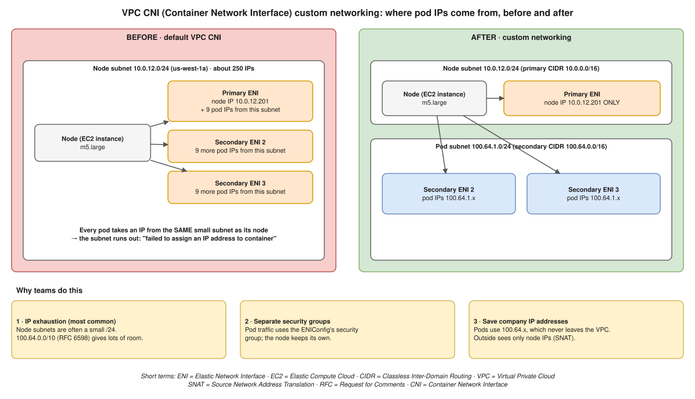

1. **IP exhaustion** (most common): small `/24` node subnets, and nodes pre-reserve pod IPs. `100.64.0.0/10` (RFC 6598) gives room.
2. **Separate security groups** for pod and node traffic.
3. **Pods stay non-routable**; on-prem and TGW only see node IPs, saving corporate RFC 1918 space.

### How VPC CNI custom networking works, step by step

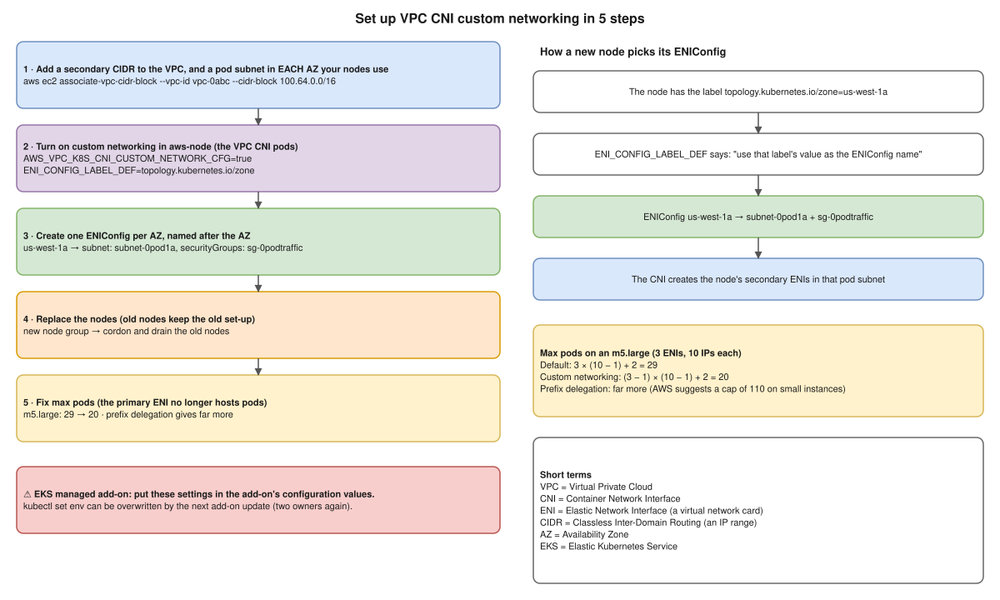

```bash
# 1. Secondary CIDR, then a pod subnet in EACH AZ your nodes use
aws ec2 associate-vpc-cidr-block --vpc-id vpc-0abc --cidr-block 100.64.0.0/16

# 2. Turn on custom networking; pick each node's ENIConfig by its AZ label
kubectl set env daemonset aws-node -n kube-system AWS_VPC_K8S_CNI_CUSTOM_NETWORK_CFG=true
kubectl set env daemonset aws-node -n kube-system ENI_CONFIG_LABEL_DEF=topology.kubernetes.io/zone
```

```yaml
# 3. One ENIConfig named after each AZ
apiVersion: crd.k8s.amazonaws.com/v1alpha1
kind: ENIConfig
metadata:
  name: us-west-1a            # = the AZ name
spec:
  subnet: subnet-0pod1a       # pod subnet from 100.64.0.0/16 in us-west-1a
  securityGroups:
  - sg-0podtraffic
```

- **4. Replace the nodes** (new nodes, then cordon and drain old ones).
- **5. Max pods drops:** **(ENIs − 1) × (IPs per ENI − 1) + 2**, m5.large **29 → 20**. Add **prefix delegation** (AWS suggests capping at 110 on small instances).
- ⚠️ On the **managed add-on**, set these in its **configuration values**: `kubectl set env` can be overwritten by the next add-on update (two owners again).

### What happens to a packet

| Traffic | Source IP seen | Security group |
|---|---|---|
| Pod → inside the VPC | **Pod IP** `100.64.1.23` | ENIConfig (pod) SG |
| Pod → outside the VPC (NAT, TGW) | **SNAT to node IP** `10.0.12.201` (`AWS_VPC_K8S_CNI_EXTERNALSNAT=false`) | Node SG, node subnet route table |
| On-prem → pod | ❌ `100.64.x` isn't advertised | Internal ALB/NLB in routable subnets (`target-type: ip`) |
| `hostNetwork` pods | Node IP | Node SG |

### The EKS Auto Mode version (what One2N did)

```yaml
apiVersion: eks.amazonaws.com/v1
kind: NodeClass
metadata:
  name: prod-nodeclass           # ⚠️ NOT "default"
spec:
  role: MyNodeRole
  subnetSelectorTerms:           # node primary ENI
  - tags: { Name: node-subnet }
  securityGroupSelectorTerms:
  - tags: { Name: eks-node-sg }
  podSubnetSelectorTerms:        # pod ENIs: set TOGETHER with the next field
  - tags: { kubernetes.io/role/pod: "1" }
  podSecurityGroupSelectorTerms:
  - tags: { Name: eks-pod-sg }
```

| Detail | Fact |
|---|---|
| NodePool | `nodeClassRef.name` → your NodeClass |
| Access entry | Custom NodeClass needs type **EC2** with `AmazonEKSAutoNodePolicy` (built-in gets one) |
| Pod IPs | **/28 prefixes** by default, fallback to single IPs; `advancedNetworking.ipv4PrefixSize: "32"` = singles only |
| `snatPolicy` | `Random` (default) SNATs to node IP leaving the VPC; `Disabled` keeps pod IPs everywhere |
| Pod SGs | Only inside the VPC; per NodeClass |
| AZ | Pod subnet in the **same AZ** as its node subnet; fewer pods per node |

### The One2N incident (expect this as a follow-up) ⭐

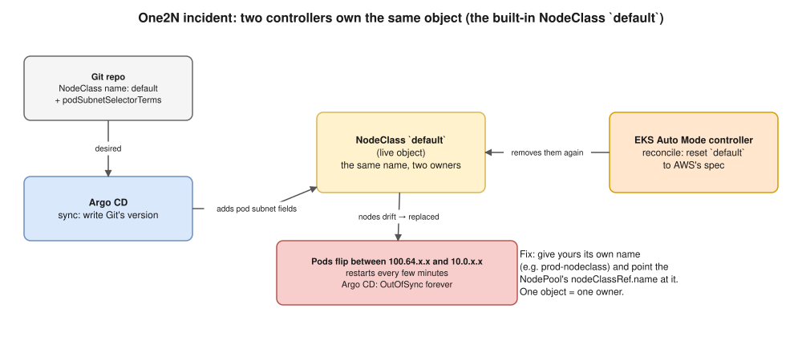

- **What:** pod CIDR added through **Argo CD** by editing NodeClass **`default`**. Pods got `100.64.x.x`, then **flipped back within ~5 minutes**, repeatedly; Argo CD **OutOfSync** after "successful" syncs.
- **Why:** Auto Mode **creates and owns `default`** when a built-in NodePool is on, and its controller stripped the pod fields. Two controllers, one object.
- **Fix:** rename to `<env>-nodeclass`, update `nodeClassRef`. AWS docs: *don't name your custom NodeClass `default`*.
- **Debug "keeps reverting":** `--show-managed-fields` (two managers), Argo CD sync history, `kubectl get nodes -L karpenter.sh/nodepool`, pod IPs over time.

### Follow-ups he's likely to ask

| He asks | Answer |
|---|---|
| Pods stuck `ContainerCreating`: `failed to assign an IP address` | Pod subnet full? ENIConfig for **this AZ**? Subnet in wrong AZ? CNI IAM? `kubectl describe pod`, `/var/log/aws-routed-eni/ipamd.log` |
| Enabled, but new pods still `10.0.x.x` | Old nodes; ENIConfig name ≠ AZ; add-on update wiped the env vars |
| Custom networking vs prefix delegation vs IPv6 | Prefix: more IPs, **same** subnet · custom: **separate** range · IPv6: solves it, new clusters only. Custom + prefix combine |
| Plain Kubernetes? | Three ranges: nodes, pods (`--cluster-cidr`, a `podCIDR` per node), Services (`--service-cluster-ip-range`, virtual). Overlay routes via VXLAN or BGP |
| Overlay CNI on EKS, catch? | Control plane **can't reach overlay pod IPs**: webhooks and metrics-server need `hostNetwork: true`; ALB `ip` targets don't work |

---

## The "two owners" pattern ⭐

| Owner 1 | Owner 2 | Symptom | Fix |
|---|---|---|---|
| Person (`kubectl edit`) | Helm | Reverted (Helm 3) or conflict (Helm 4) | Prod changes via Git only |
| HPA | Helm / Argo CD setting `replicas` | Replicas drop each deploy / OutOfSync | Don't template `replicas`; `ignoreDifferences` |
| Person | Argo CD `selfHeal` | Edit undone in minutes | The point of GitOps: change Git |
| Argo CD | EKS Auto Mode (`default` NodeClass) | Fields stripped, pods flip IPs | Your own NodeClass name |
| `kubectl set env aws-node` | Managed add-on update | Settings lost | Add-on configuration values |
| Two CI pipelines | One Helm release | `another operation … in progress` | Concurrency group, or GitOps |
| VPC A | VPC B (same CIDR) | No route | Translate (NAT, Lattice, PrivateLink) or re-IP |

**See owners:** `kubectl get <obj> -o yaml --show-managed-fields`, the Argo CD diff, EKS audit logs.

---

# Part B: more scenarios, Hemant style

**Say** = the core answer · **↳** = his push. ⭐ = most likely.

## 🐳 Docker

| # | Scenario | Say | ↳ |
|---|---|---|---|
| B1 ⭐ | Distroless, no shell or curl: can it reach the DB? | Debug container sharing the network: `kubectl debug -it <pod> --image=nicolaka/netshoot --target=app`, then `nc -zv db 5432`. Docker: `--network container:<name>`. Bash, no curl: `timeout 5 bash -c '</dev/tcp/db/5432'` ([One2N, 1 Oct 2026](https://one2n.io/blog/test-tcp-connectivity-without-curl-bash-dev-tcp)) | `/dev/tcp` limits → bash only, no TLS, no timeout. *Refused* = port closed; *timeout* = firewall/SG |
| B2 | Works on my Mac, `exec format error` on EKS | Built **arm64**, nodes **amd64**: `docker buildx build --platform linux/amd64,linux/arm64 --push`, check `buildx imagetools inspect` | Why arm64 → Graviton is cheaper |
| B3 ⭐ | Same tag `v1` pushed, half the pods run old code | Tags are mutable; `IfNotPresent` keeps the cached image. **Unique tag (SHA) or digest** + ECR tag immutability | `Always`? → pulls on every start, running pods still don't change |
| B4 | `docker stop` takes 10 s, exit 137 | Shell-form `CMD` makes `sh` PID 1, no SIGTERM forwarded; SIGKILL after 10 s = 128 + 9. Exec-form, `exec "$@"`, `--init`, handle SIGTERM | K8s → same, 30 s `terminationGracePeriodSeconds` ([05 Pods](kubernetes/05-pods.md)) |

## ☸️ Kubernetes

| # | Scenario | Say | ↳ |
|---|---|---|---|
| B5 ⭐ | ConfigMap updated, app uses old values | Env vars read at start; mounted files update after ~1 min **except `subPath`**, and the app must re-read. `rollout restart`, Helm `checksum/config`, Kustomize hash suffix | Secrets → same rules |
| B6 ⭐ | Node NotReady: what happens to its pods? | **50 s** no heartbeat → `unreachable:NoExecute` taint → default toleration **300 s** → evicted, recreated. **StatefulSet pods wait** until the node is confirmed gone | Faster → shorter `tolerationSeconds`; `out-of-service` taint; a PDB **doesn't help** (involuntary) |
| B7 | Rollout stuck on readiness: auto rollback? | **No.** Old pods keep serving; after 600 s `ProgressDeadlineExceeded`, nothing more. `rollout undo`, Helm `--rollback-on-failure` (`--atomic` in 3), Argo Rollouts | |
| B8 ⭐ | After EKS upgrade, `helm upgrade`: `no matches … policy/v1beta1` | Stored release uses the removed API → `helm mapkubeapis`; pluto, kubent, **EKS upgrade insights** first ([Helm 06](helm-chart/06-troubleshooting.md)) | |
| B9 | Karpenter / Auto Mode moves pods in business hours | **Consolidation.** PDBs, `karpenter.sh/do-not-disrupt: "true"`, NodePool **disruption budgets** with a schedule (`nodes: "0"`), or `WhenEmpty` | |

## ☁️ AWS

| # | Scenario | Say | ↳ |
|---|---|---|---|
| B10 ⭐ | Private pods can't pull ECR: `i/o timeout` | **Timeout = network, 401/403 = permissions.** NAT, or endpoints `ecr.api` + `ecr.dkr` + **S3 gateway** (+ `sts`, `logs` for private clusters); endpoint SG 443, private DNS on. Node role `AmazonEC2ContainerRegistryReadOnly`; cross-account repo policy | Why S3 → ECR layers live in S3 |
| B11 | NAT bill jumped | Cost Explorer `NatGateway-Bytes` + **Flow Logs** (top talkers). Causes: S3/ECR via NAT (free S3 gateway endpoint), cross-AZ NAT (one **per AZ**), chatty external logging | |
| B12 | ALB 502s during every deploy | ALB hits terminating or not-ready pods. **Readiness gates** (`elbv2.k8s.aws/pod-readiness-gate-inject=enabled`), `preStop` sleep > deregistration delay, SIGTERM handling, `target-type: ip` | |
| B13 | Private EKS endpoint: kubectl times out from laptops and CI | Resolves to VPC IPs. VPN/DX, bastion or SSM tunnel; or public with `publicAccessCidrs`; CI: runners in the VPC, or GitOps pull | |

## 🔄 CI/CD

| # | Scenario | Say | ↳ |
|---|---|---|---|
| B14 ⭐ | Second pipeline: `another operation … in progress` | Release is `pending-upgrade`. `concurrency: { group: deploy-prod, cancel-in-progress: false }`; killed job → `helm rollback`; GitOps avoids it | |
| B15 | `helm upgrade` green, app down | Without `--wait` Helm returns when the API **accepts** objects. `--wait --timeout 5m` + `--rollback-on-failure` / `--atomic` + smoke test; better: Argo health + Rollouts analysis | |
| B16 | Roll back prod now | Through **the tool that deployed**: `git revert` (Argo syncs) or `helm rollback web <rev>`. `kubectl rollout undo` = drift ([A1](#a1--helm-drift-someone-edited-the-cluster-then-we-run-helm-upgrade-again-)) | Database? → only if schema changes are backward compatible: expand, then contract |

## 🔥 Security

| # | Scenario | Say | ↳ |
|---|---|---|---|
| B17 ⭐ | Dev wants cluster-admin on prod | No: namespace **view** + `pods/log`, `pods/exec` only if needed. Emergencies: **time-limited break-glass** via access entries, approved and audited | `create pods` → privileged pod = **node takeover** unless PSA blocks it; `list secrets` = read every secret |
| B18 | Compromised pod mining crypto | **Contain, keep evidence, clean up:** deny-all NetworkPolicy + cordon → capture YAML, logs, node snapshot → revoke AWS access (Pod Identity / IRSA) → rotate readable secrets → delete. Then find the entry; **GuardDuty EKS runtime monitoring** | |
| B19 | Critical CVE in the base image of 40 services | **ECR enhanced scanning** (Inspector) lists them → rebuild from patched base (Renovate/Dependabot) via the pipeline → admission policy blocks unsigned or critical-CVE images | |
| B20 | DB passwords committed in `values.yaml` | **Rotate first** → `git filter-repo` + force-push → **External Secrets Operator** + Secrets Manager (Pod Identity) or SOPS; **gitleaks** pre-commit and CI. See [model answer Q57](hemant-model-answers.md) | |

---

## Videos for these scenarios (all checked: link, title, channel, length)

| | Video | Channel | Length | For |
|---|---|---|---|---|
| ⭐ | [How Amazon VPC CNI for k8s works](https://www.youtube.com/watch?v=RBE3yk2UlYA) | Containers from the Couch (AWS) | 9 min | A3: ENIs, prefixes, custom networking |
| ⭐ | [Running Out of IPs on EKS? Use Secondary CIDR + VPC CNI Plugin](https://www.youtube.com/watch?v=69OE4LwzdJE) | DevOps World | 10 min | A3: secondary CIDR, step by step |
| ⭐ | [How to Solve for Overlapping IP Addresses](https://www.youtube.com/watch?v=vM1sO_huJvw) | F5 DevCentral | 4 min | A2: overlap and the ways out |
| ⭐ | [Fix Overlapping Network Addresses in AWS: How to Use Private NAT Gateway](https://www.youtube.com/watch?v=fIcKD8jASyQ) | Lepczynski | 15 min | A2: option 3 demo |
| ⭐ | [What Problem AWS VPC Lattice Actually Solves](https://www.youtube.com/watch?v=EpuVruSutAM) | TheBlueprintInfra | 2 min | A2: option 1 |
| 🔁 | [Amazon VPC Lattice: EKS](https://www.youtube.com/watch?v=jtfvD1kytSE) | Amazon Web Services | 5 min | A2: Lattice with EKS |
| 🔁 | [Helm 2 vs Helm 3](https://www.youtube.com/watch?v=dqMSOtWZRws) | KodeKloud | 8 min | A1 background |
| 🔁 | [Kubernetes managedFields explained](https://www.youtube.com/watch?v=P12z8X-qhis) | Aqua Security Open Source | 14 min | A1 / Helm 4 field managers |

No good video yet for Helm 4 server-side apply or Auto Mode pod subnets: use the Helm notes, A3 and the One2N post.

## Sources

- **One2N:** [NodeClass reverting to default](https://one2n.io/blog/eks-auto-mode-nodeclass-reverting-to-default) · [TCP test without curl](https://one2n.io/blog/test-tcp-connectivity-without-curl-bash-dev-tcp)
- **Helm:** [Changes since Helm 2](https://helm.sh/docs/faq/changes_since_helm2/) · [helm upgrade flags](https://helm.sh/docs/helm/helm_upgrade/) · [HIP-0023 server-side apply](https://helm.sh/community/hips/hip-0023)
- **Kubernetes:** [Server-side apply](https://kubernetes.io/docs/reference/using-api/server-side-apply/)
- **EKS:** [Custom networking tutorial](https://docs.aws.amazon.com/eks/latest/userguide/cni-custom-network-tutorial.html) · [best practices](https://docs.aws.amazon.com/eks/latest/best-practices/custom-networking.html) · [Auto Mode NodeClass](https://docs.aws.amazon.com/eks/latest/userguide/create-node-class.html)
- **AWS networking:** [Private NAT for overlapping CIDRs](https://aws.amazon.com/blogs/containers/addressing-ipv4-address-exhaustion-in-amazon-eks-clusters-using-private-nat-gateways) · [VPC Lattice with EKS](https://aws.amazon.com/blogs/containers/application-networking-with-amazon-vpc-lattice-and-amazon-eks/)
