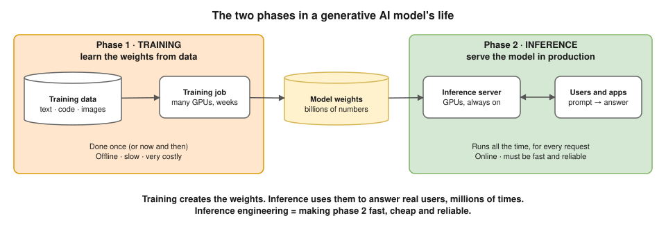
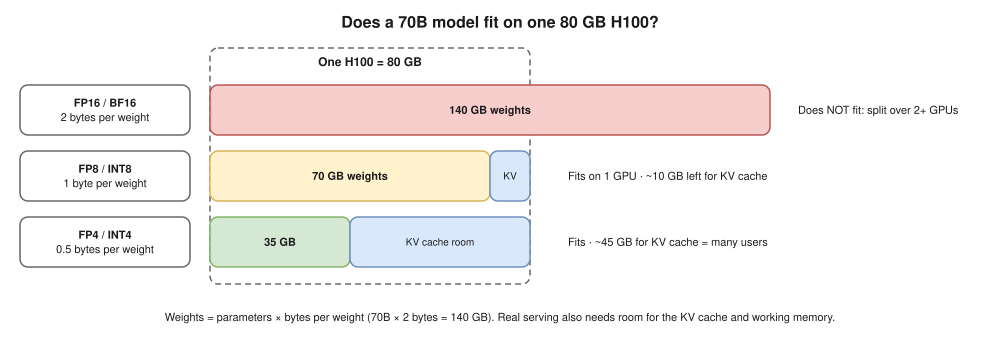
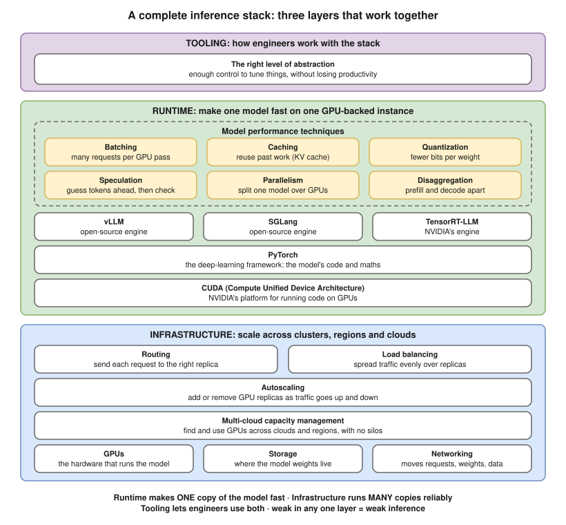
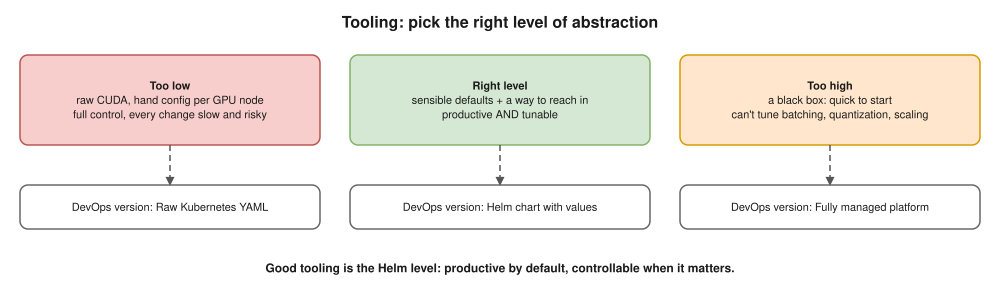

# 01 · Inference Fundamentals

> **Source:** *Inference Engineering* by Philip Kiely (Baseten), introduction and Figure 0.1, in my own words.

## What is inference? ⭐

| | Training | Inference |
|---|---|---|
| What | **Learn** the weights from data | **Serve** the model in production |
| In → out | Huge dataset → weights (billions of numbers) | One prompt → an answer |
| How often · speed | Once, can take weeks | Every request, seconds or less |
| Goal | A **smart** model | A **fast, cheap, reliable** model |

- **Weights** = the numbers learned in training; the model's "knowledge". Inference loads them onto GPUs and runs each input through them.
- **Analogy:** training = a chef learning recipes once; inference = cooking orders all day for waiting customers.

## Why generative AI inference is hard ⭐

| | Classic ML (XGBoost) | Generative AI (LLM) |
|---|---|---|
| Model size | KBs–MBs | GBs–hundreds of GBs |
| Hardware | Cheap CPUs | Scarce, expensive GPUs |
| One request | One quick calculation (fraud: yes/no) | **One token at a time**, each a full pass through the model |
| Request cost | About the same | Varies hugely (10 words vs 2,000) |

- **Token** ≈ ¾ of an English word.
- Book's key point: you can't just put weights on GPUs and expect production-grade speed and reliability. It needs engineering.

## The three layers ⭐

| Layer | Question | Scope |
|---|---|---|
| **1. Runtime** | How fast can **one copy** run? | One model on one GPU-backed instance ([02](02-runtime-layer.md), [03](03-model-performance-techniques.md)) |
| **2. Infrastructure** | How do we run **many copies** without breaking? | Clusters, regions, clouds: **no silos**, excellent uptime |
| **3. Tooling** | How do engineers work with it without drowning? | The right abstraction |

- Slow runtime + scaling = **many slow copies** and a huge GPU bill.
- **Silo** = GPU capacity locked in one cluster or cloud: one region idle, another overloaded. Treat all GPUs as **one pool**.
- All three must work together for **mission-critical inference**: "model down" = "product down".

## Runtime boxes

| Box | One line |
|---|---|
| **CUDA** | NVIDIA's platform for running code on GPUs; everything ends up as CUDA work |
| **PyTorch** | The deep-learning framework the model is written in |
| **vLLM** · **SGLang** | Open-source LLM inference engines |
| **TensorRT-LLM** | NVIDIA's engine, tuned to NVIDIA GPUs |
| **6 techniques** | Batching, caching, quantization, speculation, parallelism, disaggregation ([03](03-model-performance-techniques.md)) |

## Infrastructure boxes: home ground, with GPU twists

| Box | What I already know | The GPU twist |
|---|---|---|
| **Autoscaling** | HPA, Karpenter | A replica takes **minutes** to start (big image + GBs of weights). CPU % is the wrong signal; use queue length / requests in flight |
| **Load balancing** | ALB, NGINX | Requests vary hugely in cost: round-robin piles up long ones. Use least-outstanding-requests |
| **Routing** | Ingress, path rules | Also route to the replica that **already caches this prompt's start** |
| **Multi-cloud capacity** | Multi-region, multi-AZ | GPUs are scarce and quota-limited: take capacity wherever it exists |
| **Storage** | S3, EBS, PVCs | Pulling 140 GB from S3 every cold start is slow: cache weights near the GPU |
| **Networking** | VPC, DNS, NAT | GPUs of one split model talk over **NVLink** (in a machine) or **InfiniBand** (between machines) |
| **GPUs** | – | The expensive, hard-to-get hardware |

## Check yourself (say it out loud)

| Question | Answer |
|---|---|
| Training vs inference? | Training learns the weights once, offline. Inference serves real users all the time, fast and reliably. |
| Why is genAI inference hard? | Huge models on scarce GPUs, generating token by token, with very different cost per request. |
| Just put the weights on a GPU? | Not at scale: 70B at 16-bit = 140 GB, an H100 has 80 GB. It doesn't even fit. |
| The three layers? | Runtime (one copy fast), infrastructure (many copies, no silos, uptime), tooling (right abstraction). |
| What's a silo? | GPU capacity stuck in one place: idle here, overloaded there, you pay for both. |
| Draw the stack | Redraw the stack diagram from memory, one line per box. |
