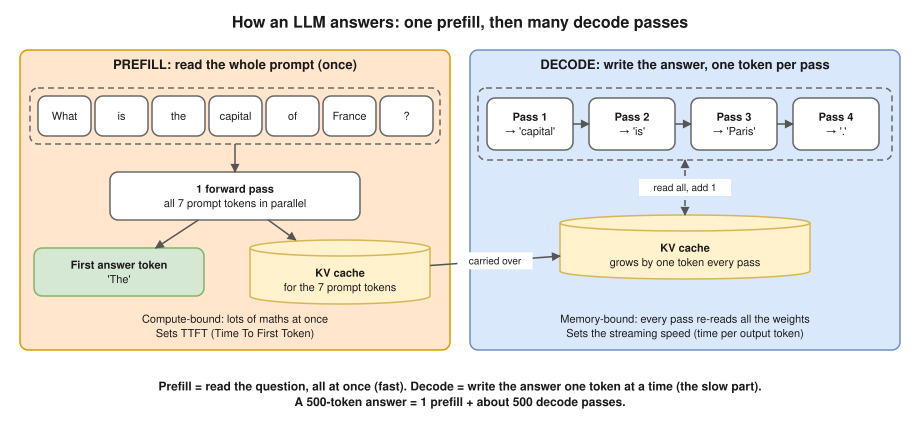
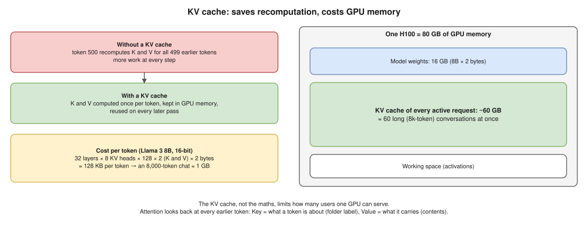
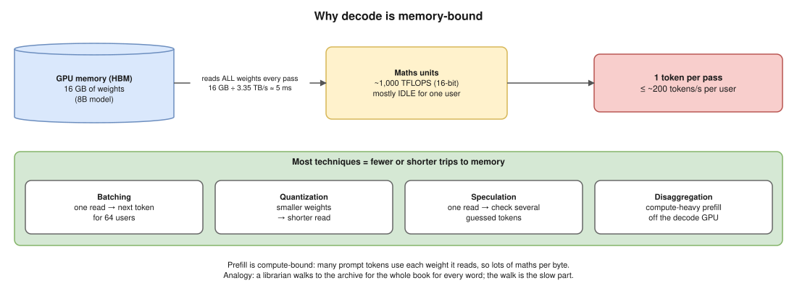
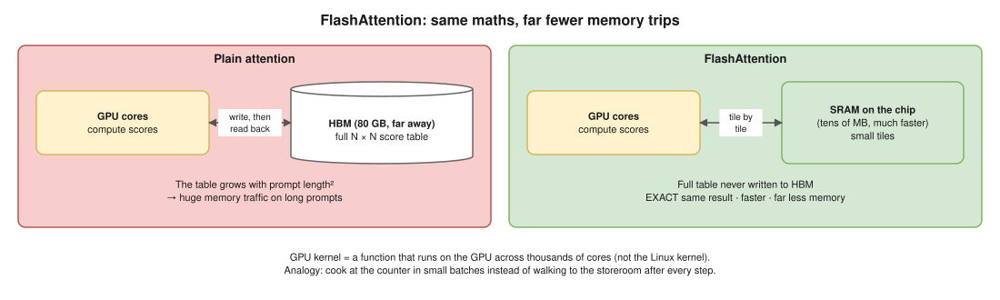

# 02 · The Runtime Layer

> **Source:** *Inference Engineering* by Philip Kiely (Baseten), the runtime layer section. Written in my own words, plus the basics the book assumes you already know.

**Reminder from [01](01-fundamentals.md):** the runtime layer's job is to make **one model fast on one GPU-backed instance** (one machine with GPUs, Graphics Processing Units).

> **DevOps link:** in Kubernetes terms, the runtime layer is everything **inside one pod that has a GPU**. The infrastructure layer is everything about **many pods** (scaling, routing, regions).

**What the book says, in short:**

1. The runtime sits on a **deep software stack**: CUDA → PyTorch → an inference engine (vLLM, SGLang or TensorRT-LLM).
2. **Low-level optimization matters.** Better **kernels**, like **FlashAttention**, give big speed-ups.
3. It uses **six model performance techniques** that bring new research to the special problems of generative AI inference. Those are in [03](03-model-performance-techniques.md).

To really understand any of that, you need four basics first.

## Part 1 · Four basics you need first ⭐

### 1. Forward pass

A **forward pass** = running input through **all the layers** of the model once, to get an output. For an LLM (Large Language Model), one forward pass gives a score for every possible next token, and one token is picked. Every forward pass has to **read all the model's weights** from GPU memory. Remember this; it explains almost everything below.

### 2. Prefill and decode: the two phases of every LLM request ⭐



| | Prefill | Decode |
|---|---|---|
| What it does | **Reads** the whole prompt | **Writes** the answer, token by token |
| Forward passes | **1**, with all prompt tokens together (in parallel) | **1 per output token** (500-token answer = 500 passes) |
| Bottleneck | Maths (**compute-bound**) | Reading memory (**memory-bound**) |
| What the user feels | **TTFT** (Time To First Token): the wait before the answer starts | **TPOT** (Time Per Output Token): how fast the text streams |

**You've seen this in every chatbot:** a short pause, then the text flows out word by word. The pause is mostly **prefill** (plus any time waiting in a queue). The flowing text is **decode**.

### 3. KV cache ⭐



**Attention, in one line:** to pick the next token, the model **looks back at every earlier token** and decides which ones matter right now. (For example, to continue "The cat sat on the mat because it…", it looks back to work out what "it" means.)

To do that, every earlier token has two lists of numbers:

- a **Key (K):** "what I'm about", like the **label** on a folder
- a **Value (V):** "what I carry", like the **contents** of the folder

**Without a cache**, every new token would recalculate K and V for **all** earlier tokens: the same work again and again, more each time. **With a cache**, K and V are calculated once per token, **stored in GPU memory**, and reused on every later pass. That store is the **KV (Key-Value) cache**.

**The catch is memory.** Real numbers for Llama 3 8B (an 8-billion-parameter model) at 16-bit:

- KV cache per token = 32 layers × 8 KV heads × 128 numbers × 2 (K and V) × 2 bytes ≈ **128 KB per token**
- One 8,000-token conversation ≈ **1 GB of KV cache**, for **one** request

So **GPU memory = model weights + the KV cache of every active request** (+ some working space). An H100 (80 GB) running this 8B model (16 GB of weights) has about 60 GB left, so roughly **60 such long conversations at once**. **The KV cache is what limits how many users one GPU can serve.**

### 4. Memory-bound vs compute-bound: the big "aha" ⭐



A GPU has **two speed limits**:

| Limit | What it means | NVIDIA H100 (rough) |
|---|---|---|
| **Compute** | How fast it does maths, in FLOPS (Floating-Point Operations Per Second) | ~1,000 trillion 16-bit operations per second |
| **Memory bandwidth** | How fast it reads its own memory, the HBM (High Bandwidth Memory) | ~3.35 TB per second |

**Decode is memory-bound.** Every decode pass must read **all** the weights, but for one user it does only a little maths with them. Example with the 8B model:

- Weights = 16 GB. Reading 16 GB at 3.35 TB/s ≈ **5 ms per pass**.
- So one user gets **at most ~200 tokens per second**, however fast the maths units are. Most of them **sit idle**, waiting for memory.

**Prefill is compute-bound:** it pushes many prompt tokens through each weight it reads, so there's lots of maths per byte read.

**Analogy:** a librarian has to walk to the archive and carry back a 16 GB book **for every single word** they write. The **walk** (memory) is the slow part, not the writing (maths). Now look at the techniques in [03](03-model-performance-techniques.md); most of them are ways to make fewer or shorter walks:

- **Batching:** one walk, write the next word for **64 people**.
- **Quantization:** make the book **smaller**, so each walk is quicker.
- **Speculation:** one walk, check **several guessed words** at once.
- **Disaggregation:** stop the maths-heavy prefill and the memory-heavy decode from **fighting over the same GPU**.

### Throughput vs latency

- **Latency:** how fast it feels for **one user** (TTFT, TPOT).
- **Throughput:** how many tokens per second the GPU produces for **all users together**.
- **Taxi vs bus:** a taxi is fastest for one person (low latency); a bus moves far more people per hour (high throughput), but each person goes a bit slower. Many runtime choices are this trade-off.
- **Why it's about money:** you pay for a GPU **per hour**. More tokens per hour = **lower cost per token**.

## Part 2 · The software stack

Read it bottom to top, like the stack diagram in [01](01-fundamentals.md):

| Layer | What it is | DevOps comparison |
|---|---|---|
| **Inference engine** (vLLM, SGLang, TensorRT-LLM) | Runs the model in production: batching, KV cache management, fast kernels, an HTTP API | The **app server** (like Tomcat or Gunicorn) |
| **PyTorch** | The deep-learning framework the model is written in; it calls kernels to do the maths | The **language runtime** (like the JVM) |
| **Kernels** | Small programs that run **on the GPU**, one per operation (matrix multiply, attention…) | Hot, highly tuned library functions |
| **CUDA** (Compute Unified Device Architecture) | NVIDIA's platform and toolkit for writing and running code on GPUs, with ready-made maths libraries | Drivers + system libraries |
| **GPU** | The hardware (H100, B200…) | The server |

> ⚠️ **A GPU kernel is not the Linux kernel.** Same word, different thing. A GPU kernel is just **a function that runs on the GPU**, spread over thousands of GPU cores at once. One forward pass launches hundreds of them.

### Low-level optimization: kernels and FlashAttention



**Low-level optimization** = making the kernels faster. Since memory is usually the bottleneck, the trick is mostly **fewer trips to memory**, not less maths.

A GPU has two kinds of memory:

| | HBM (High Bandwidth Memory) | SRAM (Static Random-Access Memory) on the chip |
|---|---|---|
| Size | Big (80 GB on an H100) | Tiny (a few dozen MB in total) |
| Speed | Fast, but "far away" | **Much** faster, right next to the cores |

**Plain attention** builds a huge table of scores (every token compared with every other token), **writes it to HBM**, then reads it back for the next step. The table grows with the **square** of the prompt length, so long prompts mean huge memory traffic.

**FlashAttention** (Tri Dao and others, 2022) does the same calculation in **small tiles that fit in SRAM** and **never writes the full table to HBM**:

- The result is **exactly the same** (it's not an approximation).
- Far fewer memory trips → **faster**, and long prompts use **much less memory**.
- Inference engines use FlashAttention (or similar kernels) by default.

**Analogy:** cooking at your counter with ingredients in small batches, instead of walking to the storeroom after every step. Same recipe, same dish, much less walking.

**The lesson:** same maths + smarter memory use = big speed-up. That's what the book means by "low-level optimization".

### Inference engines: vLLM, SGLang, TensorRT-LLM

PyTorch alone can run a model, but it isn't built for production serving. An **inference engine** adds:

- a **scheduler** that does continuous batching ([03](03-model-performance-techniques.md))
- a **KV cache manager**. For example, vLLM's **PagedAttention** stores the KV cache in small fixed-size pages, like an operating system's virtual memory, so little GPU memory is wasted
- **fast kernels** (FlashAttention and others), plus quantization and multi-GPU support
- an **HTTP API server**, usually OpenAI-compatible, so apps can switch engines easily

| Engine | From | Known for |
|---|---|---|
| **vLLM** | Started at UC Berkeley, now a big open-source community | PagedAttention, supports a huge range of models; the common default |
| **SGLang** | Open source, from the LMSYS research group | RadixAttention (automatic prefix caching), fast structured output |
| **TensorRT-LLM** | NVIDIA | Compiles the model into an engine tuned for NVIDIA GPUs; very fast there, more setup work |

> **DevOps link:** to Kubernetes, an engine is **just a container** that asks for a GPU. A sketch (not tested here; pin a real version in practice):
>
> ```yaml
> containers:
>   - name: vllm
>     image: vllm/vllm-openai:latest
>     command: ["/bin/sh", "-c"]
>     args: ["vllm serve Qwen/Qwen2.5-1.5B-Instruct"]
>     ports:
>       - containerPort: 8000          # OpenAI-compatible API
>     resources:
>       limits:
>         nvidia.com/gpu: 1            # from the NVIDIA device plugin
> ```
>
> Everything in this file happens **inside** that one container.

## One-line summary

**The runtime makes one model fast on one GPU machine. Prefill reads the prompt (compute-bound); decode writes the answer one token per pass (memory-bound, because every pass re-reads all the weights). The KV cache saves recomputation but eats GPU memory. Engines like vLLM sit on PyTorch and CUDA, and better kernels like FlashAttention win big by cutting memory trips.**

## Check yourself (say it out loud)

- "What are prefill and decode?" → Prefill reads the whole prompt in **one** forward pass (compute-bound, sets TTFT). Decode writes the answer **one token per pass** (memory-bound, sets TPOT).
- "What is the KV cache, and why does it matter?" → The stored Keys and Values of earlier tokens, so they aren't recalculated every pass. It saves compute but uses GPU memory (~128 KB per token for an 8B model), and that memory limits how many users a GPU can serve.
- "Why is decode memory-bound?" → Each pass reads **all** the weights (16 GB for an 8B model) but does little maths per weight for one user. ~5 ms just to read them on an H100, so ~200 tokens/sec max, with the maths units mostly idle.
- "Throughput vs latency?" → Latency = speed for one user; throughput = total tokens/sec for everyone. Taxi vs bus. Throughput sets the cost per token.
- "What is a GPU kernel?" → A function that runs on the GPU across thousands of cores. Not the Linux kernel.
- "What does FlashAttention do?" → Computes **exact** attention in small tiles inside fast on-chip SRAM, never writing the big score table to HBM. Fewer memory trips → faster and less memory.
- "What does an inference engine add on top of PyTorch?" → Continuous batching scheduler, KV cache manager (PagedAttention), fast kernels, quantization and multi-GPU support, and an OpenAI-compatible API.
