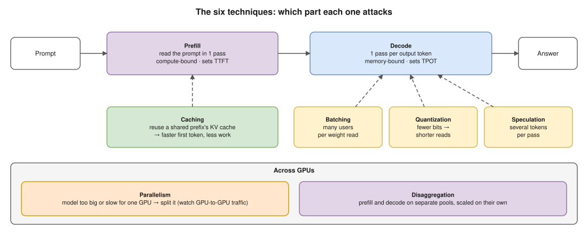
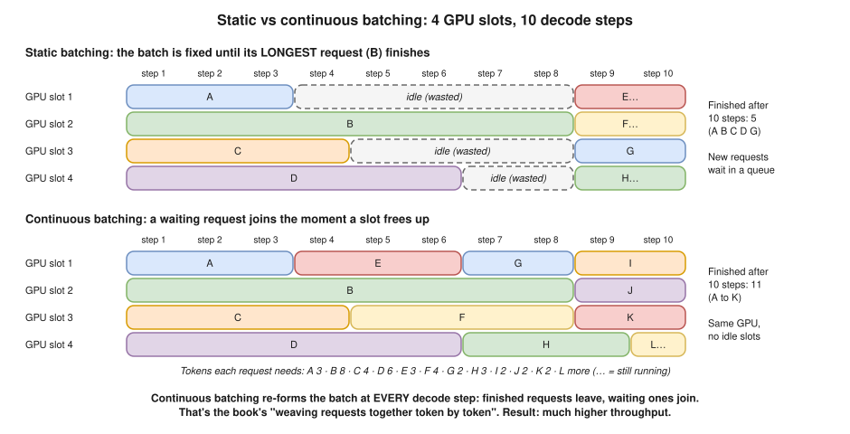
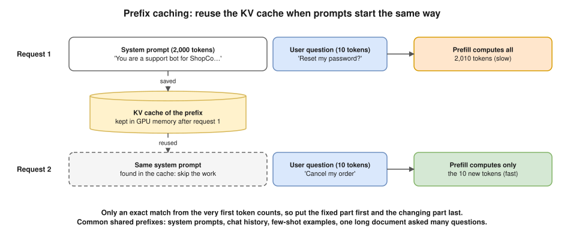
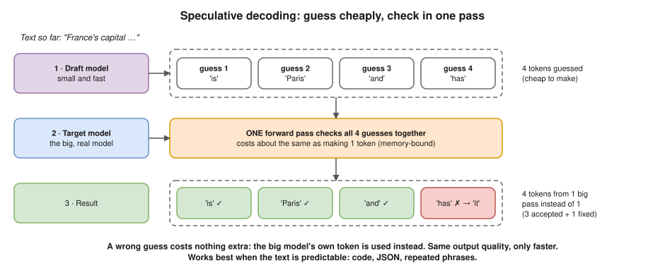
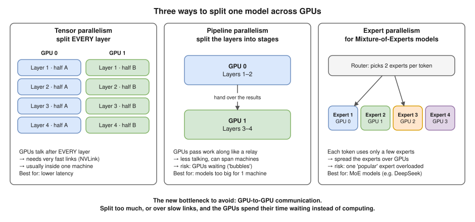
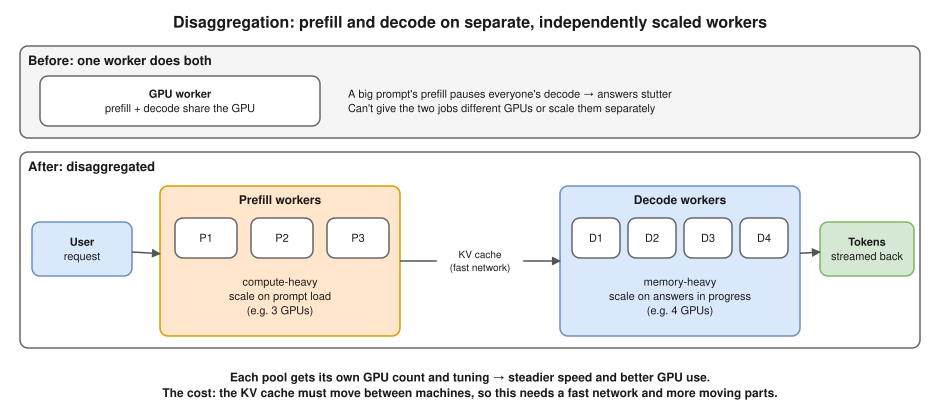

# 03 · Model Performance Techniques

> **Source:** *Inference Engineering* by Philip Kiely (Baseten), the runtime layer section. Written in my own words, with the "why" added. Read [02](02-runtime-layer.md) first: every technique here builds on **prefill vs decode**, the **KV cache** and **memory-bound decode**.

The book lists **six techniques** the runtime layer uses. Each one takes new research and applies it to a problem that's special to generative AI (Artificial Intelligence) inference.

## The six at a glance ⭐

| Technique | The book's idea, in my words | Main win |
|---|---|---|
| **Batching** | Run requests in parallel, **weaving them together token by token** | Throughput (more users per GPU) |
| **Caching** | **Reuse the KV (Key-Value) cache** between requests that start with the same text | Faster first token, less GPU work |
| **Quantization** | Use **lower precision** for selected parts of the model | More compute, less memory |
| **Speculation** | **Draft** some tokens cheaply, then **check** them, to get more than one token per decode pass | Faster decode |
| **Parallelism** | Use **more than one GPU** (Graphics Processing Unit) for big models, without creating new bottlenecks | Run models too big or too slow for one GPU |
| **Disaggregation** | Put **prefill and decode on separate workers** that scale on their own | Steadier speed, better GPU use at scale |

## 1. Batching ⭐

**The problem:** decode is memory-bound. With one user, each pass reads all the weights to produce **one token**, and the maths units sit mostly idle.

**The idea:** put many requests in the same pass. The weights are read **once** and used for **every** request in the batch, so the GPU makes many tokens per memory trip. Throughput goes up hugely and cost per token goes down.

**Static vs continuous batching.** The book's phrase "weaving them together on a token-by-token basis" means **continuous batching** (NVIDIA calls it **in-flight batching**):

- **Static batching:** collect a group of requests and run them until **all** are done. Short requests finish early and their slot sits **idle** until the longest one ends. New requests **wait** in a queue.
- **Continuous batching:** the batch is re-formed **at every decode step**. A finished request leaves, a waiting one joins **straight away**. No idle slots.

**The trade-off:**

- A bigger batch means more total tokens per second, but **each user's own tokens come a little slower** (taxi vs bus, from [02](02-runtime-layer.md)).
- Batch size is limited by **KV cache memory**: every request in the batch needs its own cache in GPU memory. (In vLLM, `--max-num-seqs` caps how many requests run together.)

> **DevOps link:** it's like a CI runner pool that starts the next queued job the moment any runner is free, instead of waiting for a whole group of jobs to finish.

## 2. Caching (prefix caching) ⭐

**The problem:** many requests **start with exactly the same text**. Without caching, prefill recomputes the KV cache for that shared text every single time: wasted GPU work and a slower first token.

**The idea:** keep the KV cache from earlier requests. If a new request starts with the same tokens (the same **prefix**), reuse the cached part and compute only the new part.

**Where shared prefixes come from (very often):**

- **System prompts:** the same instructions at the top of every request.
- **Multi-turn chat:** each turn resends the whole history. Turn 5 = turns 1–4 (already cached) + one new message.
- **Few-shot examples:** the same sample questions and answers in every prompt.
- **Document Q&A:** one long document, many questions about it.
- **AI agents:** the same tool definitions, plus a history that keeps growing.

**The rules that matter in practice:**

- Only an **exact match from the very first token** counts. Change one character early (say, a timestamp at the top of the system prompt) and **everything after it** misses the cache.
- So put the **fixed part first** and the **changing part last**.

**The trade-off:**

- The cache uses GPU memory. When it's full, old entries are thrown out.
- The cache lives on **one replica**. If the next turn of a chat goes to a different replica, the cache is useless. That's why the infrastructure layer does **cache-aware routing**.
- vLLM and SGLang can do prefix caching automatically (SGLang's version is called **RadixAttention**).

> **DevOps link:** it's a cache like any other: watch the **hit rate**. And like sticky sessions on a load balancer, it only works if related requests land on the same server.

## 3. Quantization ⭐

**The problem:** the weights are big. That means (a) you need many GPUs, (b) every decode pass has to read all of them, and (c) less memory is left for the KV cache.

**The idea:** store numbers with **fewer bits** (lower **precision**), like writing 12.3456 as 12.35: slightly less exact, much smaller.

| Format | Bits per weight | Bytes per weight | A 70B model's weights |
|---|---|---|---|
| FP16 / BF16 (16-bit Floating Point / Brain Floating Point) | 16 | 2 | ~140 GB |
| FP8 / INT8 (8-bit Floating Point / 8-bit Integer) | 8 | 1 | ~70 GB |
| FP4 / INT4 | 4 | 0.5 | ~35 GB |

**The book's two wins, explained:**

- **"Access more compute":** newer GPUs do lower-precision maths faster. An H100 runs FP8 maths about **2×** as fast as FP16, and the newer B200 adds FP4.
- **"Reduce memory burden":** fewer bytes to read every decode pass (so decode is faster), the model fits on **fewer GPUs**, and more memory is left for **KV cache** (so more users at once).

**"Select pieces of the model":** you choose what to quantize. The usual candidates are:

- the **weights** (most common)
- the **activations** (the numbers flowing between layers during a pass)
- the **KV cache**

The most sensitive parts are often kept at higher precision.

**The trade-off:** quality can drop. FP8 is usually close to the original; 4-bit carries more risk. **Always measure quality on your own tasks** (evals) before and after.

> **DevOps link:** like compressing images for a website: pick the level by testing whether users notice, not by guessing.

## 4. Speculation (speculative decoding)

**The problem:** decode makes **one token per forward pass**, and because it's memory-bound, the maths units are mostly idle during that pass.

**The idea:** a cheap guesser **drafts** several tokens, then the big model **checks all of them in one forward pass**. Correct guesses are kept, and at the first wrong one, the big model's own token is used instead. Result: **more than one token per pass**.

**Why checking 4 tokens costs about the same as making 1:** the cost of a decode pass is mostly **reading the weights**. Checking 4 positions adds a little maths, and the idle maths units absorb it. (It's like a tiny prefill.)

**Where the guesses come from:**

- A **small draft model** from the same family (for example a 1B model guessing for a 70B one).
- **Extra prediction heads** trained onto the big model itself (methods like EAGLE and Medusa).
- **Copying from the prompt** (n-gram or prompt lookup). Great for code edits, where the answer repeats much of the input.

**The trade-off:**

- It helps most when the GPU has **spare compute**: low to medium load. Under heavy load (big batches) the maths units are already busy, so the gain shrinks, and can even turn negative.
- A bad guesser wastes work. The **acceptance rate** (how many guesses are right) is the number to watch.
- **Quality doesn't change:** the big model always has the final word.

## 5. Parallelism

**The problem:** the model is too big for one GPU (70B at FP16 = 140 GB, but an H100 has 80 GB), or too slow on one.

**The idea:** spread one model over **several GPUs**, as the book stresses, **without creating new bottlenecks**.

| Type | How it splits the model | How often GPUs talk | Use it when |
|---|---|---|---|
| **Tensor parallelism** | Every layer is cut in pieces; each GPU does part of every layer | After **every** layer (a lot) | You want lower latency, and the GPUs are in one machine |
| **Pipeline parallelism** | Groups of layers (stages) on different GPUs, like a relay | Once per stage hand-over (less) | The model is too big for one machine |
| **Expert parallelism** | For MoE (Mixture of Experts) models: the experts are spread over GPUs | When tokens are sent to their experts | MoE models, such as DeepSeek |

**The new bottleneck is communication between GPUs:**

- Inside one machine, GPUs talk over **NVLink** (~900 GB/s per GPU on an H100).
- Between machines, they talk over **InfiniBand or Ethernet** (~50 GB/s per GPU with 400 Gb/s network cards). That's **many times slower**.
- **Rule of thumb:** keep tensor parallelism **inside one machine** (for example, across the 8 GPUs of one server). In vLLM: `--tensor-parallel-size` and `--pipeline-parallel-size`.

**Not the same thing:** running several **full copies** of the model (replicas) is also "parallel", but that's scaling out: the infrastructure layer's job, not this one.

> **DevOps link:** like sharding a database. You split when one machine isn't enough, but cross-shard traffic becomes the new thing that limits you.

## 6. Disaggregation

**The problem:** prefill is **compute-heavy** and decode is **memory-heavy**. On the same GPU they get in each other's way:

- A big new prompt's prefill **pauses everyone's decode**, so answers stutter.
- One GPU setup can't be ideal for both jobs.
- You can't scale the two separately.

**The idea:** run prefill and decode on **separate workers** that **scale on their own**. The prefill worker builds the KV cache and sends it over a fast network to a decode worker, which writes the answer.

**The trade-off:**

- The KV cache has to **move between machines** (about 1 GB for an 8,000-token prompt on an 8B model), so it needs a very fast network, usually using RDMA (Remote Direct Memory Access).
- More moving parts. It pays off mostly **at large scale** and with **long prompts**.
- A lighter option first: **chunked prefill** cuts a big prefill into chunks and mixes them in between decode steps, so decode doesn't stall. Engines like vLLM do this.
- Tools that do disaggregation include NVIDIA Dynamo, llm-d, and newer versions of vLLM and SGLang.

> **DevOps link:** like splitting a monolith into two microservices, each with its own Deployment and its own HPA (Horizontal Pod Autoscaler) scaling on its own metric, at the cost of network calls between them.

## Cheat sheet: which problem each technique fixes ⭐

| Technique | Attacks | Improves | Costs |
|---|---|---|---|
| Batching | Idle GPU during decode | Throughput, cost per token | A bit of per-user speed; KV cache memory |
| Caching | Recomputing the same prefix | TTFT (Time To First Token), GPU work | GPU memory; needs cache-aware routing |
| Quantization | Big weights | Speed, memory, GPUs needed | Possible quality loss; test it |
| Speculation | One token per pass | Decode speed (latency) | Extra work; weak under heavy load |
| Parallelism | Model too big or slow for one GPU | Fits big models; lower latency | GPU-to-GPU communication |
| Disaggregation | Prefill and decode fighting | Steadier speed, GPU use at scale | KV cache transfer; complexity |

## Not just LLMs: other modalities

The book points out that these techniques are used for models of **every modality** (type of input or output), not just LLMs (Large Language Models):

| Modality | What it does | Notes |
|---|---|---|
| **VLM** (Vision Language Model) | Reads images + text, answers in text | An LLM with an image reader added, so all six techniques apply |
| **Embedding models** | Turn text into a list of numbers (a vector) for search and RAG (Retrieval-Augmented Generation) | One forward pass, **no decode**, so batching and quantization matter most; speculation doesn't apply |
| **ASR** (Automatic Speech Recognition) | Speech → text (for example Whisper) | Writes text token by token, so the decode techniques apply |
| **Speech synthesis** (TTS, Text-To-Speech) | Text → spoken audio | Often generates audio token by token; time to first audio matters most |
| **Image generation** | Text → image | Runs many "denoising" steps instead of tokens; quantization, parallelism and caching ideas are adapted to those steps |
| **Video generation** | Text or image → video | Very heavy compute, so parallelism across many GPUs is key |

**How to reason about a new modality:** ask "does it generate step by step like an LLM?" If yes, nearly all six apply. If it's a single pass (like embeddings), the decode-only tricks don't.

*(The book's passage continues here. I'll add the rest when I read it.)*

## One-line summary

**Six techniques make one model fast: batching (many users per memory trip), caching (reuse shared prefixes), quantization (fewer bits), speculation (several tokens per pass), parallelism (several GPUs without a communication bottleneck) and disaggregation (separate prefill and decode). Most of them attack the same root problem: decode is memory-bound.**

## Check yourself (say it out loud)

- "What is continuous batching, and why is it better than static batching?" → The batch is re-formed at every decode step: finished requests leave, waiting ones join straight away. Static batching leaves slots idle until the longest request finishes.
- "When does prefix caching help, and what breaks it?" → When requests share the same start (system prompt, chat history, documents). Any change early in the prompt breaks it for everything after, so put the fixed part first. It also needs the request to reach the replica that holds the cache.
- "What does quantization give you, and what does it cost?" → Fewer bits per number: faster maths on new GPUs, fewer bytes to read, fewer GPUs, more room for KV cache. The cost is possible quality loss, so test with evals.
- "How can speculative decoding make more than one token per pass without changing quality?" → A cheap guesser drafts tokens; the big model checks them all in one pass (it costs about the same as one token, because decode is memory-bound) and keeps only what it agrees with.
- "Tensor vs pipeline parallelism?" → Tensor splits every layer and talks after every layer (needs NVLink, one machine); pipeline splits layers into stages and talks less (can span machines, risk of bubbles).
- "Why disaggregate prefill and decode?" → They need different things (compute vs memory) and interfere on one GPU. Separate pools scale and tune independently; the cost is moving the KV cache over a fast network.
- "Which techniques fit an embedding model?" → Batching and quantization. It has no decode, so speculation and disaggregation don't apply.
