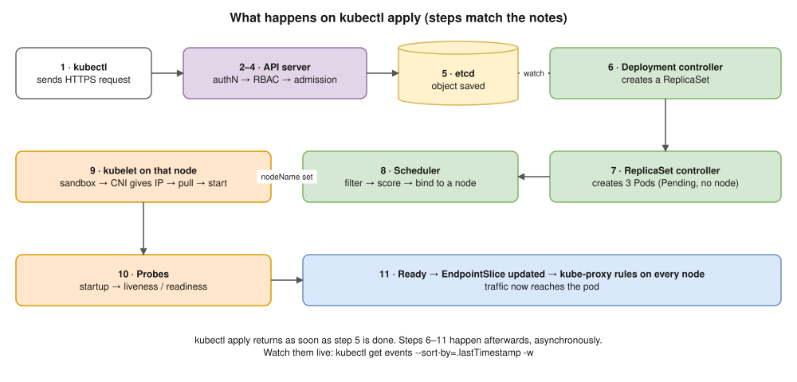
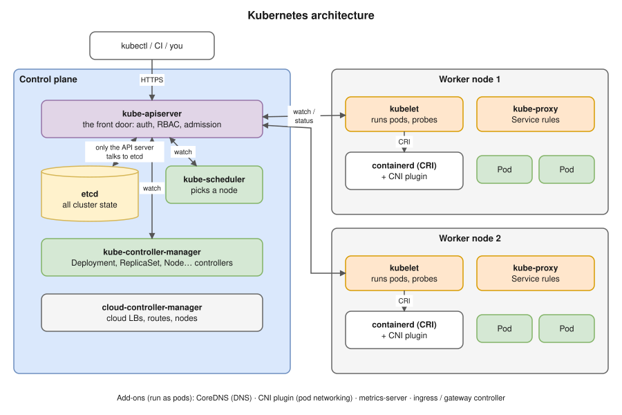

# Interview Review · 11 Nov 2026 · NiCE Actimize (R Systems), Application Support Engineer / SRE

Face-to-face round, from my own recall of the questions and answers. This note covers **every question**, **what I said**, **the gap**, **the answer to give next time**, and a **4-week plan** to close the gaps.



---

## 1. The verdict in one paragraph

I didn't fail on advanced topics. I failed on **basics I have used for years**: `grep`, `sed`, `find`, `INSERT`/`DELETE`, and what happens when a pod starts. The root cause is **how I prepare**. I read and collect notes (the night before: canary with Route 53, push vs pull, log retention), but I don't **type from memory**, so under pressure nothing comes out. The resume says 5+ years, so every basic miss weighs more.

| # | Gap | Section |
|---|---|---|
| 1 | Self-ratings higher than what I could defend | [2.3](#23-rate-yourself) |
| 2 | SQL basics: DML, INSERT, DELETE, "what do you know about SQL" | [2.4](#24-sql) |
| 3 | Linux daily commands: grep, sed, find | [2.5](#25-linux) |
| 4 | Kubernetes internals: architecture components, pod startup flow | [2.6](#26-kubernetes) |
| 5 | Intro and "why this role" told my problems, not my value | [2.1](#21-introduction), [2.7](#27-this-is-a-support-role-why-do-you-want-to-join) |
| 6 | Preparation method: reading instead of recall | [3](#3-the-4-week-plan) |

---

## 2. Question by question

### 2.1 Introduction

- **I said:** "My name is Suraj Jadhav. I'm currently working at One2N, a consultancy company. I've been on the bench for the last month, so I'm looking for new opportunities. My last project was Mixxi, where my main task was handling Kubernetes infrastructure and creating monitoring dashboards in Grafana and Prometheus. Before that I was at Koko Networks, a climate-tech organisation that sells stoves and ethanol fuel to people in Kenya and generates carbon credits; that's the business."
- **The interviewer cut in:** "Don't tell me the project, tell me your responsibilities."
- **Gap:** I led with the company business and my bench status. He wanted to know what **I** own.
- **Better answer (60 seconds):**
  > "I'm an SRE with about five and a half years in production operations on AWS. Day to day I run production Kubernetes (EKS), handle incidents and root cause analysis, build monitoring and alerting with Prometheus and Grafana, and run CI/CD and releases. At Koko Networks I migrated our applications from Docker Swarm to EKS in a 6–7 person DevOps team and handled day-to-day incidents and deployments. Now at One2N I've worked on Kubernetes infrastructure and the observability stack. I'm looking for a role where I own application reliability end to end."
- Mention the bench **only if asked**, and keep it to one neutral line: "My last client engagement ended, so I'm between projects."

### 2.2 Responsibilities at Koko Networks

- **I said:** "There were only 6–7 people in the DevOps team. I worked as DevOps and SRE: I migrated Docker Swarm to Kubernetes and handled day-to-day tasks like CI/CD, and checked incoming incidents and resolved them."
- **Gap:** correct, but too short and with no numbers or examples. "Check incidents and resolve them" invites "tell me one", and I need a STAR story ready.
- **Better answer:** name 4 concrete responsibilities, each with one number from the resume:
  - The Swarm → EKS migration across Dev, UAT, Prod-Int and Production, with a 20–30% cost cut.
  - Jenkins → ArgoCD GitOps, which took deploys from 10 minutes to 2.
  - Federated Prometheus and Grafana alerting, which reduced MTTD.
  - Production operations: EKS upgrades, SSL renewals, release coordination, incident response and RCA.

### 2.3 "Rate yourself"

- **I said:** SQL 5/10, Linux 7/10, Kubernetes 9/10, AWS 8/10.
- **What happened:** he started with my lowest (SQL), and every Kubernetes miss counted against a **9**.
- **Gap:** a rating is a promise about how deep the follow-ups can go.
- **Rule:** rate each skill at the level where I can take **10 minutes of follow-up questions** without notes. Today that's about **Kubernetes 7, AWS 7, Linux 6, SQL 4**, then add "and I use it daily for ___".

### 2.4 SQL

| Question | What I said | Answer to give |
|---|---|---|
| Do you know DML commands? | No | **DML (Data Manipulation Language)** = `INSERT`, `UPDATE`, `DELETE`, `MERGE` (`SELECT` is sometimes counted here, or as DQL) |
| Do you know insert, update, delete? | Yes | ✓ |
| What is an insert query? | "Used to insert data in tables" | Say it **and write it**: `INSERT INTO users (id, name, city) VALUES (1, 'Suraj', 'Pune');` |
| What is delete? | "Deletes data from a table using keywords and the id of the row" | `DELETE FROM users WHERE id = 1;` Without `WHERE` it deletes **every row**. In production, first run `SELECT` with the same `WHERE` to check what will be removed, inside a transaction so I can `ROLLBACK` |
| What do you know about SQL? | Connection pools, RAM and CPU utilisation, slow queries | That's database **monitoring**, not SQL, and it sounded like I was avoiding the question. Answer with the language: "I write SELECT queries with WHERE, JOINs, GROUP BY/HAVING and ORDER BY for data checks, use INSERT/UPDATE/DELETE carefully inside transactions, and read execution plans when a query is slow." |

**The SQL command families (know these by heart):**

| Family | Full form | Commands |
|---|---|---|
| **DDL** | Data Definition Language | `CREATE`, `ALTER`, `DROP`, `TRUNCATE`, `RENAME` |
| **DML** | Data Manipulation Language | `INSERT`, `UPDATE`, `DELETE`, `MERGE` |
| **DQL** | Data Query Language | `SELECT` |
| **DCL** | Data Control Language | `GRANT`, `REVOKE` |
| **TCL** | Transaction Control Language | `COMMIT`, `ROLLBACK`, `SAVEPOINT` |

```sql
UPDATE users SET city = 'Mumbai' WHERE id = 1;
-- DELETE vs TRUNCATE vs DROP
DELETE FROM users WHERE id = 1;   -- DML: removes chosen rows, can be rolled back, fires triggers
TRUNCATE TABLE users;             -- DDL: removes all rows fast, keeps the table
DROP TABLE users;                 -- DDL: removes the table itself
```

### 2.5 Linux

| Question | What I said | Answer to give |
|---|---|---|
| Name some Linux commands | `cat`, `nslookup`, `dig`, `ps`, "that's all I remember" | Group them so the list sounds organised: **files** `ls cd cp mv rm find`; **text** `cat less grep sed awk sort uniq wc head tail`; **processes** `ps top kill systemctl journalctl`; **disk** `df du lsof`; **network** `ss curl dig nslookup ping traceroute`; **permissions** `chmod chown` |
| Find "error" and "info" in a log file | `cat filename \| grep 'error\|info'` | `grep -Ei 'error\|info' app.log`. Plain `grep` treats `\|` as a literal character, so it needs `-E` (or escape the pipe with a backslash). `-i` ignores case, and `cat \|` isn't needed. Useful extras: `grep -c` (count), `grep -n` (line numbers), `grep -v` (exclude) |
| Replace "error" with "success" in a file | "sed something, I don't know the full command" | `sed -i 's/error/success/g' app.log`. `s` means substitute, `g` means every match on the line, `-i` edits in place, and `-i.bak` keeps a backup. Test first without `-i` to print the result |
| Find files in a folder older than 60 days | "find something, I don't know the full command" | `find /var/log/app -type f -mtime +60`. Delete them with `find /var/log/app -type f -mtime +60 -delete`, or `-exec rm {} \;`. `-mtime +60` means modified more than 60 days ago, and `-mtime -1` means in the last day |

### 2.6 Kubernetes

**Architecture**
- **I said:** the control plane has the API server, etcd and the scheduler; worker nodes have the kubelet and containerd. The scheduler places pods by checking node CPU and memory. The API server is the main communication point. "The kubelet holds the state of pods: running, pending, exited."
- **Gaps:**
  - I missed the **controller-manager** (control plane) and **kube-proxy** (worker node). I could also mention the cloud-controller-manager on EKS.
  - **etcd holds the cluster state, not the kubelet.** The kubelet runs the containers on its node and **reports their status** to the API server, which stores it in etcd.
- **Answer to give:**

  

  - **Control plane:**
    - **kube-apiserver** is the only component that talks to etcd. Everything else goes through it. It handles authentication, authorisation and admission.
    - **etcd** is the key-value store holding the desired and actual state.
    - **kube-scheduler** picks a node for each new pod: it filters out nodes that don't fit (resources, taints, affinity), then scores the rest.
    - **kube-controller-manager** runs the control loops (Deployment, ReplicaSet, Node, Job, endpoints) that make actual state match desired state.
    - **cloud-controller-manager** handles load balancers and nodes in AWS.
  - **Worker node:**
    - **kubelet** starts pods via the container runtime and reports their status.
    - **kube-proxy** programs iptables/IPVS rules so Service IPs reach the pods.
    - **containerd** is the container runtime.
    - **CNI** (aws-node / VPC CNI on EKS) gives pods their IPs.

**"When a pod starts, how does the mechanism work?"**
- **I said:** "Sorry, I don't know."
- **Answer to give (the diagram at the top of this note):**
  1. `kubectl apply -f deploy.yaml` sends the request to the **API server**, which authenticates, authorises and runs **admission** (mutating, then validating), then saves the object to **etcd**.
  2. The **Deployment controller** sees the new Deployment and creates a **ReplicaSet**. The ReplicaSet controller creates the **Pod** objects, which have no node yet.
  3. The **scheduler** sees the unscheduled pod, **filters** nodes (enough CPU/memory requests, taints, affinity, volumes), **scores** the rest, and **binds** the pod to the best node (`spec.nodeName`).
  4. The **kubelet** on that node sees the pod assigned to it and calls the runtime (**containerd**) through CRI:
     - It creates the **pod sandbox** (pause container) and network namespace.
     - **CNI** assigns the pod IP.
     - **CSI** mounts volumes.
     - It pulls the image.
  5. **Init containers** run in order, then the **app containers** start.
  6. **Probes:** the startup probe, then liveness (restarts the container if it fails) and readiness (whether the pod can get traffic).
  7. When the pod is **Ready**, the endpoints controller adds its IP to the Service's **endpoints**, kube-proxy updates the rules on every node, and the pod starts receiving traffic.
  8. The kubelet keeps reporting status (Pending → Running), which is stored in etcd.
- **Pod phases:** Pending (accepted, not yet running: scheduling or image pull), Running, Succeeded, Failed, Unknown. CrashLoopBackOff and ImagePullBackOff are **container waiting reasons**, not phases.

| Question | What I said | Answer to give |
|---|---|---|
| List pods in a namespace | `kubectl get pods -n <namespace>` | ✓ Add `-o wide` (node, IP), `--show-labels`, `-A` (all namespaces), `-w` (watch) |

### 2.7 "This is a support role. Why do you want to join?"

- **I said:** "I want a stable job and role. I'm currently on the bench, my current company is a consulting company and NiCE is an MNC, so I want to join for job security. My last company, Koko, also shut down, so I'm looking for a stable company."
- **Gap:** every reason was **my problem** (bench, insecurity, a company shutdown). Nothing said what **I bring** or why **this** role and domain. It also hinted that I see support as a fallback.
- **Answer to give:**
  > "Most of my last five years has been production support: incidents, RCA, monitoring, releases, keeping systems at 99.9%. I enjoy that part the most and want to go deeper on application reliability instead of only building infrastructure. Actimize is where reliability has real consequences: if fraud detection is slow or an AML batch fails, a bank misses fraud or a regulatory deadline. I want a long-term role where I own that, and I bring hands-on Kubernetes, AWS and monitoring experience to it."
- Stability is a fine *reason*, but say it as "a long-term role", never as "I'm on the bench".

---

## 3. The 4-week plan

**Method rule:** **no reading-only sessions.** Every session is typed or spoken from memory, with notes closed, then checked.

| Week | Daily (1.5 h) | Goal by the end of the week |
|---|---|---|
| **1** | 45 min **Linux text**: `grep` (-E -i -v -c -n -r), `sed` (s///g, -i, delete lines), `awk` (fields, sums, conditions), `find` (-name -mtime -size -exec -delete), `sort \| uniq -c`, `cut`, `xargs`, run on real log files · 45 min **SQL**: [SQLBolt](https://sqlbolt.com/) lessons 1–18 | Write 15 Linux one-liners from memory. INSERT/UPDATE/DELETE/SELECT with WHERE, ORDER BY, GROUP BY without help |
| **2** | 45 min Linux: processes, disk, network, permissions, logrotate, systemd (see the cheat sheet, section 5) · 45 min SQL: [LeetCode SQL 50](https://leetcode.com/studyplan/top-sql-50/) (joins, aggregates, subqueries, window functions) | 20 LeetCode SQL problems solved. Explain INNER vs LEFT JOIN, WHERE vs HAVING, DELETE vs TRUNCATE |
| **3** | Kubernetes internals **out loud**: architecture, pod startup (section 2.6), Service → endpoints → kube-proxy, Deployment rollout · Break/fix labs on [Killercoda](https://killercoda.com/) (CrashLoopBackOff, Pending, ImagePullBackOff, empty endpoints, OOMKilled) | Explain the pod startup flow in 2 minutes without notes. Fix 10 broken scenarios |
| **4** | **Mock interviews** with Claude (ask me to "act as the interviewer"): intro, 3 STAR stories, why-this-role, rapid-fire Linux/SQL/K8s · Re-rate yourself honestly | Intro and stories are smooth. Ratings match what you can defend |

**Daily test (10 minutes, every day):** close everything and write 10 commands or queries from memory. Anything you can't write, you don't know yet. Put it on tomorrow's list.

---

## 4. Drill: 15 questions to answer from memory (answers hidden)

Write each answer on paper or in a terminal **before** opening it.

<details><summary>1. Count how many lines in <code>app.log</code> contain "ERROR".</summary>

`grep -c "ERROR" app.log`
</details>

<details><summary>2. Show lines with "error" or "warn" (any case), with line numbers.</summary>

`grep -Ein 'error|warn' app.log`
</details>

<details><summary>3. Show all lines that do NOT contain "DEBUG".</summary>

`grep -v "DEBUG" app.log`
</details>

<details><summary>4. Replace every "http://" with "https://" in <code>config.txt</code>, keeping a backup.</summary>

`sed -i.bak 's#http://#https://#g' config.txt` (any delimiter works, and `#` avoids escaping `/`)
</details>

<details><summary>5. Delete all blank lines from a file.</summary>

`sed -i '/^$/d' file.txt`
</details>

<details><summary>6. Find <code>.log</code> files under /var/log/app older than 30 days and delete them.</summary>

`find /var/log/app -type f -name "*.log" -mtime +30 -delete`
</details>

<details><summary>7. Find files bigger than 500 MB under /.</summary>

`find / -type f -size +500M 2>/dev/null`
</details>

<details><summary>8. From an Nginx access log, count requests per HTTP status code (status is field 9).</summary>

`awk '{print $9}' access.log | sort | uniq -c | sort -rn`
</details>

<details><summary>9. Which process is listening on port 8080?</summary>

`ss -tlnp | grep 8080` (or `lsof -i :8080`)
</details>

<details><summary>10. Disk is full: find which directory under /var is using the most space.</summary>

`du -sh /var/* 2>/dev/null | sort -h | tail`
</details>

<details><summary>11. Write an INSERT for table <code>employees(id, name, salary)</code>.</summary>

`INSERT INTO employees (id, name, salary) VALUES (101, 'Asha', 75000);`
</details>

<details><summary>12. Give everyone in department 10 a 10% raise.</summary>

`UPDATE employees SET salary = salary * 1.10 WHERE dept_id = 10;`
</details>

<details><summary>13. Find duplicate emails in <code>users</code>.</summary>

`SELECT email, COUNT(*) FROM users GROUP BY email HAVING COUNT(*) > 1;`
</details>

<details><summary>14. List employees with their department name, including employees with no department.</summary>

`SELECT e.name, d.dept_name FROM employees e LEFT JOIN departments d ON e.dept_id = d.id;`
</details>

<details><summary>15. Explain in 5 steps what happens after <code>kubectl apply</code> creates a Deployment.</summary>

API server (authn, authz, admission) → etcd → Deployment controller creates a ReplicaSet, which creates Pods → scheduler filters, scores and binds a node → kubelet + containerd + CNI start the containers → probes pass → Ready → added to Service endpoints.
</details>

---

Related: [NiCE cheat sheet](nice-actimize-sre-cheatsheet.md) · [Oct 9 review](interview-transcript-review-oct-9.md) · [kubectl commands](kubernetes/23-kubectl-commands.md)
