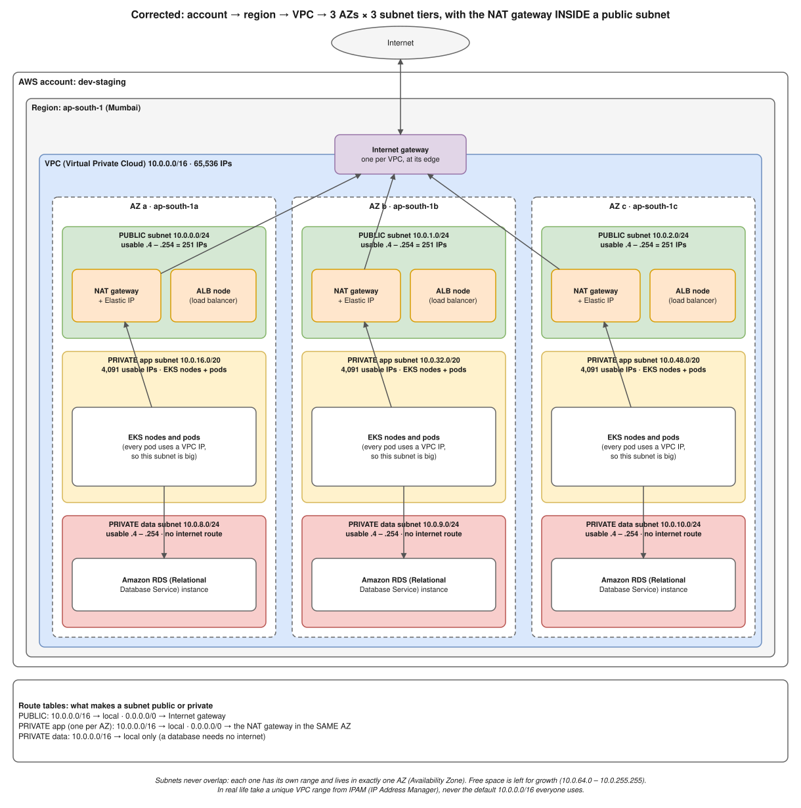
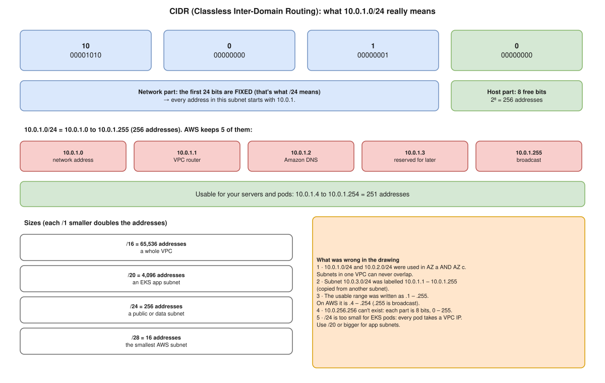
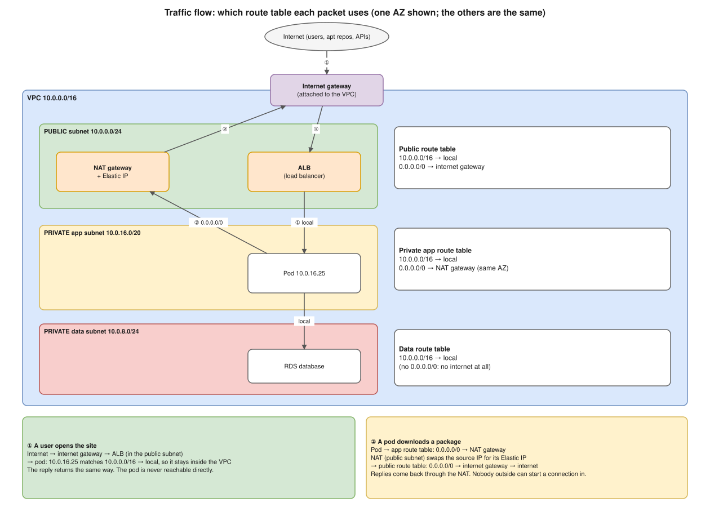
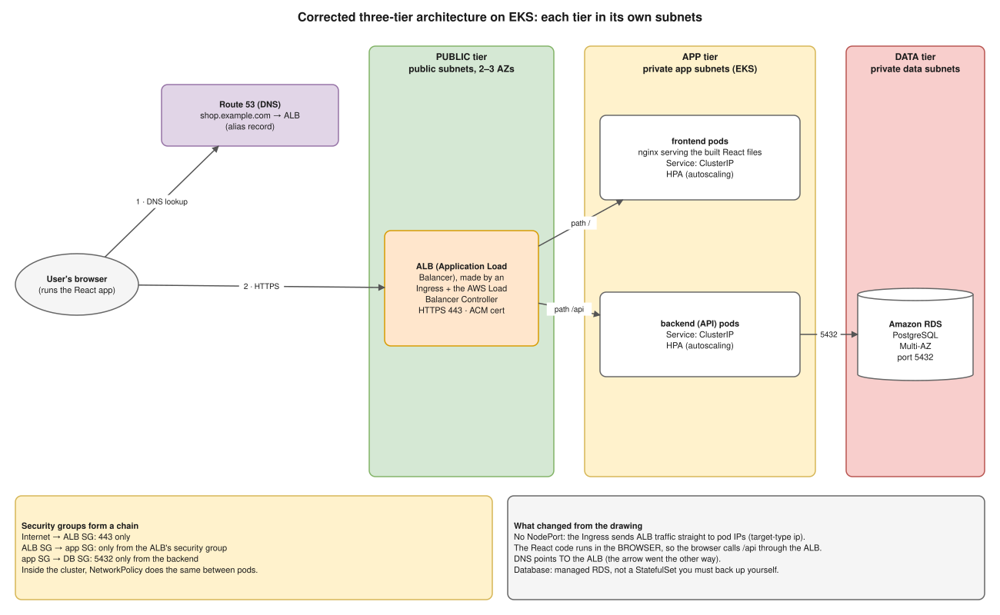
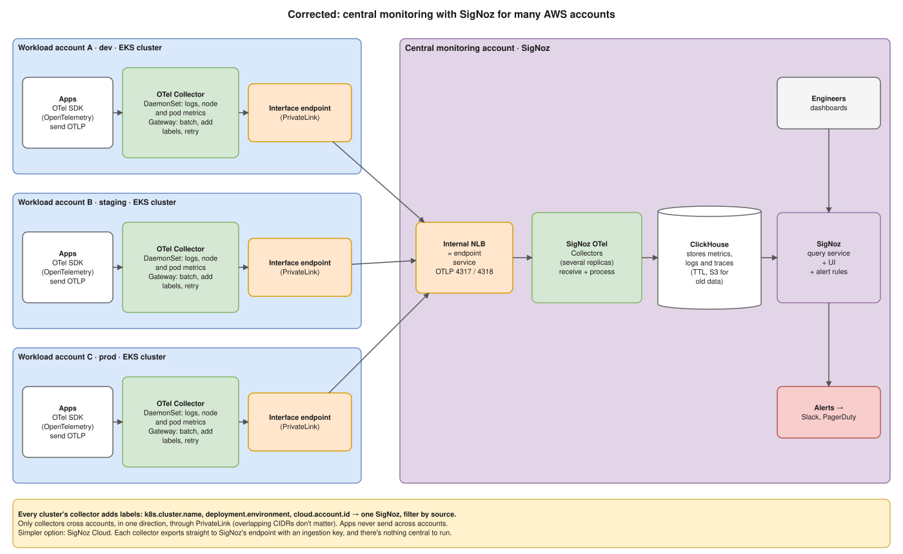

# Interview Review · 9 Oct 2026 (Hemant, One2N)

Corrections to the diagrams drawn in the interview, based on Hemant's feedback. Each section shows **what was drawn**, **what was wrong**, **the correct version** (with a draw.io diagram), and **what to say next time**.

Short terms are written in full the first time they appear.

> **The full question-by-question review of the recording, with a subnetting worksheet and a 4-week plan, is in [interview-transcript-review-oct-9.md](interview-transcript-review-oct-9.md).**

| # | Topic | Hemant's feedback |
|---|---|---|
| 1 | [VPC and subnets](#1--vpc-and-subnets-how-to-choose-them) | How to choose the VPC (Virtual Private Cloud) and why that many subnets |
| 2 | [CIDR and IP addresses](#2--cidr-and-ip-addresses-what-was-wrong) | "The subnet CIDR / IP concept is wrong" |
| 3 | [NAT gateway and internet gateway](#3--nat-gateway-and-internet-gateway-where-they-fit) | "Where NAT and IG sit is wrong" |
| 4 | [Three-tier architecture](#4--three-tier-architecture-on-eks) | Tiers, services, DNS direction |
| 5 | [Central monitoring with SigNoz](#5--central-monitoring-with-signoz) | Collecting metrics from many accounts into one place |
| 6 | [Dockerfile](#6--the-dockerfile-on-the-same-drawing) | The React Dockerfile notes |

---

## 1 · VPC and subnets: how to choose them



**What was drawn:** account (dev-staging) → region → VPC `10.0.0.0/16` → 3 AZs (Availability Zones) a, b, c, with 2 subnets each. The overall nesting (account → region → VPC → AZ → subnet) was **right**.

### How to choose the VPC range

1. **Use a private range** (RFC 1918 (Request for Comments 1918)): `10.0.0.0/8`, `172.16.0.0/12` or `192.168.0.0/16`.
2. **Make it big enough:** a `/16` (65,536 addresses) for a VPC that runs EKS (Elastic Kubernetes Service), because **every pod takes a VPC IP**.
3. **Make it unique:** take it from an IPAM (IP Address Manager) plan per environment and region, e.g. dev-staging `10.20.0.0/16`, prod `10.30.0.0/16`.
   - Avoid `10.0.0.0/16`: everybody uses it, so it overlaps later (that's scenario A2).
   - Avoid `172.17.0.0/16`: Docker's default bridge uses it.
4. **Leave free space** for new subnets later, or a secondary range like `100.64.0.0/16` for pods (scenario A3).

### Why 3 AZs × 3 tiers = 9 subnets

**3 AZs**, for availability:
- the app survives one AZ failing;
- an ALB (Application Load Balancer) and an EKS cluster need at least 2 AZs;
- RDS (Relational Database Service) Multi-AZ keeps a standby in another AZ;
- 3 gives a majority if one is lost.

**3 tiers**, for security. Each tier gets **its own route table**, so it can reach only what it needs:

| Tier | What lives there | Size | Can reach the internet? |
|---|---|---|---|
| **Public** | ALB, NAT gateway | `/24` (few IPs needed) | Yes, through the internet gateway |
| **Private app** | EKS nodes and pods | **`/20`** (4,091 usable: pods eat IPs) | Outbound only, through the NAT gateway |
| **Private data** | Databases (RDS) | `/24` | **No** |

**The subnet plan** (no two subnets overlap; each lives in one AZ):

| AZ | Public | Private app | Private data |
|---|---|---|---|
| a | `10.0.0.0/24` | `10.0.16.0/20` | `10.0.8.0/24` |
| b | `10.0.1.0/24` | `10.0.32.0/20` | `10.0.9.0/24` |
| c | `10.0.2.0/24` | `10.0.48.0/20` | `10.0.10.0/24` |

Everything from `10.0.64.0` to `10.0.255.255` stays free for growth.

**EKS detail:** tag public subnets `kubernetes.io/role/elb=1` and private ones `kubernetes.io/role/internal-elb=1`, so the AWS Load Balancer Controller knows where to put internet-facing and internal load balancers.

> **Say it:** "I take a unique /16 from our IPAM plan, never the default 10.0.0.0/16. I spread it over 3 AZs for availability, with 3 tiers per AZ: public subnets only for the ALB and NAT gateways, big private /20 app subnets for EKS because every pod uses a VPC IP, and private data subnets with no internet route. Each tier has its own route table and security groups."

---

## 2 · CIDR and IP addresses: what was wrong



**CIDR (Classless Inter-Domain Routing)** notation `10.0.1.0/24` means: **the first 24 bits are fixed**, and the remaining 8 bits are free. 2⁸ = **256 addresses**, from `10.0.1.0` to `10.0.1.255`.

**The mistakes in the drawing:**

| Drawn | Problem | Correct |
|---|---|---|
| `10.0.1.0/24` and `10.0.2.0/24` in AZ a **and** again in AZ c | Subnets in one VPC can **never overlap**, and a subnet lives in exactly **one** AZ | Every subnet gets its own range (table in section 1) |
| Subnet `10.0.3.0/24` labelled `10.0.1.1 – 10.0.1.255` | Copied from another subnet; its range is `10.0.3.x` | `10.0.3.0 – 10.0.3.255` |
| Usable range `.1 – .255` | AWS reserves **5** addresses: `.0` network, `.1` VPC router, `.2` Amazon DNS, `.3` future use, `.255` broadcast | Usable: **`.4 – .254` = 251** |
| `10.0.256.256` | Each of the 4 numbers is **8 bits: 0 – 255** | The highest is `10.0.255.255` |
| `0000 0011.0000…` | `10` in binary is `00001010` | `10.0.1.0` = `00001010.00000000.00000001.00000000` |
| `/24` subnets for EKS | Too small: each pod takes a VPC IP | `/20` or bigger for app subnets |

**Quick sizes:** `/16` = 65,536 · `/20` = 4,096 · `/24` = 256 · `/28` = 16 (the smallest AWS subnet). One step smaller in the number = twice the addresses.

> **Say it:** "A /24 fixes the first 24 bits, leaving 8 host bits: 256 addresses. AWS reserves 5 in every subnet, the network address, the router, DNS, one for the future and broadcast, so 251 are usable, .4 to .254. Subnets in a VPC never overlap, and each lives in one AZ."

---

## 3 · NAT gateway and internet gateway: where they fit



The same diagram as section 1 ([r1](diagrams/r1-vpc-subnets-nat-igw.drawio.svg)).

**What was drawn:**
- "IG" and "NAT" boxes inside the VPC but **outside every AZ and subnet**;
- arrows IG → public subnets, NAT → private subnets, and NAT → IG.

**What was right:** the idea that private subnets go out through NAT, and NAT goes out through the internet gateway.

**What was wrong, and the fix:**

| | Drawn | Correct |
|---|---|---|
| **Internet gateway** | A box among the subnets | **One per VPC**, attached at the **VPC's edge**. It isn't in any AZ or subnet. A subnet is "public" only because its **route table** says `0.0.0.0/0 → igw-…` |
| **NAT gateway** | Outside all AZs and subnets | It lives **inside a public subnet**, in **one AZ**, with an **Elastic IP** (a fixed public IP). Use **one per AZ**: if that AZ fails, the other AZs keep working, and there are no cross-AZ data charges |
| **Private subnets** | Arrows from NAT | Their **route table** says `0.0.0.0/0 → nat-…` (the NAT gateway **in the same AZ**) |
| **Data subnets** | Treated like the app subnets | **No internet route at all**: a database doesn't need the internet |

**The path of one packet:** pod in a private app subnet → NAT gateway (in the public subnet of the same AZ) → internet gateway → internet. The reply comes back the same way. The internet **can't start** a connection to a private subnet: NAT is outbound only.

**The route tables:**

| Route table | Routes |
|---|---|
| Public | `10.0.0.0/16 → local` · `0.0.0.0/0 → igw-…` |
| Private app (one per AZ) | `10.0.0.0/16 → local` · `0.0.0.0/0 → nat-…` in the same AZ |
| Private data | `10.0.0.0/16 → local` only |

**Cost trade-off:** in a dev account, one NAT gateway for all AZs is cheaper, but an AZ failure then cuts every AZ's internet access. In prod, use one per AZ.

> **Say it:** "The internet gateway is one per VPC at its edge; a subnet is public because its route table points 0.0.0.0/0 at it. The NAT gateway sits inside a public subnet with an Elastic IP, one per AZ, and each private subnet's route table points 0.0.0.0/0 at the NAT in its own AZ. Data subnets get no internet route. NAT is outbound only."

---

## 4 · Three-tier architecture on EKS



**What was drawn:**
- 3 bands: front end, backend, database;
- front end and backend as Deployments with **NodePort** Services, the database as a "stateful deployment";
- front-end pod → backend pod;
- NodePort → ALB, and an arrow **ALB → Route 53**.

**What was wrong:**

1. **The tiers weren't tied to the network.** "Three-tier" means three network layers too: the **ALB in public subnets**, the **app pods in private app subnets**, and the **database in private data subnets**. Each layer can only be reached from the layer before it.
2. **The DNS arrow went the wrong way.** Route 53 (AWS's DNS (Domain Name System) service) holds an **alias record** `shop.example.com → ALB`. The browser asks Route 53 first, then connects to the ALB. Route 53 never receives traffic from the ALB.
3. **NodePort isn't needed, and it's less secure.** It opens a port on **every node**. Use an **Ingress** with the AWS Load Balancer Controller and `target-type: ip`: the ALB sends traffic **straight to pod IPs**. Both Services become **ClusterIP** (internal only).
4. **The React code runs in the BROWSER, not in the pod.** The front-end pod only serves static files. The **browser** calls the API through the same ALB (path `/api` → backend Service), not "front-end pod → backend pod". You could also host the React files on S3 + CloudFront.
5. **The database:** a StatefulSet (the correct name, not "stateful deployment") works, but then **you** own backups, failover and upgrades. In production use **Amazon RDS Multi-AZ** in the data subnets. If it must be in the cluster: a StatefulSet + a headless Service + one PVC (PersistentVolumeClaim) per replica on EBS (Elastic Block Store, tied to one AZ), and a NetworkPolicy that allows only the backend.

**The security chain (one rule per tier):**
- internet → ALB security group: `443` only;
- ALB security group → app: only from the ALB's security group;
- app → database security group: `5432` only from the backend;
- inside the cluster, NetworkPolicy does the same between pods.

> **Say it:** "Route 53 has an alias record pointing at the ALB, which sits in the public subnets and is created by an Ingress. It sends `/` to the frontend Service and `/api` to the backend Service, both ClusterIP, with target-type ip so traffic goes straight to pods in the private app subnets. The React code runs in the browser, so the browser calls `/api`. The data tier is RDS Multi-AZ in private data subnets. Security groups chain ALB → app → DB, and NetworkPolicy does the same inside the cluster."

---

## 5 · Central monitoring with SigNoz



**What was drawn:**
- Accounts A, B and a third one on the left; only **A** had front-end and back-end boxes;
- those apps sent **directly** to the "OTEL collector" in the SigNoz box, which went → Database → "signoz query engine".

**What was right:** the central chain: collector → storage → query engine. That's how SigNoz works:
- the **SigNoz OTel Collector** receives the data;
- **ClickHouse** stores it;
- the **query service + UI + alerts** read it.

**What was missing or wrong:**

1. **Apps must not send across accounts.** Each cluster runs its **own OTel (OpenTelemetry) Collector**:
   - a **DaemonSet** collects logs and node and pod metrics;
   - a **gateway** receives OTLP (OpenTelemetry Protocol) from the apps, **batches** it, **adds labels** and **retries**.
   - Only this collector sends data out of the account.
2. **Every account needs the same set-up.** Accounts B and C were empty.
3. **There was no network path between accounts.** Use **PrivateLink**:
   - the monitoring account publishes an **endpoint service** (an NLB (Network Load Balancer) in front of the SigNoz collectors, ports `4317` gRPC and `4318` HTTP);
   - each workload account creates an **interface endpoint**.
   - It's one direction, many consumers to one provider, and overlapping CIDRs don't matter (scenario A2).
4. **Label the source**, or the central data is a mix you can't filter: every collector adds `k8s.cluster.name`, `deployment.environment` and `cloud.account.id`.
5. **Show the outputs:** dashboards for engineers, and **alerts** to Slack or PagerDuty.
6. **Plan for scale and cost:**
   - several collector replicas behind the NLB;
   - ClickHouse **retention (TTL)**, with S3 for old data;
   - trace **sampling** at the gateway.

**The simpler option: SigNoz Cloud.** Each cluster's collector exports straight to SigNoz's endpoint with an **ingestion key**, so there's no central infrastructure to run. Choose self-hosted when data must stay in your accounts.

**What a workload cluster's collector sends** (the important parts of its configuration):

```yaml
receivers:
  otlp:
    protocols:
      grpc:
        endpoint: 0.0.0.0:4317
processors:
  memory_limiter:
    check_interval: 1s
    limit_percentage: 80
  resource:
    attributes:
      - key: k8s.cluster.name
        value: staging-eks
        action: upsert
      - key: deployment.environment
        value: staging
        action: upsert
      - key: cloud.account.id
        value: "222222222222"
        action: upsert
  batch: {}
exporters:
  otlp:
    endpoint: otel.monitoring.internal:4317   # private DNS name of the PrivateLink interface endpoint
service:
  pipelines:
    metrics:
      receivers: [otlp]
      processors: [memory_limiter, resource, batch]
      exporters: [otlp]
```

> **Say it:** "Each cluster runs its own OpenTelemetry Collector, a DaemonSet for logs and node metrics plus a gateway that batches, labels every record with cluster, environment and account, and retries. Only the collectors cross accounts, through PrivateLink to an NLB in front of the central SigNoz collectors. SigNoz stores everything in ClickHouse, with retention and S3 tiering, and the query service serves dashboards and alerts. If we don't want to run it, SigNoz Cloud takes the same OTLP stream with an ingestion key."

---

## 6 · The Dockerfile on the same drawing


**What was written:** `From reactjs`, `COPY package`, `WORKDIR /dir`, `RUN install pakages`, `COPY copy code`, `EXPOSE 8080`, `USER create user`, `CMD [application run]`, then `docker build .`, `docker tag tagname image`, `docker push repository`.

**The fixes:**
1. There's **no `reactjs` image**. Build with `node`, then serve the files with nginx: a **multi-stage build**.
2. Set `WORKDIR` **before** the first `COPY`.
3. Copy `package.json` and `package-lock.json` first, run `npm ci`, then copy the code. Dependencies then stay cached when only code changes.
4. Use an nginx image that **already runs as non-root**. Tested: `nginxinc/nginx-unprivileged:1.27-alpine` runs as user `101` and listens on `8080`.
5. Tag with the **git commit ID**, not a manual name, and push to ECR (Elastic Container Registry).

```dockerfile
FROM node:22-alpine AS build
WORKDIR /app
COPY package.json package-lock.json ./
RUN npm ci
COPY . .
RUN npm run build

FROM nginxinc/nginx-unprivileged:1.27-alpine
COPY --from=build /app/dist /usr/share/nginx/html
EXPOSE 8080
```

(`dist` is Vite's output folder; Create React App uses `build`.)

Log in to ECR:

```bash
aws ecr get-login-password --region ap-south-1 | docker login --username AWS --password-stdin 123456789012.dkr.ecr.ap-south-1.amazonaws.com
```

Build and tag with the commit ID in one step:

```bash
docker build -t 123456789012.dkr.ecr.ap-south-1.amazonaws.com/frontend:4f2a9c1 .
```

Push:

```bash
docker push 123456789012.dkr.ecr.ap-south-1.amazonaws.com/frontend:4f2a9c1
```

---

## What to practise before the next round

1. Draw diagram r1 from memory, with the route tables. Hemant's main point was **where NAT and IG sit**.
2. Write the subnet table for a new VPC on paper, and check that no two ranges overlap.
3. Say the three-tier request path out loud: browser → Route 53 → ALB → `/` or `/api` → pods → RDS.
4. Explain the SigNoz design in 1 minute: local collectors, labels, PrivateLink, ClickHouse, alerts.
