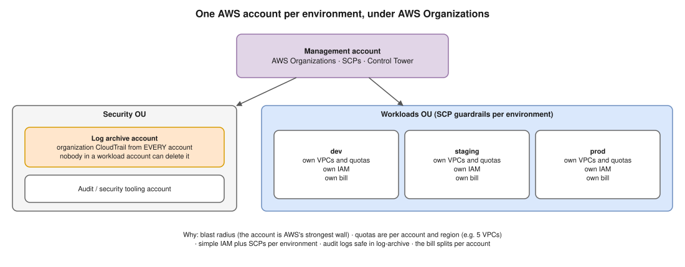
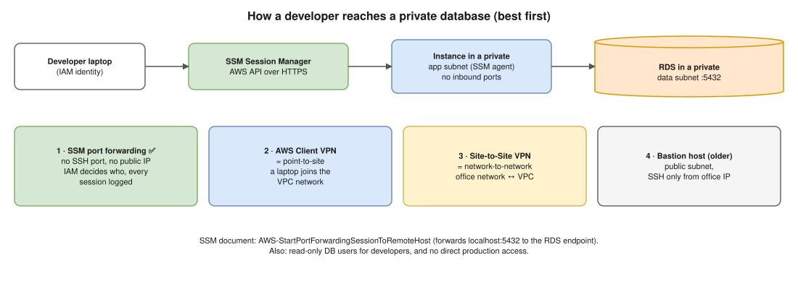
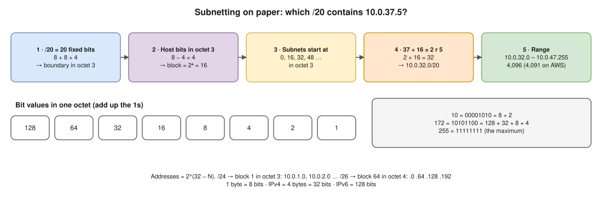
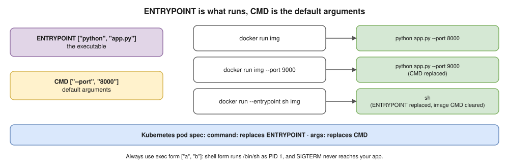

# Interview Transcript Review · 9 Oct 2026 · Where I Went Wrong and How to Improve

Based on the 63-minute recording with Hemant Kumar (One2N), and the diagrams drawn during it. The corrected diagrams are explained in [interview-review-oct-9.md](interview-review-oct-9.md). This file covers **every question**, **Hemant's feedback**, and a **plan to close the gaps**.

Short terms are written in full the first time they appear.

---

## 1. Hemant's verdict, in his own points

**The good:** "Better than what you were a few weeks back." You can now connect the terms (subnets, VPCs (Virtual Private Clouds)…) and talk like technical people talk.

**The gaps he named:**

| # | Gap | His words (summarised) | Section |
|---|---|---|---|
| 1 | **Subnetting maths** | "Calculation is totally wrong, conceptually totally wrong. Bit and byte are very different. Calculate on pen and paper, not with a website" | [3](#3-the-biggest-gap-ip-and-subnetting-maths) |
| 2 | **Where things sit, and how traffic flows** | "You should know where to position each element. The NAT gateway sits in a public subnet. Draw route tables and traffic flow. Recreate the AWS diagrams you find online" | [4](#4-placement-route-tables-and-traffic-flow) |
| 3 | **Dockerfile depth** | "You can write the syntax, but you need more depth" | [5](#5-dockerfile-depth) |
| 4 | **Kubernetes basics** | "Services, how things are exposed, how frontend and backend talk. Run a 3-tier app on Kubernetes yourself. These are taught in colleges now" | [6](#6-kubernetes-exposure-and-scaling) |
| 5 | **The expected level** | What One2N expects from someone with 1.5–2 years of experience | [9](#9-the-4-week-plan) |

**His offer:** no more formal interview for now. Ping him when you're stuck on something specific, and he'll help.

---

## 2. Question by question

Each question shows **what you said**, **the gap**, and **a better answer** to say out loud.

### Q1 · Dev and staging in one AWS account: where does it fail or not scale?

- **You said:** access policies get complicated; someone with high privileges could delete CloudTrail logs; "create multiple private networks" to scale.
- **Gap:** the log point was good, but the fix was missing, and the scaling answer was vague.
- **Better answer:**
  1. **Blast radius:** a mistake or a hacked key in dev can break staging. **The account is AWS's strongest isolation wall.**
  2. **Quotas are per account and per region:** a load test in dev can use up EC2 vCPU limits, Elastic IPs or API rate limits that staging needs (e.g. **5 VPCs per region** by default).
  3. **Permissions and guardrails:** with one account per environment, IAM (Identity and Access Management) stays simple, and AWS Organizations **SCPs (Service Control Policies)** can apply rules per environment.
  4. **Audit:** send CloudTrail from every account to a separate **log-archive account** (an organization trail), so nobody in a workload account can delete it.
  5. **Cost:** the bill splits per account automatically.
- **Say it:** "One account per environment, under AWS Organizations: separate blast radius, quotas and permissions, SCP guardrails, and CloudTrail centralised in a log-archive account. That's the standard landing zone from Control Tower."

### Q2 · Draw the VPC and the overall architecture

- **You said:** you first drew regions **inside** the VPC, then corrected it after his question: "VPC has a region, or region has a VPC?"
- **Gap:** the nesting order.
- **Correct order:** **Account → Region → VPC** (a VPC belongs to one region and **spans all its AZs (Availability Zones)**) **→ Subnet** (each subnet sits in **exactly one AZ**).
- The **internet gateway** is attached to the **VPC**, not to an AZ or a subnet. See [diagram r1](diagrams/r1-vpc-subnets-nat-igw.drawio.svg).

### Q3 · Which CIDR range do you pick? Do we always need a big VPC?

- **You said:** `/16` to get more IPs; "depends on requirement and hosts".
- **Gap:** no sizing logic and no uniqueness.
- **Better answer:**
  - Size for **growth** and for **EKS (Elastic Kubernetes Service)**, where **every pod takes a VPC IP**.
  - A VPC can be from `/16` (65,536) down to `/28` (16).
  - More ranges can be **added later** (secondary CIDRs (Classless Inter-Domain Routing ranges)).
  - It must be **unique** across all VPCs and on-premises networks: take it from an **IPAM (IP Address Manager)** plan, or peering and routing break later (scenario A2).

### Q4 · What do /16 and 10.0.1.0/24 mean? First and last IP? How many?

This is where Hemant said **"totally wrong"**.

| You said | Correct |
|---|---|
| "/16 is 128 bytes" | An IPv4 address is **32 bits = 4 bytes**. (128 bits is **IPv6**.) `/16` = the **first 16 bits** are fixed |
| Last IP of `10.0.1.0/24` is `10.0.256.256`, then `10.0.1.256` | **`10.0.1.255`**. Each part (octet) is 8 bits: **0 to 255**. 256 doesn't exist |
| "8 bits or 4 bits… I'm confused" | **1 byte = 8 bits.** An IPv4 address = 4 bytes = 4 octets = 32 bits |
| "Around 253 / 255 / 256 IPs" | **256 addresses** in total. Normally 254 usable (minus the network and broadcast addresses). **On AWS 251 usable** (`.4`–`.254`) |
| "Why reserve them? I don't know" | `.0` names the network itself; `.255` is broadcast. AWS also keeps `.1` (VPC router), `.2` (DNS (Domain Name System) resolver) and `.3` (future use) |
| "What's the next subnet?" (confused) | `/24`s go up by one in the third octet: `10.0.2.0/24`, `10.0.3.0/24`… `/20`s go up by **16**: `10.0.16.0/20`, `10.0.32.0/20`… |

👉 Practise with the worksheet in [section 3](#3-the-biggest-gap-ip-and-subnetting-maths) until each answer takes under a minute.

### Q5 · Public vs private subnets: where do workloads go?

- **You said:** public subnets for the **frontend / UI**, private for the backend and database.
- **Gap:** in modern designs the **frontend also runs in private subnets**. **Only** load balancers and NAT gateways (and maybe a bastion) sit in public subnets. Users reach the frontend **through the ALB (Application Load Balancer)**.

### Q6 · Why 6 subnets, not 4 or 8?

- **You said:** high availability, "if any **region** has an issue… serve from another **region**".
- **Gap:** you kept saying **region** when you meant **AZ**. Multi-region is a different design (disaster recovery).
- **Better answer:**
  - "3 AZs × 2 tiers (public + private) = 6."
  - "3 AZs survive one AZ failing, and an ALB, EKS and RDS (Relational Database Service) Multi-AZ need at least 2."
  - "In practice I'd use **3 tiers**: public, private app, private data. That's 9 subnets, so the database has no internet route."
  - "The count comes from AZs × tiers, and the size from how many IPs each tier needs."

### Q7 · Where do databases go?

- **You said:** private subnets, reachable only from the backend. ✅ **Correct.**
- **Add:**
  - dedicated **data subnets** with **no internet route**;
  - an RDS **DB subnet group** needs subnets in **at least 2 AZs**;
  - the DB security group allows the port (5432) **only from the backend's security group**.

### Q8 · How do you know which subnet is public? Is the internet gateway attached to subnets or the VPC?

- **You said:** "for each subnet we assign an internet gateway or a NAT gateway"; then "I'm confused, I need to check."
- **Correct:**
  - The **internet gateway is attached to the VPC**, one per VPC.
  - A subnet is **public because of its route table**: `0.0.0.0/0 → internet gateway`.
  - A private subnet's route table says `0.0.0.0/0 → NAT gateway`.
  - **The route table decides, not the subnet's name.** See [diagram r5](diagrams/r5-traffic-flows-route-tables.drawio.svg).

### Q9 · What is NAT, and where do you place the NAT gateway?

- **You said:** NAT (Network Address Translation) translates the private IP to the router's IP, and there's source NAT and destination NAT. ✅ **Good.**
- **Then:** "put the NAT in the subnet that wants to go to the internet." ❌
- **Correct:**
  - The **NAT gateway lives in a public subnet** (one per AZ), with an **Elastic IP**.
  - The **private** subnets that need outbound internet **route to it**.
  - The NAT gateway's own subnet routes `0.0.0.0/0 → internet gateway`.
  - NAT is **outbound only**.

### Q10 · How does a developer connect to a private database?

- **You said:** VPN or bastion; site-to-site vs point-to-site (you couldn't recall).
- **Better answer, best first:**
  1. **SSM (Systems Manager) Session Manager port forwarding:**
     - no open SSH port, no bastion with a public IP;
     - IAM controls who can use it, and every session is logged;
     - it uses the `AWS-StartPortForwardingSessionToRemoteHost` document through an instance in the VPC.
  2. **AWS Client VPN** = **point-to-site**: a person's laptop joins the VPC network.
  3. **Site-to-Site VPN** = **network-to-network**: the office network ↔ the VPC.
  4. A **bastion host** in a public subnet, with SSH allowed only from the office IP. This is the older way.
- **Also say:** give developers read-only DB users, and avoid direct production access.

### Q11 · Host a 3-tier app on Kubernetes (on AWS)

- **You said:** database in a "stateful deployment", frontend and backend as Deployments. ✅ The idea was right.
- **Gaps:**
  - It's called a **StatefulSet**. Say **why**:
    - stable pod names (`postgres-0`);
    - **one PersistentVolumeClaim per pod** (`volumeClaimTemplates`, on EBS (Elastic Block Store) through the EBS CSI (Container Storage Interface) driver);
    - ordered start and stop;
    - a **headless Service** for stable DNS.
  - Mention **backups and failover**: use an operator such as CloudNativePG, or RDS outside the cluster.

### Q12 · Write a Dockerfile for a React app; build and push it

- **You said:** `FROM` some React image, `COPY` package file, `WORKDIR`, `RUN` install, `EXPOSE`, `USER` (good reason given: don't run as root), `CMD`. You forgot to copy the code, then added it. Then `docker build`, `docker tag`, push to Docker Hub.
- **Gaps:**
  - There's no React base image. **A React app builds into static files**, so use a **multi-stage build**: `node` to build, **nginx** to serve.
  - Set `WORKDIR` first.
  - Copy `package*.json`, run `npm ci`, **then** copy the code (layer caching).
  - Add a `.dockerignore`.
  - Tag with the **git commit ID**.
  - On AWS, push to **ECR (Elastic Container Registry)**.
- The full corrected Dockerfile is in [the diagram review, section 6](interview-review-oct-9.md#6--the-dockerfile-on-the-same-drawing).

### Q13 · Expose the frontend through a load balancer on EKS. What's a NodePort?

- **You said:** NodePort Service → target group → ALB → Route 53. You remembered 2 of the Service types.
- **Gaps:**
  - **The 4 Service types:**
    - `ClusterIP` (internal only, the default);
    - `NodePort` (a port from **30000–32767** opened on **every** node);
    - `LoadBalancer` (a cloud load balancer, an NLB (Network Load Balancer) on EKS);
    - `ExternalName` (a DNS alias).
    - Plus the **headless** `clusterIP: None`.
  - **The standard EKS answer:**
    - install the **AWS Load Balancer Controller**;
    - create an **Ingress** (`ingressClassName: alb`);
    - **the controller creates the ALB, listeners and target groups for you**;
    - with `target-type: ip`, traffic goes **straight to pod IPs**, so Services stay `ClusterIP`.
    - Your NodePort path also works (that's `target-type: instance`), but it opens ports on every node.
  - **Route 53 points to the ALB** with an alias record, which ExternalDNS can create.

### Q14 · How does the frontend talk to the backend?

- **You said:** through Kubernetes internal DNS: `service.namespace.svc.cluster.local`. ✅ **Correct.** You weren't sure which Service type: it's **ClusterIP**.
- **The missing insight:** a React app runs **in the user's browser**. So the **browser** calls the backend through the ALB (e.g. path `/api` → backend Service). The frontend pod only serves files.

### Q15 · How do you scale the apps and the nodes?

- **You said:** "node class and node pool… use Auto Scaling groups"; HPA (Horizontal Pod Autoscaler) "inside the Deployment, set min and max replicas"; StatefulSet: "need to check".
- **Corrections:**
  - **Pods:** the **HPA is a separate object** (`HorizontalPodAutoscaler`) with `minReplicas`, `maxReplicas` and a metric target (e.g. 70% CPU). It needs **metrics-server** and **CPU requests** on the pods.
  - **Nodes:**
    - **Cluster Autoscaler** scales EKS managed node groups, which **are** Auto Scaling groups.
    - **Karpenter** (and EKS Auto Mode, built on it) uses **NodePool + NodeClass** and launches EC2 instances **directly**, **without** Auto Scaling groups. It's faster and picks the best instance type per pod.
  - **StatefulSets:**
    - an HPA can scale them, but **a database doesn't scale by just adding replicas**: replication must be set up (an operator does this);
    - often you scale **vertically**, or add **read replicas**.

### Q16 · Centralised observability for many accounts, VPCs and clusters

- **You said:**
  - SigNoz: collector, ClickHouse, SigNoz UI and query. ✅ The components were right.
  - Then: expose the central collector **on the internet**, and the frontend and backend **push directly** to it.
- **Gaps:**
  - Run an **OpenTelemetry Collector in each cluster**, as a DaemonSet plus a gateway. It batches, **adds labels** (cluster, environment, account) and retries.
  - Only these collectors send data out, through **PrivateLink** (or a TGW (Transit Gateway)). If you must use the internet: **TLS plus authentication**.
  - Separate **metrics, logs and traces**: you said "push the logs" while talking about metrics.
  - Add retention, scaling and **alerts**.
- See [diagram r4](diagrams/r4-central-monitoring-signoz.drawio.svg).

---

## 3. The biggest gap: IP and subnetting maths

### The 4 facts to know cold

1. **1 byte = 8 bits.** An IPv4 address = **4 bytes = 32 bits**, written as 4 numbers (octets), each **0 to 255**.
2. **`/N` = the first N bits are fixed** (the network part). The other **32 − N** bits are for hosts.
3. **Addresses = 2^(32 − N).** `/24` → 2⁸ = 256 · `/20` → 2¹² = 4,096 · `/16` → 2¹⁶ = 65,536.
4. **Subnets start at multiples of the "block size".** The block size is 2^(number of host bits in the octet where the boundary falls). For a `/20`, the boundary is in the third octet with 4 host bits there, so the block is **16**: `10.0.0.0`, `10.0.16.0`, `10.0.32.0`…

### Binary in 1 minute

The 8 bits of an octet are worth **128 64 32 16 8 4 2 1**. Add up the bits that are 1:

| Number | Binary | Sum |
|---|---|---|
| 10 | `00001010` | 8 + 2 |
| 172 | `10101100` | 128 + 32 + 8 + 4 |
| 192 | `11000000` | 128 + 64 |
| 255 | `11111111` | all of them = the maximum |

### Worksheet: do it on paper, then check

1. How many bits are in an IPv4 address? In IPv6?
2. Write 168 in binary.
3. `10.0.1.0/24`: first address, last address, total, usable (normally, and on AWS)?
4. `10.0.0.0/16`: first address, last address, total?
5. `10.0.16.0/20`: what range does it cover? How many addresses?
6. `192.168.10.64/26`: range, total, and the next `/26`?
7. How many `/24` subnets fit in a `/16`?
8. Split `10.0.0.0/24` into 4 equal subnets.
9. Do `10.0.16.0/20` and `10.0.20.0/24` overlap?
10. Which `/20` contains `10.0.37.5`?
11. Write the subnet masks for `/16`, `/20`, `/24` and `/26`.
12. Plan 6 subnets in `10.0.0.0/16`: 3 public `/24`s and 3 private `/20`s, with no overlaps.

<b>Answers</b> (open only after trying)

1. IPv4: **32** bits (4 bytes). IPv6: **128** bits.
2. 168 = 128 + 32 + 8 = **`10101000`**.
3. First `10.0.1.0` (network), last `10.0.1.255` (broadcast), **256** in total. Usable: **254** normally (`.1`–`.254`), **251 on AWS** (`.4`–`.254`).
4. `10.0.0.0` to `10.0.255.255`: **65,536**.
5. Block size 16 in the third octet → **`10.0.16.0` to `10.0.31.255`**: **4,096** addresses (4,091 usable on AWS).
6. Block size 64 in the fourth octet → **`192.168.10.64` to `192.168.10.127`**: **64** addresses. Next: **`192.168.10.128/26`**.
7. 2^(24 − 16) = **256** (`10.0.0.0/24` … `10.0.255.0/24`).
8. Four `/26`s: **`10.0.0.0/26`, `10.0.0.64/26`, `10.0.0.128/26`, `10.0.0.192/26`** (64 each).
9. **Yes.** `10.0.16.0/20` covers `10.0.16.0`–`10.0.31.255`, and 20 is inside 16–31.
10. 37 ÷ 16 = 2 remainder 5, and 2 × 16 = 32 → **`10.0.32.0/20`** (`10.0.32.0`–`10.0.47.255`).
11. `/16` = `255.255.0.0` · `/20` = `255.255.240.0` (`11110000` = 240) · `/24` = `255.255.255.0` · `/26` = `255.255.255.192` (`11000000` = 192).
12. Public: `10.0.0.0/24`, `10.0.1.0/24`, `10.0.2.0/24`. Private: `10.0.16.0/20`, `10.0.32.0/20`, `10.0.48.0/20`. (No overlap: the `/24`s sit in `10.0.0–2`, and the `/20`s start at 16.)

**Done when:** you get all 12 right on paper, without a calculator, in under 15 minutes.

**Videos (checked: title, channel, length):**
- [what is an IP Address? // You SUCK at Subnetting // EP 1](https://www.youtube.com/watch?v=5WfiTHiU4x8) · NetworkChuck · 18 min
- [subnetting is simple](https://www.youtube.com/watch?v=ecCuyq-Wprc) · Sunny Classroom · 13 min
- [Public vs Private IP Address](https://www.youtube.com/watch?v=po8ZFG0Xc4Q) · PowerCert · 7 min

---

## 4. Placement, route tables and traffic flow

**The rules to remember:**
1. **Internet gateway:** one per **VPC**, at its edge.
2. **NAT gateway:** inside a **public subnet**, one per AZ, with an Elastic IP.
3. **Public subnet** = its route table has `0.0.0.0/0 → internet gateway`.
4. **Private app subnet** = `0.0.0.0/0 → the NAT gateway in the same AZ`.
5. **Data subnet** = local routes only.

**Drawing exercises** (on paper, from memory):
1. Draw the VPC from [r1](diagrams/r1-vpc-subnets-nat-igw.drawio.svg): 3 AZs × 3 tiers, with the internet gateway, the NAT gateways and all 3 route tables. Target: **10 minutes**.
2. On that drawing, trace with a pen: **①** a user opening the site, and **②** a pod downloading a package (as in r5).
3. Add flow **③**: a developer reaching the database with SSM port forwarding.
4. Find "AWS VPC architecture diagram" images online, as Hemant suggested, and redraw one that has a NAT gateway. Then check: is every element in the right place?

**Reference:** the AWS documentation page "Example: VPC with servers in private subnets and NAT" shows exactly this design.

---

## 5. Dockerfile depth

Know these, and say **why** each one matters:
- **Multi-stage builds:** build tools stay in the first stage, so the final image is small and has fewer vulnerabilities.
- **Layer caching:** copy the dependency files first, install, then copy the code. Code changes then don't reinstall everything.
- **`CMD` vs `ENTRYPOINT`, exec form, PID 1** (signals reach the app).
- **Non-root `USER`:** a numeric UID (e.g. 10001), and an image that listens on a port above 1024 (e.g. 8080).
- **`.dockerignore`**, pinned base image versions, and tags = **git commit ID** (never reuse `latest`).
- **Push to ECR:** `aws ecr get-login-password | docker login …`, then `docker push`.

Your notes: [Docker 05 Dockerfile](docker/05-dockerfile.md) and [06 Build optimisation](docker/06-build-optimization.md). Practice: create a React app (`npm create vite@latest`), write the multi-stage Dockerfile, build it, and run it on port 8080.

---

## 6. Kubernetes: exposure and scaling

**The request path to know by heart (3-tier on EKS)** ([diagram r3](diagrams/r3-three-tier-on-eks.drawio.svg)):

Browser → Route 53 (alias) → ALB (created by an Ingress) → `/` → frontend Service (ClusterIP) → frontend pods. The browser also calls `/api` → backend Service (ClusterIP) → backend pods → database (StatefulSet + headless Service + PVC (PersistentVolumeClaim), or RDS).

**Hemant's direct advice: run it yourself.** Use the [practice cluster recipe](helm-chart/README.md#your-own-practice-cluster-no-kind-needed-) (k3s in Docker, with its own kubeconfig) and build:
1. a frontend Deployment + ClusterIP Service;
2. a backend Deployment + ClusterIP Service;
3. a Postgres StatefulSet + headless Service + PVC;
4. an Ingress: `/` → frontend, `/api` → backend;
5. an HPA on the backend, then watch it scale with `kubectl get hpa -w`.

**Done when:** `curl` through the Ingress returns data that came from Postgres, and you can explain each object.

Your notes: [Kubernetes 08 Services and DNS](kubernetes/08-services-and-dns.md), [09 Ingress](kubernetes/09-ingress-and-gateway-api.md), [12 Autoscaling](kubernetes/12-resources-and-autoscaling.md), [20 EKS](kubernetes/20-eks.md).

Video: [Kubernetes Services explained: ClusterIP vs NodePort vs LoadBalancer](https://www.youtube.com/watch?v=T4Z7visMM4E) · TechWorld with Nana · 24 min.

---

## 7. How you answered: communication tips

The transcript shows the knowledge was often **partly there**, but the answers lost marks in the delivery:

1. **Mixed-up terms:** "region" for AZ, "logs" for metrics, "stateful deployment" for StatefulSet, "bytes" for bits. **One wrong word sounds like one wrong concept.** Say the exact term.
2. **Filler words:** "like", "means like", "I can say", "it's like the…" appeared in almost every sentence, and they hide the answer.
   - **Fix:** answer in this shape: **one-line answer → why → example → trade-off**.
3. **"I'm confused" with no plan:** when you don't know, say it once, then show how you'd find out:
   > "I'm not sure about X. I'd check Y, and my best guess is Z, because…"

   Hemant explicitly said: *"If you don't know, say it out loud."*
4. **Answer the exact question first.** "Where do you place the NAT gateway?" needs "in a public subnet, one per AZ" as the **first** sentence.
5. **Practice:** record yourself answering 3 questions a day for 60 seconds each, then listen back for fillers and wrong terms.

---

## 8. What went well (keep doing it)

- The database belongs in private subnets, reachable only from the backend.
- NAT = translating a private IP to a shared IP, plus SNAT and DNAT.
- Why a container should run as non-root.
- Kubernetes internal DNS: `service.namespace.svc.cluster.local`.
- The SigNoz components: collector, ClickHouse, query service and UI.
- Thinking about access control and audit-log deletion when choosing accounts.

---

## 9. The 4-week plan

About **1 hour on weekdays** and **2–3 hours at weekends**. Videos first, then hands-on, then explain out loud.

| Week | Focus | Do | Done when |
|---|---|---|---|
| **1** | IP and subnetting | The 3 videos in section 3; the worksheet by hand **every day**; [Networking Level 2: IP addressing and subnetting](networking/02-ip-addressing-and-subnetting/README.md) | All 12 worksheet answers right in under 15 minutes, with no calculator |
| **2** | VPC design and traffic flow | The [Server Gyan VPC video](https://www.youtube.com/watch?v=TuBA5maXFgc) (7 min); drawing exercises 1–4 in section 4; [Networking 3.8: NAT](networking/03-core-networking-protocols/08-nat-pat-and-port-forwarding.md) | You draw r1 + r5 from memory in 10 minutes and explain flows ①②③ |
| **3** | Kubernetes 3-tier, hands-on | The Nana Services video; the 5-step lab in section 6 on the practice cluster | The `curl` through the Ingress returns data from Postgres |
| **4** | Docker depth, EKS exposure, scaling, observability | The React multi-stage Dockerfile; AWS Load Balancer Controller and Ingress; Karpenter vs Cluster Autoscaler; diagram r4 | A **mock interview** replaying Q1–Q16 above (ask me to "act as Hemant") |

**Each week:** send Hemant **one specific question** you got stuck on, as he offered. For example: "I calculated `10.0.37.5` falls in `10.0.32.0/20`. Is my block-size method right?"

**⚠️ Cost:** if you build any of this in a real AWS account, **NAT gateways and ALBs charge by the hour**. Use your own account and delete them the same day, or practise locally.
