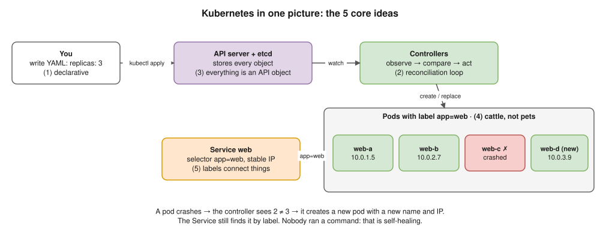

# 01 · Kubernetes Fundamentals ⭐



- Kubernetes is a **container orchestrator**: you say **what** you want ("3 copies, reachable on port 80"), it works out **how** and keeps it true.
- The 5 ideas: **declarative** YAML · a **reconciliation loop** in every controller · **everything is an API object** in etcd · pods are **cattle** (replaced, never fixed) · **labels** connect objects.


## Why not just Docker?

| Problem | Docker alone (one host) | Kubernetes |
|---|---|---|
| Container crashes at 3 AM | Restart on that host | Recreated on any healthy node |
| Whole server dies | Containers gone | Pods rescheduled elsewhere |
| More traffic | Start containers by hand | Autoscaling: pods, then nodes |
| New version | Stop / start by hand | Rolling update, rollback |
| Find other services | Names on one host | DNS names across the cluster |
| Config and secrets | `-e` per `docker run` | ConfigMaps and Secrets |

## Vocabulary

| Term | Meaning |
|---|---|
| Cluster | Control plane + worker nodes |
| Node | A machine that runs pods |
| Pod | Smallest unit: one or more containers sharing an IP |
| Deployment | Identical pods + rolling updates |
| Service | Stable name and IP in front of changing pods |
| Namespace | A folder-like group of objects |
| Controller | A loop making actual = desired |

## Imperative vs declarative

| | Imperative | Declarative ✅ |
|---|---|---|
| Commands | `kubectl create / run / scale` | `kubectl apply -f` YAML from Git |
| Run it twice | Often errors | Nothing changes |
| GitOps | No | Yes, Git is the source of truth |

## Managed vs self-managed

- **Managed** (EKS, GKE, AKS): the cloud runs the control plane ([20](20-eks.md)).
- **Self-managed** (kubeadm, k3s, Talos): you run everything, including etcd backups.
- **Not every app needs Kubernetes:** small workloads fit ECS, App Runner or one VM.

> **Docker link:** pods are started by containerd and runc, like `docker run` ([Docker 02](../docker/02-architecture-internals.md)). Kubernetes adds scheduling, self-healing, discovery and rollouts.

## Interview angle

| Question | Answer |
|---|---|
| ⭐ What problem does it solve? | Running containers reliably across many machines: scheduling, self-healing, scaling, discovery, rollouts. |
| ⭐ Desired state / reconciliation? | You declare the end state; controllers loop forever (observe → compare → act). |
| Imperative vs declarative? | Commands vs YAML applied from Git; declarative is repeatable and fits GitOps. |
| Kubernetes for everything? | No. It adds complexity; say the trade-off and name ECS, Fargate or a VM. |

## Practice 🖥️

```bash
kind create cluster
kubectl create deployment web --image=nginx:1.27 --replicas=3
kubectl get pods -l app=web
kubectl delete pod -l app=web --wait=false
kubectl get pods -l app=web -w   # new pods appear: the reconciliation loop
```
