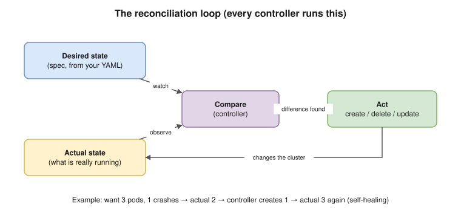

# 01 · Kubernetes Fundamentals ⭐

## What Kubernetes is

- Kubernetes (K8s) is a **container orchestrator**: it runs containers across **many machines** and keeps them running.
- You tell it **what you want** ("3 copies of my API, reachable on port 80"). It works out **how**: which machine, restarting failed copies, spreading traffic, rolling out new versions.

## Why it exists

Docker runs containers on **one host**. Running many services in production raises problems Docker alone doesn't solve:

| Problem | Docker alone | Kubernetes |
|---|---|---|
| A container crashes at 3 AM | Restart policy on that one host | Recreated automatically, on any healthy node |
| A whole server dies | Its containers are gone | Pods are rescheduled onto other nodes |
| More traffic | You start more containers by hand | Autoscaling adds pods, then nodes |
| Deploying a new version | Stop and start by hand | Rolling update with automatic rollback options |
| Finding other services | Container names on one host | Service names (DNS) across the whole cluster |
| Config and secrets | Env vars per `docker run` | ConfigMaps and Secrets, managed centrally |

## The 5 core ideas ⭐ (deep fundamentals)

### 1. Declarative desired state
You write a **manifest** (YAML) that describes the end state ("replicas: 3"), not the steps to get there. `kubectl apply` stores it, and Kubernetes makes it true and **keeps** it true.

### 2. The reconciliation loop (the heart of Kubernetes)

Every **controller** runs the same endless loop:

1. **Observe** the current state.
2. **Compare** it with the desired state.
3. **Act** to close the gap.
4. Repeat, forever.



**Example:** you want 3 pods and one crashes, leaving 2. The ReplicaSet controller notices the difference and creates a new pod. Nobody ran a command. This is called **self-healing**, and it's just this loop.

### 3. Everything is an API object
- Pods, Services and Deployments are all **objects** stored in **etcd** (a key-value database).
- Every component talks to the **API server**, never directly to each other. They **watch** the API server for changes.

### 4. Cattle, not pets
Pods are **disposable**: they get new names and IPs every time they're recreated. You never fix a pod by hand; you replace it. Stable identity comes from **Services** (a stable name and IP) and **labels**.

### 5. Labels connect everything
Objects find each other through **labels and selectors**, not hard-coded names. For example, a Service sends traffic to "every pod with `app=web`", however many there are. See [03](03-objects-and-api.md).

## Key vocabulary

| Term | Meaning |
|---|---|
| **Cluster** | The control plane plus the worker nodes |
| **Node** | A machine (VM or physical) that runs pods |
| **Control plane** | The "brain": API server, etcd, scheduler, controllers |
| **Pod** | The smallest unit you deploy: one or more containers that share an IP |
| **Deployment** | Manages identical pods and rolling updates |
| **Service** | A stable name and IP in front of a changing set of pods |
| **Namespace** | A folder-like group of objects inside a cluster |
| **Manifest** | A YAML file describing objects |
| **kubectl** | The command-line client that talks to the API server |
| **Controller** | A loop that makes the actual state match the desired state |

## Imperative vs declarative

| | Imperative | Declarative ✅ |
|---|---|---|
| Style | "Do this now" | "Make it look like this" |
| Commands | `kubectl create`, `kubectl run`, `kubectl scale` | `kubectl apply -f` on YAML kept in Git |
| Repeatable? | No: running it twice often errors | Yes: apply it again and nothing changes |
| Fits GitOps? | No | Yes: Git is the source of truth |

## Managed vs self-managed

- **Managed** (EKS, GKE, AKS): the cloud runs the control plane, and you run your workloads (and usually the nodes). See [20 EKS](20-eks.md).
- **Self-managed** (kubeadm, k3s, Talos): you run everything, including etcd backups and upgrades.
- **Alternatives:** ECS (simpler, AWS-only), Nomad, Docker Swarm. **Not every app needs Kubernetes.** A few small services can run fine on ECS, App Runner or a single VM.

> **Docker link:** a pod's containers are started by containerd and runc, exactly like `docker run` ([Docker 02](../docker/02-architecture-internals.md)). Kubernetes adds **scheduling across machines, self-healing, service discovery and rollouts** on top.

## Interview angle

- ⭐ "What problem does Kubernetes solve?" → running containers reliably across many machines: scheduling, self-healing, scaling, service discovery and rolling updates.
- ⭐ "What is desired state / reconciliation?" → you declare the end state; controllers loop forever (observe → compare → act) to make reality match it.
- "Imperative vs declarative?" → commands vs YAML applied repeatedly from Git. Declarative can be repeated safely and fits GitOps.
- "Would you use Kubernetes for everything?" → no. It adds complexity; small workloads may fit ECS, Fargate or a VM better. Say what the trade-off is.

## Practice 🖥️

```bash
kind create cluster
kubectl get nodes
kubectl create deployment web --image=nginx:1.27 --replicas=3
kubectl get pods -l app=web
kubectl delete pod -l app=web --wait=false
kubectl get pods -l app=web -w
```

Watch new pods appear straight away. That's the reconciliation loop. Press Ctrl+C to stop watching.
