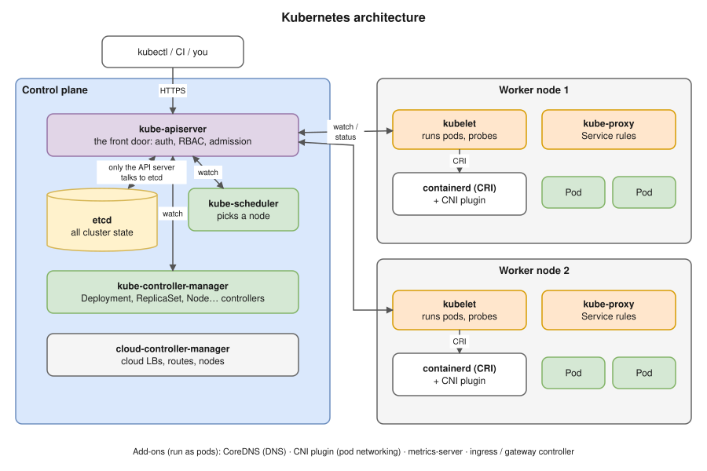
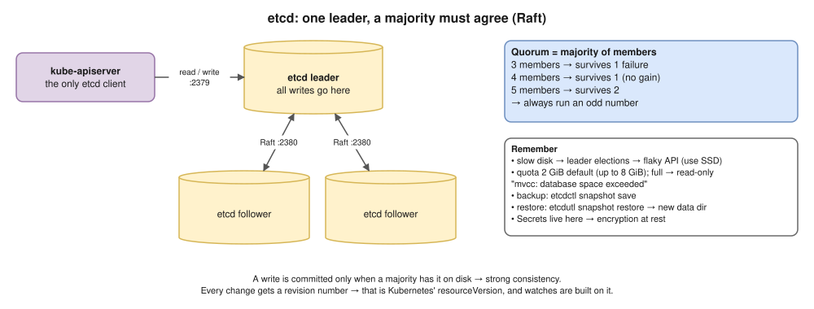
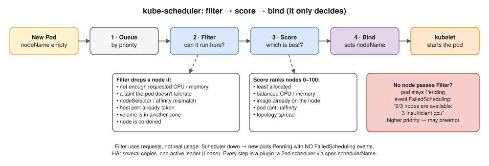
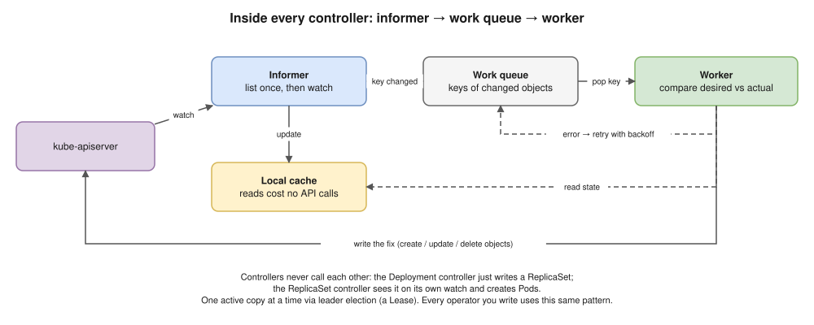
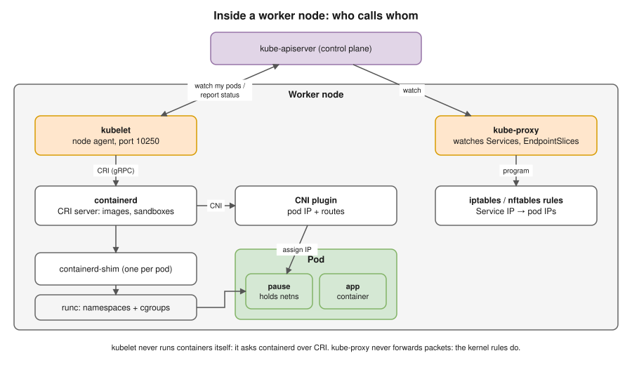
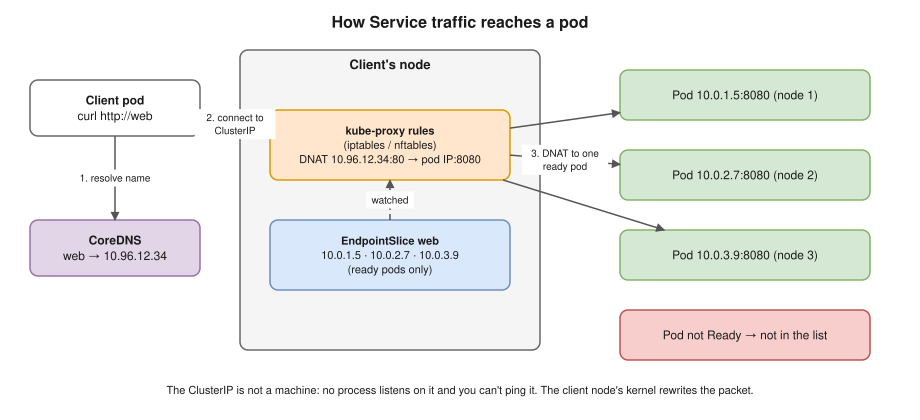
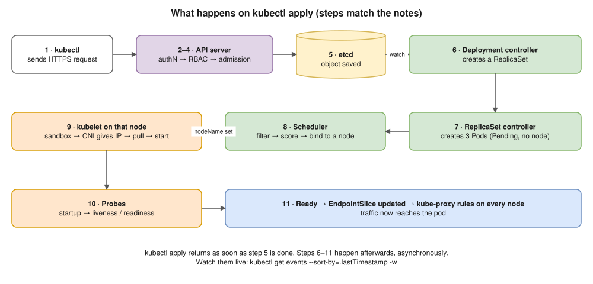
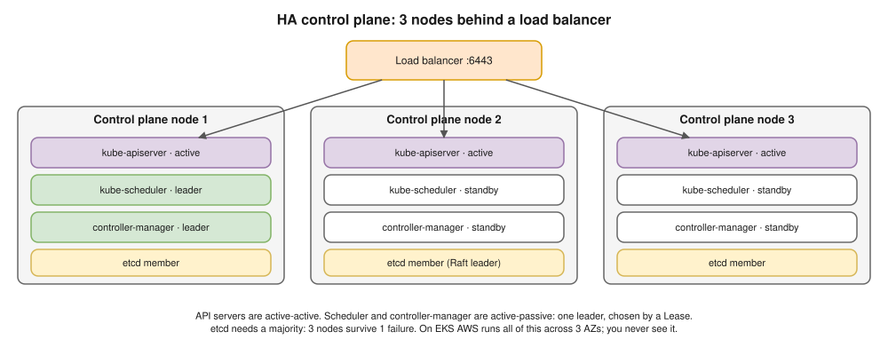

# 02 · Kubernetes Architecture ⭐



- **Control plane** decides and stores what *should* run. **Worker nodes** run it and report what *is* running.
- Every component talks **only to the API server**, and every component is a **watch → compare → act** loop ([01](01-fundamentals.md)).

## Every component in one table ⭐

| Component | Job | If it's down |
|---|---|---|
| **kube-apiserver** | Front door: auth, RBAC, admission, saves to etcd | Running pods keep running; nothing can change or self-heal; `kubectl` fails |
| **etcd** | Key-value store with **all** cluster state | Same as API server down; **data loss** if gone without a backup |
| **kube-scheduler** | Picks a node for each new pod | New pods stay `Pending` |
| **kube-controller-manager** | Runs the built-in controllers (self-healing) | Deleted pods aren't replaced; rollouts freeze |
| **cloud-controller-manager** | Cloud LBs, routes, node labels | `LoadBalancer` Services get no external IP; new nodes stay uninitialised |
| **kubelet** (every node) | Starts pods through the runtime, probes, reports status | Node `NotReady`; containers keep running, but pods are evicted after ~5 min |
| **containerd + runc** | Pulls images, runs containers | Pods stuck in `ContainerCreating` |
| **kube-proxy** (every node) | Turns Services into iptables / nftables rules | Old rules still work; changes stop reaching that node |
| **CNI plugin** | Pod IPs and pod-to-pod routes | New pods get no IP; node `NotReady` |
| **CoreDNS** | Service name → ClusterIP | Names stop resolving, so most apps break |
| **metrics-server** | Latest CPU / memory for `kubectl top` and the HPA | `top` and the HPA stop working |

## kube-apiserver


- API groups: `/api/v1` (core), `/apis/apps/v1` and so on; CRDs add more ([19](19-extending-kubernetes.md)).
- **Aggregation layer:** `metrics.k8s.io` is served by metrics-server through the API server.
- **API Priority and Fairness:** one noisy client can't starve the kubelets and the scheduler.

## etcd



- Objects are stored as keys like `/registry/pods/default/web-abc`.
- Old revisions are **compacted** every 5 minutes; **defrag** gives the disk space back.

## kube-scheduler



- It **only decides** (writes `spec.nodeName`); the kubelet starts the pod. Details in [13](13-scheduling.md).

## kube-controller-manager



| Controller | Keeps this true |
|---|---|
| Deployment | ReplicaSets for rollouts and rollbacks |
| ReplicaSet | exactly N pods match the selector |
| StatefulSet · DaemonSet · Job · CronJob | ordered pods · one pod per node · run to completion · on a schedule |
| Node lifecycle | silent node → `NotReady` + taint → its pods are evicted |
| EndpointSlice | each Service lists only **ready** pod IPs |
| Garbage collector | children are deleted with their owner (`ownerReferences`) |
| HPA | `replicas` follows CPU, memory or custom metrics ([12](12-resources-and-autoscaling.md)) |
| Namespace · ServiceAccount · PersistentVolume | namespace cleanup · `default` SA per namespace · PVC ↔ PV binding |

## cloud-controller-manager

- Labels new nodes (zone, instance type), deletes Nodes whose VM is gone, sets routes, creates the cloud LB for `type: LoadBalancer`.
- **EKS:** AWS runs it; most clusters add the **AWS Load Balancer Controller** for ALB / NLB ([20](20-eks.md)).
- **Bare metal:** no cloud, so `LoadBalancer` stays `<pending>` until you add MetalLB.

## On every node: kubelet, runtime, CNI



**kubelet** is a systemd service, **not a pod** (port 10250).

- Renews its node `Lease` every **~10 s** (heartbeat). Missed heartbeats → `NotReady`.
- Starts a pod: sandbox → CNI IP → volumes → image pull → init → app containers ([04](04-kubectl-apply-flow.md)).
- Runs probes ([06](06-probes.md)); turns limits into **cgroups** (over memory limit → **OOMKilled**).
- Low memory or disk (`memory.available<100Mi`, `nodefs.available<10%`) → evicts pods, BestEffort first.
- **Static pods:** runs manifests from `/etc/kubernetes/manifests` with no API server. That's how kubeadm runs the control plane.

**Runtime chain:** kubelet → CRI → containerd → shim (one per pod) → runc → namespaces + cgroups.

- The **pause** container holds the pod's network namespace, so a container restart keeps the pod IP.
- Debug with `crictl ps / logs / inspect`, not `docker`. dockershim was removed in **1.24**; Docker-built images still run (they're OCI).

**CNI:** every pod gets an IP and reaches every other pod **without NAT** ([14](14-cluster-networking.md)).

- On EKS the VPC CNI hands out real VPC IPs: out of subnet IPs → pods stuck in `ContainerCreating`.

## kube-proxy and CoreDNS



- kube-proxy is **not in the data path**: it writes rules, the kernel moves packets. Dead kube-proxy → old rules work, new changes don't ("works on some nodes, not others").
- Modes: `iptables` (default), `nftables` (stable in 1.33), `ipvs` (deprecated in 1.35); Cilium eBPF can replace it.
- CoreDNS sits behind the `kube-dns` Service; every pod's `/etc/resolv.conf` points at it. `ndots:5` makes short names work and external lookups slower ([08](08-services-and-dns.md)).
- metrics-server keeps only the **latest** values; no history, so use Prometheus for that ([16](16-observability.md)).

## How the parts talk



| From | To | Why |
|---|---|---|
| kubectl, controllers, scheduler, kubelet, kube-proxy | API server `:6443` | read, write, watch |
| API server | etcd `:2379` | state (nothing else talks to etcd) |
| etcd | etcd `:2380` | Raft replication |
| API server | kubelet `:10250` | logs, exec, port-forward; metrics-server scrapes here too |
| kubelet | containerd (local socket) | CRI: sandboxes, images, containers |
| containerd | CNI plugin (local binary) | pod IP |

## High availability



## Interview angle

| Question | Answer |
|---|---|
| ⭐ Explain the architecture | Control plane (API server, etcd, scheduler, controllers) + nodes (kubelet, runtime, kube-proxy, CNI) + add-ons. Everything talks only to the API server; every part is a watch-and-reconcile loop. |
| ⭐ Who talks to etcd? | Only the API server. |
| ⭐ What does the scheduler do? | Filter → score → bind. It only sets `spec.nodeName`; the kubelet starts the pod. |
| Control plane goes down? | Running workloads continue; nothing new happens. |
| Why an odd number of etcd members? | Quorum is a majority; 4 members tolerate no more failures than 3. |
| What does kube-proxy do? | Programs iptables / nftables on every node so Service IPs work. Not in the packet path. |
| Is the kubelet a pod? | No, a systemd service. On kubeadm it runs the control plane as static pods. |
| How do 2 copies of a controller not both act? | Leader election through a `Lease`. |
| What is the pause container? | The pod sandbox; holds the network namespace so the IP survives container restarts. |
| How is a dead node detected? | No `Lease` renewal (~10 s) → `NotReady` + taint → pods evicted after 5 min. |

## Practice 🖥️

```bash
kubectl get nodes -o wide
kubectl get pods -n kube-system -o wide
kubectl describe node kind-control-plane
kubectl get --raw='/readyz?verbose'     # API server health checks, incl. etcd
kubectl get leases -n kube-system       # which scheduler / controller-manager is leader
kubectl get leases -n kube-node-lease   # node heartbeats
kubectl api-resources                   # every resource type served
kubectl get apiservices                 # aggregated APIs (look for metrics.k8s.io)
```

Inside a kind node (`docker exec -it kind-control-plane bash`):

```bash
ls /etc/kubernetes/manifests   # static pods: the control plane itself
crictl ps                      # containers, as the runtime sees them
crictl pods                    # pod sandboxes
systemctl status kubelet       # the kubelet is a service, not a pod
```
