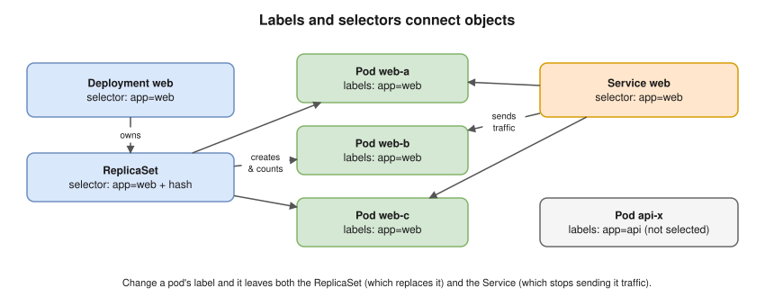
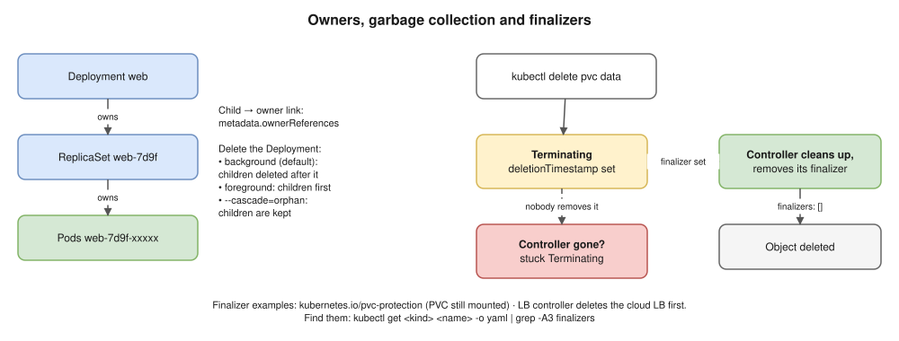

# 03 · Objects and the API ⭐

## The shape of every manifest

```yaml
apiVersion: apps/v1          # API group/version
kind: Deployment             # object type
metadata:                    # identity
  name: web
  namespace: shop
  labels:
    app: web
  annotations:
    team: payments
spec:                        # DESIRED state: you write this
  replicas: 3
  selector:
    matchLabels:
      app: web
  template:
    metadata:
      labels:
        app: web
    spec:
      containers:
      - name: nginx
        image: nginx:1.27
# status:                    # ACTUAL state: controllers write this, you never do
```

- ⭐ **`spec`** = what you want · **`status`** = what exists now. Controllers work until they match.

## API groups

| apiVersion | Kinds |
|---|---|
| `v1` (core) | Pod, Service, ConfigMap, Secret, Namespace, ServiceAccount, PV, PVC, Node |
| `apps/v1` | Deployment, ReplicaSet, StatefulSet, DaemonSet |
| `batch/v1` | Job, CronJob |
| `networking.k8s.io/v1` | Ingress, IngressClass, NetworkPolicy |
| `rbac.authorization.k8s.io/v1` | Role, ClusterRole, RoleBinding, ClusterRoleBinding |
| `storage.k8s.io/v1` | StorageClass |
| `autoscaling/v2` | HorizontalPodAutoscaler |
| `policy/v1` | PodDisruptionBudget |
| `gateway.networking.k8s.io/v1` | Gateway, HTTPRoute (CRDs, [09](09-ingress-and-gateway-api.md)) |

- alpha → beta → stable. Old betas get **removed**: check deprecated APIs before upgrades ([18](18-cluster-operations.md)).
- `kubectl api-resources` lists types; `kubectl explain deployment.spec.strategy` documents any field.

## Namespaces

- Group objects by team, app or environment; names are unique **per namespace**.
- Built in: `default` · `kube-system` (components) · `kube-public` · `kube-node-lease` (heartbeats).
- **Cluster-scoped:** Nodes, PVs, Namespaces, ClusterRoles, StorageClasses, CRDs.
- ⚠️ Not a security boundary alone: add NetworkPolicy ([14](14-cluster-networking.md)) and RBAC ([15](15-security.md)).

## Labels and selectors ⭐



- Selectors: equality (`app=web`, `env!=dev`) or set-based (`env in (prod,staging)`).
- Used by Deployments / ReplicaSets, Services, NetworkPolicies and `kubectl get -l`.
- ⚠️ A Deployment's `selector` **can't change** after creation and must match the template labels.
- **Labels** = you'd filter by it · **annotations** = data for tools and people (`prometheus.io/scrape`, build commit).

## Owners, garbage collection, finalizers



## apply vs create

- `create` fails if the object exists; `apply` creates **or** updates.
- **Server-side apply** (`--server-side`): the API server tracks which tool owns each field ([Helm 03](../helm-chart/03-server-side-apply.md)).

## Interview angle

| Question | Answer |
|---|---|
| ⭐ spec vs status? | Desired vs actual; controllers move `status` towards `spec`. |
| ⭐ How does a Service find its pods? | Label selector → EndpointSlice of ready pod IPs ([08](08-services-and-dns.md)). |
| Labels vs annotations? | Selecting and grouping vs non-identifying data for tools. |
| ⭐ Namespace stuck in Terminating? | Finalizers whose controller is gone. `kubectl get ns <ns> -o yaml`. |
| Delete a Deployment? | GC deletes its ReplicaSets and Pods, unless `--cascade=orphan`. |

## Practice 🖥️

```bash
kubectl api-resources --namespaced=false
kubectl explain deployment.spec.strategy.rollingUpdate
kubectl get pods --show-labels
kubectl label pod <pod> tier=frontend
kubectl get pods -l 'app=web,tier in (frontend)'
kubectl annotate deployment web owner=team-a
kubectl get rs -o yaml | grep -A5 ownerReferences
```
