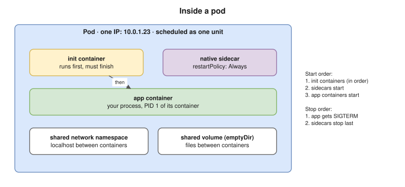
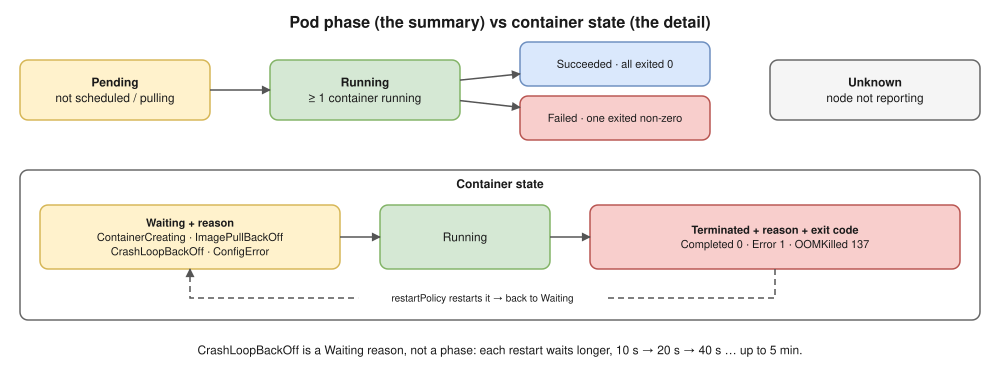
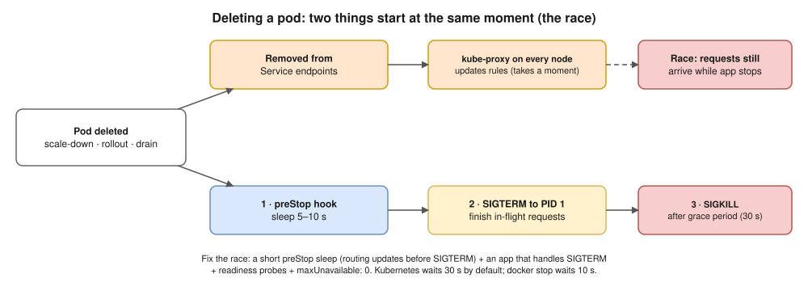

# 05 · Pods ⭐

## What a pod is

- The **smallest thing you deploy**: one or more containers that are **always scheduled together on one node**.
- Containers in a pod **share**:
  - the **network namespace**: one IP address, and they reach each other on `localhost`;
  - IPC;
  - **volumes** (shared folders).
- A hidden **pause** container holds the network namespace, so app containers can restart without the pod losing its IP.
- You rarely create pods directly: a bare pod isn't recreated if it dies. Use a controller instead (Deployment and others, see [07](07-workloads.md)).



## Pod phases vs container states ⭐



**Pod phase** (`kubectl get pod` → STATUS, roughly):

| Phase | Meaning |
|---|---|
| `Pending` | Accepted, but not running yet: not scheduled, or images still pulling |
| `Running` | Bound to a node, and at least one container is running |
| `Succeeded` | All containers exited 0 and won't restart (Jobs) |
| `Failed` | All containers stopped, and at least one failed |
| `Unknown` | The node isn't reporting (usually a node problem) |

**Container states** give the detail behind that:
- `Waiting`, with a **reason**: `ContainerCreating`, `ImagePullBackOff`, `CrashLoopBackOff`, `CreateContainerConfigError`;
- `Running`;
- `Terminated`, with a reason (`Completed`, `Error`, `OOMKilled`) and an **exit code**.

⚠️ `CrashLoopBackOff` is **not a phase**. It's a waiting reason: the container keeps crashing, and the kubelet waits longer between restarts (10s, 20s, 40s… up to **5 minutes**).

## restartPolicy (pod level)

| Value | Used by |
|---|---|
| `Always` (default) | Deployments, StatefulSets, DaemonSets |
| `OnFailure` | Jobs that should retry failures |
| `Never` | Jobs where a failed container shouldn't restart |

## Multi-container patterns

| Pattern | Example |
|---|---|
| **Sidecar:** helps the main container all the time | Log shipper, service-mesh proxy (Envoy), config reloader |
| **Ambassador:** a proxy for outgoing connections | A local proxy to a database cluster |
| **Adapter:** converts output | Turns app metrics into Prometheus format |

## Init containers and native sidecars

- **Init containers** run **one after another, each to completion**, before the app starts. Uses: wait for a dependency, run DB migrations, fetch config. If one fails, the pod retries it (following `restartPolicy`).
- **Native sidecars** (stable since **Kubernetes 1.33**) are an init container with `restartPolicy: Always`. They:
  - **start before** the app containers;
  - **keep running** for the pod's whole life;
  - **stop after** the app.

  This fixes the old problem of a sidecar keeping a Job pod alive forever.
- **Ephemeral containers** are added to a **running** pod for debugging, with `kubectl debug` (useful for distroless images that have no shell). See [17](17-troubleshooting.md).

```yaml
apiVersion: v1
kind: Pod
metadata:
  name: web
  labels:
    app: web
spec:
  terminationGracePeriodSeconds: 30
  volumes:
  - name: logs
    emptyDir: {}
  initContainers:
  - name: wait-for-db            # runs first, must finish
    image: busybox:1.36
    command: ["sh", "-c", "until nslookup db; do echo waiting for db; sleep 2; done"]
  - name: log-shipper            # native sidecar: keeps running
    image: busybox:1.36
    restartPolicy: Always
    command: ["sh", "-c", "touch /logs/app.log; tail -F /logs/app.log"]
    volumeMounts:
    - name: logs
      mountPath: /logs
  containers:
  - name: app
    image: busybox:1.36
    command: ["sh", "-c", "while true; do date >> /logs/app.log; sleep 5; done"]
    volumeMounts:
    - name: logs
      mountPath: /logs
    lifecycle:
      preStop:
        exec:
          command: ["sh", "-c", "sleep 5"]
```

## Graceful shutdown ⭐ (the sequence and the race)



When a pod is deleted (scale-down, rollout, node drain):

1. The pod is marked **Terminating**. **At the same time**, it's removed from Service **endpoints**.
2. The **`preStop` hook** runs, if there is one.
3. **SIGTERM** is sent to each container's PID 1.
4. Kubernetes waits up to `terminationGracePeriodSeconds` (**30 s** by default), then sends **SIGKILL**.

⚠️ **The race:** endpoint removal and SIGTERM happen at the **same time**. kube-proxy on other nodes may still send requests for a moment after the app has started shutting down, which gives users errors during deploys.

**Fix:** a short `preStop` sleep (5–10 s) so routing updates before the app stops, plus an app that handles SIGTERM and finishes the requests it already has.

## Other pod features

- **Lifecycle hooks:** `postStart` (runs right after the container starts) and `preStop`.
- **Downward API:** give the container its own pod name, namespace, IP or resource limits, as env vars or files.
- **QoS class:** Guaranteed, Burstable or BestEffort, set by requests and limits. See [12](12-resources-and-autoscaling.md).
- **Static pods:** started by the kubelet straight from files on the node (`/etc/kubernetes/manifests`). That's how kubeadm runs the control plane.

> **Docker link:** PID 1, SIGTERM handling and exit codes (137 = OOMKilled) work exactly as in [Docker 04](../docker/04-containers.md). The difference is the grace period: 30 s in Kubernetes vs 10 s for `docker stop`.

## Interview angle

- ⭐ "Why does Kubernetes use pods and not just containers?" → some containers must share a network and storage and be scheduled together (app + sidecar). The pod is that unit.
- ⭐ "What do containers in one pod share?" → network namespace (IP and `localhost`), IPC and volumes; each keeps its own filesystem and process tree.
- ⭐ "Init container vs sidecar?" → an init container finishes before the app starts; a sidecar runs alongside it for the whole pod life.
- ⭐ "Users see errors during every deploy. Why?" → the endpoint/SIGTERM race. Add a `preStop` sleep and graceful SIGTERM handling, use readiness probes, and set `maxUnavailable: 0` ([07](07-workloads.md)).
- "What is CrashLoopBackOff?" → the container keeps exiting, and the kubelet restarts it with growing delays. Run `kubectl logs --previous` and read the exit code.

## Practice 🖥️

```bash
kubectl apply -f practice/pod.yaml
kubectl get pod web -w
kubectl logs web -c log-shipper -f
kubectl exec -it web -c app -- sh
kubectl get pod web -o jsonpath='{.status.containerStatuses[*].state}'
kubectl delete pod web
```

While the last command runs, watch the pod terminate. It takes about 5 s because of the `preStop` sleep.
