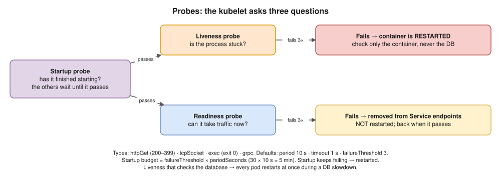

# 06 · Probes: Liveness, Readiness, Startup ⭐



The **kubelet** runs probes against each container to decide **restart?** and **send traffic?**

| Probe | Question it answers | When it fails |
|---|---|---|
| **Liveness** | "Is the process stuck or broken?" | The kubelet **restarts the container** |
| **Readiness** | "Can it serve traffic **right now**?" | The pod is **removed from Service endpoints**. It is **not** restarted. |
| **Startup** | "Has it finished starting?" | Liveness and readiness checks are **paused until it passes**; if it keeps failing, the container is restarted |

## Probe types

- `httpGet`: success is HTTP 200–399.
- `tcpSocket`: success is a successful TCP connection.
- `exec`: runs a command; success is exit code 0.
- `grpc`: the gRPC health-checking protocol.

## Timing fields (defaults)

| Field | Default | Meaning |
|---|---|---|
| `initialDelaySeconds` | 0 | Wait before the first probe |
| `periodSeconds` | 10 | How often to probe |
| `timeoutSeconds` | 1 | How long each probe may take |
| `failureThreshold` | 3 | Failures in a row before acting |
| `successThreshold` | 1 | Successes needed to count as healthy again |

**The maximum time a startup probe allows** = `failureThreshold × periodSeconds`. For example, 30 × 10 s = 5 minutes for a slow Java app.

```yaml
containers:
- name: api
  image: myapi:1.0
  ports:
  - containerPort: 8080
  startupProbe:                # gives slow starts up to 30 × 10 s = 300 s
    httpGet:
      path: /healthz
      port: 8080
    failureThreshold: 30
    periodSeconds: 10
  livenessProbe:               # only "is the process alive?"
    httpGet:
      path: /healthz
      port: 8080
    periodSeconds: 10
    failureThreshold: 3
  readinessProbe:              # "can I take traffic now?"
    httpGet:
      path: /readyz
      port: 8080
    periodSeconds: 5
    failureThreshold: 2
```

## Best practices ⭐

- **Liveness must check only the container itself, never its dependencies.** If liveness checks the database and the database is slow, **every pod restarts at once**. That turns a slowdown into a full outage.
- **Readiness** can include "my critical dependency is reachable", but be careful: if every pod goes unready together, the Service has **no endpoints** and returns 503.
- For slow starts, use a **startup probe**, not a huge `initialDelaySeconds`.
- Use separate endpoints (`/healthz` for liveness, `/readyz` for readiness), and keep them cheap and fast.
- **No readiness probe** means a pod gets traffic as soon as its container starts, before the app is ready.

> **Docker link:** Kubernetes **ignores** the Dockerfile `HEALTHCHECK` and uses these probes instead ([Docker 11](../docker/11-production.md)).

## Interview angle

- ⭐ "Liveness vs readiness?" → restart vs stop sending traffic.
- ⭐ "What goes wrong if liveness checks the database?" → cascading restarts of every pod during a database slowdown.
- "A Java app takes 3 minutes to start and keeps getting killed. Fix?" → add a startup probe with `failureThreshold × periodSeconds` > 3 minutes.
- "A pod is Running but shows `0/1` READY." → its readiness probe is failing. `describe` shows the probe failures; check the path, port and dependency.

## Practice 🖥️ (break it on purpose)

1. In [practice/deploy.yaml](practice/deploy.yaml), change the readiness `path` to `/wrong`, then `kubectl apply -f practice/deploy.yaml`.
2. `kubectl get pods`: the pod shows `0/1`.
3. `kubectl describe pod <pod>`: look for `Readiness probe failed: HTTP probe failed with statuscode: 404`.
4. `kubectl get endpointslices -l kubernetes.io/service-name=web`: the pod's IP is gone.
5. Change the path back to `/` and apply again.
